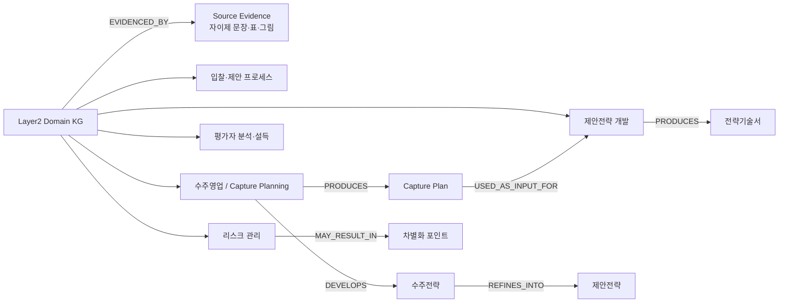
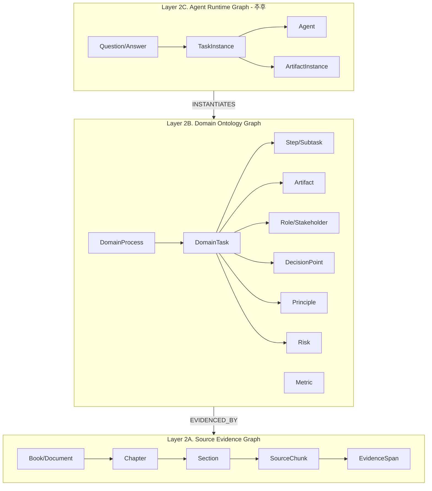
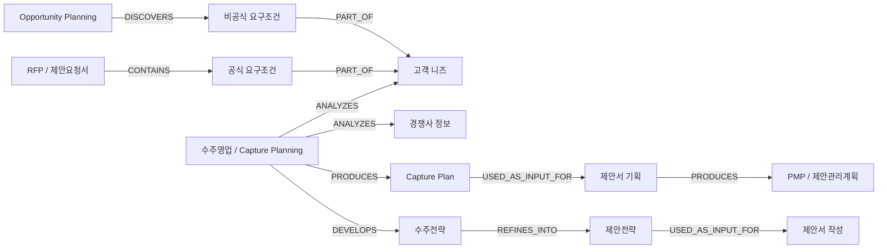
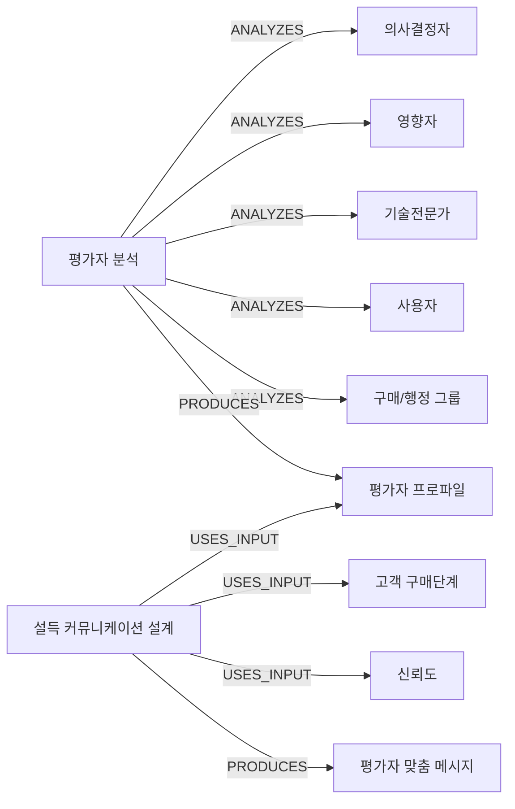
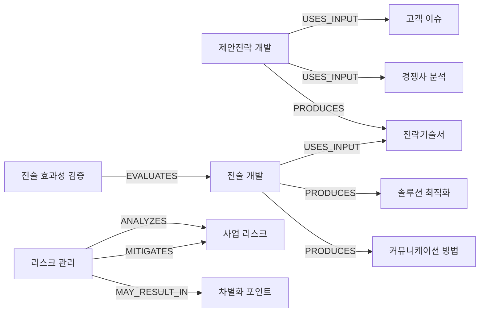
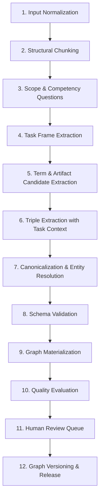
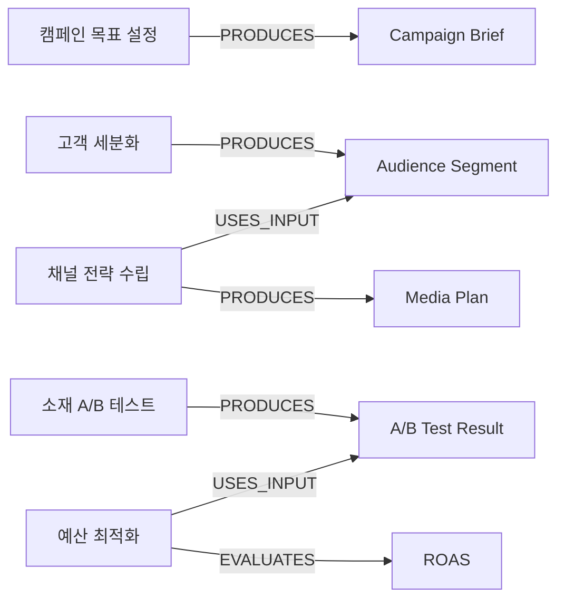

# AX 자이제 Layer 2 KG 구축 방법론

작성일: 2026-07-06  
작성 범위: **Layer 1 제외, Layer 2 자이제 KG 구축 및 이후 다도메인 확장**  
입력 자료: `자이제_1.xlsx` / `clean_sentences` 시트, 참고 방법론 `붙여넣은 마크다운(1).md`

---

## 0. 결론 요약

본 프로젝트의 Layer 2는 단순한 키워드 그래프가 아니라, **업무 수행을 설명하는 Task 중심 온톨로지**로 구축하는 것이 적절하다. `자이제_1.xlsx`의 1/3 샘플은 “입찰과 제안 → 수주영업 → 제안서 전략”으로 전개되며, 이 흐름은 다음과 같은 그래프 구조로 표현할 수 있다.



핵심 제안은 다음과 같다.

1. **Task Frame을 먼저 만들고, Triple을 나중에 채운다.**  
   자이제는 “무엇을 해야 하는가”보다 “어떤 순서와 조건으로 업무를 수행해야 하는가”가 중요하므로, 엔티티 추출부터 시작하면 그래프가 단편적 개념망이 되기 쉽다.

2. **Layer 2 내부를 3개 하위 영역으로 나눈다.**  
   `Source Evidence Graph`는 문장·페이지·섹션 근거를 저장하고, `Domain Ontology Graph`는 Task·Role·Artifact·DecisionPoint·Principle을 저장하며, `Agent Runtime Graph`는 추후 실제 에이전트 실행 로그와 산출물을 연결한다.

3. **모든 노드와 엣지는 근거를 가져야 한다.**  
   `EVIDENCED_BY` 관계, `page`, `section_no`, `evidence_span`, `source_hash`, `extraction_run_id`를 저장한다. 에이전트가 답변할 때 그래프 경로뿐 아니라 근거 문장까지 추적할 수 있게 하기 위함이다.

4. **관계명은 통제하고, 신규 관계는 후보로만 둔다.**  
   LLM이 관계명을 자유롭게 생성하면 그래프가 금방 깨진다. `USES_INPUT`, `PRODUCES`, `PRECEDES`, `HAS_DECISION_POINT`, `ANALYZES`, `DEVELOPS`, `REFINES_INTO`, `HAS_PRINCIPLE`, `MITIGATES`, `MAY_RESULT_IN` 등으로 제한한다.

5. **자이제 전용 온톨로지가 아니라, 책 기반 자동 온톨로지 생성 메타방법론으로 설계한다.**  
   Performance Marketing 책이 들어오면 동일한 상위 클래스 `DomainTask`, `Artifact`, `Metric`, `Channel`, `Audience`, `Experiment`, `Strategy` 등으로 새 도메인 온톨로지를 자동 구성할 수 있어야 한다.

---

## 1. 범위와 비범위

### 1.1 본 문서의 범위

이 문서는 다음만 다룬다.

- `자이제_1.xlsx` 샘플을 기반으로 한 **Layer 2 수주·제안 도메인 KG 구축**
- Layer 2의 온톨로지 스키마, 노드 타입, 관계 타입, 속성 설계
- Task Frame LLM + Triple LLM 기반 추출 파이프라인
- 근거 기반 검증, 정규화, 리뷰 큐 설계
- AX가 확인하고자 하는 “온톨로지의 형태와 효과”를 보여줄 수 있는 MVP 산출물
- Performance Marketing 등 다른 책으로 확장하기 위한 일반화 방법론

### 1.2 본 문서에서 제외하는 것

다음은 제외한다.

- NCS/PCF 등 **Layer 1 표준 직무·능력단위 매핑**
- Layer 1 노드/엣지 생성
- Layer 2 → Layer 1 매핑 점수화
- 실제 운영 에이전트의 UI/백엔드 구현 세부사항

단, Layer 2가 나중에 Layer 1 또는 다른 표준 체계와 연결될 수 있도록, 노드 ID·근거·정규화 규칙은 확장 가능한 형태로 설계한다.

---

## 2. 참고한 방법론과 표준

업로드된 방법론은 “Layer 2는 Task Frame LLM을 먼저 만들고, Triple LLM을 통해 삼중항을 Task에 귀속한다”는 방향을 제안한다. 본 문서는 그 방향을 유지하되, 다음을 보강한다.

- **근거 그래프 분리:** 원문 문장·표·그림·섹션을 별도 Source Evidence Graph로 관리
- **온톨로지 스키마 명시:** 노드/관계/속성/제약조건을 먼저 정의
- **SHACL/JSON Schema 검증:** LLM 출력이 스키마를 어기면 그래프에 넣지 않음
- **PROV-O식 provenance:** 어떤 모델·프롬프트·소스에서 추출되었는지 추적
- **SKOS식 alias 관리:** Capture Planning, 수주영업 등 동의어와 약어를 canonical term에 연결
- **Competency Question 평가:** KG가 실제 에이전트 질문에 답할 수 있는지 기준 질문으로 검증
- **책 독립적 확장:** 자이제만이 아니라 Performance Marketing 등 새 도메인 책에도 동일 파이프라인 적용

선행연구·표준 반영 요약은 다음과 같다.

| 구분 | 반영 방식 |
|---|---|
| RDF | 그래프의 기본 표현을 subject–predicate–object 삼중항으로 관리한다. |
| OWL 2 | 클래스, 속성, 인스턴스를 구분해 온톨로지 스키마를 정의한다. |
| SHACL | 필수 속성, 허용 관계, domain/range 제약을 검증한다. |
| PROV-O | 추출 근거, 추출 활동, 모델/프롬프트 버전을 provenance로 남긴다. |
| SKOS | preferred label, alt label, broader/narrower, related 개념을 alias/용어집 관리에 적용한다. |
| SPARQL/Cypher | RDF export 또는 property graph 저장소에서 질의 가능하게 설계한다. |
| Ontology Development 101 | 도메인·범위 결정, 용어 열거, 클래스/속성/제약/인스턴스 정의 절차를 반영한다. |
| METHONTOLOGY/NeOn | 반복적 구축, 비온톨로지 자원 재공학, 재사용 가능한 온톨로지 네트워크 관점을 반영한다. |
| GraphRAG/LLM-KG | LLM으로 원문에서 구조화 지식을 추출하되, 그래프와 근거를 함께 사용해 에이전트 검색·추론을 강화한다. |

---

## 3. 입력 데이터 프로파일

### 3.1 파일 구조

`자이제_1.xlsx`는 `clean_sentences` 시트 하나로 구성되어 있으며, 범위는 `A1:F1367`이다. 헤더는 다음 6개다.

| 컬럼 | 의미 | Layer 2 활용 |
|---|---|---|
| `page` | 책 페이지 | SourceChunk와 EvidenceSpan의 locator |
| `chapter_no` | 장 번호 | Document structure graph의 Chapter |
| `chapter_title` | 장 제목 | DomainProcess 후보 |
| `section_no` | 절/소절 번호 | Section 및 Task evidence |
| `section_title` | 절/소절 제목 | Task 후보, Concept 후보 |
| `text_for_llm_human` | 정제 문장/표/그림 설명 | LLM 입력 텍스트, EvidenceSpan |

본문 기준으로 장별 분포는 다음과 같다.

| 장 | 제목 | 페이지 범위 | 본문 행 수 | 섹션 수 |
|---:|---|---:|---:|---:|
| 1 | 입찰과 제안 | 19-56 | 310 | 18 |
| 2 | 수주영업 | 57-118 | 486 | 18 |
| 3 | 제안서 전략 | 119-178 | 567 | 15 |

위 표의 행 수는 `chapter_no`와 `section_no`가 있는 1,363행 기준이다. 나머지 3행은 그림/설명성 텍스트로 보이며, 구축 시 직전 유효 섹션에 귀속하거나 `FloatingChunk`로 별도 보존한다.

주의할 점은 일부 행의 `chapter_no`, `section_no`가 비어 있다는 것이다. 이런 행은 이전 섹션에 흡수할지, 독립 `FloatingChunk`로 둘지 결정해야 한다. 기본값은 **직전 유효 섹션에 귀속하되, `imputed_section=true`를 표시**하는 방식이다.

### 3.2 샘플의 도메인 구조

샘플은 다음 세 덩어리로 읽을 수 있다.

| 장 | Layer 2 해석 |
|---|---|
| 1장 입찰과 제안 | 입찰·제안 프로세스의 필요성, 오해와 진실, 단계적 제안 프로세스 |
| 2장 수주영업 | Capture Planning, 정보 수집, 가치제안, 평가자 분석, 설득 커뮤니케이션 |
| 3장 제안서 전략 | 제안전략 개발, 고객/경쟁사 분석, 전략기술서, 전술 검증, 실전 전략, 리스크 관리 |

따라서 MVP의 중심축은 다음과 같이 잡는다.

```text
입찰·제안 환경 이해
  → 기회분석 / 사전영업
  → 수주영업 / Capture Planning
  → Bid/No-Bid Decision
  → 제안서 기획 / Proposal Planning
  → 제안전략 개발
  → 제안서 작성·리뷰·프레젠테이션
```

---

## 4. Layer 2 목표 온톨로지의 형태

### 4.1 Layer 2 내부 3분할

Layer 2 전체를 하나의 평면 그래프로 만들지 않고, 다음처럼 나눈다.



각 영역의 역할은 다음과 같다.

| 영역 | 목적 | 구축 시점 |
|---|---|---|
| Source Evidence Graph | 원문 구조와 근거 추적 | MVP에서 필수 |
| Domain Ontology Graph | 수주·제안 업무 지식 표현 | MVP에서 필수 |
| Agent Runtime Graph | 실제 에이전트 실행, 체크리스트, 산출물 로그 | MVP 이후 확장 |

### 4.2 TBox, ABox, Runtime 분리

| 구분 | 설명 | 예시 |
|---|---|---|
| TBox | 온톨로지 스키마 | `DomainTask`, `Artifact`, `PRODUCES` |
| ABox | 책에서 추출된 도메인 지식 | `수주영업 -PRODUCES-> Capture Plan` |
| Runtime | 특정 프로젝트에서 실행된 업무 인스턴스 | `2026_AX_공공SI_제안 -HAS_TASK_INSTANCE-> 수주전략수립_실행01` |

MVP는 TBox와 ABox까지만 구축한다. Runtime은 AX가 실제 수주 에이전트를 운영할 때 연결한다.

---

## 5. Layer 2 노드 타입

### 5.1 핵심 노드 타입

| 노드 타입 | 설명 | 필수 속성 |
|---|---|---|
| `Book` | 원천 책/자료 | `book_id`, `title`, `source_file` |
| `Chapter` | 장 | `chapter_no`, `title` |
| `Section` | 절/소절 | `section_no`, `title`, `page_start`, `page_end` |
| `SourceChunk` | LLM 입력 단위 | `chunk_id`, `text`, `hash`, `chunk_type` |
| `EvidenceSpan` | 추출 근거 문장/구간 | `span_id`, `chunk_id`, `text_span`, `page`, `section_no` |
| `DomainProcess` | 상위 업무 흐름 | `process_id`, `name_ko`, `definition` |
| `DomainTask` | 반복 수행 가능한 업무 단위 | `task_id`, `name_ko`, `aliases`, `definition` |
| `Step` | Task 내부 단계 | `step_id`, `order`, `name_ko` |
| `DecisionPoint` | 의사결정 지점 | `decision_id`, `name_ko`, `criteria` |
| `Artifact` | 산출물, 도구, 문서 | `artifact_id`, `name_ko`, `artifact_type` |
| `InformationObject` | 입력 정보·분석 대상 | `info_id`, `name_ko`, `info_type` |
| `Role` | 수행자·책임자 | `role_id`, `name_ko`, `role_type` |
| `Stakeholder` | 고객, 평가자, 구매자 등 외부 이해관계자 | `stakeholder_id`, `name_ko`, `perspective` |
| `Principle` | 원칙, 지침, 규칙 | `principle_id`, `statement`, `scope` |
| `StrategyPattern` | 전략 유형 | `strategy_id`, `name_ko`, `usage_condition` |
| `Risk` | 위험 요인 또는 리스크 갭 | `risk_id`, `name_ko`, `risk_type` |
| `Metric` | 성공률, 비용 대비 수주액 등 수치 지표 | `metric_id`, `name_ko`, `unit` |
| `ReviewType` | 전략 리뷰, 초안 리뷰 등 리뷰 유형 | `review_id`, `name_ko`, `review_stage` |
| `DecisionOutcome` | Bid/No-Bid 등 결정 결과 | `outcome_id`, `name_ko`, `outcome_type` |
| `Condition` | 리스크·전략 적용 조건 | `condition_id`, `statement`, `scope` |
| `AliasTerm` | 동의어·약어 | `term`, `language`, `canonical_id` |

### 5.2 노드 공통 속성

모든 Domain Ontology 노드는 다음 공통 속성을 갖는다.

```json
{
  "id": "L2_TASK_CAPTURE_PLANNING",
  "labels": ["DomainTask"],
  "name_ko": "수주영업",
  "name_en": "Capture Planning",
  "aliases": ["Capture Planning", "영업 정보 관리", "수주계획"],
  "definition": "고객·경쟁사·자사 솔루션 정보를 수집·분석하여 수주전략을 결정하는 업무",
  "source_book_id": "ZAIJE_1",
  "evidence_refs": ["EV_ZAIJE_1_3_1_0004", "EV_ZAIJE_2_1_3_0002"],
  "confidence": 0.91,
  "review_status": "needs_review",
  "schema_version": "L2_SCHEMA_0.1"
}
```

### 5.3 자이제에서 우선 인식할 Artifact 후보

| Artifact | 유형 | 근거 섹션 |
|---|---|---|
| RFP / 제안요청서 | external_document | 1.1.1, 1.3.1 |
| Capture Plan | planning_artifact | 1.3.1, 1.3.2 |
| 수주전략 | strategy_artifact | 1.3.1, 1.3.2, 3.1 |
| Proposal Plan / 제안서 기획 | planning_artifact | 1.3.1, 1.3.3 |
| PMP / Proposal Management Plan | management_artifact | 1.3.3 |
| Storyboard / PDW | planning_artifact | 1.3.3 |
| 경쟁사 비교표 / BCM | analysis_artifact | 1.3.2, 3.1.4 |
| 전략기술서 | strategy_artifact | 3.2.2 |
| Executive Summary | proposal_component | 1.3.2 |
| 리뷰 산출물 | review_artifact | 1.3.4, 3.2.3 |

---

## 6. Layer 2 관계 타입

### 6.1 관계 타입 표준안

| Predicate | Domain → Range | 의미 |
|---|---|---|
| `HAS_CHAPTER` | Book → Chapter | 책이 장을 포함 |
| `HAS_SECTION` | Chapter → Section | 장이 섹션을 포함 |
| `HAS_CHUNK` | Section → SourceChunk | 섹션이 chunk를 포함 |
| `HAS_PROCESS` | DomainOntology → DomainProcess | 도메인 온톨로지의 상위 프로세스 |
| `HAS_TASK` | DomainProcess → DomainTask | 프로세스의 업무 포함 |
| `HAS_SUBTASK` | DomainTask → DomainTask/Step | 하위 업무 |
| `CONTAINS` | Artifact/InformationObject → InformationObject | 문서·정보 객체가 하위 정보를 포함 |
| `PART_OF` | InformationObject/Artifact → InformationObject/Artifact | 구성요소 관계 |
| `DISCOVERS` | DomainTask → InformationObject | 업무를 통해 숨은 정보나 니즈를 발견 |
| `PRECEDES` | DomainTask/Step → DomainTask/Step | 선후행 |
| `USES_INPUT` | DomainTask → Artifact/InformationObject | 업무 입력 |
| `USED_AS_INPUT_FOR` | Artifact/InformationObject → DomainTask | 산출물이 후속 업무에 사용됨 |
| `PRODUCES` | DomainTask → Artifact/InformationObject | 업무 산출물 |
| `PERFORMED_BY` | DomainTask → Role | 수행 역할 |
| `TARGETS_STAKEHOLDER` | DomainTask/StrategyPattern → Stakeholder | 공략 대상 |
| `ANALYZES` | DomainTask → InformationObject/Stakeholder/Risk | 분석 대상 |
| `DEVELOPS` | DomainTask → StrategyPattern/Artifact | 개발 대상 |
| `REFINES_INTO` | Artifact/StrategyPattern → Artifact/StrategyPattern | 더 구체화됨 |
| `DECIDES` | DecisionPoint/Role → DecisionOutcome | 의사결정 |
| `HAS_DECISION_POINT` | DomainTask/Process → DecisionPoint | 업무의 의사결정 지점 |
| `EVALUATES` | DomainTask/Role → Artifact/StrategyPattern | 평가 |
| `HAS_REVIEW` | DomainTask/Artifact → ReviewType | 리뷰 단계 |
| `HAS_PRINCIPLE` | DomainTask/StrategyPattern → Principle | 적용 원칙 |
| `MITIGATES` | DomainTask/StrategyPattern → Risk | 리스크 완화 |
| `INCREASES_RISK` | Condition → Risk | 조건이 위험 증가 |
| `MAY_RESULT_IN` | DomainTask/StrategyPattern → Outcome | 결과 가능성 |
| `ALIAS_OF` | AliasTerm → Any Canonical Node | 동의어 연결 |
| `EVIDENCED_BY` | Any Domain Node/Edge → EvidenceSpan | 근거 연결 |

### 6.2 관계 공통 속성

모든 관계는 다음 속성을 가진다.

```json
{
  "edge_id": "EDGE_ZAIJE_000102",
  "source_id": "L2_TASK_CAPTURE_PLANNING",
  "predicate": "PRODUCES",
  "target_id": "L2_ARTIFACT_CAPTURE_PLAN",
  "evidence_refs": ["EV_ZAIJE_1_3_2_0001"],
  "confidence": 0.92,
  "relation_scope": "general_rule",
  "extraction_run_id": "RUN_2026_07_06_001",
  "review_status": "needs_review"
}
```

`relation_scope`는 중요하다.

| 값 | 의미 | 예시 |
|---|---|---|
| `definition` | 용어 정의 | Capture Plan은 특정 사업 기회의 영업정보 관리 도구 |
| `process_step` | 절차·순서 | Capture Plan이 Proposal Planning의 입력이 됨 |
| `principle` | 일반 원칙 | 고객 니즈에서 전략이 출발해야 함 |
| `empirical_claim` | 통계·조사 주장 | 성공률·비용 대비 수주액 |
| `example_case` | 책의 사례 | 예시 회사, 예시 인물, 가상 프로젝트 |
| `author_opinion` | 저자의 주장 | 전략의 중요성 등 정성 주장 |

`example_case`는 기본적으로 DomainTask로 승격하지 않는다. 사례 속 인물·회사·프로젝트는 `CaseEntity`로 보존하거나, 일반 원칙으로 추상화된 경우에만 Domain Ontology에 반영한다.

---

## 7. 자이제 샘플 기반 Layer 2 v0 Task Catalog

아래는 `자이제_1.xlsx` 1/3 샘플에서 바로 만들 수 있는 초기 Task Catalog이다. 실제 구축 시 LLM 추출 결과와 사람 검토를 거쳐 ID와 정의를 확정한다.

| task_id | Task | 상위 Process | 핵심 입력 | 핵심 산출물 | 근거 섹션 |
|---|---|---|---|---|---|
| `L2_TASK_REQUIREMENT_ICEBERG_ANALYSIS` | 고객 요구조건 구조 분석 | 입찰·제안 환경 이해 | RFP, 공식 요구조건, 비공식 요구조건 | 고객 니즈 구조 | 1.1.1 |
| `L2_TASK_OPPORTUNITY_PLANNING` | 사전영업 / Opportunity Planning | 제안참여 전 준비 | 고객 관계, 기회 정보 | 기회분석 결과 | 1.1.1, 1.3.1 |
| `L2_TASK_CAPTURE_PLANNING` | 수주영업 / Capture Planning | 수주영업 | 고객 정보, 경쟁사 정보, 자사 솔루션 | Capture Plan, 수주전략 | 1.3.1, 1.3.2, 2.1 |
| `L2_TASK_BID_NO_BID_DECISION` | 제안참여 의사결정 | 제안참여 관리 | 기회분석, Capture Plan, RFP | Bid/No-Bid 판단 | 1.3.1 |
| `L2_TASK_PROPOSAL_PLANNING` | 제안서 기획 / Proposal Planning | 제안서 작성 준비 | Capture Plan, 수주전략 | Proposal Plan, PMP, 일정·역할분담 | 1.3.1, 1.3.3 |
| `L2_TASK_PROPOSAL_PREPARING` | 제안서 작성 / Proposal Preparing | 제안서 작성 | 제안전략, 섹션 기획, 리뷰 계획 | 제안서 초안·완성본 | 1.3.4 |
| `L2_TASK_PRESENTATION_PREPARATION` | 프레젠테이션 준비 | 제안 커뮤니케이션 | 제안전략, 발표자료, 평가자 정보 | PT 자료, 발표전략 | 1.3.5 |
| `L2_TASK_SALES_INFORMATION_MANAGEMENT` | 영업 정보 관리 | 수주영업 핵심 스킬 | 고객성향, 의사결정 프로세스, 경쟁 정보 | 영업 정보 DB/관리 체계 | 2.2.1 |
| `L2_TASK_VALUE_PROPOSITION` | 가치제안 개발 | 설득력 있는 수주영업 | 고객 효용, 비용, 경쟁자 대비 가치 | 가치제안 | 2.1.3, 2.2.2 |
| `L2_TASK_EVALUATOR_ANALYSIS` | 평가자 분석 | 평가자 공략 | 의사결정자, 영향자, 기술전문가, 사용자, 구매그룹 | 평가자별 공략 포인트 | 2.3.1~2.3.4 |
| `L2_TASK_PERSUASIVE_COMMUNICATION` | 설득 커뮤니케이션 설계 | 설득력 높은 제안 | 구매단계, 신뢰도, 커뮤니케이션 스타일, 구매심리 | 설득 메시지 | 2.4.1~2.4.5 |
| `L2_TASK_PROPOSAL_STRATEGY_DEVELOPMENT` | 제안전략 개발 | 제안서 전략 | 고객 이슈, 경쟁사 분석, 자사 차별화 요소 | 제안전략, 전략기술서 | 3.1, 3.2 |
| `L2_TASK_COMPETITOR_ANALYSIS` | 경쟁사 분석 및 차별화 요소 규명 | 제안전략 개발 | 경쟁사 정보, 고객 평가 기준, 자사 강약점 | 핵심 차별화 요소, BCM | 3.1.4, 1.3.2 |
| `L2_TASK_TACTIC_DEVELOPMENT_VALIDATION` | 전술 개발 및 효과성 검증 | 전략 개발 프로세스 | 전략기술서, 솔루션, 커뮤니케이션 방법 | 검증된 전술 | 3.2.3, 3.2.4 |
| `L2_TASK_RISK_MANAGEMENT` | 리스크 관리 | 실전 전략 | 사업 리스크, 경쟁자 약점, 접근방법 | 리스크 대응, 차별화 포인트 | 2.1.2, 3.3.3 |

---

## 8. 자이제 Layer 2 v0 그래프 예시

### 8.1 핵심 경로: 요구조건에서 제안전략까지



### 8.2 평가자 분석과 설득 커뮤니케이션



### 8.3 제안전략과 리스크 관리



### 8.4 JSONL 노드 예시

```json
{
  "id": "L2_TASK_CAPTURE_PLANNING",
  "labels": ["DomainTask"],
  "name_ko": "수주영업",
  "name_en": "Capture Planning",
  "aliases": ["Capture Planning", "수주계획", "영업 정보 관리"],
  "definition": "참여하기로 한 기회에서 고객의 근원적 니즈와 경쟁사 정보를 분석하고 자사 솔루션 및 수주전략을 결정하는 업무",
  "parent_process_id": "L2_PROCESS_CAPTURE_AND_PROPOSAL",
  "inputs": [
    "L2_INFO_CUSTOMER_NEEDS",
    "L2_INFO_COMPETITOR_INFORMATION",
    "L2_INFO_OWN_SOLUTION"
  ],
  "outputs": [
    "L2_ARTIFACT_CAPTURE_PLAN",
    "L2_STRATEGY_CAPTURE_STRATEGY"
  ],
  "decision_points": [
    "L2_DECISION_BID_NO_BID"
  ],
  "evidence_sections": ["1.3.1", "1.3.2", "2.1.3"],
  "confidence": 0.91,
  "review_status": "needs_review"
}
```

### 8.5 JSONL 엣지 예시

```json
{
  "edge_id": "L2_EDGE_000001",
  "source_id": "L2_TASK_CAPTURE_PLANNING",
  "predicate": "PRODUCES",
  "target_id": "L2_ARTIFACT_CAPTURE_PLAN",
  "evidence_refs": ["EV_ZAIJE_SEC_1_3_2_0003"],
  "relation_scope": "definition",
  "confidence": 0.92,
  "review_status": "needs_review"
}
```

```json
{
  "edge_id": "L2_EDGE_000002",
  "source_id": "L2_ARTIFACT_CAPTURE_PLAN",
  "predicate": "USED_AS_INPUT_FOR",
  "target_id": "L2_TASK_PROPOSAL_PLANNING",
  "evidence_refs": ["EV_ZAIJE_SEC_1_3_1_0005"],
  "relation_scope": "process_step",
  "confidence": 0.90,
  "review_status": "needs_review"
}
```

```json
{
  "edge_id": "L2_EDGE_000003",
  "source_id": "L2_STRATEGY_CAPTURE_STRATEGY",
  "predicate": "REFINES_INTO",
  "target_id": "L2_STRATEGY_PROPOSAL_STRATEGY",
  "evidence_refs": ["EV_ZAIJE_SEC_1_3_1_0006"],
  "relation_scope": "process_step",
  "confidence": 0.88,
  "review_status": "needs_review"
}
```

---

## 9. 구축 파이프라인

### 9.1 전체 흐름



### 9.2 Step 1. Input Normalization

입력 행을 다음 객체로 변환한다.

```json
{
  "source_row_id": "ZAIJE_1_ROW_000044",
  "book_id": "ZAIJE_1",
  "page": 44,
  "chapter_no": 1,
  "chapter_title": "입찰과 제안",
  "section_no": "1.3.1",
  "section_title": "프로세스가 중요하다",
  "text": "...",
  "row_hash": "sha256:..."
}
```

정규화 규칙은 다음과 같다.

| 케이스 | 처리 |
|---|---|
| `chapter_no`/`section_no` 누락 | 직전 유효 섹션에 귀속하고 `imputed_section=true` 표시 |
| 표/그림 설명 | `chunk_type=table_or_figure`로 보존 |
| 짧은 제목 행 | 독립 chunk로 두지 않고 섹션 제목과 결합 |
| 중복 문장 | hash 기반 중복 제거 또는 동일 EvidenceSpan으로 병합 |
| 영어 약어 | 원문 보존 + alias 후보 등록 |
| “우리 회사”, “고객” | 실제 회사명이 아니라 Role/Stakeholder placeholder로 처리 |

### 9.3 Step 2. Structural Chunking

권장 chunk 단위는 다음과 같다.

| chunk type | 단위 | 사용 목적 |
|---|---|---|
| `section_summary_chunk` | 절/소절 전체 요약 | Task Frame 추출 |
| `paragraph_chunk` | 1~5개 연속 문장 | Triple 추출 |
| `table_chunk` | 표 단위 | Step, Metric, Artifact 추출 |
| `figure_chunk` | 그림 설명 단위 | Concept relation 추출 |
| `definition_chunk` | 용어 정의 주변 문장 | Concept/Artifact 정의 추출 |

초기 MVP는 **section 단위 요약 + paragraph chunk 병행**이 적절하다. 자이제 데이터는 이미 문장 단위로 정제되어 있으므로, 1차 chunk는 같은 `section_no`의 문장을 묶고, 2차 chunk는 800~1,200자 범위로 나눈다.

### 9.4 Step 3. Competency Questions 정의

KG가 의미 있는지 확인하기 위해 먼저 답해야 하는 질문을 정한다. 예시는 다음과 같다.

| ID | 질문 | 기대 그래프 경로 |
|---|---|---|
| CQ1 | 제안전략을 세우기 전에 어떤 정보와 산출물이 필요한가? | 제안전략 개발 ← USES_INPUT ← Capture Plan/고객 니즈/경쟁사 분석 |
| CQ2 | Capture Plan은 어떤 업무에서 생성되고 어디에 사용되는가? | 수주영업 → PRODUCES → Capture Plan → USED_AS_INPUT_FOR → 제안서 기획 |
| CQ3 | Bid/No-Bid 의사결정은 어느 단계에서 발생하며 어떤 입력을 쓰는가? | 수주영업/제안참여 관리 → HAS_DECISION_POINT → Bid/No-Bid |
| CQ4 | 평가자 유형에 따라 커뮤니케이션은 어떻게 달라지는가? | 평가자 분석 → ANALYZES → 평가자 유형 → USED_AS_INPUT_FOR → 설득 메시지 |
| CQ5 | 리스크 관리는 어떻게 차별화 포인트로 이어지는가? | 리스크 관리 → ANALYZES/MITIGATES → 리스크 → MAY_RESULT_IN → 차별화 포인트 |
| CQ6 | 제안서 작성 단계에서 어떤 리뷰 또는 마일스톤이 필요한가? | 제안서 작성 → HAS_REVIEW/PRECEDES → 전략 리뷰/초안 리뷰/최종 리뷰 |
| CQ7 | 고객의 공식 요구조건과 비공식 요구조건은 어떻게 구분되는가? | RFP → CONTAINS → 공식 요구조건; 비공식 요구조건 → PART_OF → 고객 니즈 |

이 질문들에 답하지 못하면 KG가 단순 개념 목록에 머물러 있다는 뜻이다.

### 9.5 Step 4. Task Frame Extraction

Task Frame LLM은 chapter/section summary를 입력받아 반복적으로 등장하는 업무 단위를 추출한다. 업로드된 방법론의 핵심을 유지하되, 다음 속성을 추가한다.

```json
{
  "task_id": "",
  "task_name_ko": "",
  "task_name_en": "",
  "aliases": [],
  "definition": "",
  "parent_process": "",
  "task_scope": "conceptual|operational|review|decision",
  "inputs": [],
  "outputs": [],
  "roles": [],
  "stakeholders": [],
  "decision_points": [],
  "subtasks": [],
  "preceding_tasks": [],
  "next_tasks": [],
  "principles": [],
  "risks": [],
  "metrics": [],
  "evidence_sections": [],
  "evidence_spans": [],
  "confidence": 0.0,
  "new_schema_candidates": []
}
```

Task Frame 생성 규칙은 다음과 같다.

- 섹션 제목만 보고 Task를 만들지 않는다. 본문에서 실제 활동·입력·산출물·조건이 확인되어야 한다.
- `수주영업`, `제안서 기획`, `제안전략 개발`처럼 여러 섹션에서 반복 등장하는 개념은 상위 Task로 승격한다.
- 단순 개념, 주장, 통계는 Task가 아니라 `Concept`, `Principle`, `Metric`으로 분리한다.
- 영어 용어가 괄호로 제시되면 alias로 등록한다.
- 사례 속 인물과 회사는 기본 Task/Role로 승격하지 않는다.

### 9.6 Step 5. Term, Artifact, Role 후보 추출

Task Frame을 기준으로 다음 후보를 별도 추출한다.

| 후보 | 예시 | 추출 단서 |
|---|---|---|
| Artifact | Capture Plan, PMP, PDW, BCM, 전략기술서 | “계획”, “표”, “기술서”, “Matrix”, “Worksheet” |
| DecisionPoint | Bid/No-Bid Decision, Bid Validation Decision | “결정”, “Decision”, “의사결정” |
| Role | 영업대표, PM, 제안팀, 평가자 | 사람/조직 역할명 |
| Stakeholder | 의사결정자, 영향자, 기술전문가, 사용자, 구매그룹 | 고객 내부 이해관계자 |
| InformationObject | 고객 니즈, 경쟁사 정보, 고객 구매단계 | 분석 대상 정보 |
| Principle | 고객에서 출발한다, 프로세스로 관리한다 | 규칙·지침 문장 |
| Risk | Risk Gap, 사업 리스크 | 리스크 명시 또는 위험 조건 |
| Metric | 성공률, 비용 대비 수주액 | 수치·단위·비율 |

### 9.7 Step 6. Triple Extraction with Task Context

Triple LLM은 chunk마다 실행하되, 반드시 현재 chunk와 관련된 Task Frame 후보를 함께 넣는다.

입력 구조:

```json
{
  "chunk": {
    "chunk_id": "ZAIJE_SEC_1_3_1_CHUNK_002",
    "text": "...",
    "page": 44,
    "section_no": "1.3.1"
  },
  "candidate_task_frames": [
    "L2_TASK_CAPTURE_PLANNING",
    "L2_TASK_BID_NO_BID_DECISION",
    "L2_TASK_PROPOSAL_PLANNING"
  ],
  "allowed_node_types": [
    "DomainTask", "Artifact", "InformationObject", "DecisionPoint",
    "Role", "Stakeholder", "Principle", "Risk", "Metric", "StrategyPattern"
  ],
  "allowed_predicates": [
    "HAS_SUBTASK", "CONTAINS", "PART_OF", "DISCOVERS", "PRECEDES",
    "USES_INPUT", "USED_AS_INPUT_FOR", "PRODUCES", "PERFORMED_BY",
    "ANALYZES", "DEVELOPS",
    "REFINES_INTO", "HAS_DECISION_POINT", "HAS_PRINCIPLE",
    "EVALUATES", "MITIGATES", "MAY_RESULT_IN", "EVIDENCED_BY"
  ]
}
```

출력 구조:

```json
{
  "chunk_id": "ZAIJE_SEC_1_3_1_CHUNK_002",
  "triples": [
    {
      "subject": "수주영업",
      "subject_type": "DomainTask",
      "predicate": "PRODUCES",
      "object": "Capture Plan",
      "object_type": "Artifact",
      "frame_task_id": "L2_TASK_CAPTURE_PLANNING",
      "evidence_span": "Capture Plan 관련 원문 일부",
      "evidence_page": 44,
      "evidence_section": "1.3.1",
      "confidence": 0.91,
      "relation_scope": "definition"
    }
  ],
  "new_node_candidates": [],
  "new_predicate_candidates": []
}
```

### 9.8 Step 7. Canonicalization & Entity Resolution

동일 개념을 병합한다.

| 입력 표현 | canonical node |
|---|---|
| Capture Planning, 수주영업, 수주계획 | `L2_TASK_CAPTURE_PLANNING` |
| Capture Plan, 영업정보 관리 도구 | `L2_ARTIFACT_CAPTURE_PLAN` |
| Proposal Planning, 제안서 기획 | `L2_TASK_PROPOSAL_PLANNING` |
| Proposal Preparing, 제안서 작성 | `L2_TASK_PROPOSAL_PREPARING` |
| Bid/No Bid Decision, 제안참여 의사결정 | `L2_DECISION_BID_NO_BID` |
| Bid Validation Decision, 입찰타당성 결정 | `L2_DECISION_BID_VALIDATION` |
| PMP, Proposal Management Plan, 제안관리계획 | `L2_ARTIFACT_PMP` |
| BCM, Bidder Comparison Matrix, 경쟁사 비교표 | `L2_ARTIFACT_BCM` |
| PDW, Proposal Development Worksheet, 섹션기획서 | `L2_ARTIFACT_PDW` |

정규화는 세 단계로 한다.

1. **문자열 규칙:** 대소문자, 공백, 괄호 속 영어, 약어 정리
2. **사전 기반:** 사람이 승인한 alias dictionary 적용
3. **의미 기반:** embedding similarity + LLM 판단으로 후보 병합, 단 자동 병합은 고신뢰 후보만

### 9.9 Step 8. Schema Validation

LLM 출력은 그래프 적재 전에 검증한다.

검증 규칙 예시:

| 규칙 | 처리 |
|---|---|
| `DomainTask`는 `name_ko`, `definition`, `evidence_refs` 필수 | 없으면 reject |
| `PRODUCES`의 subject는 `DomainTask` 또는 `Step` | 위반 시 review queue |
| `EVIDENCED_BY` 없는 Domain edge | reject |
| `confidence < 0.60` | graph에는 넣지 않고 후보 큐로 이동 |
| 신규 predicate | `schema_change_request`로 분리 |
| 사례 인물/회사 | `CaseEntity`로 분리 |
| 순환 `PRECEDES` | review queue |
| 동일 subject–predicate–object 중복 | evidence_refs 병합 |

### 9.10 Step 9. Graph Materialization

MVP는 property graph를 우선 추천한다. 이유는 AX가 에이전트와 연결할 때 Cypher식 path query, graph traversal, subgraph retrieval이 직관적이기 때문이다. 동시에 RDF/Turtle export를 제공하면 W3C 계열 표준과도 연결할 수 있다.

권장 저장 구조:

```text
graph/
  neo4j/
    nodes.csv
    edges.csv
    import.cypher
  rdf/
    layer2_schema.ttl
    layer2_data.ttl
  jsonl/
    source_chunks.jsonl
    task_frames.canonical.jsonl
    nodes.jsonl
    edges.jsonl
```

Cypher 예시:

```cypher
MATCH (t:DomainTask {name_ko: "수주영업"})-[:PRODUCES]->(a:Artifact)
RETURN t.name_ko AS task, a.name_ko AS output;
```

```cypher
MATCH path = (:DomainTask {name_ko:"수주영업"})-[:PRODUCES|DEVELOPS|USED_AS_INPUT_FOR|REFINES_INTO*1..4]->(:DomainTask {name_ko:"제안서 기획"})
RETURN path;
```

```cypher
MATCH (t:DomainTask {name_ko:"제안전략 개발"})-[:USES_INPUT]->(i)
OPTIONAL MATCH (i)-[:EVIDENCED_BY]->(e:EvidenceSpan)
RETURN i.name_ko, collect(e.section_no) AS evidence_sections;
```

---

## 10. Task Frame LLM 프롬프트 초안

### 10.1 System Prompt

```text
당신은 업무 도메인 온톨로지 설계자입니다.
입력 문서에서 반복 가능한 업무(Task), 업무의 입력(Input), 산출물(Artifact), 역할(Role), 의사결정 지점(DecisionPoint), 원칙(Principle)을 추출합니다.

규칙:
1. 원문에서 근거가 확인되는 내용만 추출합니다.
2. 사례 속 인물·회사·프로젝트는 일반 업무 지식으로 승격하지 않습니다.
3. 섹션 제목만으로 Task를 만들지 말고, 실제 활동·조건·산출물이 있는지 확인합니다.
4. 동일 개념의 한국어/영어/약어는 aliases로 묶습니다.
5. 출력은 반드시 JSON Schema를 따릅니다.
6. Layer 1 표준 직무 매핑은 하지 않습니다.
```

### 10.2 User Prompt

```text
다음은 책의 장/섹션 단위 텍스트입니다.

[문서 메타데이터]
book_id: ZAIJE_1
chapter_no: {chapter_no}
chapter_title: {chapter_title}
section_no: {section_no}
section_title: {section_title}

[텍스트]
{text}

[요청]
이 섹션에서 확인되는 Layer 2 업무 Task Frame을 추출하세요.
반드시 evidence_sections와 evidence_spans를 포함하세요.
업무가 아니라 개념/원칙/통계/사례에 해당하는 것은 task가 아닌 candidate_terms에 넣으세요.

[출력 JSON]
{
  "task_frames": [],
  "candidate_terms": [],
  "candidate_artifacts": [],
  "candidate_decision_points": [],
  "candidate_principles": [],
  "notes": []
}
```

---

## 11. Triple LLM 프롬프트 초안

### 11.1 System Prompt

```text
당신은 근거 기반 지식그래프 삼중항 추출기입니다.
입력 chunk에서 확인되는 사실관계를 subject-predicate-object 형태로 추출합니다.

규칙:
1. predicate는 allowed_predicates 안에서만 선택합니다.
2. subject와 object는 가능한 한 canonical node를 사용합니다.
3. 모든 triple은 evidence_span을 가져야 합니다.
4. evidence_span이 chunk 안에 없으면 추출하지 않습니다.
5. 확신이 낮거나 schema에 맞지 않으면 new_node_candidates 또는 review_notes로 보냅니다.
6. 예시 인물·회사·프로젝트는 relation_scope="example_case"로 표시합니다.
```

### 11.2 User Prompt

```text
[Chunk]
chunk_id: {chunk_id}
page: {page}
section_no: {section_no}
section_title: {section_title}
text:
{text}

[Candidate Task Frames]
{candidate_task_frames_json}

[Allowed Predicates]
{allowed_predicates}

[Alias Dictionary]
{alias_dictionary}

[요청]
현재 chunk에서 확인되는 Layer 2 KG triple을 추출하세요.
가능하면 frame_task_id에 기존 Task ID를 부여하세요.
추출 대상은 업무 수행 지식입니다. 감상, 장식적 표현, 근거 없는 일반화는 제외하세요.

[출력 JSON]
{
  "chunk_id": "",
  "triples": [
    {
      "subject": "",
      "subject_type": "",
      "predicate": "",
      "object": "",
      "object_type": "",
      "frame_task_id": "",
      "evidence_span": "",
      "evidence_page": null,
      "evidence_section": "",
      "confidence": 0.0,
      "relation_scope": ""
    }
  ],
  "new_node_candidates": [],
  "new_predicate_candidates": [],
  "review_notes": []
}
```

---

## 12. Graph QA와 품질 평가

### 12.1 자동 품질 지표

| 지표 | 정의 | MVP 목표 |
|---|---|---:|
| `node_grounded_rate` | evidence_refs가 있는 노드 비율 | 95% 이상 |
| `edge_grounded_rate` | evidence_refs가 있는 엣지 비율 | 98% 이상 |
| `predicate_valid_rate` | 허용 predicate만 사용한 비율 | 100% |
| `task_orphan_rate` | 프로세스와 연결되지 않은 Task 비율 | 5% 이하 |
| `duplicate_alias_rate` | alias 병합 후 중복 후보 비율 | 하락 추세 |
| `cq_pass_rate` | Competency Question 통과율 | 80% 이상 |
| `review_resolution_rate` | review queue 해결 비율 | 릴리스 전 100% |
| `case_leakage_rate` | 사례 인물이 canonical task/role로 섞인 비율 | 0% |

### 12.2 Human Review 우선순위

리뷰 큐는 다음 우선순위로 본다.

1. 신규 Task 후보
2. 신규 Predicate 후보
3. `confidence < 0.75`인 핵심 업무 엣지
4. `PRECEDES`, `REFINES_INTO`, `HAS_DECISION_POINT`처럼 프로세스 흐름에 영향을 주는 엣지
5. 사례와 일반 원칙의 경계가 애매한 노드
6. 동일/유사 개념 병합 후보

### 12.3 전문가 검토 화면에 필요한 컬럼

추후 리뷰용 sheet를 만든다면 다음 컬럼이 적절하다.

| 컬럼 | 설명 |
|---|---|
| `candidate_id` | 후보 ID |
| `candidate_type` | node/edge/alias/schema |
| `subject` | 엣지 subject |
| `predicate` | 엣지 predicate |
| `object` | 엣지 object |
| `source_text` | 근거 문장 |
| `page` | 페이지 |
| `section_no` | 섹션 |
| `confidence` | 모델 확신도 |
| `system_reason` | 추출 이유 |
| `review_decision` | approve/reject/merge/edit |
| `reviewer_note` | 검토자 의견 |

---

## 13. AX가 확인할 수 있는 온톨로지 효과

AX 측에서 보고 싶은 것은 “자이제로 만든 온톨로지가 어떤 형태이고 어떤 효과를 내는가”이다. MVP에서 보여줄 수 있는 효과는 다음과 같다.

### 13.1 업무 경로 기반 질의

예시 질문:

> “수주영업에서 제안서 기획으로 넘어가기 전에 필요한 산출물은 무엇인가?”

그래프 답변 경로:

```text
수주영업
  -PRODUCES-> Capture Plan
  -DEVELOPS-> 수주전략
Capture Plan
  -USED_AS_INPUT_FOR-> 제안서 기획
수주전략
  -REFINES_INTO-> 제안전략
```

효과:

- 벡터 검색만으로는 흩어진 문장을 요약해야 하지만, KG는 **업무 간 선후행과 산출물 의존성**을 직접 반환한다.
- 에이전트는 “현재 Capture Plan이 없으므로 Proposal Planning을 시작하기 어렵다”처럼 결핍 정보를 진단할 수 있다.

### 13.2 체크리스트 자동 생성

예시 질문:

> “Bid/No-Bid 판단 전에 확인해야 할 정보는?”

그래프 기반 체크리스트:

```text
- 고객 니즈가 공식 요구조건과 비공식 요구조건으로 구분되어 있는가?
- 경쟁사 정보가 확보되어 있는가?
- 자사 솔루션이 고객 니즈와 연결되어 있는가?
- Capture Plan이 작성되었는가?
- RFP 이후 영향력 감소 구간의 리스크를 고려했는가?
```

효과:

- 에이전트가 단순 답변자가 아니라 **업무 점검자**가 된다.
- 그래프에서 누락 입력을 찾는 방식으로 checklist를 생성하므로 재사용성이 높다.

### 13.3 근거 기반 답변

예시 질문:

> “Capture Plan은 왜 제안서 기획의 입력인가?”

답변 구성:

1. 그래프 경로: `수주영업 → PRODUCES → Capture Plan → USED_AS_INPUT_FOR → 제안서 기획`
2. 근거: `section_no=1.3.1`, `section_no=1.3.2`
3. 설명: 수주영업 단계의 축적 정보가 제안서 작성 계획과 역할·일정 수립의 기반이 되기 때문

효과:

- 답변이 항상 `EvidenceSpan`을 통해 원문으로 추적된다.
- LLM이 근거 없이 설명을 지어내는 문제를 줄인다.

### 13.4 제안 품질 리스크 탐지

예시 질문:

> “이 제안은 제안전략이 충분히 준비되었는가?”

그래프 기반 진단:

```text
제안전략 개발의 필수 입력:
- 고객 이슈
- 경쟁사 분석
- 자사 차별화 요소
- 전략기술서
- 전술 효과성 검증
- 리스크 대응
```

현재 프로젝트 데이터에 경쟁사 분석이 없으면:

```text
진단: 제안전략 개발 Task의 입력 중 '경쟁사 분석'과 'BCM'이 누락되어 있습니다.
권고: 경쟁자 분석 리뷰 또는 블랙햇 리뷰를 먼저 수행하세요.
```

효과:

- KG가 업무의 선행 조건과 산출물을 알고 있으므로, 에이전트가 **누락된 업무와 산출물**을 찾을 수 있다.

---

## 14. 다도메인 확장 방법론: Performance Marketing 책을 넣는 경우

AX의 장기 목표는 특정 수주 에이전트 하나가 아니라, 책을 넣으면 해당 분야 온톨로지가 자동 구축되는 플랫폼이다. 이를 위해 자이제 Layer 2를 **도메인 독립 메타스키마 + 도메인별 확장 모듈**로 설계한다.

### 14.1 도메인 독립 Core Schema

다른 책에서도 유지할 공통 클래스는 다음과 같다.

```text
DomainOntology
DomainProcess
DomainTask
Step
Artifact
InformationObject
Role
Stakeholder
DecisionPoint
Principle
Metric
Risk
StrategyPattern
EvidenceSpan
AliasTerm
```

이 클래스는 수주·제안뿐 아니라 Performance Marketing, HR, 제조, 재무, CS 등에도 적용 가능하다.

### 14.2 도메인별 Extension Schema

새 책이 들어오면 도메인별 클래스와 predicate 후보를 별도 extension으로 둔다.

Performance Marketing 예시:

| Core Class | Performance Marketing Extension 예시 |
|---|---|
| `DomainTask` | 캠페인 목표 설정, 고객 세분화, 채널 전략 수립, 소재 A/B 테스트, 예산 최적화, 성과 리포팅 |
| `Artifact` | Campaign Brief, Media Plan, Creative Asset, Landing Page, Dashboard |
| `Metric` | CAC, ROAS, CTR, CVR, CPA, LTV |
| `Stakeholder` | Audience Segment, Buyer Persona |
| `InformationObject` | 고객 행동 데이터, 광고비 데이터, 전환 데이터 |
| `DecisionPoint` | 예산 증액/중단 판단, 채널 전환 판단 |
| `Risk` | 과소측정, attribution 오류, fatigue, brand safety risk |
| `StrategyPattern` | Retargeting, Lookalike, Funnel Optimization |

그래프 예시:



중요한 점은 `TARGETS`, `MEASURED_BY`, `OPTIMIZES` 같은 새 관계를 바로 전체 schema에 넣지 않는 것이다. 먼저 `new_predicate_candidates`로 모으고, 여러 도메인에서 반복적으로 필요하면 Core Predicate로 승격한다.

### 14.3 Cross-Book 확장 전략

새 책이 들어올 때마다 다음 객체를 만든다.

```json
{
  "domain_ontology_id": "DOMAIN_PERFORMANCE_MARKETING_V1",
  "source_books": ["BOOK_PM_001"],
  "core_schema_version": "L2_CORE_0.1",
  "extension_schema": "performance_marketing_extension_0.1",
  "status": "draft"
}
```

그리고 기존 온톨로지와 다음 관계로 연결한다.

| 관계 | 의미 |
|---|---|
| `SAME_AS` | 동일 개념 |
| `CLOSE_MATCH` | 거의 유사 |
| `BROADER_THAN` | 더 넓은 개념 |
| `NARROWER_THAN` | 더 좁은 개념 |
| `RELATED_TO` | 관련 있지만 동일하지 않음 |
| `USES_SIMILAR_ARTIFACT` | 유사 산출물 사용 |
| `HAS_ANALOGOUS_TASK` | 다른 도메인의 유사 업무 |

예:

```text
자이제: 가치제안 개발
  -HAS_ANALOGOUS_TASK->
Performance Marketing: Campaign Value Proposition 개발

자이제: 평가자 분석
  -HAS_ANALOGOUS_TASK->
Performance Marketing: Audience Segment 분석
```

이렇게 하면 “모든 책을 하나의 거대한 그래프에 섞는 것”이 아니라, **도메인별 온톨로지를 만들고 공통 메타스키마와 cross-domain alignment로 연결**할 수 있다.

---

## 15. 산출물 구조

MVP에서 생성할 산출물은 다음과 같다.

```text
layer2_kg/
  00_source_profile.md
  01_layer2_core_schema.yaml
  02_layer2_domain_extension_zaije.yaml
  03_source_chunks.jsonl
  04_evidence_spans.jsonl
  05_task_frames.raw.jsonl
  06_task_frames.canonical.jsonl
  07_terms_alias_dictionary.json
  08_triples.raw.jsonl
  09_triples.validated.jsonl
  10_nodes.jsonl
  11_edges.jsonl
  12_quality_report.md
  13_review_queue.xlsx
  14_neo4j_import/
    nodes.csv
    edges.csv
    import.cypher
  15_rdf_export/
    layer2_schema.ttl
    layer2_data.ttl
```

각 파일의 역할:

| 파일 | 역할 |
|---|---|
| `01_layer2_core_schema.yaml` | 모든 도메인 공통 Layer 2 스키마 |
| `02_layer2_domain_extension_zaije.yaml` | 수주·제안 도메인 확장 타입/용어 |
| `03_source_chunks.jsonl` | 정규화된 원문 chunk |
| `04_evidence_spans.jsonl` | 원문 근거 span |
| `06_task_frames.canonical.jsonl` | 확정 Task Catalog |
| `07_terms_alias_dictionary.json` | 용어·약어·동의어 사전 |
| `09_triples.validated.jsonl` | 검증된 삼중항 |
| `10_nodes.jsonl`, `11_edges.jsonl` | 그래프 적재용 노드/엣지 |
| `12_quality_report.md` | 품질 평가 리포트 |
| `13_review_queue.xlsx` | 사람 검토 큐 |
| `14_neo4j_import` | property graph 적재 파일 |
| `15_rdf_export` | 표준 RDF export |

---

## 16. MVP 구축 순서

Layer 1을 제외하고 자이제 샘플만으로 MVP를 만든다면 다음 순서를 추천한다.

### 16.1 MVP-1: Source Evidence Graph

목표:

- `clean_sentences` 전체 1,366행을 `Book–Chapter–Section–SourceChunk` 구조로 변환
- page/section 기반 EvidenceSpan 생성
- 누락 section 처리 규칙 적용

성공 기준:

- 모든 Domain 추출 후보가 최소 하나 이상의 EvidenceSpan을 참조할 수 있음
- section inventory와 원문 row count가 일치함

### 16.2 MVP-2: Task Catalog v0

목표:

- 15개 내외의 canonical Task 확정
- `Capture Planning`, `Proposal Planning`, `Bid/No-Bid`, `PMP`, `BCM` 등 핵심 alias 사전 확정
- Task별 input/output/decision/principle slot 작성

성공 기준:

- 7개 Competency Question 중 5개 이상에 Task Frame만으로 초안 답변 가능

### 16.3 MVP-3: Triple Extraction

목표:

- 1~3장 전체 섹션에서 schema-constrained triple 추출
- `PRODUCES`, `USES_INPUT`, `PRECEDES`, `ANALYZES`, `DEVELOPS`, `HAS_DECISION_POINT` 중심의 관계 확보
- evidence 기반 검증

성공 기준:

- predicate valid rate 100%
- edge grounded rate 98% 이상
- 핵심 Task의 orphan rate 0%

### 16.4 MVP-4: Graph Query Demo

목표:

- Neo4j 또는 유사 property graph에서 질의 가능한 demo graph 생성
- AX가 확인할 수 있는 5개 질의 시나리오 구성

Demo 질의:

1. 수주영업의 입력과 산출물은 무엇인가?
2. Capture Plan은 어디서 생성되고 어디에 쓰이는가?
3. 제안전략 개발 전 필요한 정보는 무엇인가?
4. 평가자 유형별로 어떤 분석이 필요한가?
5. 리스크 관리는 어떤 차별화 포인트로 연결되는가?

### 16.5 MVP-5: Agent 연결 Proof-of-Concept

목표:

- Graph path + EvidenceSpan + 원문 chunk를 함께 검색하는 retrieval 함수 작성
- 수주 에이전트가 체크리스트, 누락 정보, 근거 기반 답변을 생성하도록 연결

성공 기준:

- 답변마다 그래프 경로와 근거 섹션을 반환
- “근거 없음”인 내용은 생성하지 않음
- 누락된 입력/산출물 진단 가능

---

## 17. Layer 2 Schema 초안 YAML

```yaml
schema_id: L2_CORE_SCHEMA_0.1
scope: domain_task_ontology
excluded_scope:
  - layer1_standard_reference_mapping
  - ncs_mapping
  - pcf_mapping

node_types:
  DomainOntology:
    required: [id, name, domain, schema_version]
  DomainProcess:
    required: [id, name_ko, definition, evidence_refs]
  DomainTask:
    required: [id, name_ko, definition, evidence_refs]
    optional: [name_en, aliases, inputs, outputs, roles, subtasks, principles, risks]
  Step:
    required: [id, name_ko, order, parent_task_id, evidence_refs]
  Artifact:
    required: [id, name_ko, artifact_type, evidence_refs]
  InformationObject:
    required: [id, name_ko, info_type, evidence_refs]
  DecisionPoint:
    required: [id, name_ko, evidence_refs]
    optional: [criteria, outcomes]
  Role:
    required: [id, name_ko, role_type, evidence_refs]
  Stakeholder:
    required: [id, name_ko, stakeholder_type, evidence_refs]
  Principle:
    required: [id, statement, scope, evidence_refs]
  StrategyPattern:
    required: [id, name_ko, usage_condition, evidence_refs]
  Risk:
    required: [id, name_ko, risk_type, evidence_refs]
  Metric:
    required: [id, name_ko, unit, evidence_refs]
  ReviewType:
    required: [id, name_ko, review_stage, evidence_refs]
  DecisionOutcome:
    required: [id, name_ko, outcome_type, evidence_refs]
  Condition:
    required: [id, statement, scope, evidence_refs]
  EvidenceSpan:
    required: [id, chunk_id, text_span, page, section_no]
  AliasTerm:
    required: [term, canonical_id, language]

edge_types:
  HAS_PROCESS:
    domain: [DomainOntology]
    range: [DomainProcess]
  HAS_TASK:
    domain: [DomainProcess]
    range: [DomainTask]
  HAS_SUBTASK:
    domain: [DomainTask]
    range: [DomainTask, Step]
  CONTAINS:
    domain: [Artifact, InformationObject]
    range: [InformationObject]
  PART_OF:
    domain: [InformationObject, Artifact]
    range: [InformationObject, Artifact]
  DISCOVERS:
    domain: [DomainTask]
    range: [InformationObject]
  PRECEDES:
    domain: [DomainTask, Step]
    range: [DomainTask, Step]
  USES_INPUT:
    domain: [DomainTask, Step]
    range: [Artifact, InformationObject]
  USED_AS_INPUT_FOR:
    domain: [Artifact, InformationObject]
    range: [DomainTask]
  PRODUCES:
    domain: [DomainTask, Step]
    range: [Artifact, InformationObject, StrategyPattern]
  PERFORMED_BY:
    domain: [DomainTask, Step]
    range: [Role]
  ANALYZES:
    domain: [DomainTask, Step]
    range: [InformationObject, Stakeholder, Risk]
  DEVELOPS:
    domain: [DomainTask, Step]
    range: [Artifact, StrategyPattern]
  REFINES_INTO:
    domain: [Artifact, StrategyPattern]
    range: [Artifact, StrategyPattern]
  HAS_DECISION_POINT:
    domain: [DomainTask, DomainProcess]
    range: [DecisionPoint]
  HAS_PRINCIPLE:
    domain: [DomainTask, StrategyPattern]
    range: [Principle]
  EVALUATES:
    domain: [DomainTask, Step, Role]
    range: [Artifact, StrategyPattern, Metric]
  MITIGATES:
    domain: [DomainTask, StrategyPattern]
    range: [Risk]
  MAY_RESULT_IN:
    domain: [DomainTask, StrategyPattern]
    range: [InformationObject, Artifact, Metric]
  ALIAS_OF:
    domain: [AliasTerm]
    range: [Any]
  EVIDENCED_BY:
    domain: [Any]
    range: [EvidenceSpan]

edge_required_properties:
  - evidence_refs
  - confidence
  - relation_scope
  - extraction_run_id
  - review_status
```

---

## 18. Appendix A. 자이제 샘플 섹션 인벤토리

| 장 | 섹션 | 섹션 제목 | 페이지 | 행 수 |
|---:|---:|---|---:|---:|
| 1 입찰과 제안 | 1.1 | 입찰과 제안의 중요성 | 19-19 | 2 |
| 1 입찰과 제안 | 1.1.1 | 제안서를 잘 써야 입찰에 성공한다 | 21-23 | 38 |
| 1 입찰과 제안 | 1.1.2 | 수의계약은 없어지는 추세이다 | 24-24 | 9 |
| 1 입찰과 제안 | 1.1.3 | 제안 역량은 대정부 비즈니스의 핵심 역량이다 | 25-29 | 67 |
| 1 입찰과 제안 | 1.1.4 | 입찰 제안은 전 산업으로 확대되는 추세이다 | 30-31 | 21 |
| 1 입찰과 제안 | 1.2 | 제안의 오해와 진실 | 33-35 | 7 |
| 1 입찰과 제안 | 1.2.1 | 오해 1: 제안서는 형식일 뿐 영업이 모든 것을 결정한다 | 36-36 | 16 |
| 1 입찰과 제안 | 1.2.2 | 오해 2: 제안서는 일단 양이 많아야 한다 | 37-37 | 5 |
| 1 입찰과 제안 | 1.2.3 | 오해 3: 추가 제안은 많을수록 좋다 | 37-37 | 6 |
| 1 입찰과 제안 | 1.2.4 | 오해 4: 우리 업계는 가격이 전부이다 | 38-38 | 6 |
| 1 입찰과 제안 | 1.2.5 | 오해 5: 제안서는 그래픽 중심으로 작성해야 한다 | 38-38 | 8 |
| 1 입찰과 제안 | 1.2.6 | 오해 6: 한국 기업은 해외 사업을 잘하고 있다 | 39-39 | 13 |
| 1 입찰과 제안 | 1.3 | 제안 프로세스 | 41-41 | 2 |
| 1 입찰과 제안 | 1.3.1 | 프로세스가 중요하다 | 43-46 | 37 |
| 1 입찰과 제안 | 1.3.2 | 수주영업과 수주전략이 승부를 결정한다 | 47-48 | 10 |
| 1 입찰과 제안 | 1.3.3 | 제안 기획이 제안서 품질을 결정한다 | 49-52 | 36 |
| 1 입찰과 제안 | 1.3.4 | 제안서 작성은 단계(Milestone)로 관리하라 | 53-54 | 6 |
| 1 입찰과 제안 | 1.3.5 | 프레젠테이션은 먼저 출발해야 이긴다 | 54-56 | 21 |
| 2 수주영업 | 2.1 | 수주영업의 이해 | 57-59 | 2 |
| 2 수주영업 | 2.1.1 | 수주영업은 세일즈가 아니라 비즈니스 개발이다 | 61-63 | 23 |
| 2 수주영업 | 2.1.2 | 영업이 성패를 좌우한다 | 64-65 | 15 |
| 2 수주영업 | 2.1.3 | 수주영업의 핵심은 관계가 아니라 정보 수집이다 | 65-70 | 84 |
| 2 수주영업 | 2.2 | 수주영업의 핵심 스킬 | 57-71 | 3 |
| 2 수주영업 | 2.2.1 | 영업 정보를 관리하라 | 73-88 | 50 |
| 2 수주영업 | 2.2.2 | 가치제안을 하라 | 89-90 | 13 |
| 2 수주영업 | 2.3 | 평가자 공략법 | 57-91 | 4 |
| 2 수주영업 | 2.3.1 | 의사결정자와 영향자를 공략하라 | 93-94 | 29 |
| 2 수주영업 | 2.3.2 | 기술전문가, 사용자, 행정가는 관심이 다르다. | 95-95 | 7 |
| 2 수주영업 | 2.3.3 | 분석적 평가자와 통합적 평가자는 관점이 다르다 | 96-100 | 51 |
| 2 수주영업 | 2.3.4 | 평가자는 주류에서 벗어나면 부담감을 느낀다 | 100-101 | 22 |
| 2 수주영업 | 2.4 | 설득력이 높은 제안 | 57-103 | 4 |
| 2 수주영업 | 2.4.1 | 고객의 구매단계를 파악하라 | 105-108 | 52 |
| 2 수주영업 | 2.4.2 | 높은 신뢰도를 유지하라 | 109-110 | 23 |
| 2 수주영업 | 2.4.3 | 검증된 커뮤니케이션 기술로 설득력을 높이라 | 111-113 | 40 |
| 2 수주영업 | 2.4.4 | 특정한 니즈와 커뮤니케이션 스타일에 맞추라 | 114-116 | 23 |
| 2 수주영업 | 2.4.5 | 구매심리 상태를 이해하라 | 116-118 | 41 |
| 3 제안서 전략 | 3.1 | 전략 관리의 비밀 | 119-121 | 2 |
| 3 제안서 전략 | 3.1.1 | 형식보다 내용을 먼저 결정하라 | 123-126 | 54 |
| 3 제안서 전략 | 3.1.2 | 전략은 이기기 위해 필요한 무기이다 | 127-127 | 9 |
| 3 제안서 전략 | 3.1.3 | 전략은 고객에서 출발한다 | 128-136 | 97 |
| 3 제안서 전략 | 3.1.4 | 경쟁사 분석을 통해 핵심 차별화요소를 규명하라 | 137-145 | 93 |
| 3 제안서 전략 | 3.2 | 전략 개발 프로세스 | 119-147 | 3 |
| 3 제안서 전략 | 3.2.1 | 전략은 목적을 명확히 하는 것이다. | 149-150 | 21 |
| 3 제안서 전략 | 3.2.2 | 전략기술서에 전략의 핵심을 담으라 | 150-154 | 52 |
| 3 제안서 전략 | 3.2.3 | 전술개발의 효과성을 검증하라 | 155-157 | 36 |
| 3 제안서 전략 | 3.2.4 | 전술개발에는 ‘솔루션 최적화’와 ‘커뮤니케이션 방법 개발’이 있다 | 158-161 | 33 |
| 3 제안서 전략 | 3.2.5 | 영원히 이기는 전략은 없다 | 161-163 | 53 |
| 3 제안서 전략 | 3.3 | 실전 전략 | 119-165 | 4 |
| 3 제안서 전략 | 3.3.1 | 1등 전략·2등 전략 | 167-170 | 40 |
| 3 제안서 전략 | 3.3.2 | 정공법·역공법 | 171-172 | 16 |
| 3 제안서 전략 | 3.3.3 | 리스크 관리 | 173-178 | 54 |

---

## 19. Appendix B. 참고문헌 및 표준

- W3C. RDF 1.1 Concepts and Abstract Syntax. https://www.w3.org/TR/rdf11-concepts/
- W3C. OWL 2 Web Ontology Language Document Overview. https://www.w3.org/TR/owl2-overview/
- W3C. Shapes Constraint Language (SHACL). https://www.w3.org/TR/shacl/
- W3C. PROV-O: The PROV Ontology. https://www.w3.org/TR/prov-o/
- W3C. SKOS Simple Knowledge Organization System Reference. https://www.w3.org/TR/skos-reference/
- W3C. SPARQL 1.1 Query Language. https://www.w3.org/TR/sparql11-query/
- Noy, N. F. & McGuinness, D. L. Ontology Development 101: A Guide to Creating Your First Ontology. Stanford KSL. https://protege.stanford.edu/publications/ontology_development/ontology101.pdf
- Fernández-López, M., Gómez-Pérez, A., & Juristo, N. METHONTOLOGY: From Ontological Art Towards Ontological Engineering. https://oa.upm.es/5484/1/METHONTOLOGY_.pdf
- Gómez-Pérez, A. & Suárez-Figueroa, M. C. NeOn Methodology for Building Ontology Networks. https://oa.upm.es/5475/1/INVE_MEM_2009_64399.pdf
- Edge, D. et al. From Local to Global: A Graph RAG Approach to Query-Focused Summarization. https://arxiv.org/abs/2404.16130
- Microsoft Research. GraphRAG publications. https://www.microsoft.com/en-us/research/project/graphrag/publications/
- Zhu, Y. et al. LLMs for Knowledge Graph Construction and Reasoning: Recent Capabilities and Future Opportunities. https://arxiv.org/abs/2305.13168
- Bian, H. LLM-empowered Knowledge Graph Construction: A Survey. https://arxiv.org/abs/2510.20345
