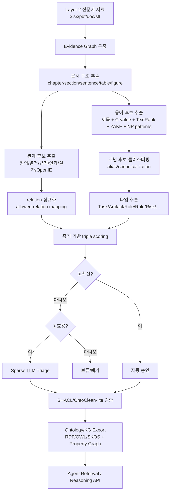
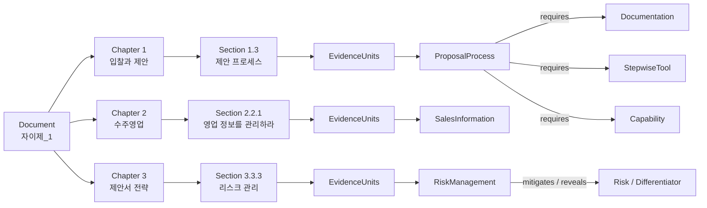

# ECO-L2: Layer 2 전문가 자료 기반 저비용·도메인 확장형 업무 온톨로지/KG 자동 구축 방법론

> 대상 파일: `자이제_1.xlsx`  
> 대상 범위: **Layer 2 — 직무별 전문가 자료만 사용**  
> 목표: 자이제/수주·제안 데이터를 출발점으로 삼되, 법인파산·스타트업 투자·Performance Marketing 등 다른 직무 전문가 자료에도 그대로 적용 가능한 **도메인 독립적 온톨로지/KG 구축 방법론**을 설계한다.  
> 방법론 이름: **ECO-L2 — Evidence-Centric Ontology Learning for Layer-2 Expert Corpora**

---

## 0. 한 줄 결론

자이제 데이터는 단순한 “수주/제안 텍스트”가 아니라 **업무 판단 규칙, 절차, 산출물, 역할, 고객 니즈, 전략, 리스크가 문장 단위로 정리된 전문가 지식 코퍼스**이다. 따라서 이 데이터에서 만들 KG는 일반적인 명사-명사 동시출현 그래프가 아니라, AI 에이전트가 실제 업무를 수행할 때 사용할 수 있는 **증거 기반 업무 온톨로지**, 즉 `Task–Artifact–Role–Rule–Risk–Criterion–Strategy` 중심의 그래프여야 한다.

핵심 전략은 다음이다.

1. **LLM을 기본 추출기가 아니라 “불확실성 해결기”로만 사용한다.**
2. 문서 계층, 제목, 정의문, 명령문, 인과문, 열거문, 표/그림 텍스트, 통계적 용어성, 임베딩 클러스터, 패턴 기반 관계 추출을 먼저 수행한다.
3. 모든 노드와 엣지는 반드시 `EvidenceUnit`, 즉 원문 문장 ID와 연결한다.
4. 온톨로지의 상위 스키마는 직무 도메인과 무관하게 고정한다.
5. 도메인별 차이는 “용어 사전”과 “하위 개념”에서만 발생하게 한다.

---

## 1. `자이제_1.xlsx` 데이터 구조 이해

### 1.1 파일 구조

엑셀 파일에는 `clean_sentences` 시트 하나가 있으며, 다음 6개 컬럼으로 구성되어 있다.

| 컬럼 | 의미 | KG 구축에서의 역할 |
|---|---|---|
| `page` | 원문 페이지 | 증거 추적, 인용, 검수 단위 |
| `chapter_no` | 장 번호 | 문서 계층 그래프의 상위 노드 |
| `chapter_title` | 장 제목 | 상위 토픽 또는 업무 영역 후보 |
| `section_no` | 절 번호 | 세부 토픽, 업무 단위, 개념 후보 |
| `section_title` | 절 제목 | 고신뢰 개념/작업/규칙 후보 |
| `text_for_llm_human` | 정제 문장 | EvidenceUnit, 용어/관계/규칙 추출 대상 |

### 1.2 데이터 규모

| 항목 | 값 |
|---|---:|
| 총 문장 수 | 1,366 |
| 본문 챕터 수 | 3 |
| 섹션 수 | 52 |
| 구조 누락 행 | 3 |

챕터별 문장 수는 다음과 같다.

| chapter_no | chapter_title | sentence_count |
|---:|---|---:|
| 1 | 입찰과 제안 | 310 |
| 2 | 수주영업 | 486 |
| 3 | 제안서 전략 | 567 |

구조 누락 3행은 그림, 수식, 본문 중간의 단독 문장으로 보이며, 버리지 말고 `FigureEvidence` 또는 `DetachedEvidence`로 별도 관리하는 편이 좋다. 예를 들어 가치제안 수식, 고객 이슈 관련 문장, 전략 구현 관련 문장이 여기에 포함되어 있다.

### 1.3 데이터에서 관찰되는 지식 패턴

자이제 데이터에는 다음과 같은 온톨로지 추출 신호가 강하게 존재한다.

| 패턴 | 예시적 표현 | 추출 가능한 지식 |
|---|---|---|
| 정의 | “X란…”, “X를 의미한다”, “X라고 부른다”, “정의된다” | `Concept`, `Definition`, `sameAs`, `definedAs` |
| 구성 | “X는 A, B, C를 의미한다”, “다음과 같다” | `hasPart`, `hasSubSkill`, `hasStep` |
| 규칙/권고 | “해야 한다”, “필요하다”, “관리하라”, “파악하라” | `Rule`, `Guideline`, `requires`, `recommends` |
| 인과 | “왜냐하면”, “때문이다”, “따라서” | `causes`, `enables`, `reduces`, `increases` |
| 절차 | “프로세스”, “단계”, “Milestone”, “먼저”, “이후” | `Process`, `Stage`, `precedes` |
| 역할 | “고객”, “평가자”, “의사결정자”, “영향자”, “기술전문가” | `Role`, `Stakeholder`, `targets` |
| 산출물 | “제안서”, “RFP”, “전략기술서”, “표”, “체크리스트” | `Artifact`, `Input`, `Output` |
| 리스크 | “리스크”, “약점”, “실패”, “감점”, “부정적 영향” | `Risk`, `mitigates`, `threatens` |
| 오해/진실 | “오해 1…”, “진실…” | `Misconception`, `CorrectiveRule`, `contradicts` |
| 비교/차별화 | “우리 > 경쟁자”, “차별화요소” | `Differentiator`, `comparedWith`, `hasAdvantageOver` |

이 구조 때문에 자이제 데이터는 ECO-L2 방법론의 1차 실험 대상으로 적합하다. 섹션 제목 자체가 고품질 seed이고, 본문에는 정의·규칙·절차·전략·평가자 관점이 반복적으로 등장한다.

---

## 2. 선행연구에서 배울 점과 넘어설 지점

### 2.1 전통적 온톨로지 공학

`Ontology Development 101`, `METHONTOLOGY`, `NeOn` 계열은 온톨로지를 만들 때 목적, 범위, 주요 용어, 클래스, 관계, 속성, 제약, 평가를 명시해야 한다는 점을 강조한다. 특히 온톨로지는 그 자체가 목적이라기보다 다른 시스템이 사용할 수 있는 데이터 구조와 의미 명세라는 관점이 중요하다. 이 관점은 AI 에이전트용 직무 온톨로지에도 그대로 적용된다.

**배울 점**

- 온톨로지 구축의 목표와 사용자, 사용 시나리오를 먼저 정의해야 한다.
- 클래스와 관계만 나열하지 말고 competency question, 즉 온톨로지가 답해야 할 질문을 정의해야 한다.
- 재사용 가능한 상위 패턴과 제약을 두어야 한다.
- 평가와 유지보수 절차가 필요하다.

**한계**

- 수작업 비중이 매우 높다.
- 도메인 전문가와 온톨로지 엔지니어의 반복 협업이 필요하다.
- 수많은 직무 도메인으로 확장하기에는 비용이 크다.

**ECO-L2의 극복 방식**

- 전통적 방법론의 “설계 원칙”은 유지하되, 스키마 후보와 관계 후보는 문서 계층·패턴·통계·임베딩으로 자동 생성한다.
- 전문가 검수는 전체가 아니라 불확실성이 높은 후보에 집중한다.
- 도메인마다 온톨로지를 새로 설계하지 않고, 직무 전문가 자료에 공통적으로 적용 가능한 상위 스키마를 고정한다.

### 2.2 Ontology Learning from Text

Text2Onto는 텍스트 자원에서 온톨로지를 학습하는 대표적 프레임워크로, 텍스트에서 용어·개념·관계를 추출하고 확률적 모델로 관리한다. Hearst pattern은 “X such as Y”류의 어휘-구문 패턴으로 상하위 관계를 높은 정밀도로 얻는 고전적 방식이다. OpenIE/TextRunner는 사전 정의된 관계 없이 웹 규모 텍스트에서 관계 튜플을 추출하는 방향을 열었다.

**배울 점**

- 패턴 기반 추출은 LLM 없이도 고정밀 관계를 확보할 수 있다.
- 확률적 신뢰도와 추출 provenance를 함께 관리해야 한다.
- 도메인 독립적 관계 후보 추출은 가능하지만, 후처리와 정규화가 핵심이다.

**한계**

- 일반 OpenIE는 관계명이 지나치게 자유로워 온톨로지 relation으로 바로 쓰기 어렵다.
- 단어/명사구 중심 추출은 업무 절차, 산출물, 규칙, 리스크 같은 agent-useful knowledge를 충분히 포착하지 못한다.
- 한국어 직무 문서에서는 정의문, 명령문, 열거문, 제목 계층을 적극 활용해야 한다.

**ECO-L2의 극복 방식**

- OpenIE 결과를 그대로 relation으로 쓰지 않고, `requires`, `produces`, `governs`, `mitigates`, `targets`, `hasCriterion`, `precedes` 같은 제한된 상위 relation으로 매핑한다.
- 문서 계층과 제목을 강한 prior로 사용한다.
- 업무 수행에 필요한 “행동 가능 지식”을 우선 추출한다.

### 2.3 비LLM 키워드·용어 추출

C-value/NC-value는 다어절 전문용어 추출에서 언어적·통계적 정보를 결합한다. TextRank는 텍스트 내부 그래프 순위를 이용하고, YAKE는 외부 말뭉치나 학습 없이 단일 문서의 통계적 특징으로 키워드를 뽑는다. KeyBERT류 방법은 문서 임베딩과 후보 구문의 유사도로 핵심어를 고른다.

**배울 점**

- 용어 후보 추출은 LLM 없이도 상당 부분 가능하다.
- 제목, 빈도, 분산, 다어절성, 주변 문맥, 문서 내 중심성을 결합하면 도메인 용어를 안정적으로 얻을 수 있다.
- 단일 문서 기반 방식은 기업 내부 문서처럼 외부 corpus가 부족한 경우 유용하다.

**한계**

- 키워드가 곧 개념은 아니다.
- 중요한 업무 규칙은 빈도가 낮을 수 있다.
- 용어 추출만으로는 relation과 axiom이 만들어지지 않는다.

**ECO-L2의 극복 방식**

- 용어성 점수와 별도로 `ActionabilityScore`를 둔다.
- “해야 한다”, “필요하다”, “위해서”, “결정한다”, “줄인다”, “높인다” 같은 규칙·인과 문맥에 등장한 후보를 우대한다.
- 용어 후보는 곧바로 노드가 아니라 `TermCandidate → ConceptCandidate → AcceptedConcept` 단계를 거친다.

### 2.4 LLM 기반 온톨로지/KG 구축

최근 OntoGPT, LLMs4OL, LLM 기반 ontology learning, ontology-grounded KG construction 연구들은 LLM이 텍스트에서 구조화 지식을 추출하고, 스키마를 제안하며, relation을 매핑하는 데 유용하다는 것을 보여준다. 그러나 LLM 기반 방식은 비용, 재현성, 환각, 근거 없는 노드 생성, 일관성 문제를 동반한다.

**배울 점**

- LLM은 문맥을 넓게 보고 관계 유형을 정규화하는 데 강하다.
- 스키마로 출력을 제한하면 free-form extraction보다 안정적이다.
- JSON/TTL 같은 구조화 출력을 강제하면 후처리가 쉬워진다.
- 사람이 놓치기 쉬운 암묵적 관계 후보를 제안하는 데 유용하다.

**한계**

- 전체 문장을 LLM으로 처리하면 비용이 커진다.
- 근거 문장 없이 일반 지식으로 노드·엣지를 만들어낼 수 있다.
- 도메인별 prompt를 매번 새로 짜면 확장성이 떨어진다.
- relation label이 일관되지 않으면 KG 품질이 낮아진다.

**ECO-L2의 극복 방식**

- LLM은 전체 추출기가 아니라 **triage 모듈**이다.
- LLM 호출 조건을 `고효용·저확신·추출기 간 불일치` 후보로 제한한다.
- LLM 출력에는 반드시 `evidence_id`를 요구한다.
- 스키마 밖 relation은 거부한다.
- 동일 evidence hash는 캐시하여 반복 호출을 막는다.

---

## 3. ECO-L2의 핵심 아이디어

### 3.1 Evidence-first, Prompt-last

대부분의 LLM 기반 KG 구축은 “문서를 넣고 triples를 뽑아라”에서 시작한다. ECO-L2는 반대로 시작한다.

1. 먼저 문서 구조와 문장을 `EvidenceUnit`으로 고정한다.
2. 용어·관계·규칙 후보는 모두 evidence와 연결한다.
3. LLM은 이미 추출된 후보의 모호성을 줄이는 데만 사용한다.
4. evidence가 없는 triple은 KG에 들어올 수 없다.

이 방식은 환각을 줄이고, 전문가 검수 비용을 낮추며, 나중에 에이전트가 답변 근거를 제시할 수 있게 만든다.

### 3.2 Agent-ready Work Ontology

일반적인 ontology learning은 `Concept`와 `is-a` taxonomy에 집중하는 경우가 많다. 그러나 AX가 필요로 하는 것은 “AI 에이전트가 업무를 잘 수행하게 하는 지식 구조”이다. 그러므로 다음과 같은 업무 수행형 지식이 중요하다.

- 어떤 업무를 해야 하는가?
- 어떤 순서로 해야 하는가?
- 누가/무엇이 관련되는가?
- 어떤 입력과 산출물이 필요한가?
- 어떤 판단 기준을 따라야 하는가?
- 어떤 위험을 피해야 하는가?
- 어떤 전략이 어떤 고객 니즈를 해결하는가?
- 특정 업무 산출물의 품질 기준은 무엇인가?

따라서 ECO-L2의 KG는 다음 질문에 답할 수 있어야 한다.

| Competency Question | 예시 |
|---|---|
| 업무 절차 | “수주 제안에서 제안서 작성 전에 수행해야 하는 활동은 무엇인가?” |
| 산출물 | “전략 개발 단계에서 어떤 산출물이 필요한가?” |
| 규칙 | “이기는 제안을 위해 반드시 지켜야 할 원칙은 무엇인가?” |
| 고객 이해 | “RFP에 없는 고객 니즈는 어떤 유형으로 설명되는가?” |
| 평가자 대응 | “분석적 평가자와 통합적 평가자에게 각각 어떻게 대응해야 하는가?” |
| 리스크 | “리스크 갭은 무엇이며 어떻게 줄일 수 있는가?” |
| 전략 | “차별화요소는 어떤 정보에서 도출되는가?” |

### 3.3 Domain-independent, Domain-specialized

ECO-L2는 도메인 독립적인 상위 스키마를 고정한다. 그러나 도메인별 용어와 하위 개념은 자동 생성한다.

예를 들어 다음은 모두 같은 상위 구조로 표현된다.

| 도메인 | Task | Artifact | Role | Criterion | Risk |
|---|---|---|---|---|---|
| 수주/제안 | RFP 분석, 제안 전략 개발 | 제안서, 전략기술서 | 고객, 평가자, 의사결정자 | 요구조건 충족, 차별화 | 리스크 갭, 감점 |
| 법인파산 | 채권자 목록 작성, 신청서 준비 | 파산신청서, 재무자료 | 채무자, 법원, 관재인 | 제출요건, 소명자료 | 기각, 누락 |
| 스타트업 투자 | 딜소싱, 투자검토, DD | IR deck, term sheet | 창업자, 투자심사역 | 시장성, 팀, traction | 밸류에이션 리스크 |
| Performance Marketing | 캠페인 세팅, A/B 테스트 | 광고소재, 리포트 | 마케터, 매체, 고객 | CTR, CVR, CAC, ROAS | 예산 소진, tracking 오류 |

도메인이 바뀌어도 `Task–Artifact–Role–Rule–Risk–Metric` 구조는 유지된다. 이것이 확장성의 핵심이다.

---

## 4. ECO-L2 온톨로지 상위 스키마

### 4.1 핵심 클래스

```text
Thing
├── EvidenceUnit
│   ├── SentenceEvidence
│   ├── TableEvidence
│   ├── FigureEvidence
│   └── DetachedEvidence
├── DomainConcept
│   ├── WorkUnit
│   │   ├── Process
│   │   ├── Activity
│   │   ├── Task
│   │   └── Milestone
│   ├── Actor
│   │   ├── Role
│   │   ├── Stakeholder
│   │   └── Organization
│   ├── KnowledgeObject
│   │   ├── Artifact
│   │   ├── Input
│   │   ├── Output
│   │   ├── Template
│   │   └── Tool
│   ├── NormativeKnowledge
│   │   ├── Rule
│   │   ├── Principle
│   │   ├── Guideline
│   │   └── ChecklistItem
│   ├── DecisionKnowledge
│   │   ├── Requirement
│   │   ├── Need
│   │   ├── Criterion
│   │   ├── Metric
│   │   └── Goal
│   ├── StrategyKnowledge
│   │   ├── Strategy
│   │   ├── Tactic
│   │   ├── Differentiator
│   │   └── ValueProposition
│   └── RiskKnowledge
│       ├── Risk
│       ├── Issue
│       └── Mitigation
└── LexicalObject
    ├── TermSurface
    ├── AliasCluster
    └── Abbreviation
```

### 4.2 핵심 관계

| relation | domain → range | 의미 |
|---|---|---|
| `hasPart` | Concept → Concept | 구성요소 |
| `subClassOf` | Class → Class | 상하위 개념 |
| `instanceOf` | Individual → Class | 인스턴스-클래스 |
| `precedes` | WorkUnit → WorkUnit | 절차적 선후관계 |
| `requires` | Task/Rule/Goal → Concept | 필요조건 |
| `requiresInput` | Task → Input/Artifact | 업무 입력 |
| `producesOutput` | Task → Output/Artifact | 산출물 |
| `performedBy` | Task → Actor/Role | 수행 주체 |
| `targets` | Strategy/Task → Actor/Need | 대상 |
| `addressesNeed` | Strategy/Artifact → Need | 니즈 대응 |
| `governedBy` | Task/Artifact → Rule | 규칙 적용 |
| `checkedBy` | Artifact/Task → ChecklistItem | 검토 기준 |
| `hasCriterion` | Task/Artifact/Decision → Criterion | 판단 기준 |
| `hasRisk` | Task/Strategy → Risk | 관련 리스크 |
| `mitigates` | Strategy/Mitigation → Risk | 리스크 완화 |
| `causes` | Concept/Event → Concept/Event | 인과 |
| `enables` | Concept/Task → Task/Outcome | 가능하게 함 |
| `contradicts` | Claim → Claim | 오해/진실, 반대 명제 |
| `definedAs` | Concept → Definition | 정의 |
| `mentions` | EvidenceUnit → TermSurface | 문장 내 언급 |
| `assertedBy` | Triple/Claim → EvidenceUnit | 근거 문장 |

### 4.3 relation을 제한하는 이유

LLM이나 OpenIE가 뽑은 관계명을 그대로 쓰면 다음과 같은 문제가 생긴다.

```text
A — "중요하다" — B
A — "결정한다" — B
A — "핵심이다" — B
A — "필요하다" — B
A — "사용한다" — B
```

이 relation들은 사람이 보기에는 이해되지만, 에이전트가 안정적으로 질의하거나 추론하기 어렵다. 따라서 ECO-L2에서는 자유 관계를 상위 relation으로 정규화한다.

예를 들어:

| 원문 관계 표현 | 정규 relation |
|---|---|
| “필요하다”, “해야 한다”, “위해서는” | `requires` |
| “결정한다”, “좌우한다”, “영향을 준다” | `influences` 또는 `determines` |
| “줄인다”, “제거한다”, “완화한다” | `mitigates` |
| “포함한다”, “구성된다”, “A, B, C를 의미한다” | `hasPart` |
| “정의된다”, “의미한다”, “라고 부른다” | `definedAs` |
| “고객에게”, “평가자를”, “대상으로” | `targets` |
| “검토한다”, “평가한다”, “확인한다” | `checkedBy` 또는 `hasCriterion` |

---

## 5. ECO-L2 구축 파이프라인



---

## 6. 단계별 세부 방법

### Step 0. Evidence Graph 구축

모든 문장을 evidence 단위로 만든다.

```json
{
  "evidence_id": "ZJ-E0002",
  "source_file": "자이제_1.xlsx",
  "sheet": "clean_sentences",
  "page": 19,
  "chapter_no": 1,
  "chapter_title": "입찰과 제안",
  "section_no": "1.1",
  "section_title": "입찰과 제안의 중요성",
  "text": "경쟁력 있는 제안 역량이란 차별화된 정보를 수집할 줄 아는 전문가 영업 역량, 고객의 정보를 이기는 전략으로 만들 수 있는 전략 개발 역량, 이를 고객과 소통할 줄 아는 제안서 역량, PT 역량을 의미한다.",
  "hash": "..."
}
```

Evidence Graph의 기본 relation은 다음과 같다.

```text
Document -hasChapter-> Chapter
Chapter -hasSection-> Section
Section -hasEvidence-> EvidenceUnit
EvidenceUnit -nextEvidence-> EvidenceUnit
EvidenceUnit -mentions-> TermSurface
Claim/Triple -assertedBy-> EvidenceUnit
```

이 계층은 거의 100% 자동 생성 가능하며, 이후 모든 지식 추출의 provenance spine이 된다.

### Step 1. 용어 후보 추출

LLM을 쓰기 전에 다음 신호를 결합한다.

#### 1) 구조 신호

- `chapter_title`
- `section_title`
- 표/그림 제목
- 반복되는 절 제목
- “오해 N”, “전략”, “프로세스”, “관리”, “공략법” 등의 heading cue

자이제 데이터에서는 섹션 제목만으로도 다음과 같은 개념 후보가 생성된다.

```text
입찰과 제안
제안 프로세스
수주영업
영업 정보
가치제안
평가자 공략법
의사결정자
영향자
분석적 평가자
통합적 평가자
전략 관리
전략 개발 프로세스
전략기술서
전술개발
리스크 관리
```

#### 2) 통계 신호

- C-value/NC-value: 다어절 전문용어 우대
- TF-IDF 또는 BM25: 섹션별 특이 용어 우대
- TextRank: 문서 내 중심성 우대
- YAKE: 단일 문서 기반 중요도
- Section dispersion: 여러 절에 걸쳐 반복되는 핵심 개념 우대
- Heading boost: 제목에 등장한 후보 우대

#### 3) 언어 패턴 신호

한국어 직무 문서에서 유용한 candidate pattern은 다음이다.

```regex
(?P<X>.+?)(이란|란) (?P<Y>.+?)(이다|의미한다)
(?P<X>.+?)(은|는) (?P<Y>.+?)(라고 부른다|이라고 부른다)
(?P<X>.+?)(은|는) 다음과 같이 정의된다
(?P<X>.+?)을 위해서는 (?P<Y>.+?)(이|가) 필요하다
(?P<X>.+?)(해야 한다|하여야 한다)
(?P<X>.+?)(관리하라|파악하라|검증하라|공략하라)
```

#### 4) 용어 후보 점수

```text
TermScore(t) =
  0.20 * HeadingScore(t)
+ 0.20 * TermhoodScore(t)
+ 0.15 * TextRankScore(t)
+ 0.15 * DefinitionCueScore(t)
+ 0.10 * SectionDispersionScore(t)
+ 0.10 * ActionabilityContextScore(t)
+ 0.05 * AcronymAliasScore(t)
+ 0.05 * TableFigureCueScore(t)
```

`ActionabilityContextScore`가 중요하다. “제안서”, “고객”, “전략”처럼 빈도가 높은 용어도 중요하지만, “해야 한다”, “필요하다”, “검증하라” 문맥에 등장하는 용어는 에이전트 업무 수행에 더 직접적으로 기여한다.

### Step 2. 개념 타입 추론

용어 후보를 바로 노드로 확정하지 않고, 먼저 상위 타입을 부여한다.

#### 2.1 규칙 기반 타입 추론 예시

| 단서 | 타입 후보 |
|---|---|
| `프로세스`, `단계`, `절차`, `Milestone` | `Process`, `Stage`, `Milestone` |
| `작성`, `관리`, `분석`, `검증`, `공략`, `파악` | `Task` 또는 `Activity` |
| `제안서`, `RFP`, `요청서`, `기술서`, `양식`, `표`, `문서` | `Artifact` |
| `고객`, `평가자`, `의사결정자`, `영향자`, `사용자`, `행정가` | `Actor` 또는 `Stakeholder` |
| `요구조건`, `니즈`, `이슈`, `관심`, `구매심리` | `Need`, `Requirement`, `Issue` |
| `전략`, `전술`, `공략법`, `차별화요소`, `가치제안` | `StrategyKnowledge` |
| `리스크`, `위험`, `약점`, `실패`, `감점` | `RiskKnowledge` |
| `품질`, `신뢰도`, `성공률`, `평가 기준`, `가치`, `가격` | `Metric` 또는 `Criterion` |
| `해야 한다`, `필요하다`, `명심하라` 문맥 | `Rule` 또는 `Guideline` |

#### 2.2 타입 확신도

각 candidate에는 여러 타입 점수가 붙는다.

```json
{
  "term": "리스크 갭",
  "type_scores": {
    "Risk": 0.72,
    "Stage": 0.41,
    "Concept": 0.30
  },
  "decision": "Risk",
  "confidence": 0.72,
  "needs_llm": false
}
```

LLM은 다음 조건에서만 호출한다.

```text
needs_llm =
  max(type_scores) < 0.65
  OR top1_score - top2_score < 0.15
  OR candidate is high-centrality but low-confidence
  OR candidate appears in definition/rule pattern but type is unclear
```

### Step 3. 관계 후보 추출

관계 후보는 최소 5개 extractor의 합의로 생성한다.

| extractor | 설명 | LLM 필요 여부 |
|---|---|---|
| `HierarchyExtractor` | chapter/section/sentence 구조 | 불필요 |
| `DefinitionPatternExtractor` | “X란 Y”, “X라고 부른다” | 불필요 |
| `EnumerationExtractor` | 첫째/둘째/셋째, bullet, table row | 불필요 |
| `RulePatternExtractor` | 해야 한다, 필요하다, 관리하라 | 불필요 |
| `CausalPatternExtractor` | 왜냐하면, 때문에, 따라서 | 불필요 |
| `ProcedurePatternExtractor` | 먼저, 이후, 전에, 단계, 프로세스 | 불필요 |
| `OpenIEExtractor` | dependency/open relation candidate | 불필요 또는 소형 모델 |
| `EmbeddingCoherenceExtractor` | section-level co-occurrence/semantic similarity | 불필요 |
| `LLMTriageExtractor` | 모호한 relation 후보 판정 | 제한적 사용 |

#### 3.1 관계 패턴 예시

| 원문 패턴 | relation |
|---|---|
| `X란 Y이다` | `definedAs(X, Y)` |
| `X는 A, B, C를 의미한다` | `hasPart(X, A/B/C)` |
| `X에는 Y가 있다` | `hasPart(X, Y)` |
| `X을 위해서는 Y가 필요하다` | `requires(X, Y)` |
| `X해야 한다` | `requires(goal_or_task, X)` |
| `X가 Y를 결정한다` | `determines(X, Y)` |
| `X는 Y를 높인다` | `increases(X, Y)` |
| `X는 Y를 줄인다` | `reduces(X, Y)` |
| `X는 Y를 방해한다` | `threatens(X, Y)` |
| `X는 Y를 공략한다` | `targets(X, Y)` |
| `오해 X / 진실 Y` | `contradicts(Y, X)` 또는 `corrects(Y, X)` |
| `A > B` | `hasAdvantageOver(A, B)` |

#### 3.2 EdgeScore

```text
EdgeScore(e) =
  0.25 * PatternConfidence(e)
+ 0.15 * DependencyConfidence(e)
+ 0.15 * StructuralProximity(e)
+ 0.15 * ExtractorAgreement(e)
+ 0.10 * EvidenceCount(e)
+ 0.10 * SemanticCoherence(e)
+ 0.05 * SourceReliability(e)
+ 0.05 * RelationSchemaFit(e)
- 0.20 * ContradictionPenalty(e)
```

판정 기준:

| 점수 | 처리 |
|---:|---|
| `>= 0.75` | 자동 승인 |
| `0.45–0.75` | LLM triage 또는 전문가 검수 큐 |
| `< 0.45` | 보류 또는 폐기 |

### Step 4. Taxonomy induction

Taxonomy는 세 경로로 만든다.

1. **제목 계층 기반 taxonomy**
   - `입찰과 제안 > 제안 프로세스 > 프로세스가 중요하다`
   - 단, 문서 제목은 곧바로 class가 아니라 `Topic`으로 먼저 둔다.

2. **언어 패턴 기반 taxonomy**
   - `X는 Y의 일종이다`
   - `X와 같은 Y`
   - `Y에는 X가 있다`

3. **타입-클러스터 기반 taxonomy**
   - `의사결정자`, `영향자`, `평가자`, `기술전문가`, `사용자`, `행정가` → `StakeholderRole`
   - `RFP`, `제안서`, `전략기술서`, `표`, `체크리스트` → `Artifact`
   - `가치제안`, `차별화요소`, `1등 전략`, `2등 전략` → `StrategyKnowledge`

Taxonomy에 대해서는 OntoClean-lite 검사를 둔다.

| 금지 패턴 | 예 |
|---|---|
| Role이 Artifact의 하위 클래스가 됨 | `평가자 subClassOf 제안서` |
| Task가 Actor의 하위 클래스가 됨 | `영업 정보 관리 subClassOf 고객` |
| Risk가 Artifact의 하위 클래스가 됨 | `리스크 갭 subClassOf 전략기술서` |
| Topic을 무조건 Class로 승격 | `오해 1 subClassOf 제안서` |

### Step 5. 규칙과 체크리스트 추출

업무 에이전트용 KG에서 가장 중요한 것은 `Rule`이다.

예를 들어 다음 문장:

```text
따라서 궁극적으로 이기는 제안을 하려면 빙산 전체를 다 이해해야 한다.
```

이를 단순 triple로만 만들면 정보가 손실된다.

```text
이기는 제안 —requires→ 빙산 전체 이해
```

더 좋은 표현은 n-ary rule node이다.

```json
{
  "rule_id": "ZJ-R0019",
  "type": "Guideline",
  "condition": "목표가 이기는 제안인 경우",
  "action": "빙산 전체를 이해한다",
  "target": "고객 니즈",
  "rationale": "RFP의 공식 요구조건만으로는 고객 니즈 전체를 다루지 못하기 때문",
  "evidence_ids": ["ZJ-E0007", "ZJ-E0008", "ZJ-E0019"],
  "confidence": 0.86
}
```

이렇게 하면 에이전트가 다음과 같은 방식으로 사용할 수 있다.

- 제안 전략 수립 시 체크리스트 생성
- RFP 분석 단계에서 “비공식 요구조건 탐색” 작업 생성
- 제안서 리뷰 시 “공식 요구조건만 다루고 있지 않은가?” 검증
- 답변 생성 시 rule provenance 제공

### Step 6. Alias와 canonicalization

자이제 데이터에는 한국어/영어/약어가 함께 등장한다.

| 표면형 | canonical concept |
|---|---|
| RFP | 제안 요청서 |
| Request for Proposal | 제안 요청서 |
| PT | 프레젠테이션 |
| Value Proposition | 가치제안 |
| Risk Gap | 리스크 갭 |
| Milestone | 마일스톤 / 단계 |

처리 방식:

1. 괄호 패턴 추출: `제안 요청서(RFP: Request for Proposal)`
2. 한글-영문 병기 추출
3. 약어 대문자 패턴 추출
4. embedding 유사도 기반 후보 병합
5. 동일 section 내 정의문 우선
6. 고중심성 alias 충돌은 LLM 또는 전문가 검수로 보류

### Step 7. Sparse LLM Triage

LLM은 다음 세 가지에만 사용한다.

#### 7.1 타입 모호성 해소

입력:

```json
{
  "candidate": "리스크 갭",
  "context": [
    {"id": "ZJ-E0350", "text": "RFP 이후부터 제안서 제출까지 구간은 우리가 영향력을 행사할 수 없는 구간이라는 의미에서 리스크 갭이라고 부른다."},
    {"id": "ZJ-E0351", "text": "리스크 갭이란 고객에게 미치는 영향력이 극적으로 감소하여 판매자의 리스크가 커진 구간을 일컫는다."}
  ],
  "allowed_types": ["Process", "Stage", "Risk", "Concept", "Metric"]
}
```

출력:

```json
{
  "canonical_label": "리스크 갭",
  "type": "Risk",
  "secondary_type": "Stage",
  "definition": "고객 영향력이 감소하여 판매자의 리스크가 커지는 구간",
  "evidence_ids": ["ZJ-E0350", "ZJ-E0351"],
  "confidence": 0.88
}
```

#### 7.2 relation mapping

OpenIE가 다음을 뽑았다고 하자.

```text
제안 기획 — 품질을 결정한다 — 제안서
```

LLM에게 자유롭게 triple을 만들게 하지 않고, 다음 중 하나로 고르게 한다.

```json
{
  "allowed_relations": ["requires", "producesOutput", "determines", "hasCriterion", "governedBy", "addressesNeed", "mitigates", "targets", "hasPart", "definedAs"]
}
```

기대 출력:

```json
{
  "subject": "제안 기획",
  "predicate": "determines",
  "object": "제안서 품질",
  "evidence_ids": ["..."],
  "confidence": 0.81
}
```

#### 7.3 contradiction / 오해-진실 구조화

자이제 데이터에는 “오해와 진실” 구조가 있다. 이 구조는 단순 지식보다 에이전트에 중요하다. 왜냐하면 에이전트가 잘못된 권고를 피하게 해주기 때문이다.

예:

```text
오해: 제안서는 일단 양이 많아야 한다.
진실: 맹목적인 양적 추구는 평가위원의 평가를 어렵게 하여 부정적인 영향을 주는 경우도 있다.
```

KG 표현:

```text
Claim_ProposalVolumeMoreIsBetter —type→ Misconception
Rule_BlindVolumeIsHarmful —type→ CorrectiveGuideline
Rule_BlindVolumeIsHarmful —contradicts→ Claim_ProposalVolumeMoreIsBetter
Rule_BlindVolumeIsHarmful —threatens→ EvaluatorComprehension
Rule_BlindVolumeIsHarmful —assertedBy→ EvidenceUnit
```

### Step 8. 검증과 제약

RDF/OWL/SKOS로 표준 표현을 만들고, SHACL로 data graph 제약을 검증한다.

예시 제약:

```text
Task는 최소 1개 이상의 evidence를 가져야 한다.
AcceptedConcept는 prefLabel을 가져야 한다.
Rule은 condition/action/target 중 최소 2개 이상을 가져야 한다.
Artifact는 producesOutput 또는 requiresInput relation의 object로 등장할 수 있다.
Evidence가 없는 asserted triple은 rejected 상태가 된다.
```

---

## 7. 자이제 데이터에 대한 KG 설계 예시

### 7.1 권장 그래프 계층



### 7.2 자이제 1차 핵심 노드 후보

| class | 후보 노드 |
|---|---|
| `Process` | 제안 프로세스, 전략 개발 프로세스, 구매 프로세스, 판매 프로세스 |
| `Task` | 영업 정보 관리, 고객 구매단계 파악, 전술개발 효과성 검증, 리스크 관리 |
| `Artifact` | 제안 요청서, 제안서, 전략기술서, 표, 체크리스트, 산출물 양식 |
| `Actor` | 고객, 평가자, 의사결정자, 영향자, 기술전문가, 사용자, 행정가, 경쟁자 |
| `Need/Requirement` | 고객 니즈, 공식 요구조건, 비공식 요구조건, 이슈, 구매심리 |
| `Strategy` | 수주전략, 제안서 전략, 1등 전략, 2등 전략, 정공법, 역공법 |
| `Tactic` | 솔루션 최적화, 커뮤니케이션 방법 개발, 평가자 공략 |
| `Rule` | 빙산 전체 이해, 제안서 양보다 메시지 명확성, 고객 니즈 기반 추가 제안 |
| `Risk` | 리스크 갭, 감점 요인, 고객 영향력 감소, 경쟁자 강점 |
| `Metric/Criterion` | 신뢰도, 가치, 가격, 성공률, 평가 기준, 차별화요소 |

### 7.3 예시 triple

아래 triple은 현재 파일 구조와 문장 내용에 기반한 설계 예시이다. 실제 구축 시에는 extractor confidence와 검수 상태가 함께 저장된다.

| 주어 | 관계 | 목적어 | 타입 | 근거 |
|---|---|---|---|---|
| 경쟁력 있는 제안 역량 | `hasPart` | 전문가 영업 역량 | Capability decomposition | `ZJ-E0002`, p.19 |
| 경쟁력 있는 제안 역량 | `hasPart` | 전략 개발 역량 | Capability decomposition | `ZJ-E0002`, p.19 |
| 경쟁력 있는 제안 역량 | `hasPart` | 제안서 역량 | Capability decomposition | `ZJ-E0002`, p.19 |
| 경쟁력 있는 제안 역량 | `hasPart` | PT 역량 | Capability decomposition | `ZJ-E0002`, p.19 |
| 고객 니즈 | `hasPart` | 공식적인 요구조건 | Need decomposition | `ZJ-E0008`, p.21 |
| 고객 니즈 | `hasPart` | 비공식적인 요구조건 | Need decomposition | `ZJ-E0008`, p.21 |
| 제안 요청서(RFP) | `expresses` | 공식적인 요구조건 | Artifact → Requirement | `ZJ-E0012`, p.21 |
| 이기는 제안 | `requires` | 빙산 전체 이해 | Rule / Goal dependency | `ZJ-E0019`, p.22 |
| 제안 프로세스 | `requires` | 표준화된 문서 | Process requirement | `ZJ-E0206`, p.43 |
| 제안 프로세스 | `requires` | 단계별 도구 | Process requirement | `ZJ-E0207`, p.43 |
| 제안 프로세스 | `requires` | 단계별 도구 활용 역량 | Process requirement | `ZJ-E0208`, p.43 |
| 가치제안 | `definedAs` | 고객과 공급업체의 상호 이익 원리 | Definition | `ZJ-E0414`, p.69 |
| 리스크 갭 | `definedAs` | 고객 영향력이 감소하여 판매자 리스크가 커지는 구간 | Definition | `ZJ-E0350`, p.64 |
| 제안 기획 | `determinesQualityOf` | 제안서 | Causal / influence | section 1.3.3 |
| 리스크 관리 | `canReveal` | 차별화 포인트 | Strategy / risk relation | `ZJ-E1366`, p.178 |

### 7.4 RDF/Turtle 예시

```turtle
@prefix eco: <https://ax.example/eco-l2#> .
@prefix zj:  <https://ax.example/zj#> .
@prefix skos: <http://www.w3.org/2004/02/skos/core#> .
@prefix prov: <http://www.w3.org/ns/prov#> .

zj:E0002 a eco:SentenceEvidence ;
    eco:sourceFile "자이제_1.xlsx" ;
    eco:page 19 ;
    eco:sectionNo "1.1" ;
    eco:sectionTitle "입찰과 제안의 중요성" ;
    eco:text "경쟁력 있는 제안 역량이란 차별화된 정보를 수집할 줄 아는 전문가 영업 역량, 고객의 정보를 이기는 전략으로 만들 수 있는 전략 개발 역량, 이를 고객과 소통할 줄 아는 제안서 역량, PT 역량을 의미한다." .

zj:CompetitiveProposalCapability a eco:Capability ;
    skos:prefLabel "경쟁력 있는 제안 역량"@ko ;
    eco:hasPart zj:ExpertSalesCapability, zj:StrategyDevelopmentCapability,
                zj:ProposalWritingCapability, zj:PresentationCapability ;
    prov:wasDerivedFrom zj:E0002 .

zj:CustomerNeed a eco:Need ;
    skos:prefLabel "고객 니즈"@ko ;
    eco:hasPart zj:OfficialRequirement, zj:UnstatedRequirement .

zj:RFP a eco:Artifact ;
    skos:prefLabel "제안 요청서"@ko ;
    skos:altLabel "RFP"@en, "Request for Proposal"@en ;
    eco:expresses zj:OfficialRequirement .

zj:WinProposalRule001 a eco:Guideline ;
    skos:prefLabel "이기는 제안은 빙산 전체를 이해해야 한다"@ko ;
    eco:requires zj:UnderstandFullCustomerIceberg ;
    eco:targets zj:CustomerNeed ;
    prov:wasDerivedFrom zj:E0019 .
```

### 7.5 Property Graph / Neo4j 예시

RDF/OWL은 표준성과 reasoning에 좋고, Property Graph는 에이전트 질의와 운영 시스템 연동에 편하다. 둘을 동시에 유지하는 것을 권장한다.

```cypher
MERGE (e:EvidenceUnit {id: "ZJ-E0002", page: 19, section_no: "1.1"})
MERGE (c:Capability {id: "CompetitiveProposalCapability", label_ko: "경쟁력 있는 제안 역량"})
MERGE (s:Capability {id: "ExpertSalesCapability", label_ko: "전문가 영업 역량"})
MERGE (c)-[:HAS_PART {confidence: 0.91, extractor: "definition_pattern"}]->(s)
MERGE (c)-[:ASSERTED_BY]->(e);
```

에이전트 질의 예시:

```cypher
MATCH (r:Rule)-[:GOVERNS|:REQUIRES|:TARGETS*1..2]->(x)
WHERE x.label_ko CONTAINS "제안서"
MATCH (r)-[:ASSERTED_BY]->(e:EvidenceUnit)
RETURN r.label_ko, collect(distinct e.section_title), collect(distinct e.page);
```

---

## 8. LLM 사용 최소화 전략

### 8.1 호출하지 않는 경우

LLM을 호출하지 않아도 되는 경우:

| 상황 | 이유 |
|---|---|
| 문서 계층 생성 | 엑셀 metadata로 충분 |
| 제목 기반 seed concept 생성 | `section_title`이 고품질 |
| “X란 Y” 정의 추출 | 정규식/의존구문으로 충분 |
| “첫째/둘째/셋째” 열거 구조 | 규칙 기반 처리 가능 |
| “해야 한다/필요하다” 규칙 후보 | 규칙 기반 처리 가능 |
| 약어 병기 추출 | 괄호 패턴으로 충분 |
| co-occurrence edge weighting | 통계/임베딩으로 충분 |
| SHACL 제약 검증 | symbolic validation으로 충분 |

### 8.2 호출하는 경우

LLM 호출은 다음 네 가지로 제한한다.

| 호출 목적 | 입력 단위 | 출력 | 예상 비중 |
|---|---|---|---:|
| 타입 모호성 해소 | high-score term + 근거 문장 2–5개 | allowed type 중 선택 | 전체 후보의 5–10% |
| relation 정규화 | OpenIE 후보 + allowed relation 목록 | relation 선택 | relation 후보의 5–15% |
| rule 구조화 | 명령/규칙 문장 묶음 | condition/action/target JSON | 규칙 후보의 10–20% |
| contradiction 판정 | 오해/진실/반례 문장 | contradicts/corrects 관계 | 해당 패턴에 한정 |

### 8.3 LLM 호출 정책

```python
def should_call_llm(candidate):
    high_utility = candidate.utility_score >= 0.70
    low_confidence = candidate.confidence < 0.65
    disagreement = candidate.extractor_disagreement >= 0.35
    central = candidate.graph_centrality >= 0.80
    novel = candidate.cluster_is_new is True

    return high_utility and (low_confidence or disagreement or central or novel)
```

이 정책의 핵심은 **중요하지 않은 후보에는 LLM을 쓰지 않는다**는 것이다. 비용은 “문장 수”가 아니라 “고효용 불확실성 수”에 비례해야 한다.

### 8.4 Prompt template

```text
역할:
너는 온톨로지 검수 보조기다. 새 지식을 만들지 말고, 제공된 evidence 안에서만 판단한다.

입력:
- allowed_classes
- allowed_relations
- candidate_terms
- candidate_edges
- evidence_units

규칙:
1. evidence_id가 없는 출력은 금지한다.
2. allowed_classes 밖의 타입을 만들지 않는다.
3. allowed_relations 밖의 relation을 만들지 않는다.
4. 원문에 없는 일반 지식은 사용하지 않는다.
5. 확신이 낮으면 null 또는 "needs_human_review"를 출력한다.
6. 같은 의미의 표면형은 aliases로 묶는다.

출력 JSON schema:
{
  "accepted_terms": [
    {
      "canonical_label": "...",
      "type": "...",
      "aliases": ["..."],
      "definition": "...",
      "evidence_ids": ["..."],
      "confidence": 0.0
    }
  ],
  "accepted_edges": [
    {
      "subject": "...",
      "predicate": "...",
      "object": "...",
      "evidence_ids": ["..."],
      "confidence": 0.0
    }
  ],
  "rejected": [
    {
      "candidate_id": "...",
      "reason": "unsupported_by_evidence | wrong_type | relation_not_allowed | ambiguous"
    }
  ]
}
```

---

## 9. 다양한 도메인 확장 방법

### 9.1 확장 원칙

도메인이 바뀌어도 바뀌지 않는 것:

- EvidenceUnit 모델
- 상위 클래스: `Task`, `Artifact`, `Role`, `Rule`, `Risk`, `Metric`, `Criterion`, `Strategy`
- 핵심 relation: `requires`, `producesOutput`, `performedBy`, `governedBy`, `hasRisk`, `mitigates`, `targets`, `hasCriterion`
- scoring 방식
- LLM triage 정책
- SHACL 제약
- 평가 지표

도메인이 바뀌면 바뀌는 것:

- 표면 용어
- alias
- 세부 하위 클래스
- 도메인별 pattern lexicon 일부
- domain-specific competency question template 일부

### 9.2 법인파산 도메인 예시

| ECO-L2 class | 법인파산 후보 |
|---|---|
| `Task` | 파산신청 준비, 채권자 목록 작성, 재산목록 작성, 소명자료 준비 |
| `Artifact` | 파산신청서, 채권자목록, 재무제표, 법원 제출서류 |
| `Role` | 채무자, 채권자, 법원, 파산관재인, 대리인 |
| `Rule` | 제출요건, 기한 준수, 누락 금지 |
| `Risk` | 신청 기각, 자료 누락, 허위기재 |
| `Criterion` | 지급불능, 채무초과, 소명 충분성 |

같은 규칙:

```text
X를 위해서는 Y가 필요하다 → requires(X, Y)
X를 제출해야 한다 → producesOutput/requiredArtifact
X가 누락되면 Y 위험이 있다 → omissionOf(X) hasRisk Y
```

### 9.3 스타트업 투자 도메인 예시

| ECO-L2 class | 스타트업 투자 후보 |
|---|---|
| `Task` | 딜소싱, 예비검토, 투자심사, Due Diligence, 조건협상 |
| `Artifact` | IR deck, 투자검토보고서, term sheet, cap table |
| `Role` | 창업자, 투자심사역, 파트너, LP, 법무 |
| `Metric` | ARR, MRR, retention, CAC, LTV, gross margin |
| `Criterion` | 시장성, 팀 역량, 성장성, 방어력 |
| `Risk` | 밸류에이션 리스크, 기술 리스크, 규제 리스크 |

### 9.4 Performance Marketing 도메인 예시

| ECO-L2 class | Performance Marketing 후보 |
|---|---|
| `Task` | 캠페인 세팅, 타겟팅, 소재 테스트, 퍼널 분석, 예산 최적화 |
| `Artifact` | 광고소재, 랜딩페이지, 캠페인 리포트, UTM 정책 |
| `Role` | 마케터, 디자이너, 매체, 고객 세그먼트 |
| `Metric` | CTR, CVR, CPA, CAC, ROAS, LTV |
| `Rule` | 예산 cap, 실험 중단 기준, tracking 검증 규칙 |
| `Risk` | 예산 소진, attribution 오류, 소재 피로도, tracking 누락 |

Performance Marketing에서는 수주/제안의 `평가자`가 `고객 세그먼트/매체 알고리즘`으로, `제안서`가 `광고소재/랜딩페이지`로, `평가 기준`이 `CTR/CVR/ROAS`로 바뀐다. 그러나 `Task–Artifact–Metric–Rule–Risk` 구조는 유지된다.

---

## 10. 평가 설계

### 10.1 구축 품질 평가

| 평가 대상 | 지표 | 설명 |
|---|---|---|
| 용어 추출 | Precision / Recall / F1 | 전문가 gold term과 비교 |
| 타입 분류 | Type accuracy / Macro F1 | `Task`, `Artifact`, `Role` 등 타입 정확도 |
| 관계 추출 | Relation Precision / Recall / F1 | 정규 relation 기준 |
| Taxonomy | Edge precision, cycle error, parent suitability | 상하위 관계 품질 |
| 규칙 추출 | Rule completeness, actionability | condition/action/target 추출 품질 |
| 근거 연결 | Evidence grounding accuracy | triple이 실제 evidence로 지지되는가 |
| 제약 위반 | SHACL violation count | 필수 속성/도메인-레인지 오류 |
| 환각 | Unsupported triple rate | evidence 없는 triple 비율 |
| 비용 | LLM tokens/triple, LLM call rate | LLM 절약 효과 |
| 확장성 | Cross-domain degradation | 다른 도메인에서 품질 하락폭 |

### 10.2 비교 실험군

| 실험군 | 설명 | 목적 |
|---|---|---|
| B0 | 문서 계층만 KG화 | 구조 baseline |
| B1 | 통계 키워드 + co-occurrence | AutoKG류 lightweight baseline |
| B2 | 패턴 + OpenIE + relation 정규화 | 비LLM ontology learning baseline |
| B3 | 전체 문장 LLM triple extraction | 비용 높은 LLM baseline |
| ECO-L2 | B2 + sparse LLM triage + SHACL + evidence lattice | 제안 방법론 |

핵심 주장은 다음 방식으로 검증한다.

```text
ECO-L2가 B3와 유사한 품질을 달성하면서,
LLM 호출량은 크게 줄이고,
B1/B2보다 relation 정합성·규칙 추출·agent utility를 높인다.
```

### 10.3 Gold standard 구축 방법

1. 52개 섹션에서 층화 표본을 뽑는다.
2. 각 챕터별로 최소 5개 섹션 또는 전체 문장의 15–20%를 annotation 대상으로 둔다.
3. 전문가 2인이 다음을 라벨링한다.
   - 핵심 용어
   - 타입
   - 관계
   - 규칙
   - 근거 문장
4. disagreement는 제3자 adjudication으로 정리한다.
5. 나머지 문장은 silver label과 active learning 검수로 확장한다.

### 10.4 Agent utility 평가

온톨로지가 좋은지는 예쁘게 보이는 그래프가 아니라, 에이전트 업무 수행에 도움이 되는지로 평가해야 한다.

| 업무 시나리오 | 평가 항목 |
|---|---|
| RFP 분석 | 공식/비공식 요구조건 구분, 누락 니즈 탐색 |
| 제안 전략 수립 | 차별화요소, 고객 이슈, 경쟁자 분석 연결 |
| 제안서 리뷰 | 규칙 준수, 평가자 관점 반영, 위험 요인 탐지 |
| PT 준비 | 발표 프로세스, 메시지, 평가자 유형 대응 |
| 리스크 관리 | 리스크 갭, 감점 요인, 경쟁자 공략 가능성 식별 |

비교:

```text
일반 RAG
vs
RAG + keyword graph
vs
RAG + ECO-L2 업무 온톨로지
```

지표:

- 업무 성공률
- 규칙 준수율
- 근거 제시율
- unsupported claim rate
- 산출물 품질 루브릭 점수
- 수행 시간/토큰 비용

---

## 11. 구현 산출물 제안

프로젝트 산출물은 다음 구조를 권장한다.

```text
eco_l2/
├── input/
│   └── 자이제_1.xlsx
├── evidence/
│   ├── evidence_units.jsonl
│   └── document_hierarchy.json
├── candidates/
│   ├── term_candidates.csv
│   ├── relation_candidates.csv
│   ├── rule_candidates.csv
│   └── alias_candidates.csv
├── ontology/
│   ├── eco_l2_meta_schema.ttl
│   ├── domain_ontology_zj.ttl
│   ├── domain_taxonomy_zj.skos.ttl
│   └── shacl_shapes.ttl
├── graph/
│   ├── kg_edges.csv
│   ├── kg_nodes.csv
│   └── neo4j_import.cypher
├── llm_triage/
│   ├── prompts/
│   ├── triage_requests.jsonl
│   ├── triage_outputs.jsonl
│   └── rejected_outputs.jsonl
├── evaluation/
│   ├── gold_sample.jsonl
│   ├── metrics_report.md
│   └── error_analysis.md
└── docs/
    └── methodology.md
```

### 11.1 Node schema

```json
{
  "node_id": "ZJ-C0001",
  "canonical_label": "고객 니즈",
  "aliases": ["고객의 니즈", "Customer Need"],
  "type": "Need",
  "definition": "공식 요구조건과 비공식 요구조건을 포함하는 고객의 요구",
  "source_evidence_ids": ["ZJ-E0008", "ZJ-E0012", "ZJ-E0013"],
  "confidence": 0.89,
  "status": "accepted",
  "created_by": ["heading_seed", "definition_pattern", "llm_triage_optional"],
  "domain": "proposal"
}
```

### 11.2 Edge schema

```json
{
  "edge_id": "ZJ-R0001",
  "subject_id": "ZJ-C0001",
  "predicate": "hasPart",
  "object_id": "ZJ-C0002",
  "source_evidence_ids": ["ZJ-E0008"],
  "extractors": ["definition_pattern", "enumeration_extractor"],
  "confidence": 0.91,
  "status": "accepted",
  "polarity": "positive",
  "condition": null
}
```

### 11.3 Rule schema

```json
{
  "rule_id": "ZJ-G0019",
  "label": "이기는 제안은 빙산 전체를 이해해야 한다",
  "type": "Guideline",
  "condition": {
    "goal": "이기는 제안"
  },
  "action": {
    "verb": "이해하다",
    "object": "빙산 전체",
    "expanded_object": "공식 요구조건과 비공식 요구조건을 포함한 고객 니즈"
  },
  "target": "CustomerNeed",
  "rationale": "RFP는 고객의 니즈 전체를 다루지 못함",
  "source_evidence_ids": ["ZJ-E0007", "ZJ-E0008", "ZJ-E0019"],
  "confidence": 0.86,
  "status": "accepted"
}
```

---

## 12. ECO-L2가 기존 방법론 대비 갖는 혁신성

### 12.1 Evidence Lattice

기존 KG extraction은 triple을 먼저 만들고 나중에 provenance를 붙이는 경우가 많다. ECO-L2는 evidence를 먼저 만들고, 모든 후보를 evidence lattice 위에서만 생성한다.

효과:

- hallucination 감소
- 전문가 검수 용이
- 에이전트 답변 근거 제시 가능
- 섹션/페이지 단위 오류 분석 가능

### 12.2 Ontology Utility Triage

일반 ontology learning은 빈도 높은 용어를 우대한다. ECO-L2는 “업무 수행 효용”을 별도 점수화한다.

```text
UtilityScore(x) =
  0.25 * Actionability
+ 0.20 * AgentCQCoverage
+ 0.15 * ArtifactOrRuleConnectivity
+ 0.15 * RiskOrCriterionRelevance
+ 0.10 * StructuralCentrality
+ 0.10 * EvidenceSupport
+ 0.05 * Transferability
```

`고객`, `제안서`처럼 빈도 높은 노드도 중요하지만, `비공식 요구조건`, `리스크 갭`, `전략기술서`, `전술개발 효과성 검증`처럼 에이전트 의사결정에 직접 연결되는 노드를 높게 평가한다.

### 12.3 Sparse LLM Triage

LLM을 줄이는 핵심은 단순히 “작은 모델을 쓰자”가 아니다. 더 중요한 것은 **LLM이 필요한 후보만 선별하는 정책**이다.

```text
전체 문장 → 전부 LLM 처리 ❌
후보 추출 → 고효용/저확신 후보만 LLM 처리 ✅
```

### 12.4 Relation Canonicalization

OpenIE와 LLM은 다양한 relation label을 만든다. ECO-L2는 agent-useful relation set을 미리 고정하여 relation explosion을 막는다.

### 12.5 Domain Transfer by Meta-schema

도메인이 달라져도 상위 ontology pattern은 바뀌지 않는다. 이 덕분에 수주/제안에서 개발한 파이프라인을 법인파산, 투자, Performance Marketing에 확장할 수 있다.

---

## 13. 예상 실패 모드와 방어책

| 실패 모드 | 원인 | 방어책 |
|---|---|---|
| 명사 co-occurrence 그래프에 머묾 | relation 정규화 부재 | allowed relation set + pattern mapping |
| 제목을 모두 class로 승격 | 문서 구조와 개념 구조 혼동 | `Topic`과 `Concept` 분리 |
| 문서 순서를 절차 순서로 오해 | 설명 순서와 업무 순서 차이 | `프로세스/단계/먼저/이후` cue가 있을 때만 `precedes` |
| LLM 환각 | 근거 없는 일반 지식 사용 | evidence_id 강제, unsupported rejection |
| relation label 폭발 | OpenIE/LLM 자유 출력 | relation canonicalization |
| 너무 많은 저품질 노드 | 키워드 기반 추출 남발 | UtilityScore + confidence threshold |
| 도메인 종속 규칙 과다 | 자이제 전용 패턴만 작성 | 상위 relation과 한국어 일반 업무문서 패턴 중심 |
| 규칙 추출 손실 | triple만 저장 | n-ary Rule node 도입 |
| 검수 비용 증가 | 전체 후보 리뷰 | active review queue |

---

## 14. 개발 로드맵

### Phase 1. 자이제 데이터 기반 MVP

- Evidence Graph 구축
- 제목/섹션 기반 seed ontology 생성
- 용어 후보 추출
- 정의/열거/규칙/인과 패턴 extractor 구현
- relation canonicalization
- KG nodes/edges CSV 생성
- SHACL 기본 제약 작성
- 샘플 5개 섹션 수동 평가

### Phase 2. Sparse LLM Triage 도입

- 불확실성 기반 LLM 호출 정책 구현
- JSON schema 검증
- evidence 없는 출력 자동 rejection
- LLM 사용률, 비용, 품질 측정
- B2 비LLM baseline 대비 개선폭 측정

### Phase 3. Agent utility 평가

- 수주 에이전트 시나리오 5–10개 정의
- 일반 RAG vs ECO-L2 graph-augmented RAG 비교
- 규칙 준수율, 근거 제시율, unsupported claim rate 측정

### Phase 4. 타 도메인 복제

- 법인파산 문서 1세트
- 스타트업 투자 문서 1세트
- Performance Marketing 문서 1세트
- 동일 meta-schema로 자동 구축
- 도메인별 수정량, LLM 호출량, 품질 하락폭 측정

---

## 15. Appendix A — 자이제_1 섹션 목록

| chapter | section | section_title | sentences | pages |
|---:|---|---|---:|---|
| 1 | 1.1 | 입찰과 제안의 중요성 | 2 | 19–19 |
| 1 | 1.1.1 | 제안서를 잘 써야 입찰에 성공한다 | 38 | 21–23 |
| 1 | 1.1.2 | 수의계약은 없어지는 추세이다 | 9 | 24–24 |
| 1 | 1.1.3 | 제안 역량은 대정부 비즈니스의 핵심 역량이다 | 67 | 25–29 |
| 1 | 1.1.4 | 입찰 제안은 전 산업으로 확대되는 추세이다 | 21 | 30–31 |
| 1 | 1.2 | 제안의 오해와 진실 | 7 | 33–35 |
| 1 | 1.2.1 | 오해 1: 제안서는 형식일 뿐 영업이 모든 것을 결정한다 | 16 | 36–36 |
| 1 | 1.2.2 | 오해 2: 제안서는 일단 양이 많아야 한다 | 5 | 37–37 |
| 1 | 1.2.3 | 오해 3: 추가 제안은 많을수록 좋다 | 6 | 37–37 |
| 1 | 1.2.4 | 오해 4: 우리 업계는 가격이 전부이다 | 6 | 38–38 |
| 1 | 1.2.5 | 오해 5: 제안서는 그래픽 중심으로 작성해야 한다 | 8 | 38–38 |
| 1 | 1.2.6 | 오해 6: 한국 기업은 해외 사업을 잘하고 있다 | 13 | 39–39 |
| 1 | 1.3 | 제안 프로세스 | 2 | 41–41 |
| 1 | 1.3.1 | 프로세스가 중요하다 | 37 | 43–46 |
| 1 | 1.3.2 | 수주영업과 수주전략이 승부를 결정한다 | 10 | 47–48 |
| 1 | 1.3.3 | 제안 기획이 제안서 품질을 결정한다 | 36 | 49–52 |
| 1 | 1.3.4 | 제안서 작성은 단계(Milestone)로 관리하라 | 6 | 53–54 |
| 1 | 1.3.5 | 프레젠테이션은 먼저 출발해야 이긴다 | 21 | 54–56 |
| 2 | 2.1 | 수주영업의 이해 | 2 | 57–59 |
| 2 | 2.1.1 | 수주영업은 세일즈가 아니라 비즈니스 개발이다 | 23 | 61–63 |
| 2 | 2.1.2 | 영업이 성패를 좌우한다 | 15 | 64–65 |
| 2 | 2.1.3 | 수주영업의 핵심은 관계가 아니라 정보 수집이다 | 84 | 65–70 |
| 2 | 2.2 | 수주영업의 핵심 스킬 | 3 | 57–71 |
| 2 | 2.2.1 | 영업 정보를 관리하라 | 50 | 73–88 |
| 2 | 2.2.2 | 가치제안을 하라 | 13 | 89–90 |
| 2 | 2.3 | 평가자 공략법 | 4 | 57–91 |
| 2 | 2.3.1 | 의사결정자와 영향자를 공략하라 | 29 | 93–94 |
| 2 | 2.3.2 | 기술전문가, 사용자, 행정가는 관심이 다르다. | 7 | 95–95 |
| 2 | 2.3.3 | 분석적 평가자와 통합적 평가자는 관점이 다르다 | 51 | 96–100 |
| 2 | 2.3.4 | 평가자는 주류에서 벗어나면 부담감을 느낀다 | 22 | 100–101 |
| 2 | 2.4 | 설득력이 높은 제안 | 4 | 57–103 |
| 2 | 2.4.1 | 고객의 구매단계를 파악하라 | 52 | 105–108 |
| 2 | 2.4.2 | 높은 신뢰도를 유지하라 | 23 | 109–110 |
| 2 | 2.4.3 | 검증된 커뮤니케이션 기술로 설득력을 높이라 | 40 | 111–113 |
| 2 | 2.4.4 | 특정한 니즈와 커뮤니케이션 스타일에 맞추라 | 23 | 114–116 |
| 2 | 2.4.5 | 구매심리 상태를 이해하라 | 41 | 116–118 |
| 3 | 3.1 | 전략 관리의 비밀 | 2 | 119–121 |
| 3 | 3.1.1 | 형식보다 내용을 먼저 결정하라 | 54 | 123–126 |
| 3 | 3.1.2 | 전략은 이기기 위해 필요한 무기이다 | 9 | 127–127 |
| 3 | 3.1.3 | 전략은 고객에서 출발한다 | 97 | 128–136 |
| 3 | 3.1.4 | 경쟁사 분석을 통해 핵심 차별화요소를 규명하라 | 93 | 137–145 |
| 3 | 3.2 | 전략 개발 프로세스 | 3 | 119–147 |
| 3 | 3.2.1 | 전략은 목적을 명확히 하는 것이다. | 21 | 149–150 |
| 3 | 3.2.2 | 전략기술서에 전략의 핵심을 담으라 | 52 | 150–154 |
| 3 | 3.2.3 | 전술개발의 효과성을 검증하라 | 36 | 155–157 |
| 3 | 3.2.4 | 전술개발에는 ‘솔루션 최적화’와 ‘커뮤니케이션 방법 개발’이 있다 | 33 | 158–161 |
| 3 | 3.2.5 | 영원히 이기는 전략은 없다 | 53 | 161–163 |
| 3 | 3.3 | 실전 전략 | 4 | 119–165 |
| 3 | 3.3.1 | 1등 전략·2등 전략 | 40 | 167–170 |
| 3 | 3.3.2 | 정공법·역공법 | 16 | 171–172 |
| 3 | 3.3.3 | 리스크 관리 | 54 | 173–178 |

---

## 16. Appendix B — SHACL 제약 예시

```turtle
@prefix sh: <http://www.w3.org/ns/shacl#> .
@prefix eco: <https://ax.example/eco-l2#> .
@prefix prov: <http://www.w3.org/ns/prov#> .

eco:AcceptedConceptShape
    a sh:NodeShape ;
    sh:targetClass eco:AcceptedConcept ;
    sh:property [
        sh:path eco:canonicalLabel ;
        sh:minCount 1 ;
    ] ;
    sh:property [
        sh:path prov:wasDerivedFrom ;
        sh:minCount 1 ;
    ] .

eco:RuleShape
    a sh:NodeShape ;
    sh:targetClass eco:Rule ;
    sh:property [
        sh:path eco:action ;
        sh:minCount 1 ;
    ] ;
    sh:property [
        sh:path prov:wasDerivedFrom ;
        sh:minCount 1 ;
    ] .

eco:TaskShape
    a sh:NodeShape ;
    sh:targetClass eco:Task ;
    sh:property [
        sh:path prov:wasDerivedFrom ;
        sh:minCount 1 ;
    ] .
```

---

## 17. Appendix C — 최소 구현 의사코드

```python
def build_eco_l2_kg(layer2_docs):
    evidence = build_evidence_graph(layer2_docs)

    term_candidates = union(
        extract_terms_from_headings(evidence),
        extract_terms_by_cvalue(evidence),
        extract_terms_by_textrank(evidence),
        extract_terms_by_yake(evidence),
        extract_terms_by_definition_patterns(evidence),
        extract_terms_by_np_patterns(evidence),
    )

    typed_terms = type_candidates(
        term_candidates,
        rules=DOMAIN_INDEPENDENT_TYPE_RULES,
        embeddings=True,
    )

    relation_candidates = union(
        extract_hierarchy_edges(evidence),
        extract_definition_edges(evidence, typed_terms),
        extract_enumeration_edges(evidence, typed_terms),
        extract_rule_edges(evidence, typed_terms),
        extract_causal_edges(evidence, typed_terms),
        extract_procedure_edges(evidence, typed_terms),
        extract_openie_edges(evidence, typed_terms),
        extract_cooccurrence_edges(evidence, typed_terms),
    )

    normalized_edges = canonicalize_relations(
        relation_candidates,
        allowed_relations=ECO_L2_ALLOWED_RELATIONS,
    )

    scored_graph = score_candidates(typed_terms, normalized_edges)

    uncertain_high_utility = select_for_llm_triage(
        scored_graph,
        min_utility=0.70,
        max_confidence=0.65,
        min_disagreement=0.35,
    )

    llm_results = run_sparse_llm_triage(
        uncertain_high_utility,
        schema=ECO_L2_SCHEMA,
        require_evidence=True,
    )

    graph = merge_and_validate(
        scored_graph,
        llm_results,
        shacl_shapes=ECO_L2_SHAPES,
        ontoclean_lite=True,
    )

    export_rdf_owl_skos(graph)
    export_property_graph(graph)
    return graph
```

---

## 18. 결론

자이제 데이터에서 바로 LLM으로 triple을 대량 생성하는 방식은 빠르게 보이지만, 비용·환각·일관성·검수 문제를 낳을 가능성이 높다. 반대로 전통적 온톨로지 공학만 따르면 품질은 높아도 도메인 확장이 어렵다.

ECO-L2의 핵심은 두 극단을 피하는 것이다.

```text
전통적 온톨로지 공학의 엄밀성
+ ontology learning의 자동성
+ pattern/statistics/embedding의 저비용성
+ LLM의 제한적 판단 능력
+ evidence 기반 검증
= 도메인 확장형 Layer 2 업무 온톨로지/KG 구축 방법론
```

자이제 데이터에서는 `고객 니즈`, `비공식 요구조건`, `제안 프로세스`, `수주영업`, `가치제안`, `평가자`, `전략기술서`, `전술개발`, `리스크 갭`, `리스크 관리` 같은 핵심 개념을 중심으로 agent-ready graph를 구성할 수 있다. 같은 상위 스키마는 법인파산, 스타트업 투자, Performance Marketing에도 적용 가능하다.

따라서 AX 과제에서 제안할 방법론의 주장은 다음과 같이 정리할 수 있다.

> Layer 2 전문가 자료만으로도, 문서 구조와 증거 문장을 중심으로 용어·규칙·절차·산출물·역할·리스크를 자동 추출하고, LLM은 고효용 불확실성 후보 검수에만 제한적으로 사용함으로써, 다양한 직무 도메인으로 확장 가능한 업무 온톨로지/KG를 구축할 수 있다.

---

## References

1. Noy, N. F. & McGuinness, D. L. (2001). *Ontology Development 101: A Guide to Creating Your First Ontology*. Stanford KSL. https://protege.stanford.edu/publications/ontology_development/ontology101.pdf
2. Fernández-López, M., Gómez-Pérez, A., & Juristo, N. (1997). *METHONTOLOGY: From Ontological Art Towards Ontological Engineering*. https://oa.upm.es/5484/1/METHONTOLOGY_.pdf
3. Suárez-Figueroa, M. C. (2010/2012). *NeOn Methodology for Building Ontology Networks*. https://oa.upm.es/3879/2/MARIA_DEL-_CARMEN_SUAREZ_DE_FIGUEROA_BAONZA.pdf
4. Gangemi, A. & Presutti, V. (2005/2008). *Ontology Design Patterns for Semantic Web Content*. https://ontologydesignpatterns.org/
5. Guarino, N. & Welty, C. (2002). *An Overview of OntoClean*. https://www.loa.istc.cnr.it/old/Papers/GuarinoWeltyOntoCleanv3.pdf
6. Cimiano, P. & Völker, J. (2005). *Text2Onto: A Framework for Ontology Learning and Data-driven Change Discovery*. https://link.springer.com/chapter/10.1007/11428817_21
7. Hearst, M. A. (1992). *Automatic Acquisition of Hyponyms from Large Text Corpora*. https://aclanthology.org/C92-2082.pdf
8. Banko, M. et al. (2007). *Open Information Extraction from the Web*. https://www.ijcai.org/Proceedings/07/Papers/429.pdf
9. Frantzi, K., Ananiadou, S., & Mima, H. (2000). *Automatic Recognition of Multi-word Terms: The C-value/NC-value Method*. https://link.springer.com/article/10.1007/s007999900023
10. Mihalcea, R. & Tarau, P. (2004). *TextRank: Bringing Order into Text*. https://aclanthology.org/W04-3252/
11. Campos, R. et al. (2020). *YAKE! Keyword Extraction from Single Documents using Multiple Local Features*. https://www.sciencedirect.com/science/article/abs/pii/S0020025519308588
12. Cabot, P. L. H. & Navigli, R. (2021). *REBEL: Relation Extraction By End-to-end Language Generation*. https://aclanthology.org/2021.findings-emnlp.204/
13. Lou, J. et al. (2023). *Universal Information Extraction as Unified Semantic Matching*. https://arxiv.org/abs/2301.03282
14. Monarch Initiative. *OntoGPT: LLM-based ontological extraction*. https://github.com/monarch-initiative/ontogpt
15. Bakker, R. M. et al. (2024). *Ontology Learning from Text: an Analysis on LLM Performance, Limitations and Common Mistakes*. https://ceur-ws.org/Vol-3874/paper5.pdf
16. Lo, A. et al. (2024). *End-to-End Ontology Learning with Large Language Models*. NeurIPS. https://proceedings.neurips.cc/paper_files/paper/2024/file/9e89f068a62f6858c661a8abecf5bb0a-Paper-Conference.pdf
17. Chen, B. & Bertozzi, A. L. (2023). *AutoKG: Efficient Automated Knowledge Graph Generation for Language Models*. https://arxiv.org/abs/2311.14740
18. Feng, X., Wu, X., & Meng, H. (2024). *Ontology-grounded Automatic Knowledge Graph Construction by LLM under Wikidata schema*. https://human-interpretable-ai.github.io/assets/pdf/19_Ontology_grounded_Automatic.pdf
19. W3C. *SKOS Simple Knowledge Organization System Reference*. https://www.w3.org/TR/skos-reference/
20. W3C. *OWL 2 Web Ontology Language Document Overview*. https://www.w3.org/TR/owl2-overview/
21. W3C. *Shapes Constraint Language (SHACL)*. https://www.w3.org/TR/shacl/
22. Poveda-Villalón, M., Gómez-Pérez, A., & Suárez-Figueroa, M. C. (2014). *OOPS! OntOlogy Pitfall Scanner*. https://oops.linkeddata.es/
