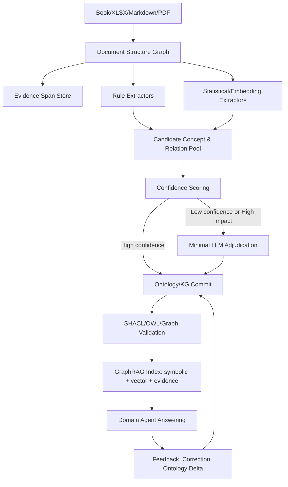
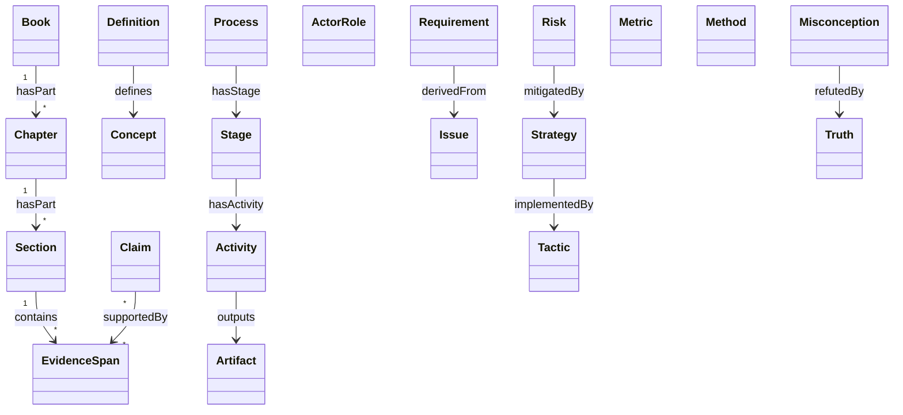
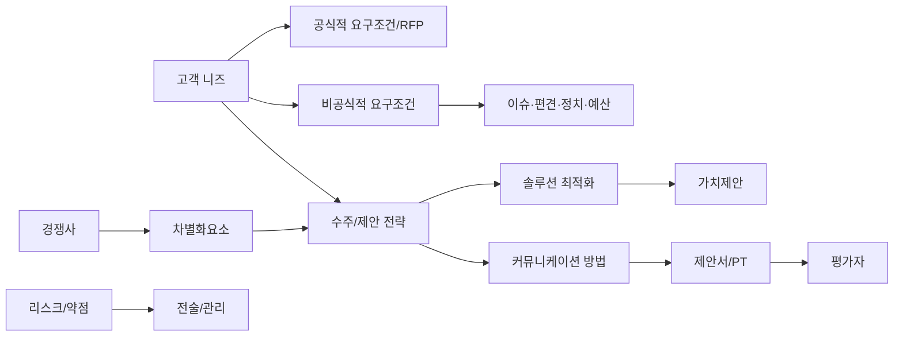
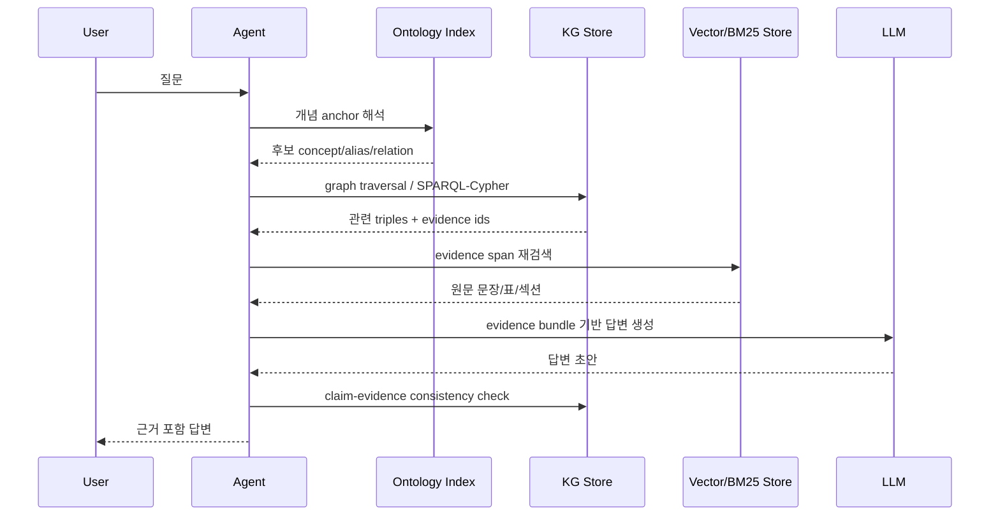
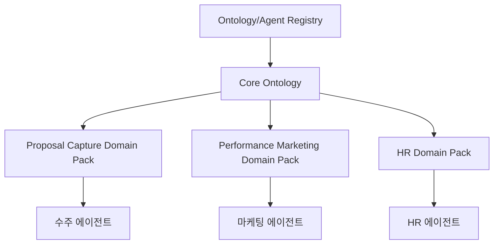

# SCOPE-KG: LLM-light 온톨로지/KG 구축 방법론 제안서  
## `자이제_1.xlsx` 기반 수주·제안 도메인 온톨로지와 범용 책-기반 에이전트 확장안

작성일: 2026-07-09  
대상 데이터: `/mnt/data/자이제_1.xlsx`의 `clean_sentences` 시트  
제안 방법론명: **SCOPE-KG** — **S**tructure-first, **C**onfidence-gated, **O**ntology-pattern, **P**rovenance-preserving, **E**vidence-grounded Knowledge Graph

---

## 0. 핵심 제안 요약

AX 측 요구는 “특정 책을 넣으면 해당 도메인의 온톨로지를 자동 구축하고, 이후 에이전트가 그 온톨로지를 RAG 방식으로 참조하여 답변하는 것”이다. 단, 모든 문장을 LLM으로 삼중항 추출하는 방식은 비용·재현성·환각·도메인 확장성에서 취약하다. 따라서 본 제안은 **LLM을 주 엔진이 아니라 심판·정규화기·불확실성 해소기**로 제한한다.

SCOPE-KG는 다음 네 가지를 동시에 만족하도록 설계한다.

1. **책 구조를 먼저 그래프화**한다. 장·절·문장·표·그림·페이지를 원천 증거 그래프로 만들고, 모든 온톨로지 주장에는 증거 span을 연결한다.
2. **규칙·통계·임베딩으로 1차 KG를 구축**한다. 정의문, “포함한다”, “결정한다”, “단계”, “오해/진실” 같은 반복 패턴과 TF-IDF/PageRank/임베딩 클러스터링으로 대부분의 후보 개념과 관계를 만든다.
3. **LLM은 confidence gate를 통과하지 못한 고가치 후보에만 사용**한다. 문장별 호출이 아니라 후보 용어·관계 묶음 단위로 배치 호출한다.
4. **온톨로지와 RAG를 분리하지 않는다.** 답변용 RAG는 텍스트 chunk만 검색하지 않고, 개념 anchor → 그래프 주변부 → 원문 evidence bundle → 생성 답변의 순서로 동작한다.

---

## 1. 업로드 데이터 진단

### 1.1 파일 구조

| 항목 | 값 |
|---|---:|
| 시트명 | `clean_sentences` |
| 데이터 행 수 | 1,366개 |
| 컬럼 수 | 6개 |
| 컬럼 | `page`, `chapter_no`, `chapter_title`, `section_no`, `section_title`, `text_for_llm_human` |
| 장 수 | 3개 본문 장 + metadata 누락 row 3개 |
| 절/소절 수 | 52개 |
| 페이지 범위 | 19–178 |

### 1.2 장별 분포

| 장 | 장 제목 | 문장/블록 수 | 절/소절 수 | 페이지 |
|---:|---|---:|---:|---:|
| 1 | 입찰과 제안 | 310 | 18 | 19–56 |
| 2 | 수주영업 | 486 | 18 | 57–118 |
| 3 | 제안서 전략 | 567 | 15 | 119–178 |

metadata가 비어 있는 row가 3개 존재한다. 이들은 각각 가치제안 수식, 고객 이슈, 전략 구현 구체화에 관한 내용이므로 삭제하지 말고 **orphan evidence span**으로 보존한 뒤, 인접 row·임베딩 유사도·용어 중복도를 이용해 가장 가능성 높은 section에 재배치해야 한다.

### 1.3 구조적 신호

| 구조 후보 | 개수 |
|---|---:|
| 프로세스/단계 후보 | 130 |
| 리스크/강약점 후보 | 89 |
| 정의 후보 | 59 |
| 표/마크다운 테이블 포함 | 56 |
| 그림/캡션 포함 | 30 |
| 오해-진실 후보 | 15 |

이 데이터는 단순 문장 집합이 아니라 **정의문, 표, 그림 캡션, 단계 프로세스, 오해/진실 대조표, 리스크/강약점 설명**이 섞인 반구조화 지식이다. 따라서 일반적인 “문장 → triple” 추출보다, 구조별 extractor를 분리하는 편이 정확하고 비용이 낮다.

### 1.4 1차 도메인 핵심어 후보

단순 빈도 기준이므로 최종 온톨로지 용어는 아니지만, 핵심 domain module의 seed로 유용하다.

| 순위 | 후보 용어 | 등장 횟수 |
|---:|---|---:|
| 1 | 고객 | 454 |
| 2 | 제안 | 424 |
| 3 | 전략 | 224 |
| 4 | 제안서 | 194 |
| 5 | 영업 | 184 |
| 6 | 솔루션 | 181 |
| 7 | 이슈 | 148 |
| 8 | 정보 | 121 |
| 9 | 수주 | 109 |
| 10 | 경쟁사 | 95 |
| 11 | 차별화 | 78 |
| 12 | 니즈 | 71 |
| 13 | 평가자 | 68 |
| 14 | 가치 | 65 |
| 15 | 경쟁자 | 62 |
| 16 | 프로세스 | 61 |
| 17 | 리스크 | 50 |
| 18 | 약점 | 46 |
| 19 | 강점 | 45 |
| 20 | 입찰 | 43 |
| 21 | 수주영업 | 43 |
| 22 | 가격 | 40 |
| 23 | RFP | 33 |
| 24 | 프레젠테이션 | 31 |
| 25 | 성과 | 26 |
| 26 | 의사결정자 | 23 |
| 27 | 차별화요소 | 22 |
| 28 | 영향자 | 22 |
| 29 | 커뮤니케이션 | 22 |
| 30 | 제안 요청서 | 22 |

---

## 2. 선행연구에서 배울 점과 한계

### 2.1 전통적 Ontology Learning from Text

초기 ontology learning 연구는 term extraction, taxonomy learning, relation extraction을 단계적으로 수행했다. Buitelaar 등의 개관 연구는 용어 추출이 텍스트 기반 온톨로지 학습의 선행 조건이며, hypernym/taxonomy와 non-hierarchical relation 추출이 핵심 과제임을 정리했다. Maedche & Staab은 온톨로지를 공유 가능한 도메인 이론으로 보고 텍스트에서 개념 구조를 학습하는 방향을 제시했다.

**배울 점**: LLM 없이도 용어·상하위·비계층 관계를 나눠 학습하는 파이프라인은 여전히 유효하다.  
**한계**: 규칙과 언어자원 의존도가 높고, 한국어·도메인 특화 표현·표/그림/프로세스 구조에는 바로 적용하기 어렵다.

### 2.2 Text2Onto와 확률적 온톨로지 모델

Text2Onto는 텍스트 자원에서 ontology modeling primitive를 추출하고, 이를 Probabilistic Ontology Model로 표현하여 변경 발견과 target language 독립성을 지원했다.

**배울 점**: 추출 결과에 confidence를 붙이고, OWL 같은 특정 표현 언어로 바로 고정하지 않는 “중간 모델”이 중요하다.  
**한계**: 실무 도메인에서는 사람이 검수해야 하는 오류가 남고, 표·도식·절 제목 등 문서 구조 신호를 충분히 활용하지 않으면 recall이 낮아진다.

### 2.3 OntoLearn Reloaded와 그래프 기반 taxonomy learning

OntoLearn Reloaded는 taxonomy backbone을 처음부터 학습하기 위한 그래프 기반 알고리즘을 제안했다. 기존 OntoLearn은 용어 추출, string inclusion 기반 term subtree, WordNet 기반 disambiguation, subtree 결합 과정을 사용했으나, WordNet 같은 일반 지식 자원 의존은 기술 도메인 학습에 제약이 될 수 있다.

**배울 점**: taxonomy는 ontology의 backbone이므로 그래프 알고리즘으로 안정화할 가치가 있다.  
**한계**: 일반 지식베이스에 없는 산업·실무 개념, 예를 들어 “수주전략”, “Blue Team Review”, “Bid/No Bid Decision” 같은 용어는 외부 lexical resource만으로 처리하기 어렵다.

### 2.4 FRED와 Semantic Web Machine Reading

FRED는 자연어 텍스트를 RDF/OWL 및 linked data로 변환하는 machine reader이며, frame semantics와 ontology design pattern을 활용한다.

**배울 점**: 추출 결과를 애초에 RDF/OWL과 설계 패턴에 맞춰 내보내면 downstream 재사용성이 높다.  
**한계**: domain-specific task ontology 없이 일반 machine reading만 수행하면 “실제 에이전트가 어떤 업무를 더 잘하게 되는가”까지 이어지기 어렵다.

### 2.5 Ontology Engineering 방법론: METHONTOLOGY, NeOn, Ontology Design Patterns

METHONTOLOGY는 specification, conceptualization, formalization, integration, implementation, maintenance 같은 생명주기 관점을 제시했다. NeOn은 reuse, re-engineering, ontology network 구축을 강조한다. Ontology Design Patterns는 반복되는 모델링 문제에 대한 작은 재사용 블록을 제공한다.

**배울 점**: 자동화하더라도 요구사항·재사용·유지보수·검증이 빠지면 연구 데모에 머문다.  
**한계**: 전통 방법론은 사람이 중심이고, 책 단위로 수많은 도메인 온톨로지를 빠르게 만드는 요구에는 속도가 부족하다.

### 2.6 LLM 기반 Ontology Learning과 OntoGPT

OntoGPT는 LLM, instruction prompt, ontology grounding을 이용해 비정형 텍스트에서 구조화 정보를 추출하는 도구이다. LLMs4OL 계열 연구는 term typing, taxonomy discovery, non-taxonomic relation extraction을 주요 태스크로 정식화했다. OLLM은 개별 관계보다 ontology subcomponent 전체를 모델링하도록 LLM을 fine-tuning하는 방향을 제시했다.

**배울 점**: LLM은 모호한 용어 typing, 관계 label normalization, schema gap 제안에는 강하다.  
**한계**: 모든 문장을 LLM으로 처리하면 비용이 커지고, hallucination·논리 불일치·형식 오류·재현성 문제가 생긴다. 최근 LLM ontology engineering review들도 LLM 적용 범위와 평가 방법이 아직 성숙 중임을 보여준다.

### 2.7 GraphRAG와 Ontology-grounded RAG

Microsoft GraphRAG는 원문에서 knowledge graph와 community hierarchy를 구축한 뒤, local/global 질의응답에 활용하는 접근을 제시했다. OG-RAG 같은 최근 연구는 retrieval을 domain-specific ontology에 grounding하는 방향을 제안한다.

**배울 점**: 긴 책이나 사내 문서처럼 “전역 질문”이 많은 데이터는 graph 기반 retrieval이 유리하다.  
**한계**: GraphRAG가 생성한 entity graph가 곧바로 ontology는 아니다. 에이전트가 안정적으로 추론하려면 class/property/constraint/provenance가 있는 formal layer가 필요하다.

---

## 3. 제안 방법론: SCOPE-KG

### 3.1 핵심 아이디어

SCOPE-KG는 **문서 구조 그래프 + 도메인 온톨로지 + 증거 KG + RAG index**를 동시에 만드는 방법론이다.



### 3.2 네 층의 그래프

| 층 | 목적 | 예시 |
|---|---|---|
| L0. Document Graph | 출처·문서 구조 보존 | Book → Chapter → Section → Row/Span |
| L1. Evidence Graph | 모든 주장에 근거 연결 | Triple → supportedBy → row 9, p.21 |
| L2. Domain Ontology | 개념·관계·제약 | CustomerNeed, Requirement, Strategy, Risk |
| L3. Task/RAG Graph | 에이전트 실행 최적화 | 질의 anchor, retrieval path, answer citation |

기존 접근은 L2만 만들거나, 반대로 L0/L1 텍스트 index만 만드는 경우가 많다. SCOPE-KG는 네 층을 분리하되, 각 ontology assertion이 반드시 L1 증거를 갖도록 강제한다.

---

## 4. 목표 KG/온톨로지 모델

### 4.1 표현 선택

권장 구현은 **RDF/OWL + SHACL + property graph projection**이다.

- 원본 truth layer: RDF dataset 또는 RDF-star/재구체화 패턴
- 개념 계층: SKOS `broader/narrower` + 필요한 부분만 OWL class/property
- 데이터 품질: SHACL shape
- provenance: PROV-O 또는 단순화한 `EvidenceSpan`, `ExtractionActivity`
- RAG 운영: Neo4j/Cypher 또는 RDF store/SPARQL 중 AX 인프라에 맞춰 projection

즉, 연구 산출물은 formal semantics를 유지하고, 서비스는 빠른 graph traversal을 위해 property graph projection을 사용할 수 있다.

### 4.2 상위 공통 ontology layer

여러 책에 공통으로 적용할 수 있는 core schema를 먼저 둔다.



이 layer는 자이제뿐 아니라 Performance Marketing, HR, 제조, 법무, 의료 가이드 등에도 재사용된다.

### 4.3 자이제 도메인 module 초안

`자이제_1.xlsx`는 수주·제안·전략 도메인이므로 다음 domain classes를 추가한다.

| Class | 상위 Class | 설명 |
|---|---|---|
| `zj:Proposal` | `Artifact` | 제안서/제안 행위 |
| `zj:RFP` | `Artifact` | 제안 요청서 |
| `zj:CustomerNeed` | `Issue` | 고객 니즈 |
| `zj:OfficialRequirement` | `Requirement` | RFP에 명시된 요구조건 |
| `zj:UnstatedRequirement` | `Requirement` | 비공식/숨은 요구조건 |
| `zj:CapturePlanning` | `Process` | 수주영업 전체의 기획·실행 |
| `zj:ProposalPlanning` | `Process` | 제안서 기획 |
| `zj:BidNoBidDecision` | `Decision` | 제안 참여 여부 결정 |
| `zj:Evaluator` | `ActorRole` | 평가자 |
| `zj:DecisionMaker` | `ActorRole` | 의사결정자 |
| `zj:Influencer` | `ActorRole` | 영향자 |
| `zj:Competitor` | `ActorRole` | 경쟁자/경쟁사 |
| `zj:Solution` | `Artifact` | 고객 문제 해결안 |
| `zj:Differentiator` | `Concept` | 차별화요소 |
| `zj:ValueProposition` | `Strategy` | 가치제안 |
| `zj:ReviewStage` | `Stage` | Blue/Pink/Red Team 등 리뷰 단계 |
| `zj:RiskGap` | `Risk` | 리스크 갭 |
| `zj:CommunicationArtifact` | `Artifact` | 제안서, PT, executive summary 등 |

### 4.4 핵심 관계 vocabulary

| 관계 | domain → range | 적용 예 |
|---|---|---|
| `kg:hasPart` | Whole → Part | 고객 니즈 → 공식/비공식 요구조건 |
| `kg:includes` | Concept → Concept | 제안서 기획 → 전략 개발 |
| `kg:hasComponent` | Capability → Capability | 제안 역량 → 영업/전략/제안서/PT 역량 |
| `kg:precedes` | Stage → Stage | 전략 리뷰 → 섹션기획서 리뷰 |
| `kg:outputs` | Activity → Artifact | 경쟁자 분석 → 경쟁사 비교표 |
| `kg:performedBy` | Activity → ActorRole | 평가 → 평가자 |
| `kg:targets` | Strategy/Tactic → ActorRole/Issue | 의사결정자 공략 |
| `kg:addresses` | Solution/Strategy → Need/Issue | 솔루션 → 고객 니즈 |
| `kg:determines` | Factor → Outcome | 제안 기획 → 제안서 품질 |
| `kg:mitigates` | Tactic → Risk | 리스크 관리 → 약점/리스크 |
| `kg:refutedBy` | Misconception → Truth | “제안서는 형식” → “전략적 제안이 핵심” |
| `kg:hasFormula` | Metric/Concept → Formula | 가치제안 → `Winner(V-C)>Loser(V-C)` |
| `kg:supportedBy` | Claim/Triple → EvidenceSpan | 모든 주장 → row/page/section |
| `skos:broader/narrower` | Concept → Concept | 수주영업 → 정보 수집 |
| `skos:altLabel` | Concept → Literal | 수주영업 → Capture Planning |

---

## 5. 자이제 데이터에서 바로 만들 수 있는 KG 예시

아래는 최종 정답 KG가 아니라, SCOPE-KG의 deterministic extractor가 높은 confidence로 만들 수 있는 seed triples이다.

| subject | predicate | object | evidence | conf. | 추출 근거 |
|---|---|---|---|---:|---|
| `zj:고객니즈` | `kg:includes` | `zj:공식적요구조건` | row 9, p.21, 1.1.1 | 0.96 | 패턴: ‘포함한다’ |
| `zj:고객니즈` | `kg:includes` | `zj:비공식적요구조건` | row 9, p.21, 1.1.1 | 0.96 | 패턴: ‘뿐만 아니라 … 포함한다’ |
| `zj:경쟁력있는제안역량` | `kg:hasComponent` | `zj:전문가영업역량` | row 3/75 | 0.92 | 정의문+열거 |
| `zj:경쟁력있는제안역량` | `kg:hasComponent` | `zj:전략개발역량` | row 3/75 | 0.92 | 정의문+열거 |
| `zj:경쟁력있는제안역량` | `kg:hasComponent` | `zj:제안서역량` | row 3/75 | 0.92 | 정의문+열거 |
| `zj:경쟁력있는제안역량` | `kg:hasComponent` | `zj:PT역량` | row 3/75 | 0.92 | 정의문+열거 |
| `zj:수주영업` | `skos:altLabel` | `Capture Planning` | row 230, 1.3.1 | 0.88 | 괄호 영문 표기 |
| `zj:제안서기획` | `kg:includes` | `zj:전략개발` | row 221, 1.3.1 | 0.86 | 포함한다 패턴 |
| `zj:제안기획` | `kg:determines` | `zj:제안서품질` | row 249, 1.3.3 | 0.84 | 제목/문장 패턴 |
| `zj:제안프로세스` | `kg:hasStage` | `zj:기회분석` | row 234 | 0.90 | 단계 테이블 |
| `zj:제안프로세스` | `kg:hasStage` | `zj:수주영업단계` | row 236 | 0.90 | 단계 테이블 |
| `zj:제안프로세스` | `kg:hasStage` | `zj:제안서기획단계` | row 237 | 0.90 | 단계 테이블 |
| `zj:제안프로세스` | `kg:hasStage` | `zj:제안서작성단계` | row 238 | 0.90 | 단계 테이블 |
| `zj:오해_영업이모든것을결정한다` | `kg:refutedBy` | `zj:진실_조직차원정보습득과전략적제안` | row 145, 1.2 | 0.91 | 오해/진실 표 |
| `zj:가치제안` | `kg:hasFormula` | `Winner(V-C) > Loser(V-C)` | orphan row, 재배치 필요 | 0.65 | 수식/그림 텍스트 |

### 5.1 자이제 KG의 중심축



이 graph shape은 자이제에만 갇히지 않는다. Performance Marketing 책을 넣으면 같은 구조에서 `CustomerNeed` 대신 `AudienceNeed`, `Proposal` 대신 `CampaignCreative`, `Evaluator` 대신 `TargetAudience/PlatformAlgorithm`, `Metric`은 `ROAS/CPA/CVR/LTV`로 채워진다.

---

## 6. 구축 파이프라인 상세

### 6.1 Step A — 문서 구조 그래프 생성

입력 row를 다음 객체로 정규화한다.

```yaml
EvidenceSpan:
  id: zj:span/row_0009
  source_file: 자이제_1.xlsx
  sheet: clean_sentences
  row_no: 9
  page: 21
  chapter_no: 1
  chapter_title: 입찰과 제안
  section_no: 1.1.1
  section_title: 제안서를 잘 써야 입찰에 성공한다
  text: 고객의 니즈는 제안 요청서에 공개된 공식적인 요구조건뿐만 아니라 비공식적인 요구조건까지 포함한다.
```

구조 그래프는 rule로 생성 가능하다.

```turtle
zj:book/jaije_1 a kg:Book ;
  kg:hasPart zj:chapter/1, zj:chapter/2, zj:chapter/3 .

zj:chapter/2 a kg:Chapter ;
  rdfs:label "수주영업" ;
  kg:hasPart zj:section/2.1, zj:section/2.2, zj:section/2.3, zj:section/2.4 .
```

### 6.2 Step B — span type classifier

각 row를 한 가지 이상 type으로 태깅한다.

| Type | 규칙 예시 | 자이제 예 |
|---|---|---|
| `DefinitionSpan` | `이란`, `란`, `의미한다`, `뜻한다` | “경쟁력 있는 제안 역량이란…” |
| `InclusionSpan` | `포함한다`, `구성된다`, `~까지를 포함` | 고객 니즈 includes 요구조건 |
| `ProcessSpan` | `단계`, `프로세스`, `Milestone`, `리뷰` | 제안 프로세스 단계 |
| `TableSpan` | Markdown table 또는 `표 n.` | 오해/진실 표, 활동/결과물 표 |
| `FigureSpan` | `그림 n.` | 프로세스 단계 그림 |
| `ContrastSpan` | `오해`, `진실`, `반면`, `그러나` | 제안 오해와 진실 |
| `RiskSpan` | `리스크`, `약점`, `강점`, `갭` | 리스크 관리 |
| `FormulaSpan` | `=`, `>`, `%`, 수식 패턴 | 가치제안 공식 |

이 분류는 LLM 없이 regex와 간단한 classifier로 가능하다.

### 6.3 Step C — 후보 개념 추출

후보 개념은 네 경로에서 만든다.

1. **구조 seed**: chapter_title, section_title의 명사구
2. **용어 seed**: 빈도, TF-IDF, C-value/NC-value, RAKE/YAKE류 keyphrase
3. **패턴 seed**: `X란`, `X은/는`, `X를 Y라고 한다`, 괄호 영문 `RFP: Request for Proposal`
4. **표/그림 seed**: 표 제목, 컬럼명, 단계명, 활동/결과물

후보 개념 객체는 바로 ontology class가 아니라 상태를 가진다.

```yaml
CandidateTerm:
  label: "수주전략"
  source: [section_title, frequency, process_table]
  evidence_count: 17
  candidate_type: Strategy
  status: candidate  # candidate -> accepted_term -> concept -> class/individual
  aliases: ["Capture Strategy"]
  confidence: 0.81
```

### 6.4 Step D — 관계 추출

관계 추출은 “문장 생성”이 아니라 “패턴 family”로 분할한다.

| 패턴 family | 예시 규칙 | 생성 관계 |
|---|---|---|
| 정의 | `X이란 Y를 의미한다` | `X kg:definedAs Y`, `X a inferredType` |
| 포함 | `X는 A뿐 아니라 B까지 포함한다` | `X kg:includes A`, `X kg:includes B` |
| 원인/필요 | `A를 위해서는 B가 필요하다` | `B kg:enables A` |
| 영향/결정 | `A가 B를 결정한다` | `A kg:determines B` |
| 단계 | `단계 n: X` | `Process kg:hasStage X`, stage ordering |
| 활동/결과물 표 | `활동 | 결과물` | `Activity kg:outputs Artifact` |
| 오해/진실 표 | `오해 | 진실` | `Misconception kg:refutedBy Truth` |
| 비교 표 | 행/열 구조 | `Alternative kg:comparedOn Metric` |
| 수식 | `V > C`, `Winner(V-C)>...` | `Metric kg:hasFormula Formula` |

### 6.5 Step E — 상하위 taxonomy 유도

Taxonomy는 다음 증거를 결합한다.

1. 문서 계층: `2.4 설득력이 높은 제안` 아래 `2.4.1 고객의 구매단계`, `2.4.2 신뢰도`, `2.4.3 커뮤니케이션 기술`
2. 문자열 포함: `제안 전략` → `전략`, `수주영업` → `영업`
3. 관계 패턴: `X는 Y의 종류`, `X에는 A/B/C`
4. 임베딩 클러스터: 유사 concept 묶음
5. 선택적 LLM: taxonomy conflict 또는 high-centrality 후보에만 사용

문서 목차는 authorial structure이므로 초기 taxonomy prior로 매우 강하다. 다만 목차의 `hasPart`를 곧바로 `subClassOf`로 바꾸면 오류가 생긴다. 예를 들어 “리스크 관리”는 “실전 전략”의 부분이지만 반드시 subclass는 아니다. 따라서 초기에는 `kg:coveredIn` 또는 `skos:related/broader`로 두고, 검증된 경우만 `rdfs:subClassOf`로 승격한다.

### 6.6 Step F — confidence scoring

각 assertion에 confidence를 부여한다.

```text
confidence =
  0.30 * pattern_score
+ 0.20 * evidence_count_score
+ 0.15 * structure_prior
+ 0.10 * table_or_caption_prior
+ 0.10 * embedding_cluster_stability
+ 0.10 * ontology_constraint_pass
+ 0.05 * source_quality_score
```

LLM 호출 조건은 다음처럼 제한한다.

```text
LLM_needed = 
  confidence < 0.65
  OR relation_conflict == true
  OR centrality(term) >= p90 AND type_unknown == true
  OR SHACL_violation_count(term) >= 2
```

이렇게 하면 전체 1,366개 row를 LLM에 넣지 않고도, 고영향·저확신 후보만 검토할 수 있다.

### 6.7 Step G — Ontology commit과 validation

1. Candidate pool에서 accepted term만 KG에 반영
2. 동일어/별칭 정규화: `RFP`, `제안 요청서`, `Request for Proposal`
3. SHACL validation
4. OWL reasoning은 최소한으로 사용  
   - class disjointness
   - domain/range check
   - transitive `hasPart`/`broader`
5. invalid assertion은 KG에 바로 삭제하지 않고 `kg:RejectedAssertion`으로 남긴다.

---

## 7. LLM 최소 사용 전략

### 7.1 LLM을 쓰지 않는 영역

| 작업 | LLM 대체 |
|---|---|
| 장/절/문장 구조화 | 엑셀 metadata |
| 표/그림/단계 감지 | regex, Markdown table parser |
| 정의/포함/결정/필요 패턴 | rule extractor |
| 빈출 핵심어 추출 | TF-IDF, C-value, RAKE/YAKE, TextRank |
| 유사어 후보 | sentence embedding + clustering |
| confidence 계산 | deterministic scoring |
| KG validation | SHACL/OWL rules |

### 7.2 LLM을 쓰는 영역

LLM은 네 가지 역할로 제한한다.

1. **Canonicalization Judge**  
   “제안 요청서”, “RFP”, “Request for Proposal”이 같은 개념인지 판정한다.
2. **Type Adjudicator**  
   “Bid/No Bid Decision”이 `Decision`인지 `ProcessStage`인지 판정한다.
3. **Relation Label Normalizer**  
   추출된 자연어 관계를 사전 정의 relation vocabulary에 매핑한다.
4. **Competency Question Generator**  
   온톨로지가 답해야 하는 질문 세트를 만든다.

### 7.3 배치 프롬프트 템플릿

#### Prompt 1 — 용어 정규화

```text
역할: 온톨로지 용어 정규화 심판.
입력: 후보 용어 목록과 각 용어의 증거 문장 1~3개.
출력: JSON만 반환.

규칙:
- 원문에 없는 새 개념을 만들지 말 것.
- 같은 개념이면 canonical_label 하나로 묶을 것.
- 확신이 낮으면 "needs_human_review": true.
- type은 제공된 목록 중 하나만 선택: Concept, Process, Stage, Activity, Artifact, ActorRole, Requirement, Risk, Metric, Strategy, Tactic, Claim.

입력:
[
  {
    "term": "RFP",
    "evidence": ["쉬플리의 조사에 따르면 고객의 제안 요청서(RFP: Request for Proposal)..."]
  },
  ...
]

출력 스키마:
{
  "canonical_terms": [
    {
      "canonical_label": "...",
      "aliases": ["..."],
      "type": "...",
      "confidence": 0.0,
      "needs_human_review": false,
      "reason": "원문 근거 기반 한 문장"
    }
  ]
}
```

#### Prompt 2 — 관계 정규화

```text
역할: 추출된 후보 관계를 온톨로지 relation vocabulary에 매핑하는 심판.
금지: 새로운 사실 생성, 원문 근거 없는 추론.
가능 relation:
includes, hasComponent, precedes, outputs, performedBy, targets, addresses,
determines, mitigates, refutedBy, hasFormula, altLabel, broader, narrower, relatedTo

입력:
{
  "subject": "제안 기획",
  "raw_relation": "결정한다",
  "object": "제안서 품질",
  "evidence": "제안 기획이 제안서 품질을 결정한다"
}

출력:
{
  "predicate": "determines",
  "confidence": 0.92,
  "valid": true,
  "needs_human_review": false
}
```

LLM 출력은 바로 commit하지 않고 SHACL과 evidence checker를 통과해야 한다.

---

## 8. RAG 에이전트 설계

### 8.1 기본 원리

에이전트는 “책 내용을 아는 척”하지 않고, **온톨로지에서 질의 anchor를 잡고 원문 evidence bundle을 회수한 뒤 답변**한다.



### 8.2 Hybrid retrieval scoring

```text
score(evidence_span, query) =
  0.30 * BM25(query, span.text)
+ 0.25 * embedding_similarity(query, span.text)
+ 0.20 * graph_proximity(query_concept, span_concepts)
+ 0.10 * concept_centrality
+ 0.10 * assertion_confidence
+ 0.05 * section_relevance
```

질문 예시: “왜 제안서를 잘 써도 입찰에 실패할 수 있나?”

1. anchor: `제안서`, `입찰 성공`, `고객 니즈`, `공식적 요구조건`, `비공식적 요구조건`
2. graph path: `제안서 -> RFP -> 공식적 요구조건`, `고객 니즈 -> 비공식적 요구조건`
3. evidence: row 5–15, p.21 중심
4. 답변: RFP가 고객 니즈 전체가 아니라는 구조적 설명 + 공식/비공식 요구조건 구분

### 8.3 답변 품질 guardrail

생성 답변의 각 핵심 claim은 다음 중 하나를 가져야 한다.

- `supportedBy` evidence id
- ontology axiom 또는 SHACL rule
- “원문 근거 없음/추론” 명시

근거 없는 claim은 답변에서 제거하거나 “원문에는 명시되어 있지 않다”로 처리한다.

---

## 9. 다양한 도메인으로 확장하는 방법

### 9.1 Domain Pack 구조

각 책은 공통 core ontology 위에 domain pack을 얹는다.

```yaml
DomainPack:
  name: performance_marketing
  seed_labels:
    ActorRole: [고객, 광고주, 매체, 플랫폼, 사용자]
    Metric: [ROAS, CPA, CPC, CTR, CVR, LTV]
    Process: [캠페인 기획, 집행, 최적화, 리포팅]
    Artifact: [광고 소재, 랜딩페이지, 리포트, 대시보드]
    Strategy: [타겟팅 전략, 입찰 전략, 예산 배분]
  extraction_patterns:
    - formula
    - funnel_stage
    - metric_definition
    - channel_comparison
```

자이제 domain pack은 다음처럼 시작한다.

```yaml
DomainPack:
  name: proposal_capture
  seed_labels:
    ActorRole: [고객, 평가자, 의사결정자, 영향자, 경쟁사, 사용자, 행정가]
    Metric: [성공률, 수주액, 입찰비용, 충실도, 신뢰도, 가치]
    Process: [수주영업, 전략 개발, 제안서 기획, 제안서 작성, 프레젠테이션]
    Artifact: [RFP, 제안서, Capture Plan, Executive Summary, 전략기술서, 경쟁사 비교표]
    Strategy: [수주전략, 제안전략, 1등 전략, 2등 전략, 정공법, 역공법]
    Risk: [리스크 갭, 약점, 숨은 니즈, 정치적 역학 관계]
```

핵심은 domain pack이 ontology를 하드코딩하는 것이 아니라, **type label과 extractor 우선순위만 제공**한다는 점이다.

### 9.2 신규 책 처리 흐름

1. 목차/section 구조 추출
2. domain-independent core extractor 실행
3. 자동 domain profiling  
   - 상위 빈도 용어
   - section title cluster
   - 표/수식/프로세스 분포
4. domain pack 자동 초안 생성
5. high-confidence KG commit
6. LLM으로 domain pack 초안과 ambiguous terms만 검토
7. CQ 기반 평가 후 운영

---

## 10. 평가 설계

### 10.1 온톨로지/KG 평가

| 평가축 | 지표 |
|---|---|
| Structural validity | SHACL pass rate, domain/range violation count |
| Evidence grounding | triple 중 evidence 없는 비율 0% 목표 |
| Extraction quality | term/relation precision, recall, F1 |
| Hallucination | subject/relation/object hallucination rate |
| Taxonomy quality | ancestor precision, cycle count, orphan concept count |
| Maintainability | duplicate concept ratio, alias resolution accuracy |
| Cost | 1,000 spans당 LLM token/call 수 |
| Portability | 다른 책 domain pack 적용 시 수정 rule 수 |

### 10.2 RAG 평가

| 평가축 | 지표 |
|---|---|
| Retrieval | Hit@k, MRR, graph path relevance |
| Answer groundedness | 답변 claim 중 evidence 연결 비율 |
| Faithfulness | 원문 불일치 claim 비율 |
| Coverage | competency question pass rate |
| Latency | 질의당 graph retrieval + generation 시간 |
| Explainability | 답변 내 page/section/evidence 제시율 |

### 10.3 자이제용 Competency Questions 초안

1. RFP의 공식 요구조건만 충족해도 제안 성공률이 100%가 아닌 이유는 무엇인가?
2. 고객 니즈는 어떤 하위 요구조건으로 구성되는가?
3. 수주영업과 일반 세일즈의 차이는 무엇인가?
4. 제안 프로세스의 주요 단계와 각 단계의 산출물은 무엇인가?
5. 제안 기획은 제안서 품질에 어떤 영향을 주는가?
6. 평가자 유형별 관심사는 어떻게 다른가?
7. 가치제안은 어떤 수식/개념으로 설명되는가?
8. 경쟁사 분석은 어떤 차별화요소를 찾는 데 기여하는가?
9. 리스크 관리는 전략 개발에서 어떤 역할을 하는가?
10. “가격이 전부”라는 오해는 책에서 어떻게 반박되는가?

---

## 11. 구현 로드맵

### Phase 1 — 자이제 PoC, 1권 대상

산출물:

- L0 문서 구조 KG
- L1 evidence store
- 자이제 domain module v0.1
- high-confidence triples 200–500개
- CQ 10개 평가 리포트
- GraphRAG 질의응답 데모

핵심 작업:

1. 엑셀 row를 EvidenceSpan으로 변환
2. table/figure/definition/process extractor 구현
3. candidate term scoring
4. relation vocabulary와 SHACL shape 작성
5. minimal LLM adjudication batch 1회 실행
6. RAG evidence bundle 구성

### Phase 2 — 다른 도메인 1권 적용

예: Performance Marketing 도서

목표:

- core ontology 재사용률 측정
- domain pack 자동 생성률 측정
- 자이제 전용 rule 제거 여부 확인
- LLM call/token 감소율 확인

### Phase 3 — Agent Registry

여러 책/domain agent를 관리한다.



Registry는 다음 정보를 저장한다.

- ontology version
- source book/document
- supported competency questions
- domain pack schema
- graph index endpoint
- evaluation score
- last update delta

---

## 12. 선행연구 대비 SCOPE-KG의 차별성

| 기존 접근 | 장점 | 한계 | SCOPE-KG의 극복 |
|---|---|---|---|
| 전통 OL | 비용 낮음, 재현성 높음 | 도메인/언어/표 구조 취약 | 한국어 문서 구조·표·프로세스 extractor 강화 |
| Text2Onto | probabilistic model, change discovery | 실무 구조 활용 부족 | confidence scoring + evidence graph + SHACL |
| OntoLearn | taxonomy backbone 안정화 | 일반 lexical resource 의존 | 문서 목차/section prior + embedding cluster |
| FRED | RDF/OWL 출력 | task ontology와 연결 약함 | agent task/RAG layer까지 포함 |
| OntoGPT | schema-guided LLM extraction | 비용·환각·일관성 | LLM을 gate 뒤의 심판으로 제한 |
| GraphRAG | 전역 질문에 강함 | formal ontology 부족 | OWL/SHACL/provenance가 있는 GraphRAG |
| 수동 OE 방법론 | 품질 높음 | 속도 낮음 | METHONTOLOGY/NeOn 생명주기를 자동 pipeline으로 축소 |

---

## 13. 연구적으로 강조할 수 있는 혁신 포인트

### 13.1 Evidence-first Ontology Learning

대부분 자동 ontology learning은 “개념/관계”부터 만들고 근거를 나중에 붙인다. SCOPE-KG는 반대로 모든 span을 먼저 evidence entity로 만들고, **근거 없는 ontology assertion은 원천적으로 commit하지 않는다.**

### 13.2 Confidence-gated LLM

LLM 비용 최소화의 핵심은 모델을 안 쓰는 것이 아니라, **언제 쓸지 계산 가능하게 만드는 것**이다. confidence, centrality, SHACL violation, conflict flag를 기준으로 LLM 호출을 결정하면 재현성과 비용 통제가 가능하다.

### 13.3 Document Structure as Ontology Prior

책은 무작위 문장 모음이 아니다. 장·절·표·그림·단계·제목은 저자의 개념 구조를 담고 있다. 이를 ontology prior로 활용하면 LLM보다 저렴하고 안정적인 taxonomy seed를 얻을 수 있다.

### 13.4 Ontology-RAG Co-design

온톨로지를 따로 만들고 RAG를 따로 붙이는 방식이 아니라, 처음부터 answer retrieval을 고려해 `EvidenceSpan`, `Claim`, `Concept`, `Section`을 연결한다. 이 때문에 에이전트 답변은 “개념적으로 맞고, 원문 근거가 있으며, 추적 가능한” 형태가 된다.

### 13.5 Domain Pack 방식의 확장성

자이제 전용 온톨로지를 하나 만드는 것이 아니라, core ontology + domain pack + extractor profile 구조로 만들면 “책을 바꾸면 agent도 바뀌는” 구조가 가능하다.

---

## 14. 실무 구현 시 권장 데이터 모델

### 14.1 Assertion 객체

```json
{
  "assertion_id": "assertion:zj:000123",
  "subject": "zj:CustomerNeed",
  "predicate": "kg:includes",
  "object": "zj:UnstatedRequirement",
  "assertion_type": "ObjectPropertyAssertion",
  "confidence": 0.96,
  "extractor": "rule.inclusion.v1",
  "supported_by": ["span:row_0009"],
  "status": "accepted",
  "created_at": "2026-07-09",
  "ontology_version": "proposal_capture:0.1.0"
}
```

### 14.2 SHACL shape 예시

```turtle
kg:AssertionShape a sh:NodeShape ;
  sh:targetClass kg:Assertion ;
  sh:property [
    sh:path kg:supportedBy ;
    sh:minCount 1 ;
    sh:class kg:EvidenceSpan ;
  ] ;
  sh:property [
    sh:path kg:confidence ;
    sh:datatype xsd:decimal ;
    sh:minInclusive 0 ;
    sh:maxInclusive 1 ;
  ] .
```

### 14.3 Cypher projection 예시

```cypher
MERGE (c:Concept {id: "zj:CustomerNeed", label: "고객 니즈"})
MERGE (r:Concept {id: "zj:UnstatedRequirement", label: "비공식적 요구조건"})
MERGE (s:EvidenceSpan {id: "span:row_0009", page: 21, section: "1.1.1"})
MERGE (c)-[:INCLUDES {confidence: 0.96, assertion_id: "assertion:zj:000123"}]->(r)
MERGE (c)-[:SUPPORTED_BY]->(s)
```

---

## 15. 바로 시작할 수 있는 작업 분해

1. `xlsx_to_evidence_span.py`  
   엑셀 row를 EvidenceSpan JSONL로 변환한다.
2. `span_classifier.py`  
   definition/table/process/contrast/risk/formula 태깅.
3. `term_extractor.py`  
   section title, TF-IDF, pattern seed, table header 기반 후보 용어 추출.
4. `relation_rule_extractor.py`  
   includes/defines/determines/precedes/refutedBy/outputs 등 rule family 구현.
5. `confidence_scorer.py`  
   evidence count, pattern score, structure prior로 assertion 점수화.
6. `ontology_commit.py`  
   accepted assertion을 RDF/Turtle 또는 property graph로 저장.
7. `llm_adjudicator.py`  
   confidence gate를 통과한 후보만 batch prompt 호출.
8. `rag_retriever.py`  
   concept anchor → graph traversal → evidence bundle 구성.
9. `answer_validator.py`  
   생성 답변 claim과 evidence id 연결 여부 검사.
10. `evaluation_cq.py`  
   competency questions에 대한 retrieval/answer 평가.

---

## 16. 참고문헌 및 참고 URL

1. Buitelaar, Cimiano, Magnini. *Ontology Learning from Text: Methods, Evaluation and Applications*. https://pub.uni-bielefeld.de/download/2497696/2525557/pci_OL-Book-Intro.pdf  
2. Maedche & Staab. *Ontology Learning for the Semantic Web*. https://www.csee.umbc.edu/courses/771/papers/ieeeIntelligentSystems/ontologyLearning.pdf  
3. Cimiano & Völker. *Text2Onto: A Framework for Ontology Learning and Data-driven Change Discovery*. https://link.springer.com/chapter/10.1007/11428817_21  
4. Velardi et al. *OntoLearn Reloaded: A Graph-Based Algorithm for Taxonomy Induction*. https://direct.mit.edu/coli/article/39/3/665/1442/OntoLearn-Reloaded-A-Graph-Based-Algorithm-for  
5. Gangemi et al. *Semantic Web Machine Reading with FRED*. https://semantic-web-journal.net/system/files/swj1379.pdf  
6. Fernández-López et al. *METHONTOLOGY*. https://oa.upm.es/5484/1/METHONTOLOGY_.pdf  
7. Gómez-Pérez et al. *NeOn Methodology for Building Ontology Networks*. https://oa.upm.es/5475/1/INVE_MEM_2009_64399.pdf  
8. Noy & McGuinness. *Ontology Development 101*. https://protege.stanford.edu/publications/ontology_development/ontology101.pdf  
9. Gangemi & Presutti. *Ontology Design Patterns*. https://ideas.repec.org/h/spr/ihichp/978-3-540-92673-3_10.html  
10. W3C. *RDF 1.1 Concepts and Abstract Syntax*. https://www.w3.org/TR/rdf11-concepts/  
11. W3C. *OWL 2 Web Ontology Language Primer*. https://www.w3.org/TR/owl2-primer/  
12. W3C. *SHACL*. https://www.w3.org/TR/shacl/  
13. W3C. *PROV-O*. https://www.w3.org/TR/prov-o/  
14. Monarch Initiative. *OntoGPT Documentation*. https://monarch-initiative.github.io/ontogpt/  
15. LLMs4OL 2024 Overview. https://arxiv.org/html/2409.10146v1  
16. Lo et al. *End-to-End Ontology Learning with Large Language Models*. https://openreview.net/forum?id=UqvEHAnCJC  
17. Bakker et al. *Ontology Learning from Text: an Analysis on LLM*. https://ceur-ws.org/Vol-3874/paper5.pdf  
18. Li et al. *Large Language Models for Ontology Engineering: A Systematic Literature Review*. https://www.semantic-web-journal.net/content/large-language-models-ontology-engineering-systematic-literature-review  
19. Zaratiana et al. *GLiNER: Generalist Model for Named Entity Recognition*. https://aclanthology.org/2024.naacl-long.300/  
20. Huguet Cabot & Navigli. *REBEL: Relation Extraction By End-to-end Language generation*. https://aclanthology.org/2021.findings-emnlp.204.pdf  
21. Edge et al. *From Local to Global: A Graph RAG Approach to Query-Focused Summarization*. https://arxiv.org/abs/2404.16130  
22. Microsoft GraphRAG Documentation. https://microsoft.github.io/graphrag/  
23. Sharma et al. *OG-RAG: Ontology-grounded Retrieval-Augmented Generation*. https://aclanthology.org/2025.emnlp-main.1674.pdf  
24. KoSimCSE Korean sentence embedding repository. https://github.com/BM-K/Sentence-Embedding-Is-All-You-Need  
25. KOMORAN Korean Morphological Analyzer. https://github.com/shineware/komoran  

---

## 17. 결론

`자이제_1.xlsx`는 이미 장·절·문장·표·그림·프로세스가 정제되어 있어, 처음부터 LLM 대량 호출로 KG를 만들 필요가 없다. 가장 합리적인 전략은 **문서 구조와 명시적 언어 패턴으로 high-confidence KG를 먼저 만들고, LLM은 모호한 핵심 후보에만 사용하는 것**이다.

SCOPE-KG의 핵심 산출물은 단순 triple 목록이 아니라 다음 네 가지다.

1. 증거 추적 가능한 온톨로지/KG
2. 도메인 agent가 사용할 수 있는 GraphRAG retrieval 구조
3. 새로운 책에도 적용 가능한 core ontology + domain pack 체계
4. 비용·정확도·확장성을 함께 관리하는 confidence-gated LLM 운영 원칙

이 방식으로 자이제 기반 수주 에이전트를 먼저 만들고, 이후 Performance Marketing 등 다른 책으로 확장하면 AX가 원하는 “수많은 책 기반 전문 에이전트”를 하나의 공통 방법론 위에서 반복 생산할 수 있다.
