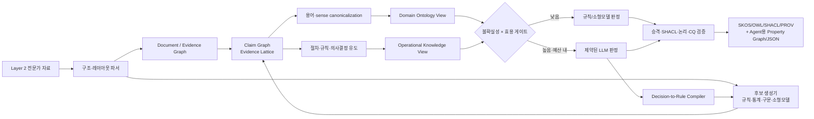
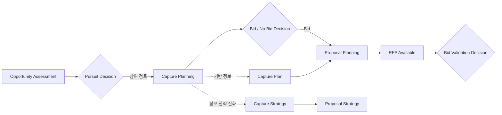
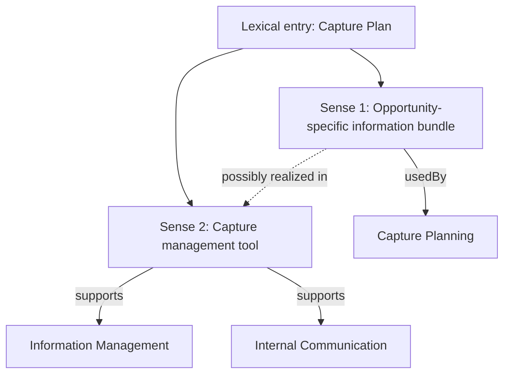

# TRACE-OL: Layer 2 전문가 자료로부터 직무 온톨로지를 자동 구축하는 방법론

> **Traceable, Rule-aware, Adaptive, Confidence-gated, Evidence-preserving Ontology Learning**  
> 자이제 자료를 최초 실증 도메인으로 사용하되, 법인파산·스타트업 투자·Performance Marketing 등 서로 다른 직무 전문가 자료에도 같은 코어 파이프라인을 적용하기 위한 연구 설계안

- 문서 버전: 연구 방법론 제안 v0.9
- 작성 기준일: 2026-07-10
- 대상 입력: **Layer 2 직무별 전문가 자료만**
- 대상 출력: 근거 추적형 직무 온톨로지, 업무 지식 그래프, 규칙·제약 그래프 및 검증 리포트
- 최초 실증 데이터: `자이제_1 (2).xlsx`

---

## 문서 구성

- [초록](#초록)
- [1. 연구 범위와 문제 정의](#1-연구-범위와-문제-정의)
- [2. 자이제 데이터 진단](#2-자이제-데이터-진단)
- [3. 선행 연구에서 배울 점과 남은 공백](#3-선행-연구에서-배울-점과-남은-공백)
- [4. TRACE-OL의 핵심 연구 기여](#4-trace-ol의-핵심-연구-기여)
- [5. 네 개의 동기화된 그래프 뷰](#5-네-개의-동기화된-그래프-뷰)
- [6. 도메인 중립 Work Knowledge Kernel](#6-도메인-중립-work-knowledge-kernel)
- [7. TRACE-OL 상세 파이프라인](#7-trace-ol-상세-파이프라인)
- [8. 자이제 데이터에 적용한 초기 KG 설계](#8-자이제-데이터에-적용한-초기-kg-설계)
- [9. 직렬화 예시](#9-직렬화-예시)
- [10. 최소 LLM 사용 설계](#10-최소-llm-사용-설계)
- [11. 구현 청사진](#11-구현-청사진)
- [12–13. 연구 질문과 평가 설계](#12-연구-질문과-검증-가설)
- [14. 타 도메인 확장 프로토콜](#14-타-도메인-확장-프로토콜)
- [15–18. 실패 대응·수행 순서·차별화·권고안](#15-예상-실패-모드와-대응)
- [부록과 참고문헌](#부록-a-자이제-1차-annotation-guideline-초안)

---

## 초록

이 문서는 직무 표준 메타데이터(Layer 1)나 기업 맞춤 데이터(Layer 3)에 의존하지 않고, 교재·가이드·매뉴얼·강의 전사문·표·그림 설명과 같은 **직무별 전문가 자료(Layer 2)**만으로 도메인 온톨로지와 업무 지식 그래프를 자동 구축하는 방법론을 제안한다.

핵심 제안은 LLM을 문서 전체의 삼중항 생성기로 사용하지 않는 것이다. 대신 문서 계층과 레이아웃을 먼저 복원하고, 언어 규칙·통계적 용어 추출·구문/의미역 분석·약한 감독·소형 판별 모델을 이용해 대부분의 후보를 만든다. 이후 각 후보를 원문 근거, 문맥, 주장 유형, 양태, 극성, 조건과 함께 **증거 격자(evidence lattice)**에 보존한다. LLM은 불확실하면서 그래프 전체에 미치는 영향이 큰 후보에만 제한적으로 호출하며, 채택된 판단은 재사용 가능한 규칙 또는 labeling function으로 컴파일한다. 따라서 배치가 누적될수록 LLM 호출량이 감소한다.

이 방법론의 중심 원칙은 **“Claim-first, Ontology-later”**이다. 문장을 곧바로 RDF/OWL 사실로 확정하지 않고, 먼저 정의·절차·조건·의무·금지·권고·인과·비교·예시·반례·통계·질문을 구분한 원자 주장으로 만든다. 반복 근거, 문서 구조, 타입 일관성, 충돌 검사, competency question 충족도와 제약 검증을 통과한 주장만 개념, 관계, 프로세스, 규칙 또는 공리로 승격한다. 이 방식은 전문가 자료에서 특히 중요한 “해야 한다”, “피해야 한다”, “경우”, “목적”, “잘못된 예”를 일반 사실 삼중항으로 오인하는 문제를 줄인다.

제안 명칭은 **TRACE-OL**이다. 주요 차별점은 다음 다섯 가지다.

1. 문서 구조·표·그림·문장 근거를 1급 객체로 보존하는 **근거 우선 그래프**
2. 정의·규정·절차·예시를 분리한 **규칙 인식형 원자 주장 모델**
3. 조기 병합을 피하고 대안 해석을 보존하는 **증거 격자와 가역적 승격**
4. 불확실성뿐 아니라 중심성·위험도·신규성까지 고려하는 **효용 기반 선택적 LLM 게이트**
5. LLM 판정을 규칙으로 환원하여 다음 문서와 다음 도메인의 호출 비용을 줄이는 **Decision-to-Rule Distillation**

이 문서는 자이제 데이터의 실제 구조와 예시를 반영한 KG 설계, 단계별 알고리즘, 데이터 모델, 프롬프트 계약, 평가 지표, 비교 실험, 타 도메인 복제 프로토콜을 포함한다. 제시된 성능 수치는 달성 결과가 아니라 후속 실험에서 검증할 **연구 목표**다.

---

## 1. 연구 범위와 문제 정의

### 1.1 이번 연구에서 다루는 것

입력은 특정 직무에 관한 전문가 자료 집합이다.

- 전문 서적과 교재
- 업무 가이드·매뉴얼·체크리스트
- 산출물 템플릿과 작성 예시
- 표와 그림 설명
- 강의 영상의 전사문
- 전문가 인터뷰 또는 사례 설명

출력은 다음 요소를 포함하는 패키지다.

- 도메인 용어와 동의어·약어·다의어를 담은 어휘 그래프
- 개념과 상하위 관계를 담은 경량 TBox
- 업무 단계·활동·역할·입력·산출물·의사결정·위험을 담은 운영 그래프
- 의무·금지·권고·조건·예외를 담은 규칙/제약 그래프
- 모든 항목의 원문 위치·문맥·신뢰도·처리 이력을 담은 provenance 그래프
- 검토가 필요한 후보, 충돌, 미해결 의미를 담은 감사 리포트

### 1.2 이번 연구에서 의도적으로 제외하는 것

- NCS, APQC, Q-net 등 Layer 1 표준 체계와의 정렬
- 고객사 내부 용어·시스템·조직 구조 등 Layer 3 맞춤화
- 외부 지식베이스를 정답으로 사용하는 distant supervision
- 특정 에이전트의 런타임 프롬프트 최적화
- 최초 단계부터 완전한 상위 온톨로지 또는 산업 표준을 설계하는 작업

단, 도메인 일반화를 위해 사용하는 작은 **Work Knowledge Kernel**은 Layer 1 직무 표준이 아니다. 이는 어떤 전문가 자료에서도 관찰되는 `업무`, `단계`, `행위자`, `산출물`, `규칙`, `조건`, `위험`, `근거` 같은 추출 인터페이스를 정의하는 방법론 수준의 메타모델이다. 이를 제거하면 “완전 schema-free”라는 명목 아래 관계명이 무한히 파편화되고 도메인 간 성능을 비교하기 어려워진다.

### 1.3 형식적 문제 정의

구조화되지 않은 전문가 자료 집합을 다음과 같이 둔다.

\[
D = \{(b_i, h_i, l_i, s_i)\}_{i=1}^{N}
\]

- \(b_i\): 문장, 목록, 표, 셀, 캡션, 수식 등 원문 블록
- \(h_i\): 장·절·페이지·행·선후관계로 구성된 문서 계층
- \(l_i\): 레이아웃 타입
- \(s_i\): 원문 위치와 체크섬

목표 출력은 다음 튜플이다.

\[
O = (L, C, T, R, K, A, P, V)
\]

- \(L\): lexical entries, 표기·약어·동의어·sense
- \(C\): domain concepts
- \(T\): taxonomy
- \(R\): non-taxonomic relation schema
- \(K\): operational knowledge graph
- \(A\): axioms, rules, constraints
- \(P\): provenance and evidence graph
- \(V\): validation and version history

최적화 목표는 단순 삼중항 수가 아니다.

\[
\max_O \; \alpha F_{faithfulness} + \beta F_{coverage} + \gamma F_{coherence}
+ \delta F_{CQ} + \epsilon F_{transfer}
- \lambda C_{complexity} - \mu C_{LLM}
\]

여기서 `faithfulness`는 원문 근거 충실도, `CQ`는 competency question 답변 가능성, `transfer`는 타 도메인 재사용성, `C_LLM`은 LLM 호출·토큰·지연 비용이다.

---

## 2. 자이제 데이터 진단

### 2.1 파일 구조

`자이제_1 (2).xlsx`를 구조적으로 점검한 결과는 다음과 같다.

| 항목 | 관찰 결과 |
|---|---:|
| 시트 | `clean_sentences` 1개 |
| 데이터 행 | 1,366개 |
| 열 | `page`, `chapter_no`, `chapter_title`, `section_no`, `section_title`, `text_for_llm_human` |
| 페이지 범위 | 19–178 |
| 장 | 3개 |
| 비어 있지 않은 절 | 51개 |
| 문맥 메타데이터가 비어 있는 행 | 3개 |
| 텍스트 길이 평균 | 약 66자 |
| 텍스트 길이 중앙값 | 48자 |
| 최대 텍스트 길이 | 1,258자 |
| Markdown 표가 포함된 행 | 56개 |
| HTML `<br>`가 포함된 행 | 39개 |
| `Shipley Tip` 표지 | 27개 |

장별 행 수는 `입찰과 제안` 310개, `수주영업` 486개, `제안서 전략` 567개이며, 장·절 정보가 없는 행이 3개다. 이 3개는 주변 행을 보면 각각 가치제안, 고객 이슈, 전략 구현에 관한 문맥으로 복원할 수 있지만, 복원 결과는 원본 메타데이터와 구별하여 `contextRecovered=true`로 기록해야 한다.

### 2.2 데이터가 일반 문장 집합이 아닌 이유

자이제 데이터에는 다음 유형이 혼재한다.

- 정의: “X란 …을 말한다”, “X라고 부른다”
- 절차와 선후관계: “끝나면”, “그 시점부터”, “단계 1”
- 필요조건과 의무: “있어야 한다”, “해야 한다”
- 권고와 전략: “가장 좋은 것은 …이다”
- 금지·회피·실수: “피하는 일”, “하지 말아야 한다”
- 조건과 예외: “경우”, “만약”, “그러나”
- 목적·인과: “목적은”, “때문이다”, “위해서”
- 비교와 평가: 경쟁자 비교표, 점수, 가중치
- 수식: `V > C`, `Winner(V-C) > Loser(V-C)`
- 표: 활동–결과물, 평가 기준–비중–점수
- 질문: “왜 그럴까?”
- 사례·비유·옳고 그른 예시
- 캡션과 도해 설명

예비 규칙 스캔에서는 전체 1,366개 단위 중 약 60.3%가 정의·의무·조건·절차·인과·비교·예시 등의 표지 중 하나 이상에 걸렸다. 이는 추출 정확도가 아니라 **결정적 규칙으로 우선 라우팅할 수 있는 후보 범위**를 뜻한다. 나머지는 일반 서술, 문맥 의존 문장, 대명사, 생략, 표 제목 등으로 구성되어 소형 모델 또는 선택적 LLM 판정이 필요할 수 있다.

### 2.3 단순 삼중항 방식이 실패하는 구체적 사례

| 데이터 현상 | 단순 삼중항의 오류 | 필요한 처리 |
|---|---|---|
| `Capture Plan`이 영업 정보이면서 관리 도구로도 쓰임 | 두 의미를 하나의 개체로 병합 | 표면형과 sense를 분리하고 병합을 지연 |
| 리스크 관리 문단이 정의→이유→흔한 실수→권고로 이어짐 | 네 문장을 모두 동일한 사실 관계로 저장 | 주장 유형·극성·양태를 분리 |
| 단계 표 안에 활동과 결과물이 셀 단위로 배치 | 텍스트 선형화 과정에서 활동–산출물 대응 손실 | 표 헤더·행·셀 좌표를 보존한 전용 파서 |
| `V > C`와 경쟁 환경의 수식 | `V`, `C`를 일반 엔티티로 잘못 해석 | 수식/평가 모델 노드로 표현 |
| “왜 그럴까?” | 무의미한 개체·관계 생성 | 질문으로 분류해 지식 승격 금지 |
| `(×)/(○)` 예시 | 틀린 예도 사실로 저장 | 반례·안티패턴과 권장 예를 분리 |
| 장·절이 비어 있는 3행 | 출처 문맥 상실 | 주변 구조 기반 문맥 복원과 불확실성 표기 |
| 같은 문구가 반복되는 팁·표지 | 반복을 독립 증거로 과대 계산 | boilerplate 중복 제거와 증거 독립성 계산 |

### 2.4 데이터에서 바로 도출되는 설계 요구사항

1. 문서 계층과 레이아웃은 부가 메타데이터가 아니라 추출 신호여야 한다.
2. 문장보다 작은 절과 문장보다 큰 표·목록을 모두 처리해야 한다.
3. “개념 추출”과 “주장 승격”을 분리해야 한다.
4. 동일 표면형의 다의성을 허용하고 조기 병합을 피해야 한다.
5. 업무 지식은 이항 삼중항만이 아니라 조건·양태·순서·역할이 있는 n-ary event/rule로 표현해야 한다.
6. 원문 근거가 없는 노드·관계는 정식 그래프에 들어가면 안 된다.
7. LLM 판단을 매번 소비하지 않고 규칙으로 재사용해야 한다.

---

## 3. 선행 연구에서 배울 점과 남은 공백

### 3.1 연구 계보

온톨로지 자동 구축 연구는 대략 네 흐름으로 나눌 수 있다.

1. **전통적 ontology learning**: 용어, 동의어, taxonomy, 관계를 통계·언어 패턴으로 학습
2. **semantic parsing to RDF/OWL**: 문장의 논리·프레임 구조를 RDF/OWL로 변환
3. **약한 감독과 소형 모델**: 규칙·휴리스틱·구조 신호를 확률적으로 결합
4. **LLM 기반 KGC/OE**: 자유 추출, 스키마 유도, canonicalization, 검증을 프롬프트로 수행

최근 LLM 방법은 유연하지만, 전문가 자료 전체를 반복적으로 생성 모델에 넣으면 비용, 재현성, 근거 이탈, 관계명 파편화, 양태 손실 문제가 커진다. 반대로 전통적 패턴 방식만으로는 다의성, 생략, 복합 조건, 새로운 표현을 다루기 어렵다. TRACE-OL은 양쪽의 역할을 분리한다. **규칙·통계·소형 모델은 넓은 범위를 처리하고, LLM은 제한된 고가치 판정만 수행한다.**

### 3.2 주요 선행 연구 비교

| 연구 | 배울 점 | 이 연구에 그대로 적용할 때의 한계 | TRACE-OL의 대응 |
|---|---|---|---|
| Text2Onto (Cimiano & Völker, 2005) | 표현 언어와 독립적인 확률적 중간 모델, 항목별 confidence, 증분 변경 추적 | 주로 전통적 ontology learning object 중심이며 규정·절차·문서 레이아웃의 표현이 약함 | confidence와 delta update를 계승하되 claim/rule/evidence를 중간 모델의 중심으로 확장 |
| FRED (Draicchio et al., 2013) | DRT, frame semantics, ODP를 이용한 문장→RDF/OWL 변환 | 문장 파서 의존성이 높고, 교재의 표·목록·장절 구조와 규범적 양태를 충분히 다루기 어려움 | 문장 의미 분석은 후보 생성기로만 사용하고 구조·표·주장 유형과 결합 |
| Ontology Design Patterns (Gangemi, 2005) | 재사용 가능한 패턴 조합으로 모델링 품질과 일관성 향상 | 어떤 패턴을 언제 선택할지 자동화가 별도 문제 | Work Knowledge Kernel과 claim pattern을 작은 ODP 라이브러리로 구현 |
| LOT (Poveda-Villalón et al., 2022) | 경량이며 산업 적용 가능한 ontology engineering lifecycle, requirements와 CQ 강조 | 본래 방법론은 사람 중심 단계가 많고 자동 추출 알고리즘은 제한적 | CQ를 자동 승격·검증 함수에 넣고 파이프라인 산출물로 테스트 생성 |
| C-value/NC-value (Frantzi et al., 2000) | 중첩된 다단어 전문용어를 언어·통계 신호로 추출 | 용어가 곧 개념은 아니며 다의어와 관계를 해결하지 못함 | term candidate 생성에 사용하되 sense induction과 evidence lattice에서 검증 |
| ReVerb/OpenIE (Fader et al., 2011) | 사전 스키마 없이 관계 후보를 넓게 생성 | 표면 술어가 파편화되고 규정·조건·양태가 손실되기 쉬움 | OpenIE 결과를 정답이 아닌 claim 후보로 보존하고 argument signature로 canonicalize |
| Snorkel (Ratner et al.) | 패턴·휴리스틱·약한 분류기·구조 신호를 labeling function으로 결합하고 상관을 모델링 | labeling function 설계가 필요하며 새로운 도메인에서 초기 coverage가 낮을 수 있음 | 언어 공통 LF + 자동 유도 LF + LLM 판정에서 컴파일된 LF를 순환적으로 축적 |
| LLMs4OL (Giglou et al., 2023–2025) | term typing, taxonomy, non-taxonomic relation 등 ontology learning을 과제로 분해하고 벤치마킹 | 개별 과제 성능과 end-to-end 근거 보존·운영 규칙 구축 사이에 간극 | 동일 과제를 모듈로 평가하되 claim graph와 provenance로 end-to-end 연결 |
| Text2KGBench (Mihindukulasooriya et al., 2023) | fact F1뿐 아니라 ontology conformance와 hallucination을 별도 측정 | 주어진 ontology에 맞춘 사실 추출이므로 schema induction 자체는 평가하지 않음 | conformance·hallucination 지표를 계승하고 schema induction, rule, provenance 지표를 추가 |
| SPIRES/OntoGPT (Caufield et al., 2024) | 사용자 스키마에 맞춘 재귀적 구조 추출과 ontology grounding | 반복 LLM 호출 비용, 사전 스키마 의존, 입력보다 구체적인 내용 생성 위험 | 스키마는 자동 유도하고, LLM은 고불확실 후보의 판정자로 제한하며 source span을 강제 |
| SAC-KG (Chen et al., 2024) | 생성–검증–정제 역할 분리, 대규모 KG 구축 가능성 | 다중 LLM 역할과 외부 지식 의존이 크며 직무 규범·절차보다는 엔티티 중심 | verifier/pruner 아이디어를 규칙·제약 엔진과 소형 모델로 대체 |
| EDC (Zhang & Soh, 2024) | Extract–Define–Canonicalize로 사전 스키마 없이 관계 공간을 정규화 | 자유 삼중항 중심이고 문서 구조·규범성·n-ary 규칙이 약하며 LLM 의존도가 높음 | 추출 전에 structure/claim typing을 두고 canonicalization 뒤 ontology promotion 단계를 추가 |
| iText2KG (Lairgi et al., 2024) | 주제 독립적 증분 구축과 그래프 통합 | 주요 모듈이 LLM 중심이고 blueprint 범위에 좌우될 수 있음 | corpus delta와 버전은 계승하되 schema와 판정은 low-LLM evidence workflow로 구현 |
| Tree-KG (Niu et al., 2025) | 교재의 목차 구조를 활용해 명시적이고 확장 가능한 지식 구조 생성 | 트리 중심 표현은 교차 관계·규칙·예외를 담기 어렵고 요약·확장에 LLM을 사용 | 자이제의 장절 구조는 evidence scaffold로 사용하되 최종 지식은 다중 그래프로 구성 |
| DIAL-KG (Bao et al., 2026) | schema-free incremental KGC, 구조 변화의 판정과 soft deprecation | governance 단계의 LLM 의존으로 고속 환경에서 지연이 발생하며 일반 이벤트/속성 중심 | 직무 전문가 자료의 규범·절차를 중심으로 특화하고, LLM 판정을 LF/소형 모델로 증류 |

### 3.3 기존 연구의 공통 한계

최근 체계적 문헌 검토에서도 LLM 기반 ontology engineering 연구는 과제·입력·출력·평가가 이질적이고, 공개된 재현 프로토콜과 공통 벤치마크가 충분하지 않다는 문제가 지적된다. 직무 전문가 자료에서는 추가로 다음 공백이 있다.

- 서술 사실과 규정·권고·예시를 구분하지 않는 경우가 많다.
- 문서의 장·절·표·목록 구조를 지식 유도의 핵심 신호로 쓰지 않는다.
- 추출된 삼중항과 ontology axiom을 사실상 동일시한다.
- LLM을 모든 문장에 호출한 뒤 사후 정제하는 구조가 많다.
- 새 도메인으로 옮겼을 때 필요한 수동 스키마 수정량을 측정하지 않는다.
- 원문 근거, 의미 후보, 거절된 해석, 버전 이력을 함께 보존하지 않는다.
- “업무를 어떻게 해야 하는가”를 나타내는 양태·조건·예외·산출물이 엔티티 관계에 묻힌다.

TRACE-OL의 연구 공백은 다음 문장으로 요약된다.

> **문서 구조와 규범적 주장을 보존하면서, 사전 도메인 스키마 없이 온톨로지를 유도하고, LLM 호출을 불확실·고영향 후보에만 배정하며, 그 판단을 다시 규칙으로 환원하는 도메인 일반화형 방법론은 아직 충분히 정립되어 있지 않다.**

---

## 4. TRACE-OL의 핵심 연구 기여

### 4.1 Claim-first, Ontology-later

문서에 나타난 모든 진술은 먼저 `Atomic Work Claim`으로 표현한다. 이 단계에서 주장은 참이라고 확정되지 않으며, 다음 정보를 갖는다.

```text
(subject, predicate, object/event)
+ claimType
+ polarity
+ modality
+ condition
+ purpose
+ scope/context
+ sourceSpan
+ confidence
+ status
```

그 후 다음 질문을 통과한 항목만 온톨로지에 승격한다.

- 이 진술은 정의인가, 사례인가, 권고인가, 오류 사례인가?
- 어느 문맥과 단계에만 적용되는가?
- 동일하거나 독립적인 근거가 반복되는가?
- 다른 주장과 충돌하는가?
- subject와 object의 타입이 관계의 domain/range와 맞는가?
- competency question에 필요한가?
- 더 단순한 스키마로 동일한 내용을 표현할 수 있는가?

### 4.2 Evidence lattice

후보는 즉시 채택/폐기하지 않고 다음 상태를 이동한다.

```text
Observed → Candidate → Supported → Accepted
                       ↘ NeedsReview
                       ↘ Rejected
Accepted → Superseded / SoftDeprecated
```

- `Observed`: 원문 블록 자체
- `Candidate`: 하나 이상의 추출기가 제안한 해석
- `Supported`: 복수 신호 또는 독립 근거가 지지
- `Accepted`: 승격 기준과 검증을 통과
- `NeedsReview`: 고위험 또는 해석 충돌
- `Rejected`: 근거 부족·타입 위반·예시 오인 등
- `SoftDeprecated`: 새 근거로 대체되었으나 이력 보존

이 구조는 `Capture Plan`의 두 의미처럼 조기 병합이 위험한 경우에 특히 중요하다. 서로 다른 sense 후보를 유지한 뒤 문맥과 argument signature가 충분히 분리될 때 독립 개념으로 확정한다.

### 4.3 구조 조건부 약한 감독

labeling function은 단어 패턴만 보지 않는다. 다음 신호를 함께 사용한다.

- 장·절 제목과 해당 문장의 거리
- 표의 열 헤더와 셀 좌표
- 목록의 순번과 들여쓰기
- 캡션과 후속 설명의 연결
- 앞뒤 문장의 담화 관계
- 한국어 양태·조건·정의 표지
- 동일 용어의 반복 문맥과 argument signature
- 문서 내 선후 단계와 산출물 구조

예를 들어 `| 활동(Activity) | 결과물(Output) |` 표는 모든 행에 `activityProducesOutput` 후보를 부여하는 높은 정밀도의 구조 LF가 된다. 반면 “결과”라는 단어가 일반 문장에 나타난 것만으로 같은 관계를 생성하지 않는다.

### 4.4 효용 기반 선택적 LLM 게이트

LLM 호출 우선순위는 단순 불확실성 순서가 아니다.

\[
Priority(c) = U(c) \times \bigl(
 w_1 Centrality(c) + w_2 Risk(c) + w_3 Novelty(c)
 + w_4 CoverageGap(c) + w_5 CQImpact(c)
\bigr)
\]

- `U`: 여러 추출기·LF의 불일치와 calibrated entropy
- `Centrality`: 병합 또는 관계 결정이 그래프의 많은 노드에 미치는 영향
- `Risk`: 규정·금지·필수 조건처럼 오류 비용이 큰 정도
- `Novelty`: 기존 스키마에 없는 새 predicate/type일 가능성
- `CoverageGap`: 규칙·소형 모델이 모두 abstain한 정도
- `CQImpact`: 핵심 competency question 답변에 필요한 정도

예산 \(B\) 안에서 우선순위가 높은 후보만 LLM에 보낸다. 낮은 위험의 장식 문구나 이미 규칙 합의가 높은 정의는 LLM을 호출하지 않는다.

### 4.5 Decision-to-Rule Distillation

LLM 판정은 일회성 결과로 끝나지 않는다.

1. LLM이 후보를 accept/reject/abstain으로 판정한다.
2. 판정에 사용된 표면 패턴, 구문 경로, 장절 맥락, argument type을 추출한다.
3. 같은 결정을 재현하는 후보 labeling function을 생성한다.
4. 과거 데이터와 반례 세트에서 정밀도·coverage를 평가한다.
5. 기준을 통과하면 LF registry에 추가한다.
6. 다음 배치부터 동일 패턴은 LLM 없이 처리한다.

이를 **LLM-as-teacher-once, rules-thereafter** 원리라고 부른다. 단, 자동 생성된 규칙은 바로 전역 적용하지 않는다. 로컬 절 전용→문서 전용→언어 팩 공통의 세 범위로 승격하고, 각 범위에서 반례 테스트를 통과해야 한다.

---

## 5. 네 개의 동기화된 그래프 뷰

TRACE-OL은 하나의 평면 KG가 아니라, 같은 claim/evidence ID로 연결되는 네 개의 뷰를 유지한다.



### 5.1 Document / Evidence Graph

원문과 구조를 그대로 보존한다.

- Document, Chapter, Section, Page
- Block, Sentence, Clause, ListItem
- Table, Row, Column, Cell, Caption, FigureDescription, Formula
- source file, Excel row, character offsets, checksum
- 이전/다음 블록, 포함 관계, 표 헤더 관계
- 원래 문맥과 복원된 문맥의 구분

이 뷰는 “어디에서 나온 지식인가?”와 “표의 어느 셀들이 연결되었는가?”를 답한다.

### 5.2 Claim Graph

원문에서 유도된 해석 후보를 저장한다.

- Claim과 ClaimArgument
- claim type, polarity, modality
- condition, exception, purpose, temporal order
- extraction method, LF votes, small-model score
- LLM decision과 prompt/model/version
- candidate status와 confidence calibration
- supporting/contradicting evidence

이 뷰는 “왜 이 관계를 믿는가?”와 “다른 해석은 무엇이었는가?”를 답한다.

### 5.3 Domain Ontology View

도메인에 특화되어 자동 유도되는 어휘·개념·관계 스키마다.

- lexical entry와 sense
- concept와 taxonomy
- relation type, domain/range, inverse/symmetric 여부 후보
- synonym, acronym, broader/narrower/related
- ontology design pattern 인스턴스
- 승격된 제한적 공리

이 뷰는 `Capture Plan`, `Bid/No Bid Decision`, `가치제안`, `경쟁사 비교표` 등 자이제 고유 개념을 담는다. 다른 도메인에서는 `전환율`, `회생채권`, `투자심의위원회` 등 전혀 다른 개념으로 대체된다.

### 5.4 Operational Knowledge View

에이전트가 실제 업무를 수행하는 데 필요한 구조다.

- Process, Stage, Task, Action
- Agent/Role
- Input, Output, Artifact, Tool
- Decision, Criterion, Condition, Exception
- Rule, Obligation, Prohibition, Recommendation
- Risk, Mitigation, Goal, Metric
- precedes, requires, produces, governedBy, mitigates 등

이 뷰는 “무엇을 어떤 순서로 수행하고, 무엇을 입력받아 무엇을 만들며, 어떤 규칙을 지켜야 하는가?”를 답한다.

---

## 6. 도메인 중립 Work Knowledge Kernel

### 6.1 설계 원칙

Kernel은 수주/제안의 개념을 미리 넣지 않는다. 대신 대부분의 직무 전문가 자료에서 반복되는 가장 작은 의미 범주만 제공한다. 도메인 개념은 이 Kernel의 타입 또는 패턴으로 자동 배치된다.

Kernel은 다음 조건을 만족해야 한다.

- **작아야 한다**: 처음부터 산업별 거대 상위 온톨로지를 만들지 않는다.
- **업무 지향적이어야 한다**: 사람·조직 엔티티보다 행위, 산출물, 판단, 규칙을 우선한다.
- **표현 언어와 독립적이어야 한다**: 학습 중간 모델은 JSON/그래프 객체이며, 마지막에 SKOS/OWL/SHACL로 컴파일한다.
- **확장 가능해야 한다**: 새 도메인 개념은 Kernel을 수정하기보다 subclass 또는 pattern specialization으로 추가한다.
- **검증 가능해야 한다**: 각 클래스와 관계에는 competency question과 SHACL test가 연결된다.

### 6.2 핵심 클래스

| 상위 범주 | Kernel 클래스 | 의미 | 예시: 자이제 | 예시: Performance Marketing |
|---|---|---|---|---|
| 업무 구조 | `WorkDomain` | 직무/전문 분야 | 수주·제안 | 퍼포먼스 마케팅 |
| 업무 구조 | `Process` | 목적을 가진 업무 흐름 | 수주영업 | 캠페인 최적화 |
| 업무 구조 | `Stage` | 프로세스의 순서화된 구간 | 경쟁자 분석 | 소재 테스트 |
| 업무 구조 | `Task` | 수행 가능한 업무 단위 | BCM 작성 | 광고세트 생성 |
| 업무 구조 | `Action` | 동사 중심 실행 사건 | 평가한다 | 입찰가를 조정한다 |
| 수행 주체 | `Agent` | 사람·팀·조직·시스템 | 제안팀 | 마케터/플랫폼 |
| 수행 주체 | `Role` | 업무상 책임 역할 | 작성자, 리뷰어 | 캠페인 오너 |
| 정보·산출물 | `InformationObject` | 정보가 담긴 객체 | Capture Plan | 성과 리포트 |
| 정보·산출물 | `Artifact` | 업무에서 사용/생성되는 산출물 | 전략기술서 | 대시보드 |
| 정보·산출물 | `Tool` | 작업을 지원하는 도구 | BCM 도구 | 광고 관리자 |
| 제어 | `Decision` | 선택이 필요한 판단 | Bid/No Bid | 예산 증액 여부 |
| 제어 | `Criterion` | 판단 기준 | 핵심 이슈별 경쟁력 | CPA 임계값 |
| 제어 | `Condition` | 규칙·행위의 적용 조건 | RFP가 나오면 | 전환량이 충분하면 |
| 제어 | `Exception` | 일반 규칙의 예외 | 특정 입찰 유형 | 학습 기간 예외 |
| 규범 | `Rule` | 조건과 결론을 가진 지식 | 단계별 방법론 필요 | 예산 초과 시 중단 |
| 규범 | `Obligation` | 반드시 해야 함 | 승인해야 한다 | 추적 태그 설치 필수 |
| 규범 | `Prohibition` | 하지 말아야 함 | 리스크 언급 회피 금지 | 학습 중 잦은 수정 금지 |
| 규범 | `Recommendation` | 권고되는 행동 | 적극적으로 언급 | 충분한 표본 확보 권장 |
| 성과 | `Goal` | 달성하려는 상태 | 수주 가능성 향상 | ROAS 개선 |
| 성과 | `Metric` | 측정 가능한 지표 | 경쟁력 점수 | CPA, ROAS |
| 위험 | `Risk` | 부정적 가능성 | 솔루션 리스크 | 추적 손실 |
| 위험 | `Mitigation` | 위험 완화 활동 | 대안 제시 | 서버사이드 추적 |
| 지식 | `DomainConcept` | 도메인 개념 | 가치제안 | 증분 전환 |
| 지식 | `Claim` | 원문에서 유도된 주장 | 리스크 관리 정의 | 어트리뷰션 설명 |
| 지식 | `Evidence` | 주장을 지지하는 원문 | Excel 1315행 | 매뉴얼 4.2절 |
| 문맥 | `Context` | 적용 범위 | 경쟁 시장 | 신규 캠페인 |

### 6.3 핵심 관계

| 관계 | Domain → Range | 질문 |
|---|---|---|
| `partOf` | WorkEntity → WorkEntity | 무엇의 일부인가? |
| `hasStage` | Process → Stage | 어떤 단계로 구성되는가? |
| `precedes` | Stage/Task → Stage/Task | 무엇이 먼저인가? |
| `performedBy` | Task/Action → Role/Agent | 누가 수행하는가? |
| `actsOn` | Action → DomainConcept/Artifact | 무엇을 대상으로 하는가? |
| `requiresInput` | Task → InformationObject | 어떤 입력이 필요한가? |
| `produces` | Task/Stage → Artifact | 무엇을 산출하는가? |
| `usesArtifact` | Task → Artifact/Tool | 무엇을 사용하는가? |
| `governedBy` | Task/Process → Rule | 어떤 규칙을 따라야 하는가? |
| `hasPrecondition` | Task/Rule → Condition | 시작 전에 무엇이 참이어야 하는가? |
| `hasPostcondition` | Task/Rule → Condition | 완료 후 무엇이 성립하는가? |
| `hasDecisionCriterion` | Decision → Criterion | 무엇을 기준으로 판단하는가? |
| `hasOutcome` | Decision → Outcome | 어떤 결과가 가능한가? |
| `mitigates` | Mitigation/Action → Risk | 어떤 위험을 낮추는가? |
| `supportsGoal` | Task/Artifact → Goal | 어떤 목표에 기여하는가? |
| `measuredBy` | Goal/Task → Metric | 무엇으로 측정하는가? |
| `specializes` | Concept/Relation → Concept/Relation | 어떤 일반 개념을 구체화하는가? |
| `equivalentTo` | Concept → Concept | 같은 의미인가? |
| `relatedTo` | Concept → Concept | 관련은 있으나 동일하지 않은가? |
| `appliesInContext` | Claim/Rule → Context | 어디에 적용되는가? |
| `supportedBy` | Claim/Assertion → Evidence | 근거가 어디인가? |
| `contradicts` | Claim → Claim | 어떤 주장과 충돌하는가? |
| `derivedFrom` | OntologyElement → Claim | 어떤 claim에서 승격되었는가? |

### 6.4 주장 유형 체계

| Claim type | 의미 | 온톨로지 승격 정책 |
|---|---|---|
| `DefinitionClaim` | X의 정의 | 강한 개념/type 후보. 출처 scope 유지 |
| `DescriptiveClaim` | 상태·사실 서술 | 반복 근거 또는 명시적 범위가 있어야 ABox/TBox로 승격 |
| `NecessaryConditionClaim` | 성립에 필요한 조건 | Rule/SHACL 후보 |
| `ObligationClaim` | 반드시 해야 하는 행위 | Obligation rule로 승격, 일반 사실로 만들지 않음 |
| `ProhibitionClaim` | 금지·회피 | Prohibition rule로 승격 |
| `RecommendationClaim` | 권고·모범 사례 | 추천 규칙, 강제 제약과 구분 |
| `ConditionalRuleClaim` | if–then 조건 | antecedent/consequent 구조로 승격 |
| `ProcedureClaim` | 단계·순서 | process edge 또는 event chain으로 승격 |
| `CausalClaim` | 원인·결과 | causal relation 후보, 과도한 인과 확정 금지 |
| `PurposeClaim` | 목적·의도 | supportsGoal/hasPurpose 후보 |
| `ComparisonClaim` | 우열·대비 | 비교 이벤트와 기준을 n-ary로 표현 |
| `MetricClaim` | 수치·평가식 | Metric/Formula 모델로 표현 |
| `ExampleClaim` | 예시 | 기본적으로 ontology assertion으로 승격하지 않음 |
| `CounterExampleClaim` | 잘못된 예·반례 | AntiPattern으로 보존, 사실 승격 금지 |
| `QuestionClaim` | 질문 | 요구사항/CQ 후보로만 활용 |
| `CitationClaim` | 타 조사·인용 | 주장과 인용 출처를 분리하고 신뢰 수준 표시 |
| `LayoutClaim` | 표·그림·캡션이 암시하는 구조 | 셀/캡션 근거와 함께 다른 신호가 보강해야 승격 |

### 6.5 Atomic Work Claim 스키마

```json
{
  "claim_id": "claim:r200:c1",
  "claim_type": "NecessaryConditionClaim",
  "subject": {"surface": "제안 프로세스", "concept_id": "cand:proposal_process"},
  "predicate": "requiresConstituent",
  "object": {"surface": "프로세스를 표준화한 문서", "concept_id": "cand:standardized_process_document"},
  "polarity": "positive",
  "modality": "must",
  "conditions": ["조직이 제안 프로세스를 보유한다고 주장하는 경우"],
  "purpose": null,
  "scope": {"section": "1.3", "domain": "proposal_management"},
  "source_span_ids": ["xlsx:clean_sentences:r200"],
  "extractors": ["definition_rule_ko_v2", "dependency_pattern_17"],
  "lf_votes": {"necessary_condition": 0.91, "descriptive": 0.08},
  "confidence": 0.88,
  "status": "supported",
  "context_recovered": false
}
```

---

## 7. TRACE-OL 상세 파이프라인

## 7.1 단계 A — 입력 정규화와 문서 구조 복원

### 목적

전문가 자료를 “문장 리스트”가 아닌 구조화된 evidence graph로 변환한다.

### 처리

1. 파일·시트·페이지·장·절·행 ID를 안정적인 source ID로 만든다.
2. Markdown 표, HTML `<br>`, 목록, 번호, 캡션, 수식을 별도 block type으로 분할한다.
3. 문장 분리는 하되 원래 블록과 셀 경계를 유지한다.
4. 동일한 팁 표지나 페이지 머리말은 boilerplate로 표시하되 삭제하지 않는다.
5. 체크섬을 저장하여 원문 변경 시 delta를 감지한다.
6. 장·절 정보가 비어 있으면 다음 점수로 문맥 후보를 계산한다.

\[
S_{ctx}(b_i, s_j)=w_p S_{proximity}+w_h S_{heading}+w_e S_{embedding}+w_l S_{layout}
\]

7. 최고 점수가 임계값을 넘을 때만 문맥을 복원하며, 원본 값과 복원 값을 별도 필드에 저장한다.

### 자이제 적용

- 빈 문맥 3행은 각각 인접한 `2.2.2 가치제안을 하라`, `3.1.3 전략은 고객에서 출발한다`, `3.2.3 전술개발의 효과성을 검증하라`의 후보가 높다.
- 복원은 지식 사실이 아니라 문서 메타데이터 추정이므로 별도의 confidence와 provenance를 갖는다.

## 7.2 단계 B — 레이아웃·담화 단위 타입 분류

각 block을 다음 중 하나 이상으로 라우팅한다.

- prose sentence
- definition-like sentence
- normative sentence
- procedural sentence
- question
- example/counterexample
- caption
- table
- formula
- list
- boilerplate

### 한국어 언어 팩의 고정밀 표지 예

| 유형 | 표지 예 |
|---|---|
| 정의 | `X란`, `X는 …을 말한다`, `…라고 한다`, `…라고 부른다` |
| 의무 | `해야 한다`, `있어야 한다`, `필수`, `반드시`, `필요하다` |
| 금지 | `하지 말아야`, `피해야`, `금지`, `해서는 안 된다` |
| 권고 | `좋다`, `바람직하다`, `권장`, `중요하다`, `가장 좋은 것은` |
| 조건 | `만약`, `경우`, `때`, `-면`, `위해서는` |
| 순서 | `먼저`, `이후`, `끝나면`, `그 시점부터`, `단계`, `다음` |
| 인과 | `때문이다`, `따라서`, `그러므로`, `결과적으로` |
| 목적 | `목적은`, `위해`, `하도록`, `기여한다` |
| 비교 | `비해`, `반면`, `더`, `우위`, `불리`, `차별` |
| 반례 | `(×)`, `잘못`, `실수`, `피하는 일` |
| 정례 | `(○)`, `바람직`, `좋은 예` |

이 표지는 domain-independent이지만 language-dependent하다. 다른 언어로 확장할 때는 코어 방법론을 바꾸지 않고 언어 팩만 교체한다.

## 7.3 단계 C — 후보 생성기 앙상블

후보 생성기는 서로 독립적으로 abstain할 수 있어야 한다.

### C1. 전문용어 후보

- 명사구와 복합명사
- C-value/NC-value 계열 점수
- 장·절 제목과 표 헤더에 나타난 표현
- 한글–영문 괄호 패턴: `가치제안(Value Proposition)`
- 약어 패턴: `BCM: Bidder Comparison Matrix`
- 반복되는 대문자·CamelCase 표현
- 동사 명사화와 산출물 접미사: `-계획`, `-표`, `-서`, `-전략`, `-결정`

용어 점수 예시는 다음과 같다.

\[
S_{term}(t)=a\,CValue(t)+b\,Heading(t)+c\,TableHeader(t)
+d\,DomainBurst(t)+e\,AliasEvidence(t)
\]

`DomainBurst`는 전체 일반언어 빈도 대신 문서 내 특정 절에서의 집중도를 사용한다. Layer 2만 사용한다는 범위를 지키기 위해 외부 도메인 사전은 필수가 아니다.

### C2. 개체·타입 후보

- 사전 정의된 소수 Kernel type에 대한 소형 open-type NER
- 접미사·동사 argument 기반 타입 규칙
- 표 헤더 기반 타입 전파
- 장·절 제목 기반 prior

GLiNER류의 소형 open-type NER는 선택지다. 다만 한국어와 전문어 성능을 별도 검증해야 하며, 기본 파이프라인은 특정 모델에 종속되지 않는다.

### C3. 관계·이벤트 후보

- 의존구문 경로
- semantic role labeling
- OpenIE-style predicate–argument extraction
- 한국어 정의/상하위 패턴
- 동사의 argument type signature
- 표의 행·열 구조
- 목록의 순서와 들여쓰기

모든 결과는 자유 삼중항으로 바로 병합하지 않고 `candidate claim`으로 저장한다.

## 7.4 단계 D — 약한 감독 결합

각 labeling function \(\lambda_j\)는 후보 \(x_i\)에 대해 label 또는 abstain을 반환한다.

\[
\lambda_j(x_i) \in \{y_1, \dots, y_K, \emptyset\}
\]

LF는 다음 계층으로 관리한다.

1. **Language LF**: 정의·조건·양태 같은 한국어 일반 규칙
2. **Layout LF**: 활동–결과물 표, 단계 번호, 캡션 연결
3. **Kernel LF**: `Task produces Artifact`와 같은 타입 호환 규칙
4. **Corpus-induced LF**: 자이제 내부 반복 표현에서 자동 유도
5. **Distilled LF**: LLM 또는 전문가 판정에서 컴파일

단순 다수결 대신 LF별 정확도와 상관을 추정하는 label model을 사용한다. 작은 gold seed가 있으면 calibration에 사용하고, 없을 때는 LF 동의 구조와 제약 위반률을 이용한 비지도 초기화를 사용한다.

출력은 hard label이 아니라 posterior distribution이다.

\[
p(y\mid \lambda_1(x),\dots,\lambda_m(x))
\]

## 7.5 단계 E — 원자 주장 분해

복합문은 최소 의미 단위로 분해한다. 단, 조건·목적·부정이 argument에서 떨어지지 않게 한다.

예를 들어 자이제 200행은 다음 두 주장으로 나뉜다.

1. 조직이 제안 프로세스를 보유한다고 보기 위한 필요조건은 표준화된 프로세스 문서의 존재다.
2. 각 정의된 단계에는 구체적인 활동 방법론이 있어야 한다.

이들을 다음처럼 잘못 분해하면 안 된다.

```text
기업 — 보유한다 → 문서
단계 — 있다 → 방법론
```

필요조건과 범위가 사라지기 때문이다.

### n-ary event/rule 모델

다음 정보가 둘 이상 있으면 relation을 event/rule node로 재구성한다.

- 수행자
- 대상
- 입력/출력
- 조건
- 시점
- 방법
- 목적
- 기준
- 예외
- 양태

예를 들어 “RFP가 나오면 참여 여부에 대한 최종 의사결정을 한다”는 다음 구조다.

```text
DecisionEvent: BidValidationDecision
trigger: RFP_Available
decides: BidParticipation
stage: ProposalPlanning
modality: must/expected
source: row 224
```

## 7.6 단계 F — 표·수식 전용 파싱

### 표 파서

표는 다음 순서로 처리한다.

1. 헤더 행 감지
2. 병합·줄바꿈 정규화
3. 열 역할 추정
4. 각 행을 record/event로 생성
5. 본문 전후 문장과 연결
6. 합계·비중·점수·순위를 별도 metric으로 분리

자이제의 활동–결과물 표는 다음 패턴을 자동 유도한다.

```text
Stage --hasActivity--> Activity
Activity --produces--> OutputArtifact
Stage --produces--> OutputArtifact
```

단, `-`로 표시된 결과물은 “출력 없음”이 아니라 “문서에 명시되지 않음”으로 처리한다. OWL의 open-world assumption과 동일하게, 부재를 곧 부정으로 해석하지 않는다.

### 수식 파서

`V > C`는 세 개의 문자열 엔티티가 아니라 다음 객체다.

```text
FormulaClaim
  leftOperand: Benefit(V)
  operator: greaterThan
  rightOperand: Cost(C)
  interpretation: customer benefit exceeds customer cost
  context: value proposition
```

`Winner(V-C) > Loser(V-C)`는 경쟁 대안, 평가 함수, 비교 결과를 갖는 n-ary comparison으로 표현한다.

## 7.7 단계 G — 어휘 정규화와 sense induction

### 정규화 순서

1. Unicode·공백·문장부호 정규화
2. 한글/영문 괄호 alias 연결
3. 약어와 전체 이름 연결
4. 표기 변형 클러스터링
5. 문맥 임베딩 유사도
6. argument signature 유사도
7. 인접 개념과 그래프 neighborhood 비교
8. 병합·분리 후보를 evidence lattice에 저장

### 병합 점수

\[
S_{merge}(a,b)=w_l Lexical+w_e Embedding+w_a ArgumentSignature
+w_g GraphContext+w_d DefinitionAgreement-w_c Contradiction
\]

병합 임계값은 관계 생성보다 높게 둔다. 잘못된 병합은 다수의 관계와 규칙을 오염시키기 때문이다.

### 다의어 처리: Capture Plan

자이제에서 `Capture Plan`은 적어도 다음 두 sense 후보를 가진다.

- 특정 사업 기회에 대한 영업 정보 묶음
- 그 정보를 관리하고 소통하는 방법론적 도구

두 후보는 같은 lexical entry를 공유하지만, 별도 concept ID를 갖는다.

```text
lex:Capture_Plan
  sense → concept:CapturePlan_InformationBundle
  sense → concept:CapturePlan_ManagementTool
```

후속 문맥에서 두 의미가 실제로 동일한 복합 개념으로 쓰이는지, 부분적으로 겹치는지, 완전히 분리되는지는 관련 정의와 사용 관계를 누적한 뒤 결정한다. 초기에는 `relatedTo`만 설정하고 `equivalentTo`를 금지한다.

## 7.8 단계 H — taxonomy와 관계 스키마 유도

### Taxonomy 후보

- 명시적 정의: `X는 Y를 말한다`
- 상하위 패턴: `X의 한 종류`, `X에 포함`, `X로 구성`
- 장·절 제목 계층
- 분포 포함과 문맥 특이성
- 동일 predicate의 argument generality

장·절 계층은 taxonomy의 근거가 될 수 있지만 그대로 taxonomy는 아니다. `제안서 전략` 절 아래 등장한다고 해서 모든 용어가 `제안서 전략`의 subclass는 아니다. 문서 포함 관계와 개념 상하위 관계를 구분한다.

### 관계 canonicalization

표면 술어를 다음 신호로 군집화한다.

- lemma/표면 의미 유사도
- subject/object Kernel type
- 구문 경로
- 적용되는 claim type
- 인접 단계와 graph neighborhood
- 정의 문장의 predicate 설명

예를 들어 `만든다`, `산출한다`, `결과물로 나온다`, 표의 `결과물(Output)`은 `produces` 후보로 통합할 수 있다. 반면 `도출한다`는 정보·전략을 추론하는 의미일 수 있으므로 자동 병합하지 않는다.

### 스키마 최소화

관계 수를 무조건 늘리지 않고 Minimum Description Length 관점을 사용한다.

\[
J(S)=Coverage(S)+Coherence(S)+CQGain(S)-\eta |S|-\rho Redundancy(S)
\]

새 관계를 추가했을 때 설명 범위나 CQ 답변력이 거의 늘지 않으면 기존 관계의 specialization 또는 claim-level predicate로 남긴다.

## 7.9 단계 I — 절차·규칙·제약 유도

### 절차 그래프

다음 단서로 선후관계를 만든다.

- 명시적 단계 번호
- `먼저`, `이후`, `끝나면`, `그 시점부터`
- 표와 목록 순서
- 입력–출력 연결
- 의사결정의 trigger/outcome

선후관계는 세 수준을 구분한다.

- `strictlyPrecedes`: 문서가 필수 순서로 진술
- `typicallyPrecedes`: 일반적 권고 순서
- `listedBefore`: 단지 문서에 먼저 나타남

`listedBefore`를 곧바로 업무 순서로 승격하지 않는다.

### 규칙 표현

```text
Rule
  antecedent: ConditionGraph
  consequent: Action/StateGraph
  modality: MUST | MUST_NOT | SHOULD | MAY | DESCRIPTIVE
  scope: Context
  exception: optional
  priority: optional
  evidence: one or more source spans
```

### OWL과 SHACL의 역할 분리

- SKOS: 용어·동의어·상하위 개념의 경량 표현
- OWL 2 EL/RL: 안정된 개념 및 관계 공리와 제한적 추론
- SHACL: 필수 속성, 타입, 값 범위, 업무 검증 규칙
- PROV-O: 원문 근거와 생성·검수 이력
- Rule/Claim graph: 조건·양태·예외가 복잡한 운영 지식

전문가 자료의 “해야 한다”는 폐쇄세계 검증과 절차적 문맥이 필요한 경우가 많다. 따라서 모든 규칙을 OWL restriction으로 억지 변환하지 않는다.

## 7.10 단계 J — 선택적 LLM 판정

### LLM을 호출하는 경우

- 동일 표면형의 sense가 충돌하고 병합 영향이 큰 경우
- 대명사·생략 때문에 핵심 argument가 불명확한 경우
- 새 relation type의 이름과 범위를 결정해야 하는 경우
- 복합 조건·예외를 원자 규칙으로 분해하기 어려운 경우
- 표 본문과 주변 설명의 연결이 모호한 경우
- 고위험 의무·금지 주장에 추출기들이 불일치하는 경우
- ontology promotion이 핵심 CQ에 큰 영향을 주는 경우

### LLM을 호출하지 않는 경우

- 고정밀 정의 패턴과 구문 분석이 일치하는 경우
- 활동–결과물 표처럼 구조가 명확한 경우
- 이미 검증된 LF가 높은 confidence로 처리한 경우
- 장식 문구, 반복 팁 제목, 단순 페이지 캡션
- 그래프에 미치는 영향이 낮고 필요성도 낮은 후보

### 호출 단위

문서 전체를 넣지 않는다. 다음으로 구성된 **evidence bundle**만 보낸다.

- 후보 ID
- 최소 원문 span과 앞뒤 문맥
- 장·절 제목
- 표라면 필요한 헤더·행·셀
- 가능한 해석 후보 2–5개
- 허용된 Kernel type과 relation
- 현재 그래프 neighborhood
- 자동 검증에서 발생한 오류

동일 절의 후보를 8–20개 정도 묶어 batch 판정을 시도하되, 서로 독립적인 JSON 항목으로 응답하게 한다.

## 7.11 단계 K — LLM 판정의 규칙 증류

판정 결과에서 다음 feature를 추출한다.

- 핵심 lexical marker
- dependency path
- subject/object type
- heading/layout context
- polarity/modality marker
- 반례를 구분한 단서

후보 규칙은 과거 데이터에서 precision, coverage, conflict rate를 측정한다.

```text
if precision ≥ τ_local and counterexample_error ≤ ε:
    register as local LF
if multiple sections support and drift test passes:
    promote to document LF
if multiple domains support and semantics are domain-neutral:
    promote to language/kernel LF
```

이로써 자이제에서 배운 `X의 작성 목적은 …하는 것이다` 패턴은 이후 법인파산이나 마케팅 자료에서도 `PurposeClaim` LF로 재사용될 수 있다. 반면 `Capture Plan` 고유 패턴은 자이제 도메인 LF에 머문다.

## 7.12 단계 L — 온톨로지 승격과 검증

후보 \(c\)의 승격 점수는 다음처럼 계산할 수 있다.

\[
Promote(c)=
\alpha P_{claim}(c)+\beta EvidenceIndependence(c)+\gamma TypeFit(c)
+\delta ConstraintFit(c)+\epsilon CQGain(c)
-\zeta Conflict(c)-\eta ComplexityCost(c)
\]

### 승격 정책 예

| 대상 | 최소 기준 예 |
|---|---|
| lexical alias | 명시적 괄호/약어 근거 1개 또는 독립 문맥 2개 |
| concept | 정의 근거 1개 + 반복 사용, 또는 독립 고품질 문맥 2개 이상 |
| synonym/equivalence | 매우 높은 병합 점수와 반례 없음. 가장 보수적으로 처리 |
| taxonomy edge | 명시적 상하위 근거 또는 여러 신호 합의 |
| non-taxonomic relation | 타입 일관성 + 근거 span + 관계명 canonicalization |
| strict process edge | 명시적 순서 표현 또는 단계 표 구조 |
| obligation/prohibition | 양태와 scope가 명확하며 원문 근거 필수 |
| OWL axiom | 반복·안정적·도메인 전역 성격. 사례/권고는 제외 |
| SHACL constraint | 검증 가능한 폐쇄세계 요구이며 적용 scope 명시 |

### 자동 검증

- source span 누락 검사
- 미허용 Kernel type/관계 검사
- domain/range 일관성
- 순환 process와 모순된 순서 탐지
- `must`와 `must_not` 충돌
- synonym으로 병합된 개념의 정의 충돌
- 중복 relation type과 label fragmentation
- SHACL conformance
- 선택한 OWL profile 내 논리 일관성
- competency question 회귀 테스트

## 7.13 단계 M — 증분 업데이트와 버전 관리

새 문서 또는 수정본이 들어오면 전체를 재처리하지 않는다.

1. block checksum으로 추가·삭제·수정 delta 계산
2. 영향을 받는 claim과 ontology element의 lineage 탐색
3. 해당 부분만 후보 재생성
4. 기존 근거가 사라지면 즉시 삭제하지 않고 support를 감소
5. 대체 근거가 있으면 유지, 없으면 `SoftDeprecated`
6. schema change는 기존 CQ와 SHACL test를 회귀 실행
7. 버전별 graph diff와 LLM 비용을 기록

---

## 8. 자이제 데이터에 적용한 초기 KG 설계

### 8.1 제안 도메인에서 우선 구축할 서브그래프

자이제 전체를 한 번에 완성하려 하기보다, 다음 다섯 서브그래프를 우선 구축하면 방법론의 핵심 난제를 모두 검증할 수 있다.

1. **프로세스·마일스톤 그래프**: Opportunity Assessment부터 Pursuit Decision, Capture Planning, Bid/No Bid, Proposal Planning, Bid Validation까지
2. **단계–활동–산출물 그래프**: 수주영업 5단계와 제안 기획 6단계의 표
3. **전략 개념·도구 그래프**: Capture Plan, Capture Strategy, Proposal Strategy, 전략기술서
4. **고객 가치·경쟁 분석 그래프**: 핵심 이슈, 가치제안, BCM, 차별화요소
5. **규칙·리스크 그래프**: 해야 할 일, 피해야 할 실수, 리스크 완화 권고

이 다섯 서브그래프는 각각 절차, 표, 다의어, 수식/평가, 규범 지식을 포함하므로 타 도메인 일반화에 필요한 추출기와 검증기를 폭넓게 시험한다.

### 8.2 프로세스 그래프 예

자이제 216–224행에서 유도되는 초기 구조는 다음과 같다.



주의할 점은 `RFP Available`을 반드시 하나의 업무 단계로 만들 필요는 없다는 것이다. 문서상으로는 `Bid Validation Decision`을 촉발하는 event/condition이다. 또한 `Capture Strategy → Proposal Strategy`는 단순한 `precedes`가 아니라 `evolvesInto` 또는 `specializesForPhase` 후보로 보존한 뒤 관계 스키마 유도에서 결정한다.

### 8.3 단계–활동–산출물 표의 변환

자이제 241–246행의 표를 다음과 같은 record로 만든다.

| Stage | Activity | Output |
|---|---|---|
| 팀 구성 | 프로젝트 담당자 또는 전담 팀 구성 | 프로젝트 조직도 |
| 고객과 관계 형성 | 고객 접촉 확대, 솔루션 관련 정보 수집 | 고객미팅 플래너 |
| 수주전략 수립 | 수주전략 초안·리뷰·실행계획·업데이트 | Capture Plan 초안, Executive Summary 초안 |
| 고객과 협력 | 고객 니즈 분석, 요구조건 개발 지원, 솔루션 정의 | Capture Plan 업데이트 버전 |
| 경쟁자 분석 | 협력업체 구성 의사결정, 블랙햇 리뷰 | 경쟁사 비교표(BCM) |

각 record는 다음 그래프 패턴으로 컴파일된다.

```text
Process --hasStage--> Stage
Stage --hasOrderIndex--> integer
Stage --hasActivity--> Task
Task --produces--> Artifact
Artifact --hasMaturityState--> draft/updated/final, if explicitly stated
```

`초안`, `업데이트 버전`은 별도 artifact인지 동일 artifact의 상태인지 두 후보를 만든다. 문서 전반의 사용을 보고 `ArtifactVersion` 패턴으로 승격할지 결정한다.

### 8.4 Capture Plan의 다의성

관련 근거는 서로 다른 관점을 제시한다.

- 특정 사업 기회에 관한 영업 정보
- 고객·경쟁사 정보를 수집하여 전략 방향을 도출하는 도구
- 영업 정보 관리와 사내 커뮤니케이션의 핵심 도구

초기 모델은 다음과 같다.



`S1 equivalentTo S2`는 초기에는 금지한다. 두 정의가 “도구에 담긴 정보”와 “도구 자체”의 metonymy일 수 있기 때문이다. 최종 모델은 전문가 검토 또는 충분한 문맥 증거 후 다음 중 하나로 결정된다.

- 완전히 별개의 두 개념
- `InformationBundle partOf ManagementTool`
- 하나의 복합 artifact에 대한 두 관점
- 동일 lexical entry의 문맥적 metonymy

이 사례는 다른 도메인의 `펀드`, `캠페인`, `회생계획`처럼 정보 객체·프로세스·도구가 같은 표면형을 공유하는 문제에도 그대로 적용된다.

### 8.5 가치제안 수식의 모델링

문맥이 누락된 자이제 497행은 주변 절과 결합하면 가치제안 정의를 보강하는 그림 설명이다. 이를 다음처럼 모델링한다.

```text
Metric: BenefitValue (V)
Metric: CustomerCost (C)
Formula 1: V > C
Interpretation: 제안의 효용이 고객 비용보다 큼
Context: 단일 대안 또는 기본 가치 판단

Formula 2: Winner(V-C) > Loser(V-C)
Interpretation: 경쟁 대안보다 순효용이 큼
Context: 경쟁 시장
```

수식 자체와 자연어 해설을 별도 evidence로 저장하고 서로 `explains`로 연결한다. 이 구조는 투자 자료의 밸류에이션 공식, 법률 자료의 변제 순위, 마케팅 자료의 ROAS/CPA 공식에도 재사용할 수 있다.

### 8.6 BCM 표의 n-ary 평가 모델

자이제 983행의 경쟁사 비교표는 다음 개체가 필요하다.

- EvaluationMatrix: BCM
- Candidate/Bidder: 자사, A사, B사
- Criterion: 구체적 경험, 일정준수 역량, 예산, 관리자 친숙도
- Weight
- Score
- Weighted/Total score
- Differentiator assessment: 유리함/불리함
- Evidence/Rationale: 동일 프로젝트 수행 경험 등

단순히 `자사 hasScore 25`로 만들면 어떤 기준의 점수인지 잃는다. 따라서 평가 관측을 재구체화한다.

```text
EvaluationObservation
  matrix: BCM_1
  evaluatedEntity: OurCompany
  criterion: RelevantExperience
  weight: 30
  score: 25
  sourceCell: row983/cell...
```

그리고 차별화요소는 별도 assertion이다.

```text
DifferentiatorAssessment
  entity: OurCompany
  criterion: RelevantExperience
  polarity: advantageous
  rationale: five similar projects last year
```

### 8.7 리스크 관리 문단의 claim 분리

자이제 1315–1318행은 한 개의 `RiskManagement` 개념에 대해 서로 다른 지식 기능을 제공한다.

| 행 | Claim type | 구조 |
|---:|---|---|
| 1315 | DefinitionClaim | RiskManagement = strategy that minimizes proposed-solution risk |
| 1316 | Purpose/CausalClaim | risk understanding + alternatives → customer trust |
| 1317 | CounterExample/AntiPattern | avoiding any mention of risk is a common mistake |
| 1318 | RecommendationClaim | proactively mention risk and demonstrate manageability |

이 네 주장을 하나의 일반 사실로 병합하지 않는다. 에이전트 관점에서는 1317과 1318이 특히 중요하다. 하나는 피해야 할 행동이고 다른 하나는 권장 행동이기 때문이다.

### 8.8 자이제용 초기 competency questions

아래 질문은 추출 범위를 정의하고 자동 회귀 테스트로 사용한다.

1. 수주영업 프로세스는 어떤 단계로 구성되며 순서는 무엇인가?
2. 각 단계에서 수행하는 활동과 산출물은 무엇인가?
3. Pursuit Decision, Bid/No Bid Decision, Bid Validation Decision은 언제 발생하며 무엇을 판단하는가?
4. Capture Plan은 어떤 의미들로 사용되며 각각 어떤 기능을 하는가?
5. Capture Strategy가 Proposal Strategy로 전환되는 시점과 근거는 무엇인가?
6. 가치제안은 어떤 지표와 비교식으로 설명되는가?
7. BCM은 어떤 기준·가중치·점수·차별화 근거를 포함하는가?
8. 전략기술서의 목적과 포함해야 할 내용은 무엇인가?
9. 리스크 관리에서 피해야 할 실수와 권장 행동은 무엇인가?
10. 각 답변의 근거 페이지·절·원문 행은 어디인가?

CQ 10을 별도로 둔 것이 중요하다. 정답 내용만 맞고 근거가 없는 그래프는 TRACE-OL의 성공으로 간주하지 않는다.

---

## 9. 직렬화 예시

### 9.1 Turtle/PROV 예시

아래는 개념, claim, evidence를 분리하는 예시다. 실제 namespace는 프로젝트에서 확정한다.

```turtle
@prefix wk:   <https://example.org/work-kernel/> .
@prefix ex:   <https://example.org/jaije/> .
@prefix skos: <http://www.w3.org/2004/02/skos/core#> .
@prefix prov: <http://www.w3.org/ns/prov#> .
@prefix xsd:  <http://www.w3.org/2001/XMLSchema#> .

ex:CapturePlanLexeme a wk:LexicalEntry ;
    skos:prefLabel "Capture Plan"@en ;
    wk:hasSense ex:CapturePlanInformationSense,
                ex:CapturePlanToolSense .

ex:CapturePlanInformationSense a wk:InformationObject, wk:DomainConcept ;
    skos:prefLabel "특정 사업 기회의 영업 정보"@ko .

ex:CapturePlanToolSense a wk:Tool, wk:DomainConcept ;
    skos:prefLabel "영업 정보 관리 도구"@ko ;
    wk:supportsGoal ex:InternalCommunication .

ex:Claim245a a wk:DefinitionClaim ;
    wk:claimSubject ex:CapturePlanInformationSense ;
    wk:claimPredicate wk:hasLexicalization ;
    wk:claimObject ex:CapturePlanLexeme ;
    wk:modality wk:Descriptive ;
    wk:confidence "0.89"^^xsd:decimal ;
    wk:status wk:Supported ;
    wk:supportedBy ex:EvidenceRow245 .

ex:EvidenceRow245 a wk:Evidence, prov:Entity ;
    wk:sourceFile "자이제_1 (2).xlsx" ;
    wk:sheet "clean_sentences" ;
    wk:excelRow 245 ;
    wk:page 47 ;
    wk:section "1.3.2" ;
    prov:value "Capture Plan은 ... 두 가지 의미로 통용된다."@ko .
```

실제 배포에서는 원문 전체를 공개 그래프에 넣지 않고 source ID와 접근 통제된 evidence store를 연결할 수 있다.

### 9.2 SHACL 예시

모든 accepted claim은 근거와 상태를 가져야 한다.

```turtle
@prefix sh: <http://www.w3.org/ns/shacl#> .
@prefix wk: <https://example.org/work-kernel/> .

wk:AcceptedClaimShape a sh:NodeShape ;
    sh:targetClass wk:AcceptedClaim ;
    sh:property [
        sh:path wk:supportedBy ;
        sh:minCount 1 ;
        sh:class wk:Evidence
    ] ;
    sh:property [
        sh:path wk:confidence ;
        sh:minCount 1 ;
        sh:datatype <http://www.w3.org/2001/XMLSchema#decimal>
    ] ;
    sh:property [
        sh:path wk:claimType ;
        sh:minCount 1
    ] .

wk:RuleShape a sh:NodeShape ;
    sh:targetClass wk:Rule ;
    sh:property [ sh:path wk:hasAntecedent ; sh:minCount 1 ] ;
    sh:property [ sh:path wk:hasConsequent ; sh:minCount 1 ] ;
    sh:property [ sh:path wk:modality ; sh:minCount 1 ] ;
    sh:property [ sh:path wk:appliesInContext ; sh:minCount 1 ] .
```

### 9.3 Agent용 단순 JSON projection

에이전트에는 전체 provenance 모델 대신 목적별 projection을 제공한다.

```json
{
  "task": "경쟁자 분석",
  "order": 5,
  "activities": [
    "경쟁자 분석을 통한 협력업체 구성 의사결정",
    "블랙햇 리뷰"
  ],
  "outputs": ["경쟁사 비교표(BCM)"],
  "rules": [],
  "evidence": [
    {"source_id": "xlsx:clean_sentences:r246", "page": 48, "section": "1.3.2"}
  ]
}
```

정본은 claim/provenance를 보존한 RDF 또는 유사 그래프이며, 에이전트용 JSON과 property graph는 materialized view로 생성한다.

---

## 10. 최소 LLM 사용 설계

### 10.1 LLM의 역할 계약

LLM은 다음 역할만 수행한다.

- candidate adjudication
- coreference/ellipsis resolution for selected spans
- sense split/merge decision
- complex rule segmentation
- relation naming among provided alternatives
- conflict explanation and abstention

LLM이 해서는 안 되는 역할은 다음과 같다.

- 원문에 없는 도메인 사실 추가
- 전체 문서 요약을 바탕으로 자유 ontology 생성
- 허용 목록 밖의 type/relation 무제한 생성
- 출처 span 없이 assertion 생성
- 불확실한 내용을 상식으로 보완
- reasoning trace나 장문의 설명 생성

### 10.2 판정 프롬프트 템플릿

```text
SYSTEM
당신은 지식 생성기가 아니라 근거 제한형 온톨로지 후보 판정기다.
제공된 SOURCE_SPANS 밖의 사실을 추가하지 말라.
허용된 KERNEL_TYPES와 RELATIONS만 사용하라.
근거가 부족하면 반드시 abstain 또는 needs_review를 선택하라.
짧은 근거 ID만 반환하고 장문의 추론은 출력하지 말라.

TASK
아래 후보들의 claim type, argument, sense, modality, polarity를 판정하라.
각 후보는 독립적으로 처리한다.

CONTEXT
chapter: {chapter}
section: {section}
heading: {heading}
graph_neighborhood: {compact_graph}
validation_errors: {errors}

SOURCE_SPANS
[{span_id}] {text}
...

CANDIDATES
{candidate_json_array}

ALLOWED
kernel_types: [...]
relations: [...]
claim_types: [...]

OUTPUT_JSON_SCHEMA
[
  {
    "candidate_id": "string",
    "decision": "accept|reject|abstain|needs_review",
    "canonical_label": "string|null",
    "sense_id": "string|null",
    "kernel_type": "string|null",
    "relation_or_claim_type": "string|null",
    "arguments": [],
    "modality": "must|must_not|should|may|descriptive|null",
    "polarity": "positive|negative|null",
    "conditions": [],
    "source_span_ids": [],
    "confidence": 0.0,
    "uncertainty_reason": "short string"
  }
]
```

### 10.3 호출량 절감 장치

- 같은 normalized evidence bundle은 content hash로 캐시
- 후보별이 아니라 절/표 단위 batch 판정
- 출력 토큰이 짧은 JSON-only 계약
- temperature 0 또는 동등한 결정적 설정
- self-consistency 다중 호출은 핵심 규칙 외에는 사용하지 않음
- 고위험 후보만 두 번째 verifier 사용
- 낮은 confidence지만 영향도도 낮은 후보는 `NeedsReview`로 남겨 호출하지 않음
- LLM 판정이 누적되면 LF와 소형 모델을 주기적으로 재학습
- 전체 후보 대비 LLM adjudication 비율과 1,000 evidence unit당 호출 수를 핵심 지표로 관리

### 10.4 권고 연구 목표

아래는 달성 결과가 아니라 실험에서 검증할 목표다.

| 지표 | 1차 목표 |
|---|---:|
| LLM이 직접 판정한 후보 비율 | 전체 후보의 5–10% 이하 |
| 1,000 evidence unit당 LLM 호출 | batch 기준 50회 이하 |
| 모든 행을 LLM에 넣는 baseline 대비 토큰 절감 | 80% 이상 |
| LLM 없는 규칙·소형 모델 coverage | 85% 이상 후보에 비-abstain |
| 고위험 의무·금지 후보의 자동 처리 | confidence 기준 통과분만, 나머지는 review |
| 반복 배치에 따른 LLM 호출 감소 | 2차 배치 이후 유의한 하락 |

“5–10%”는 고정 약속이 아니라 자이제와 타 도메인에서 품질–비용 곡선을 그려 결정해야 한다. 핵심 규칙 recall이 떨어진다면 호출 예산을 늘리는 것이 맞다.

---

## 11. 구현 청사진

### 11.1 모듈 구성

```text
trace_ol/
  ingest/
    spreadsheet_reader
    pdf_layout_reader
    transcript_reader
    block_normalizer
  structure/
    hierarchy_builder
    table_parser
    list_formula_parser
    context_repair
  candidates/
    term_extractor
    kernel_typer
    dependency_relation_extractor
    openie_adapter
    claim_segmenter
  weak_supervision/
    lf_registry
    label_model
    calibration
  canonicalization/
    alias_linker
    sense_inducer
    relation_clusterer
  schema/
    taxonomy_inducer
    relation_schema_inducer
    pattern_instantiator
  adjudication/
    priority_gate
    llm_client
    decision_cache
    rule_distiller
  promotion/
    evidence_lattice
    promotion_policy
    conflict_detector
  validation/
    shacl_runner
    owl_profile_checker
    cq_test_runner
    provenance_auditor
  export/
    rdf_writer
    property_graph_writer
    agent_json_projector
  evaluation/
    gold_loader
    metrics
    bootstrap_ci
    transfer_report
```

### 11.2 중간 산출물

| 파일 | 내용 |
|---|---|
| `document_graph.jsonl` | 원문 block과 구조·좌표 |
| `candidate_terms.jsonl` | 용어 후보와 점수·근거 |
| `candidate_claims.jsonl` | 원자 주장 후보와 LF votes |
| `evidence_lattice.jsonl` | 후보 상태와 대안 해석 |
| `lexicon_senses.json` | 표면형–sense–concept 매핑 |
| `domain_ontology.ttl` | SKOS/OWL 개념·관계 |
| `operational_graph.ttl` | 프로세스·업무·산출물·규칙 |
| `shapes.ttl` | 검증 제약 |
| `provenance.ttl` | 원문·처리·검수 이력 |
| `llm_decisions.jsonl` | 제한적 LLM 판정과 비용 |
| `lf_registry.yaml` | 규칙 버전·범위·검증 성능 |
| `validation_report.md` | 충돌·미해결·CQ 결과 |
| `agent_projection.json` | 런타임용 축약 그래프 |

### 11.3 핵심 의사코드

```python
def build_trace_ol(corpus, kernel, llm_budget, cq_suite):
    document_graph = parse_structure_and_layout(corpus)
    document_graph = repair_context_with_provenance(document_graph)

    candidates = []
    for block in document_graph.blocks:
        block_types = route_block(block)
        candidates += generate_term_candidates(block, block_types)
        candidates += generate_claim_candidates(block, block_types)
        candidates += generate_table_formula_candidates(block, block_types)

    lf_matrix = apply_labeling_functions(candidates, document_graph, kernel)
    posteriors = weak_label_model(lf_matrix)
    lattice = initialize_evidence_lattice(candidates, posteriors)

    lexical_graph = induce_terms_aliases_and_senses(lattice)
    claim_graph = segment_and_type_atomic_claims(lattice, lexical_graph)
    schema_candidates = induce_taxonomy_and_relations(claim_graph, kernel)
    operational_candidates = induce_process_rules_and_metrics(claim_graph, kernel)

    queue = rank_by_uncertainty_and_utility(
        schema_candidates + operational_candidates,
        cq_suite
    )

    for batch in select_under_budget(queue, llm_budget):
        decision = adjudicate_with_constrained_llm(batch)
        lattice.update(decision)
        candidate_lfs = distill_decisions_to_rules(decision, batch)
        validate_and_register_lfs(candidate_lfs)

    ontology = promote_supported_candidates(lattice, kernel, cq_suite)
    validation = run_all_constraints(ontology, document_graph, cq_suite)
    ontology = revise_or_flag(ontology, validation)

    return export_views(ontology, document_graph, lattice, validation)
```

### 11.4 재현성 요구사항

- 입력 파일 hash
- parser·모델·규칙 버전
- LF registry 버전
- embedding 모델 ID
- LLM model ID와 날짜
- 정확한 prompt template hash
- decoding 설정
- random seed
- gold annotation version
- ontology namespace/version IRI
- 각 ontology element의 생성 lineage

이 정보가 없으면 “자동 구축” 성능을 재현하거나 LLM 모델 변경의 영향을 설명하기 어렵다.

---

## 12. 연구 질문과 검증 가설

### RQ1. 문서 구조를 보존하면 추출 품질이 향상되는가?

**가설 H-Structure**  
장·절, 표 헤더, 셀 좌표, 목록 순서와 캡션을 사용하는 구조 조건부 약한 감독은 동일 텍스트를 평문으로 처리하는 방식보다 process edge, activity–output relation, claim type 추출의 F1을 높인다.

### RQ2. Claim-first 표현이 잘못된 ontology assertion을 줄이는가?

**가설 H-Claim**  
정의·의무·권고·예시·반례를 원자 주장으로 구분한 뒤 승격하는 방식은 직접 삼중항 생성 방식보다 unsupported axiom과 modality/polarity 오류를 줄인다.

### RQ3. 선택적 LLM으로 전면 LLM 방식에 근접한 품질을 유지할 수 있는가?

**가설 H-Gate**  
불확실성×효용 게이트는 전체 후보의 10% 이하를 LLM에 보내면서, 전면 LLM 방식 대비 핵심 추출 Macro-F1 하락을 2%p 이내로 유지하고 토큰 사용량을 80% 이상 줄인다.

### RQ4. LLM 판단을 규칙으로 증류하면 호출량이 실제로 감소하는가?

**가설 H-Distill**  
Decision-to-Rule Distillation을 적용하면 후속 문서 또는 후속 배치의 LLM 호출률이 감소하며, 증류하지 않은 선택적 LLM 방식과 비교해 품질 하락이 통계적으로 유의하지 않다.

### RQ5. 코어 방법론이 타 직무에 복제되는가?

**가설 H-Transfer**  
자이제에서 개발한 Kernel, 파이프라인, 승격·검증 정책을 고정한 상태로 법인파산, 스타트업 투자, Performance Marketing 자료에 적용했을 때, 도메인별 수동 코드 비중 20% 이하, 코어 재사용률 80% 이상, 주요 추출 F1 저하 5%p 이내를 달성한다.

### RQ6. 근거 보존이 에이전트용 지식의 감사 가능성을 높이는가?

**가설 H-Provenance**  
모든 accepted assertion에 source span을 강제하면 전문가가 오류를 찾고 수정하는 시간이 provenance가 없는 KG보다 줄어들며, 인용 정확도는 95% 이상을 달성한다.

---

## 13. 평가 설계

### 13.1 Gold standard 구축

Gold는 완성된 하나의 거대 ontology만 제공하기보다 단계별로 구축한다.

1. **Document gold**: block type, 표 구조, 문맥 복원
2. **Term gold**: span, canonical form, alias, sense
3. **Claim gold**: claim type, argument, modality, polarity, condition
4. **Relation gold**: taxonomy, non-taxonomic relation
5. **Operational gold**: process order, input/output, decision, rule
6. **Promotion gold**: claim-level로 남겨야 할 것과 ontology로 승격할 것
7. **Provenance gold**: 정확한 source span

도메인 전문가 2명이 독립 주석하고, 불일치는 제3의 adjudication으로 해결한다. 용어 span에는 span F1, 범주에는 Cohen's kappa 또는 Krippendorff's alpha, 복합 그래프에는 edge agreement와 graph edit agreement를 함께 보고한다.

### 13.2 데이터 분할

무작위 문장 분할은 인접 문장과 같은 표의 정보가 train/test에 동시에 들어가 누수를 만든다. 따라서 다음을 권고한다.

- 장 또는 절 단위 group split
- 표와 해당 설명 문장은 동일 split에 유지
- 같은 boilerplate와 거의 중복된 문장은 한 split에만 배치
- 다의어의 서로 다른 sense 예가 train/test에 균형 있게 포함되도록 층화
- 고위험 의무·금지·예외 문장을 별도 challenge set으로 구성

권고 실험은 두 단계다.

- **In-domain**: 자이제의 절 단위 교차검증 또는 고정 train/dev/test
- **Cross-domain**: 자이제에서 개발 후 다른 직무는 완전히 holdout

### 13.3 평가 단위와 지표

#### 구조·레이아웃

| 평가 항목 | 지표 |
|---|---|
| block type | Macro-F1 |
| 표 헤더·행·셀 복원 | cell/record exact match, relation F1 |
| 문맥 복원 | section assignment accuracy, top-k accuracy |
| 목록 순서 | ordered edge F1 |

#### 용어·개념

| 평가 항목 | 지표 |
|---|---|
| term span | exact/partial span Precision, Recall, F1 |
| type | Macro-F1 |
| alias/약어 | pairwise F1 |
| sense 분리 | B-cubed F1, pairwise F1 |
| 잘못된 병합 | false merge rate |

#### 주장·관계·규칙

| 평가 항목 | 지표 |
|---|---|
| claim type | Macro-F1 |
| subject/predicate/object | argument-level F1 |
| modality | Macro-F1, critical error rate |
| polarity | F1 |
| condition/exception span | exact/partial F1 |
| taxonomy | edge F1, ancestor F1 |
| non-taxonomic relation | canonical relation F1 |
| process | directed edge F1, path accuracy |
| 규칙 | antecedent F1, consequent F1, full-rule exact match |
| 핵심 규칙 | Recall 별도 보고 |

#### 온톨로지·그래프 품질

- source-link exact match
- unsupported assertion rate
- relation fragmentation/redundancy
- SHACL violation rate
- logical inconsistency count
- CQ answerability와 answer F1
- graph compactness
- 전문가 수정 거리와 수정 시간
- accepted assertion당 독립 근거 수
- NeedsReview 큐의 precision@k

#### LLM 효율

- 전체 후보 대비 LLM adjudication 비율
- 1,000 evidence unit당 호출 수
- 입력/출력 토큰
- accepted assertion당 LLM 비용
- 평균·p95 지연
- cache hit rate
- 증류 전후 호출 감소율
- LLM 모델 변경 시 결과 변동성

#### 도메인 복제성

- zero-shot F1
- 자이제 대비 성능 저하 폭
- Kernel class/relation 재사용률
- 새 도메인 relation 수와 중복률
- 도메인별 코드/규칙 추가량
- 수동 calibration 사례 수
- 최초 유효 ontology까지의 전문가 시간

### 13.4 비교 기준선

| ID | 방법 | 목적 |
|---|---|---|
| B0 | 빈도·명사구 + 단순 co-occurrence | 가장 낮은 전통 기준 |
| B1 | 규칙/OpenIE only | LLM 없는 surface baseline |
| B2 | 소형 NER/RE only | 판별 모델 baseline |
| B3 | 모든 행을 LLM에 넣어 자유 삼중항 생성 | 흔한 direct-LLM baseline |
| B4 | 사전 Kernel schema를 매 prompt에 넣는 LLM 추출 | schema-guided LLM baseline |
| B5 | EDC-style Extract–Define–Canonicalize | schema-free LLM baseline |
| B6 | 문서 트리 + LLM 요약/확장 | Tree-KG 유사 baseline |
| B7 | TRACE-OL without LLM | low-cost 하한선 |
| B8 | TRACE-OL selective LLM, no distillation | 게이트 효과 분리 |
| B9 | Full TRACE-OL | 제안 방법 |
| B10 | 전문가 수동 ontology | 품질 상한과 시간 비교 |

### 13.5 Ablation

- 문서 구조 제거
- 표 전용 파서 제거
- claim type 제거 후 직접 triple
- evidence lattice 제거 후 즉시 병합
- sense induction 제거
- 효용 항 중 centrality 제거
- risk weighting 제거
- CQ impact 제거
- LLM adjudication 제거
- Decision-to-Rule Distillation 제거
- SHACL/promotion validation 제거

각 ablation은 “무엇이 좋아졌는가”뿐 아니라 LLM 비용과 전문가 검수 시간에도 미치는 영향을 함께 본다.

### 13.6 통계 검정

- F1과 비용 차이는 section 단위 paired bootstrap confidence interval
- 같은 사례의 성공/실패 비교는 McNemar test
- 전문가 검수 시간은 paired test 또는 비모수 Wilcoxon signed-rank test
- 여러 도메인을 반복 측정할 경우 mixed-effects model 고려
- 단일 숫자만 제시하지 않고 95% confidence interval 보고
- threshold는 test set을 보기 전에 dev set에서 고정

### 13.7 권고 목표치

다음은 연구 성공 판정용 제안치이며, 실제 난이도와 gold 품질을 보고 사전 등록 단계에서 확정한다.

| 영역 | 지표 | 목표 |
|---|---|---:|
| H1 | term/type/relation Macro-F1 | 0.85 이상 |
| H1 | process edge F1 | 0.85 이상 |
| H1 | rule extraction Macro-F1 | 0.80 이상 |
| H1 | 핵심 obligation/prohibition Recall | 0.90 이상 |
| 신뢰성 | source-link accuracy | 0.95 이상 |
| 신뢰성 | unsupported accepted assertion | 5% 이하 |
| 제약 | SHACL violation | 2% 이하 |
| 비용 | direct-LLM baseline 대비 토큰 절감 | 80% 이상 |
| 비용 | 전문가 수정 시간 감소 | 50% 이상 |
| 복제 | 코어 pipeline 재사용률 | 80% 이상 |
| 복제 | 도메인 전용 코드·규칙 | 20% 이하 |
| 복제 | cross-domain F1 저하 | 5%p 이내 |

규칙 추출은 일반 entity relation보다 어렵기 때문에 초기 목표를 별도로 두었다. 특히 `must`를 `should`로 바꾸거나 부정을 놓치는 오류는 일반 F1과 별도로 치명적 오류율을 측정해야 한다.

---

## 14. 타 도메인 확장 프로토콜

### 14.1 무엇을 고정하는가

자이제 이후에는 다음을 고정한다.

- Work Knowledge Kernel
- evidence/claim 데이터 모델
- promotion state machine
- LLM gating 공식
- provenance와 validation 정책
- 언어 팩의 일반 한국어 규칙
- 평가 코드

### 14.2 무엇을 자동으로 다시 학습하는가

- 전문용어와 약어
- concept와 sense
- taxonomy
- domain relation labels
- process/stage/task 인스턴스
- 산출물과 도구
- 도메인 특수 규칙과 metric
- corpus-induced LF

### 14.3 무엇을 수동으로 허용할 수 있는가

완전 zero-shot과 소량 calibration을 분리해 평가한다.

- **Zero-shot mode**: 원문 외에 도메인 지식·스키마를 제공하지 않음
- **Calibrated mode**: 전문가가 20–50개 고가치 claim만 판정하거나 CQ만 제공

두 모드를 모두 보고해야 방법론 자체의 일반성과 현실적 도입 비용을 구분할 수 있다.

### 14.4 도메인별 예상 지식 패턴

| 도메인 | 자동 유도될 개념 예 | 공통 Kernel 패턴 |
|---|---|---|
| 법인파산 | 파산원인, 채권신고, 배당, 관재인, 환가 | Process, Role, Decision, Obligation, Deadline, Artifact |
| 스타트업 투자 | 딜소싱, 투자심의, 실사, 밸류에이션, 투자계약 | Stage, Criterion, Risk, Metric, Decision, Artifact |
| Performance Marketing | 캠페인, 전환, CPA, ROAS, 어트리뷰션, 소재 | Task, Metric, Formula, Condition, Recommendation, Tool |
| 수주/제안 | Capture Plan, BCM, 가치제안, Bid Decision | Stage, Artifact, Decision, Rule, Risk, Goal |

공통되는 것은 도메인 단어가 아니라 **지식 기능**이다. 예를 들어 수주의 `Bid/No Bid`, 투자의 `투자심의`, 마케팅의 `예산 증액`은 서로 다른 개념이지만 모두 `Decision`과 `Criterion` 패턴을 공유한다.

### 14.5 복제 성공 판정

다음 세 가지를 모두 만족해야 “확장 가능”하다고 주장할 수 있다.

1. **품질 유지**: 주요 추출 지표가 사전 정의한 범위 안에서 유지
2. **수정 최소화**: Kernel과 코어 코드 변경이 아니라 자동 유도 또는 설정 수준으로 해결
3. **비용 유지**: 새 도메인에서 LLM 호출과 전문가 검수량이 폭증하지 않음

한 도메인에서 F1이 높아도 새 도메인마다 수동 relation schema와 prompt를 다시 쓰면 도메인 일반 방법론으로 보기 어렵다.

---

## 15. 예상 실패 모드와 대응

| 실패 모드 | 원인 | 탐지 | 대응 |
|---|---|---|---|
| 예시가 사실로 승격 | claim type 누락 | `(예, 사례, ×/○)` 표지, 문맥 검사 | Example/CounterExample 기본 비승격 |
| 다의어 과잉 병합 | 표면형 유사도 과신 | 정의·argument signature 충돌 | delayed merge, sense node 유지 |
| 동의어 과소 병합 | 표기 변형·영문 약어 | alias 패턴과 문맥 클러스터 | lexical entry–sense 분리 |
| 표의 열 대응 손실 | 평문 변환 | 셀 좌표·헤더 검증 | layout-aware parser |
| 순서 과잉 추론 | 문서 나열 순서를 업무 순서로 오인 | 명시 순서 표지 유무 | `listedBefore`와 `precedes` 분리 |
| 의무/권고 혼동 | 양태 표지 누락 | modality confusion matrix | 고위험 rule 별도 gate |
| 부정 누락 | 구문 범위 오류 | negation scope 검사 | polarity extractor + LLM high-risk adjudication |
| 원문 밖 보완 | LLM 상식 주입 | source span entailment 검사 | closed evidence prompt, abstain 강제 |
| 관계명 폭증 | OpenIE surface predicate | relation redundancy 분석 | argument signature + MDL canonicalization |
| 잘못된 context repair | 인접 절 가정 | top-2 score gap, manual flag | 낮은 margin이면 미복원 |
| 규칙 증류의 과적합 | 한 사례에서 LF 생성 | held-out 반례와 drift test | local scope부터 단계 승격 |
| 반복 문구를 독립 근거로 계산 | boilerplate 중복 | hash/near-duplicate cluster | evidence independence 할인 |
| OWL 과잉 표현 | 모든 문장을 공리화 | profile/consistency test | claim/rule/SHACL로 분산 |
| 새 도메인 coverage 급락 | 언어 표현·레이아웃 차이 | LF abstention rate | active adjudication, 자동 LF 유도 |
| 전문가 골드 불일치 | 개념화 관점 차이 | inter-annotator agreement | claim gold와 ontology gold 분리, adjudication 기록 |

---

## 16. 연구 수행 순서

### Phase 0 — 연구 계약과 평가 설계

- Layer 2 범위와 저작권·보안 조건 확정
- 자이제용 competency question 확정
- Work Knowledge Kernel v0.1 동결
- gold annotation guideline 작성
- 비교 baseline과 LLM budget 사전 등록

### Phase 1 — No-LLM 구조·후보 파이프라인

- evidence graph와 source ID
- 표·목록·수식·문맥 복원
- term/claim/process/rule 후보 생성
- weak supervision과 confidence calibration
- LLM 없는 baseline 성능 측정

### Phase 2 — Evidence lattice와 선택적 LLM

- merge/split 후보와 promotion state machine
- uncertainty×utility queue
- 제약된 JSON adjudicator
- cache·비용 계측
- full-LLM baseline과 품질–비용 곡선 비교

### Phase 3 — Decision-to-Rule Distillation

- LLM 판정에서 LF 후보 생성
- 로컬/문서/언어 범위 승격
- 후속 배치 호출 감소 실험
- 규칙 drift와 반례 검증

### Phase 4 — Ontology/Operational Graph 컴파일

- SKOS/OWL/SHACL/PROV export
- CQ와 SHACL 회귀 테스트
- Agent용 JSON/property graph projection
- 전문가 검수 UI 또는 review queue

### Phase 5 — Cross-domain 복제

- 법인파산, 스타트업 투자, Performance Marketing 중 최소 2개 이상
- zero-shot과 calibrated mode 분리
- 코어 수정량, LLM 비용, 성능 저하 측정
- 실패 유형별 Kernel/언어 팩 개선

---

## 17. 논문·특허 관점의 차별화 포인트

아래는 **검증해야 할 연구 기여 후보**이며, 선행 특허 조사 없이 법적 신규성을 단정해서는 안 된다.

### 기여 1. Evidence-preserving claim-first ontology learning

일반 텍스트의 엔티티 삼중항보다 직무 자료의 정의·절차·규정·권고·반례를 먼저 claim으로 모델링하고, 근거·양태·조건을 보존한 채 ontology로 승격하는 방법.

### 기여 2. Structure-conditioned multi-view graph induction

장·절·표·목록·수식 구조를 evidence graph로 보존하고, claim graph–domain ontology–operational graph를 동기화하는 방법.

### 기여 3. Risk- and utility-aware selective LLM adjudication

entropy만이 아니라 그래프 중심성, 규칙 위험도, 신규성, CQ 영향도를 결합해 제한된 LLM 예산을 배분하는 방법.

### 기여 4. Decision-to-Rule Distillation

LLM의 accept/reject/sense 판정을 구문·레이아웃·타입 기반 labeling function으로 컴파일하고, 검증 범위에 따라 자동 승격하여 후속 호출을 감소시키는 방법.

### 기여 5. Domain transfer measured by adaptation footprint

새 도메인 F1뿐 아니라 코어 수정량, 도메인 전용 코드 비중, LLM 호출 증가, 전문가 calibration 사례 수를 함께 측정하는 복제성 평가 프로토콜.

논문 제목 예시는 다음과 같다.

> **TRACE-OL: Evidence-Preserving, Rule-Aware Ontology Learning from Professional Instructional Documents with Selective LLM Adjudication**

또는

> **Claim First, Ontology Later: Low-LLM Domain-General Knowledge Graph Induction from Expert Work Manuals**

---

## 18. 최종 권고안

자이제 데이터에 가장 적합하면서 타 도메인으로 확장 가능한 방법은 “문장→삼중항→정제”가 아니다. 다음 순서를 정본으로 권고한다.

1. 원문과 문서 구조를 evidence graph로 보존한다.
2. 용어보다 먼저 block/claim의 지식 기능을 분류한다.
3. 정의·절차·규정·조건·예시를 원자 claim으로 만든다.
4. 통계·구문·표 구조·약한 감독으로 넓은 후보를 저비용 생성한다.
5. 다의어와 관계명은 조기에 병합하지 않고 evidence lattice에 보존한다.
6. 불확실성과 업무 위험·그래프 영향도를 함께 계산해 LLM을 제한 호출한다.
7. 채택된 LLM 판단은 재사용 가능한 LF로 증류한다.
8. 근거 독립성, 타입 일관성, CQ 기여도, SHACL 검증을 통과한 것만 ontology로 승격한다.
9. 정본 그래프와 에이전트용 projection을 분리한다.
10. 자이제 성능만이 아니라 타 도메인에서 필요한 수정량과 비용까지 측정한다.

이 방법론의 가장 중요한 연구 명제는 다음과 같다.

> **도메인 일반성은 모든 분야의 용어를 미리 아는 데서 나오지 않는다. 서로 다른 전문가 자료가 수행하는 지식 기능—정의, 절차, 조건, 판단, 산출물, 규칙, 위험, 근거—을 같은 방식으로 발견·검증·승격할 수 있을 때 확보된다.**

---

## 부록 A. 자이제 1차 annotation guideline 초안

### A.1 주석 단위

- 문장 전체가 아니라 최소 clause
- 표는 header–row–cell record
- 목록은 item과 parent list
- 수식은 operator와 operand, 자연어 interpretation
- 캡션은 대상 figure/table과 연결

### A.2 필수 필드

```text
source_span_id
block_type
claim_type
subject_span
predicate_span
object/event_arguments
kernel_type
modality
polarity
condition
purpose
scope
is_example
is_counterexample
canonical_concept_id
relation_id
promotion_target
annotator_confidence
notes
```

### A.3 경계 원칙

- 원문에 없는 subject는 추정하지 않고 implicit 표시
- 대명사 해석은 antecedent span을 연결
- “중요하다”만으로 obligation을 만들지 않음
- `해야 한다`는 기본 obligation 후보이나 인용·반례 안이면 polarity/scope 확인
- 표의 `-`는 null/unknown으로 처리, negative assertion 금지
- 질문은 답이 뒤에 있어도 질문 자체를 사실로 만들지 않음
- 사례는 실제 사건인지 교육용 가상 사례인지 구분
- 영문 괄호는 alias 근거이며 자동 equivalence 후보지만 sense 충돌 검사

---

## 부록 B. 품질 대시보드 권고

| 범주 | 대시보드 항목 |
|---|---|
| Corpus | 처리 문서·block·표·수식 수, delta 수 |
| Coverage | LF non-abstain, small-model coverage, LLM queue |
| Quality | term/claim/relation/process/rule F1 |
| Safety | unsupported assertion, critical modality error, conflict |
| Provenance | source-link completeness/accuracy |
| Schema | concept/relation 수, redundancy, orphan concept |
| Validation | SHACL violation, OWL inconsistency, CQ pass rate |
| Cost | LLM calls/tokens/cost, cache hit, review time |
| Transfer | domain별 F1, adaptation footprint, core reuse |
| Learning | 새 LF 수, LF 승격/폐기, 호출 감소 곡선 |

---

## 부록 C. 주요 참고문헌

1. Cimiano, P., & Völker, J. (2005). **Text2Onto: A Framework for Ontology Learning and Data-Driven Change Discovery.** NLDB 2005. DOI: [10.1007/11428817_21](https://doi.org/10.1007/11428817_21)
2. Draicchio, F., Gangemi, A., Presutti, V., & Nuzzolese, A. G. (2013). **FRED: From Natural Language Text to RDF and OWL in One Click.** ESWC 2013. DOI: [10.1007/978-3-642-41242-4_36](https://doi.org/10.1007/978-3-642-41242-4_36)
3. Gangemi, A. (2005). **Ontology Design Patterns for Semantic Web Content.** ISWC 2005. DOI: [10.1007/11574620_21](https://doi.org/10.1007/11574620_21)
4. Poveda-Villalón, M., Fernández-Izquierdo, A., García-Castro, R. (2022). **LOT: An Industrial Oriented Ontology Engineering Framework.** Engineering Applications of Artificial Intelligence. DOI: [10.1016/j.engappai.2022.104755](https://doi.org/10.1016/j.engappai.2022.104755)
5. Frantzi, K., Ananiadou, S., & Mima, H. (2000). **Automatic Recognition of Multi-word Terms: the C-value/NC-value Method.** International Journal on Digital Libraries. DOI: [10.1007/s007999900023](https://doi.org/10.1007/s007999900023)
6. Fader, A., Soderland, S., & Etzioni, O. (2011). **Identifying Relations for Open Information Extraction.** EMNLP 2011. [ACL Anthology](https://aclanthology.org/D11-1142/)
7. Ratner, A. et al. (2020). **Snorkel: Rapid Training Data Creation with Weak Supervision.** The VLDB Journal. DOI: [10.1007/s00778-019-00552-1](https://doi.org/10.1007/s00778-019-00552-1)
8. Giglou, H. B. et al. (2023). **LLMs4OL: Large Language Models for Ontology Learning.** [arXiv:2307.16648](https://arxiv.org/abs/2307.16648)
9. Mihindukulasooriya, N., Tiwari, S., Enguix, C. F., & Lata, K. (2023). **Text2KGBench: A Benchmark for Ontology-Driven Knowledge Graph Generation from Text.** [arXiv:2308.02357](https://arxiv.org/abs/2308.02357)
10. Caufield, J. H. et al. (2024). **Structured Prompt Interrogation and Recursive Extraction of Semantics (SPIRES): A Method for Populating Knowledge Bases Using Zero-shot Learning.** Bioinformatics, 40(3), btae104. DOI: [10.1093/bioinformatics/btae104](https://doi.org/10.1093/bioinformatics/btae104)
11. Zaratiana, U., Tomeh, N., Holat, P., & Charnois, T. (2024). **GLiNER: Generalist Model for Named Entity Recognition using Bidirectional Transformer.** NAACL 2024. DOI: [10.18653/v1/2024.naacl-long.300](https://doi.org/10.18653/v1/2024.naacl-long.300)
12. Zhang, B., & Soh, H. (2024). **Extract, Define, Canonicalize: An LLM-based Framework for Knowledge Graph Construction.** [arXiv:2404.03868](https://arxiv.org/abs/2404.03868)
13. Chen, H., Shen, X., Lv, Q., Wang, J., Ni, X., & Ye, J. (2024). **SAC-KG: Exploiting Large Language Models as Skilled Automatic Constructors for Domain Knowledge Graph.** ACL 2024. DOI: [10.18653/v1/2024.acl-long.238](https://doi.org/10.18653/v1/2024.acl-long.238)
14. Lairgi, Y. et al. (2024). **iText2KG: Incremental Knowledge Graphs Construction Using Large Language Models.** [arXiv:2409.03284](https://arxiv.org/abs/2409.03284)
15. Niu, G. et al. (2025). **Tree-KG: An Expandable Knowledge Graph Construction Framework for Knowledge-intensive Domains.** ACL 2025. DOI: [10.18653/v1/2025.acl-long.907](https://doi.org/10.18653/v1/2025.acl-long.907)
16. Bao, W. et al. (2026). **DIAL-KG: Schema-Free Incremental Knowledge Graph Construction via Dynamic Schema Induction and Evolution-Intent Assessment.** [arXiv:2603.20059](https://arxiv.org/abs/2603.20059)
17. Li, J., Poveda-Villalón, M., & Garijo, D. (2025). **Large Language Models for Ontology Engineering: A Systematic Literature Review.** Semantic Web Journal submission/review version. [Project page](https://www.semantic-web-journal.net/content/large-language-models-ontology-engineering-systematic-literature-review)
18. W3C. **SKOS Simple Knowledge Organization System Reference.** [Recommendation](https://www.w3.org/TR/skos-reference/)
19. W3C. **OWL 2 Web Ontology Language Document Overview.** [Recommendation](https://www.w3.org/TR/owl2-overview/)
20. W3C. **OWL 2 Web Ontology Language Profiles.** [Recommendation](https://www.w3.org/TR/owl2-profiles/)
21. W3C. **Shapes Constraint Language (SHACL).** [Recommendation](https://www.w3.org/TR/shacl/)
22. W3C. **PROV-O: The PROV Ontology.** [Recommendation](https://www.w3.org/TR/prov-o/)
23. Universal Dependencies. **Cross-linguistically consistent grammatical annotation.** [Official documentation](https://universaldependencies.org/)

---

## 부록 D. 해석 시 주의사항

- 이 문서는 자이제 파일의 구조적 표본 분석과 선행 연구 비교를 바탕으로 한 **연구 설계안**이다.
- 제시된 F1, 비용 절감, 재사용률은 아직 실험으로 달성된 결과가 아니다.
- `자이제` 한 도메인에서 threshold와 규칙을 과도하게 맞추면 타 도메인 성능이 부풀려질 수 있다.
- cross-domain test corpus와 평가 지침은 자이제 개발이 끝나기 전에 동결하는 것이 바람직하다.
- LLM 모델과 API가 바뀌면 비용·재현성·판정 특성이 달라질 수 있으므로 model/version별 결과를 분리한다.
- 저작권이 있는 원문은 provenance store에서 접근 통제하고, 공개 산출물에는 필요한 최소 인용과 source ID만 남긴다.
