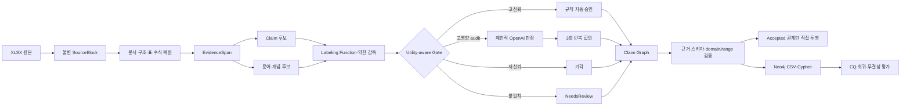

# TRACE-OL 기반 자이제 온톨로지 자동 구축 및 Neo4j 검증 실험 보고서

> 교수님 보고용 상세본  
> 작성일: 2026-07-10  
> 입력 데이터: `handoff-hanyang/수주제안/자이제_1.xlsx`  
> 기준 설계서: `TRACE_OL_자이제_Neo4j_전체실험_설계서.md`  
> 최종 선택 Run: `run:20260710T020000Z:P1_TYPED_OPENAI:a9482ce`

---

## 0. 한 페이지 요약

### 0.1 무엇을 진행했는가

자이제 수주·제안 자료의 정제 문장 1,366행을 대상으로 다음 작업을 수행하였다.

1. XLSX 원문을 행 단위 `SourceBlock`으로 손실 없이 보존하였다.
2. 장·절 구조, 표, 표 셀, 수식, 변수, 제약식과 EvidenceSpan을 복원하였다.
3. 용어와 Claim 후보를 LLM 없이 먼저 생성하였다.
4. 규칙 기반 약한 감독으로 후보를 승인·기각·검토·LLM 판정 대상으로 분기하였다.
5. 고영향 typed Claim 30개를 `gpt-4o-mini-2024-07-18`로 3회씩, 총 90회 판정하였다.
6. 세 번 모두 의미 필드가 일치한 승인만 최종 `Accepted`로 승격하였다.
7. Claim을 정본으로 보존하고, 승인된 Claim만 조회용 직접 관계로 투영하였다.
8. Neo4j 적재용 노드·관계 CSV, 제약조건, 적재·검증·CQ Cypher를 생성하였다.
9. 12개 Competency Question, 실제 행 기반 회귀검사, 그래프 무결성, CSV 파서 위험을 검증하였다.

### 0.2 무엇을 만들었는가

최종 선택 run에서 다음 결과물을 만들었다.

| 결과물 | 수량 또는 상태 |
|---|---:|
| SourceBlock | 1,366 |
| EvidenceSpan | 1,552 |
| 복원 표 / 표 셀 | 56 / 892 |
| 수식 / 변수 / 제약식 | 1 / 2 / 2 |
| 용어 mention | 117 |
| Claim 후보 | 609 |
| 최종 Accepted / NeedsReview / Rejected | 39 / 528 / 42 |
| 승인 직접 관계 | 34 |
| Neo4j 노드 / 관계 | 5,065 / 7,369 |
| ModelCall 감사 노드 | 90 |
| Neo4j CSV 전체 행 | 12,434 |
| 고정 회귀검사 | 6/6 통과 |
| Competency Question | 11/12 통과 |

### 0.3 현재 상황은 무엇인가

현재 상태는 **연구 실행은 완료되었지만 production graph로 승인할 단계는 아니다**.

| 구분 | 현재 상태 | 의미 |
|---|---|---|
| 원문·구조 파이프라인 | 완료 | 1,366행과 구조 산출물 생성·검증 완료 |
| 규칙 기반 B0 | 완료 | 후보 생성과 규칙 기반 분기 완료 |
| 선택적 LLM P1 | 완료 | typed 후보 30개 × 3회 판정 완료 |
| LLM 응답 계약 | 통과 | 90/90 schema·ID·근거·domain/range 통과 |
| 반복 안정성 | 93.33% | 30개 중 28개가 3회 동일 결정 |
| CQ | 11/12 | CQ-07 한 건 미통과 |
| Human gold 평가 | 미수행 | precision/recall/F1을 주장할 수 없음 |
| 규칙 증류 P2 | 후보만 생성 | 검증용 gold가 없어 규칙 채택 0개 |
| Live Neo4j | 미수행 | Docker 소켓 권한이 없어 CSV/Cypher 생성까지만 완료 |
| Production 승격 | 보류 | CQ-07, human gold, live Neo4j 검증이 남음 |

CQ-07은 BCM 표의 `자사 - 예산` 점수 Claim에 대해 모델 결정이 `accept, reject, accept`로 갈렸기 때문에 실패하였다. 다수결로 강제 승인하지 않고 보수적인 3/3 기준에 따라 `NeedsReview`로 남겼다.

---

## 1. 보고 목적과 해석 원칙

### 1.1 보고 목적

본 문서는 다음 질문에 답하기 위한 교수님 보고 자료이다.

- 실제로 어떤 데이터를 대상으로 무엇을 수행했는가?
- TRACE-OL 방법론을 어떻게 구현했는가?
- LLM은 어느 단계에, 어떤 제약 아래 사용했는가?
- 어떤 온톨로지·Claim Graph·Neo4j 산출물을 만들었는가?
- 현재 결과는 완료, 실패, 보류 중 어느 상태인가?
- 다음 연구 단계에서 무엇을 보완해야 하는가?

### 1.2 반드시 구분해야 하는 상태

본 실험에서 `Accepted`는 **사람이 정답으로 확정한 gold**를 뜻하지 않는다. 다음 자동 계약을 통과했다는 뜻이다.

- 직접 EvidenceSpan이 존재한다.
- source/span ID가 실제 원문 객체를 참조한다.
- 허용 predicate와 entity ID만 사용한다.
- predicate domain/range가 맞는다.
- 질문·예시·반례 방지 규칙을 위반하지 않는다.
- 규칙 임계값 또는 제한적 LLM 반복 판정 기준을 통과한다.

따라서 본 문서의 자동 품질 결과와 사람 주석 기반 의미 정확도는 별개의 평가이다.

---

## 2. 연구 문제와 접근 방향

### 2.1 연구 목표

최종 목표는 단순한 문장 삼중항 추출이 아니라 다음 조건을 만족하는 감사 가능한 온톨로지 구축이다.

1. 원문과 문서 구조를 보존한다.
2. 모든 운영 관계가 Claim과 원문 근거로 역추적 가능해야 한다.
3. LLM을 전체 문서 생성기로 쓰지 않고 불확실한 후보의 판정기로 제한한다.
4. 표, 수식, 양태, 부정, 다의어를 단순 삼중항으로 평탄화하지 않는다.
5. Neo4j에서 조회하기 쉬운 직접 관계와 감사 가능한 Claim 정본을 동시에 제공한다.

### 2.2 핵심 연구 질문

| 연구 질문 | 본 실험에서 확인한 내용 |
|---|---|
| RQ1. 구조와 근거를 보존할 수 있는가? | 1,366 SourceBlock, 1,552 EvidenceSpan, 표·수식 구조를 보존하고 offset 검증 통과 |
| RQ2. LLM을 선택적으로 사용할 수 있는가? | 전체 609개 중 typed 고영향 후보 30개만 3회 판정 |
| RQ3. Claim-first가 안전한가? | 모델 불일치 Claim을 직접 관계로 투영하지 않고 NeedsReview로 보존 |
| RQ4. 판정을 규칙으로 재사용할 수 있는가? | 증류 후보 10개 생성, 검증 gold 부재로 채택은 보류 |
| RQ5. Neo4j에서 감사·질의할 수 있는가? | 노드·관계 CSV와 CQ/검증 Cypher 생성, 정적 무결성 통과; live 적재는 미수행 |

---

## 3. 입력 데이터 진단

### 3.1 실제 입력 프로파일

| 항목 | 실제 값 |
|---|---|
| 파일 | `자이제_1.xlsx` |
| 시트 | `clean_sentences` |
| 유효 텍스트 행 | 1,366 |
| 컬럼 | page, chapter_no, chapter_title, section_no, section_title, text_for_llm_human |
| 페이지 범위 | 19–178 |
| 장 | 3 |
| 절 | 51 |
| 실제 원문 문맥 누락 | 0 |

### 3.2 설계서 기준과의 차이

| 항목 | 설계서 | 실제 입력 |
|---|---|---|
| SHA-256 | `9246a6da6c7635b3f34ee55df75112eb38a2984ea06828be943dc196de5926eb` | `e8c5f174b65eccd7a50dbd2e0e216ea870a6aedfd16b3e4538d6486aea15cf1f` |
| 예상 문맥 누락 | 3 | 0 |

이는 동일한 이름의 다른 버전 파일을 사용했을 가능성을 의미한다. 실제 파일의 메타데이터를 설계서에 맞추기 위해 삭제하거나 변형하지 않았다. 따라서 본 결과는 **현재 제공 파일에 대한 유효한 실행**이지만, 설계서가 처음 프로파일링한 입력과 완전히 동일한 실험으로 직접 비교해서는 안 된다.

### 3.3 단순 문장 집합으로 볼 수 없는 이유

`text_for_llm_human`에는 다음이 함께 존재한다.

- 일반 설명 문장
- 단계와 활동 목록
- Markdown 표와 표 안의 줄바꿈
- 그림 설명과 캡션
- `V > C`, `Winner(V-C) > Loser(V-C)` 같은 수식
- 질문·예시·반례
- 의무·권고·금지·가능성 표현
- Capture Plan처럼 하나의 표면어가 여러 의미를 갖는 경우

따라서 각 행을 독립적으로 LLM에 보내 바로 삼중항을 생성하면 표 헤더, 조건, 양태, 부정, 의미 구분이 손실될 위험이 있다.

---

## 4. 전체 방법론 개요

### 4.1 파이프라인



### 4.2 네 개의 동기화된 그래프

#### 1) Document/Evidence Graph

문서 구조와 원문을 보존한다.

```text
Document → Chapter → Section → SourceBlock → EvidenceSpan
                                  ├→ Table → Row/Column/Cell
                                  └→ Formula → Variable/Constraint
```

#### 2) Claim Graph

후보, 승인, 기각, 보류, 근거와 판정자를 보존하는 정본이다.

```text
Claim
 ├─ HAS_SUBJECT → Entity
 ├─ HAS_OBJECT → Entity
 ├─ SUPPORTED_BY → EvidenceSpan
 └─ ADJUDICATED_BY → LabelingFunction / ModelCall
```

#### 3) Domain Ontology View

Process, Stage, Task, Artifact, Decision, Risk, Mitigation, Criterion, Concept 등 도메인 개념과 타입을 표현한다.

#### 4) Operational Knowledge View

에이전트와 질의 사용자가 조회하기 쉽도록 승인된 Claim만 직접 관계로 투영한다.

```text
(:Task)-[:PRODUCES {claim_id, confidence, run_id}]->(:Artifact)
```

직접 관계는 정본이 아니다. Claim이 기각·보류되면 직접 관계를 만들지 않는다.

---

## 5. 단계별 방법론 상세

### 5.1 Stage A - 불변 원문 수집

XLSX를 외부 라이브러리 없이 OOXML 구조에서 읽고, 텍스트가 있는 1,366행을 `SourceBlock`으로 만들었다.

주요 보존 필드:

- 원본 파일과 SHA-256
- 시트명과 Excel 행 번호
- page, chapter, section 원본값
- `text_raw`와 NFC 정규화 문자열
- 행별 content hash
- block type
- context 상태
- run ID와 schema version

SourceBlock ID는 다음과 같이 원본 행에 안정적으로 연결하였다.

```text
src:jaije:v1:clean_sentences:r<excel-row>
```

예를 들어 Excel 245행은 다음 ID를 갖는다.

```text
src:jaije:v1:clean_sentences:r245
```

원본 필드와 추론 필드를 분리했기 때문에 추후 문맥 추론을 하더라도 원래 메타데이터를 덮어쓰지 않는다.

### 5.2 Stage B - 블록·문서 구조 복원

각 SourceBlock을 우선순위 규칙으로 분류하였다.

| 블록 유형 | 탐지 신호 | 후속 처리 |
|---|---|---|
| markdown_table | 여러 줄의 `| ... |` 패턴과 separator | 표 헤더·행·열·셀 복원 |
| formula | 변수, `=`, `>`, `Winner`, `Loser` | Formula/Variable/Constraint 생성 |
| list | 번호·bullet·단계 표현 | 목록 문맥 보존 |
| question | 물음표·의문형 | 자동 사실 승격 차단 |
| figure_caption | 그림·도표·Figure | 캡션으로 분리 |
| prose | 일반 서술 | EvidenceSpan 분할 |
| mixed | 표·수식·목록이 혼합 | 원문 전체 span과 하위 구조 병행 |

장·절 구조는 `Document-HAS_CHAPTER-Chapter-HAS_SECTION-Section-HAS_SOURCE_BLOCK-SourceBlock`으로 구성하였다.

### 5.3 Stage C - EvidenceSpan 생성과 offset 검증

일반 문장은 문장·줄바꿈 경계로 분할하고, 표·수식·혼합 블록은 구조 손실을 막기 위해 원문 전체 span을 우선 보존하였다.

Span ID는 원문 offset을 포함한다.

```text
span:<source-id>:<start>-<end>
```

검증 시 모든 span에 대해 다음 round-trip을 확인하였다.

```python
source_text[start:end] == evidence_quote
```

오류는 0건이었다.

### 5.4 Stage D - Markdown 표 복원

표는 행을 독립 문장으로 다루지 않고 하나의 `Table`로 복원하였다.

처리 순서:

1. pipe로 시작·종료하는 표 행을 수집한다.
2. `---` separator를 찾는다.
3. separator 직전 행을 헤더로 판정한다.
4. 열 수를 맞추고 부족한 셀을 빈 값으로 보존한다.
5. Table, Column, TableRow, Cell 노드를 만든다.
6. 각 Cell을 행과 열에 모두 연결한다.

이 방식으로 56개 표와 892개 셀을 복원하였다.

BCM 표인 Row 983에서는 다음 구조를 보존하였다.

- 핵심 이슈/평가 기준
- 비중
- 자사, A사, B사 점수
- 핵심 차별화 요소
- 전체 점수

숫자만 단독 Claim으로 만들지 않고 `Competitor-MEASURED_BY-Criterion` 관계와 `numeric_value`를 함께 저장하였다.

### 5.5 Stage E - 수식 구조화

Row 497에서 다음 표현을 탐지하였다.

```text
Value = V
Cost = C
V > C
Winner(V-C) > Loser(V-C)
```

이를 자연어 삼중항 하나로 축약하지 않고 다음 객체로 분리하였다.

- Formula 1개
- Variable `V`, `C`
- `>` Constraint 2개
- 원문 expression 문자열
- 자연어 해석 상태 `NeedsReview`

수식의 구조와 자연어 의미 해석을 분리했기 때문에 모델이 수식보다 강한 주장을 만들지 못하도록 하였다.

### 5.6 Stage F - 용어·다의어 후보 생성

영문 대문자, 약어, 괄호 alias, 도메인 사전 용어를 이용해 mention 후보를 만들었다. 총 117개의 term mention이 생성되었다.

Capture Plan은 Row 245의 원문에 따라 하나의 개념으로 강제 병합하지 않았다.

```text
LexicalEntry: Capture Plan
 ├─ DENOTES → 특정 사업 기회의 영업 정보
 └─ DENOTES → 영업 정보를 관리하는 쉬플리 도구
```

Capture Plan과 Account Plan의 비교는 `sameAs`가 아니라 `DISTINCT_FROM` Claim으로 표현하였다.

### 5.7 Stage G - Claim 후보 생성

온톨로지의 정본 단위를 직접 edge가 아니라 Claim으로 정의하였다.

Claim의 핵심 필드는 다음과 같다.

- subject ID
- predicate
- object ID 또는 object literal
- polarity
- modality
- condition span IDs
- evidence span IDs
- confidence
- status
- decision source
- run ID

Claim ID는 의미 필드의 정규형을 해시하여 만들었다.

```text
claim_id = hash(
  subject + predicate + object + polarity + modality + conditions + scope
)
```

조건·양태·범위가 다르면 같은 subject/predicate/object라도 다른 Claim이 된다.

### 5.8 Stage H - Labeling Function과 약한 감독

LLM 호출 전에 투명한 규칙으로 후보를 생성·평가하였다.

사용한 규칙 패밀리:

- 정의: `이란`, `정의`, `의미한다`
- 별칭·약어: 괄호 영문, `이하`, 약어 패턴
- 활동–산출물: `작성`, `개발`, `도출`, `결과물`
- 입력·기반: `기반으로`, `바탕으로`, `사용`, `통해`
- 순서: `먼저`, `이후`, `끝나고`, `다음 단계`
- 의사결정·기준: `Bid/No-Bid`, `기준`, `점수`
- 규범·양태: `해야`, `필요`, `피해야`, `하지 말아야`
- 조건·예외: `경우`, `조건`, `때`
- 목적·인과: `위해`, `때문`, `목적`
- 위험·완화: `리스크`, `위험`, `대안`, `대처`, `완화`
- 질문 차단: 질문을 일반 사실로 자동 승인하지 않음

기본 임계값:

| 분기 | 기준 |
|---|---:|
| 자동 승인 | confidence ≥ 0.92 |
| 핵심 Claim 자동 승인 | confidence ≥ 0.96 |
| 자동 기각 | confidence ≤ 0.25 |
| 그 외 | LLM gate 또는 NeedsReview |

오프라인 단계에서 609개 Claim 후보를 생성하였다.

### 5.9 Stage I - Utility-aware Gate

초기 gate는 불확실성과 영향도를 함께 사용하였다.

```text
uncertainty = 1 - |2p - 1|
gate_score = uncertainty × utility
```

utility는 다음 경우 높게 주었다.

- CQ 답변에 직접 영향을 주는 Claim
- process/stage 순서
- Capture Plan 다의어
- 표 점수·기준
- 수식
- 리스크·안티패턴·완화 관계
- 실제 행 기반 회귀 대상

#### 초기 untyped gate에서 발견한 문제

첫 API 실행에서는 불확실 문장을 Section placeholder에 연결한 후보가 포함되었다. 이 경우 모델이 승인하더라도 다음과 같은 schema 문제가 생길 수 있었다.

```text
Section -[:MITIGATES]-> literal
```

이는 `MITIGATES`의 기대 domain/range인 `Task 또는 Mitigation → Risk`와 맞지 않는다. 이 run은 방법론 결함을 발견한 진단 실험으로 보존했으며 최종 그래프에는 채택하지 않았다.

#### 최종 typed audit gate

최종 run에서는 subject/object 타입이 명시된 고영향 Claim 30개를 선택하였다.

예:

```text
Task -[:PRODUCES]-> Artifact
Task -[:REQUIRES_INPUT]-> Artifact
Mitigation -[:MITIGATES]-> Risk
Artifact -[:HAS_CRITERION]-> Criterion
Competitor -[:MEASURED_BY]-> Criterion
```

이 변경은 모델 성능을 높이기 위한 사후 정답 조정이 아니라, 판정할 수 없는 형식의 후보를 LLM에 보내지 않기 위한 schema 계약 보강이다.

### 5.10 Stage J - 제한적 OpenAI 판정

모델은 설계서에 고정된 스냅샷을 사용하였다.

```text
gpt-4o-mini-2024-07-18
```

OpenAI Responses API와 JSON Schema Structured Output을 사용하였다. 모델은 후보를 새로 작성하는 것이 아니라 evidence packet 안의 Claim을 판정하였다.

Evidence packet에는 다음만 포함하였다.

- 후보 Claim
- 직접 EvidenceSpan과 source ID
- 장·절 및 앞뒤 최소 문맥
- labeling function vote
- 허용 predicate
- 허용 entity ID
- subject/object entity type

모델 출력 필드:

- decision: accept/reject/revise/abstain
- predicate
- subject/object
- polarity와 modality
- evidence span IDs
- condition span IDs
- error codes
- confidence
- reusable pattern 후보

로컬 검증기는 모델 응답 후 다음을 다시 검사하였다.

1. candidate ID가 요청과 같은가?
2. packet 밖 entity ID를 만들지 않았는가?
3. 존재하지 않는 evidence span을 사용하지 않았는가?
4. object literal이 원문 substring 또는 허용 정규화인가?
5. predicate가 whitelist 안에 있는가?
6. predicate domain/range가 subject/object type과 맞는가?
7. 관계형 Claim이 literal로 잘못 평탄화되지 않았는가?

최종 typed run의 90개 응답은 이 로컬 계약을 모두 통과하였다.

### 5.11 Stage K - 3회 반복과 합의 정책

모델 비결정성을 숨기지 않기 위해 동일한 30개 후보를 각각 3회 호출하였다.

승격 정책은 보수적으로 설정하였다.

| 반복 결과 | 최종 상태 |
|---|---|
| 3회 모두 accept/revise, 의미 필드 동일 | Accepted |
| 3회 중 과반 reject | Rejected |
| accept/reject 불일치 | NeedsReview |
| schema·ID·근거 위반 | NeedsReview 또는 로컬 기각 |

최종 결과:

| 결과 | 후보 수 |
|---|---:|
| 3/3 Accepted | 26 |
| 3/3 Rejected | 2 |
| 2:1 불일치 | 2 |
| 완전 일치 | 28/30, 93.33% |

3/3 정책은 다수결보다 recall이 낮아질 수 있지만, 자동 ontology 승격의 precision과 감사 가능성을 우선한 선택이다.

### 5.12 Stage L - Decision-to-Rule Distillation

LLM이 반복적으로 승인한 패턴에서 증류 규칙 후보 10개를 만들었다.

그러나 설계서의 채택 조건은 다음을 요구한다.

- 서로 다른 절에서 최소 3개 지지
- 별도 rule-validation set precision ≥ 0.90
- 핵심 predicate precision ≥ 0.95
- 최소 5개 반례 통과
- test split을 사용하지 않은 누수 방지

현재 human gold와 별도 validation 결과가 없으므로 규칙 후보는 `NeedsRuleValidation`으로만 저장하고 채택 규칙은 0개로 유지하였다.

### 5.13 Stage M - Claim 승격과 직접 관계 투영

최종 Claim 상태 분포는 다음과 같다.

| 상태 | 수량 |
|---|---:|
| Accepted | 39 |
| NeedsReview | 528 |
| Rejected | 42 |
| 전체 | 609 |

오프라인 B0에서 Accepted였던 43개 중 30개를 typed audit gate로 다시 보냈다. 그 결과 26개 승인, 2개 기각, 2개 보류가 되어 최종 Accepted는 `감사 대상 외 13개 + 재승인 26개 = 39개`가 되었다.

Accepted Claim 중 object entity를 갖고 whitelist predicate에 속한 34개만 직접 관계로 투영하였다. 나머지 definition literal 등은 Claim Graph에서 보존하였다.

---

## 6. Neo4j 구현 방법

### 6.1 전역 ID와 공통 Entity 라벨

모든 노드는 공통 `Entity` 라벨을 갖고 전역 `id`로 구분한다.

```cypher
CREATE CONSTRAINT entity_id IF NOT EXISTS
FOR (n:Entity) REQUIRE n.id IS UNIQUE;
```

최종 주요 노드 수:

| 라벨 | 수량 |
|---|---:|
| SourceBlock | 1,366 |
| EvidenceSpan | 1,552 |
| Claim | 609 |
| ModelCall | 90 |
| Table / TableRow / Column / Cell | 56 / 193 / 194 / 892 |
| Section / Chapter | 51 / 3 |
| Stage / Task / Artifact | 6 / 7 / 6 |
| Risk / Mitigation / Criterion | 4 / 4 / 5 |

### 6.2 Claim 정본과 운영 관계의 병행

예를 들어 산출물 관계는 두 형태로 함께 존재한다.

```text
Claim -[:HAS_SUBJECT]-> Task
Claim -[:HAS_OBJECT]-> Artifact
Claim -[:SUPPORTED_BY]-> EvidenceSpan
Claim -[:ADJUDICATED_BY]-> LabelingFunction 또는 ModelCall

Task -[:PRODUCES {claim_id, confidence, run_id}]-> Artifact
```

직접 edge의 `claim_id`가 Accepted Claim을 참조하지 않으면 검증 실패로 처리한다.

### 6.3 멱등성 설계

노드는 `Entity.id`, 관계는 relationship `id`를 기준으로 `MERGE`하도록 Cypher를 만들었다.

```text
MERGE (n:Entity {id: row.id})
MERGE (s)-[r:RELATION {id: row.edge_id}]->(t)
```

따라서 같은 run CSV를 재적재할 때 새로운 ID가 중복 생성되지 않도록 설계하였다. 다만 실제 두 번째 적재의 생성 수 0 검사는 live Neo4j가 필요하므로 아직 수행하지 못했다.

### 6.4 생성한 Neo4j 패키지

- `nodes.csv`
- `relationships.csv`
- `00_constraints.cypher`
- `10_load.cypher`
- `40_validate.cypher`
- `50_competency_questions.cypher`
- `manifest.json`
- CSV validation report

JSON 속성은 CSV 파서 안전성을 위해 base64 carrier로 저장하였다. 최종 노드 5,065행과 관계 7,369행, 총 12,434행에서 파서 위험과 carrier 오류는 0건이었다.

---

## 7. 검증 및 평가 방법

### 7.1 그래프 무결성 검사

| 검사 | 결과 |
|---|---|
| SourceBlock 수 1,366 | PASS |
| 중복 SourceBlock ID 0 | PASS |
| Evidence offset round-trip 오류 0 | PASS |
| 전역 노드 ID 중복 0 | PASS |
| dangling 관계 끝점 0 | PASS |
| 근거 없는 Accepted Claim 0 | PASS |
| direct edge-Claim 불일치 0 | PASS |
| 현재 입력 문맥 누락 0 | PASS |
| 설계서 입력 hash 일치 | FAIL - 입력 버전 차이 |
| 설계서 누락 3건 기준 일치 | FAIL - 실제 0건 |

### 7.2 실제 행 기반 회귀검사

설계서의 여러 행을 기능별 6개 회귀군으로 묶어 매 실행에 검사하였다.

| 회귀군 | 핵심 확인 | 결과 |
|---|---|---|
| Row 218 | Opportunity Assessment → Pursuit Decision 순서와 근거 | PASS |
| Row 245 | Capture Plan lexical entry와 2개 sense | PASS |
| Row 497 | Formula, V/C, `>` Constraint | PASS |
| Row 916/1140 | 현재 입력의 observed 문맥을 원문대로 보존 | PASS |
| Row 983 | BCM 7열과 점수·기준 구조 | PASS |
| Rows 1315–1335 | Risk/Mitigation/Rule 분리, 안티패턴 polarity | PASS |

결과는 6/6 통과이다.

### 7.3 Competency Questions

12개 질문을 실행 가능한 정적 등가 검사와 Cypher로 구성하였다.

| CQ | 질문 요약 | 최종 결과 |
|---|---|---|
| CQ-01 | 수주 프로세스 단계와 순서 | PASS |
| CQ-02 | 단계별 활동과 산출물 | PASS |
| CQ-03 | Proposal Planning의 입력 | PASS |
| CQ-04 | Capture Plan의 의미 분리 | PASS |
| CQ-05 | Capture Plan과 Account Plan 비교 | PASS |
| CQ-06 | BCM의 생성과 사용 | PASS |
| CQ-07 | BCM 기준·업체·점수 | **FAIL** |
| CQ-08 | 가치제안 수식 | PASS |
| CQ-09 | 리스크 정의 | PASS |
| CQ-10 | 리스크 대응책 | PASS |
| CQ-11 | 리스크 관리 안티패턴 | PASS |
| CQ-12 | 운영 관계의 원문·판정자 감사 | PASS |

CQ-07은 자사 예산 점수 Claim 하나가 2:1 불일치로 보류되어, 기대한 12개 점수 관계 중 11개만 Accepted 상태로 남았기 때문에 실패하였다.

### 7.4 재현성 검사

오프라인 파이프라인을 같은 input/config/code/run ID로 두 번 실행하여 다음 14개 핵심 산출물의 SHA-256을 비교하였다.

- SourceBlock
- EvidenceSpan
- Table
- Formula
- term candidates
- Claim candidates
- Claim adjudication
- LLM request ledger
- graph entities
- accepted relations
- split manifest
- Neo4j nodes CSV
- Neo4j relationships CSV
- load Cypher

14/14가 byte-identical이었다.

LLM 결과 자체는 비결정적일 수 있으므로 byte identity 대신 3회 반복 합의율을 보고하였다. 최종 합의율은 93.33%였다.

---

## 8. 실험 수행 과정과 시행착오

### 8.0 설계서 실험군별 실제 수행 범위

| 실험군 | 목적 | 실제 수행 상태 |
|---|---|---|
| B0_RULE_ONLY | LLM 없이 규칙 기반 baseline 생성 | **완료** |
| B1_LOCAL_EMBEDDING | local embedding 보조 baseline | 미수행 - 설계 설정에서 비활성 |
| B2_FULL_ADJ | 전체 후보를 LLM으로 판정 | 미수행 - 609개 전체 호출 대신 제한적 gate를 선택 |
| P1_SELECTIVE | 고영향 후보만 제한적으로 LLM 판정 | **완료 - typed 후보 30개 × 3회** |
| P2_DISTILLED | 검증된 증류 규칙을 포함한 production | 미완료 - 규칙 후보만 생성, 채택 0개 |
| Ablation | 표 구조, Claim-first, gate 등 요소 제거 비교 | 미수행 |

따라서 본 실험은 B0와 P1을 실제 실행한 단계이며, 설계서의 전체 비교 실험 매트릭스를 모두 완료한 것은 아니다.

### 8.1 Phase 1 - 오프라인 전체 실행

1,366행을 전량 처리해 구조, 후보, Claim Graph, Neo4j CSV를 생성하였다. 이 단계에서는 API를 호출하지 않았다.

주요 결과:

- Claim 후보 609개
- 규칙 기반 Accepted 43개
- NeedsReview 526개
- Rejected 40개
- CQ 12/12
- 회귀 6/6

이 결과는 B0_RULE_ONLY 성격의 baseline이다.

### 8.2 Phase 2 - 최초 selective LLM 진단

불확실성·utility로 선택한 30개를 3회씩 판정하였다.

API 자체는 정상 동작했지만, 일부 후보의 subject가 Section placeholder여서 관계 타입이 완결되지 않는 문제가 드러났다. 또한 모델이 직접 evidence가 아닌 앞뒤 context 제목을 literal로 가져온 15개 응답을 로컬 가드레일이 차단하였다.

이 run의 의미는 다음과 같다.

- LLM이 JSON을 반환했다고 해서 안전한 Claim이 되는 것은 아니다.
- 후보 생성 단계의 subject/object typing이 LLM 판정보다 선행되어야 한다.
- context는 판정 보조 정보이지 직접 evidence가 아니다.
- 출력 schema뿐 아니라 ID·근거·domain/range 후검증이 필요하다.

따라서 이 run은 진단용으로 보존하고 최종 결과에서 제외하였다.

### 8.3 Phase 3 - typed audit로 방법론 보강

다음 변경을 적용하였다.

1. 고영향 후보의 subject/object를 typed entity로 한정하였다.
2. packet에 entity type을 포함하였다.
3. predicate별 domain/range 검증을 추가하였다.
4. 관계형 Claim이 object literal로 평탄화되는 것을 차단하였다.
5. anaphora 해소 등 사전에 허용한 candidate literal 정규화를 명시하였다.
6. 동일 후보를 3회 실행하고 3/3만 자동 승인하였다.

수정 후 typed smoke 1건이 통과했고, 최종 90건도 모두 로컬 계약을 통과하였다.

### 8.4 Phase 4 - 최종 결과 동결

최종 선택 run:

```text
run:20260710T020000Z:P1_TYPED_OPENAI:a9482ce
```

최종 run은 CQ-07 실패를 숨기지 않고 `FAILED`로 기록하였다. 여기서 `FAILED`는 API 실행 실패가 아니라 **production 진입을 위한 모든 critical CQ를 통과하지 못했다**는 의미이다.

---

## 9. 최종 OpenAI 실행 결과

### 9.1 호출과 비용

| 항목 | 최종 typed run |
|---|---:|
| API 호출 | 90 |
| 완료 응답 | 90 |
| 입력 토큰 | 108,972 |
| 캐시 입력 토큰 | 3,328 |
| 출력 토큰 | 10,680 |
| 추정 비용 | $0.0225042 |

스모크와 진단 run까지 포함한 전체 API 호출은 182회, 총 추정 비용은 $0.0462066이다.

### 9.2 보안과 감사 원장

API 키는 다음 위치에 저장하지 않았다.

- 소스 코드
- 명령행 인자
- manifest
- ModelCall ledger
- 보고서
- Neo4j CSV

키는 실행 프로세스의 표준입력과 환경변수로만 전달했고 실행 후 제거하였다. 산출물에서 키 prefix를 검색해 미검출을 확인하였다.

ModelCall 원장에는 다음만 남겼다.

- model과 endpoint
- candidate ID
- prompt/input hash
- response ID
- repeat 번호
- decision과 parse status
- validation errors
- input/cache/output token
- latency와 retry
- 추정 비용

### 9.3 반복 불일치 항목

사람 검토 패킷에는 총 4개 항목이 있다.

| Excel 행 | Claim | 반복 결과 | 자동 상태 |
|---:|---|---|---|
| 236 | Process HAS_STAGE Capture Planning | reject/reject/reject | Rejected |
| 236 | Capture Planning HAS_OUTCOME Bid/No-Bid | accept/accept/reject | NeedsReview |
| 243 | 수주전략 Stage HAS_TASK 수주전략 초안 개발 | reject/reject/reject | Rejected |
| 983 | 자사 MEASURED_BY 예산 | accept/reject/accept | NeedsReview |

Rejected 2개도 핵심 구조 Claim이므로 human audit queue에 함께 포함하였다.

---

## 10. 생성 산출물

### 10.1 실행 코드

| 파일 | 역할 |
|---|---|
| `scripts/run_trace_ol_jaije_experiment.py` | XLSX 수집부터 구조·Claim·Neo4j·검증까지 오프라인 전량 실행 |
| `scripts/run_trace_ol_openai_adjudication.py` | Responses API, typed evidence packet, 3회 반복, 합의, ModelCall 원장 |
| `scripts/validate_neo4j_import_csv.py` | Neo4j CSV와 base64 JSON carrier 검증 |

### 10.2 최종 선택 run 핵심 파일

기준 디렉터리:

```text
experiments/trace_ol_jaije_neo4j_20260710/openai_typed_selective/
```

| 파일 | 내용 |
|---|---|
| `manifest.json` | 입력·모델·prompt hash·run 설정 |
| `source_blocks.jsonl` | 불변 원문 1,366행 |
| `evidence_spans.jsonl` | 원문 근거 span 1,552개 |
| `tables.jsonl` | 복원한 표 구조 |
| `formulas.jsonl` | Formula/Variable/Constraint |
| `term_candidates.jsonl` | 용어 mention 후보 |
| `claims.candidate.jsonl` | 전체 Claim 후보 609개 |
| `claims.adjudicated.jsonl` | 최종 상태가 반영된 Claim |
| `llm_requests.jsonl` | 비밀정보가 없는 요청 해시 원장 |
| `model_calls.jsonl` | 90회 API 호출 감사 원장 |
| `llm_consensus.json` | 후보별 3회 합의 결과 |
| `human_review_queue.jsonl` | 사람 검토 4건 |
| `distilled_rules.candidate.jsonl` | 증류 규칙 후보 10개 |
| `entities.jsonl` | 전체 그래프 노드 |
| `relations.accepted.jsonl` | Accepted 직접 관계 |
| `competency_questions.json` | CQ 12개 결과 |
| `regression_results.json` | 회귀 6개 결과 |
| `validation.json` | 무결성·CQ·입력 비교 검증 |
| `run_summary.json` | 최종 수치·비용·상태 |
| `report.md` | run 단위 보고서 |

### 10.3 Neo4j 파일

```text
openai_typed_selective/neo4j/
├─ nodes.csv
├─ relationships.csv
├─ 00_constraints.cypher
├─ 10_load.cypher
├─ 40_validate.cypher
├─ 50_competency_questions.cypher
├─ manifest.json
├─ csv_validation.json
└─ csv_validation.md
```

---

## 11. 현재 결과의 학술적 해석

### 11.1 현재 주장할 수 있는 것

1. 자이제 1,366행을 구조와 원문 근거를 보존한 그래프로 변환했다.
2. 모든 Accepted Claim에 직접 evidence가 연결된다.
3. Claim 정본과 운영 직접 관계를 분리해 감사 경로를 제공한다.
4. 표와 수식을 문장 삼중항으로 단순 평탄화하지 않았다.
5. 제한적 LLM 판정과 로컬 계약 검증을 실제 API로 수행했다.
6. 동일 후보 3회 반복에서 93.33%의 완전 결정 일치율을 관찰했다.
7. 모델 불일치가 CQ 실패로 이어지는 경로를 Claim 수준에서 추적할 수 있다.
8. Neo4j import 패키지는 정적 CSV 무결성 검사를 통과했다.

### 11.2 현재 주장할 수 없는 것

1. 의미 정확도 precision/recall/F1이 높다고 주장할 수 없다.
2. 39개 Accepted Claim을 human gold라고 부를 수 없다.
3. P1이 B0/B2/P2보다 통계적으로 우수하다고 주장할 수 없다.
4. 증류 규칙의 precision이 0.90 이상이라고 주장할 수 없다.
5. Neo4j 실제 적재와 멱등성이 검증됐다고 주장할 수 없다.
6. 설계서 원래 입력과 완전히 동일한 재현 실험이라고 주장할 수 없다.

### 11.3 주요 방법론적 발견

가장 중요한 발견은 LLM 모델보다 **후보 계약의 품질이 먼저**라는 점이다.

초기 untyped 후보는 모델이 일관되게 승인해도 ontology schema상 잘못될 수 있었다. typed candidate, evidence-only grounding, domain/range 후검증을 적용한 뒤에야 모델 판정을 안전하게 Claim Graph에 반영할 수 있었다.

또한 모델 2:1 판정을 자동 다수결로 통과시키지 않음으로써, CQ의 빈칸이 생기더라도 불확실성을 그래프 안에 명시적으로 보존하였다. 이는 성능 수치를 높이는 것보다 감사 가능성과 안전한 자동화를 우선한 결과이다.

---

## 12. 현재 미완료 조건과 다음 단계

### 12.1 우선순위 1 - 사람 판정

`human_review_queue.jsonl`의 4건을 검토한다. 특히 다음 두 NeedsReview가 우선이다.

1. Row 236 `Capture Planning HAS_OUTCOME Bid/No-Bid`
2. Row 983 `자사 MEASURED_BY 예산`

Row 983을 사람이 승인하고 근거가 유효하면 CQ-07을 다시 실행한다.

### 12.2 우선순위 2 - Human gold 구축

설계서 기준으로 section-level split을 유지하며 annotation package를 작성한다.

필요 산출물:

- gold Claim
- evidence span
- polarity/modality
- subject/object type
- adjudication log
- annotator ID와 timestamp
- IAA 결과

이후 B0/B2/P1/P2의 precision, recall, F1, unsupported rate, evidence completeness를 비교한다.

### 12.3 우선순위 3 - 규칙 증류 검증

현재 증류 후보 10개를 rule-validation split에서 검증한다.

- distinct section support
- precision
- critical predicate precision
- 반례
- 기존 규칙 충돌률
- test leakage 여부

조건을 만족한 규칙만 P2에 채택한다.

### 12.4 우선순위 4 - Live Neo4j

Docker 권한을 확보한 뒤 `neo4j:5.26.28-community` fresh volume에 최종 run을 적재한다.

확인할 항목:

1. constraints와 indexes 생성
2. 첫 적재 성공
3. 두 번째 적재 신규 생성 0
4. validation Cypher 실행
5. CQ 12개 실제 Cypher 실행
6. Browser 고정 뷰와 audit log 저장

### 12.5 우선순위 5 - 최종 production run

Human review, gold 평가, 규칙 검증, live Neo4j가 끝난 뒤 P2 production run을 별도 ID로 생성한다. 현재 P1 typed run을 production이라고 이름만 바꾸어 사용해서는 안 된다.

---

## 13. 교수님께 보고드릴 핵심 결론

본 실험에서는 자이제 수주·제안 자료 1,366행을 대상으로 원문·표·수식·Claim 근거를 보존하는 TRACE-OL 파이프라인을 구현하였다. 전체 문서를 LLM에 넣어 삼중항을 생성하는 방식 대신, 규칙으로 후보를 먼저 생성하고 고영향 typed Claim 30개만 `gpt-4o-mini-2024-07-18`로 세 번씩 판정하였다.

최종 90개 응답은 모두 구조·ID·근거·domain/range 계약을 통과했으며 30개 후보 중 26개는 세 번 모두 승인, 2개는 세 번 모두 기각, 2개는 2:1로 갈렸다. 반복 완전 일치율은 93.33%였다. 최종 그래프는 5,065개 노드와 7,369개 관계로 구성되며, 모든 Accepted Claim은 원문 근거를 가진다.

다만 BCM의 자사 예산 점수 Claim이 반복 불일치로 보류되어 Competency Question은 12개 중 11개만 통과하였다. 또한 사람 gold와 live Neo4j 검증이 없으므로 현재 결과는 연구 실행 완료 상태이지만 production-ready 상태는 아니다.

본 실험의 핵심 성과는 단순히 그래프를 생성한 것이 아니라, **후보 생성 → 근거 기반 판정 → 반복 안정성 측정 → Claim 정본 → 승인 관계 투영 → CQ 실패 추적**의 감사 가능한 전 과정을 구현하고, 실패한 항목을 숨기지 않고 다음 사람 검토 단계로 연결했다는 점이다.

---

## 부록 A. 상태 코드 해석

| 상태 | 의미 |
|---|---|
| Observed | 원문에 표면적으로 존재 |
| Candidate | 규칙·파서가 구조화 후보 생성 |
| Supported | 규칙 또는 구조 근거가 일정 수준 지지 |
| Accepted | 자동 계약과 승격 기준 통과 |
| NeedsReview | 불확실·불일치·충돌로 사람 검토 필요 |
| Rejected | 근거 부족, 타입 위반 또는 반복 기각 |
| Superseded | 새 Claim이 기존 Claim을 대체 |

## 부록 B. 주요 경로

| 항목 | 경로 |
|---|---|
| 본 보고서 | `TRACE_OL_자이제_Neo4j_실험_교수님_보고서.md` |
| 전체 설계서 | `TRACE_OL_자이제_Neo4j_전체실험_설계서.md` |
| 최종 통합 보고 | `experiments/trace_ol_jaije_neo4j_20260710/FINAL_EXPERIMENT_REPORT.md` |
| 최종 요약 JSON | `experiments/trace_ol_jaije_neo4j_20260710/FINAL_EXPERIMENT_SUMMARY.json` |
| 최종 선택 run | `experiments/trace_ol_jaije_neo4j_20260710/openai_typed_selective/` |
| 사람 검토 큐 | `experiments/trace_ol_jaije_neo4j_20260710/openai_typed_selective/human_review_queue.jsonl` |
| Neo4j 패키지 | `experiments/trace_ol_jaije_neo4j_20260710/openai_typed_selective/neo4j/` |

## 부록 C. 실행 환경 주의사항

- 실제 실행 Python은 3.13.13이다.
- 설계서 권고 범위는 Python 3.11 또는 3.12이다.
- 본 실행기는 표준 라이브러리 기반으로 정상 동작했지만 공식 재현 환경과 차이가 있다.
- Neo4j live 실행에는 Docker socket 권한 또는 별도 Neo4j 서버가 필요하다.
- API 키는 환경변수로만 주입하고 저장소·보고서·로그에 넣지 않아야 한다.
