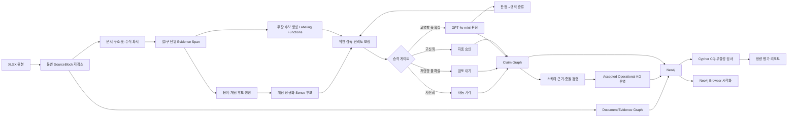
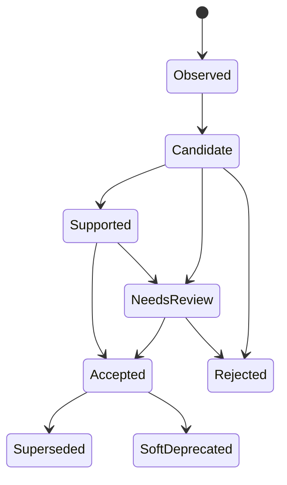
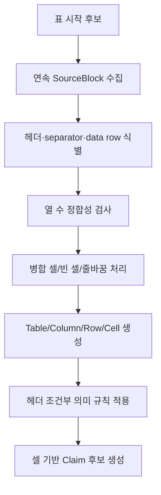
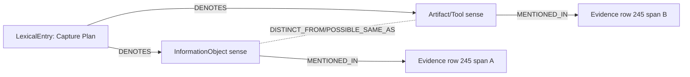
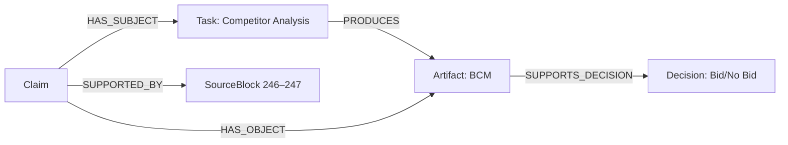
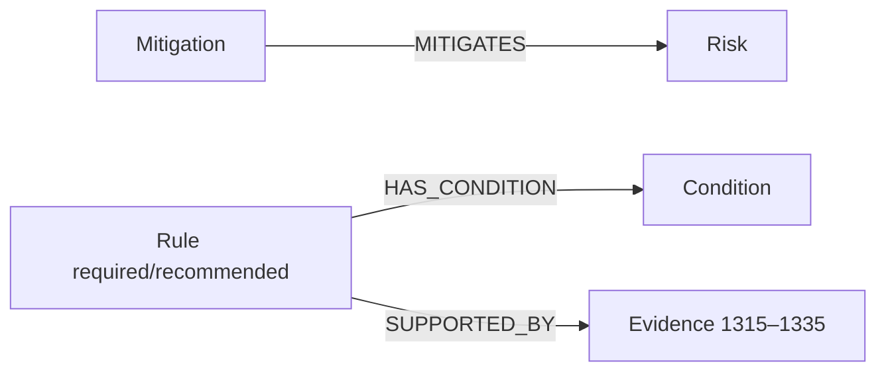

# TRACE-OL 자이제 데이터 기반 온톨로지 자동 구축·Neo4j 검증 전체 실험 설계서

> **부제:** Layer 2 전문가 자료에서 최소 LLM 호출로 추적 가능한 직무 지식그래프를 구축하고, 자이제 수주·제안 자료에서 정확성·비용·재현성·확장성을 검증하는 실행 프로토콜

| 항목 | 내용 |
|---|---|
| 문서 버전 | 1.0.0 |
| 작성일 | 2026-07-10 |
| 실험 상태 | 실행 전 설계·사전등록 초안 |
| 연구 범위 | **Layer 2 직무별 전문가 자료만 사용** |
| 입력 데이터 | `자이제_1 (2).xlsx` |
| 입력 SHA-256 | `9246a6da6c7635b3f34ee55df75112eb38a2984ea06828be943dc196de5926eb` |
| 방법론 기준 문서 | `TRACE_OL_Layer2_온톨로지_구축_방법론.md` |
| 방법론 문서 SHA-256 | `580fa5a24ab48381d73f27c5f892bc615dff2de0b21a1717c789ddf0081201ba` |
| LLM | `gpt-4o-mini-2024-07-18` 고정 스냅샷 권고 |
| 그래프 DB | Neo4j Community `5.26.28-community` 고정 이미지 권고 |
| 기본 시각화 | Neo4j Browser |
| 핵심 원칙 | Claim-first, evidence-preserving, confidence-gated, rule-distilling |

---

## 문서 사용 순서

| 읽는 목적 | 권장 구간 |
|---|---|
| 연구 범위와 가설 확정 | Part I–III |
| 데이터·스키마·파이프라인 구현 | Part IV–VII |
| 비교 실험·골드·평가 사전등록 | Part VIII–X |
| Neo4j 적재·검증·시각화 | Part XI–XIV |
| 실행·테스트·리스크·확장 | Part XV–XXI |
| 복사해 사용할 설정·예제 | 부록 A–F |

## 0. 이 설계서가 답해야 하는 질문

이 실험은 단순히 자이제 문장을 삼중항으로 바꾸고 Neo4j 화면에 노드를 띄우는 데 목적이 있지 않다. 다음 네 질문에 재현 가능한 증거로 답하는 것이 목적이다.

1. **정확성:** 문서 구조, 정의, 절차, 입출력, 의사결정, 규칙, 조건, 위험과 대응책을 원문보다 과도하게 일반화하거나 꾸며내지 않고 추출할 수 있는가?
2. **LLM 효율:** 모든 문장을 LLM에 보내지 않고도 전면 LLM 처리와 비슷한 품질을 달성할 수 있는가?
3. **추적성:** Neo4j의 모든 채택 지식이 어느 행·문장·표 셀에서 왔고 어떤 규칙 또는 모델 판정으로 생성됐는지 역추적 가능한가?
4. **도메인 확장성:** 자이제 특화 클래스와 프롬프트를 무분별하게 늘리지 않고, 코어 스키마와 파이프라인을 다른 Layer 2 전문가 자료에도 재사용할 수 있는가?

본 실험의 성공은 **그래프가 보기 좋다**가 아니라, 다음 조건을 동시에 만족하는 것으로 정의한다.

- 검증된 골드 데이터에서 사전 정의한 정확도 기준을 통과한다.
- 수용된 주장마다 원문 근거가 존재한다.
- 실험군 간 입력과 평가 조건이 통제된다.
- 같은 코드·설정·입력으로 같은 중간 산출물을 재생성할 수 있다.
- Neo4j 시각화가 평가 결과를 보조하며, 시각화 자체가 정확성의 근거로 오인되지 않는다.

---

# Part I. 연구 문제와 실험 범위

## 1. 연구 목표

### 1.1 최종 목표

자이제 수주·제안 전문가 자료를 대상으로 다음 파이프라인을 실제 구현한다.

```text
XLSX 원문
  → 불변 원문·문서구조 그래프
  → 규칙/통계 기반 용어·주장 후보
  → 약한 감독 기반 신뢰도 추정
  → 가치·불확실성 기반 선택적 GPT-4o-mini 판정
  → 판정 결과의 재사용 가능한 규칙 증류
  → 검증·승격된 업무 온톨로지/KG
  → Neo4j 적재·질의·시각화·품질 감사
```

### 1.2 이번 실험에서 포함하는 것

- 자이제 원문 1,366개 레코드 전량의 구조 보존형 수집
- 문장, 목록, Markdown 표, 수식, 그림 설명, 질문의 유형 분리
- 도메인 중립 코어 스키마와 자이제 도메인 어휘의 분리
- 용어 후보, 개념 후보, 주장 후보, 규칙 후보의 생성
- 후보별 신뢰도·충돌·영향도 산정
- 선택적 `gpt-4o-mini` 판정
- Claim Graph와 승인된 Operational KG의 동시 생성
- Neo4j 제약조건, 인덱스, 멱등 적재, 검증 질의, Browser 시각화
- 골드셋 기반 정량평가와 호출·토큰·비용 분석
- 무LLM/전면 LLM/선택적 LLM/규칙 증류 실험 비교

### 1.3 이번 실험에서 의도적으로 제외하는 것

- NCS, APQC, Q-net 등 Layer 1과의 정렬
- 고객사 내부 매뉴얼 등 Layer 3와의 병합
- 28개 수주 에이전트 성능 비교
- 그래프 임베딩 또는 GNN 학습을 통한 다운스트림 최적화
- 법인파산·스타트업 투자·Performance Marketing의 실제 전면 실증
- 완전 자동 승인: 고위험·저신뢰 지식은 검토 대기 상태로 남긴다.

## 2. 연구 질문과 가설

### RQ1. 구조와 근거를 보존한 자동 구축이 가능한가?

**H1-Structure**: 문서 구조와 표 구조를 먼저 복원한 뒤 주장 후보를 추출하면, 행을 독립 문장으로 평면 처리하는 방식보다 관계 및 출처 연결 F1이 높다.

### RQ2. LLM 호출을 줄여도 품질을 유지할 수 있는가?

**H2-Selective**: 불확실성뿐 아니라 지식의 중심성·위험도·평가질문 영향도를 함께 사용한 선택적 호출은, 후보 전량 LLM 판정 대비 성능 차이를 3%p 이내로 유지하면서 호출 수를 70% 이상 줄인다.

### RQ3. Claim-first가 직접 삼중항 생성보다 안전한가?

**H3-Claim**: 주장 노드에 양태, 극성, 조건, 범위, 근거를 먼저 보존하고 승인된 주장만 직접 관계로 투영하면, 직접 삼중항 생성보다 근거 없는 승인 지식과 규정 의미 왜곡이 감소한다.

### RQ4. LLM 판정을 규칙으로 재사용할 수 있는가?

**H4-Distillation**: 개발 구간에서 GPT-4o-mini가 반복적으로 내린 판정을 구조 패턴 기반 labeling function으로 증류하면, 고정된 블라인드 테스트에서 추가 LLM 호출 없이 선택적 방식의 성능을 유지하거나 개선한다.

### RQ5. Neo4j 구현이 감사 가능하고 질의 가능한가?

**H5-Graph**: 모든 승인 노드·관계는 근거 SourceBlock과 Run으로 추적 가능하며, 사전 정의 competency question의 90% 이상을 Cypher로 정확히 답하고 치명적 무결성 오류는 0건이다.

## 3. 주요 독립·종속·통제 변수

| 구분 | 변수 |
|---|---|
| 독립 변수 | 문서 구조 사용 여부, Claim-first 여부, LLM 호출 정책, 규칙 증류 여부, 표 전용 파서 여부, 개념 병합 정책 |
| 주요 종속 변수 | 개념/관계/속성 F1, 핵심 규칙 Recall, 근거 연결 정확도, unsupported assertion rate, CQ 정답률 |
| 효율 종속 변수 | LLM 호출 비율, 입력·출력·캐시 토큰, API 비용, 처리 시간, 전문가 검토량 |
| 그래프 종속 변수 | 고아 노드율, 무근거 승인 주장 수, 중복 ID 수, 스키마 위반 수, 프로세스 순환 수 |
| 통제 변수 | 동일 원문, 동일 split, 동일 후보 집합, 동일 모델 스냅샷, 동일 프롬프트 버전, 동일 출력 스키마, 동일 평가자/루브릭 |

---

# Part II. 자이제 원본 데이터 진단

## 4. 실제 데이터 프로파일

업로드된 파일의 관찰 결과는 다음과 같다.

| 항목 | 관찰값 |
|---|---:|
| 시트 | `clean_sentences` 1개 |
| 전체 범위 | `A1:F1367` |
| 헤더 제외 본문 레코드 | **1,366** |
| 컬럼 | `page`, `chapter_no`, `chapter_title`, `section_no`, `section_title`, `text_for_llm_human` |
| 페이지 범위 | 19–178 |
| 장 수 | 3 |
| 유효 절 수 | 51 |
| 문맥 메타데이터 전체 누락 행 | 3 |
| Markdown 표 시작/구성 행 | 최소 52개 행; 표 단위로는 약 56개 구조가 관찰됨 |

### 4.1 장별 레코드 수

| 장 | 레코드 수 |
|---|---:|
| 제안서 전략 | 567 |
| 수주영업 | 486 |
| 입찰과 제안 | 310 |
| 장·절 문맥 누락 | 3 |

### 4.2 데이터가 단순 문장 집합이 아닌 이유

`text_for_llm_human`에는 다음 현상이 혼재한다.

- 한 문장 또는 여러 문장으로 된 서술
- 단계 목록과 활동 목록
- Markdown 표의 헤더·구분선·행
- 그림 설명과 캡션
- 수식과 부등식
- 독자에게 던지는 질문
- 정의, 권고, 금지, 필요조건, 예외
- 동일 표면어의 서로 다른 의미
- 앞·뒤 행과 결합해야 완성되는 문맥

따라서 각 행을 독립적으로 LLM에 보내 삼중항을 생성하면 다음 오류가 예상된다.

1. 표 헤더가 사라져 셀 의미가 왜곡된다.
2. 질문과 예시가 사실 주장으로 승격된다.
3. “해야 한다”, “하지 말아야 한다”, “할 수 있다”가 동일한 관계로 평탄화된다.
4. Capture Plan처럼 다의적인 용어가 조기 병합된다.
5. 단계와 산출물의 관계가 단순 공기 관계로 바뀐다.
6. 그림·수식의 의미가 자연어 추측으로 과잉 생성된다.

## 5. 필수 회귀 테스트로 사용할 실제 행

아래 행은 파이프라인의 대표 난점을 포함하므로 매 실행에서 고정 회귀 테스트로 사용한다.

| Excel 행 | 현상 | 기대 처리 |
|---:|---|---|
| 218 | Opportunity Assessment에서 Pursuit Decision으로 이어지는 프로세스 | Stage/Decision 후보와 순서 관계 생성 |
| 222 | Capture Plan을 근거로 Proposal Planning 수행 | 입력·기반 관계와 활동 후보 생성 |
| 236 | Stage 2 표와 Bid/No Bid 의사결정 | 표 헤더를 보존해 Stage–Decision–Criterion 연결 |
| 243–244 | 단계별 활동과 산출물 | `Task/Activity → PRODUCES → Artifact` 후보 |
| 245 | Capture Plan의 두 의미 | 하나의 개념으로 즉시 병합하지 않고 sense 후보 분리 |
| 246–247 | 경쟁사 분석과 BCM | 분석 활동–산출물–의사결정 지원 관계 |
| 461 | Capture Plan과 Account Plan 비교 | 비교·차이 주장으로 모델링; 동치 처리 금지 |
| 497 | `Value`, `Cost`, `V > C`, `Winner(V-C) > Loser(V-C)` | Formula/Variable/Constraint 구조 및 문맥 누락 표시 |
| 916 | 고객 개인 이슈를 조직 이슈로 묶는 문장 | 원문 보존, 문맥은 추론값과 원본값 분리 |
| 983 전후 | BCM 기준·점수·차별화 | 표 재구체화 및 Criterion/Metric/Competitor 연결 |
| 1140 | “Exactly Same Word”까지 전략 구체화 | 규범/품질 기준 후보, 문맥 누락 상태 보존 |
| 1315–1335 | 리스크 정의·안티패턴·권고·매트릭스·완화 | Risk–Mitigation–Rule–Criterion을 분리 |

## 6. 문맥 메타데이터 누락 행 처리 원칙

메타데이터가 누락된 3개 행은 원본을 수정하지 않는다.

```text
원본 필드: null 그대로 보존
추론 필드: inferred_chapter / inferred_section
추론 근거: preceding_source_id, following_source_id, lexical_similarity, structure_match
상태: missing → inferred → human_confirmed 또는 rejected
```

문맥 복원 알고리즘은 인접 비결측 행, 페이지 번호, 장·절의 연속성, 어휘 유사도와 표/그림 연속성을 사용한다. 그러나 복원 결과는 사실이 아니라 **후보**이므로 인간 확인 전에는 운영 KG의 범위 조건으로 사용하지 않는다.

---

# Part III. 전체 시스템 설계

## 7. 아키텍처 개요



## 8. 네 개의 동기화된 그래프

### 8.1 Document/Evidence Graph

원문과 구조를 손실 없이 보존한다.

```text
Document → Chapter → Section → SourceBlock → Clause/Span
                                  ├→ Table → Row/Column/Cell
                                  └→ Formula → Variable/Expression
```

### 8.2 Claim Graph

후보, 충돌, 양태, 조건, 근거, 판정 상태를 보존한다.

```text
Claim
 ├─ HAS_SUBJECT → Entity/Concept
 ├─ HAS_OBJECT → Entity/Concept/Literal
 ├─ HAS_CONDITION → Condition
 ├─ HAS_PURPOSE → Goal
 ├─ SUPPORTED_BY → EvidenceSpan/SourceBlock
 ├─ CONTRADICTS / REFINES / DUPLICATES → Claim
 └─ ADJUDICATED_BY → RuleDecision/ModelCall/HumanReview
```

### 8.3 Domain Ontology View

용어, 개념, 타입, 상하위, 부분·전체, 동의어 및 다의성을 표현한다.

### 8.4 Operational Knowledge View

에이전트가 조회하기 쉬운 Process, Stage, Task, Artifact, Decision, Rule, Risk 등의 승인 관계만 투영한다.

## 9. Claim-first와 직접 관계 투영의 병행

Neo4j에는 두 표현을 모두 저장한다.

1. **정본:** `Claim` 노드 중심 표현
2. **조회 최적화:** 승인된 주장만 직접 관계로 투영

예시:

```text
(:Claim {id:'clm:...', status:'Accepted', predicate:'PRODUCES'})
  -[:HAS_SUBJECT]->(:Task {id:'task:...'})
  -[:HAS_OBJECT]->(:Artifact {id:'artifact:...'})
  -[:SUPPORTED_BY]->(:SourceBlock {id:'src:...:r243'})

(:Task)-[:PRODUCES {
    claim_id:'clm:...',
    confidence:0.96,
    run_id:'run:...'
}]->(:Artifact)
```

직접 관계는 정본이 아니라 **materialized projection**이다. Claim이 철회되거나 대체되면 해당 직접 관계도 재생성한다.

## 10. Evidence lattice 상태 기계



상태 전이 규칙:

- `Observed`: 원문에 표면적으로 존재
- `Candidate`: 파서 또는 labeling function이 구조화 후보 생성
- `Supported`: 독립 근거 또는 다수 규칙이 일정 수준 이상 지지
- `Accepted`: 자동 승인 임계값, 모델 판정 또는 인간 검토를 통과
- `NeedsReview`: 불확실하거나 충돌하지만 보존 가치가 있음
- `Rejected`: 근거 부족, 질문/예시 오승격, 타입 위반 등
- `Superseded`: 새 버전의 주장이 대체
- `SoftDeprecated`: 삭제하지 않고 비권장으로 표시

---

# Part IV. 재현 가능한 프로젝트 구조와 환경

## 11. 권고 저장소 구조

```text
trace-ol-jaije/
├─ README.md
├─ pyproject.toml
├─ uv.lock 또는 requirements.lock
├─ Makefile
├─ .env.example
├─ docker-compose.yml
├─ config/
│  ├─ base.yaml
│  ├─ jaije.yaml
│  ├─ experiments.yaml
│  ├─ relation_schema.yaml
│  ├─ competency_questions.yaml
│  └─ browser_style.grass
├─ data/
│  ├─ raw/                         # 읽기 전용
│  │  └─ 자이제_1 (2).xlsx
│  ├─ manifests/
│  ├─ interim/
│  ├─ gold/
│  └─ runs/
│     └─ <run_id>/
│        ├─ config.lock.yaml
│        ├─ manifest.json
│        ├─ source_blocks.jsonl
│        ├─ evidence_spans.jsonl
│        ├─ term_candidates.jsonl
│        ├─ claims.candidate.jsonl
│        ├─ claims.adjudicated.jsonl
│        ├─ entities.jsonl
│        ├─ relations.accepted.jsonl
│        ├─ model_calls.jsonl
│        ├─ validation.json
│        ├─ metrics.json
│        └─ report.md
├─ prompts/
│  ├─ claim_adjudicator_v1.md
│  ├─ sense_resolver_v1.md
│  └─ conflict_resolver_v1.md
├─ rules/
│  ├─ core/
│  ├─ korean/
│  ├─ tables/
│  ├─ formulas/
│  └─ distilled/
├─ schemas/
│  ├─ pydantic_models.py
│  ├─ graph_contract.json
│  └─ relation_domain_range.yaml
├─ cypher/
│  ├─ 00_constraints.cypher
│  ├─ 10_load_nodes.cypher
│  ├─ 20_load_claims.cypher
│  ├─ 30_project_edges.cypher
│  ├─ 40_validate.cypher
│  ├─ 50_competency_questions.cypher
│  └─ 60_visualization.cypher
├─ src/traceol/
│  ├─ cli.py
│  ├─ ingest.py
│  ├─ structure.py
│  ├─ segment.py
│  ├─ terms.py
│  ├─ candidates.py
│  ├─ weak_supervision.py
│  ├─ canonicalize.py
│  ├─ llm_gate.py
│  ├─ llm_client.py
│  ├─ distill.py
│  ├─ promote.py
│  ├─ validate.py
│  ├─ neo4j_loader.py
│  └─ evaluate.py
└─ tests/
   ├─ unit/
   ├─ contract/
   ├─ regression/
   ├─ integration/
   └─ golden/
```

## 12. 실행 환경 고정

권고 기준:

- Python 3.11 또는 3.12 중 하나를 선택해 잠금
- 패키지 버전 lockfile 필수
- 운영체제·CPU·메모리·Docker 버전을 manifest에 기록
- OpenAI 모델은 alias가 아니라 스냅샷을 기록
- Neo4j는 `latest` 대신 명시적 이미지 태그 사용
- 모든 난수 시드 기본값 `20260710`

핵심 Python 의존성 예시:

```toml
[project]
name = "traceol-jaije"
version = "0.1.0"
requires-python = ">=3.11,<3.13"
dependencies = [
  "openai",
  "pydantic>=2",
  "neo4j",
  "python-dotenv",
  "pyyaml",
  "typer",
  "regex",
  "rapidfuzz",
  "scikit-learn",
  "networkx",
  "kiwipiepy",
  "python-calamine",
  "orjson",
  "tenacity",
  "pytest",
]
```

버전 번호는 설치 시점에 검증한 뒤 lockfile로 고정한다. 라이브러리의 최신 버전을 코드에 암묵적으로 기대하지 않는다.

## 13. 환경 변수

```dotenv
OPENAI_API_KEY=replace_me
OPENAI_MODEL=gpt-4o-mini-2024-07-18
OPENAI_MODE=sync
OPENAI_MAX_CONCURRENCY=4
OPENAI_DAILY_BUDGET_USD=5.00

NEO4J_URI=bolt://localhost:7687
NEO4J_USER=neo4j
NEO4J_PASSWORD=replace_with_long_password
NEO4J_DATABASE=neo4j

TRACEOL_SEED=20260710
TRACEOL_DATA_DIR=./data
TRACEOL_LOG_LEVEL=INFO
```

API 키와 Neo4j 비밀번호는 Git에 커밋하지 않는다.

## 14. Neo4j Docker Compose

```yaml
services:
  neo4j:
    image: neo4j:5.26.28-community
    container_name: traceol-neo4j
    restart: unless-stopped
    ports:
      - "7474:7474"   # Browser/HTTP
      - "7687:7687"   # Bolt
    environment:
      NEO4J_AUTH: "neo4j/${NEO4J_PASSWORD}"
    volumes:
      - ./neo4j/data:/data
      - ./neo4j/logs:/logs
      - ./neo4j/import:/import
      - ./neo4j/plugins:/plugins
```

연구 재현성을 위해 실험 중간에 Neo4j 메이저/마이너 버전을 바꾸지 않는다. 버전 변경 실험은 별도 run으로 수행한다.

---
# Part V. 데이터 계약과 식별자 설계

## 15. 불변 원문 계약

원본 XLSX는 절대 덮어쓰지 않는다. 모든 파생 데이터는 `run_id`, `source_id`, `input_hash`를 가진다.

### 15.1 SourceBlock JSONL 예시

```json
{
  "id": "src:jaije:v1:clean_sentences:r245",
  "document_id": "doc:jaije:v1",
  "sheet": "clean_sentences",
  "excel_row": 245,
  "page": 54,
  "chapter_no_raw": "...",
  "chapter_title_raw": "수주영업",
  "section_no_raw": "...",
  "section_title_raw": "...",
  "text_raw": "Capture Plan은 ...",
  "text_nfc": "Capture Plan은 ...",
  "block_type": "prose",
  "context_status": "observed",
  "source_file_sha256": "9246a6...5926eb",
  "content_sha256": "<sha256-of-canonical-record>",
  "ingest_run_id": "run:20260710T...:ingest",
  "schema_version": "source-block/1.0"
}
```

### 15.2 절대 보존 필드와 파생 필드

| 종류 | 필드 예 | 수정 정책 |
|---|---|---|
| 원본 | `page_raw`, `chapter_title_raw`, `text_raw` | 절대 수정 금지 |
| 정규화 | `text_nfc`, `whitespace_normalized` | 알고리즘·버전 기록 |
| 추론 | `inferred_section_id`, `block_type` | confidence·근거 필수 |
| 검토 | `human_confirmed_section_id` | annotator·timestamp 필수 |

정규화 텍스트는 검색과 패턴 매칭에 사용하되, 근거 인용과 span offset은 반드시 `text_raw` 기준으로도 역변환할 수 있어야 한다.

## 16. 안정적 ID 규칙

| 객체 | ID 규칙 |
|---|---|
| 문서 | `doc:jaije:v1` |
| 장 | `chap:jaije:v1:<chapter-no-or-hash>` |
| 절 | `sec:jaije:v1:<chapter>:<section-or-hash>` |
| 원문 행 | `src:jaije:v1:clean_sentences:r<excel-row>` |
| 절/구 span | `span:<source-id>:<start>-<end>` |
| 표 | `tbl:<first-source-id>:<table-seq>` |
| 표 셀 | `cell:<table-id>:r<row>:c<col>` |
| 용어 언급 | `mention:<source-id>:<start>-<end>` |
| 개념 | `concept:<canonical-hash>` |
| 주장 | `claim:<content-hash>` |
| 모델 호출 | `call:<run-id>:<sequence>` |
| 규칙 | `lf:<family>:<semantic-version>` |
| 실행 | `run:<UTC timestamp>:<experiment-id>:<git-shortsha>` |

`claim_id` 해시는 다음 정규형을 사용한다.

```text
canonical_claim =
  subject_id + predicate + object_id_or_literal +
  polarity + modality + sorted(condition_ids) + scope_id
```

동일 의미 주장이 여러 근거에서 발견되면 Claim은 공유할 수 있으나 `SUPPORTED_BY` 관계는 모두 보존한다. 반대로 조건·양태·범위가 다르면 별도 Claim으로 유지한다.

## 17. 실행 manifest

각 run마다 다음 정보를 `manifest.json`에 저장한다.

```json
{
  "run_id": "run:20260710T153000Z:P2:abc1234",
  "experiment_id": "P2_selective_distilled",
  "created_at_utc": "2026-07-10T15:30:00Z",
  "input_file": "자이제_1 (2).xlsx",
  "input_sha256": "9246a6da6c7635b3f34ee55df75112eb38a2984ea06828be943dc196de5926eb",
  "git_commit": "abc1234",
  "config_sha256": "...",
  "prompt_versions": {
    "claim": "claim_adjudicator/1.0",
    "sense": "sense_resolver/1.0"
  },
  "model": "gpt-4o-mini-2024-07-18",
  "seed": 20260710,
  "python": "3.11.x",
  "neo4j_image": "neo4j:5.26.28-community",
  "split_id": "jaije-section-split-v1",
  "gold_version": "gold/1.0"
}
```

## 18. 블록 유형 분류

우선순위 기반 규칙으로 다음 중 하나 또는 복합 유형을 부여한다.

| 유형 | 탐지 신호 | 처리 |
|---|---|---|
| `markdown_table` | `|` 구분, 헤더 separator | 인접 행을 표 단위로 먼저 결합 |
| `formula` | `=`, `>`, `<`, 변수 정의, 수식 캡션 | 토큰/변수/연산자 파서 |
| `list` | 번호, bullet, 단계 표현 | 항목별 순서와 상위 문맥 보존 |
| `figure_caption` | “그림”, “도표”, “Figure” | 그림 객체·설명 객체 분리 |
| `question` | 의문형 종결·질문 표지 | 주장으로 자동 승격 금지 |
| `prose` | 일반 서술 | 절/구 분할 후 후보 생성 |
| `mixed` | 표+서술, 수식+캡션 등 | 하위 block으로 분해 |

블록 분류 자체도 골드 평가 대상이다. 표나 질문을 잘못 분류하면 이후 관계 정확도가 높아 보이더라도 실질적으로는 실패다.

## 19. 표 복원 계약

Markdown 표는 행별로 독립 처리하지 않는다.



표 셀 주장에는 다음 근거가 모두 연결되어야 한다.

- 셀 자체
- 행 헤더
- 열 헤더
- 표 제목 또는 바로 앞 설명
- 장·절 문맥

예를 들어 경쟁사 비교표에서 숫자 `3`만 근거로 저장하지 않고, “어떤 기준에 대한 어떤 업체의 점수”인지 n-ary Claim으로 표현한다.

## 20. 수식 계약

수식은 자연어 삼중항으로 억지 변환하지 않는다.

```text
(:Formula)-[:HAS_VARIABLE]->(:Variable {symbol:'V', meaning:'Value'})
(:Formula)-[:HAS_VARIABLE]->(:Variable {symbol:'C', meaning:'Cost'})
(:Constraint {operator:'>'})-[:LEFT_OPERAND]->(:Variable {symbol:'V'})
(:Constraint)-[:RIGHT_OPERAND]->(:Variable {symbol:'C'})
```

`Winner(V-C) > Loser(V-C)`와 같이 함수형 표현은 다음으로 보존한다.

- 원문 expression 문자열
- 파싱된 abstract syntax tree
- 변수 및 함수 후보
- 자연어 해석 후보
- 해석 상태 `Candidate/NeedsReview/Accepted`

LLM은 파서가 실패했거나 자연어 의미가 평가질문에 중요할 때만 호출한다.

---

# Part VI. 도메인 중립 코어 스키마

## 21. 설계 원칙

자이제에만 맞는 `BidValidationMeeting`, `BlueTeamReview` 같은 클래스를 코어에 추가하지 않는다. 먼저 도메인 중립 타입에 매핑하고, 자이제 고유 개념은 인스턴스 또는 하위 타입 후보로 둔다.

예:

```text
Capture Planning       → Activity 또는 Process 인스턴스
Capture Plan           → Artifact/InformationObject sense 후보
Bid/No Bid Decision    → Decision 인스턴스
BCM                     → Artifact + DecisionSupportTool sense 후보
Red Team Review         → ReviewTask 인스턴스
```

## 22. 노드 타입

모든 실체 노드는 공통적으로 `:Entity` 라벨과 고유 `id`를 가진다. 추가 라벨은 복수 부여 가능하다.

### 22.1 실행·근거 계층

| 라벨 | 의미 | 필수 속성 |
|---|---|---|
| `Run` | 한 번의 재현 가능한 실행 | `id`, `experiment_id`, `config_hash`, `created_at` |
| `Document` | 원본 문서 | `id`, `title`, `file_hash`, `version` |
| `Chapter` | 장 | `id`, `number`, `title` |
| `Section` | 절 | `id`, `number`, `title`, `context_status` |
| `SourceBlock` | XLSX 한 행 또는 복원된 블록 | `id`, `excel_row`, `text_raw`, `content_hash` |
| `EvidenceSpan` | 정확한 문자 범위 | `id`, `start`, `end`, `quote` |
| `Table` | 복원된 표 | `id`, `title`, `parse_status` |
| `TableRow` | 표 행 | `id`, `row_index` |
| `TableColumn` | 표 열 | `id`, `column_index`, `header` |
| `TableCell` | 표 셀 | `id`, `row_index`, `column_index`, `raw` |
| `Formula` | 수식 | `id`, `expression`, `parse_status` |

### 22.2 지식 계층

| 라벨 | 의미 |
|---|---|
| `Concept` | 정규화된 의미 단위 |
| `LexicalEntry` | 표면어·동의어·약어 |
| `Mention` | 특정 원문 위치의 용어 출현 |
| `Claim` | 근거·양태·조건이 붙은 원자 주장 |
| `Process` | 업무 과정 |
| `Stage` | 순서가 있는 과정 단계 |
| `Activity` | 비교적 큰 수행 단위 |
| `Task` | 실행 가능한 업무 단위 |
| `Action` | 세부 행위 |
| `Artifact` | 문서·계획·표·산출물 |
| `InformationObject` | 정보 묶음 또는 관리 대상 |
| `ActorRole` | 수행·검토·승인 역할 |
| `Decision` | 선택 또는 게이트 판단 |
| `Criterion` | 평가·판단 기준 |
| `Rule` | 의무·금지·권고·허용 규칙 |
| `Condition` | 적용·선행·분기 조건 |
| `Exception` | 일반 규칙의 예외 |
| `Goal` | 목적 또는 기대 효과 |
| `Risk` | 불확실한 부정 사건/영향 |
| `Mitigation` | 위험 완화 조치 |
| `Metric` | 측정 항목·점수·KPI |
| `Context` | 조직·단계·상황·문서 범위 |
| `Variable` | 수식 변수 |
| `Constraint` | 수식·논리 제약 |

### 22.3 거버넌스 계층

| 라벨 | 의미 |
|---|---|
| `ModelCall` | API 호출 원장 |
| `PromptTemplate` | 프롬프트 버전 |
| `LabelingFunction` | 규칙 기반 판정 함수 |
| `RuleDecision` | labeling function의 개별 vote |
| `HumanReview` | 전문가 검토 기록 |
| `ValidationIssue` | 스키마·근거·충돌 오류 |
| `CompetencyQuestion` | 그래프가 답해야 하는 질문 |

## 23. Claim 필수 속성

```yaml
Claim:
  required:
    - id
    - claim_type
    - predicate
    - polarity
    - modality
    - status
    - confidence
    - run_id
    - schema_version
  properties:
    claim_type:
      enum:
        - definition
        - taxonomy
        - partonomy
        - alias
        - procedure
        - precedence
        - input_output
        - responsibility
        - decision
        - criterion
        - rule
        - condition
        - exception
        - causal
        - purpose
        - comparative
        - risk_mitigation
        - metric
        - example
        - question
    polarity: [positive, negative]
    modality: [asserted, required, prohibited, recommended, permitted, possible, hypothetical]
    status: [Observed, Candidate, Supported, Accepted, NeedsReview, Rejected, Superseded, SoftDeprecated]
```

`example`과 `question`은 Claim Graph에는 보존할 수 있지만, 별도의 변환 근거 없이 Operational KG의 사실 관계로 투영하지 않는다.

## 24. 관계 타입과 domain/range

### 24.1 문서·근거 관계

| 관계 | 시작 → 끝 |
|---|---|
| `CONTAINS` | Document/Chapter/Section/Table → 하위 구조 |
| `NEXT_BLOCK` | SourceBlock → SourceBlock |
| `NEXT` | Clause/Row/Stage → 동일 계층 다음 객체 |
| `HAS_ROW` | Table → TableRow |
| `HAS_COLUMN` | Table → TableColumn |
| `HAS_CELL` | TableRow/TableColumn → TableCell |
| `HAS_SPAN` | SourceBlock → EvidenceSpan |
| `MENTIONED_IN` | Mention/Entity → EvidenceSpan/SourceBlock |
| `SUPPORTED_BY` | Claim → EvidenceSpan/SourceBlock/TableCell |
| `DERIVED_FROM` | 파생 객체 → 원본/후보 객체 |
| `HAS_VARIABLE` | Formula → Variable | 수식 변수 |
| `HAS_CONSTRAINT` | Formula → Constraint | 수식 제약 |
| `LEFT_OPERAND` | Constraint → Variable/Expression | 좌항 |
| `RIGHT_OPERAND` | Constraint → Variable/Expression | 우항 |
| `GENERATED_IN` | Entity/Claim/Relation → Run |

### 24.2 Claim 구성 관계

| 관계 | 시작 → 끝 |
|---|---|
| `HAS_SUBJECT` | Claim → Entity |
| `HAS_OBJECT` | Claim → Entity/LiteralNode |
| `HAS_ARGUMENT` | Claim → Entity (`role` 속성) |
| `HAS_CONDITION` | Claim/Rule → Condition |
| `HAS_EXCEPTION` | Claim/Rule → Exception |
| `HAS_PURPOSE` | Claim/Task/Artifact → Goal |
| `APPLIES_IN_CONTEXT` | Claim/Rule → Context |
| `CONTRADICTS` | Claim → Claim |
| `REFINES` | Claim → Claim |
| `DUPLICATES` | Claim → Claim |
| `ADJUDICATED_BY` | Claim → ModelCall/RuleDecision/HumanReview | 판정 주체·이력 |

### 24.3 개념 관계

| 관계 | 시작 → 끝 |
|---|---|
| `DENOTES` | LexicalEntry → Concept |
| `HAS_MENTION` | Concept → Mention |
| `ALIAS_OF` | Concept/LexicalEntry → Concept/LexicalEntry |
| `BROADER_THAN` | Concept → Concept |
| `NARROWER_THAN` | Concept → Concept |
| `PART_OF` | Concept/Task/Stage → Concept/Process |
| `POSSIBLE_SAME_AS` | Concept → Concept |
| `DISTINCT_FROM` | Concept → Concept |

`POSSIBLE_SAME_AS`는 병합이 아니다. 자동 병합은 높은 문자열·문맥 유사도만으로 수행하지 않는다.

### 24.4 운영 관계

| 관계 | 권장 domain → range | 의미 |
|---|---|---|
| `HAS_STAGE` | Process → Stage | 과정의 단계 |
| `HAS_TASK` | Process/Stage/Activity → Task | 과정·단계의 업무 |
| `PRECEDES` | Stage/Task → Stage/Task | 선후관계 |
| `REQUIRES_INPUT` | Activity/Task → Artifact/InformationObject | 입력 |
| `PRODUCES` | Activity/Task → Artifact/InformationObject | 산출물 |
| `PERFORMED_BY` | Activity/Task → ActorRole | 수행 역할 |
| `REVIEWED_BY` | Artifact/Task → ActorRole | 검토 역할 |
| `APPROVED_BY` | Artifact/Decision → ActorRole | 승인 역할 |
| `GOVERNED_BY` | Process/Task/Decision → Rule | 통제 규칙 |
| `HAS_PRECONDITION` | Task/Decision → Condition | 선행 조건 |
| `HAS_CRITERION` | Decision/Metric/Artifact/InformationObject → Criterion | 판단·평가 기준 |
| `HAS_OUTCOME` | Decision → Stage/Action/Artifact | 결정 결과 |
| `USES` | Task/Activity → Artifact/ToolConcept | 사용 대상 |
| `SUPPORTS_GOAL` | Task/Artifact/Decision → Goal | 목표 지원 |
| `SUPPORTS_DECISION` | Artifact/InformationObject/Task/Activity → Decision | 판단 지원 |
| `MEASURED_BY` | Process/Task/Artifact → Metric | 측정 방식 |
| `IDENTIFIES` | Task/Activity → Risk/Issue/Concept | 식별 결과 |
| `MITIGATES` | Mitigation/Task → Risk | 위험 완화 |
| `COMPARES` | Artifact/Task/Activity → Concept | 비교 대상 |

## 25. 다의어 모델링: Capture Plan 예시

초기에는 다음을 별도 sense 후보로 둔다.

```text
lex:Capture_Plan
 ├─ DENOTES → concept:capture-plan-as-opportunity-information
 └─ DENOTES → concept:capture-plan-as-management-artifact-or-tool
```

각 sense는 서로 다른 근거, 타입, 주변 관계를 가진다.

- 정보 묶음 sense: `InformationObject`
- 계획서/관리 도구 sense: `Artifact`

두 의미가 문서 안에서 실제로 하나의 복합 개념인지, 용례가 혼재된 것인지는 판정 문제로 남긴다. `sameAs`로 조기 통합하지 않는다.

## 26. 관계 투영 화이트리스트

동적 Cypher 관계 타입을 임의 문자열로 생성하지 않는다. `relation_schema.yaml`에 등록된 관계만 직접 관계로 투영한다.

```yaml
PRODUCES:
  domains: [Activity, Task]
  ranges: [Artifact, InformationObject]
  critical: false
PRECEDES:
  domains: [Stage, Task]
  ranges: [Stage, Task]
  critical: true
GOVERNED_BY:
  domains: [Process, Stage, Activity, Task, Decision]
  ranges: [Rule]
  critical: true
MITIGATES:
  domains: [Mitigation, Task]
  ranges: [Risk]
  critical: true
SUPPORTS_DECISION:
  domains: [Artifact, InformationObject, Task, Activity]
  ranges: [Decision]
  critical: true
```

화이트리스트 밖 predicate는 Claim Graph에 `unmapped_predicate`로 남기고 자동 직접 투영하지 않는다.

---
# Part VII. 실제 구축 파이프라인

## 27. 단계별 입출력과 통과 조건

| 단계 | 입력 | 출력 | 단계 통과 조건 |
|---|---|---|---|
| A. Ingest | XLSX | `source_blocks.jsonl` | 1,366개, ID/해시 중복 0 |
| B. Structure | SourceBlock | 장·절·표·수식 구조 | 원본 행 역추적 100% |
| C. Segmentation | 구조화 블록 | clause/evidence span | offset 왕복 검증 100% |
| D. Term Mining | span | mention/term 후보 | 후보마다 근거 span 존재 |
| E. Claim Proposal | span+term | 원자 claim 후보 | subject/predicate/object 또는 n-ary argument 완전성 |
| F. Weak Supervision | 후보+LF votes | support score | vote·규칙 버전 기록 |
| G. Canonicalization | term/claim 후보 | concept/sense 후보 | 강제 병합 전 충돌 검사 |
| H. Utility Gate | 후보 점수·영향 | auto/LLM/review queue | 예산·threshold 기록 |
| I. LLM Adjudication | 제한된 evidence packet | 구조화 판정 | schema·span 검증 통과 |
| J. Rule Distillation | 개발 구간 판정 | 신규 LF 후보 | 반례 정밀도 기준 통과 |
| K. Promotion | 모든 판정 | Accepted/Rejected/... | 핵심 무결성 검사 0 오류 |
| L. Neo4j Load | 정본 JSONL | Graph | 멱등 재적재 시 증가 0 |
| M. CQ/Visualization | Graph | 결과·스크린샷·리포트 | CQ·검증 기준 통과 |

## 28. Stage A — 수집과 정규화

### 28.1 처리 순서

1. 파일 SHA-256 확인
2. `clean_sentences` 시트와 필수 컬럼 검사
3. Excel 행 번호를 포함해 1,366개 레코드 로드
4. 원본 값을 그대로 `*_raw`에 저장
5. Unicode NFC, 줄바꿈, 공백 정규화 파생값 생성
6. 행별 content hash 생성
7. 장·절 노드와 `NEXT_BLOCK` 연결
8. 누락 메타데이터는 `context_status=missing`으로 표시

### 28.2 실패 조건

- 필수 컬럼 누락
- 입력 해시 불일치인데 버전 갱신 없이 실행
- 행 수가 1,366과 다르면서 manifest에 변경 사유가 없음
- 중복 `source_id`
- 원문 텍스트를 정규화값으로 덮어씀

## 29. Stage B — 문서 구조와 표 재구성

### 29.1 장·절 구조

같은 장·절 메타데이터를 가진 연속 행을 그룹화하되, 번호와 제목이 충돌하면 별도 후보 절을 만든다. 제목이 동일하더라도 비연속 위치라면 자동 병합하지 않고 `POSSIBLE_SAME_AS`만 제안한다.

### 29.2 Markdown 표 파서

표 시작·종료를 인접 행 수준에서 찾는다.

```python
TABLE_ROW = regex.compile(r"^\s*\|.*\|\s*$")
SEPARATOR = regex.compile(r"^\s*\|(?:\s*:?-{3,}:?\s*\|)+\s*$")
```

핵심 규칙:

- separator 앞 행을 기본 헤더로 본다.
- 열 수가 다른 행은 즉시 폐기하지 않고 `parse_warning`을 남긴다.
- 빈 셀은 이전 셀을 자동 상속하지 않는다.
- 표 앞 1–2개 설명 블록을 title/context 후보로 연결한다.
- 표의 각 claim은 셀만이 아니라 헤더 경로를 근거로 가진다.

### 29.3 목록·단계 파서

번호, 서수, “단계”, 화살표, “먼저/다음/마지막” 신호로 순서를 제안한다. 단순 나열은 `PRECEDES`가 아니라 `MEMBER_OF_LIST` 후보로 두며, 절차임을 뒷받침하는 문맥이 있을 때만 순서 관계를 승인한다.

## 30. Stage C — 절·구와 EvidenceSpan 생성

문장 경계는 한국어 형태 분석과 문장부호를 함께 사용한다. 그러나 다음은 함부로 분리하지 않는다.

- 괄호 안 영문 별칭
- 약어와 점
- 표 셀
- 수식
- 콜론 뒤 정의 목록
- “~하면 …한다” 조건 구조

절/구 분할은 관계의 양태와 조건을 보존하는 방향으로 수행한다.

예:

```text
“리스크가 식별되면 대응 계획을 수립해야 한다.”
```

```text
Condition: 리스크가 식별되다
Rule modality: required
Action: 대응 계획을 수립하다
```

단순히 `(리스크, 수립한다, 대응 계획)`으로 만들지 않는다.

## 31. Stage D — LLM 없는 용어 후보 추출

### 31.1 후보 신호

- 한국어 명사구와 복합명사
- 영문 대문자 연속어, CamelCase, 약어
- `한글(English)` 또는 `English(한글)` 패턴
- 장·절 제목과 표 헤더
- 정의 패턴의 좌항
- 반복 빈도와 문맥 다양성
- C-value/NC-value 계열 점수
- 문자 n-gram TF-IDF와 문서 구간 분산
- 도메인 관계의 argument로 반복 등장하는 표현

### 31.2 후보 점수

초기 점수 예시는 다음과 같다.

\[
TermScore(t)=0.25CValue+0.20Header+0.20Definition+0.15ContextDiversity+0.10Frequency+0.10RelationUtility
\]

가중치는 개발 구간에서 고정하며 테스트 결과를 보고 조정하지 않는다.

### 31.3 후보 타입 추정

문맥 패턴으로 약한 타입 vote를 생성한다.

| 신호 | 타입 vote 예 |
|---|---|
| “~단계”, “~프로세스” | Stage/Process |
| “~을 작성한다”, “~을 도출한다”의 목적어 | Artifact/InformationObject |
| “~여부를 결정한다” | Decision |
| “~기준”, “평가 항목” | Criterion |
| “~해야 한다”, “금지한다” | Rule |
| “위험”, “발생 가능성”, “영향” | Risk/Metric |
| “대응”, “완화”, “회피” | Mitigation/Task |

이는 최종 타입이 아니라 후보 vote다.

## 32. Stage E — 원자 주장 후보 생성

### 32.1 주장 생성 원칙

한 문장에서 여러 의미를 발견하면 원자 claim으로 분리한다.

```text
“경쟁사를 분석해 BCM을 작성하고 Bid/No Bid 판단에 활용한다.”
```

후보:

1. `CompetitorAnalysis PRODUCES BCM`
2. `BCM SUPPORTS Decision(Bid/No Bid)`
3. 필요 시 `CompetitorAnalysis PRECEDES BCMCreation`

### 32.2 기본 labeling function 패밀리

#### 정의

```text
X란 Y이다
X는 Y를 의미한다
X라고 부른다
X의 정의는 Y이다
```

결과: `definition` Claim. Y가 긴 설명이면 literal 정의를 먼저 보존하고, 별도 개념화는 후속 단계에서 수행한다.

#### 별칭·약어

```text
한글명(English Name)
Full Name (ACRONYM)
X, 즉 Y
```

결과: `alias` 후보. 정의나 동치 증거 없이 `sameAs`로 즉시 승인하지 않는다.

#### 활동–산출물

```text
X를 작성한다/개발한다/도출한다/생성한다
활동 | 산출물 형식의 표
```

결과: `PRODUCES` 후보.

#### 입력·기반

```text
X를 바탕으로 Y한다
X에 근거하여 Y한다
X를 활용해 Y한다
```

결과: `REQUIRES_INPUT`, `USES`, `DERIVED_FROM` 후보를 문맥에 따라 분리.

#### 순서

```text
X 후 Y
X에 이어 Y
1단계 ... 2단계 ...
```

결과: `PRECEDES` 후보. 단순한 문서 나열이면 abstain.

#### 의사결정·기준

```text
X 여부를 결정한다
X를 기준으로 Y를 판단한다
X 점수가 Y 이상이면 Z
```

결과: Decision, Criterion, Condition, Outcome이 포함된 n-ary claim.

#### 규범

| 표면형 | modality |
|---|---|
| “해야 한다”, “필수다” | `required` |
| “하지 말아야 한다”, “금지한다” | `prohibited` |
| “권장한다”, “바람직하다” | `recommended` |
| “할 수 있다” | `possible` 또는 `permitted`; 문맥 판정 필요 |
| “일반적으로”, “대개” | asserted + scope/hedge |

#### 조건·예외

```text
X인 경우 Y
X라면 Y
단, Z인 경우 제외
```

결과: Claim–Condition/Exception 연결.

#### 목적·인과

```text
Y하기 위해 X한다
X로 인해 Y
X함으로써 Y
```

`purpose`와 `causal`을 구분한다. 목적 표현을 실제 인과 사실로 바꾸지 않는다.

#### 위험·완화

```text
X는 위험이다
X가 발생할 가능성/영향
X를 줄이기 위해 Y한다
```

Risk, Metric, Mitigation을 분리한다.

### 32.3 질문·예시 방지 규칙

아래 조건에서는 자동 승인 점수를 크게 낮춘다.

- 문장이 질문으로 끝남
- “예를 들어”, “가령” 범위 안의 일회성 사례
- 저자가 비판하기 위해 제시한 안티패턴
- “~라고 생각할 수 있으나” 뒤에서 부정되는 전제
- 표 제목이나 그림 캡션만 있고 본문 근거가 없음

안티패턴은 `Rule`의 부정 예시로 저장할 수 있으나 긍정 수행 규칙으로 뒤집지 않는다.

## 33. Stage F — 구조 조건부 약한 감독

### 33.1 vote 모델

각 labeling function은 후보마다 다음을 출력한다.

```json
{
  "candidate_id": "claim:...",
  "lf_id": "lf:korean:required-pattern:1.2.0",
  "vote": "accept",
  "weight_prior": 0.85,
  "matched_span_ids": ["span:..."],
  "features": {"pattern": "해야 한다", "section_type": "procedure"}
}
```

vote는 `accept`, `reject`, `abstain` 중 하나다.

### 33.2 1차 집계

초기 구현은 해석 가능한 가중 log-odds를 사용한다.

\[
logit(p_c)=b+\sum_i w_i v_{ic}+\sum_j \gamma_j f_{jc}
\]

- `v`: LF vote
- `f`: 구조·반복·충돌 feature
- 같은 표 또는 같은 절에서 나온 반복은 독립 증거로 과대 계상하지 않는다.
- 개발 골드가 충분하면 label model과 비교하되, 테스트 전에 선택한다.

### 33.3 보정

원시 support score를 확률처럼 부르지 않는다. 개발셋에서 isotonic regression 또는 Platt scaling을 적용한 뒤에만 `confidence`로 사용한다.

평가 시 다음을 함께 보고한다.

- Brier score
- Expected Calibration Error
- reliability diagram

### 33.4 기본 승격 임계값

초기값이며 개발셋에서만 조정한다.

| 후보 종류 | 자동 승인 | 자동 기각 | 중간 영역 |
|---|---:|---:|---|
| 일반 claim | ≥ 0.92 | ≤ 0.25 | 선택적 LLM/검토 |
| 핵심 규칙·결정·순서 | ≥ 0.96 | ≤ 0.15 | 우선 LLM/검토 |
| alias 병합 | ≥ 0.98 | ≤ 0.10 | sense 검토 |
| 표 셀 기반 claim | ≥ 0.94 | ≤ 0.20 | 표 단위 검토 |

핵심 claim은 잘못 승인하는 비용이 크므로 임계값을 높이고, 누락 비용이 큰 경우에는 검토 큐 우선순위를 높인다.

## 34. Stage G — 개념 정규화와 sense induction

### 34.1 LLM 이전의 정규화 순서

1. Unicode·대소문자·공백·기호 정규화
2. 명백한 영한 괄호 별칭 수집
3. 약어–확장형 후보 연결
4. 문자 n-gram 유사도
5. 형태소 핵심어 Jaccard
6. 장·절 및 predicate 문맥 분포 비교
7. 로컬 다국어 임베딩 선택적 사용
8. 상충 타입·상충 관계 검사
9. `ALIAS_OF`, `POSSIBLE_SAME_AS`, `DISTINCT_FROM` 중 하나를 제안

### 34.2 병합 금지 조건

- 서로 다른 핵심 타입으로 반복 사용됨
- 서로 다른 입출력 관계를 가짐
- 한쪽은 행위, 다른 쪽은 산출물
- 한쪽은 일반 개념, 다른 쪽은 특정 문서/양식
- 정의가 서로 충돌
- 유사도 근거가 문자열 하나뿐임

### 34.3 군집 평가

개념 정규화는 단순 exact match가 아니라 다음으로 평가한다.

- pairwise precision/recall/F1
- B-cubed precision/recall/F1
- false merge rate
- false split rate

업무 온톨로지에서는 false merge가 더 치명적이므로 별도 상한을 둔다.

## 35. Stage H — Utility-aware LLM Gate

### 35.1 불확실성

보정 confidence `p`가 0.5에 가까울수록 높게 둔다.

\[
U(c)=1-2|p_c-0.5|
\]

### 35.2 영향도

\[
I(c)=0.25Risk+0.20Centrality+0.20CQImpact+0.15Novelty+0.10CoverageGap+0.10Conflict
\]

- `Risk`: 규정, 금지, 승인, 순서, Bid/No Bid 등 오류 비용
- `Centrality`: 후보 그래프에서 연결 중심성
- `CQImpact`: competency question 답변에 사용될 가능성
- `Novelty`: 기존 규칙이 포착하지 못한 패턴
- `CoverageGap`: 해당 관계/절/표 유형의 커버리지 부족
- `Conflict`: 다른 후보 또는 정의와 충돌

최종 우선순위:

\[
Priority(c)=U(c)\times I(c)
\]

### 35.3 호출 정책

```python
if confidence >= accept_threshold and not hard_conflict:
    route = "AUTO_ACCEPT"
elif confidence <= reject_threshold and not critical_recall_case:
    route = "AUTO_REJECT"
elif priority >= priority_threshold and budget_remaining:
    route = "LLM_ADJUDICATE"
else:
    route = "NEEDS_REVIEW"
```

### 35.4 예산 곡선

같은 후보 집합에 대해 다음 호출 예산을 실험한다.

```text
0% → 2% → 5% → 10% → 20% → 100%
```

`100%`는 모든 후보를 판정하는 기준선이다. 최종 권고 운영점은 개발셋의 성능–비용 Pareto frontier에서 선택하고 테스트 전에 동결한다.

## 36. Stage I — GPT-4o-mini 제한적 판정

### 36.1 모델 고정

본 실험에서는 최종 결과 재현을 위해 다음 스냅샷을 권고한다.

```text
gpt-4o-mini-2024-07-18
```

탐색 단계에서 alias `gpt-4o-mini`를 사용할 수 있으나, 논문/보고서 결과는 스냅샷으로 재실행한다.

### 36.2 LLM에게 맡기지 않는 것

- 문서 전체를 읽고 자유롭게 온톨로지 설계
- 근거에 없는 상위 개념 생성
- 관계 이름 무제한 생성
- 원문에 없는 암묵적 업무 단계 채우기
- 자동 `sameAs` 병합
- 장문의 설명 또는 chain-of-thought 출력

### 36.3 LLM에게 맡기는 것

- 규칙 후보가 상충하는 고영향 claim의 accept/reject/abstain
- 조건·양태·부정 범위 판별
- 두 sense의 병합/분리 판정
- 복합 문장의 argument 역할 교정
- 표 구조는 복원됐으나 셀 의미가 모호한 경우의 제한적 판정
- 수식의 자연어 의미 후보 검토

### 36.4 Evidence packet

한 호출에는 필요한 최소 범위만 넣는다.

```json
{
  "task": "claim_adjudication",
  "candidate": {
    "id": "claim:...",
    "claim_type": "input_output",
    "subject": {"id": "task:...", "surface": "경쟁사 분석"},
    "predicate": "PRODUCES",
    "object": {"id": "artifact:...", "surface": "BCM"},
    "modality": "asserted",
    "polarity": "positive"
  },
  "evidence": [
    {"span_id": "span:...", "quote": "...", "source_id": "src:..."}
  ],
  "context": {
    "chapter": "수주영업",
    "section": "...",
    "previous_block_excerpt": "...",
    "next_block_excerpt": "...",
    "table_headers": []
  },
  "rule_votes": [
    {"lf_id": "lf:...", "vote": "accept", "matched": "..."}
  ],
  "allowed_predicates": ["PRODUCES", "USES", "REQUIRES_INPUT"],
  "allowed_entity_ids": ["task:...", "artifact:..."]
}
```

### 36.5 출력 스키마

```python
from enum import Enum
from typing import Literal
from pydantic import BaseModel, ConfigDict, Field

class Decision(str, Enum):
    ACCEPT = "accept"
    REJECT = "reject"
    REVISE = "revise"
    ABSTAIN = "abstain"

class AdjudicationResult(BaseModel):
    model_config = ConfigDict(extra="forbid")

    candidate_id: str
    decision: Decision
    predicate: Literal[
        "DEFINES", "ALIAS_OF", "PART_OF", "HAS_STAGE", "HAS_TASK", "PRECEDES",
        "REQUIRES_INPUT", "PRODUCES", "USES", "PERFORMED_BY",
        "GOVERNED_BY", "HAS_PRECONDITION", "HAS_CRITERION",
        "HAS_OUTCOME", "SUPPORTS_GOAL", "SUPPORTS_DECISION", "MEASURED_BY",
        "MITIGATES", "DISTINCT_FROM", "UNMAPPED"
    ]
    subject_id: str
    object_id: str | None = None
    object_literal: str | None = None
    polarity: Literal["positive", "negative"]
    modality: Literal[
        "asserted", "required", "prohibited", "recommended",
        "permitted", "possible", "hypothetical"
    ]
    evidence_span_ids: list[str] = Field(min_length=1)
    condition_span_ids: list[str] = Field(default_factory=list)
    error_codes: list[Literal[
        "none", "not_asserted", "question", "example_only", "subject_wrong",
        "predicate_wrong", "object_wrong", "modality_wrong", "polarity_wrong",
        "scope_missing", "insufficient_evidence", "type_violation"
    ]]
    confidence: float = Field(ge=0.0, le=1.0)
    reusable_pattern: str | None = None
```

서버 응답 후 로컬 검증기는 다음을 다시 검사한다.

- 모든 ID가 packet의 허용 ID 안에 있는가?
- `evidence_span_ids`가 실제 제공한 span인가?
- `object_literal`이 원문 substring 또는 허용된 정규화인가?
- predicate의 domain/range가 맞는가?
- revise가 원문보다 구체적인 내용을 추가하지 않았는가?

### 36.6 Responses API 예시

```python
import json
from openai import OpenAI

client = OpenAI()

response = client.responses.parse(
    model="gpt-4o-mini-2024-07-18",
    input=[
        {
            "role": "system",
            "content": SYSTEM_PROMPT_V1,
        },
        {
            "role": "user",
            "content": json.dumps(evidence_packet, ensure_ascii=False),
        },
    ],
    text_format=AdjudicationResult,
    temperature=0,
)

result: AdjudicationResult = response.output_parsed
```

SDK 버전에 따라 지원 파라미터가 달라질 수 있으므로 lockfile과 통합 테스트로 고정한다.

### 36.7 시스템 프롬프트 계약

```text
역할: 당신은 온톨로지 작성자가 아니라, 주어진 후보 주장의 근거 판정자다.

절대 규칙:
1. Evidence packet에 없는 사실, 개념, 역할, 단계, 관계를 추가하지 않는다.
2. 제공된 span ID와 entity ID만 사용한다.
3. 질문, 예시, 반례, 저자가 비판한 표현을 일반 사실로 승인하지 않는다.
4. 의무·금지·권고·가능성과 부정 범위를 구분한다.
5. 근거가 충분하지 않으면 abstain한다. 추측으로 빈칸을 채우지 않는다.
6. 허용 predicate 중 의미가 맞는 것이 없으면 UNMAPPED 또는 reject를 선택한다.
7. 긴 설명이나 숨은 추론을 출력하지 말고 정의된 구조만 반환한다.

판정 기준:
- accept: 후보가 제공된 근거에 직접 지지된다.
- revise: 근거 범위 안에서 필드 교정이 필요하다.
- reject: 후보가 근거와 어긋나거나 주장으로 볼 수 없다.
- abstain: 문맥 또는 근거가 부족해 결정할 수 없다.
```

### 36.8 프롬프트 캐시 구조

정적 시스템 규칙, enum 설명, 예시를 앞에 두고 candidate/evidence packet을 마지막에 둔다. 다만 캐시를 받기 위해 불필요하게 프롬프트를 1,024토큰 이상으로 부풀리지 않는다.

### 36.9 오류·재시도 정책

| 오류 | 처리 |
|---|---|
| 네트워크/일시 오류 | 지수 backoff, 최대 3회 |
| rate limit | 서버 지침 존중, 큐로 복귀 |
| schema parse 실패 | 동일 요청 1회 재시도 후 `NeedsReview` |
| refusal | 원문·정책 이유 기록 후 `NeedsReview` |
| 허용 ID 밖 출력 | 로컬 기각, 재프롬프트하지 않음 또는 1회 제한 |
| 예산 초과 | 나머지 후보를 `NeedsReview`로 종료 |

무한 재시도와 “정답이 나올 때까지 재질문”은 금지한다.

## 37. ModelCall 원장

모든 호출은 다음을 저장한다.

```json
{
  "id": "call:run:...:000123",
  "candidate_id": "claim:...",
  "model": "gpt-4o-mini-2024-07-18",
  "endpoint": "responses.parse",
  "prompt_template_id": "prompt:claim-adjudicator:1.0",
  "prompt_hash": "...",
  "input_hash": "...",
  "response_id": "...",
  "decision": "accept",
  "parse_status": "valid",
  "retry_count": 0,
  "input_tokens": 0,
  "cached_input_tokens": 0,
  "output_tokens": 0,
  "latency_ms": 0,
  "estimated_cost_usd": 0.0,
  "created_at_utc": "..."
}
```

원문 전체나 API 키는 원장에 기록하지 않는다. 원장에는 해시와 최소 evidence packet만 저장하고, 저작권·보안 정책에 따라 raw payload 저장 범위를 결정한다.

## 38. Stage J — Decision-to-Rule Distillation

### 38.1 목적

GPT-4o-mini가 한 번 해결한 반복 패턴을 계속 API로 재판정하지 않도록 구조 규칙으로 변환한다.

### 38.2 증류 후보

LLM이 `accept/revise`한 사례에서 다음을 추출한다.

- 핵심 표면 패턴
- 형태·의존 경로
- subject/object 타입
- 장·절 제목 feature
- 표 헤더 경로
- 양태·부정 표지
- 오류 코드

예:

```yaml
id: lf:korean:based-on-requires-input:distilled-001
pattern:
  surface: "{INPUT}을 바탕으로 {ACTION}"
  subject_type: [Activity, Task]
  object_type: [Artifact, InformationObject]
output:
  predicate: REQUIRES_INPUT
provenance:
  teacher_model: gpt-4o-mini-2024-07-18
  source_decisions: [call:..., call:..., call:...]
```

### 38.3 채택 기준

증류 규칙은 다음을 모두 만족해야 한다.

- 서로 다른 절에서 최소 3개 이상 지지 사례
- 별도 rule-validation set precision ≥ 0.90
- 핵심 규칙 predicate이면 precision ≥ 0.95
- 최소 5개 반례 테스트 통과
- 기존 LF와 충돌률 기준 이내
- 테스트셋을 보지 않고 동결

### 38.4 누수 방지

- 증류는 rule-development 또는 dev 구간의 모델 판정만 사용한다.
- 블라인드 테스트의 판정을 이용해 규칙을 만든 뒤 같은 테스트에 재적용하지 않는다.
- 최종 전체 코퍼스 운영 그래프를 만들 때는 평가 종료 후 전체 개발 결과를 활용한 별도 `production` run을 수행한다.

## 39. Stage K — 승격과 충돌 해소

### 39.1 자동 승인 조건

- confidence 임계값 통과
- 최소 1개 직접 evidence span
- relation domain/range 통과
- 질문/예시/반례 차단 규칙 통과
- hard contradiction 없음
- 핵심 claim이면 강화 임계값 통과

### 39.2 충돌 유형

| 충돌 | 처리 |
|---|---|
| 동일 subject/predicate의 상반 object | 두 Claim 보존, `CONTRADICTS`, 검토 |
| 동일 용어의 상충 타입 | sense 분리 후보 |
| 규칙과 예외 | Rule–Exception 구조로 보존 |
| 일반 설명과 특정 단계 설명 | `REFINES`, scope 분리 |
| 오래된/새로운 버전 | 버전 근거가 있을 때 `Superseded` |

### 39.3 승인 후 직접 관계 투영

승인된 Claim 중 화이트리스트 predicate만 직접 관계로 생성한다. 관계 속성:

```yaml
claim_id: claim:...
confidence: 0.96
run_id: run:...
status: Accepted
source_count: 2
critical: false
schema_version: relation/1.0
```

## 40. 파이프라인 의사코드

```python
def run_pipeline(config: Config) -> RunArtifacts:
    run = create_run_manifest(config)
    blocks = ingest_xlsx(config.input_path, run)
    assert len(blocks) == 1366

    document_graph = reconstruct_structure(blocks, run)
    spans = segment_evidence(document_graph, run)

    mentions = mine_terms(spans, config.term_rules)
    concepts = propose_concepts(mentions, config.canonicalization)
    claims = propose_claims(spans, concepts, config.labeling_functions)

    votes = apply_labeling_functions(claims, document_graph)
    claims = aggregate_and_calibrate(claims, votes, config.calibration)
    concepts = induce_senses(concepts, claims, config.canonicalization)

    queues = route_candidates(
        claims=claims,
        concepts=concepts,
        thresholds=config.thresholds,
        budget=config.llm_budget,
    )

    accepted = validate_auto_accept(queues.auto_accept)
    rejected = queues.auto_reject

    llm_results = adjudicate_bounded(
        queues.llm,
        model=config.openai_model,
        prompt_versions=config.prompts,
        budget=config.llm_budget,
    )

    distilled_rules = distill_rules(
        llm_results,
        allowed_split=config.distillation_split,
    )

    final_claims = resolve_and_promote(
        accepted, rejected, llm_results, queues.review,
        relation_schema=config.relation_schema,
    )

    validation = validate_graph_contract(document_graph, final_claims)
    if validation.has_critical_error:
        raise CriticalValidationError(validation)

    load_neo4j(document_graph, final_claims, run, config.neo4j)
    cq_results = run_competency_questions(config.cqs)
    metrics = evaluate_run(run, final_claims, cq_results, config.gold)
    freeze_artifacts(run, validation, metrics, distilled_rules)
    return RunArtifacts(run, validation, metrics)
```

---
# Part VIII. 비교 실험 설계

## 41. 실험군

### 41.1 핵심 비교군

| ID | 방법 | 후보 생성 | LLM 정책 | 규칙 증류 | 목적 |
|---|---|---|---|---|---|
| `B0_RULE_ONLY` | 구조+규칙+약한 감독 | 동일 | 없음 | 없음 | LLM의 순효과 하한 |
| `B1_DIRECT_LLM` | 원문 블록→구조화 KG 직접 추출 | LLM 자체 | 모든 평가 블록 | 없음 | 일반적인 LLM KG 구축 기준선 |
| `B2_FULL_ADJ` | 동일 후보를 전량 판정 | 규칙 기반 | 후보 100% | 없음 | 선택 게이트의 품질 상한 |
| `P1_SELECTIVE` | TRACE-OL 선택적 판정 | 동일 | utility-aware budget | 없음 | 핵심 제안 방식 |
| `P2_DISTILLED` | 선택적 판정+규칙 환류 | 동일 | utility-aware budget | 개발 구간만 | 최종 제안 방식 |

### 41.2 중요한 공정성 조건

- `B0`, `B2`, `P1`, `P2`는 **완전히 같은 candidate set**을 사용한다. 1차 비교에서 증류 규칙은 테스트 후보를 새로 만들지 않고, 이미 동결된 후보에 vote와 confidence만 추가한다. 신규 후보 생성 효과는 별도 production 분석으로 보고한다.
- `B1`은 candidate set을 사용하지 않는 별도 end-to-end 기준선이므로, 후보 조건부 지표와 직접 비교하지 않고 최종 그래프 지표로 비교한다.
- 모든 LLM 실험은 같은 모델 스냅샷, 동일 evidence 범위, 동일 schema 버전, 동일 temperature 설정을 사용한다.
- LLM 조건은 3회 반복해 비결정성 분산을 보고한다.
- 테스트셋 threshold, 프롬프트, 규칙은 결과를 본 뒤 수정하지 않는다.

## 42. 절제 실험(ablation)

| ID | 제거 요소 | 검증 질문 |
|---|---|---|
| `A1_FLAT` | 장·절·표 구조 제거 | 구조 보존이 실제로 관계 정확도를 높이는가? |
| `A2_DIRECT_TRIPLE` | Claim node 제거, 즉시 edge 생성 | Claim-first가 무근거 승인·양태 오류를 줄이는가? |
| `A3_NO_TABLE_PARSER` | 표 전용 파서 제거 | 표 재구체화가 BCM/단계 표에 필요한가? |
| `A4_NO_MODALITY` | 양태·극성 속성 제거 | 규범 지식이 얼마나 왜곡되는가? |
| `A5_EARLY_MERGE` | 높은 문자열 유사도 즉시 병합 | 다의어 false merge가 증가하는가? |
| `A6_UNCERTAINTY_ONLY` | impact 항 제거 | 불확실성만으로 호출할 때 CQ·핵심 규칙 성능이 낮아지는가? |
| `A7_NO_PROVENANCE_GATE` | evidence 강제 검사 제거 | unsupported assertion이 증가하는가? |
| `A8_NO_DISTILLATION` | 증류 규칙 제거 | 반복 호출 감소 효과가 사라지는가? |

## 43. 단계적 실행 순서

### Phase 0 — 스모크 테스트

실제 행 218, 245, 497, 983 전후, 1315–1335를 사용해 다음만 확인한다.

- 파서가 깨지지 않음
- ID와 span offset이 안정적
- 구조화 출력 schema 통과
- Neo4j에 샘플 그래프 적재 가능
- 검증 질의에서 치명적 오류 0

Phase 0 결과는 성능 주장에 사용하지 않는다.

### Phase 1 — 후보·골드 고정

- section split 동결
- 골드셋 확정
- candidate generation과 LF 버전 동결
- competency question과 정답 동결

### Phase 2 — 개발

- rule-development split에서 LF 작성
- dev split에서 threshold와 예산 선택
- 프롬프트와 출력 스키마 오류 수정
- 증류 규칙 생성 및 rule-validation

### Phase 3 — 블라인드 테스트

- 모든 설정 동결
- 실험군·ablation 실행
- test label을 보지 않은 상태에서 결과 파일 생성
- 평가 스크립트로 일괄 채점

### Phase 4 — 전체 코퍼스 production graph

블라인드 평가 종료 후 선택된 P2 설정으로 1,366개 레코드 전량을 처리한다. 평가 그래프와 production 그래프는 run ID와 Neo4j 속성으로 구분한다.

## 44. LLM 예산 실험

P1/P2에서 후보 호출 비율을 다음으로 제한한다.

| Budget ID | 최대 후보 호출률 |
|---|---:|
| `L0` | 0% |
| `L2` | 2% |
| `L5` | 5% |
| `L10` | 10% |
| `L20` | 20% |
| `L100` | 100% |

개발셋에서 다음 목적함수를 최대화하는 점을 선택한다.

\[
Utility = F1_{relation} + 0.5Recall_{critical} - 2.0UnsupportedRate - \lambda CostNormalized
\]

`λ`는 사전에 선언한다. 하나의 숫자로 결론을 숨기지 않도록 전체 Pareto curve도 보고한다.

## 45. API 실행 모드

- **파일럿/디버깅:** 동기 Responses API
- **고정된 대량 평가:** Batch API를 선택적으로 사용
- sync와 batch 결과는 같은 experiment ID에 섞지 않고 별도 run으로 기록
- Batch 입력의 `custom_id`는 candidate ID와 일대일 대응
- 순서가 뒤섞여 반환돼도 ID로 재결합

비용 비교에서는 sync와 batch 요금 차이를 별도로 표시한다.

---

# Part IX. 데이터 분할과 골드 스탠더드

## 46. 누수 방지 분할

행 단위 무작위 분할을 금지한다. 같은 절의 인접 행과 하나의 표가 서로 다른 split에 들어가면 문맥 및 표현이 누수된다.

### 46.1 그룹 단위

기본 그룹은 `Section`이다. 다음은 반드시 같은 그룹으로 묶는다.

- 하나의 Markdown 표를 구성하는 모든 행
- 같은 그림/수식과 설명 행
- 연속된 단계 목록
- MinHash 또는 높은 lexical similarity로 탐지된 거의 동일한 예문
- 누락 문맥 행과 문맥 복원에 사용되는 인접 블록

### 46.2 권고 split

51개 절을 장, 길이, 표 비중, 규범/절차 비중으로 층화해 다음과 같이 배정한다.

| Split | 절 비율 | 용도 |
|---|---:|---|
| `R_RULE_DEV` | 약 55% | 패턴 발견과 LF 작성; 최종 수치 미보고 |
| `D_DEV` | 약 20% | threshold, budget, calibration, prompt 고정 |
| `T_TEST` | 약 25% | 블라인드 최종 평가 |

정확한 절 목록은 `split_manifest_v1.json`에 기록하고 seed `20260710`으로 재생성 가능해야 한다. 장별 비율이 무너지지 않도록 제약 최적화 또는 반복 stratified assignment를 사용한다.

## 47. 권고 주석 규모

### 47.1 Main protocol

| 세트 | 블록 수 | 장별 균형 | 용도 |
|---|---:|---|---|
| Rule-development annotation | 120 | 장별 40 | LF 작성·오류 분류 |
| Dev gold | 180 | 장별 60 | 보정·threshold·예산 선택 |
| Test gold | 180 | 장별 60 | 최종 블라인드 평가 |
| 합계 | **480** | 균형 표집 | 주 평가 |

표는 SourceBlock 수가 아니라 복원된 Table 단위로 주석한다. 480개에 포함되지 않은 표라도 모든 표 파싱 결과에 구조 검사를 수행하며, 핵심 표는 challenge set에 강제 포함한다.

### 47.2 최소 파일럿

리소스가 제한된 초기 구현에서는 장별 30개씩 총 90개 블록으로 파이프라인 오류만 점검할 수 있다. 이 결과로 최종 정확도 주장을 하지 않는다.

## 48. Challenge set

Test gold 중 최소 60개를 다음 현상에 균등 배치한다.

| 현상 | 최소 수 |
|---|---:|
| Markdown 표·다중 헤더 | 8 |
| 단계·순서 | 6 |
| 조건·예외 | 6 |
| 의무·금지·권고 | 6 |
| 질문·예시·반례 | 6 |
| 다의어·약어 | 6 |
| 수식·변수 | 4 |
| 비교·차별화 | 6 |
| 위험·완화 | 6 |
| 문맥 누락·인접 의존 | 6 |

행 245, 497, 916, 1140과 리스크 관리 구간은 반드시 포함한다.

## 49. 주석 단위

한 블록에 대해 다음을 주석한다.

1. 블록 유형
2. EvidenceSpan
3. Mention과 표면어
4. Concept ID 및 타입
5. sense cluster
6. 원자 Claim
7. subject/object/argument role
8. predicate
9. polarity와 modality
10. condition, exception, purpose, scope
11. source span
12. operational projection 허용 여부
13. critical 여부

### 49.1 Gold Claim 예시

```json
{
  "id": "gold:claim:0001",
  "source_ids": ["src:jaije:v1:clean_sentences:r245"],
  "subject": "concept:capture-plan-term",
  "predicate": "DENOTES_MULTIPLE_SENSES",
  "arguments": [
    {"role": "sense", "id": "concept:capture-plan-information"},
    {"role": "sense", "id": "concept:capture-plan-artifact"}
  ],
  "claim_type": "definition",
  "polarity": "positive",
  "modality": "asserted",
  "evidence_spans": ["span:..."],
  "operational_projection": false,
  "critical": true
}
```

## 50. 주석 절차

1. 두 명의 도메인 이해 주석자가 독립 주석
2. 서로의 결과를 보지 않고 1차 완료
3. 자동 diff 생성
4. 불일치 유형별 회의
5. 합의 불가 항목은 제3의 판정자가 adjudication
6. 최종 gold와 adjudication log 동시 보존

### 50.1 주석 가이드의 핵심 규칙

- 원문보다 구체적인 개념을 만들지 않는다.
- 정의와 예시는 구분한다.
- 목적과 인과를 구분한다.
- “할 수 있다”를 항상 허용 규칙으로 해석하지 않는다.
- 같은 용어라도 역할·타입·정의가 다르면 sense를 분리한다.
- 조건과 예외를 relation property에 문자열로 숨기지 않고 객체화한다.
- 표 셀은 헤더 경로와 함께 판정한다.

## 51. 주석자 간 일치도

| 대상 | 지표 |
|---|---|
| 블록 유형·claim type·modality | Cohen’s κ 또는 Krippendorff’s α |
| span | exact span F1, overlap F1 |
| 관계 | micro/macro F1 |
| sense cluster | pairwise F1, B-cubed F1 |
| 순서 | pairwise precedence agreement |

목표는 discrete label κ ≥ 0.80이다. 그보다 낮은 항목은 모델 성능 문제가 아니라 주석 정의의 모호성일 수 있으므로 가이드를 먼저 수정하고 버전을 올린다.

---

# Part X. 평가 지표

## 52. 구조 복원 지표

- 장·절 연결 정확도
- SourceBlock 순서 정확도
- 블록 유형 macro-F1
- 표 경계 exact match
- 표 행·열·셀 구조 F1
- 수식 token/AST parse success rate
- span offset round-trip success rate

## 53. 용어와 개념 지표

### 53.1 Mention

- exact mention precision/recall/F1
- relaxed overlap F1
- 타입 macro-F1

### 53.2 Canonicalization

- pairwise precision/recall/F1
- B-cubed F1
- false merge rate
- false split rate
- 다의어 challenge accuracy

특히 false merge는 다음처럼 별도 보고한다.

\[
FalseMergeRate=\frac{잘못 같은 cluster로 합쳐진 pair}{예측 same-cluster pair}
\]

## 54. Claim·관계 지표

### 54.1 End-to-end Claim match

다음 필드가 맞아야 strict match다.

```text
subject + predicate + object/arguments + polarity + modality + condition/scope
```

relaxed match는 concept alias 및 span overlap을 허용하되 판정 규칙을 사전 고정한다.

보고 지표:

- claim micro/macro precision, recall, F1
- predicate별 F1
- 핵심 관계 macro-F1
- n-ary claim F1
- condition/exception F1
- modality/polarity macro-F1

### 54.2 핵심 규칙 Recall

`required`, `prohibited`, Bid/No Bid decision, submission/validation gate, 위험 완화처럼 실패 비용이 큰 gold claim에 대해 별도 Recall을 계산한다.

## 55. 근거성과 환각 지표

### 55.1 출처 연결 정확도

\[
GroundingAccuracy=\frac{주장을 실제로 지지하는 연결 span}{전체 예측 근거 span}
\]

### 55.2 Unsupported accepted assertion rate

\[
UAR=\frac{Accepted이지만 gold 또는 원문 근거가 없는 claim}{전체 Accepted claim}
\]

### 55.3 근거 완전성

- Accepted Claim 중 evidence link가 하나도 없는 비율
- 직접 관계 중 유효 `claim_id`가 없는 비율
- Claim의 evidence quote가 원문 substring이 아닌 비율

세 비율의 목표는 각각 0%다. 의미적으로 잘못 연결된 근거는 Grounding Accuracy에서 별도 평가한다.

## 56. 프로세스·업무 그래프 지표

- Stage 탐지 F1
- Task–Artifact 입출력 F1
- pairwise `PRECEDES` F1
- 프로세스 순서 Kendall’s τ
- Decision–Criterion–Outcome 구조 정확도
- Risk–Mitigation relation F1
- cycle error count

## 57. Neo4j 그래프 품질 지표

| 지표 | 정의 |
|---|---|
| Constraint violations | 로드 시 제약조건 위반 수 |
| Orphan rate | 근거·상위 구조·지식 연결이 모두 없는 노드 비율 |
| Evidence coverage | 지식 객체 중 SourceBlock까지 경로가 있는 비율 |
| Run traceability | 객체 중 Run까지 경로가 있는 비율 |
| Projection consistency | 직접 edge와 Accepted Claim의 일치율 |
| Duplicate ID | 동일 ID 중복 수 |
| Invalid domain/range | relation schema 위반 수 |
| Process cycle | `PRECEDES+` 자기회귀 경로 수 |

## 58. Competency Question 지표

각 질문은 다음 세 요소로 평가한다.

1. Cypher가 실행되는가?
2. 반환 객체가 gold answer set과 일치하는가?
3. 각 답에 원문 근거까지 연결되는가?

```text
CQ score = answer correctness × grounding correctness
```

단순히 쿼리가 결과를 반환했다는 사실만으로 성공 처리하지 않는다.

## 59. LLM 효율 지표

- 전체 후보 대비 호출률
- SourceBlock 대비 호출 수
- 입력 토큰, 비캐시 입력 토큰, 캐시 입력 토큰, 출력 토큰
- 후보 1개당 토큰
- 승인 Claim 1개당 비용
- 정확한 Claim 1개당 비용
- 평균/중앙/p95 latency
- parse failure rate
- abstain rate
- 재시도율
- 증류 규칙이 대체한 예상 호출 수

### 59.1 비용 계산식

실행 시점 가격을 config에 기록하고 다음으로 계산한다.

\[
Cost = \frac{T_{noncached}P_{in}+T_{cached}P_{cached}+T_{out}P_{out}}{10^6}
\]

가격은 코드에 영구 고정하지 않고 `pricing_snapshot.yaml`에 조회일과 함께 기록한다.

## 60. Calibration과 선택 정책 평가

- Brier score
- Expected Calibration Error
- risk–coverage curve
- selective accuracy
- budget–F1 curve
- budget–critical recall curve
- budget–unsupported rate curve
- Pareto frontier

선택적 시스템은 단순 평균 F1뿐 아니라 **어떤 후보를 LLM에 보냈는지**가 중요하다. 핵심 규칙을 놓친 채 쉬운 후보만 판정하면 실패다.

## 61. 통계 검정

평가 단위는 가능한 한 독립성에 가까운 `Section`으로 둔다.

- section-level paired bootstrap 10,000회, 95% CI
- 같은 gold claim의 정오 비교: McNemar test
- section별 점수 차이: Wilcoxon signed-rank test
- 다중 ablation: Holm 보정
- 효과크기: ΔF1, risk ratio, Cliff’s delta

LLM 3회 반복 결과는 평균만 내지 않고 run별 분산과 최악 성능도 보고한다.

## 62. 사전 성공 기준

아래는 **달성 결과가 아니라 실험 전 목표**다.

| 영역 | 목표 |
|---|---:|
| Claim/관계 Macro-F1 | ≥ 0.85 |
| 핵심 규칙 Recall | ≥ 0.90 |
| modality/polarity Macro-F1 | ≥ 0.90 |
| 출처 연결 정확도 | ≥ 0.98 |
| Unsupported accepted assertion rate | ≤ 0.02 |
| false merge rate | ≤ 0.05 |
| CQ grounded answer accuracy | ≥ 0.90 |
| Accepted Claim의 evidence coverage | 100% |
| direct edge–Claim consistency | 100% |
| 치명적 Neo4j 무결성 오류 | 0 |
| P1/P2와 B2의 관계 F1 차이 | 3%p 이내 |
| P1/P2의 LLM 호출 감소 | B2 대비 ≥ 70% |
| 권고 운영점의 후보 호출률 | ≤ 10% 목표 |

절대 기준을 못 넘더라도 어느 단계에서 오류가 발생했는지 분해해 보고한다. 목표 미달 결과를 후처리로 숨기지 않는다.

---
# Part XI. Neo4j 구현 설계

## 63. 적재 모드

### 63.1 평가 격리 모드 — 권고

각 실험군/run을 별도의 빈 Neo4j data volume에 적재한다. 이 방식은 다른 실험군의 노드와 관계가 우연히 재사용되는 것을 막는다.

```text
neo4j/data/B0_RULE_ONLY/
neo4j/data/B2_FULL_ADJ/
neo4j/data/P1_SELECTIVE/
neo4j/data/P2_DISTILLED/
neo4j/data/PRODUCTION/
```

### 63.2 단일 DB 비교 모드

한 DB에 여러 run을 넣어야 한다면 모든 객체 ID를 run-scope로 만든다.

```text
physical_id = <run_id> + "::" + <logical_id>
```

그리고 모든 Cypher에 `$run_id` 필터를 강제한다. 평가용 쿼리에서 run 필터가 빠지면 테스트를 실패시킨다.

### 63.3 최종 시각화 모드

블라인드 평가가 끝난 뒤 선택된 P2 production run만 깨끗한 DB에 적재해 발표·검토용 그래프로 사용한다.

## 64. 제약조건과 인덱스

`cypher/00_constraints.cypher`:

```cypher
CREATE CONSTRAINT entity_id IF NOT EXISTS
FOR (n:Entity) REQUIRE n.id IS UNIQUE;

CREATE INDEX entity_logical_id IF NOT EXISTS
FOR (n:Entity) ON (n.logical_id);

CREATE INDEX run_experiment IF NOT EXISTS
FOR (n:Run) ON (n.experiment_id);

CREATE INDEX source_excel_row IF NOT EXISTS
FOR (n:SourceBlock) ON (n.excel_row);

CREATE INDEX source_page IF NOT EXISTS
FOR (n:SourceBlock) ON (n.page);

CREATE INDEX source_section IF NOT EXISTS
FOR (n:SourceBlock) ON (n.section_id);

CREATE INDEX claim_status IF NOT EXISTS
FOR (n:Claim) ON (n.status);

CREATE INDEX claim_type IF NOT EXISTS
FOR (n:Claim) ON (n.claim_type);

CREATE INDEX claim_predicate IF NOT EXISTS
FOR (n:Claim) ON (n.predicate);

CREATE INDEX concept_name IF NOT EXISTS
FOR (n:Concept) ON (n.canonical_name);

CREATE INDEX model_call_candidate IF NOT EXISTS
FOR (n:ModelCall) ON (n.candidate_id);
```

모든 노드가 `:Entity` 라벨을 갖는다는 계약이 지켜져야 `entity_id` 하나로 전역 ID 중복을 막을 수 있다.

## 65. 적재 순서

```text
0. constraints/indexes
1. Run, PromptTemplate, LabelingFunction
2. Document, Chapter, Section, SourceBlock
3. EvidenceSpan, Table, Row, Column, Cell, Formula
4. LexicalEntry, Mention, Concept 및 도메인 객체
5. Claim
6. Claim 구성·근거·판정 관계
7. Accepted Claim의 직접 운영 관계
8. ValidationIssue와 CompetencyQuestion 결과
```

앞 단계가 실패하면 뒤 단계를 실행하지 않는다.

## 66. Python driver 적재 패턴

### 66.1 연결

```python
from neo4j import GraphDatabase

class Neo4jStore:
    def __init__(self, uri: str, user: str, password: str, database: str):
        self.database = database
        self.driver = GraphDatabase.driver(uri, auth=(user, password))
        self.driver.verify_connectivity()

    def close(self) -> None:
        self.driver.close()
```

### 66.2 노드 batch 적재

라벨은 데이터에서 받은 문자열을 직접 Cypher에 삽입하지 않고 코드 화이트리스트에서 템플릿을 선택한다.

```python
NODE_QUERIES = {
    "SourceBlock": """
        UNWIND $rows AS row
        MERGE (n:Entity:SourceBlock {id: row.id})
        SET n += row.props
    """,
    "Claim": """
        UNWIND $rows AS row
        MERGE (n:Entity:Claim {id: row.id})
        SET n += row.props
    """,
    "Concept": """
        UNWIND $rows AS row
        MERGE (n:Entity:Concept {id: row.id})
        SET n += row.props
    """,
}

def load_node_batch(store: Neo4jStore, label: str, rows: list[dict]) -> None:
    query = NODE_QUERIES[label]
    store.driver.execute_query(
        query,
        rows=rows,
        database_=store.database,
    )
```

### 66.3 관계 batch 적재

```python
REL_QUERIES = {
    "SUPPORTED_BY": """
        UNWIND $rows AS row
        MATCH (s:Entity {id: row.source_id})
        MATCH (t:Entity {id: row.target_id})
        MERGE (s)-[r:SUPPORTED_BY {id: row.id}]->(t)
        SET r += row.props
    """,
    "HAS_SUBJECT": """
        UNWIND $rows AS row
        MATCH (s:Entity {id: row.source_id})
        MATCH (t:Entity {id: row.target_id})
        MERGE (s)-[r:HAS_SUBJECT {id: row.id}]->(t)
        SET r += row.props
    """,
    "PRODUCES": """
        UNWIND $rows AS row
        MATCH (s:Entity {id: row.source_id})
        MATCH (t:Entity {id: row.target_id})
        MERGE (s)-[r:PRODUCES {claim_id: row.claim_id}]->(t)
        SET r += row.props
    """,
}
```

권고 batch 크기는 먼저 500으로 시작하고, 메모리·latency를 측정해 조정한다. 한 행마다 개별 쿼리를 보내지 않는다.

## 67. 멱등성 검사

같은 run 산출물을 두 번 적재했을 때 두 번째 적재의 생성 수가 0이어야 한다.

```python
summary_first = load_all(...)
summary_second = load_all(...)

assert summary_second.nodes_created == 0
assert summary_second.relationships_created == 0
```

속성 update는 발생할 수 있으나 입력 hash가 같은데 값이 바뀌면 오류로 처리한다.

## 68. Rollback과 실패 복구

- 각 객체 종류를 batch transaction으로 적재
- batch 실패 시 해당 batch 전체 롤백
- 실패한 batch의 ID와 오류를 파일에 기록
- 재실행은 `MERGE` 기반으로 안전하게 수행
- 치명적 검증 실패 시 production projection을 생성하지 않음

대량 최초 적재라도 본 코퍼스 규모에서는 driver `UNWIND` batch가 충분하다. `LOAD CSV`나 `neo4j-admin import`는 성능 비교가 필요할 때 별도 실험으로 둔다.

---

# Part XII. Neo4j 무결성 검증

## 69. 기본 수량 검증

### 69.1 SourceBlock 1,366개

```cypher
MATCH (s:SourceBlock {run_id: $run_id})
RETURN count(s) AS source_blocks;
```

기대값: `1366`

### 69.2 원문 행 중복

```cypher
MATCH (s:SourceBlock {run_id: $run_id})
WITH s.excel_row AS excel_row, count(*) AS c
WHERE c <> 1
RETURN excel_row, c
ORDER BY excel_row;
```

기대 결과: 0행

### 69.3 문맥 누락 원본 수

```cypher
MATCH (s:SourceBlock {run_id: $run_id})
WHERE s.context_status = 'missing'
RETURN s.id, s.excel_row, s.text_raw;
```

초기 ingest 기대값: 3개. 이후 추론 상태가 생겨도 원본 누락 속성은 보존한다.

## 70. 근거 무결성

### 70.1 근거 없는 Accepted Claim

```cypher
MATCH (c:Claim {run_id: $run_id, status: 'Accepted'})
WHERE NOT (c)-[:SUPPORTED_BY]->()
RETURN c.id, c.predicate, c.confidence;
```

기대 결과: 0행

### 70.2 원문까지 도달하지 못하는 Accepted Claim

```cypher
MATCH (c:Claim {run_id: $run_id, status: 'Accepted'})
WHERE NOT EXISTS {
  MATCH (c)-[:SUPPORTED_BY|DERIVED_FROM*1..4]->(:SourceBlock)
}
RETURN c.id, c.predicate;
```

기대 결과: 0행

### 70.3 subject/object 불완전

```cypher
MATCH (c:Claim {run_id: $run_id, status: 'Accepted'})
WHERE NOT (c)-[:HAS_SUBJECT]->()
   OR NOT ((c)-[:HAS_OBJECT]->() OR (c)-[:HAS_ARGUMENT]->())
RETURN c.id, c.claim_type, c.predicate;
```

정의 literal 등 예외 claim type은 쿼리의 예외 목록으로 명시한다.

## 71. 직접 관계–Claim 일치

### 71.1 유효 Claim이 없는 materialized edge

```cypher
MATCH ()-[r]->()
WHERE r.run_id = $run_id AND r.claim_id IS NOT NULL
OPTIONAL MATCH (c:Claim {id: r.claim_id, status: 'Accepted'})
WITH r, c
WHERE c IS NULL
RETURN type(r) AS rel_type, r.claim_id, count(*) AS invalid_count;
```

기대 결과: 0행

### 71.2 Accepted Claim인데 직접 투영 누락

화이트리스트 predicate마다 별도 검사한다.

```cypher
MATCH (c:Claim {
  run_id: $run_id,
  status: 'Accepted',
  predicate: 'PRODUCES'
})-[:HAS_SUBJECT]->(s:Entity),
  (c)-[:HAS_OBJECT]->(o:Entity)
WHERE NOT (s)-[:PRODUCES {claim_id: c.id}]->(o)
RETURN c.id, s.id, o.id;
```

기대 결과: 0행

## 72. 타입·스키마 검증

### 72.1 PRODUCES domain/range

```cypher
MATCH (s)-[r:PRODUCES {run_id: $run_id}]->(o)
WHERE NOT (s:Task OR s:Activity)
   OR NOT (o:Artifact OR o:InformationObject)
RETURN s.id, labels(s), o.id, labels(o), r.claim_id;
```

기대 결과: 0행

### 72.2 MITIGATES domain/range

```cypher
MATCH (s)-[r:MITIGATES {run_id: $run_id}]->(o)
WHERE NOT (s:Mitigation OR s:Task)
   OR NOT o:Risk
RETURN s.id, labels(s), o.id, labels(o), r.claim_id;
```

관계별 query generator로 전체 화이트리스트 검증문을 자동 생성한다.

## 73. 프로세스 순환 검증

```cypher
MATCH p=(n:Stage {run_id: $run_id})-[:PRECEDES*1..]->(n)
RETURN p
LIMIT 20;
```

기대 결과: 0행. 실제 업무가 반복 루프를 가진다면 `ITERATES_TO` 같은 별도 관계로 표현하고 `PRECEDES` DAG와 구분한다.

## 74. 고아 노드 검증

```cypher
MATCH (n:Entity {run_id: $run_id})
WHERE NOT n:Run
  AND NOT (n)--()
RETURN labels(n) AS labels, count(*) AS orphan_count;
```

고아 후보/검토 노드는 허용될 수 있으나 Accepted 운영 객체의 고아는 0이어야 한다.

## 75. LLM 추적성 검증

```cypher
MATCH (c:Claim {run_id: $run_id})-[:ADJUDICATED_BY]->(m:ModelCall)
WHERE m.model <> 'gpt-4o-mini-2024-07-18'
   OR m.prompt_hash IS NULL
   OR m.input_hash IS NULL
RETURN c.id, m.id, m.model;
```

기대 결과: 0행

## 76. 검증 결과 저장

각 검증문은 다음 구조로 파일과 Neo4j에 남긴다.

```json
{
  "check_id": "VAL_ACCEPTED_WITHOUT_EVIDENCE",
  "severity": "critical",
  "expected": 0,
  "actual": 0,
  "passed": true,
  "query_hash": "...",
  "run_id": "...",
  "executed_at_utc": "..."
}
```

critical check가 하나라도 실패하면 보고서에 큰 경고를 표시하고 production graph를 “완료”로 표시하지 않는다.

---

# Part XIII. 자이제 Competency Questions와 Cypher

## 77. CQ 설계 원칙

각 CQ는 자연어 질문, 기대 answer type, gold answer, Cypher, 근거 검증 쿼리를 함께 가진다. 질문을 그래프를 본 뒤 유리하게 추가하지 않고 test 전에 동결한다.

## 78. CQ-01 — 수주 프로세스 단계와 순서

**질문:** Opportunity Assessment부터 Pursuit Decision 또는 Bid/No Bid 판단까지 어떤 단계가 어떤 순서로 이어지는가?

```cypher
MATCH (p:Process {run_id: $run_id})-[:HAS_STAGE]->(s:Stage)
WHERE toLower(p.canonical_name) CONTAINS '수주'
   OR toLower(p.canonical_name) CONTAINS 'capture'
OPTIONAL MATCH (s)-[r:PRECEDES]->(next:Stage)
RETURN s.canonical_name AS stage,
       s.order AS stage_order,
       next.canonical_name AS next_stage,
       r.claim_id AS evidence_claim
ORDER BY stage_order;
```

검증 포인트: 문서 나열 순서와 업무 순서를 혼동하지 않았는가?

## 79. CQ-02 — 단계별 활동과 산출물

**질문:** 각 수주 단계에서 수행하는 활동과 생성되는 산출물은 무엇인가?

```cypher
MATCH (s:Stage {run_id: $run_id})-[:HAS_TASK]->(t)
OPTIONAL MATCH (t)-[r:PRODUCES]->(a:Artifact)
RETURN s.canonical_name AS stage,
       t.canonical_name AS task,
       a.canonical_name AS artifact,
       r.claim_id AS claim_id
ORDER BY s.order, task;
```

## 80. CQ-03 — Proposal Planning의 입력

**질문:** Proposal Planning은 무엇을 바탕으로 수행되는가?

```cypher
MATCH (t {run_id: $run_id})-[r:REQUIRES_INPUT|USES]->(i)
WHERE toLower(t.canonical_name) CONTAINS 'proposal planning'
   OR t.canonical_name CONTAINS '제안 기획'
RETURN t.canonical_name, type(r) AS relation,
       i.canonical_name AS input,
       r.claim_id;
```

## 81. CQ-04 — Capture Plan의 의미 분리

**질문:** 문서에서 Capture Plan은 몇 가지 의미로 사용되며 각 의미의 타입과 근거는 무엇인가?

```cypher
MATCH (l:LexicalEntry {run_id: $run_id})-[:DENOTES]->(c:Concept)
WHERE toLower(l.normalized) = 'capture plan'
OPTIONAL MATCH (c)-[:HAS_MENTION]->(:Mention)-[:MENTIONED_IN]->(e:EvidenceSpan)
RETURN c.id, c.canonical_name, labels(c),
       collect(DISTINCT e.quote)[0..10] AS evidence_quotes;
```

성공 조건: 정보/산출물 또는 도구 의미가 근거 없이 하나로 합쳐지지 않는다.

## 82. CQ-05 — Capture Plan과 Account Plan 비교

**질문:** 두 계획의 차이점으로 제시된 내용은 무엇인가?

```cypher
MATCH (c:Claim {run_id: $run_id, claim_type: 'comparative'})
      -[:HAS_SUBJECT]->(a),
      (c)-[:HAS_OBJECT]->(b),
      (c)-[:SUPPORTED_BY]->(e)
WHERE (toLower(a.canonical_name) CONTAINS 'capture plan'
   AND toLower(b.canonical_name) CONTAINS 'account plan')
   OR (toLower(b.canonical_name) CONTAINS 'capture plan'
   AND toLower(a.canonical_name) CONTAINS 'account plan')
RETURN c.id, c.predicate, c.object_literal, e.text_raw;
```

## 83. CQ-06 — BCM의 생성과 사용

**질문:** BCM은 어떤 분석 활동에서 생성되며 어떤 의사결정을 지원하는가?

```cypher
MATCH (t)-[p:PRODUCES]->(b {run_id: $run_id})
WHERE toUpper(b.canonical_name) CONTAINS 'BCM'
OPTIONAL MATCH (b)-[s:SUPPORTS_DECISION]->(d:Decision)
RETURN t.canonical_name AS producer,
       b.canonical_name AS bcm,
       d.canonical_name AS decision,
       p.claim_id, s.claim_id;
```

## 84. CQ-07 — BCM 평가 기준과 점수

**질문:** 경쟁사 비교에서 사용한 기준, 업체, 점수 또는 차별화 근거는 무엇인가?

```cypher
MATCH (b:Artifact {run_id: $run_id})-[:HAS_CRITERION]->(c:Criterion)
OPTIONAL MATCH (score:Claim)-[:HAS_ARGUMENT {role:'criterion'}]->(c)
OPTIONAL MATCH (score)-[:HAS_ARGUMENT {role:'competitor'}]->(company)
RETURN b.canonical_name, c.canonical_name,
       company.canonical_name, score.numeric_value, score.id;
```

표의 헤더 경로가 claim 근거에 연결되는지도 함께 점검한다.

## 85. CQ-08 — 가치제안 수식

**질문:** Value와 Cost는 어떻게 정의되고 어떤 조건이 승리 가치제안으로 표현되는가?

```cypher
MATCH (f:Formula {run_id: $run_id})-[:HAS_VARIABLE]->(v:Variable)
OPTIONAL MATCH (f)-[:HAS_CONSTRAINT]->(c:Constraint)
RETURN f.expression,
       collect(DISTINCT {symbol:v.symbol, meaning:v.meaning}) AS variables,
       collect(DISTINCT {operator:c.operator, expression:c.expression}) AS constraints;
```

자연어 해석이 `Accepted`인지 `NeedsReview`인지도 함께 표시한다.

## 86. CQ-09 — 리스크 정의

**질문:** 자이제 자료에서 리스크는 어떻게 정의되는가?

```cypher
MATCH (c:Claim {run_id: $run_id, claim_type:'definition'})
      -[:HAS_SUBJECT]->(r:Risk),
      (c)-[:SUPPORTED_BY]->(e)
RETURN r.canonical_name, c.object_literal, e.text_raw, c.confidence;
```

## 87. CQ-10 — 리스크 대응책

**질문:** 어떤 완화 조치가 어떤 위험을 다루는가?

```cypher
MATCH (m)-[r:MITIGATES]->(risk:Risk {run_id: $run_id})
RETURN m.canonical_name AS mitigation,
       risk.canonical_name AS risk,
       r.claim_id AS claim_id,
       r.confidence AS confidence;
```

## 88. CQ-11 — 리스크 관리 안티패턴

**질문:** 문서가 피해야 한다고 설명한 리스크 관리 방식은 무엇인가?

```cypher
MATCH (c:Claim {run_id: $run_id, polarity:'negative'})
      -[:SUPPORTED_BY]->(e)
WHERE c.claim_type IN ['rule','example']
  AND (c.scope CONTAINS '리스크' OR e.text_raw CONTAINS '리스크')
RETURN c.id, c.modality, c.object_literal, e.text_raw;
```

안티패턴을 긍정 규칙으로 반전시키지 않았는지 확인한다.

## 89. CQ-12 — 근거 감사

**질문:** 특정 운영 관계는 어느 원문에서 왔고 규칙/LLM/인간 중 누가 승인했는가?

```cypher
MATCH (s)-[r:PRODUCES {run_id: $run_id}]->(o)
MATCH (c:Claim {id:r.claim_id})-[:SUPPORTED_BY]->(e)
OPTIONAL MATCH (c)-[:ADJUDICATED_BY]->(a)
RETURN s.canonical_name AS subject,
       type(r) AS predicate,
       o.canonical_name AS object,
       c.id AS claim_id,
       e.id AS evidence_id,
       coalesce(e.quote, e.text_raw) AS evidence,
       labels(a) AS adjudicator_type,
       a.id AS adjudicator_id;
```

---

# Part XIV. Neo4j Browser 시각화 프로토콜

## 90. 시각화의 역할

시각화는 다음을 돕는다.

- 잘못 병합된 허브 탐지
- 고아 노드와 단절된 단계 탐지
- 프로세스 순서와 산출물 연결 확인
- Claim–Evidence–ModelCall 감사 경로 확인
- 도메인 전문가의 직관적 검토

그러나 화면의 연결 모양은 정확성 증거가 아니다. 모든 시각화에는 대응 검증 쿼리와 gold/CQ 결과가 있어야 한다.

## 91. Browser 접속

Docker 실행 후 로컬 Browser:

```text
http://localhost:7474
```

Bolt 연결:

```text
bolt://localhost:7687
```

## 92. 권고 GraSS 스타일

`config/browser_style.grass` 예시:

```css
node {
  diameter: 35px;
  color: #D9E4F5;
  border-color: #7A8CA5;
  border-width: 2px;
  text-color-internal: #1F2937;
  caption: "{canonical_name}";
}

node.SourceBlock {
  color: #F3F4F6;
  caption: "row {excel_row}";
}

node.Claim {
  color: #FDE68A;
  caption: "{predicate}";
}

node.Process, node.Stage, node.Task, node.Activity {
  color: #BFDBFE;
  caption: "{canonical_name}";
}

node.Artifact, node.InformationObject {
  color: #C7D2FE;
  caption: "{canonical_name}";
}

node.Decision, node.Criterion {
  color: #FBCFE8;
  caption: "{canonical_name}";
}

node.Rule, node.Condition, node.Exception {
  color: #FED7AA;
  caption: "{canonical_name}";
}

node.Risk, node.Mitigation {
  color: #FECACA;
  caption: "{canonical_name}";
}

relationship {
  color: #9CA3AF;
  shaft-width: 2px;
  caption: "<type>";
}

relationship.SUPPORTED_BY {
  color: #6B7280;
  shaft-width: 1px;
}
```

스타일은 의미적 검증과 독립된 표시 설정이다.

## 93. 발표·검토용 6개 고정 뷰

### View 1 — 전체 문서 구조

```cypher
MATCH p=(d:Document {run_id:$run_id})-[:CONTAINS*1..3]->(x)
RETURN p
LIMIT 300;
```

### View 2 — 수주 프로세스와 단계

```cypher
MATCH p=(proc:Process {run_id:$run_id})-[:HAS_STAGE|PRECEDES|HAS_TASK*1..3]->(x)
WHERE proc.canonical_name CONTAINS '수주'
RETURN p
LIMIT 300;
```

### View 3 — 단계–활동–산출물

```cypher
MATCH p=(s:Stage {run_id:$run_id})-[:HAS_TASK|PRODUCES*1..3]->(x)
RETURN p
LIMIT 400;
```

### View 4 — Capture Plan sense map

```cypher
MATCH p=(l:LexicalEntry {run_id:$run_id})-[:DENOTES|HAS_MENTION|MENTIONED_IN*1..4]->(x)
WHERE toLower(l.normalized) = 'capture plan'
RETURN p
LIMIT 300;
```

### View 5 — BCM 의사결정 구조

```cypher
MATCH p=(b {run_id:$run_id})-[*1..3]-(x)
WHERE toUpper(b.canonical_name) CONTAINS 'BCM'
RETURN p
LIMIT 400;
```

### View 6 — Claim 감사 경로

```cypher
MATCH p=(s)-[r {run_id:$run_id}]->(o)
WHERE r.claim_id IS NOT NULL
WITH s, r, o LIMIT 20
MATCH q=(c:Claim)-[:SUPPORTED_BY|ADJUDICATED_BY]->(e)
WHERE c.id = r.claim_id
RETURN s, r, o, q;
```

## 94. 시각 검수 체크리스트

각 뷰에서 다음을 기록한다.

- 의도하지 않은 초대형 허브가 있는가?
- Capture Plan처럼 sense를 나눠야 할 용어가 합쳐졌는가?
- 질문·예시가 운영 관계로 보이는가?
- Stage 순서가 끊기거나 순환하는가?
- Artifact와 Task의 방향이 뒤집혔는가?
- Claim이 원문 SourceBlock까지 연결되는가?
- LLM 판정 노드가 호출 원장과 일치하는가?
- 고신뢰지만 근거가 빈약한 edge가 있는가?

문제는 스크린샷만 남기지 말고 `ValidationIssue` 노드와 재현 Cypher를 등록한다.

## 95. 시각화 산출물

최종 production run에서 다음을 저장한다.

```text
reports/neo4j/
├─ 01_document_structure.png
├─ 02_process_flow.png
├─ 03_stage_task_artifact.png
├─ 04_capture_plan_senses.png
├─ 05_bcm_decision.png
├─ 06_claim_evidence_audit.png
├─ browser_style.grass
├─ visualization_queries.cypher
└─ visual_review_log.csv
```

스크린샷에는 run ID, 쿼리 ID, 생성일을 캡션으로 기록한다.

---
# Part XV. 실행 Runbook

## 96. 최초 준비

```bash
# 1. 저장소 생성 및 환경 설치
python -m venv .venv
source .venv/bin/activate       # Windows는 .venv\Scripts\activate
pip install -e .

# 2. 환경 변수
cp .env.example .env
# .env에 OPENAI_API_KEY, NEO4J_PASSWORD 입력

# 3. 원본을 읽기 전용 위치에 복사
mkdir -p data/raw
auto_input='data/raw/자이제_1 (2).xlsx'

# 4. Neo4j 시작
docker compose up -d
```

## 97. Preflight

```bash
python -m traceol.cli preflight \
  --input "data/raw/자이제_1 (2).xlsx" \
  --expected-sha256 9246a6da6c7635b3f34ee55df75112eb38a2984ea06828be943dc196de5926eb \
  --check-openai \
  --check-neo4j
```

Preflight 통과 조건:

- 파일 hash 일치
- 필수 시트·컬럼 존재
- Neo4j connectivity 성공
- 모델 접근 가능
- prompt/schema 버전 일치
- 예산 값이 0보다 크거나 LLM 비활성 모드
- 출력 경로 쓰기 가능

## 98. 원문 수집과 구조 복원

```bash
python -m traceol.cli ingest \
  --config config/jaije.yaml \
  --run-name ingest-v1

python -m traceol.cli parse-structure \
  --run-id <INGEST_RUN_ID>

python -m traceol.cli validate-source \
  --run-id <INGEST_RUN_ID>
```

필수 확인:

```text
source_blocks = 1366
missing_context_original = 3
duplicate_source_id = 0
offset_roundtrip_error = 0
```

## 99. split과 annotation package

```bash
python -m traceol.cli make-split \
  --config config/experiments.yaml \
  --seed 20260710 \
  --output data/manifests/split_manifest_v1.json

python -m traceol.cli export-annotation \
  --split R_RULE_DEV,D_DEV,T_TEST \
  --output data/gold/annotation_package_v1.jsonl
```

주석 완료 후:

```bash
python -m traceol.cli validate-gold \
  --gold data/gold/gold_v1.jsonl \
  --adjudication-log data/gold/adjudication_v1.jsonl
```

## 100. 후보 생성

```bash
python -m traceol.cli mine-terms \
  --run-id <INGEST_RUN_ID> \
  --config config/jaije.yaml

python -m traceol.cli propose-claims \
  --run-id <INGEST_RUN_ID> \
  --rules rules/core rules/korean rules/tables rules/formulas

python -m traceol.cli weak-supervise \
  --run-id <INGEST_RUN_ID> \
  --calibration-split D_DEV
```

후보 집합을 이 시점에 해시·동결한다.

```bash
python -m traceol.cli freeze-candidates \
  --run-id <INGEST_RUN_ID> \
  --output data/manifests/candidate_manifest_v1.json
```

## 101. 스모크 LLM 판정

```bash
python -m traceol.cli adjudicate \
  --experiment smoke \
  --source-rows 218,245,497,983,1315-1335 \
  --model gpt-4o-mini-2024-07-18 \
  --max-calls 30 \
  --mode sync
```

스모크 단계에서 성능 수치를 확정하지 않고, schema failure·ID 위반·근거 누락만 해결한다.

## 102. 개발 실험

```bash
python -m traceol.cli run-experiment \
  --experiment B0_RULE_ONLY \
  --split D_DEV

python -m traceol.cli run-experiment \
  --experiment B2_FULL_ADJ \
  --split D_DEV \
  --model gpt-4o-mini-2024-07-18

for budget in 0.02 0.05 0.10 0.20; do
  python -m traceol.cli run-experiment \
    --experiment P1_SELECTIVE \
    --split D_DEV \
    --llm-budget-ratio "$budget" \
    --model gpt-4o-mini-2024-07-18
done
```

개발 결과에서 운영점 하나를 선택하고 `config.lock.yaml`로 동결한다.

## 103. 규칙 증류

```bash
python -m traceol.cli distill-rules \
  --from-splits R_RULE_DEV,D_DEV \
  --min-support 3 \
  --min-precision 0.90 \
  --critical-min-precision 0.95 \
  --output rules/distilled/v1

python -m traceol.cli validate-rules \
  --rules rules/distilled/v1 \
  --split RULE_VALIDATION
```

## 104. 블라인드 테스트

```bash
python -m traceol.cli lock-experiment \
  --config config/selected.lock.yaml

python -m traceol.cli run-test-matrix \
  --matrix config/experiments.yaml \
  --split T_TEST \
  --repeats 3

python -m traceol.cli evaluate \
  --gold data/gold/gold_v1.jsonl \
  --split T_TEST \
  --bootstrap 10000 \
  --output reports/test
```

테스트 실행 전에 gold answer 파일을 별도 권한 또는 암호화 저장소로 분리하는 것이 바람직하다.

## 105. 최종 production graph

```bash
python -m traceol.cli run-experiment \
  --experiment P2_DISTILLED_PRODUCTION \
  --split ALL \
  --config config/selected.lock.yaml

python -m traceol.cli validate-run \
  --run-id <PRODUCTION_RUN_ID> \
  --fail-on critical

python -m traceol.cli load-neo4j \
  --run-id <PRODUCTION_RUN_ID> \
  --reset-target-volume

python -m traceol.cli run-cqs \
  --run-id <PRODUCTION_RUN_ID> \
  --config config/competency_questions.yaml

python -m traceol.cli export-report \
  --run-id <PRODUCTION_RUN_ID> \
  --output reports/production
```

## 106. 권고 Makefile 인터페이스

```makefile
bootstrap:
	python -m pip install -e .

db-up:
	docker compose up -d

db-down:
	docker compose down

preflight:
	python -m traceol.cli preflight --config config/jaije.yaml

ingest:
	python -m traceol.cli ingest --config config/jaije.yaml

smoke:
	python -m traceol.cli run-experiment --experiment smoke

test:
	pytest -q

experiment:
	python -m traceol.cli run-test-matrix --matrix config/experiments.yaml

production:
	python -m traceol.cli run-experiment --experiment P2_DISTILLED_PRODUCTION --split ALL

neo4j-load:
	python -m traceol.cli load-neo4j --run-id $(RUN_ID)

report:
	python -m traceol.cli export-report --run-id $(RUN_ID)
```

---

# Part XVI. 테스트 전략

## 107. 단위 테스트

### 107.1 파서

- Markdown table header/separator/data row
- 파이프가 텍스트 안에 있는 경우
- 열 수 불일치
- 번호 목록과 일반 숫자 구분
- 괄호 영문 alias
- 한국어 조건·부정·양태 범위
- 수식 변수/연산자

### 107.2 ID·해시

- 같은 입력은 같은 logical ID
- 다른 condition을 가진 claim은 다른 ID
- source hash 변경 시 manifest mismatch
- run-scoped physical ID 충돌 없음

### 107.3 규칙

각 LF에 최소 다음 fixture를 둔다.

```text
positive examples ≥ 3
negative examples ≥ 3
hard counterexamples ≥ 2
```

## 108. 실제 행 기반 golden regression

### Row 218

기대:

- 최소 하나의 Process/Stage/Decision 후보
- 순서 후보의 근거 span 존재
- 독립 문장 순서를 업무 순서로 단정하지 않음

### Row 245

기대:

- `Capture Plan` lexical entry 1개
- sense 후보 2개 이상
- `sameAs` 또는 단일 concept 강제 병합 없음
- 각 sense의 근거 분리

### Row 497

기대:

- Formula 노드 1개 이상
- Variable `V`, `C`
- `>` Constraint
- 문맥 상태가 observed로 위조되지 않음
- 자연어 해석이 근거보다 확장되면 NeedsReview

### Row 916 / 1140

기대:

- 원문 메타데이터 null 보존
- inferred context가 별도 속성
- 인간 확인 전 operational scope로 사용하지 않음

### Rows 1315–1335

기대:

- Risk, Mitigation, Rule, Criterion 구분
- 안티패턴이 긍정 Rule로 승격되지 않음
- 대응책–위험 연결 근거 존재

## 109. Prompt contract test

모델 호출 없이 mock 응답으로 다음을 검사한다.

- extra field 거부
- 허용되지 않은 predicate 거부
- packet 밖 entity ID 거부
- 존재하지 않는 span ID 거부
- evidence list empty 거부
- literal이 원문에서 찾히지 않으면 경고/기각
- `revise`가 새로운 개념을 추가하면 기각

실제 API integration test는 소수 고정 fixture만 사용하고 호출 수를 제한한다.

## 110. Neo4j integration test

빈 test volume에서 다음을 자동 실행한다.

1. constraints 생성
2. 작은 fixture 적재
3. 두 번째 적재에서 신규 생성 0 확인
4. 검증 query 전부 실행
5. CQ sample 실행
6. run 삭제 또는 volume 폐기

## 111. 재현성 테스트

같은 설정으로 두 번 실행해 다음을 비교한다.

| 산출물 | 기대 |
|---|---|
| SourceBlock/Span | byte-identical |
| 규칙 기반 후보 | byte-identical |
| split manifest | byte-identical |
| LLM request list | byte-identical |
| LLM 결과 | 완전 동일을 보장하지 않으므로 차이 보고 |
| 최종 그래프 | LLM 차이가 있으면 claim-level diff 생성 |

모델 비결정성은 숨기지 않고 다음 diff를 출력한다.

```text
accepted in all 3 runs
accepted in 2/3 runs
accepted in 1/3 runs
never accepted
```

## 112. 성능 회귀 테스트

개발용 고정 mini-gold에서 다음 하한을 유지한다.

- parser structure F1
- relation F1
- critical rule recall
- unsupported rate
- LLM call ratio

코드 변경으로 하한을 깨면 CI를 실패시킨다. 블라인드 test gold는 CI에 넣지 않는다.

---

# Part XVII. 결과 리포트 설계

## 113. 필수 표

### 113.1 전체 성능

| Experiment | Concept F1 | Relation Macro-F1 | Critical Recall | Modality F1 | Grounding | UAR | CQ |
|---|---:|---:|---:|---:|---:|---:|---:|
| B0 |  |  |  |  |  |  |  |
| B1 |  |  |  |  |  |  |  |
| B2 |  |  |  |  |  |  |  |
| P1 |  |  |  |  |  |  |  |
| P2 |  |  |  |  |  |  |  |

### 113.2 LLM 효율

| Experiment | Candidate calls | Call ratio | Input tokens | Cached tokens | Output tokens | Cost | p95 latency |
|---|---:|---:|---:|---:|---:|---:|---:|
| B1 |  |  |  |  |  |  |  |
| B2 |  |  |  |  |  |  |  |
| P1 |  |  |  |  |  |  |  |
| P2 |  |  |  |  |  |  |  |

### 113.3 현상별 challenge 결과

| Phenomenon | B0 F1 | B2 F1 | P1 F1 | P2 F1 | 주요 오류 |
|---|---:|---:|---:|---:|---|
| 표 |  |  |  |  |  |
| 순서 |  |  |  |  |  |
| 규범 |  |  |  |  |  |
| 다의어 |  |  |  |  |  |
| 수식 |  |  |  |  |  |
| 리스크 |  |  |  |  |  |

## 114. 필수 그래프

각 차트는 별도 그림으로 저장한다.

- LLM call budget–Relation F1
- LLM call budget–Critical Recall
- LLM call budget–UAR
- risk–coverage curve
- calibration reliability diagram
- 실험군별 비용–정확도 Pareto plot
- predicate별 F1
- 오류 유형 분포

## 115. 오류 분석 taxonomy

```text
S01 structure boundary
S02 table header loss
S03 formula parse
T01 term boundary
T02 wrong type
C01 false merge
C02 false split
R01 wrong subject
R02 wrong predicate
R03 wrong object
R04 missing argument
M01 modality
M02 polarity/negation
X01 condition/scope
P01 provenance mismatch
H01 unsupported generation
G01 graph projection
Q01 competency query/model mismatch
```

오류 사례는 성공 사례보다 우선적으로 원문, 후보, LF vote, 모델 판정, 최종 그래프를 한 화면에 보여준다.

## 116. 결과 해석 원칙

- P2가 B2와 비슷해도 candidate generation recall이 낮으면 성공으로 해석하지 않는다.
- LLM 호출률이 낮아도 핵심 규칙을 검토 큐에 방치하면 성공이 아니다.
- Neo4j 노드 수가 많다고 지식 품질이 높은 것이 아니다.
- direct LLM이 많은 relation을 만들더라도 UAR가 높으면 품질 우위로 보지 않는다.
- 자이제 test에서의 성능을 곧바로 모든 도메인의 성능으로 일반화하지 않는다.

---

# Part XVIII. 실패 모드와 대응

## 117. 위험 등록부

| 위험 | 징후 | 대응 | 중단 기준 |
|---|---|---|---|
| 표 구조 붕괴 | 셀 claim의 헤더 근거 누락 | 표 단위 parser/gold 강화 | 핵심 표 parse 실패 지속 |
| 조기 개념 병합 | Capture Plan 허브 폭증 | sense 분리, false merge 패널티 | critical false merge 발생 |
| 관계 폭발 | 유사 predicate 수 급증 | 화이트리스트, UNMAPPED 큐 | 신규 predicate 무통제 생성 |
| LLM 환각 | packet 밖 ID/문구 | strict schema+local validator | 반복 ID 위반률 기준 초과 |
| 규범 의미 왜곡 | required/recommended 혼동 | modality 전용 LF/LLM gate | critical modality recall 미달 |
| 문맥 누수 | 같은 표가 dev/test 분리 | group split 재생성 | split integrity 오류 1건 이상 |
| gold 모호성 | 낮은 IAA | 가이드 수정·재주석 | κ 기준 미달 지속 |
| prompt drift | 결과 재현 불가 | snapshot+prompt hash | 버전 불명 호출 존재 |
| 비용 초과 | 후보별 토큰 증가 | evidence packet 축소·budget hard stop | 일일 예산 도달 |
| Neo4j graph spaghetti | 과도한 범용 Concept 연결 | projection 분리·뷰 제한 | CQ 해석 불가능 |
| 관계 방향 오류 | PRODUCES 역방향 | domain/range validator | critical type violation |
| 시각화 샘플링 오해 | Browser가 일부 노드만 표시 | 수량 쿼리와 LIMIT 명시 | 수량 근거 없이 결론 |
| 저작권/보안 | 원문 payload 무제한 저장 | 최소 span 전송·접근 통제 | 사용 권한 불명확 |

## 118. 비용 hard guardrail

```python
if estimated_daily_cost + next_call_estimate > daily_budget:
    mark_remaining_as_needs_review(reason="budget_exhausted")
    stop_api_calls()
```

실험 중 예산 초과를 피하려고 결과를 임의로 누락시키지 않고, `budget_exhausted` 상태를 지표에 포함한다.

## 119. 모델·API 변경 대응

- 모델 alias 동작이 달라질 수 있으므로 스냅샷 사용
- SDK upgrade는 별도 branch/run
- 모델 변경 시 기존 결과와 섞지 않고 model transfer experiment로 처리
- 가격·rate limit은 실행일 snapshot에 기록
- Structured Output schema 호환성을 preflight에서 검사

## 120. 저작권·데이터 거버넌스

- 원문은 접근 통제된 로컬 저장소에 둔다.
- API 전송 허용 범위를 협력기관과 확인한다.
- 호출 시 문서 전체가 아니라 최소 evidence packet만 전송한다.
- 공개 그래프에는 원문 전문 대신 source ID와 필요한 짧은 인용만 둔다.
- 삭제 요청에 대비해 SourceBlock→파생 Claim/edge lineage를 유지한다.

---

# Part XIX. 타 도메인 확장을 위한 구현 경계

## 121. 고정해야 할 코어

다른 Layer 2 자료를 넣을 때 다음은 가급적 수정하지 않는다.

- Evidence/Claim 상태 기계
- Process–Task–Artifact–Decision–Rule–Risk 코어 타입
- provenance와 Run 모델
- 선택적 LLM gate 알고리즘
- 출력 Pydantic 계약
- Neo4j 적재·검증 구조
- 평가 지표와 오류 taxonomy

## 122. 자동으로 다시 계산할 것

- 용어 빈도와 C-value
- 장·절 역할 분포
- 후보 concept cluster
- relation candidate 분포
- uncertainty/calibration
- graph centrality와 CQ impact
- 새 증류 규칙 후보

## 123. 제한적으로 허용할 도메인 어댑터

```text
adapters/<domain>/
├─ document_profile.yaml
├─ section_role_hints.yaml
├─ lexical_stoplist.txt
├─ relation_surface_patterns.yaml
├─ table_header_mappings.yaml
└─ competency_questions.yaml
```

도메인 어댑터는 코어 코드를 수정하지 않고 설정·규칙 파일로 주입한다.

## 124. 확장성 측정: Adaptation Footprint

\[
AF = w_1CodeChange + w_2NewLF + w_3ManualLabels + w_4PromptChange + w_5LLMCallIncrease
\]

보고 항목:

- 수정된 코어 코드 줄 수
- 신규 도메인 LF 수
- 사람이 제공한 seed example 수
- 프롬프트 변경 여부
- 후보 대비 LLM 호출률
- 첫 유효 그래프까지의 실행 단계 수
- 자이제 대비 성능 하락

도메인 확장성은 “코드가 실행됐다”가 아니라, 작은 AF로 합리적인 품질을 달성했는지로 판단한다.

## 125. Performance Marketing 적용 예

새 자료에서 다음 표면어가 나와도 코어 타입은 유지한다.

```text
Campaign Planning       → Process/Activity
Audience Segment        → InformationObject/Concept
Ad Creative             → Artifact
A/B Test                 → ExperimentTask/DecisionSupport Activity
Conversion Goal          → Goal
CPA/ROAS/CTR             → Metric
Budget Allocation Rule   → Rule/Decision Criterion
Brand Safety Risk        → Risk
Bid Adjustment           → Mitigation/Action
```

자이제의 `Bid/No Bid Decision`과 마케팅의 `Budget Allocation Decision`은 용어는 달라도 `Decision–Criterion–Outcome` 패턴을 공유한다. 도메인 일반성은 이런 지식 기능의 재사용으로 검증한다.

## 126. 다음 도메인 복제 실험 최소 프로토콜

1. 자이제에서 동결한 코어로 zero-shot 실행
2. no-LLM와 selective-LLM 성능 측정
3. 도메인 seed 20–50개만 주석해 calibration
4. 신규 LF와 코어 수정량 기록
5. 수정 후 재실행
6. Adaptation Footprint와 성능을 함께 보고

현재 자이제 실험에서는 이 복제 실험을 수행하지 않지만, 코드와 로그가 바로 지원하도록 인터페이스를 설계한다.

---

# Part XX. 작업 패키지와 게이트

## 127. WP 구조

| WP | 산출물 | 다음 단계 진입 조건 |
|---|---|---|
| WP0 연구 계약 | schema v1, CQ v1, split 정책 | 범위·평가 고정 |
| WP1 Corpus | source blocks, structure graph | 1,366행·무결성 통과 |
| WP2 No-LLM | terms, claims, LF votes | golden regression 통과 |
| WP3 Gold | annotation guide, gold v1 | IAA 기준 통과 |
| WP4 Selective LLM | prompt, gate, call ledger | schema/예산 guardrail 통과 |
| WP5 Distillation | distilled LF pack | held-out precision 통과 |
| WP6 Evaluation | baseline/ablation metrics | 블라인드 test 완료 |
| WP7 Neo4j | production graph, CQ, visuals | critical validation 0 |
| WP8 Transfer-ready | adapter interface, AF report | 코어/도메인 경계 검토 |

## 128. Definition of Done

### 데이터

- [ ] 입력 hash와 파일 버전 기록
- [ ] 1,366 SourceBlock 보존
- [ ] 누락 문맥 3건의 원본 상태 보존
- [ ] 표·수식·목록 구조 파싱 로그 존재

### 방법론

- [ ] 후보 생성과 LLM 판정 분리
- [ ] Claim-first 정본 구현
- [ ] Evidence lattice 상태 구현
- [ ] utility-aware gate 구현
- [ ] rule distillation의 누수 방지 구현

### 평가

- [ ] section-level split 동결
- [ ] gold와 annotation log 버전 관리
- [ ] B0/B1/B2/P1/P2 실행
- [ ] 주요 ablation 실행
- [ ] 3회 반복과 통계 CI 보고
- [ ] 목표 미달 항목도 원문 그대로 보고

### Neo4j

- [ ] 전역 ID uniqueness
- [ ] 멱등 적재
- [ ] Accepted Claim evidence coverage 100%
- [ ] direct edge–Claim consistency 100%
- [ ] critical validation 0
- [ ] 12개 CQ 실행·채점
- [ ] 6개 고정 시각화와 audit log 저장

### 재현성

- [ ] Git commit, config hash, prompt hash 저장
- [ ] 모델 스냅샷 기록
- [ ] pricing snapshot 기록
- [ ] raw/interim/final artifact 분리
- [ ] 한 명의 제3자가 README만으로 스모크 run 재현

---

# Part XXI. 권고 초기 구현 우선순위

## 129. 가장 먼저 구현할 최소 수직 슬라이스

전체를 한꺼번에 만들기보다 다음 5개 행 집합으로 끝까지 관통하는 수직 슬라이스를 먼저 구현한다.

```text
218          프로세스/순서
245          다의어
497          수식·문맥 누락
983 전후     표·기준·점수
1315–1335    위험·규칙·완화
```

완료 조건:

1. 원문 구조가 Neo4j에 적재됨
2. Claim 후보와 evidence가 보임
3. 1–2개 모호 후보만 GPT-4o-mini 판정
4. 승인 Claim이 직접 edge로 투영됨
5. 검증 Cypher 통과
6. Browser에서 6개 뷰 중 최소 3개 확인

이 수직 슬라이스가 안정된 뒤 1,366행 전량으로 확장한다.

## 130. 구현 순서의 핵심 결정

```text
1. 원문·구조·ID
2. Claim/evidence 계약
3. Neo4j 멱등 적재와 검증
4. 고정 규칙 후보
5. 골드·평가
6. 선택적 GPT-4o-mini
7. 규칙 증류
8. 전체 production run
9. 시각화
```

Neo4j 시각화를 먼저 만들고 추출 정확도를 나중에 맞추는 순서는 피한다. 잘못된 지식도 그래프에서는 그럴듯하게 보이기 때문이다.

---

# 부록 A. `config/jaije.yaml` 예시

```yaml
project:
  name: traceol-jaije
  seed: 20260710
  timezone: Asia/Seoul

input:
  path: "data/raw/자이제_1 (2).xlsx"
  sheet: clean_sentences
  expected_rows: 1366
  expected_sha256: "9246a6da6c7635b3f34ee55df75112eb38a2984ea06828be943dc196de5926eb"

columns:
  page: page
  chapter_no: chapter_no
  chapter_title: chapter_title
  section_no: section_no
  section_title: section_title
  text: text_for_llm_human

normalization:
  unicode: NFC
  preserve_raw: true
  normalize_whitespace: true
  preserve_linebreak_map: true

candidate_generation:
  relation_schema: config/relation_schema.yaml
  labeling_function_dirs:
    - rules/core
    - rules/korean
    - rules/tables
    - rules/formulas
    - rules/distilled/v1
  local_embedding:
    enabled: false
    model: null
  min_term_score: 0.45

confidence:
  method: weighted_logit
  calibration: isotonic
  accept_threshold: 0.92
  reject_threshold: 0.25
  critical_accept_threshold: 0.96
  alias_merge_threshold: 0.98

llm:
  enabled: true
  model: gpt-4o-mini-2024-07-18
  mode: sync
  temperature: 0
  max_concurrency: 4
  max_retries: 3
  budget_ratio: 0.10
  daily_budget_usd: 5.00
  prompt_cache_key: traceol-jaije-claim-v1
  prompts:
    claim: prompts/claim_adjudicator_v1.md
    sense: prompts/sense_resolver_v1.md
    conflict: prompts/conflict_resolver_v1.md

neo4j:
  uri: bolt://localhost:7687
  database: neo4j
  batch_size: 500
  isolation_mode: fresh_volume
  fail_on_critical_validation: true

evaluation:
  split_manifest: data/manifests/split_manifest_v1.json
  gold: data/gold/gold_v1.jsonl
  bootstrap_samples: 10000
  llm_repeats: 3
```

# 부록 B. 실험 매트릭스 YAML 예시

```yaml
experiments:
  - id: B0_RULE_ONLY
    structure: true
    claim_first: true
    llm_policy: none
    distillation: false

  - id: B1_DIRECT_LLM
    structure: true
    claim_first: false
    llm_policy: direct_block_extraction
    distillation: false
    scope: gold_only

  - id: B2_FULL_ADJ
    structure: true
    claim_first: true
    llm_policy: all_candidates
    distillation: false
    scope: gold_only

  - id: P1_SELECTIVE
    structure: true
    claim_first: true
    llm_policy: utility_aware
    budgets: [0.02, 0.05, 0.10, 0.20]
    distillation: false

  - id: P2_DISTILLED
    structure: true
    claim_first: true
    llm_policy: utility_aware
    budgets: [0.05, 0.10]
    distillation: true

ablations:
  - A1_FLAT
  - A2_DIRECT_TRIPLE
  - A3_NO_TABLE_PARSER
  - A4_NO_MODALITY
  - A5_EARLY_MERGE
  - A6_UNCERTAINTY_ONLY
  - A7_NO_PROVENANCE_GATE
  - A8_NO_DISTILLATION
```

# 부록 C. Claim JSONL 예시

```json
{
  "id": "claim:8d7e...",
  "logical_id": "claim:8d7e...",
  "run_id": "run:...",
  "claim_type": "input_output",
  "predicate": "PRODUCES",
  "polarity": "positive",
  "modality": "asserted",
  "status": "Accepted",
  "confidence": 0.96,
  "critical": false,
  "subject_id": "concept:competitor-analysis",
  "object_id": "concept:bcm-artifact",
  "condition_ids": [],
  "scope_id": "sec:...",
  "evidence_span_ids": ["span:src:...:r246:0-31"],
  "extraction_methods": [
    "lf:korean:action-output:1.0",
    "lf:table:activity-output:1.1"
  ],
  "adjudicator": "auto_threshold",
  "schema_version": "claim/1.0"
}
```

# 부록 D. Mini-graph 기대 형태

## D.1 Capture Plan



## D.2 경쟁사 분석과 BCM



## D.3 리스크 관리



# 부록 E. 사전등록 체크리스트

실험 시작 전에 다음 파일을 commit한다.

```text
[ ] input manifest와 SHA-256
[ ] split manifest
[ ] annotation guideline
[ ] gold schema
[ ] relation schema
[ ] competency questions와 gold answer
[ ] baseline/ablation matrix
[ ] threshold 탐색 범위
[ ] LLM budget 범위
[ ] 모델 snapshot
[ ] prompt version과 hash
[ ] 성공 기준
[ ] 통계 검정 계획
[ ] 중단/예산 기준
```

# 부록 F. 주요 참고문헌

## F.1 온톨로지 학습·KG 구축

1. Cimiano, P., & Völker, J. (2005). **Text2Onto: A Framework for Ontology Learning and Data-Driven Change Discovery.** NLDB 2005. [DOI](https://doi.org/10.1007/11428817_21)
2. Draicchio, F., Gangemi, A., Presutti, V., & Nuzzolese, A. G. (2013). **FRED: From Natural Language Text to RDF and OWL in One Click.** ESWC 2013. [DOI](https://doi.org/10.1007/978-3-642-41242-4_36)
3. Gangemi, A. (2005). **Ontology Design Patterns for Semantic Web Content.** ISWC 2005. [DOI](https://doi.org/10.1007/11574620_21)
4. Poveda-Villalón, M., Fernández-Izquierdo, A., & García-Castro, R. (2022). **LOT: An Industrial Oriented Ontology Engineering Framework.** [DOI](https://doi.org/10.1016/j.engappai.2022.104755)
5. Frantzi, K., Ananiadou, S., & Mima, H. (2000). **Automatic Recognition of Multi-word Terms: the C-value/NC-value Method.** [DOI](https://doi.org/10.1007/s007999900023)
6. Fader, A., Soderland, S., & Etzioni, O. (2011). **Identifying Relations for Open Information Extraction.** [ACL Anthology](https://aclanthology.org/D11-1142/)
7. Ratner, A. et al. (2020). **Snorkel: Rapid Training Data Creation with Weak Supervision.** [DOI](https://doi.org/10.1007/s00778-019-00552-1)
8. Giglou, H. B. et al. (2023). **LLMs4OL: Large Language Models for Ontology Learning.** [arXiv](https://arxiv.org/abs/2307.16648)
9. Mihindukulasooriya, N. et al. (2023). **Text2KGBench: A Benchmark for Ontology-Driven Knowledge Graph Generation from Text.** [arXiv](https://arxiv.org/abs/2308.02357)
10. Caufield, J. H. et al. (2024). **SPIRES: Structured Prompt Interrogation and Recursive Extraction of Semantics.** [DOI](https://doi.org/10.1093/bioinformatics/btae104)
11. Zaratiana, U. et al. (2024). **GLiNER: Generalist Model for Named Entity Recognition using Bidirectional Transformer.** [ACL Anthology](https://aclanthology.org/2024.naacl-long.300/)
12. Zhang, B., & Soh, H. (2024). **Extract, Define, Canonicalize: An LLM-based Framework for Knowledge Graph Construction.** [arXiv](https://arxiv.org/abs/2404.03868)
13. Chen, H. et al. (2024). **SAC-KG: Exploiting Large Language Models as Skilled Automatic Constructors for Domain Knowledge Graph.** [ACL Anthology](https://aclanthology.org/2024.acl-long.238/)
14. Lairgi, Y. et al. (2024). **iText2KG: Incremental Knowledge Graphs Construction Using Large Language Models.** [arXiv](https://arxiv.org/abs/2409.03284)
15. Niu, G. et al. (2025). **Tree-KG: An Expandable Knowledge Graph Construction Framework for Knowledge-intensive Domains.** [ACL Anthology](https://aclanthology.org/2025.acl-long.907/)
16. Bao, W. et al. (2026). **DIAL-KG: Schema-Free Incremental Knowledge Graph Construction via Dynamic Schema Induction and Evolution-Intent Assessment.** [arXiv](https://arxiv.org/abs/2603.20059)

## F.2 표준과 provenance

17. W3C. **SKOS Simple Knowledge Organization System Reference.** <https://www.w3.org/TR/skos-reference/>
18. W3C. **OWL 2 Web Ontology Language Overview.** <https://www.w3.org/TR/owl2-overview/>
19. W3C. **Shapes Constraint Language (SHACL).** <https://www.w3.org/TR/shacl/>
20. W3C. **PROV-O: The PROV Ontology.** <https://www.w3.org/TR/prov-o/>

## F.3 OpenAI 공식 문서

21. OpenAI. **GPT-4o mini model.** <https://developers.openai.com/api/docs/models/gpt-4o-mini>
22. OpenAI. **Structured model outputs.** <https://developers.openai.com/api/docs/guides/structured-outputs>
23. OpenAI. **Prompt caching.** <https://developers.openai.com/api/docs/guides/prompt-caching>
24. OpenAI. **Batch API.** <https://developers.openai.com/api/docs/guides/batch>

## F.4 Neo4j 공식 문서

25. Neo4j. **Python Driver Manual — Query the database.** <https://neo4j.com/docs/python-manual/current/query-simple/>
26. Neo4j. **Python Driver Manual — Performance recommendations.** <https://neo4j.com/docs/python-manual/current/performance/>
27. Neo4j. **Cypher Manual — Create constraints.** <https://neo4j.com/docs/cypher-manual/5/constraints/create-constraints/>
28. Neo4j. **Neo4j Browser — Browser styling.** <https://neo4j.com/docs/browser/operations/browser-styling/>
29. Docker Hub. **Neo4j Official Image.** <https://hub.docker.com/_/neo4j>

---

# 최종 의사결정 요약

본 실험의 권고 구현은 다음과 같다.

> **자이제 1,366개 원문 블록을 먼저 Evidence Graph로 고정하고, 구조·한국어 패턴·표·수식 파서로 용어와 원자 Claim 후보를 만든다. 약한 감독으로 confidence를 보정한 뒤, 불확실하면서 업무 영향이 큰 최대 10% 안팎의 후보만 `gpt-4o-mini-2024-07-18`에 제한된 구조 판정으로 보낸다. 판정 결과는 개발 구간에서 재사용 가능한 규칙으로 증류한다. 모든 후보와 판정을 Claim Graph에 남기고, 근거·타입·충돌 검사를 통과한 Accepted Claim만 Neo4j의 직접 운영 관계로 투영한다. 최종 평가는 정확도, 핵심 규칙 Recall, 근거성, 호출·토큰·비용, CQ, Neo4j 무결성을 함께 측정한다.**

가장 중요한 연구 비교는 다음 세 문장으로 요약된다.

1. **구조 보존 + Claim-first가 평면 직접 삼중항보다 안전한가?**
2. **Utility-aware 선택적 GPT-4o-mini가 전량 판정의 품질을 적은 호출로 재현하는가?**
3. **한 번의 LLM 판정을 규칙으로 증류해 다음 문서와 다음 도메인에서 호출을 더 줄일 수 있는가?**

이 세 질문에 블라인드 골드 평가와 Neo4j 감사 경로로 답하면, 자이제 한 문서의 데모를 넘어 Layer 2 전문가 자료 전반에 적용 가능한 온톨로지 구축 방법론의 실증 근거를 확보할 수 있다.
