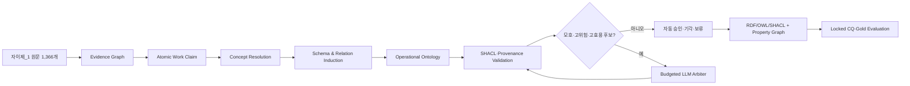

# 자이제_1 단일 도메인 온톨로지 자동 구축 실험 설계서

> **실험 범위:** Layer 2 전문가 자료만 사용한 단일 도메인 검증 — Transfer 실험 이전 단계  
> **통합 방법:** SCALE-OL의 온톨로지 학습 계층 + Atomic Work Claim(AWC) 추출 코어  
> **문서 버전:** v1.0  
> **작성 기준일:** 2026-07-11  
> **대상 파일:** `자이제_1.xlsx` / `clean_sentences` 시트

---

## 0. 한 페이지 요약

본 실험의 목적은 `자이제_1.xlsx`만 사용하여 다음 명제를 검증하는 것이다.

> **직무 전문가 자료를 곧바로 삼중항으로 변환하지 않고, 원문 근거와 조건·양태·부정·담화 지위를 보존하는 Atomic Work Claim으로 먼저 구조화한 뒤 개념 정규화, 동적 스키마 귀납, 업무 관계·규칙 생성, 그래프 제약 검증을 수행하고, 가치가 높은 소수의 모호한 후보에만 LLM을 사용하면 전수 LLM 방식에 근접한 품질의 업무 온톨로지를 더 적은 LLM 비용으로 구축할 수 있다.**

이번 실험은 **타 직무 Transfer를 검증하지 않는다.** 대신 Transfer 이전에 반드시 입증해야 할 다섯 가지를 분리하여 평가한다.

1. Claim-first 표현이 direct triple보다 조건·의무·부정·사례 구분을 더 잘 보존하는가?
2. Claim 그래프를 넘어 개념, taxonomy, 비분류 관계, 절차, 규칙, 템플릿을 갖춘 실제 온톨로지를 구축할 수 있는가?
3. 문서 계층과 표·양식 구조가 온톨로지 품질에 실질적으로 기여하는가?
4. 선택적 LLM 판정이 전수 LLM 판정에 대해 비열등하면서 토큰을 유의미하게 줄이는가?
5. 구축된 그래프가 원문으로 추적 가능하고, 제약을 만족하며, 사전에 잠근 업무 질의에 답할 수 있는가?

### 최종 권장 실험 구조



### 핵심 비교 시스템

| ID | 시스템 | 생성형 LLM 사용 | 주된 검증 목적 |
|---|---|---:|---|
| E0 | Direct Triple Full-LLM | 전수 | 평면 삼중항 기준선 |
| E1 | Full-LLM AWC | 전수 | Claim-first 표현의 고비용 기준선 |
| E2 | No-Generative-LLM AWC + Ontology | 0 | 규칙·구조·소형 모델의 독립 성능 |
| E3 | E2 + Uncertainty-only LLM | 선택 | 단순 불확실성 선택 기준선 |
| **E4** | **E2 + Risk/Diversity/Graph-Utility LLM** | **선택** | **제안 방법** |
| E5 | E2 + Exhaustive Gray-zone LLM | 회색지대 전수 | 선택 정책의 상한 비교군 |

### 핵심 성공 조건

제안 방법 E4는 최소한 다음 조건을 동시에 만족해야 한다.

- `Evidence precision ≥ 0.95`
- `RuleFrame slot F1 ≥ 0.80`
- `핵심 비분류 관계 F1 ≥ 0.75`
- `Example contamination rate ≤ 0.02`
- `중대 SHACL violation rate ≤ 0.01`
- `Provenance path coverage = 1.00`
- `Locked CQ answer-set F1 ≥ 0.80`
- E5 대비 주요 품질 지표의 비열등 한계 `−0.05` 충족
- E1 대비 입력·출력 LLM 토큰 비율 `≤ 0.35`
- 전체 후보 중 LLM 검토 후보 비율 `≤ 0.20`

위 수치는 기존 성과가 아니라 **사전등록할 연구 목표와 중단 기준**이다.

---

# 1. 연구 범위

## 1.1 포함 범위

본 실험은 다음 변환을 검증한다.

\[
D_{Zaije}
\rightarrow
(Evidence, Claim, Concept, TBox, ABox, RuleBox, Provenance)
\]

- **Evidence:** 문서·장·절·행·표·셀·원문 span
- **Claim:** 원문이 주장하는 최소 의미 단위
- **Concept:** 용어가 지시하는 정규화된 직무 개념
- **TBox:** 클래스, taxonomy, 관계 정의, domain/range
- **ABox:** 자료에 나타난 사례·개별 객체
- **RuleBox:** 조건, 의무, 권고, 금지, 예외, 평가·결정 규칙
- **Provenance:** 생성 방법, 모델·규칙 버전, 근거, 검수 이력

## 1.2 제외 범위

다음은 이번 실험에서 주장하지 않는다.

- NCS, APQC, Q-net 등 Layer 1 표준과의 정렬
- 기업 내부 문서와 Layer 3 맞춤화
- 법인파산, 투자, 퍼포먼스 마케팅 등 타 직무 Transfer
- 에이전트의 최종 업무 성공률 향상
- 자이제 외 문체·저자·문서 형식에 대한 일반화
- 원본 PDF 좌표·도형·시각 레이아웃의 완전 복원

## 1.3 “스키마 자동 구축”의 정확한 의미

본 실험은 완전한 schema-free 방식을 주장하지 않는다. `WorkUnit`, `Actor`, `InformationObject`, `NormativeObject`, `Evidence` 등은 어떤 직무 문서라도 표현하기 위한 **도메인 중립 최소 메타모델**로 고정한다. 반면 다음은 자이제 자료에서 귀납한다.

- `RFP`, `Capture Planning`, `전략기술서` 등의 도메인 개념
- 개념 간 상·하위 및 구성 관계
- 도메인 관계 후보와 관계 승격 여부
- 단계, 입력, 산출물, 역할, 의사결정 게이트
- 조건·양태·예외를 가진 업무 규칙
- Capture Plan의 템플릿·필드·척도·cardinality

따라서 올바른 연구 표현은 다음과 같다.

> **도메인 온톨로지를 사전 제공하지 않고, 최소 도메인 중립 메타모델 아래에서 자이제 도메인 온톨로지를 귀납한다.**

---

# 2. 설계 근거와 선행연구 반영

본 설계는 다음 선행연구의 장점을 취하되, 이번 데이터와 연구 목표에 맞게 제한한다.

| 선행 접근 | 채택할 점 | 그대로 사용하지 않는 이유 | 본 실험의 대응 |
|---|---|---|---|
| Data Programming [R1] | 여러 불완전한 Labeling Function의 합의 | LF 수와 support가 부족하면 label model 추정이 불안정 | 사전 활성 조건을 통과한 태스크에만 label model 사용 |
| Fonduer [R2] | 텍스트뿐 아니라 표·문서 구조를 함께 사용 | 현재 Excel에는 원본 시각 좌표가 없음 | 장·절·표·헤더·행·셀 구조까지만 사용하고 한계를 명시 |
| LLMs4OL [R3] | term typing, taxonomy, non-taxonomic relation을 분리 평가 | LLM 태스크별 성능이 곧 전체 온톨로지 품질은 아님 | Claim·개념·관계·규칙·질의를 다층 평가 |
| SPIRES/OntoGPT [R4] | 구조화된 출력과 schema-constrained extraction | 상세 스키마가 선행되고 LLM 호출 의존도가 높음 | 최소 메타모델만 고정하고 세부 스키마는 후보 귀납 |
| Coreference 기반 ontology [R5] | 전역 공지시·그래프 신호의 활용 | 단일 지역 관계와 업무 규칙은 별도 처리가 필요 | canonicalization과 alias graph에 한정해 사용 |
| AutoSchemaKG [R6] | 동적 스키마 귀납과 downstream functional evaluation | triple·schema 귀납 모두 LLM 중심이며 전문 직무 비용 부담 | 동일 문제를 구조·규칙 기본 경로와 제한적 LLM으로 검증 |
| PROV-O [R7] | 시스템 간 교환 가능한 provenance 표현 | 자체 로그만으로는 상호운용성·질의성이 약함 | Evidence–Claim–Assertion–Run을 PROV-O 호환으로 기록 |
| SHACL [R8] | RDF 그래프의 형식적 제약 검증 | 추출 정확도만으로 구조 오류를 찾기 어려움 | 타입·cardinality·근거·사례 승격 제약을 자동 검사 |

### 본 실험의 차별화 대상

단순히 “LLM과 규칙을 함께 사용했다”는 점은 신규성이 아니다. 본 실험에서 검증할 독자적 조합은 다음이다.

1. **직무 문서용 Atomic Work Claim**을 온톨로지 귀납의 중간표현으로 사용
2. 조건·양태·부정·예외·담화 지위를 평면 edge 밖에 보존
3. 표의 템플릿 스키마, 작성 규칙, 예시 인스턴스를 분리
4. 문장 불확실성뿐 아니라 **오류 위험, 그래프 영향, CQ 기여, 다양성, 토큰 비용**으로 LLM 예산 배분
5. 정확도와 함께 근거 충실도, 제약 일관성, 질의 가능성, 토큰 비용을 동시 평가

---

# 3. 자이제_1 데이터 감사 결과

## 3.1 파일 고정 정보

| 항목 | 값 |
|---|---|
| 파일 | `자이제_1.xlsx` |
| 시트 | `clean_sentences` |
| 행 수 | 헤더 1행 + evidence 1,366행 |
| 열 | `page`, `chapter_no`, `chapter_title`, `section_no`, `section_title`, `text_for_llm_human` |
| Binary SHA-256 | `9246a6da6c7635b3f34ee55df75112eb38a2984ea06828be943dc196de5926eb` |
| Canonical content SHA-256 | `de55c3184b7eba79db0694f1c89cd0a8f56dcb873d00c9f96df4e2deafc503d9` |

Canonical content hash는 줄바꿈을 `\n`으로 통일하고, 앞뒤 공백을 제거한 뒤, 각 행을 정렬된 JSON 필드로 직렬화하여 계산한다. Binary hash와 content hash를 함께 보관하여 Excel 재저장으로 바이너리만 바뀌는 경우와 실제 내용 변경을 구분한다.

## 3.2 기본 분포

| 장 | 제목 | Evidence 수 |
|---:|---|---:|
| 1 | 입찰과 제안 | 310 |
| 2 | 수주영업 | 486 |
| 3 | 제안서 전략 | 567 |
| 메타데이터 누락 | 미지정 | 3 |
| **합계** |  | **1,366** |

- 장·절 조합: **52개**
- 고유 텍스트: **1,332개**
- 정확히 같은 텍스트의 중복 행: **34개**
- 중복 클러스터: **6개**
- 텍스트 길이: 최소 3자, 중앙값 48자, 평균 약 66.1자, 최대 1,258자
- 마크다운 표 구조를 포함한 조각: **56개**
- 장·절·페이지 메타데이터 누락: **3개**

## 3.3 층화 표본용 휴리스틱 플래그

아래 수치는 정답 라벨이 아니라 표본 층화를 위한 사전 탐지 결과이며 서로 중복된다.

| 휴리스틱 플래그 | 탐지 수 |
|---|---:|
| 질문형 | 71 |
| 의무·권고·필요성 표현 | 102 |
| 조건·예외·시점 표현 | 215 |
| 절차·결정·수행 표현 | 499 |
| 평가·수치·척도 표현 | 263 |
| 사례·표·그림·오해 등 담화 표현 | 177 |
| 정의형 표현 | 362 |
| 마크다운 표 | 56 |

이 분포는 자연 무작위 표본만 사용할 경우 금지, 예외, 표 구조와 같은 희소하지만 치명적인 오류 유형이 충분히 포함되지 않을 수 있음을 보여준다. 따라서 **자연분포 테스트와 난도 테스트를 분리**한다.

## 3.4 데이터가 요구하는 표현 능력

자이제 데이터에는 다음이 동시에 존재한다.

- 정의와 개념 설명
- 절차와 단계 순서
- 입력·산출물·리뷰·의사결정 게이트
- 의무·권고·필요·금지·조건·예외
- 수치 범위, 점수, 비율, 비교
- 조사 결과와 출처 귀속
- 질문, 사례, 비유, 오해와 반박
- Capture Plan과 같은 템플릿·필드·예시 값

따라서 `(subject, predicate, object)`만으로 평가하지 않고, **n-ary Assertion/RuleFrame과 Evidence 연결**을 기본 단위로 사용한다.

---

# 4. 통합 방법론: SCALE-AWC

본 설계에서는 통합 방법을 편의상 **SCALE-AWC**라고 부른다. 이는 새로운 정식 명칭을 확정하기 위한 것이 아니라 실험 시스템을 식별하기 위한 작업명이다.

## 4.1 네 개의 그래프 평면

### Plane 1 — Evidence/Document Graph

- `Document`, `Chapter`, `Section`, `Fragment`
- `Table`, `TableRow`, `TableCell`, `ListItem`, `FigureCaption`
- `EvidenceSpan`, `SourceLocation`
- `contains`, `next`, `hasHeader`, `belongsToRow`, `locatedAtPage`

### Plane 2 — Claim Graph

- `AtomicWorkClaim`
- `claim_family`, `claim_type`
- `arguments`, `predicate_normalized`
- `modality`, `polarity`
- `condition`, `exception`, `scope`
- `discourse_status`, `promotion_target`
- `decision`, `uncertainty_code`

### Plane 3 — Concept/Operational Ontology

- `Concept`, `TermMention`, `AliasSet`, `ConceptType`
- `WorkUnit`, `Actor`, `InformationObject`, `MethodObject`
- `IntentionalObject`, `DecisionObject`, `NormativeObject`
- `AssessmentObject`, `ContextObject`, `DiscourseObject`
- procedure, input/output, role, decision, rule, risk, evidence 관계

### Plane 4 — Assurance/Provenance Graph

- `ExtractionRun`, `Extractor`, `LabelingFunction`, `ModelVersion`
- `wasDerivedFrom`, `wasGeneratedBy`, `wasReviewedBy`
- confidence, support, conflicts, status, before/after, timestamp

## 4.2 Atomic Work Claim 스키마

최소 필드는 다음과 같다.

```json
{
  "claim_id": "awc:...",
  "source_spans": [
    {"evidence_id": "ev:...", "start": 0, "end": 22, "text": "..."}
  ],
  "claim_family": "NORMATIVE",
  "claim_type": "Recommendation",
  "arguments": [
    {"role": "subject", "mention": "핵심 관련자", "span": [0, 6]},
    {"role": "value", "normalized": {"min": 3, "max": 6, "unit": "person"}}
  ],
  "predicate_normalized": "hasRecommendedCardinality",
  "modality": "SHOULD",
  "polarity": "POSITIVE",
  "conditions": [],
  "exceptions": [],
  "scope": ["CapturePlan.StakeholderIssueSection"],
  "discourse_status": "ASSERTED",
  "promotion_target": "RULE_NODE",
  "decision": "ACCEPT",
  "confidence": 0.94
}
```

### 강제 안전 규칙

- `MUST_NOT`은 부정 방향을 명시한다.
- `ConditionalRule`은 원문 condition span이 없으면 자동 승격하지 않는다.
- `Example`, `Question`, `Quotation`, `MythCandidate`는 기본적으로 operational graph에 승격하지 않는다.
- `NEEDS_REVIEW`와 `ABSTAIN`은 audit graph에는 남지만 실행 관계에는 사용하지 않는다.
- 모든 승인된 Assertion과 Rule은 하나 이상의 유효한 EvidenceSpan을 가져야 한다.

## 4.3 도메인 중립 메타모델

| 상위 유형 | 자이제에서 기대되는 예 |
|---|---|
| WorkUnit | 장기 포지셔닝, 기회기획, Capture Planning, 전략개발, 리뷰 |
| Actor | 고객, 평가자, 의사결정자, 영향자, 제안팀 |
| InformationObject | RFP, Capture Plan, 전략기술서, 제안서 |
| MethodObject | 전략, 전술, 솔루션, 커뮤니케이션 방법 |
| IntentionalObject | 요구사항, 니즈, 이슈, 기회, 목표 |
| DecisionObject | Pursuit Decision, Bid/No-bid, 평가 기준 |
| NormativeObject | 의무, 권고, 금지, 예외, 작성 규칙 |
| AssessmentObject | 영향력 점수, 중요도, 성공률, 비용 비율, 리스크 |
| ContextObject | RFP 이전·이후, 조건, 단계, 범위 |
| DiscourseObject | 정의, 사례, 조사결과, 오해, 반박, 질문 |

## 4.4 관계 레지스트리

공통 관계는 제한된 레지스트리로 시작하고, 열린 술어는 `DomainRelationCandidate`로 보류한다.

| 기능 | 관계 예시 |
|---|---|
| 계층·구성 | `subClassOf`, `partOf`, `hasPart`, `instanceOf` |
| 절차 | `hasStep`, `precedes`, `follows`, `triggers`, `hasMilestone` |
| 입출력 | `requiresInput`, `producesOutput`, `transforms`, `documents` |
| 역할 | `performedBy`, `approvedBy`, `reviewedBy`, `evaluatedBy` |
| 목적·요구 | `hasGoal`, `satisfies`, `addresses`, `prioritizes` |
| 방법 | `uses`, `appliesMethod`, `implementedBy` |
| 의사결정 | `hasCriterion`, `comparesWith`, `selects`, `rejects` |
| 규칙 | `hasCondition`, `hasException`, `requires`, `recommends`, `prohibits` |
| 인과·위험 | `causes`, `increases`, `decreases`, `mitigates`, `introducesRisk` |
| 의미·근거 | `aliasOf`, `definedBy`, `supports`, `contradicts`, `evidencedBy` |

새 관계는 다음을 모두 만족할 때 정식 관계로 승격한다.

1. 서로 다른 evidence group에서 반복 근거가 존재한다.
2. 주체·객체 타입이 안정적이다.
3. 기존 관계로 합치면 중요한 의미가 손실된다.
4. validation에서 근거 정밀도 기준을 만족한다.
5. procedure/rule/CQ 중 하나 이상의 구조적 효용이 있다.
6. 모순·중복·hub 남용 기준을 통과한다.

---

# 5. 연구 질문, 가설, 종속변수

## 5.1 연구 질문과 가설

| ID | 연구 질문 | 사전등록 가설 |
|---|---|---|
| RQ1 | Claim-first가 direct triple보다 의미를 잘 보존하는가? | E1은 E0보다 critical semantic error를 상대적으로 30% 이상 줄인다. |
| RQ2 | LLM 없이도 Claim에서 실제 온톨로지까지 구축 가능한가? | E2는 단순 Claim 추출 기준선보다 concept/relation/rule/CQ 지표가 유의하게 높다. |
| RQ3 | 문서 계층과 표 구조가 중요한가? | 구조 제거 ablation은 table/template F1, RuleFrame F1, CQ 성능을 낮춘다. |
| RQ4 | 제한적 LLM이 전수 판정에 비열등한가? | E4는 E5 대비 주요 F1 차이가 −0.05 이내이며, E1 토큰의 35% 이하를 사용한다. |
| RQ5 | 위험·다양성·그래프 효용 선택이 uncertainty-only보다 좋은가? | 동일 토큰 예산에서 E4가 E3보다 critical error와 ontology edge F1의 Pareto 우위를 보인다. |
| RQ6 | 그래프가 감사 가능하고 업무 질의에 유용한가? | 근거 정밀도 0.95 이상, provenance 100%, locked CQ F1 0.80 이상을 달성한다. |

## 5.2 공동 1차 종속변수

한 개의 임의 가중 종합점수로 결론내리지 않는다. 다음 네 지표를 공동 1차 지표로 둔다.

1. **Critical Semantic Error Rate(CSER)**
2. **RuleFrame slot F1**
3. **Ontology Edge Macro-F1**: taxonomy와 핵심 비분류 관계를 분리 보고한 뒤 사전 정의 평균
4. **LLM Token Ratio**: 비교 기준선 대비 입력+출력 토큰 비율

## 5.3 2차 종속변수

- Term span F1
- Concept type Macro-F1
- Canonicalization B³ 또는 pairwise F1
- Table/template field F1
- Evidence precision과 unsupported edge rate
- Example contamination rate
- SHACL violation rate
- CQ answer-set F1과 evidence precision
- Abstention coverage–risk curve
- 처리량, 지연시간, 인간 검수 시간

---

# 6. 실험 단위와 데이터 구조

## 6.1 실험 단위

| 수준 | 단위 | 용도 |
|---|---|---|
| 문서 | Evidence group | 분할·누출 방지·cluster bootstrap |
| 원문 | Evidence bundle | Claim 추출 평가 |
| 주장 | Atomic Work Claim | family/type/slot/critical error 평가 |
| 용어 | TermMention | 경계·유형 평가 |
| 개념 | Concept/Alias cluster | 병합·분리 평가 |
| 관계 | Assertion/RuleFrame | ontology edge·rule 평가 |
| 구조 | Section-level micrograph | 닫힌 경계 내 graph recall 평가 |
| 효용 | Competency Question | 업무 질의 평가 |

## 6.2 Evidence bundle 정의

각 target row에 다음을 결합한다.

- target 원문과 정확한 행 ID
- 같은 절의 직전·직후 최대 2개 조각
- chapter/section 제목
- 가장 가까운 목록 머리말
- 표인 경우 caption, header, row/column 좌표
- 문맥에서 논항을 복원한 경우 복원 근거 ID

원칙은 다음과 같다.

- 다른 split의 문맥은 결합하지 않는다.
- target evidence와 context evidence를 구분한다.
- context에서 복원한 정보는 `restored_from_context=true`로 기록한다.
- LLM과 비LLM 시스템에 같은 bundle을 제공한다.
- 최대 입력 길이를 초과하면 target, header, 직접 연결 문맥을 우선한다.

## 6.3 Stable ID

예시는 다음과 같다.

```text
zaije:doc/1
zaije:chapter/03
zaije:section/03-03-03
zaije:evidence/xlsx-row-1367
zaije:span/xlsx-row-1367/0-31
zaije:claim/sha256-...
zaije:concept/rfp
zaije:assertion/sha256-...
```

ID는 화면 순서가 아니라 정규화된 내용과 위치를 조합해 생성하며, 같은 실행을 두 번 수행해도 동일해야 한다.

---

# 7. 코퍼스 분할과 누출 방지

## 7.1 Leakage group 생성

단순 행 무작위 분할을 금지한다. 다음 연결을 union-find로 합쳐 하나의 `leakage_group_id`를 만든다.

1. 같은 chapter–section의 연속 블록
2. 표 caption–header–row–설명 문장
3. 목록 머리말과 목록 항목
4. 정확 중복 텍스트 클러스터
5. “단계 1/2/3”, “Capture Plan 1/8–8/8”처럼 연속된 템플릿·프로세스 블록
6. 메타데이터 누락 행과 양옆 문맥

같은 leakage group은 두 split에 들어갈 수 없다.

## 7.2 분할 비율

그룹 단위 제약 최적화로 아래 목표에 가장 가깝게 할당한다.

| Split | 목표 비율 | 목적 |
|---|---:|---|
| INDUCTION | 50% ± 3% | 규칙·후보·스키마·소형 모델 개발 |
| VALIDATION | 20% ± 3% | LF·threshold·LLM budget·promotion 정책 선택 |
| TEST_NATURAL | 20% ± 3% | 자연분포 최종 성능 |
| TEST_CHALLENGE_POOL | 10% ± 2% | 희소·고위험 구조 stress test |

균형 변수는 다음과 같다.

- chapter
- 표 포함 여부
- 조건·규범·질문·담화 플래그
- 텍스트 길이 사분위
- 한·영 병기·약어
- 중복·목록·연속 단계

고정 seed는 `20260711`을 사용하고, 동점은 `leakage_group_id`의 사전식 순서로 결정한다.

## 7.3 잠금 정책

분할 직후 다음을 생성한다.

- `split_manifest.csv`
- `split_manifest.sha256`
- 각 split의 evidence ID 목록
- 층화 분포 audit
- group overlap audit

다음 항목이 모두 고정된 뒤에만 locked test를 실행한다.

- Claim schema
- relation registry
- LF 목록과 버전
- small model ID와 checkpoint
- LLM model snapshot
- prompt와 JSON schema hash
- 자동 승인·기각 threshold
- LLM 선택 함수와 budget
- success gate
- 평가 코드 hash

`TEST_NATURAL`, `TEST_CHALLENGE_POOL`, `CQ-TEST`의 Gold와 결과를 본 뒤 프롬프트, 규칙, threshold를 변경하면 해당 test는 폐기하고 새 holdout이 필요하다.

---

# 8. 인간 Gold Standard 설계

## 8.1 Gold의 원칙

기존 LLM-Silver를 최종 정답으로 사용하지 않는다. LLM-Silver는 인간 Gold와 비교하는 보조 기준선으로만 사용할 수 있다.

- 최소 2명의 독립 주석자
- 적어도 1명은 수주·제안 도메인 전문가
- 적어도 1명은 온톨로지·정보추출 연구자
- 모델 결과를 보지 않은 blind annotation
- 제3의 adjudicator가 불일치 해소
- 실제로 근거가 부족한 경우 `UNDERDETERMINED`를 정식 Gold로 허용
- 난해 사례를 평가에서 조용히 제외하지 않음

## 8.2 권장 Gold 규모

### A. AWC Gold — 총 420 Evidence bundles

| 구분 | 수 | 사용 |
|---|---:|---|
| PILOT | 40 | 가이드라인 수정, 최종 점수 제외 |
| INDUCTION-GOLD | 100 | LF·small model 학습·오류 분석 |
| VALIDATION-GOLD | 80 | threshold·budget 선택 |
| TEST-NATURAL-GOLD | 140 | 공동 1차 지표 |
| TEST-CHALLENGE-GOLD | 60 | 고위험 stress test |
| **합계** | **420** |  |

`TEST_NATURAL`은 실제 코퍼스 분포를 보존한 확률 표본이다. 140개 자연분포 표본은 단일 비율이 약 0.85일 때 단순 이항 근사상 95% 구간의 반폭이 약 6%p인 규모다. 실제 결론은 행 독립을 가정하지 않고 leakage group 단위 cluster bootstrap으로 계산한다. `TEST_CHALLENGE`는 다음을 과표집한다.

- MUST/MUST_NOT/SHOULD 구분
- 조건과 예외
- 부정과 반박
- 사례·질문·인용의 비승격
- 표·수식·척도·cardinality
- 장거리 문맥과 생략 논항
- process direction
- instance/class 혼동

두 테스트는 따로 보고하며, challenge 성능을 자연분포 성능과 단순 평균하지 않는다.

### B. 표·템플릿 Gold — 56개 표 조각 전수

각 표에 다음을 주석한다.

- caption과 table purpose
- header hierarchy
- row/column/merged scope
- template field
- datatype/unit/scale/cardinality
- instruction vs example value
- 관계 또는 n-ary record

### C. Canonicalization Gold — 300개 mention pair

| 후보 유형 | 권장 수 |
|---|---:|
| 문자열·띄어쓰기·형태 유사 | 80 |
| 한·영 병기·약어 | 60 |
| 문맥/그래프 이웃 유사 | 60 |
| 같은 머리명사이나 다른 개념인 hard negative | 60 |
| 무작위 negative | 40 |

라벨은 `same_concept`, `broader_narrower`, `related_distinct`, `unrelated`, `underdetermined`이다.

### D. Closed Micrograph Gold — 12개

각 장에서 4개씩 선택한다.

- process/decision 중심 1개
- condition/rule 중심 1개
- table/template 중심 1개
- definition/discourse/evidence 중심 1개

6개는 development용, 6개는 locked test용이다. 각 micrograph는 명시된 evidence boundary 안에서 모든 평가 대상 개념·관계·규칙을 주석하므로, open-world KG에서 발생하는 “Gold에 없지만 맞는 관계” 문제를 줄인다.

### E. Competency Question Gold — 40개

- `CQ-DEV`: 20개
- `CQ-TEST`: 20개

각 CQ에는 다음이 포함된다.

- question ID와 자연어 질문
- graph query pattern
- 기대 answer set
- 허용 동의어
- 필수 evidence ID
- no-answer 여부
- 허용 hop 수

CQ-TEST는 extraction과 graph 설계에 사용하지 않는다.

## 8.3 주석 필드

### Claim 층

- evidence span
- claim boundary
- claim family/type
- subject/action/object 및 기타 argument role
- predicate normalization
- modality
- polarity
- condition/exception
- scope
- discourse status
- promotion target
- underdetermined 여부

### Ontology 층

- term span
- canonical concept ID
- top-level concept type
- instance/class 구분
- taxonomy edge
- non-taxonomic relation
- relation domain/range
- RuleFrame
- template/field/metric
- evidence linkage

## 8.4 주석자 일치도와 가이드라인 잠금

PILOT 40개에서 다음 기준을 확인한다.

| 항목 | 잠금 기준 |
|---|---:|
| Term/argument span pairwise F1 | ≥ 0.85 |
| Claim family Krippendorff’s α | ≥ 0.80 |
| Claim type/modality/promotion α | ≥ 0.75 |
| Canonicalization Cohen’s κ | ≥ 0.80 |
| Relation/Rule label α | ≥ 0.75 |

기준을 충족하지 못하면 가이드라인을 한 차례 수정하고 기존 PILOT과 겹치지 않는 20개로 재확인한다. Gold 본 주석은 가이드라인과 예시가 잠긴 뒤 시작한다.

## 8.5 모호 사례 처리

- adjudicator가 근거만으로 확정할 수 있으면 단일 Gold로 결정한다.
- 근거가 본질적으로 부족하면 `UNDERDETERMINED`로 둔다.
- 시스템이 이런 사례에서 `ABSTAIN`하면 정답으로 인정할 수 있다.
- primary metric에서 모호 사례를 제거하지 않고, 별도 underdetermined/abstain metric을 함께 보고한다.

---

# 9. 비교 시스템

## 9.1 E0 — Direct Triple Full-LLM

- 각 Evidence bundle에서 triple을 직접 생성
- source span과 evidence ID는 요구
- Claim 중간표현 없음
- 관계명은 제한 레지스트리 + `other` 허용
- 목적: flat triple 방식의 의미 손실 측정

### 표현 비대칭 완화

E0 결과를 기계적으로 AWC에 projection한 점수만 사용하지 않는다. 독립적으로 정의된 중립 semantic slot 집합—주체, 술어, 객체, 양태, 부정, 조건, 범위, 담화, 근거—에 대해 human Gold와 정렬한다. E0의 predicate 문자열이 의미를 실제로 표현하면 해당 슬롯으로 인정한다.

## 9.2 E1 — Full-LLM AWC

- 모든 Evidence bundle을 같은 LLM에 입력
- AWC JSON schema로 추출
- deterministic concept/schema/constraint 모듈은 E2–E5와 동일
- 목적: Claim-first 표현의 LLM-heavy reference
- “이론적 upper bound”라고 부르지 않고 **고비용 기준선**으로 부른다.

## 9.3 E2 — No-Generative-LLM SCALE-AWC

- 문서·표 파서
- 형태·구문·패턴
- 용어 통계
- frozen small encoder 또는 전통적 classifier
- high-precision LF
- 조건을 만족할 때만 label model
- graph/canonicalization/SHACL
- 생성형 LLM 호출 0

소형 encoder 토큰과 연산 비용은 별도 원장에 기록하여 “완전 무모델”로 오해하지 않도록 한다.

## 9.4 E3 — Uncertainty-only Selective LLM

- E2의 gray-zone 후보 중 entropy가 높은 순서로 선택
- E4와 동일한 후보 수·토큰 budget
- 위험·다양성·graph utility는 사용하지 않음
- 목적: 제안 선택 함수의 실제 추가 효과 분리

## 9.5 E4 — Risk/Diversity/Graph-Utility Selective LLM

본 연구의 제안 방법이다.

- E2가 만든 후보만 LLM이 판정
- 새 사실과 새 관계의 자유 생성 금지
- 관계 선택, merge/split, scope 판정, table header 판정, abstain만 허용
- 선택 점수에 위험·중심성·CQ 기여·다양성·토큰 비용 포함
- LLM 결과도 evidence/SHACL 검증을 통과해야 승격

## 9.6 E5 — Exhaustive Gray-zone LLM

- E2와 같은 gray-zone 후보 전체를 LLM에 전달
- E4와 동일한 arbiter prompt/model/schema
- E4가 무엇을 선택했는지만 다름
- 목적: 선택 정책의 품질–비용 상한 비교

## 9.7 공정성 통제

- E0와 E1은 같은 LLM snapshot, temperature, evidence bundle, 최대 출력 길이를 사용한다.
- E3–E5는 같은 candidate pool과 arbiter를 사용한다.
- 모든 시스템은 외부 웹 지식 사용을 금지한다.
- 모든 시스템은 같은 downstream graph validator를 사용한다.
- small classifier 또는 reranker는 INDUCTION에서만 학습하고, VALIDATION은 threshold·early stopping에만 사용한다. TEST의 원문은 추론 입력으로 처리할 수 있지만 TEST Gold는 어떤 학습·선택에도 사용하지 않는다.
- retry, JSON repair, timeout 정책을 동일하게 적용한다.
- 실제 API usage와 cache hit를 분리 기록한다.
- test 실행 순서와 결과 파일명을 사전에 고정한다.
- LLM 안정성은 locked test의 무작위 20%에서 독립 3회 반복하여 별도 보고한다.

---

# 10. 비LLM 및 약지도 경로

## 10.1 후보 생성

### Term/Concept 후보

- 한국어 명사구·명사 연쇄
- 절 제목, 표 header, 목록 머리말
- 괄호 속 영어·약어
- 정의 문형
- 작성·제출·검토·승인·평가의 목적어
- 빈도, C-value, context dispersion

### Claim/Relation 후보

- 정의, 포함, 순서, 입력, 산출, 역할, 목적, 인과 패턴
- 의무·권고·금지·조건·예외 cue
- 표 header–cell 관계
- section scope
- dependency/constituency argument structure
- alias와 coreference 후보

## 10.2 LF 활성 조건

기존 파일럿에서 실제 활성 LF가 적고 modality LF가 불안정했던 점을 반영하여, label model 사용을 강제하지 않는다.

### 태스크별 label model 사용 조건

- 서로 거의 같은 패턴이 아닌 active LF가 3개 이상
- 각 LF validation support 10 이상
- 결합 coverage 20% 이상
- pairwise output correlation이 모두 0.90 미만
- validation에서 최소한의 충돌 사례가 존재하여 가중치 추정이 가능

조건을 만족하지 못하면 다음 우선순위를 사용한다.

1. 검증된 high-precision rule
2. calibrated small classifier
3. conservative weighted vote
4. safe abstain

### LF 승인 기준

| 위험 수준 | Validation 조건 |
|---|---|
| 낮음: alias, 명시 정의, table header | precision point ≥ 0.90, 90% Wilson LCB ≥ 0.80, support ≥ 10 |
| 중간: input/output, process edge | precision point ≥ 0.93, 90% LCB ≥ 0.83, support ≥ 12 |
| 높음: MUST_NOT, condition, promotion | precision point ≥ 0.95, 90% LCB ≥ 0.85, support ≥ 15, critical error 0 |

기준을 못 넘은 LF는 후보 생성에는 사용할 수 있지만 자동 승인에는 사용할 수 없다.

## 10.3 자동 결정 threshold

고정 수치를 임의로 정하지 않고 VALIDATION에서 다음 목적함수로 선택한다.

- 저위험 자동 승인: precision ≥ 0.95를 만족하면서 coverage 최대화
- 고위험 자동 승인: precision ≥ 0.98을 만족하면서 coverage 최대화
- 자동 기각: false negative보다 false positive 위험이 큰 promotion 후보에 보수적으로 적용
- 나머지는 gray-zone 또는 abstain

threshold 선택 규칙 자체는 test 이전에 잠근다.

## 10.4 Concept canonicalization

다음 다중 신호를 결합한다.

\[
Sim(a,b)=w_sS_{string}+w_cS_{context}+w_rS_{role}+w_gS_{graph}+w_dS_{document}
\]

병합 금지 신호는 다음과 같다.

- 같은 문장이나 표에서 서로 대비됨
- 서로 다른 역할·출력 타입을 가짐
- 한 사례에서 동시에 별도 필드로 존재
- 상반된 규칙이나 상이한 process 위치를 가짐
- `Capture Plan` 문서와 `Capture Planning` 활동처럼 명사형이 비슷하지만 ontological category가 다름

## 10.5 Procedure와 Rule 귀납

### Procedure

- 단계 node
- `precedes/follows`
- 입력·산출물
- 수행·검토·승인 역할
- decision gate
- 조건부 분기와 반복

### RuleFrame

```text
RuleFrame {
  antecedent: Condition[]
  consequent: Assertion
  modality: MUST | MUST_NOT | SHOULD | MAY | DESCRIPTIVE
  polarity: POSITIVE | NEGATIVE
  exception: Condition[]
  scope: Context[]
  priority: optional
  evidence: EvidenceSpan[]
}
```

RuleFrame을 바로 실행 규칙으로 바꾸지 않고, 검증된 일부만 추후 agent rule로 승격할 수 있도록 분리한다.

---

# 11. 선택적 LLM 정책

## 11.1 후보 가치 함수

각 후보 `c`에 대해 다음 점수를 사용한다.

\[
Score(c)=
\frac{
H(p_c)\cdot Risk(c)\cdot Impact(c)\cdot CQGain(c)\cdot(1+Novelty(c))
}{EstimatedTokenCost(c)}
\]

- `H(p)`: 예측 엔트로피
- `Risk`: 오류 발생 시 업무 의미 왜곡 정도
- `Impact`: 이 판정이 영향을 주는 node/edge/constraint 수
- `CQGain`: 승인·기각 시 새로 결정되는 CQ 수
- `Novelty`: 기존 검증 패턴과의 차이
- `EstimatedTokenCost`: 필요한 evidence bundle 길이

## 11.2 위험 등급

| 등급 | 후보 유형 |
|---:|---|
| 5 | MUST_NOT, negation, condition/exception, 사례→규칙 승격 |
| 4 | process 방향, instance/class, 중앙 개념 merge/split |
| 3 | relation type, domain/range, decision gate |
| 2 | alias, definition, low-degree concept typing |
| 1 | 단순 descriptive fact |

## 11.3 다양성 제약

이전 파일럿에서 선택 후보가 ConditionalRule 한 유형으로 붕괴한 문제를 방지한다.

- 한 claim family가 전체 선택의 35%를 초과하지 않음
- 후보가 존재하면 normative/conditional, discourse/promotion, table/template, canonicalization, procedure에서 각각 최소 quota 부여
- 같은 semantic cluster에서 과도하게 중복 선택하지 않음
- 5%는 gray-zone 내 deterministic exploration 표본으로 배정
- 고위험 후보는 score가 낮아도 최소 review quota 적용

## 11.4 Budget sweep

한 개 budget만 보고 결론내지 않는다. gray-zone 후보 대비 다음 비율을 실행한다.

- 0%
- 5%
- 10%
- **20% — 사전등록된 주 비교점**
- 40%
- 100% — E5

각 점에서 품질, critical error, token, 비용을 측정하여 Pareto frontier를 그린다.

## 11.5 LLM 허용 출력

```json
{
  "candidate_id": "cand:...",
  "decision": "accept | reject | merge | split | relation_id | abstain",
  "selected_relation": "precedes",
  "evidence_ids": ["ev:..."],
  "confidence": 0.0,
  "abstain_reason": null
}
```

금지 사항:

- 후보에 없는 사실 생성
- 외부 상식으로 근거 보완
- 새 concept/relation을 자유 생성
- evidence ID 없는 승인
- 예시를 일반 규칙으로 승격

## 11.6 LLM 결과의 후속 검증

LLM 결정은 다음을 모두 통과해야 한다.

1. JSON schema valid
2. candidate ID valid
3. evidence span substring valid
4. relation domain/range valid
5. promotion policy valid
6. SHACL critical constraint valid
7. contradiction/duplicate audit valid

실패한 결과는 자동 채택하지 않고 `ABSTAIN/NEEDS_REVIEW`로 이동한다.

---

# 12. Ablation 실험

| ID | 제거 요소 | 검증 대상 |
|---|---|---|
| A1 | Evidence bundle 문맥 제거, target row만 사용 | 장거리 문맥과 생략 논항 효과 |
| A2 | 장·절·표·header 구조 제거 | richly formatted structure 효과 |
| A3 | AWC qualifier 제거, flat assertion 사용 | 조건·양태·담화 보존 효과 |
| A4 | concept canonicalization 제거 | 중복 node·CQ·graph path 영향 |
| A5 | SHACL/graph constraint 제거 | unsupported edge·구조 오류 영향 |
| A6 | risk/diversity/utility 제거, uncertainty-only | 제안 선택 함수 효과 |
| A7 | label model 제거, 단순 다수결 | 약지도 합의의 실제 기여 |
| A8 | relation promotion gate 제거 | 관계 폭증·중복·hub 오염 영향 |

### 우선순위

공동 1차 ablation은 A2, A3, A5, A6이다. 나머지는 2차 분석으로 둔다. 모든 ablation을 test 결과를 본 뒤 추가하지 않으며, 추가 분석은 exploratory로 명시한다.

---

# 13. 평가 지표

## 13.1 Evidence와 provenance

| 지표 | 정의 |
|---|---|
| Source span validity | 제출한 span이 원문에 정확히 존재하는 비율 |
| Evidence precision | 승인된 지식이 연결 근거로 실제 지지되는 비율 |
| Unsupported edge rate | 근거가 지지하지 않는 승인 edge 비율 |
| Provenance path coverage | Assertion→Claim→Evidence→Run 경로가 완성된 비율 |
| Context restoration precision | 문맥에서 복원한 논항 중 Gold와 일치하는 비율 |

## 13.2 Claim

- Claim boundary precision/recall/F1
- Claim family Macro-F1
- Claim type Macro-F1
- argument role span F1
- predicate normalization accuracy
- modality Macro-F1
- polarity F1
- condition/exception span F1
- promotion target Macro-F1
- RuleFrame exact match

### Critical Semantic Error

다음 중 하나라도 발생하면 critical error로 센다.

1. MUST, SHOULD, MAY, MUST_NOT의 위험한 혼동
2. negation/polarity 소실
3. condition 또는 exception 소실
4. Example/Question/Quotation/Myth의 operational promotion
5. 근거가 없는 assertion
6. instance/class 혼동
7. process direction 역전
8. 수치 범위·단위의 중대한 변형

다음 두 분모를 모두 보고한다.

- `critical errors / gold claims`
- `critical-error evidence / evaluated evidence`

## 13.3 Concept와 schema

- Term span F1
- Concept type Macro-F1
- Canonicalization pairwise F1
- B³ precision/recall/F1
- over-merge / under-merge rate
- Taxonomy edge P/R/F1
- hierarchical F1
- cycle rate
- domain/range validity
- induced relation precision와 relation inventory size

`Ontology Edge Macro-F1`은 다음 다섯 relation family F1의 비가중 평균으로 고정한다: `taxonomy`, `procedure/temporal`, `input-output`, `actor-responsibility`, `goal-decision-risk`. RuleFrame은 별도의 공동 1차 지표이므로 이 평균에 중복 포함하지 않는다. 어떤 family의 Gold support가 10 미만이면 해당 family는 수치와 support를 개별 보고하되 macro 평균에서 제외하지 않고, 불확실성이 큰 것으로 해석한다.

## 13.4 Operational ontology

- Non-taxonomic relation Micro/Macro-F1
- Procedure edge F1
- input/output/actor relation F1
- RuleFrame slot F1
- Template field F1
- scale/unit/cardinality accuracy
- Example contamination rate
- orphan node rate
- duplicate concept/edge rate

## 13.5 CQ 평가

- answer-set precision/recall/F1
- required evidence precision/recall
- no-answer accuracy
- valid path coverage
- 평균·중앙 hop 수
- query latency
- 답은 맞지만 근거가 잘못된 비율

CQ 응답은 자유 생성 LLM이 아니라 우선 SPARQL/Cypher 결과로 평가한다. 자연어 rendering이 필요하면 graph answer와 별도로 평가한다.

## 13.6 비용과 효율

- LLM calls
- reviewed candidates
- input/output/cached tokens
- 실제 또는 단가 정규화 비용
- E1·E5 대비 token ratio
- 1,000 evidence당 token
- 정확도 1%p 향상당 추가 token
- 인간 검수 분과 수정된 graph element 수
- 처리량, peak memory, runtime

---

# 14. 통계 분석 계획

## 14.1 Primary test

- 공동 1차 결론은 `TEST_NATURAL`에서 낸다.
- `TEST_CHALLENGE`는 별도 stress 결과로 보고한다.
- 층화 표본이면 inclusion probability의 역수를 이용해 자연분포 metric을 가중 추정한다.

## 14.2 의존성 처리

Evidence 행은 같은 절·표·프로세스 안에서 독립이 아니다. 따라서 단순 evidence bootstrap 대신 `leakage_group_id` 단위 **paired cluster bootstrap 5,000회**를 사용한다.

## 14.3 시스템 비교

- F1 차이: paired cluster bootstrap 95% CI
- Critical binary error: paired McNemar exact test + risk difference CI
- CQ: question-level paired bootstrap 또는 permutation test
- calibration: Brier score, ECE, reliability diagram
- multiple primary comparison: Holm 보정

p-value만 보고하지 않고 다음을 함께 제시한다.

- 절대 차이
- 상대 오류 감소율
- 95% CI
- 비용 차이
- effect가 발생한 strata

## 14.4 비열등성 검정

E4 대 E5의 비열등 한계는 `−0.05`로 고정한다.

- RuleFrame slot F1 차이의 95% CI 하한 > −0.05
- Ontology Edge Macro-F1 차이의 95% CI 하한 > −0.05
- CSER 차이의 95% CI 상한 < +0.02

세 조건을 모두 만족해야 품질 비열등으로 판단한다.

## 14.5 Pareto 분석

Budget sweep 각 점에서 다음 좌표를 그린다.

```text
x = LLM input+output tokens
 y = ontology quality 또는 critical error reduction
```

E4가 같은 budget의 E3보다 낮은 품질이면 선택 함수 가설은 기각한다. E4가 E3보다 좋더라도 E5에 비열등하지 않거나 비용 기준을 못 맞추면 저비용 방법론 성공으로 주장하지 않는다.

## 14.6 Abstention 분석

- coverage–accuracy curve
- selective risk
- high-risk family별 abstain rate
- underdetermined Gold에서의 올바른 abstain 비율

낮은 오류율을 만들기 위해 대부분을 abstain하는 시스템을 방지하기 위해 품질과 coverage를 함께 보고한다.

---

# 15. 사전등록 성공 게이트

## Gate 0 — 데이터·분할 무결성

- binary/content hash 일치
- stable ID 100%
- leakage group overlap 0
- split manifest hash 잠금
- test Gold 접근 로그 0

하나라도 실패하면 실험을 중단하고 manifest를 다시 만든다.

## Gate 1 — Gold 품질

- 주석 일치도 기준 충족
- adjudication 완료율 100%
- `UNDERDETERMINED` 포함 모든 항목의 상태 기록
- test Gold에 LLM pre-annotation 노출 없음

## Gate 2 — Claim-first 표현 효과

E1 대 E0에서:

- CSER 상대 감소 ≥ 30%
- paired 95% CI에서 감소 방향 유지
- source span validity가 악화되지 않음

통과하면 “Claim-first 표현이 자이제 문서에서 의미 보존에 유리하다”고 주장할 수 있다.

## Gate 3 — 온톨로지 구축 품질

E4의 `TEST_NATURAL` 결과:

| 지표 | 최소 기준 |
|---|---:|
| Term span F1 | 0.85 |
| Concept type Macro-F1 | 0.80 |
| Canonicalization B³ F1 | 0.85 |
| Taxonomy edge F1 | 0.75 |
| Core non-tax relation F1 | 0.75 |
| RuleFrame slot F1 | 0.80 |
| Table/template F1 | 0.85 |

핵심 네 항목—concept type, core relation, RuleFrame, table/template—은 모두 기준을 넘어야 한다.

## Gate 4 — 신뢰성과 안전성

| 지표 | 기준 |
|---|---:|
| Evidence precision | ≥ 0.95 |
| Unsupported edge rate | ≤ 0.03 |
| Example contamination | ≤ 0.02 |
| 중대 SHACL violation | ≤ 0.01 |
| Provenance path coverage | 1.00 |
| Process direction critical error | ≤ 0.02 |

## Gate 5 — 저비용 LLM 효과

- E4가 E5에 대해 비열등성 조건 충족
- E4/E1 token ratio ≤ 0.35
- E4/E5 token ratio ≤ 0.50
- LLM-reviewed candidate ratio ≤ 0.20
- 동일 budget에서 E4가 E3보다 공동 1차 지표 중 적어도 2개에서 우세하고 어느 지표에서도 유의하게 열등하지 않음

## Gate 6 — 질의 가능성과 runtime

- CQ-TEST answer-set F1 ≥ 0.80
- CQ-TEST evidence precision ≥ 0.90
- no-answer accuracy ≥ 0.85
- provenance query 성공률 1.00
- idempotent import 2회 후 node/edge hash 동일
- duplicate stable ID 0

## Gate 7 — 재현성

- 비LLM 경로 재실행 결과 hash 동일
- LLM 원응답, usage, model snapshot, prompt hash 저장
- 동일 response cache replay 결과 동일
- 환경·코드·설정 manifest 완비

---

# 16. 결과 판정 규칙

| 판정 | 조건 | 허용 주장 |
|---|---|---|
| PASS | Gate 0–7 모두 통과 | 자이제 단일 도메인에서 저비용·근거 기반 온톨로지 구축 가능성 지지 |
| PARTIAL-A | Gate 2 통과, Gate 3/5 실패 | Claim-first 효과만 지지; 온톨로지·저비용 효과는 미입증 |
| PARTIAL-B | Gate 3/4/6 통과, Gate 5 실패 | 온톨로지는 구축 가능하나 LLM 절감 가설은 미입증 |
| PARTIAL-C | Gate 5 통과, Gate 3 또는 6 실패 | 비용 절감은 가능하나 온톨로지 품질·업무 효용 부족 |
| REVISE | Gate 0/1/4/7 실패 | 데이터·Gold·신뢰성·재현성 문제로 성능 결론 보류 |

단일 총점으로 PASS를 만들지 않는다. 특히 provenance와 evidence precision을 비용 성능으로 상쇄할 수 없다.

---

# 17. CQ 설계

## 17.1 CQ-DEV 예시 20개

1. 경쟁력 있는 제안 역량은 어떤 하위 역량으로 구성되는가?
2. 공식적 요구조건과 비공식적 요구조건은 어떤 관계인가?
3. 비공식적 요구조건이 발생하는 이유는 무엇인가?
4. RFP 발행 이전에 수행해야 할 주요 활동은 무엇인가?
5. RFP 발행 이후 판매자의 영향력이 감소하는 이유는 무엇인가?
6. 사전영업 투자와 제안 성공률을 연결하는 자료·주장은 무엇인가?
7. 수주 가능성이 낮은 제안에 참여하지 않는 결정의 목적은 무엇인가?
8. 장기 포지셔닝과 Opportunity Planning은 어떤 단계와 연결되는가?
9. Capture Planning의 입력, 활동, 산출물, 의사결정 게이트는 무엇인가?
10. Capture Plan은 어떤 섹션으로 구성되는가?
11. 이해관계자 이슈 섹션에는 어떤 필드가 있는가?
12. 핵심 관련자의 권장 인원 범위는 얼마인가?
13. 영향력과 중요도는 어떤 척도로 평가되는가?
14. 개별 이해관계자 이슈는 어떻게 핵심 이슈로 집계되는가?
15. 경쟁사 분석과 자사 분석은 각각 어떤 전략 객체를 만드는가?
16. 전략개발의 산출물은 무엇이며 이후 어떤 업무의 입력인가?
17. 솔루션 최적화와 커뮤니케이션 방법 개발은 무엇이 다른가?
18. 제안서 리뷰 단계의 순서와 각 단계 목적은 무엇인가?
19. 특정 조사결과 Claim은 어느 원문과 출처에 근거하는가?
20. 완소병원 사례의 값과 일반 업무 규칙을 어떻게 구분할 수 있는가?

`CQ-TEST` 20개는 동일한 범주 분포를 따르되 정확한 질문·answer set·evidence는 별도 파일로 잠근다.

## 17.2 CQ 범주 할당

| 범주 | DEV | TEST |
|---|---:|---:|
| 정의·별칭 | 2 | 2 |
| 프로세스·순서 | 4 | 4 |
| 입력·산출물·역할 | 3 | 3 |
| 조건·규칙·예외 | 4 | 4 |
| 템플릿·척도·cardinality | 3 | 3 |
| 인과·위험·결정 | 2 | 2 |
| provenance·담화·사례 | 2 | 2 |
| **합계** | **20** | **20** |

## 17.3 CQ 누출 방지

- CQ-DEV만 top-down graph 개선에 사용한다.
- CQ-TEST는 최종 시스템 freeze 이후 한 번 실행한다.
- CQ-TEST 질문을 LLM selection score의 `CQGain` 계산에 직접 사용하지 않는다.
- `CQGain`은 메타모델에서 생성된 일반 질의 템플릿으로 계산한다.

---

# 18. Graph·SHACL·runtime 검증

## 18.1 최소 SHACL 제약

```turtle
zaije:AssertionShape a sh:NodeShape ;
    sh:targetClass zaije:Assertion ;
    sh:property [
        sh:path zaije:evidencedBy ;
        sh:minCount 1
    ] ;
    sh:property [
        sh:path zaije:confidence ;
        sh:minInclusive 0.0 ;
        sh:maxInclusive 1.0
    ] .

zaije:RuleShape a sh:NodeShape ;
    sh:targetClass zaije:Rule ;
    sh:property [
        sh:path zaije:modality ;
        sh:minCount 1 ;
        sh:maxCount 1
    ] .
```

추가 제약:

- `precedes`의 양 끝은 WorkUnit/Event
- `producesOutput`의 객체는 InformationObject
- ExampleInstance는 검토 없이 class/taxonomy로 승격 금지
- ConditionalRule은 condition 최소 1개
- Metric은 가능한 경우 unit/scale/range 중 하나 이상
- 승인 Assertion은 `generatedBy`와 `derivedFrom`을 가짐

## 18.2 Runtime 테스트

1. RDF/OWL/SHACL export
2. Neo4j 또는 동등 property graph import
3. unique constraint 적용
4. 동일 파일을 두 번 idempotent import
5. node/edge 수와 canonical hash 비교
6. duplicate ID 검사
7. Assertion→Claim→Evidence provenance query
8. CQ-DEV 20개와 CQ-TEST 20개 실행
9. 실패 query의 원인 분류: extraction, schema, import, query

## 18.3 Full-corpus graph 생성 시점

잠긴 test 평가가 끝난 뒤, 최종 선택된 시스템을 전체 1,366 evidence에 실행하여 연구 산출용 자이제 온톨로지를 만든다. 이 full-corpus 그래프는 **제품 산출물**이지 새로운 독립 test 결과가 아니다. test를 본 뒤 수정한 시스템으로 full graph를 만든 경우, 수정 전 locked 결과와 수정 후 산출물을 명확히 분리한다.

---

# 19. 실행 절차

## Phase 0 — 사전등록과 데이터 잠금

- binary/content hash 확인
- stable Evidence ID 생성
- block type, table/list/duplicate cluster 감사
- leakage group 생성
- constrained split와 manifest 잠금
- 연구 질문·지표·게이트·모델·prompt·budget 고정

### 산출물

- `preregistration.md`
- `corpus_manifest.jsonl`
- `split_manifest.csv`
- `data_audit.json`
- hash 파일

## Phase 1 — Gold 가이드라인과 PILOT

- AWC·concept·relation·RuleFrame 가이드라인 작성
- 40개 독립 이중 주석
- IAA 계산
- 가이드라인 1회 수정 가능
- schema와 label set 잠금

### 산출물

- `annotation_guideline_v1.md`
- `pilot_annotations/`
- `iaa_report.json`

## Phase 2 — 인간 Gold 구축

- INDUCTION/VALIDATION/TEST Gold 이중 주석
- adjudication
- table 56개 전수
- canonicalization pair 300개
- micrograph 12개
- CQ 40개

### 산출물

- `gold_awc.jsonl`
- `gold_terms_concepts.jsonl`
- `gold_canonical_pairs.csv`
- `gold_tables.jsonl`
- `gold_micrographs.ttl`
- `cq_dev.json`, `cq_test.locked`

## Phase 3 — 기준선 구현

- E0, E1
- E2 non-generative path
- neutral evaluation mapper
- cost/provenance ledger

### 산출물

- baseline outputs
- schema-validity report
- prompt/model manifest

## Phase 4 — 온톨로지 귀납

- concept typing/canonicalization
- taxonomy/non-tax relation
- procedure/RuleFrame
- relation promotion
- SHACL validation
- RDF/Neo4j export

## Phase 5 — 선택적 LLM과 budget sweep

- E3, E4, E5
- 0/5/10/20/40/100% sweep
- validation에서 primary budget 확정
- locked test 전 selector freeze

## Phase 6 — Locked 평가

- TEST_NATURAL 한 번 실행
- TEST_CHALLENGE 한 번 실행
- cluster bootstrap·비열등성·Pareto 분석
- CQ-TEST·runtime·idempotence 검사
- 결과 파일 read-only 잠금

## Phase 7 — 전체 그래프와 연구 보고

- 최종 frozen 시스템의 full-corpus 실행
- 실패 사례 taxonomy
- 주장 가능 범위 판정
- Transfer 단계로 넘어갈지 여부 결정

---

# 20. 재현성 디렉터리 구조

```text
zaije_experiment/
├─ README.md
├─ config/
│  ├─ preregister.yaml
│  ├─ schema_awc.json
│  ├─ relation_registry.yaml
│  ├─ shacl_shapes.ttl
│  └─ model_prompt_manifest.yaml
├─ data/
│  ├─ raw/zaije_1.xlsx
│  ├─ canonical/corpus.jsonl
│  └─ manifests/
│     ├─ corpus_manifest.jsonl
│     ├─ split_manifest.csv
│     └─ hashes.txt
├─ annotation/
│  ├─ guideline.md
│  ├─ pilot/
│  ├─ gold/
│  └─ iaa/
├─ src/
│  ├─ ingest/
│  ├─ evidence/
│  ├─ claims/
│  ├─ concepts/
│  ├─ relations/
│  ├─ weak_supervision/
│  ├─ arbitration/
│  ├─ constraints/
│  ├─ export/
│  └─ evaluation/
├─ runs/
│  └─ {run_id}/
│     ├─ config_snapshot/
│     ├─ raw_outputs/
│     ├─ graph/
│     ├─ usage_ledger.jsonl
│     └─ metrics.json
└─ reports/
   ├─ locked_test_report.md
   ├─ pareto.csv
   ├─ error_analysis.md
   └─ final_claim_matrix.md
```

## 20.1 실행 manifest 필수 항목

- git commit
- 실행 시각과 run ID
- Python/Java/graph DB 버전
- package lock hash
- CPU/GPU 정보
- random seed
- input binary/content hash
- split hash
- prompt/schema hash
- model ID와 snapshot
- LF registry hash
- threshold와 budget
- 실제 calls/tokens/cache
- output graph hash

---

# 21. 위협 요인과 완화책

| 위협 | 영향 | 완화 |
|---|---|---|
| 단일 책·단일 문체 | 타 도메인 일반화 불가 | 이번 결론을 자이제 단일 도메인으로 제한 |
| Gold 불완전성 | 맞는 edge가 오답 처리될 수 있음 | closed micrograph와 evidence precision 병행 |
| 같은 절 내 상관 | CI가 과도하게 좁아짐 | group-level split과 cluster bootstrap |
| LLM-Silver 편향 | 같은 모델 오류가 정답에 반영 | blind human Gold를 primary reference로 사용 |
| 표 원본 레이아웃 소실 | 시각 관계 복원 한계 | 현재 보존된 Markdown/metadata만 평가하고 한계 명시 |
| rare critical class 부족 | MUST_NOT·예외 성능 불안정 | challenge set과 최소 Gold 수 확장 규칙 |
| selector 유형 붕괴 | 한 claim family만 선택 | quota·다양성·exploration 제약 |
| LF support 부족 | label model 불안정 | 활성 조건 미달 시 safe abstain/weighted rule |
| CQ 최적화 누출 | 실제 효용 과대평가 | CQ-DEV/CQ-TEST 완전 분리 |
| 동적 schema의 open world | recall 평가 곤란 | 닫힌 micrograph에서 recall, 전체 graph에서 precision/CQ |
| 모델 snapshot 변화 | 재현성 저하 | snapshot·raw response·cache 저장 |
| abstain 남용 | 낮은 오류율 착시 | coverage–risk를 공동 보고 |

### 희소 클래스 확장 규칙

PILOT+INDUCTION에서 다음 critical family의 Gold claim이 각각 30개 미만이면, 모델 결과를 보기 전에 `TEST_CHALLENGE`를 최대 100 evidence까지 확장할 수 있다.

- MUST_NOT/negation
- condition/exception
- discourse non-promotion
- process direction
- table cardinality/scale

확장 규칙과 추가 evidence ID는 test 실행 전에 잠근다.

---

# 22. 최종 보고서 표준 형식

## 22.1 데이터·Gold

| 항목 | 값 |
|---|---:|
| Evidence 전체 | 1,366 |
| 평가 Evidence |  |
| Gold Claims |  |
| Gold Concepts |  |
| Gold Relations |  |
| IAA |  |
| Underdetermined 비율 |  |

## 22.2 시스템 성능

| System | Claim F1 | CSER | Concept Type F1 | Edge Macro-F1 | Rule F1 | Evidence P | CQ F1 | Tokens |
|---|---:|---:|---:|---:|---:|---:|---:|---:|
| E0 |  |  |  |  |  |  |  |  |
| E1 |  |  |  |  |  |  |  |  |
| E2 |  |  |  |  |  |  |  |  |
| E3 |  |  |  |  |  |  |  |  |
| E4 |  |  |  |  |  |  |  |  |
| E5 |  |  |  |  |  |  |  |  |

## 22.3 자연분포와 Challenge 분리

| Metric | TEST_NATURAL | TEST_CHALLENGE |
|---|---:|---:|
| Claim F1 |  |  |
| Modality F1 |  |  |
| Condition F1 |  |  |
| Discourse promotion error |  |  |
| RuleFrame F1 |  |  |
| Evidence precision |  |  |

## 22.4 Gate 판정

| Gate | PASS/FAIL | 근거 |
|---|---|---|
| 0 데이터 |  |  |
| 1 Gold |  |  |
| 2 Claim-first |  |  |
| 3 Ontology |  |  |
| 4 신뢰성 |  |  |
| 5 저비용 LLM |  |  |
| 6 CQ/runtime |  |  |
| 7 재현성 |  |  |

---

# 23. 실험 완료 후 주장 가능한 문장

모든 Gate를 통과한 경우에도 다음 수준으로 제한한다.

> 자이제 수주·제안 전문가 자료 1,366개 evidence를 대상으로, Evidence-grounded Atomic Work Claim, 개념 정규화, 동적 관계·스키마 귀납, 제약 검증과 선택적 LLM 판정을 결합한 방법이 direct triple 및 전수 LLM 기준선과 비교해 조건·양태·담화 지위를 더 안정적으로 보존하고, 잠긴 인간 Gold와 업무 질의에서 사전등록 기준을 충족하면서 LLM 토큰을 줄였음을 확인하였다.

아직 말할 수 없는 문장은 다음이다.

- “모든 직무에 일반화된다.”
- “법인파산·투자·마케팅에서도 같은 정확도를 낸다.”
- “에이전트 업무 성공률을 향상시킨다.”
- “인간 개입 없이 완전 자동으로 온톨로지를 구축한다.”
- “전수 LLM보다 항상 우수하다.”

이러한 주장은 후속 Transfer 및 에이전트 실증 단계에서 별도로 검증해야 한다.

---

# 부록 A. 중립 평가 슬롯

E0 direct triple과 E1–E5 AWC의 표현 형식 차이로 인한 평가 편향을 줄이기 위해, 다음 독립 평가 슬롯을 사용한다.

```text
SemanticEvaluationUnit {
  proposition_span
  subject
  predicate_semantics
  object_or_value
  modality
  polarity
  condition
  exception
  scope
  temporal_order
  discourse_status
  instance_or_class
  evidence_support
}
```

시스템 출력이 어떤 형식이든 위 의미를 명시적으로 표현하면 점수를 부여한다. 반대로 triple 형식이 해당 의미를 담지 못하면 누락으로 계산한다. 이 평가 틀은 AWC 출력 JSON과 별도로 버전 관리한다.

---

# 부록 B. 오류 코드

| 코드 | 설명 | Critical |
|---|---|---:|
| E-SPAN | source span 불일치 | 조건부 |
| E-HALL | 근거 없는 사실·관계 | 예 |
| E-MOD | modality 혼동 | 예 |
| E-NEG | 부정 소실·반전 | 예 |
| E-COND | condition 누락 | 예 |
| E-EXC | exception 누락 | 예 |
| E-DISC | 사례·질문·오해 오승격 | 예 |
| E-DIR | 절차 방향 역전 | 예 |
| E-IC | instance/class 혼동 | 예 |
| E-NUM | 수치·범위·단위 변형 | 예 |
| E-MERGE | 잘못된 concept merge | 위험도에 따라 |
| E-SPLIT | 같은 concept 과분리 | 아니오 |
| E-REL | relation type 오류 | 위험도에 따라 |
| E-SCOPE | 적용 범위 오류 | 위험도에 따라 |
| E-DUP | 중복 node/edge | 아니오 |
| E-SHACL | 중대 제약 위반 | 예 |

---

# 부록 C. `preregister.yaml` 예시

```yaml
experiment_id: zaije-scale-awc-v1
seed: 20260711
input:
  file: zaije_1.xlsx
  sheet: clean_sentences
  binary_sha256: 9246a6da6c7635b3f34ee55df75112eb38a2984ea06828be943dc196de5926eb
  content_sha256: de55c3184b7eba79db0694f1c89cd0a8f56dcb873d00c9f96df4e2deafc503d9
splits:
  induction: 0.50
  validation: 0.20
  test_natural: 0.20
  test_challenge_pool: 0.10
primary_budget:
  gray_zone_review_ratio: 0.20
  max_token_ratio_vs_full_awc: 0.35
noninferiority:
  f1_margin: -0.05
  critical_error_margin: 0.02
primary_metrics:
  - critical_semantic_error_rate
  - ruleframe_slot_f1
  - ontology_edge_macro_f1
  - llm_token_ratio
locked_components:
  - awc_schema_hash
  - relation_registry_hash
  - split_manifest_hash
  - prompt_hash
  - model_snapshot
  - lf_registry_hash
  - threshold_config_hash
  - evaluation_code_hash
```

---

# 참고문헌

- **[R1]** Ratner, A. et al. (2016). *Data Programming: Creating Large Training Sets, Quickly.* NeurIPS. https://arxiv.org/abs/1605.07723
- **[R2]** Wu, S. et al. (2018). *Fonduer: Knowledge Base Construction from Richly Formatted Data.* SIGMOD. https://arxiv.org/abs/1703.05028
- **[R3]** Babaei Giglou, H., D’Souza, J., & Auer, S. (2023). *LLMs4OL: Large Language Models for Ontology Learning.* ISWC. https://arxiv.org/abs/2307.16648
- **[R4]** Caufield, J. H. et al. (2024). *Structured Prompt Interrogation and Recursive Extraction of Semantics (SPIRES).* Bioinformatics, 40(3), btae104. https://doi.org/10.1093/bioinformatics/btae104
- **[R5]** Tahan, S. A. et al. (2024). *Data-driven Coreference-based Ontology Building.* Findings of EMNLP. https://aclanthology.org/2024.findings-emnlp.834/
- **[R6]** Bai, J. et al. (2026). *AutoSchemaKG: Autonomous Knowledge Graph Construction through Dynamic Schema Induction from Web-Scale Corpora.* ACL 2026. https://aclanthology.org/2026.acl-long.942/
- **[R7]** W3C. (2013). *PROV-O: The PROV Ontology.* W3C Recommendation. https://www.w3.org/TR/prov-o/
- **[R8]** W3C. (2017). *Shapes Constraint Language (SHACL).* W3C Recommendation. https://www.w3.org/TR/shacl/

---

## 최종 실험 원칙

> **Gold first, split first, evidence first, claim first, constraint before generation, LLM only under a locked budget, and no Transfer claim before Transfer data.**
