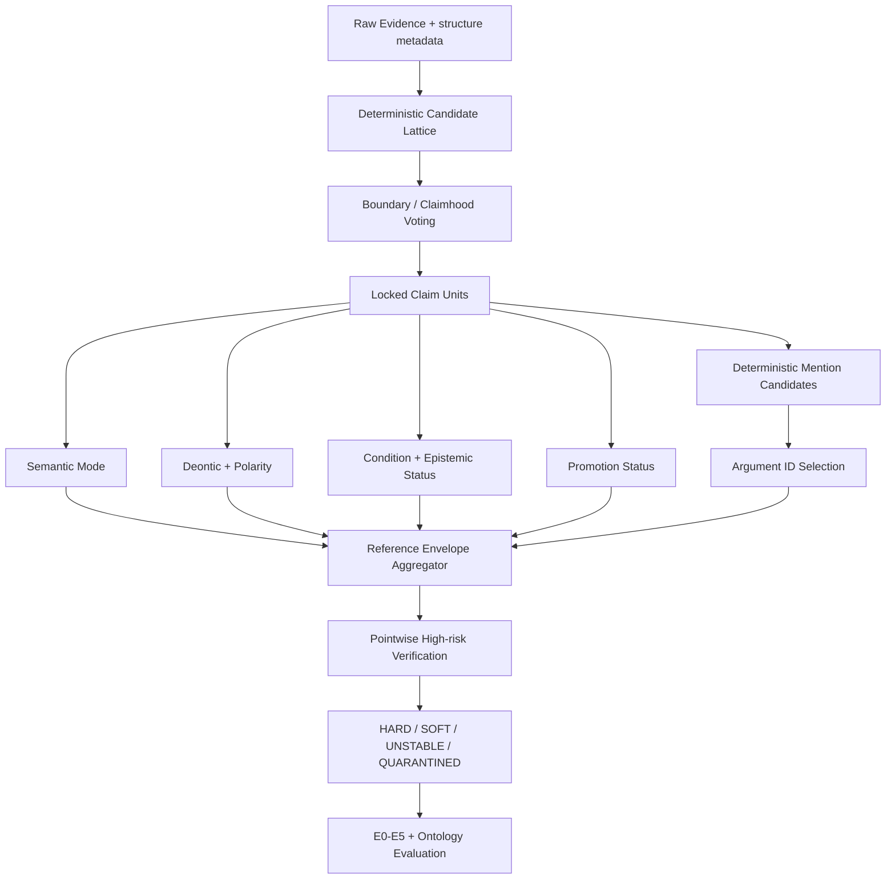

# 자이제 LDR-R2 경계 잠금형 후속 실험 설계서

> **문서 유형:** `REVISE` 판정 이후 신규 experiment ID용 사전등록 설계서  
> **권장 experiment ID:** `zaije_ldr_r2_20260712_blre_v1`  
> **상위 방법론:** SCALE-OL + Atomic Work Claim  
> **신규 기준셋 프로토콜:** **BLRE — Boundary-Locked Reference Envelope**  
> **대상 데이터:** `legacy/자이제_1.xlsx` 단일 도메인  
> **연구 범위:** Transfer 이전, E0∼E5 및 단일 도메인 온톨로지 평가까지  
> **기준일:** 2026-07-12  
> **선행 run 상태:** Gate 0 `PASS`, Gate 1L v1·v2 `FAIL`, 최종 `REVISE`

---

## 0. 최종 결정

기존 LDR 실험의 `REVISE` 판정은 타당하다. 현재 결과로 E0∼E5를 평가하면 시스템의 온톨로지 구축 능력보다 불안정한 reference와의 일치도를 주로 측정하게 된다.

다음 실험에서는 기존의 다음 구조를 폐기한다.

```text
원문
  → Annotator가 자유롭게 Claim quote와 argument를 생성
  → 서로 다른 Claim 집합을 사후 alignment
  → 전체 Claim 단위 A/B 비교형 adjudication
  → 하나의 정답 Claim으로 강제 수렴
```

대신 다음 구조를 사용한다.

```text
원문
  → 프로그램이 exact-offset 후보 격자 생성
  → LLM은 후보 ID만 선택
  → 선택된 경계를 잠금
  → 필드를 하나씩 독립 판정
  → argument도 mention ID만 선택
  → 합의를 강제하지 않고 hard/soft/unstable reference로 보존
  → 고위험 항목만 pointwise verifier로 검사
```

본 설계의 핵심 명제는 다음과 같다.

> **LLM이 Claim 전체를 생성하고 다른 LLM이 이를 비교·재작성하게 하는 대신, 프로그램이 경계와 근거 후보를 고정하고 LLM은 제한된 선택·분류만 수행하게 하면 exact grounding과 반복 안정성을 높일 수 있다. 또한 모델 간 안정적인 불일치는 오류로 제거하지 않고 set-valued 또는 probabilistic reference로 보존해야 한다.**

이번에도 인간 Gold를 사용하지 않으므로 결과물은 `Gold`가 아니라 **LLM-Derived Reference Envelope, LDR-E**이다. LDR-E에 대한 점수는 실제 정확도가 아니라 잠긴 다중 모델 reference에 대한 일치도와 비용·안정성의 상대 비교로만 해석한다.

---

# 1. 기존 실패 결과가 의미하는 것

## 1.1 단순 prompt 개선 문제가 아니다

fresh re-pilot v2에서 quote·span 관련 지표는 개선됐지만, 핵심 label 합의와 반복 안정성은 오히려 낮아졌다.

| 관찰 결과 | 해석 |
|---|---|
| A 28개, B 19개 Claim | 라벨 이전에 annotation unit 자체가 다름 |
| A/B 불일치 bundle 20/20 | 동일한 평가 우주가 존재하지 않음 |
| Claim span F1 0.6297 | 자유 경계 생성이 여전히 불안정 |
| Argument span F1 0.3232 | 자유 argument quote 생성이 실패의 주요 원인 |
| family/type/modality/polarity α가 0 이하 | 경계 오류와 다중 과업 결합이 categorical agreement를 붕괴시킴 |
| B critical-field exact agreement 0.4458 | 모델 간 다양성뿐 아니라 모델 자체 반복 불안정이 큼 |
| position-swap consistency 0.50 | 비교형 adjudicator가 순서에 민감함 |
| exact quote validity 0.85 | 생성된 quote를 reference 근거로 직접 사용할 수 없음 |
| quarantine 0.30 | 강제 단일 정답화가 많은 항목을 폐기하게 만듦 |

따라서 다음 run의 목표는 “더 좋은 adjudicator prompt”가 아니다. **annotation 문제를 unitization, typing, grounding, promotion으로 분해**하고 각 단계의 출력 공간을 닫힌 집합으로 바꾸는 것이다.

## 1.2 이전 설계에서 제거해야 할 네 가지 혼입

### 혼입 A — Unitization과 typing의 동시 수행

Claim 경계를 다르게 잡으면 family·type·modality·argument가 모두 달라진다. 경계 합의 전의 label agreement는 해석하기 어렵다.

### 혼입 B — annotator 역할의 비대칭

기존 A는 high-recall, B는 conservative로 지시됐다. 서로 다른 목적 함수를 가진 annotator에게 높은 일치를 요구한 것은 실험 설계상 모순이다.

새 run의 primary panel은 **동일한 지침, 동일한 label 정의, 동일한 예시**를 사용한다. 모델 또는 snapshot만 다르게 한다. high-recall·conservative 역할은 sensitivity analysis에만 사용한다.

### 혼입 C — 자유 텍스트 생성과 grounding 검증의 결합

모델이 quote를 생성한 뒤 exact substring인지 검사하면 reference 품질이 모델의 복사 능력에 종속된다. 새 설계에서는 원문 offset과 후보 ID를 프로그램이 만들므로 accepted 항목의 quote validity는 구조적으로 1.00이어야 한다.

### 혼입 D — 불일치를 하나의 정답으로 강제

모델들이 각각 반복적으로 같은 판단을 하지만 서로 다른 판단을 할 수 있다. 이는 불안정과 구분해야 한다.

- **모델 내 안정적 + 모델 간 합의:** hard reference
- **모델 내 안정적 + 모델 간 불일치:** soft/set-valued reference
- **모델 내 불안정:** unreliable, quarantine

새 설계는 이 세 상태를 분리한다.

---

# 2. 신규 실험의 목적과 가설

## 2.1 Primary objective

자이제 문서에서 자유 생성 없이 exact-offset 후보와 mention ID를 사용하고, 경계 결정과 의미 필드 판정을 분리했을 때 LLM-only reference를 잠정 평가 기준으로 사용할 만큼 안정화할 수 있는지 검증한다.

## 2.2 Secondary objective

안정화된 LDR-E를 이용해 E0∼E5의 상대 성능·LLM 비용·provenance·온톨로지 구조 품질을 단일 도메인에서 비교한다.

## 2.3 사전등록 가설

### H-R1 — Exact grounding

후보 ID 및 원문 offset만 선택하게 하면 accepted Claim과 argument의 exact grounding validity가 1.00이 된다.

### H-R2 — Boundary reliability

동일한 후보 우주에서 pointwise claimhood를 판정하면 자유 span 생성 방식보다 모델 내 boundary 안정성과 panel 재현성이 높아진다.

### H-R3 — Field decomposition

잠긴 경계 위에서 semantic mode, deontic force, polarity, conditionality, promotion을 별도 판정하면 전체 Claim을 한 번에 생성할 때보다 critical-field 안정성이 높아진다.

### H-R4 — Reference envelope

모델 간 불일치를 hard label로 강제하지 않고 label set 또는 분포로 보존하면 quarantine을 줄이면서 불확실성을 명시적으로 평가할 수 있다.

### H-R5 — Downstream viability

LDR-E Gate를 통과하면 E0∼E5를 hard-core score, set-compatible score, selective-risk score로 비교할 수 있다.

---

# 3. 데이터·split·표본 정책

## 3.1 유지하는 Gate 0 결과

다음 값은 변경하지 않는다.

| 항목 | 값 |
|---|---:|
| Evidence | 1,366 |
| Leakage group | 168 |
| INDUCTION | 681 |
| VALIDATION | 272 |
| TEST_NATURAL | 275 |
| TEST_CHALLENGE_POOL | 138 |
| split 간 leakage group 중복 | 0 |
| TEST reference 생성·열람 | 0 |

주 입력은 기존 설계서 binary hash와 일치하는 `legacy/자이제_1.xlsx`를 유지한다. 497·916·1140행의 메타데이터가 보완된 handoff 파일은 민감도 분석에만 사용한다.

## 3.2 기존 60건의 지위 변경

- PILOT v1의 40건
- fresh re-pilot v2의 20건

위 60건은 이미 결과가 공개됐으므로 새로운 Gate 판정에 사용하지 않는다. 다음 용도로만 사용한다.

```text
DEV_EXPOSED_60
- 후보 격자 규칙 개발
- label 정의 정리
- 모델·reasoning 설정 bake-off
- prompt unit test
- 실패 유형 재현
```

## 3.3 신규 confirmatory pilot

새로운 `R2_PILOT`은 INDUCTION에서 **60건**을 fresh 추출한다.

조건:

1. 기존 60건과 Evidence ID 중복 0
2. 기존 60건과 leakage group 중복 0
3. 기존 잠금 reference membership과 leakage group 중복 0
4. VALIDATION·TEST와 leakage group 중복 0
5. 추출 후 manifest와 content hash 잠금

권장 상호배타적 strata는 다음과 같다. 한 Evidence가 여러 cue를 가지면 아래 표의 위에서 아래 순서로 최초 일치 strata에 배정한다.

| Stratum | 수량 | 주요 대상 |
|---|---:|---|
| TABLE_TEMPLATE | 6 | 마크다운 표, 양식, 척도, 필드 |
| LIST_MULTILINE | 8 | 목록, 여러 줄 구조, 단계 나열 |
| QUESTION_CAPTION_DISCOURSE | 4 | 질문, 그림·표 caption, 담화 문장 |
| NORMATIVE_DEONTIC | 8 | 의무·권고·금지·필수 |
| CONDITIONAL_EXCEPTION | 8 | 경우·때·이후·이전·예외 |
| DEFINITION_CAUSAL_EVALUATIVE | 8 | 정의·원인·이유·비교·평가 |
| NEGATION_QUANTITY_HIGH_RISK | 4 | 부정, 수치, 범위, cardinality |
| SIMPLE_GENERAL_PROSE | 14 | 나머지 자연 분포 prose |
| **합계** | **60** |  |

현재 파일에 대한 결정적 working stratification에서는 단순 prose 1,101건, list 110건, markdown table 56건, question 47건, caption/figure 26건, complex prose 14건, 기타 multiline 12건이 확인됐다. 이 분류는 정답 label이 아니라 표본화와 오류 분석용 구조 분류다.

## 3.4 기존 reference membership

기존에 membership만 잠근 다음 표본은 가능한 한 유지한다.

- LDR-INDUCTION 100
- LDR-VALIDATION 80
- TEST-NATURAL 140
- TEST-CHALLENGE 60

단, 신규 R2_PILOT과 leakage group이 겹치면 R2_PILOT 쪽을 다시 추출한다. TEST membership은 절대 교체하거나 열람하지 않는다.

---

# 4. 신규 방법: BLRE

## 4.1 전체 구조



## 4.2 핵심 원칙

1. **LLM은 원문 quote를 쓰지 않는다.**
2. **LLM은 candidate ID와 mention ID만 선택한다.**
3. **경계가 잠긴 뒤에만 label을 판정한다.**
4. **모든 모델에 동일한 primary annotation instruction을 준다.**
5. **전체 Claim 단위 adjudication을 하지 않는다.**
6. **불일치는 필드별 분포 또는 허용 label set으로 남긴다.**
7. **LLM verifier는 후보를 비교하지 않고 하나씩 pointwise 평가한다.**
8. **프로그램 검증이 가능한 exactness는 LLM에 맡기지 않는다.**

---

# 5. Phase D — 후보 모델과 prompt 설정 선택

## 5.1 모델 선택에 새 데이터를 쓰지 않는다

모델 bake-off는 `DEV_EXPOSED_60` 중 strata를 맞춘 24건만 사용한다. fresh R2_PILOT에는 prompt·모델 선택을 하지 않는다.

## 5.2 후보 configuration

계정에서 사용 가능한 pinned snapshot 중 최소 3개, 최대 5개 configuration을 비교한다.

configuration은 다음 조합으로 정의한다.

```yaml
configuration_id: C01
model_snapshot: exact-pinned-id
reasoning_effort: fixed-supported-value
sampling_parameters: fixed
prompt_hash: sha256
schema_hash: sha256
```

rolling alias는 DEV에서 탐색용으로만 사용할 수 있다. confirmatory pilot과 이후 run에서는 concrete snapshot을 고정한다.

## 5.3 동일 지침 원칙

모든 primary panel configuration은 다음을 공유한다.

- 동일 annotation objective
- 동일 label definition
- 동일 positive·negative example
- 동일 output schema
- 동일 candidate order 정책
- 동일 context window

`domain-first high-recall`과 `ontology-first conservative`처럼 목적 함수를 다르게 하는 역할 prompt는 primary panel에서 금지한다.

## 5.4 model bake-off 평가

각 configuration을 24건에 2회 실행한다. boundary task와 field task를 분리해 평가한다.

```text
ModelScore =
  0.35 × within-model stability
+ 0.25 × deterministic-control accuracy
+ 0.15 × missing-candidate avoidance
+ 0.15 × high-risk constraint consistency
+ 0.10 × normalized cost efficiency
```

상위 3개 configuration을 panel로 선택한다. 단, 한 configuration의 다음 항목 중 하나라도 기준 미달이면 제외한다.

| 항목 | 최소 기준 |
|---|---:|
| Structured Output schema validity | 1.00 |
| Candidate ID validity | 1.00 |
| Deterministic control accuracy | 0.95 |
| Boundary repeat F1 | 0.85 |
| Critical-field IMS | 0.85 |
| API failure rate | 0.01 이하 |

model bake-off 결과를 확인한 뒤 선택한 3개 configuration, prompt, schema, candidate generator를 모두 잠근다. 이후 fresh pilot에서 변경하면 해당 experiment ID는 무효다.

---

# 6. Phase R0 — Deterministic Candidate Lattice

## 6.1 raw offset 보존

모든 span은 원본 `text_for_llm_human`의 character offset으로 관리한다.

- 원문 문자열은 수정하지 않는다.
- Unicode 정규화 view가 필요하면 original↔normalized offset mapping을 저장한다.
- 줄바꿈 표준화도 mapping 없이 원문에 직접 적용하지 않는다.
- accepted quote는 항상 `raw_text[start:end]`로 프로그램이 복원한다.

## 6.2 구조별 전처리

### Prose

1. 문장 후보
2. punctuation 기반 절 후보
3. 한국어 연결 표현 기반 절 후보
4. 인접 절 2개·3개 병합 후보
5. 전체 Evidence 후보

### List

- list header
- 각 list item
- header + item
- 인접 item 병합은 기본적으로 금지

### Table/template

표는 prose Claim과 같은 방법으로 처리하지 않는다.

```text
Table
  ├─ HeaderCell
  ├─ Row
  ├─ DataCell
  ├─ FieldDefinitionCandidate
  ├─ CardinalityCandidate
  ├─ ScaleCandidate
  └─ ExampleValueCandidate
```

### Question/caption

질문·caption도 candidate는 만들되 `META_DISCOURSE` 또는 `NON_CLAIM` 가능성을 명시한다. 질문이라는 이유만으로 자동 폐기하지 않지만, 일반 규칙으로 promotion되는 것은 제약한다.

## 6.3 candidate schema

```json
{
  "evidence_id": "EV_000123",
  "raw_text": "...",
  "candidate_id": "EV_000123_C07",
  "start_char": 14,
  "end_char": 52,
  "text_by_program": "원문에서 잘라낸 문자열",
  "candidate_level": "CLAUSE_MERGE_2",
  "member_segment_ids": ["S03", "S04"],
  "parent_candidate_id": "EV_000123_C02",
  "generation_rule": "adjacent_clause_merge_v1",
  "structure_type": "PROSE"
}
```

LLM 응답에는 `text_by_program`을 다시 출력하게 하지 않는다.

## 6.4 candidate lattice 품질 제약

| 제약 | 기준 |
|---|---:|
| offset round-trip | 1.00 |
| duplicate candidate ID | 0 |
| 동일 offset 중복 candidate | 0 |
| 허용되지 않은 비연속 span | 0 |
| candidate 수 median | 12 이하 |
| candidate 수 p95 | 25 이하 |
| 지나치게 긴 prose candidate | 240자 이하를 원칙으로 함 |
| table/list structure preservation | 1.00 |

## 6.5 missing boundary 진단

LLM은 후보가 충분하지 않을 때 자유 quote 대신 다음만 출력할 수 있다.

```json
{
  "missing_candidate": true,
  "diagnostic_start_token_id": "T17",
  "diagnostic_end_token_id": "T29",
  "reason_code": "BOUNDARY_NOT_IN_LATTICE"
}
```

이 진단 span은 reference로 즉시 승인하지 않는다. DEV에서는 generator 수정에 사용할 수 있지만, fresh pilot에서는 Gate 실패 신호로만 사용한다.

---

# 7. Phase R1 — Boundary와 Claimhood 판정

## 7.1 pointwise 판정

각 candidate에 대해 다음 네 필드를 독립적으로 판정한다.

```json
{
  "candidate_id": "EV_000123_C07",
  "contains_proposition": true,
  "self_contained": true,
  "minimal_without_material_loss": true,
  "discourse_only": false,
  "decision": "KEEP"
}
```

허용 decision:

- `KEEP`
- `DROP`
- `UNDERDETERMINED`
- `MISSING_CANDIDATE`

모델은 새로운 span을 쓰거나 candidate를 병합하지 않는다. 필요한 병합 후보는 R0에서 미리 생성한다.

## 7.2 overlap resolver

여러 nested candidate가 `KEEP`될 수 있으므로 프로그램이 weighted interval selection을 수행한다.

각 candidate의 panel score:

\[
B(c)=3V_p(c)+2V_s(c)+V_m(c)-P_{discourse}(c)-0.002\cdot length(c)
\]

- \(V_p\): proposition vote 수
- \(V_s\): self-contained vote 수
- \(V_m\): minimal vote 수
- `discourse_only` 다수 판정 시 penalty
- 길이 penalty는 같은 내용을 포함하는 과도한 span을 억제하는 tie-breaker

겹치는 candidate 집합에서는 총 score가 최대가 되는 비중첩 조합을 선택한다. 동일 score이면 다음 순서로 결정한다.

1. proposition vote가 높은 후보
2. self-contained vote가 높은 후보
3. 더 짧은 후보
4. 시작 offset이 빠른 후보

resolver는 deterministic해야 하며 동일 입력에서 항상 같은 결과를 내야 한다.

## 7.3 boundary 상태

pilot의 3개 모델×2회, 총 6표를 기준으로 다음처럼 정의한다.

| 상태 | 기준 |
|---|---|
| `BOUNDARY_HARD` | 동일 candidate가 5/6 이상 선택되고 각 모델 repeat가 안정적 |
| `BOUNDARY_SOFT` | 2개의 nested/adjacent 후보가 안정적으로 경쟁하고 두 후보 집합이 5/6 이상 표를 설명 |
| `NO_CLAIM_HARD` | DROP이 5/6 이상 |
| `BOUNDARY_UNSTABLE` | 모델 자체 repeat가 불안정하거나 candidate set이 재현되지 않음 |
| `BOUNDARY_MISSING` | missing candidate가 2표 이상 |

`BOUNDARY_SOFT`는 하나를 억지로 선택하지 않고 허용 경계 집합을 저장한다. 단, E0∼E5의 strict boundary F1은 `BOUNDARY_HARD`에서만 계산한다.

---

# 8. Phase R2 — 경계 잠금 후 Field-wise Typing

## 8.1 전체 Claim schema를 한 번에 생성하지 않는다

잠긴 Claim unit마다 네 개의 작은 task로 나눈다.

### Task F1 — Semantic mode

```text
DESCRIPTIVE
DEFINITIONAL
NORMATIVE
PROCEDURAL
CAUSAL_EVALUATIVE
META_DISCOURSE
UNDERDETERMINED
```

### Task F2 — Deontic profile

`deontic_force`:

```text
NONE
REQUIREMENT
RECOMMENDATION
PROHIBITION
PERMISSION_OR_ABILITY
UNDERDETERMINED
```

`polarity`:

```text
POSITIVE
NEGATIVE
MIXED
NOT_APPLICABLE
UNDERDETERMINED
```

### Task F3 — Context profile

`conditionality`:

```text
NONE
EXPLICIT_CONDITION
IMPLICIT_CONTEXT
EXCEPTION
UNDERDETERMINED
```

`epistemic_status`:

```text
ASSERTED
REPORTED_OR_ATTRIBUTED
HYPOTHETICAL
QUESTIONED_OR_CHALLENGED
UNDERDETERMINED
```

### Task F4 — Promotion profile

```text
GENERAL_RULE
DOMAIN_ASSERTION
EXAMPLE_INSTANCE
TEMPLATE_SCHEMA
DISCOURSE_ONLY
DO_NOT_PROMOTE
UNDERDETERMINED
```

## 8.2 fine-grained claim type은 파생한다

기존의 `family`와 `type`을 동시에 LLM이 판정하지 않는다. 다음과 같이 deterministic mapping 또는 후속 ontology stage에서 파생한다.

예:

```text
semantic_mode=NORMATIVE
+ deontic_force=RECOMMENDATION
+ conditionality=EXPLICIT_CONDITION
→ ConditionalRecommendation
```

```text
semantic_mode=DEFINITIONAL
+ promotion=DOMAIN_ASSERTION
→ ConceptDefinition
```

```text
semantic_mode=META_DISCOURSE
+ promotion=DO_NOT_PROMOTE
→ DiscourseOnly
```

이렇게 하면 label hierarchy가 명확해지고 한 필드 오류가 전체 Claim type을 붕괴시키는 것을 줄일 수 있다.

## 8.3 필드별 `UNDERDETERMINED`

한 Claim 전체를 `UNDERDETERMINED`로 만들지 않는다.

예:

```json
{
  "semantic_mode": "NORMATIVE",
  "deontic_force": "UNDERDETERMINED",
  "polarity": "POSITIVE",
  "conditionality": "EXPLICIT_CONDITION",
  "promotion": "GENERAL_RULE"
}
```

이 항목은 semantic mode·polarity·condition 평가에는 사용할 수 있고 deontic force strict 평가에서만 제외하거나 soft reference로 처리한다.

---

# 9. Phase R3 — Argument Grounding

## 9.1 argument quote 생성 금지

프로그램이 locked Claim span 안에서 mention 후보를 만든다.

mention 후보 원천:

- 명사구·고유명사 후보
- 동사·서술어 후보
- 숫자·범위·단위 후보
- 조건 cue와 종속절 후보
- 시간·단계 표현
- 문서·산출물 표현
- 표 header·cell ID

## 9.2 core role

Primary Gate는 다음 역할만 사용한다.

```text
SUBJECT_OR_ACTOR
PREDICATE_OR_ACTION
OBJECT_OR_TARGET
CONDITION
QUANTITY_OR_RANGE
```

Exploratory role:

```text
INPUT
OUTPUT
PURPOSE
EXCEPTION
TIME
EVIDENCE_BASIS
```

처음부터 12개 역할을 동일 중요도로 강제하지 않는다. core role이 안정화된 뒤 exploratory role을 온톨로지 귀납에 사용한다.

## 9.3 argument schema

```json
{
  "claim_unit_id": "CL_000123_01",
  "role": "CONDITION",
  "selected_mention_ids": ["M07"],
  "implicit": false,
  "underdetermined": false
}
```

- 자유 텍스트 금지
- mention ID 외의 string 금지
- `implicit=true`일 때는 mention ID가 없어도 됨
- `MISSING_MENTION`은 diagnostic으로만 허용

## 9.4 relation assembly

최종 AWC의 subject·predicate·object·condition은 LLM이 다시 문장으로 작성하지 않고 선택된 mention ID를 프로그램이 조합한다.

---

# 10. Phase R4 — Reference Envelope

## 10.1 adjudicator 제거

기존의 `ACCEPT_X`, `ACCEPT_Y`, `MERGE_SUPPORTED_FIELDS` 방식은 primary reference 생성에서 제거한다.

이유:

- 전체 Claim 비교는 순서 편향을 유발함
- adjudicator가 quote나 field를 재작성함
- 하나의 정답으로 강제하면서 불확실성을 숨김
- A/B 역할 차이까지 adjudicator가 보정해야 했음

## 10.2 field별 vote distribution

각 필드마다 다음을 저장한다.

```json
{
  "field": "deontic_force",
  "votes": {
    "REQUIREMENT": 1,
    "RECOMMENDATION": 4,
    "UNDERDETERMINED": 1
  },
  "distribution": {
    "REQUIREMENT": 0.1667,
    "RECOMMENDATION": 0.6667,
    "UNDERDETERMINED": 0.1667
  },
  "entropy": 0.8676,
  "accepted_label_set": ["RECOMMENDATION", "REQUIREMENT"],
  "reference_status": "SOFT"
}
```

## 10.3 hard·soft·unstable 판정

pilot에서는 3개 configuration을 각각 2회 실행한 6표를 사용한다.

### HARD

- 동일 label 5/6 이상
- 해당 필드에서 각 configuration의 반복 안정성 기준 충족
- deterministic constraint 위반 없음

### SOFT

- HARD는 아니지만 모델별 반복은 안정적
- 상위 label set의 누적 표가 5/6 이상
- run-1 panel 분포와 run-2 panel 분포의 Jensen–Shannon divergence가 기준 이하

### UNSTABLE

- 동일 configuration의 반복 결과가 자주 바뀜
- panel 분포가 반복 간 크게 달라짐
- label-order permutation에 민감함

### QUARANTINED

- 존재하지 않는 ID 선택
- grounding·schema·ontology constraint 위반
- missing boundary 또는 missing mention 해결 불가
- verifier가 명백한 비근거·반대를 확인

## 10.4 모델 의존성 처리

OpenAI 계열 모델들은 학습 데이터·아키텍처·alignment의 일부를 공유할 수 있으므로 annotator 독립성을 가정한 latent truth 추정은 primary aggregation으로 사용하지 않는다.

- primary: raw vote distribution + repeat stability + deterministic constraints
- secondary sensitivity: majority vote
- optional sensitivity: Dawid–Skene 또는 dependence-aware aggregation
- 금지: latent posterior를 인간 정답 확률처럼 해석

---

# 11. Phase R5 — Pointwise High-risk Verification

## 11.1 검증 대상

다음은 high-risk로 자동 지정한다.

- REQUIREMENT·PROHIBITION·RECOMMENDATION
- NEGATIVE polarity
- EXPLICIT_CONDITION·EXCEPTION
- GENERAL_RULE promotion
- 숫자·범위·단위·cardinality
- 표의 scale·field constraint
- 사례가 일반 규칙으로 승격될 가능성
- 순서 방향·선행·후행 관계

## 11.2 비교형 judge를 쓰지 않는다

검증기는 `(source, locked span, field, proposed label)` 하나만 보고 다음을 반환한다.

```text
SUPPORTED
CONTRADICTED
UNDERDETERMINED
```

여러 후보 label이 있으면 각 label을 별도 pointwise call 또는 독립 item으로 평가한다. verifier에게 X/Y 중 하나를 고르게 하지 않는다.

## 11.3 deterministic resolver

- 정확히 하나의 label만 `SUPPORTED` → 그 label 유지
- 두 개 이상 `SUPPORTED` → SOFT label set 유지
- 모두 `UNDERDETERMINED` → SOFT/UNSTABLE 판정
- 하나라도 명백한 `CONTRADICTED` → 해당 label 제거
- 모든 후보가 `CONTRADICTED` → QUARANTINED

## 11.4 order audit

label option을 한 prompt에 제시해야 하는 구현이라면 pilot의 다음 항목에 모든 균형 permutation을 적용한다.

- high-risk 항목: 100%
- 일반 항목: 20% 층화 표본

permutation에 따라 label이 바뀌면 HARD로 승인하지 않는다.

---

# 12. Gate 설계

## 12.1 Gate R0 — Candidate lattice

| Metric | 기준 |
|---|---:|
| Candidate JSON schema validity | 1.00 |
| Offset round-trip validity | 1.00 |
| Candidate ID uniqueness | 1.00 |
| 구조 보존 검사 | 1.00 |
| Missing candidate rate | 0.05 이하 |
| Candidate count median | 12 이하 |
| Candidate count p95 | 25 이하 |

## 12.2 Gate R1 — Boundary reliability

| Metric | 기준 |
|---|---:|
| Configuration별 boundary repeat F1 median | 0.90 이상 |
| 최저 configuration boundary repeat F1 | 0.85 이상 |
| Panel run-to-run selected-set F1 | 0.90 이상 |
| HARD+SOFT boundary coverage | 0.90 이상 |
| BOUNDARY_UNSTABLE | 0.10 이하 |
| BOUNDARY_MISSING | 0.05 이하 |
| Candidate-order audit consistency | 0.95 이상 |

## 12.3 Gate R2 — Field reliability

label prevalence가 극단적이면 α가 불안정할 수 있으므로 raw agreement, Gwet AC1, Krippendorff α를 함께 보고한다. primary stop rule은 repeat stability와 distribution stability다.

| Metric | 기준 |
|---|---:|
| Structured field schema validity | 1.00 |
| semantic mode configuration별 IMS | 0.85 이상 |
| deontic·polarity·promotion configuration별 IMS | 0.90 이상 |
| Panel distribution JSD mean | 0.10 이하 |
| Panel distribution JSD p90 | 0.25 이하 |
| HARD+SOFT critical-field coverage | 0.90 이상 |
| UNSTABLE critical field | 0.08 이하 |
| Deterministic semantic controls | 0.95 이상 |
| Label-order audit consistency | 0.95 이상 |

## 12.4 Gate R3 — Argument grounding

| Metric | 기준 |
|---|---:|
| Mention ID validity | 1.00 |
| Argument exact grounding | 1.00 |
| Missing mention rate | 0.10 이하 |
| Core-role configuration별 IMS | 0.85 이상 |
| CONDITION·QUANTITY panel stability | 0.90 이상 |
| Unsupported implicit argument rate | 0.05 이하 |

## 12.5 Gate R4 — Reference viability

| Metric | 기준 |
|---|---:|
| Claim·argument exact grounding | 1.00 |
| HARD Claim coverage | 0.50 이상 |
| HARD+SOFT usable coverage | 0.85 이상 |
| QUARANTINED Evidence | 0.10 이하 |
| High-risk verifier supported or accepted-soft | 0.90 이상 |
| Provenance completeness | 1.00 |
| Resolver determinism | 1.00 |

## 12.6 판정

### `R2_REFERENCE_PASS`

모든 R0∼R4 Gate 통과. LDR-INDUCTION·VALIDATION 생성 및 E0∼E5 진행.

### `R2_CORE_ONLY_PROCEED`

다음을 모두 만족할 때만 허용한다.

- exact grounding 1.00
- HARD coverage 0.60 이상
- QUARANTINED 0.10 이하
- critical high-risk HARD subset이 충분함
- SOFT distribution 관련 한 개 이하의 비핵심 Gate만 실패

이 경우 E0∼E5의 primary 평가는 HARD core에서만 수행하고, SOFT set은 selective prediction 평가에만 사용한다.

### `REVISE`

- boundary·field IMS 미달
- exact grounding <1.00
- missing candidate 과다
- quarantine >0.10
- fresh pilot 후 prompt·model·schema를 수정해야 하는 경우

fresh pilot 결과를 보고 수정하면 반드시 새 experiment ID를 만든다. 본 ID에서는 re-pilot을 허용하지 않는다. 기존 60건을 DEV로 충분히 활용한 뒤 confirmatory pilot을 한 번만 수행한다.

### `INVALID`

- fresh pilot membership 누출
- TEST reference 접근
- rolling model alias 사용
- prompt/schema hash 불일치
- raw response 또는 cost ledger 누락
- 결과 확인 후 panel configuration 변경

---

# 13. R2_PILOT 실행 순서

```text
Step 1. 기존 60건을 DEV_EXPOSED로 등록
Step 2. candidate generator 개발 및 unit test
Step 3. 24건 model bake-off
Step 4. panel 3개 configuration 선택·잠금
Step 5. R2_PILOT 60건 fresh 추출·manifest 잠금
Step 6. Candidate lattice 생성
Step 7. 3 model × 2 repeat boundary 판정
Step 8. deterministic boundary resolver
Step 9. locked boundary에 field task 실행
Step 10. mention candidate 생성
Step 11. core argument ID 선택
Step 12. reference envelope 집계
Step 13. high-risk pointwise verification
Step 14. Gate R0∼R4 계산
Step 15. PASS / CORE_ONLY / REVISE / INVALID 판정
```

각 단계는 이전 단계의 산출물 hash를 입력으로 기록한다. 경계를 잠근 후에는 field task가 candidate generator나 boundary를 변경할 수 없다.

---

# 14. Gate 통과 후 Reference 확장

## 14.1 LDR-INDUCTION 100

목적:

- LF·소형 모델 개발
- concept/alias 후보 개발
- ontology relation registry 개발
- 선택적 LLM 정책 개발

사용 가능:

- HARD labels
- SOFT label distribution
- QUARANTINED error taxonomy

## 14.2 LDR-VALIDATION 80

목적:

- threshold 선택
- budget sweep 선택
- risk·diversity score 조정
- ontology schema promotion 기준 조정

금지:

- reference prompt 수정
- candidate generator 수정
- label schema 수정
- model panel 교체

위 항목을 수정해야 하면 새로운 reference version과 새 experiment ID가 필요하다.

## 14.3 system freeze

다음을 잠근다.

- E0∼E5 code commit
- prompt·schema hash
- LF registry
- candidate generator
- concept canonicalization threshold
- relation promotion threshold
- SHACL shapes
- LLM budget
- selective acquisition policy
- model snapshot

## 14.4 TEST reference

system freeze 이후에만 다음을 생성한다.

- TEST-NATURAL 140
- TEST-CHALLENGE 60

검사:

```text
reference_created_at > system_frozen_at
```

TEST reference 생성 과정에서 Gate가 무너지면 TEST를 이용해 reference prompt를 수정하지 않는다. 해당 run은 `REVISE_TEST_REFERENCE`로 종료하고 새로운 ID를 만든다.

---

# 15. E0∼E5 재개 설계

| ID | 시스템 | 설명 |
|---|---|---|
| E0 | Direct Triple Full-LLM | 원문에서 바로 triple 생성 |
| E1 | Full-LLM AWC | Claim-first 전수 LLM |
| E2 | No-Generative-LLM SCALE-AWC | 구조·규칙·소형 모델 중심 |
| E3 | Uncertainty-only Selective LLM | 단순 불확실성 선택 |
| E4 | Risk·Diversity·Graph-Utility Selective LLM | 최종 제안 방식 |
| E5 | Exhaustive Gray-zone LLM | 모호 후보 전수 LLM |

## 15.1 LDR-E 기반 세 가지 score

### A. Hard-Core Score

`HARD` boundary와 `HARD` field만 사용한다. 가장 보수적인 primary score다.

### B. Set-Compatible Score

system label이 `accepted_label_set` 안에 있으면 compatible로 인정한다. 애매한 reference에 단일 label을 강제하지 않는다.

### C. Distributional Score

system이 확률을 출력할 수 있으면 panel vote distribution과 다음을 비교한다.

- Brier score
- cross-entropy
- Jensen–Shannon divergence

system이 단일 label만 출력하면 one-hot distribution으로 변환하되 별도 표시한다.

## 15.2 Abstention 평가

SOFT·UNSTABLE 항목에서 system이 abstain할 수 있도록 한다.

- coverage
- selective risk
- risk–coverage AUC
- high-risk false promotion rate

E4의 목표는 모든 항목을 강제로 예측하는 것이 아니라 비용과 위험을 고려해 적절히 LLM 또는 abstention으로 보내는 것이다.

## 15.3 Direct Triple 표현 비대칭 통제

E0를 AWC schema로 강제 projection한 결과만 평가하지 않는다. 다음 중립 semantic slot을 별도로 평가한다.

- source evidence
- subject concept
- predicate/action
- object/target
- condition
- modality/deontic force
- polarity
- quantity
- example/general status

E0와 E1∼E5 모두 이 중립 slot으로 변환한 뒤 slot별 근거 지지를 평가한다.

---

# 16. 온톨로지 귀납과 평가

## 16.1 promotion policy

| Reference 상태 | Ontology 반영 |
|---|---|
| HARD + GENERAL_RULE | 자동 rule candidate |
| HARD + DOMAIN_ASSERTION | 자동 assertion candidate |
| HARD + EXAMPLE_INSTANCE | instance graph에만 반영 |
| SOFT | confidence와 accepted set을 유지한 provisional edge |
| UNSTABLE | 자동 promotion 금지 |
| QUARANTINED | 그래프 미반영 |

## 16.2 평가 항목

- concept type Macro-F1 on HARD core
- alias/canonicalization pair compatibility
- taxonomy relation compatibility
- operational relation Hard-Core F1
- RuleFrame slot score
- condition·exception 보존율
- template structure 복원율
- example contamination
- provenance path coverage
- SHACL violation rate
- locked Competency Question 응답 가능률
- LLM token 및 비용

## 16.3 불확실성 보존

SOFT reference가 반영된 edge는 단일 확정 사실처럼 저장하지 않는다.

```turtle
:assertion_123
    a :ProvisionalAssertion ;
    :hasAcceptedPredicate :requires, :recommends ;
    :voteEntropy "0.636"^^xsd:decimal ;
    :referenceStatus :Soft ;
    prov:wasDerivedFrom :evidence_123 .
```

최종 operational ontology를 배포할 때는 `HARD_ONLY`, `HARD_PLUS_SOFT`, `REVIEW_REQUIRED` view를 분리한다.

---

# 17. Reliability와 통계 분석

## 17.1 unitization 평가

후보 우주가 고정되므로 candidate별 binary decision을 직접 비교한다.

- candidate-level precision/recall/F1
- selected-set F1
- character coverage IoU
- boundary repeat F1
- no-claim agreement

free-span 결과를 부가 분석할 경우에만 unitized alpha 또는 Gamma 계열을 사용한다.

## 17.2 categorical field 평가

- raw exact agreement
- Gwet AC1
- Krippendorff α
- configuration별 IMS
- panel vote entropy
- run-to-run JSD

희소 label의 표본 수가 10 미만이면 label별 α를 성공 Gate로 사용하지 않고 기술 통계만 보고한다.

## 17.3 cluster 구조

Evidence를 독립 표본으로 가정하지 않는다. 신뢰구간과 시스템 비교는 leakage group 단위 paired cluster bootstrap 5,000회를 사용한다.

## 17.4 E0∼E5 비교

- paired cluster bootstrap CI
- McNemar test: 동일 hard item의 성공/실패 비교
- permutation test: 비용 제약 하의 score 차이
- Holm correction: 다중 비교
- Pareto frontier: 품질·토큰·검수/abstention 비율

## 17.5 reference 불확실성 민감도

최종 결론을 다음 세 reference view에서 반복한다.

1. `HARD_ONLY`
2. `HARD_PLUS_SET_COMPATIBLE`
3. `PANEL_DISTRIBUTION`

세 view에서 E4의 상대 순위가 유지되는지 보고한다. 순위가 크게 달라지면 reference uncertainty에 민감한 결과로 판정한다.

---

# 18. API 운영 정책

## 18.1 필수 정책

- Responses API 또는 현재 지원되는 equivalent API
- Structured Outputs `strict=true`
- pinned model snapshot
- prompt·schema hash
- raw request·response 저장
- token·latency·retry·refusal 기록
- API key 환경변수 또는 secret manager
- key·credential 로그 금지
- TEST 요청은 freeze 이후 별도 access control

## 18.2 최소 출력

긴 rationale을 요청하지 않는다. 다음만 출력한다.

- selected IDs
- enum labels
- `SUPPORTED/CONTRADICTED/UNDERDETERMINED`
- reason code
- 필요 시 근거 token/mention ID

자유 서술 explanation은 debugging용 DEV에서만 허용하고 confirmatory run에서는 금지한다.

## 18.3 재호출 정책

허용:

- transport error
- explicit refusal
- schema parse failure
- server-side failure

금지:

- 결과가 마음에 들지 않음
- 다른 annotator와 불일치
- label entropy가 높음

동일 logical item의 retry는 같은 request ID와 retry index로 묶어 원장을 남긴다.

## 18.4 Batch와 caching

- DEV와 R2_PILOT은 동기 호출 또는 소규모 batch로 디버깅 가능성을 우선한다.
- Gate 통과 후 LDR-INDUCTION·VALIDATION·TEST는 Batch API 사용 가능하다.
- 공통 rubric·schema prefix는 prompt caching 지원 모델에서 캐시할 수 있다.
- caching 여부가 결과 semantic에 영향을 주지 않도록 동일 prompt content를 유지한다.

## 18.5 비용 원장

```text
cost/
  model_bakeoff/
  boundary_reference/
  field_reference/
  argument_reference/
  verifier_reference/
  E0/
  E1/
  E2/
  E3/
  E4/
  E5/
```

reference 생성비와 system 실행비를 합치지 않는다. E4의 절감률은 system inference 비용으로 비교하고, reference 구축비는 연구 인프라 비용으로 별도 보고한다.

---

# 19. 디렉터리 구조

```text
zaije_experiment/
  experiments/
    zaije_ldr_r2_20260712_blre_v1/
      preregistration/
        design.md
        data_policy.yaml
        model_bakeoff_policy.yaml
        model_panel_lock.yaml
        gate_thresholds.yaml
        prompt_manifest.json
        schema_manifest.json
      data/
        inherited_gate0_manifest.json
        dev_exposed_60.jsonl
        model_bakeoff_24.jsonl
        r2_pilot_60.jsonl
        r2_pilot_lock.json
      candidates/
        lattice/
        mentions/
        validation/
      runs/
        model_bakeoff/
        r2_boundary/
        r2_fields/
        r2_arguments/
        r2_verifier/
      reference/
        boundary_envelopes.jsonl
        field_envelopes.jsonl
        argument_envelopes.jsonl
        ldr_e_pilot.jsonl
      reports/
        candidate_lattice_report.md
        model_bakeoff_report.md
        boundary_reliability_report.md
        field_reliability_report.md
        reference_viability_report.md
        final_gate_report.md
      cost/
      logs/
      manifests/
```

---

# 20. 핵심 JSON 예시

## 20.1 Boundary annotation

```json
{
  "evidence_id": "EV_000123",
  "configuration_id": "C02",
  "repeat_id": 1,
  "candidate_decisions": [
    {
      "candidate_id": "EV_000123_C01",
      "contains_proposition": false,
      "self_contained": false,
      "minimal_without_material_loss": false,
      "discourse_only": true,
      "decision": "DROP"
    },
    {
      "candidate_id": "EV_000123_C04",
      "contains_proposition": true,
      "self_contained": true,
      "minimal_without_material_loss": true,
      "discourse_only": false,
      "decision": "KEEP"
    }
  ],
  "missing_candidate": false
}
```

## 20.2 Field annotation

```json
{
  "claim_unit_id": "CL_000123_01",
  "semantic_mode": "NORMATIVE",
  "deontic_force": "RECOMMENDATION",
  "polarity": "POSITIVE",
  "conditionality": "EXPLICIT_CONDITION",
  "epistemic_status": "ASSERTED",
  "promotion": "GENERAL_RULE"
}
```

## 20.3 Reference envelope

```json
{
  "claim_unit_id": "CL_000123_01",
  "boundary": {
    "status": "BOUNDARY_HARD",
    "candidate_ids": ["EV_000123_C04"],
    "vote_count": 6
  },
  "fields": {
    "semantic_mode": {
      "status": "HARD",
      "accepted_label_set": ["NORMATIVE"],
      "distribution": {"NORMATIVE": 1.0}
    },
    "deontic_force": {
      "status": "SOFT",
      "accepted_label_set": ["RECOMMENDATION", "REQUIREMENT"],
      "distribution": {
        "RECOMMENDATION": 0.6667,
        "REQUIREMENT": 0.3333
      }
    }
  },
  "reference_status": "USABLE_SOFT",
  "provenance": {
    "source_evidence_id": "EV_000123",
    "candidate_generator_hash": "...",
    "model_panel_hash": "...",
    "prompt_hash": "...",
    "schema_hash": "..."
  }
}
```

---

# 21. 구현 의사코드

```python
for evidence in pilot_manifest:
    lattice = build_candidate_lattice(evidence)
    validate_offsets(lattice)             # must be exact

    boundary_runs = []
    for config in locked_panel:
        for repeat in (1, 2):
            boundary_runs.append(
                classify_candidates_pointwise(
                    evidence=evidence,
                    lattice=lattice,
                    model_config=config,
                    repeat=repeat,
                )
            )

    boundary_envelope = resolve_boundary_envelope(
        lattice=lattice,
        votes=boundary_runs,
        deterministic_overlap_policy=LOCKED_POLICY,
    )

    for claim_unit in boundary_envelope.usable_units:
        field_votes = run_field_tasks_separately(
            evidence=evidence,
            claim_unit=claim_unit,
            panel=locked_panel,
            repeats=2,
        )

        mentions = build_mention_candidates(evidence, claim_unit)
        argument_votes = select_argument_ids(
            evidence=evidence,
            claim_unit=claim_unit,
            mentions=mentions,
            panel=locked_panel,
        )

        envelope = aggregate_without_forced_adjudication(
            boundary=claim_unit,
            fields=field_votes,
            arguments=argument_votes,
        )

        if is_high_risk(envelope):
            envelope = pointwise_verify(envelope)

        write_reference_envelope(envelope)

compute_gates_by_leakage_group()
freeze_report_and_hashes()
```

---

# 22. 사전등록 YAML 예시

```yaml
experiment_id: zaije_ldr_r2_20260712_blre_v1
parent_runs:
  - ldr_pilot_20260711_v1
  - ldr_repilot_20260711_v2
status: preregistered

input:
  path: legacy/자이제_1.xlsx
  evidence_count: 1366
  inherited_gate0: PASS

data_policy:
  dev_exposed_count: 60
  model_bakeoff_count: 24
  fresh_pilot_count: 60
  test_reference_access_before_freeze: 0
  leakage_group_overlap_allowed: false

reference_method:
  name: BLRE
  free_quote_generation: false
  candidate_id_selection_only: true
  fieldwise_annotation: true
  whole_claim_pairwise_adjudication: false
  soft_reference_enabled: true
  primary_aggregation: raw_votes_stability_constraints

panel:
  size: 3
  repeats_in_pilot: 2
  same_primary_instruction: true
  pinned_snapshots_required: true

stop_rules:
  prompt_revision_after_fresh_pilot: forbidden
  exact_grounding_min: 1.0
  hard_plus_soft_coverage_min: 0.85
  quarantine_max: 0.10
  test_leakage: invalid
```

---

# 23. 결과 해석 규칙

## 23.1 R2_REFERENCE_PASS가 나오는 경우

주장 가능:

> 자이제 단일 도메인에서 exact-offset candidate selection과 field decomposition을 사용한 다중 LLM reference는 사전등록한 grounding·반복 안정성·usable coverage 기준을 충족했다.

주장 불가:

> 인간 전문가 정답과 같은 품질이다.

## 23.2 SOFT 비율이 높지만 IMS가 높은 경우

이는 반드시 실패가 아니다. 다음처럼 해석한다.

> 모델들이 각자 반복적으로 일관된 판단을 했지만 semantic labeling에서 체계적 차이를 보였다. 해당 항목은 단일 정답이 아니라 reference envelope로 보존했다.

E0∼E5에서는 set-compatible·distributional score를 함께 사용한다.

## 23.3 IMS가 낮은 경우

실제 의미 모호성인지 판단하기 전에 annotation procedure 또는 모델 configuration이 불안정한 것으로 본다. 해당 항목은 soft reference가 아니라 `UNSTABLE` 또는 `QUARANTINED`이다.

## 23.4 Candidate missing이 높은 경우

LLM 능력 문제가 아니라 candidate generator recall 문제다. fresh pilot에서는 generator를 수정하지 않고 `REVISE`한다. 수정본은 새 experiment ID에서 검증한다.

## 23.5 R2 Gate 통과 후 E4가 우수한 경우

다음 네 조건을 함께 충족해야 제안 방법의 잠정 우위를 주장한다.

1. Hard-Core 품질이 E1 또는 E5 대비 비열등
2. Set-Compatible 품질에서도 순위 유지
3. LLM system token이 E1·E5보다 유의하게 낮음
4. high-risk false promotion과 provenance violation이 증가하지 않음

---

# 24. 이번 설계에서 가장 중요한 변경 요약

| 기존 방식 | 신규 방식 |
|---|---|
| 자유 Claim quote 생성 | 프로그램 exact-offset candidate 생성 |
| 자유 argument quote 생성 | mention ID 선택 |
| A high-recall / B conservative | 동일 지침의 model panel |
| 경계·family·type·modality 동시 생성 | 경계 잠금 후 필드별 분리 |
| 사후 bipartite span alignment | 처음부터 동일 candidate universe |
| 전체 Claim 비교 adjudication | field별 vote envelope |
| X/Y pairwise 선택 | pointwise support 판정 |
| 불일치를 하나의 정답으로 강제 | HARD·SOFT·UNSTABLE 분리 |
| α 중심 Gate | IMS·JSD·grounding 중심 Gate |
| Challenge 제외 가능 | challenge는 별도 stress 결과로 유지 |
| 단일 exact F1 | hard·set-compatible·distributional 평가 |

---

# 25. 권장 실행 우선순위

가장 먼저 할 일은 E0∼E5 구현이 아니다. 다음 세 산출물을 먼저 완성해야 한다.

1. `candidate_lattice_v1`  
   원문 offset, prose/list/table별 후보 생성, round-trip unit test

2. `field_schema_v1`  
   semantic mode·deontic·polarity·conditionality·promotion의 독립 schema와 예시

3. `model_panel_lock_v1`  
   기존 60건 중 24건으로 configuration bake-off 후 pinned model 3개 고정

그 뒤 fresh R2_PILOT 60건을 단 한 번 실행한다. 이 Gate를 통과해야만 LDR-INDUCTION·VALIDATION과 E0∼E5를 재개한다.

---

# 26. 선행연구와 설계 근거

1. Gandhi et al. **Decomposing Unitization and Typing for Efficient and Reliable Annotation**. Findings of ACL 2026. 경계 선택과 typing을 분리해 annotation disagreement를 줄이는 방향을 제시한다.  
   https://aclanthology.org/2026.findings-acl.1728/

2. Negi et al. **Large Language Models as Automatic Annotators and Adjudicators for Fine-Grained Opinion Analysis**. 2026. span 수준보다 복합 관계 구조에서 LLM 합의가 약해지는 현상을 보고한다.  
   https://arxiv.org/abs/2601.16800

3. Wang et al. **A Systematic Investigation of Position Bias in Pairwise LLM-as-a-Judge**. 2024/2025. pairwise judge의 순서 편향과 position consistency 측정 필요성을 다룬다.  
   https://arxiv.org/abs/2406.07791

4. Mathet et al. **The Unified and Holistic Method Gamma for Inter-Annotator Agreement**. Computational Linguistics, 2015. unitization과 categorization이 결합된 span annotation의 신뢰도 측정을 다룬다.  
   https://aclanthology.org/J15-3003/

5. Klie et al. **Analyzing Dataset Annotation Quality Management in the Wild**. Computational Linguistics, 2024. annotation 품질, agreement 지표, guideline·pilot 관리 원칙을 정리한다.  
   https://aclanthology.org/2024.cl-3.1/

6. Fornaciari et al. **Leveraging Annotator Disagreement via Soft-Label Multi-Task Learning**. NAACL 2021. annotator disagreement를 단일 majority label로 축소하지 않고 label distribution으로 보존하는 근거를 제공한다.  
   https://aclanthology.org/2021.naacl-main.204/

7. Balasubramanian et al. **Dependence-Aware Label Aggregation for LLM-as-a-Judge via Ising Models**. 2026. LLM judge 간 조건부 독립 가정이 위반될 수 있음을 지적한다.  
   https://arxiv.org/abs/2601.22336

8. OpenAI. **Structured model outputs**. JSON Schema에 맞는 출력을 강제하는 API 기능과 지원 범위를 설명한다.  
   https://developers.openai.com/api/docs/guides/structured-outputs

9. OpenAI. **Model guidance**. 현재 모델 계열의 선택과 모델 behavior를 고정하기 위한 model version 관리 원칙을 제공한다.  
   https://developers.openai.com/api/docs/guides/latest-model

10. OpenAI. **Working with evals**. 모델·prompt 실험 결과와 usage를 구조적으로 기록하는 eval 운영 방식을 제공한다.  
    https://developers.openai.com/api/docs/guides/evals

---

# 27. 최종 결론

기존 LDR 실패는 “LLM으로 reference를 만들 수 없다”는 결론이 아니다. 현재 결과가 보여준 것은 다음이다.

> **자유 생성형 다중 LLM 주석과 전체 Claim 단위 adjudication으로는 복합 직무 지식을 안정적으로 단일 정답화하기 어렵다.**

따라서 다음 실험은 더 강한 모델을 같은 구조에 넣는 실험이 아니라, LLM의 역할을 다음으로 제한하는 실험이어야 한다.

```text
경계 생성자가 아니라 candidate selector
문장 재작성자가 아니라 field classifier
argument 작성자가 아니라 mention linker
정답 강제 adjudicator가 아니라 pointwise verifier
```

BLRE가 Gate를 통과하면 자이제 단일 도메인에서 E0∼E5와 온톨로지 귀납을 다시 시작할 수 있다. 통과하지 못하면 그 실패도 candidate recall, boundary stability, field ambiguity, model instability 중 어느 계층에서 발생했는지 분리해 설명할 수 있으므로, 기존 실험보다 훨씬 높은 연구적 정보가 남는다.
