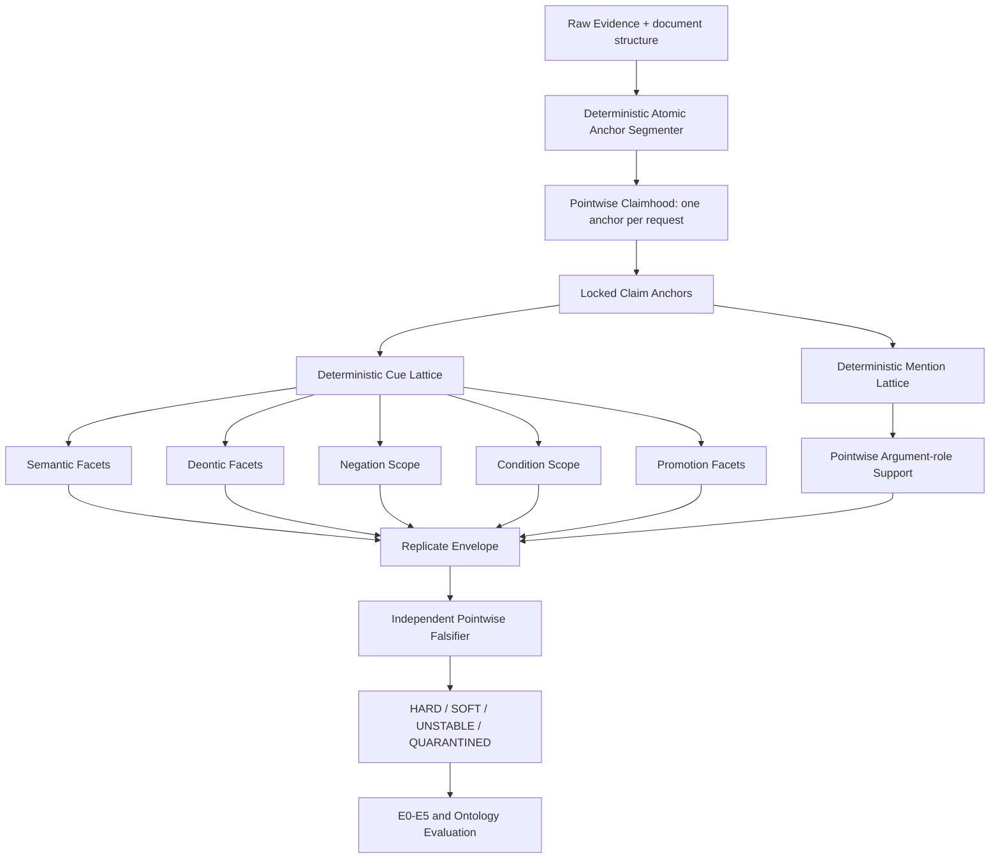

# 자이제 LDR-R3 APRE 점단위 후속 실험 설계서

> **문서 유형:** `REVISE_BEFORE_R2_PILOT` 이후 신규 experiment ID용 사전등록 설계서  
> **권장 experiment ID:** `zaije_ldr_r3_20260712_apre_v1`  
> **상위 방법론:** SCALE-OL + Atomic Work Claim  
> **신규 reference 프로토콜:** **APRE — Anchor-Pointwise Reference Envelope**  
> **대상 데이터:** `legacy/자이제_1.xlsx` 단일 도메인  
> **연구 범위:** Transfer 이전, reference 안정화 후 E0∼E5 및 단일 도메인 온톨로지 평가  
> **기준일:** 2026-07-12  
> **선행 run:** `zaije_ldr_r2_20260712_blre_v1`  
> **선행 판정:** `REVISE_BEFORE_R2_PILOT`

---

# 0. 의사결정 요약

선행 run을 fresh R2_PILOT 이전에 중단한 결정은 타당하다. 사전등록상 필수였던 3개 configuration panel을 구성하지 못한 상태에서 pilot을 강행했다면, 결과를 본 뒤 기준을 완화한 것으로 해석될 수 있었다.

다만 선행 결과는 **3개 모델 패널이 반드시 필요한가**라는 별도의 질문을 제기한다. 현재 관찰된 사실은 다음과 같다.

1. exact-offset candidate와 field decomposition은 기술적으로 작동했다.
2. `C02`는 candidate ID validity 1.00, boundary repeat F1 0.9222, critical-field IMS 0.8750을 기록했다.
3. 다른 configuration을 추가한다고 자동으로 신뢰도가 높아지지 않았다.
4. candidate를 배열로 한 번에 제시하면 모든 configuration에서 순서 민감성이 크게 남았다.
5. semantic mode·polarity·promotion을 강제 단일 범주로 판정한 구조 자체가 불안정성의 원인이었다.

따라서 신규 run에서는 다음 두 가설을 교체한다.

```text
폐기하는 가설
“서로 다른 3개 모델이 합의하면 신뢰할 수 있는 reference가 된다.”

새로 검증하는 가설
“순서가 없는 pointwise 과업에서 하나의 안정적인 pinned model을 반복 측정하고,
결정적 규칙·독립 falsifier·negative control을 결합하면,
다중 모델 합의 없이도 잠정적인 engineering reference를 구축할 수 있다.”
```

이번 변경은 panel 수를 사후에 단순 완화하는 것이 아니다. **reference의 신뢰 근거를 모델 수에서 과업 설계, 반복 안정성, 근거 제약, 반증 검사로 이동하는 새로운 연구 가설**이다. 따라서 반드시 신규 experiment ID에서 사전등록한다.

신규 프로토콜의 전체 흐름은 다음과 같다.

```text
문서 구조
→ 결정적 atomic anchor 생성
→ 후보를 하나씩 독립 판정
→ anchor를 Atomic Work Claim 단위로 잠금
→ 명시 cue는 프로그램이 해석
→ 애매한 의미 필드만 pointwise LLM 판정
→ argument는 mention ID만 선택
→ 반복 분포를 HARD / SOFT / UNSTABLE로 보존
→ 별도 snapshot falsifier가 고위험 항목만 반증 검사
→ reference viability Gate
→ E0∼E5 및 온톨로지 귀납
```

이번에도 인간 Gold가 없으므로 결과물은 `Gold`가 아니다. 공식 명칭은 다음으로 고정한다.

> **APRE-LDR: Anchor-Pointwise LLM-Derived Reference Envelope**

APRE-LDR에 대한 성능은 실제 전문가 정확도가 아니라 다음을 의미한다.

- 근거가 잠긴 반복 측정 reference와의 일치도
- 모델 내 재현성
- 결정적 제약을 통과한 비율
- 불확실성에 대한 적절한 abstention
- 비용 대비 구조적 품질

최대 판정도 `GOLD_PASS`가 아니라 **`PROVISIONAL_REFERENCE_PASS`**로 제한한다.

---

# 1. 선행 결과에서 직접 도출되는 변경 사항

| 선행 관찰 | 기존 해석 | R3 변경 |
|---|---|---|
| C02만 자격 통과 | panel 부족 | 단일 primary configuration을 허용하되 반복·반증 Gate 강화 |
| 모든 모델 order consistency 0.50 전후 | 모델 성능 부족 | 후보 배열 자체를 폐기하고 요청당 후보 1개만 제시 |
| boundary repeat은 비교적 높음 | BLRE 일부 성공 | 자유 boundary 선택 대신 atomic anchor 자체를 reference unit으로 사용 |
| semantic mode 불안정 | prompt 부족 | 상호배타적 단일 label을 폐기하고 직교 binary facet으로 분해 |
| polarity 불안정 | 모델 계열 차이 | negation cue와 scope를 분리하고 polarity는 프로그램이 파생 |
| promotion 불안정 | 예시 부족 | general/example/template/reported를 독립 facet으로 분해 |
| field를 한 응답에 넣을수록 불안정 | schema 문제 | 후보 1개·판정 1개 원칙 적용 |
| Structured Output item 누락 | 배열 길이 비보장 | API 요청 하나가 reference item 하나를 표현하도록 변경 |
| 3개 OpenAI 계열 모델 | 다양성 확보 | 동일 계열의 상관 오류를 truth로 해석하지 않음 |

## 1.1 유지할 요소

다음은 선행 설계에서 그대로 유지한다.

- Gate 0 데이터·split 무결성
- exact character offset
- candidate/mention ID
- raw response 및 token ledger
- pinned model snapshot
- Structured Outputs
- TEST reference 비공개
- fresh pilot 이후 prompt 수정 금지
- HARD·SOFT·UNSTABLE·QUARANTINED 구분
- high-risk pointwise verification
- E0∼E5와 온톨로지 평가의 단계 분리

## 1.2 폐기할 요소

다음은 R3에서 사용하지 않는다.

- 한 요청에 여러 candidate를 배열로 제시하는 boundary selection
- 후보 순서 reverse audit를 primary Gate로 사용하는 방식
- 3개 configuration panel 필수 조건
- annotator 간 majority를 latent truth로 해석하는 방식
- claim family 또는 semantic mode의 강제 단일 label
- 전체 Claim을 다시 쓰는 adjudicator
- X/Y 비교형 판정
- free quote 생성

---

# 2. 연구 질문과 사전등록 가설

## 2.1 Primary research question

> 후보 간 비교와 순서 노출을 제거하고, 결정적으로 생성한 atomic anchor를 하나씩 판정하게 하면 자이제 문서에서 안정적인 Claim reference unit을 만들 수 있는가?

## 2.2 Secondary research question

> 하나의 안정적인 primary model의 반복 판정, deterministic cue resolver, 별도 falsifier를 결합하면 3-model panel 없이도 E0∼E5 상대 비교에 사용할 수 있는 잠정 reference envelope를 구축할 수 있는가?

## 2.3 가설

### H3-R1 — Pointwise order elimination

요청마다 후보를 하나만 제시하면 candidate-order effect가 구조적으로 제거되며, 동일 후보에 대한 반복 결정 안정성이 batch/listwise 방식보다 높아진다.

### H3-R2 — Anchor-first unitization

문장 전체 또는 임의 병합 span을 선택하게 하지 않고, 프로그램이 분할한 atomic anchor를 Claim 단위로 사용하면 boundary 불일치와 중복 Claim이 감소한다.

### H3-R3 — Orthogonal facet decomposition

semantic mode·promotion처럼 동시에 성립할 수 있는 의미를 상호배타적 class가 아니라 독립적인 binary facet으로 판정하면 field-level 반복 안정성이 높아진다.

### H3-R4 — Cue-first low-LLM resolution

명시적인 의무·권고·금지·부정·조건·수량 cue는 프로그램이 먼저 추출하고, scope 또는 암묵적 의미가 불명확할 때만 LLM을 호출하면 품질을 유지하면서 field LLM 호출량을 줄일 수 있다.

### H3-R5 — Single-primary replicate envelope

한 개의 pinned primary configuration을 3회 반복하고, deterministic constraint와 별도 falsifier를 결합하면 HARD+SOFT usable coverage 0.85 이상을 달성할 수 있다.

### H3-R6 — Downstream viability

APRE-LDR가 Gate를 통과하면 E0∼E5를 hard-core, set-compatible, distributional, selective-risk 관점에서 비교할 수 있다.

---

# 3. 데이터와 표본 정책

## 3.1 유지하는 Gate 0

| 항목 | 값 |
|---|---:|
| Evidence | 1,366 |
| Leakage group | 168 |
| INDUCTION | 681 |
| VALIDATION | 272 |
| TEST_NATURAL | 275 |
| TEST_CHALLENGE_POOL | 138 |
| split 간 leakage group 중복 | 0 |
| TEST reference 생성·열람 | 0 |

입력은 설계서 binary hash와 일치하는 `legacy/자이제_1.xlsx`를 유지한다. 메타데이터가 보완된 handoff 파일은 primary 실험에 사용하지 않는다.

## 3.2 기존 공개 표본

다음 60건은 계속 `DEV_EXPOSED_60`으로만 사용한다.

- 최초 PILOT 40건
- fresh re-pilot 20건

사용 가능:

- anchor segmenter 개발
- cue lexicon 개발
- prompt/schema 개발
- model configuration 재자격 시험
- deterministic control 구축
- 오류 분석

사용 금지:

- confirmatory Gate 성능
- 최종 reference 품질 주장
- E0∼E5 TEST 성능

## 3.3 기존 fresh 60 재사용

선행 run에서 잠근 fresh R2_PILOT 60은 다음 조건을 모두 만족한다.

- API exposure 0
- label 생성 0
- 기존 공개 60과 Evidence 중복 0
- 기존 공개 60과 leakage group 중복 0
- membership/hash 잠금 완료

따라서 신규 run에서는 표본을 다시 추출하지 않고 다음 이름으로 import한다.

```text
R3_PILOT_60_IMPORTED_UNEXPOSED
```

필수 조건:

1. 원래 lock 파일과 hash를 그대로 보존한다.
2. 신규 manifest에는 `imported_from_experiment_id`를 기록한다.
3. membership 변경은 금지한다.
4. R3 model/prompt/schema lock 이전에는 내용을 API로 보내지 않는다.
5. 선행 amendment와 quota 재배분 내역을 함께 보존한다.

## 3.4 TEST 정책

다음은 계속 금지한다.

- TEST 원문 열람을 통한 prompt 개발
- TEST reference 선생성
- TEST 결과를 본 뒤 threshold 수정
- TEST와 동일 leakage group을 DEV 또는 pilot에 추가

---

# 4. 신규 방법론: APRE

## 4.1 핵심 표현 변경

BLRE는 여러 길이의 span 후보 중 하나를 선택하려 했다. R3는 **span 선택 문제 자체를 축소**한다.

```text
Evidence
 ├─ Atomic Anchor A1
 ├─ Atomic Anchor A2
 ├─ Atomic Anchor A3
 └─ Structural Context
      ├─ inherited header
      ├─ previous subject
      ├─ table header
      └─ caption / section title
```

Atomic Work Claim의 근거는 다음처럼 표현한다.

```json
{
  "claim_id": "CLM_000123_A02",
  "anchor_span_id": "EV_000123_A02",
  "context_span_ids": ["EV_000123_H01"],
  "anchor_text_by_program": "핵심 이해관계자는 3~6명으로 선정한다.",
  "context_relation": ["INHERITS_LIST_HEADER"],
  "grounding_mode": "MULTI_SPAN_PROVENANCE"
}
```

원문 quote를 억지로 하나의 긴 연속 문자열로 합치지 않는다. 목록 header, 표 header, 앞 문장의 생략 주어는 별도 context span으로 연결한다.

이 결정의 장점은 다음과 같다.

- 긴 span과 짧은 span 사이의 선택 문제 감소
- list item이 header 의미를 잃지 않음
- 표 row가 column header 의미를 상속함
- exact grounding 유지
- 원자적 Claim 분해 용이
- 동일 문장 안의 여러 작업을 별도 Claim으로 표현 가능

## 4.2 전체 파이프라인



## 4.3 LLM 최소화 원칙

LLM을 호출하기 전에 다음을 프로그램이 처리한다.

- 문장·절·목록·표 구조 분리
- exact offset과 span ID
- 의무·권고·금지 cue 후보
- 부정 cue 후보
- 조건·예외 cue 후보
- 숫자·범위·단위 후보
- example·template·definition discourse cue 후보
- noun phrase·verb phrase·quantity mention 후보
- 명시 cue에 대한 고정 매핑
- 타입·cardinality·provenance 제약

LLM은 다음 경우에만 사용한다.

1. anchor가 실제 업무 Claim을 담는지 판정
2. cue가 어느 행동·주장에 scope를 가지는지 판정
3. 명시 cue가 없을 때 암묵적 규범성 판정
4. 동시에 성립 가능한 의미 facet 판정
5. mention이 특정 argument role을 수행하는지 판정
6. 고위험 결과의 반증 검사

---

# 5. Phase A — 신규 사전등록과 환경 잠금

## 5.1 신규 experiment 생성

```text
zaije_experiment/
└── experiments/
    └── zaije_ldr_r3_20260712_apre_v1/
```

선행 run의 산출물을 덮어쓰지 않는다.

## 5.2 필수 사전등록 파일

```text
preregistration/
├── r3_amendment_from_r2.md
├── data_import_policy.yaml
├── primary_model_policy.yaml
├── falsifier_model_policy.yaml
├── pointwise_api_policy.yaml
├── anchor_schema_v1.json
├── field_schema_v1.json
├── gate_thresholds_r3.yaml
└── downstream_overlap_policy.yaml
```

## 5.3 변경 불가 항목

fresh pilot API 호출 전에 다음을 잠근다.

- primary snapshot
- falsifier snapshot
- prompt hash
- JSON Schema hash
- atomic anchor segmenter commit
- cue lexicon hash
- deterministic derivation rules
- repeat 수
- HARD/SOFT 판정 규칙
- Gate threshold
- token budget
- imported fresh 60 manifest hash

---

# 6. Phase B — Deterministic Atomic Anchor Segmenter

## 6.1 공통 원칙

1. anchor는 원문의 exact character offset을 가진다.
2. anchor는 가능한 한 하나의 서술·행동·판단만 담는다.
3. context는 anchor와 분리해 span ID로 연결한다.
4. 원문 문자열을 정규화하더라도 original↔normalized offset map을 보존한다.
5. anchor text는 LLM이 생성하지 않는다.
6. 동일 입력과 동일 code commit에서 anchor 출력은 byte-identical해야 한다.

## 6.2 prose

우선순위:

1. 문장 종결 부호
2. 병렬 predicate
3. 연결 어미와 접속 표현
4. 세미콜론·콜론
5. 괄호 안 독립 정의
6. 숫자·기호로 시작하는 하위 항목

단순히 쉼표마다 분리하지 않는다. 분리 후 주어가 생략된 경우 앞 anchor를 `INHERITS_SUBJECT_FROM`으로 연결한다.

## 6.3 list

다음 객체를 분리한다.

- list header
- list item
- nested item
- item explanation

list item의 Claim anchor는 item 자체이며, header는 context span이다.

```text
Header: “Capture Plan의 구성요소는 다음과 같다.”
Item: “핵심 이해관계자 분석”

→ anchor = Item
→ context = Header
→ relation = INHERITS_LIST_HEADER
```

## 6.4 table/template

표는 행 전체를 긴 문장으로 만들지 않는다.

- table caption
- header cell
- row label
- data cell
- footnote

각 cell assertion은 row header와 column header를 context로 가진다.

```json
{
  "anchor_span_id": "T03_R04_C02",
  "context_span_ids": ["T03_R04_C01", "T03_R01_C02"],
  "context_relation": ["HAS_ROW_HEADER", "HAS_COLUMN_HEADER"]
}
```

## 6.5 anchor schema

```json
{
  "anchor_id": "EV_000123_A02",
  "evidence_id": "EV_000123",
  "start_char": 42,
  "end_char": 71,
  "text_by_program": "핵심 이해관계자를 선정한다.",
  "structure_type": "PROSE_CLAUSE",
  "context_span_ids": ["EV_000123_A01"],
  "context_relations": ["INHERITS_SUBJECT_FROM"],
  "generation_rule": "KO_CLAUSE_V3",
  "segmenter_commit": "...",
  "source_hash": "..."
}
```

## 6.6 DEV coverage audit

`DEV_EXPOSED_60`에서만 다음 진단을 수행한다.

- anchor가 두 독립 predicate를 과도하게 합쳤는가
- 하나의 predicate가 둘로 잘렸는가
- list header 상속이 누락됐는가
- table row/column context가 누락됐는가
- 원문 의미를 담는 atomic position이 존재하지 않는가

free-span LLM 진단은 DEV에서만 허용하며 reference로 사용하지 않는다. 진단 결과를 보고 segmenter를 수정한 뒤 commit을 잠근다.

## 6.7 Segmenter Gate S0

| Metric | 기준 |
|---|---:|
| Anchor JSON validity | 1.00 |
| Offset round-trip validity | 1.00 |
| Anchor ID uniqueness | 1.00 |
| Context span existence | 1.00 |
| 동일 입력 재실행 byte identity | 1.00 |
| DEV missing-anchor diagnostic | 0.05 이하 |
| DEV over-merged anchor | 0.05 이하 |
| DEV broken structural context | 0.02 이하 |

S0 실패 시 fresh pilot을 실행하지 않는다.

---

# 7. Phase C — Pointwise Claimhood

## 7.1 요청당 후보 1개

각 API 요청은 오직 하나의 anchor를 판정한다.

금지:

- 한 prompt에 anchor 배열 제시
- 다른 anchor와 비교
- “가장 좋은 후보” 선택
- 순위 또는 pairwise preference
- candidate list order 노출

입력:

```json
{
  "evidence_id": "EV_000123",
  "anchor_id": "EV_000123_A02",
  "document_context": {
    "chapter": "...",
    "section": "..."
  },
  "source_text": "...",
  "anchor_text": "...",
  "context_spans": [
    {"span_id": "EV_000123_A01", "text": "...", "relation": "INHERITS_SUBJECT_FROM"}
  ]
}
```

출력:

```json
{
  "anchor_id": "EV_000123_A02",
  "claimhood": "CLAIM_BEARING",
  "evidence_support": "SUPPORTED"
}
```

허용 enum:

```text
claimhood:
- CLAIM_BEARING
- NON_CLAIM
- UNDERDETERMINED

evidence_support:
- SUPPORTED
- CONTRADICTED
- UNDERDETERMINED
```

`MISSING_CANDIDATE`는 더 이상 LLM 출력이 아니다. anchor coverage는 segmenter Gate에서 관리한다.

## 7.2 반복 정책

primary configuration으로 동일 anchor를 **3회 독립 호출**한다.

- 동일 pinned snapshot
- 동일 prompt/schema
- 동일 source/context
- 동일 anchor
- 동일 API parameter
- 별도 request ID
- cache replay 금지

반복 호출은 독립 annotator로 해석하지 않는다. 동일 측정 절차의 재현성 평가로만 사용한다.

## 7.3 Claimhood envelope

| 3회 결과 | 상태 |
|---|---|
| 3/3 `CLAIM_BEARING` | `BOUNDARY_HARD_KEEP` |
| 2/3 `CLAIM_BEARING`, 나머지 `UNDERDETERMINED` 또는 `NON_CLAIM` | `BOUNDARY_SOFT_KEEP` |
| 3/3 `NON_CLAIM` | `BOUNDARY_HARD_DROP` |
| 2/3 `NON_CLAIM` | `BOUNDARY_SOFT_DROP` |
| 세 결과가 분산되거나 contradiction 발생 | `BOUNDARY_UNSTABLE` |

fresh reference에서는 `BOUNDARY_HARD_KEEP`과 `BOUNDARY_SOFT_KEEP`만 field 단계로 이동한다.

## 7.4 결정적 sanity control

DEV에서 다음 control을 만든다.

- source와 무관한 다른 Evidence anchor를 결합한 mismatch
- chapter title만 있는 비Claim 구조
- 빈 anchor 또는 whitespace anchor
- exact duplicate anchor
- 동일 list item의 context 제거 버전
- table cell의 header 제거 버전

주요 목적은 실제 정확도 측정이 아니라 다음 실패를 탐지하는 것이다.

- source를 읽지 않고 무조건 KEEP
- 구조 context에 과도하게 의존
- duplicate에서 비일관
- invalid input 승인

---

# 8. Phase D — 모델 역할 재정의와 재자격

## 8.1 3-model panel 폐기

R3에서는 모델 수를 신뢰도의 직접 대리변수로 사용하지 않는다.

필수 역할은 두 개다.

1. **Primary measurer:** reference 후보를 반복 판정
2. **Independent falsifier:** 고위험 결과가 원문에 의해 지지되는지 반증 관점에서 점검

두 역할은 서로 다른 pinned snapshot이어야 한다.

## 8.2 재평가 대상

비용과 선행 결과를 고려해 다음을 우선 재평가한다.

| 역할 후보 | 대상 |
|---|---|
| Primary | C02, C03, C04 |
| Falsifier | C03, C04, 필요 시 C01 |
| 기본 제외 | C05 — ID validity와 안정성 모두 낮음 |

C01은 primary 후보에서는 제외할 수 있으나, pointwise falsifier control을 통과하면 falsifier 후보로 사용할 수 있다.

계정에서 새로운 모델을 추가하고자 한다면 `DEV_EXPOSED_24`에서만 C06으로 등록할 수 있다. rolling alias가 아니라 exact snapshot을 사용하며, fresh pilot 호출 전에 잠근다.

## 8.3 Primary qualification

DEV_EXPOSED 24건에서 pointwise claimhood와 핵심 field를 각 2회 실행한다.

| Metric | 기준 |
|---|---:|
| Structured Output validity | 1.00 |
| Anchor ID validity | 1.00 |
| Claimhood repeat agreement | 0.92 이상 |
| Positive-anchor set F1 | 0.90 이상 |
| Critical binary facet repeat agreement | 0.90 이상 |
| Deterministic control balanced accuracy | 0.95 이상 |
| API failure rate | 0.01 이하 |

통과 모델이 여러 개면 다음 순서로 primary를 선택한다.

```text
1. ID·schema·control
2. claimhood stability
3. critical-field stability
4. token cost
```

통과 모델이 C02 하나여도 실험을 진행할 수 있다. 이것이 R3의 사전등록 가설이다.

## 8.4 Falsifier qualification

falsifier는 label을 생성하지 않고 다음만 판정한다.

```text
(source, anchor, proposed field, proposed value)
→ SUPPORTED / CONTRADICTED / UNDERDETERMINED
```

DEV에서 명백히 supported인 proposal과 명백히 contradicted인 proposal을 균형 있게 구성한다.

| Metric | 기준 |
|---|---:|
| Schema validity | 1.00 |
| Proposal ID validity | 1.00 |
| Supported control recall | 0.90 이상 |
| Contradicted control recall | 0.90 이상 |
| Balanced accuracy | 0.92 이상 |
| 동일 proposal 반복 agreement | 0.90 이상 |
| API failure rate | 0.01 이하 |

falsifier가 하나도 통과하지 못하면 fresh R3_PILOT을 실행하지 않고 `REVISE_BEFORE_R3_PILOT`로 종료한다.

## 8.5 동일 모델 순환 방지

- primary snapshot은 falsifier로 사용하지 않는다.
- APRE-LDR primary reference snapshot은 E0·E1·E3·E4·E5의 primary system LLM으로 사용하지 않는 것을 원칙으로 한다.
- 불가피하게 중복되면 결과를 `SELF_OVERLAP`로 표시하고 primary 결론에서 제외한다.
- E2처럼 generative LLM을 사용하지 않는 시스템은 제한 대상이 아니다.

---

# 9. Phase E — Cue-first 의미 필드

## 9.1 단일 semantic mode 폐기

하나의 Claim은 동시에 다음 성격을 가질 수 있다.

- 절차를 설명하면서 권고할 수 있음
- 템플릿을 정의하면서 예시를 제시할 수 있음
- 평가 기준을 설명하면서 일반 규칙을 포함할 수 있음

따라서 `semantic_mode = 하나`를 강제하지 않는다. 다음 직교 facet을 사용한다.

```text
IS_DESCRIPTIVE
IS_DEFINITIONAL
IS_PROCEDURAL
IS_NORMATIVE
IS_EVALUATIVE
IS_EXAMPLE
IS_TEMPLATE_SCHEMA
IS_REPORTED_VIEW
```

각 facet은 별도 pointwise 판정이다.

```text
SUPPORTED / NOT_SUPPORTED / UNDERDETERMINED
```

`claim_family`가 필요한 경우 facet 조합에서 프로그램이 파생하며, primary 평가는 facet 수준에서 수행한다.

## 9.2 Deontic force

### 9.2.1 deterministic cue extraction

예시 cue 범주:

- REQUIREMENT: 반드시, 해야 한다, 필수, 의무
- RECOMMENDATION: 권장, 바람직, 필요가 있다, 하는 것이 좋다
- PROHIBITION: 금지, 해서는 안 된다
- PERMISSION: 할 수 있다, 허용

cue마다 exact offset과 cue ID를 부여한다.

### 9.2.2 scope 판정

명시 cue가 있으면 LLM은 cue의 종류를 새로 쓰지 않는다. 다음만 판정한다.

```json
{
  "cue_id": "EV_123_DEO_02",
  "anchor_id": "EV_123_A01",
  "scope_relation": "GOVERNS_ANCHOR"
}
```

허용 값:

- `GOVERNS_ANCHOR`
- `DOES_NOT_GOVERN_ANCHOR`
- `UNDERDETERMINED`

cue 종류와 scope가 확정되면 deontic force는 프로그램이 파생한다.

### 9.2.3 암묵적 규범

명시 cue가 없을 때만 다음 binary facet을 각각 판정한다.

- `IMPLICIT_REQUIREMENT`
- `IMPLICIT_RECOMMENDATION`
- `IMPLICIT_PROHIBITION`
- `IMPLICIT_PERMISSION`

둘 이상이 지지되면 강제 단일 label로 만들지 않고 SOFT set으로 보존한다.

## 9.3 Polarity

polarity를 직접 `POSITIVE/NEGATIVE`로 묻지 않는다.

1. 프로그램이 negation cue를 추출한다.
2. LLM은 negation cue가 anchor predicate를 scope로 가지는지 판정한다.
3. 프로그램이 polarity를 파생한다.

```text
negation cue 없음 → POSITIVE
negation cue 있음 + GOVERNS_ANCHOR → NEGATIVE
negation cue 있음 + scope 불명 → UNDERDETERMINED
```

## 9.4 Condition과 exception

프로그램이 다음 cue 후보를 만든다.

- 경우
- 때
- 이후·이전
- 조건하에
- 단, 다만
- 예외
- 만약

LLM은 condition text를 생성하지 않고 cue ID와 scope만 판정한다.

```json
{
  "condition_cue_id": "EV_123_COND_01",
  "anchor_id": "EV_123_A02",
  "relation": "CONDITIONS_ANCHOR"
}
```

## 9.5 Promotion

기존 단일 promotion label을 다음 독립 facet으로 분해한다.

- `GENERALIZABLE_RULE`
- `SPECIFIC_EXAMPLE_INSTANCE`
- `TEMPLATE_INSTRUCTION`
- `TEMPLATE_EXAMPLE`
- `REPORTED_BELIEF`
- `HYPOTHETICAL_SCENARIO`

`GENERALIZABLE_RULE`과 `SPECIFIC_EXAMPLE_INSTANCE`가 동시에 지지되면 자동 승격하지 않고 SOFT 또는 QUARANTINED로 보낸다.

## 9.6 수량과 범위

숫자·단위·범위는 정규식과 parser로 추출한다.

예:

```json
{
  "quantity_id": "EV_123_Q01",
  "raw": "3~6명",
  "min": 3,
  "max": 6,
  "unit": "person",
  "operator": "RANGE"
}
```

LLM은 이 수량이 어느 anchor 또는 argument에 연결되는지만 판정한다.

## 9.7 field 호출 정책

각 field는 다음 순서로 처리한다.

```text
deterministic explicit rule
→ constraint check
→ unresolved인가?
   ├─ 아니오: RULE_HARD
   └─ 예: pointwise LLM 3회
        → 3/3: MODEL_HARD
        → 2/3: MODEL_SOFT
        → 그 외: UNSTABLE
```

명시 cue로 확정 가능한 field에 불필요하게 LLM을 호출하지 않는다.

---

# 10. Phase F — Mention lattice와 argument

## 10.1 mention 생성

프로그램이 다음 mention 후보를 만든다.

- ACTOR
- ACTION/PREDICATE
- OBJECT
- INPUT
- OUTPUT
- METHOD
- TOOL
- CONDITION
- EXCEPTION
- CRITERION
- QUANTITY
- TEMPORAL_STAGE

모든 mention은 exact offset과 ID를 가진다.

## 10.2 role 판정

LLM은 여러 mention을 한 번에 선택하지 않는다. `(anchor, mention, proposed role)` 하나를 판정한다.

```json
{
  "anchor_id": "EV_123_A02",
  "mention_id": "EV_123_M07",
  "proposed_role": "OUTPUT",
  "decision": "SUPPORTED"
}
```

허용 값:

- SUPPORTED
- NOT_SUPPORTED
- UNDERDETERMINED

## 10.3 implicit argument

원문에 명시 span이 없는 argument는 다음처럼 구분한다.

- `IMPLICIT_FROM_CONTEXT`: context span에서 복원 가능
- `IMPLICIT_DOMAIN_DEFAULT`: 일반 상식 또는 도메인 추정
- `UNSUPPORTED_IMPLICIT`: 근거 없음

reference에는 `IMPLICIT_FROM_CONTEXT`까지만 허용한다. `IMPLICIT_DOMAIN_DEFAULT`는 ontology candidate로 보낼 수 있으나 Claim Gold-like reference에는 포함하지 않는다.

---

# 11. APRE Reference Envelope

## 11.1 상태 정의

### `RULE_HARD`

- 결정적 cue와 scope가 명확
- constraint 위반 없음
- exact provenance 1.00

### `MODEL_HARD`

- primary 3회가 동일
- deterministic constraint 위반 없음
- 고위험이면 falsifier가 `SUPPORTED`

### `MODEL_SOFT`

- primary 2/3가 동일
- 나머지는 `UNDERDETERMINED` 또는 대안 label
- falsifier가 `CONTRADICTED`하지 않음

### `UNSTABLE`

- primary 반복이 분산
- cue scope가 반복마다 달라짐
- 동일 모델의 facet 결과가 논리적으로 충돌

### `QUARANTINED`

- ID 또는 grounding 오류
- falsifier가 핵심 label을 `CONTRADICTED`
- structural context 손상
- general/example 오염 해결 불가
- unsupported implicit argument

## 11.2 분포 보존

```json
{
  "field": "GENERALIZABLE_RULE",
  "votes": {
    "SUPPORTED": 2,
    "NOT_SUPPORTED": 0,
    "UNDERDETERMINED": 1
  },
  "distribution": {
    "SUPPORTED": 0.6667,
    "NOT_SUPPORTED": 0.0,
    "UNDERDETERMINED": 0.3333
  },
  "status": "MODEL_SOFT"
}
```

동일 모델 반복은 독립 annotator가 아니므로 이 분포를 인간 의견 분포로 해석하지 않는다. **측정 절차의 불안정성 또는 모델의 모호성 신호**로만 사용한다.

## 11.3 고위험 falsification

필수 falsifier 대상:

- REQUIREMENT·PROHIBITION
- NEGATIVE polarity
- GENERALIZABLE_RULE
- CONDITION·EXCEPTION
- 수량·범위·cardinality
- 표·템플릿 제약
- 선행·후행 방향
- example에서 general rule로 승격되는 항목
- primary가 2/3인 모든 critical field

falsifier는 대안을 선택하지 않는다.

```text
proposed value가 source에 의해 지지되는가?
→ SUPPORTED / CONTRADICTED / UNDERDETERMINED
```

---

# 12. Fresh R3_PILOT Gate

Gate는 순차적으로 적용한다. 이전 Gate가 실패하면 뒤 단계의 API 호출을 하지 않는다.

## 12.1 Gate R3-0 — 데이터·잠금

| Metric | 기준 |
|---|---:|
| Imported fresh 60 hash match | 1.00 |
| Prior API exposure | 0 |
| DEV_EXPOSED overlap | 0 |
| TEST access | 0 |
| Prompt/schema/model lock completeness | 1.00 |

## 12.2 Gate R3-1 — Anchor segmenter

| Metric | 기준 |
|---|---:|
| Anchor/offset validity | 1.00 |
| Context link validity | 1.00 |
| Deterministic rerun identity | 1.00 |
| DEV missing-anchor diagnostic | 0.05 이하 |
| DEV over-merge diagnostic | 0.05 이하 |

## 12.3 Gate R3-2 — Model role lock

| Metric | 기준 |
|---|---:|
| Primary qualified | 1개 이상 |
| Independent falsifier qualified | 1개 이상 |
| Primary–falsifier snapshot 동일 | 0 |
| Primary control balanced accuracy | 0.95 이상 |
| Falsifier control balanced accuracy | 0.92 이상 |

3개 primary model은 요구하지 않는다.

## 12.4 Gate R3-3 — Fresh Claimhood

| Metric | 기준 |
|---|---:|
| Schema validity | 1.00 |
| Anchor ID validity | 1.00 |
| 전체 anchor 3-repeat exact agreement | 0.90 이상 |
| positive-anchor pairwise F1 median | 0.90 이상 |
| HARD+SOFT claimhood coverage | 0.90 이상 |
| BOUNDARY_UNSTABLE | 0.10 이하 |
| mismatch negative-control false KEEP | 0.05 이하 |
| exact duplicate consistency | 0.95 이상 |
| Candidate list/order exposure | 0 |

`order consistency`는 더 이상 결과 지표가 아니다. 후보 순서가 존재하지 않는 것이 구현 Gate다.

## 12.5 Gate R3-4 — Fresh semantic fields

| Metric | 기준 |
|---|---:|
| Cue ID validity | 1.00 |
| Deterministic cue derivation reproducibility | 1.00 |
| Critical facet 3-repeat agreement | 0.90 이상 |
| Noncritical facet 3-repeat agreement | 0.85 이상 |
| Critical UNSTABLE rate | 0.10 이하 |
| Logical contradiction rate | 0.02 이하 |
| General/example unresolved conflict | 0.05 이하 |
| High-risk falsifier accepted or soft | 0.90 이상 |

Agreement는 facet별 raw agreement와 Gwet AC1을 함께 보고한다. prevalence가 극단적인 facet은 α만으로 stop하지 않는다.

## 12.6 Gate R3-5 — Argument

| Metric | 기준 |
|---|---:|
| Mention ID validity | 1.00 |
| Argument exact grounding | 1.00 |
| Core-role repeat agreement | 0.85 이상 |
| CONDITION·QUANTITY repeat agreement | 0.90 이상 |
| Missing mention | 0.10 이하 |
| Unsupported implicit argument | 0.05 이하 |

## 12.7 Gate R3-6 — Reference viability

| Metric | 기준 |
|---|---:|
| Claim·argument provenance completeness | 1.00 |
| RULE_HARD+MODEL_HARD coverage | 0.55 이상 |
| HARD+SOFT usable coverage | 0.85 이상 |
| QUARANTINED Evidence | 0.10 이하 |
| High-risk contradicted rate | 0.05 이하 |
| Resolver deterministic rerun | 1.00 |
| Reference–system overlap policy locked | 1.00 |

## 12.8 비용·효율 지표

비용은 validity Gate와 분리해 보고하되 다음 목표를 둔다.

| Metric | 목표 |
|---|---:|
| Explicit cue로 LLM 없이 확정한 field 비율 | 0.40 이상 |
| 가능한 모든 field를 3회 호출하는 naive 방식 대비 field request 감소 | 0.30 이상 |
| Fresh pilot pointwise 요청 수 | 사전 잠금 cap 이하 |
| Input/output token | 전량 기록 |
| Cache replay | 0 |

달러 비용은 가격 변동의 영향을 받으므로 token count를 primary cost metric으로 사용한다. 가격표 snapshot과 추정 비용은 보조 지표로 기록한다.

---

# 13. 판정 규칙

## `PROVISIONAL_REFERENCE_PASS`

R3-0∼R3-6을 모두 통과한다.

허용되는 주장:

> exact provenance, 반복 안정성, 결정적 cue resolution, 독립 falsification을 통과한 잠정 LLM-derived reference를 구축했다.

허용되지 않는 주장:

> 인간 전문가 Gold와 동등하다.  
> 실제 정확도가 해당 수치다.  
> 타 도메인으로 일반화됐다.

## `BOUNDARY_REFERENCE_ONLY`

R3-3까지 통과했으나 R3-4 이후 실패한다.

이 경우 anchor/Claimhood 연구 결과는 보고할 수 있지만 E0∼E5 전체 온톨로지 평가는 진행하지 않는다.

## `REVISE`

- fresh Claimhood 안정성 실패
- critical field 안정성 실패
- falsifier Gate 실패
- usable coverage 부족

동일 experiment ID에서 prompt/schema/model을 수정하지 않는다.

## `INVALID`

- fresh 또는 TEST 누출
- model alias 변경
- prompt/schema hash 불일치
- raw response 누락
- 결과 확인 후 threshold 수정
- imported fresh 60 membership 변경

---

# 14. 실행 순서

```text
Step 1. 신규 experiment ID 생성
Step 2. R2 fresh 60 lock을 unexposed 상태로 import
Step 3. DEV_EXPOSED_60에서 atomic anchor segmenter 완성
Step 4. Segmenter S0 통과·commit 잠금
Step 5. DEV_EXPOSED_24에서 C02/C03/C04 pointwise 재자격
Step 6. primary 1개와 falsifier 1개 선택·잠금
Step 7. prompt/schema/cue lexicon/Gate/token cap 잠금
Step 8. Fresh 60 anchor 생성
Step 9. Fresh Claimhood를 anchor당 3회 실행
Step 10. R3-3 계산; 실패 시 중단
Step 11. 선택 Claim의 deterministic cue lattice 생성
Step 12. unresolved field만 3회 pointwise 실행
Step 13. R3-4 계산; 실패 시 중단
Step 14. mention lattice·argument 판정
Step 15. high-risk falsifier 실행
Step 16. APRE envelope 집계
Step 17. R3-5·R3-6 계산
Step 18. PASS / BOUNDARY_ONLY / REVISE / INVALID 판정
```

fresh pilot 결과를 보고 같은 ID에서 수정하는 re-pilot은 허용하지 않는다.

---

# 15. API 운영 설계

## 15.1 one item = one request

Structured Outputs가 object schema를 보장하더라도 배열 cardinality 또는 모든 입력 item의 반환을 과업 의미상 보장한다고 가정하지 않는다.

따라서 다음 원칙을 적용한다.

```text
1 API request
= 1 anchor 또는 1 field proposal 또는 1 argument proposal
= 1 reference record
```

## 15.2 Batch 사용

pointwise 방식은 요청 수가 증가하므로 대량 pilot과 reference 확장은 Batch API를 사용한다.

- JSONL 한 줄당 독립 request
- `custom_id`에 experiment·phase·anchor·repeat를 포함
- response 누락·중복·실패를 프로그램이 대조
- Batch 내부의 순서는 의미를 갖지 않음
- 완료 후 모든 request ID를 manifest에 기록

DEV의 prompt 단위 시험만 동기 API를 사용할 수 있다.

## 15.3 Structured Outputs

각 task는 별도 최소 schema를 사용한다.

예:

```json
{
  "type": "object",
  "properties": {
    "anchor_id": {"type": "string"},
    "decision": {
      "type": "string",
      "enum": ["SUPPORTED", "NOT_SUPPORTED", "UNDERDETERMINED"]
    }
  },
  "required": ["anchor_id", "decision"],
  "additionalProperties": false
}
```

schema validity는 의미 정확도가 아니다. ID 존재 여부와 source provenance는 프로그램이 별도로 검사한다.

## 15.4 재호출 정책

허용:

- API transport failure
- rate-limit failure
- truncated response
- schema refusal 또는 incomplete response

금지:

- label이 마음에 들지 않아서 재호출
- 3회 결과가 불일치해서 추가 tie-break call
- Gate를 통과시키기 위한 임의 반복

재시도는 원래 repeat와 구분하고 동일 `logical_request_id` 아래 저장한다.

---

# 16. 통계 분석

## 16.1 단위

Evidence는 독립 표본으로 가정하지 않는다. 주요 신뢰구간은 leakage group 단위 cluster bootstrap 5,000회로 계산한다.

## 16.2 Claimhood

- 3-repeat exact agreement
- pairwise F1/Jaccard
- positive/negative decision prevalence
- BOUNDARY_UNSTABLE 비율
- structure type별 안정성
- duplicate consistency
- negative-control false acceptance

## 16.3 Field

- facet별 raw agreement
- Gwet AC1
- Krippendorff α 보조 보고
- HARD/SOFT/UNSTABLE 분포
- explicit cue와 model 판정의 concordance
- falsifier contradiction rate
- field별 token cost

## 16.4 불확실성

같은 모델의 3회 반복을 annotator population으로 해석하지 않는다. 다음 지표로만 사용한다.

- repeat entropy
- vote margin
- instability rate
- high-risk abstention
- falsifier contradiction

## 16.5 사전등록 비교

R2 DEV와 R3 DEV의 비교는 진단용이다.

- batch/listwise boundary repeat F1
- pointwise anchor agreement
- order-sensitive error
- field IMS
- 요청·token 비용

fresh R3_PILOT은 R2 fresh pilot이 실행되지 않았으므로 직접 paired 성능 비교가 아니다.

---

# 17. Gate 통과 후 LDR 확장

## 17.1 APRE-LDR-INDUCTION 100

목적:

- LF 개발
- concept·alias 후보 생성
- relation registry 개발
- rule/condition extraction 개발
- 소형 분류기 또는 deterministic resolver 개발

사용 가능:

- RULE_HARD
- MODEL_HARD
- MODEL_SOFT distribution
- UNSTABLE·QUARANTINED error taxonomy

## 17.2 APRE-LDR-VALIDATION 80

목적:

- E2∼E5 threshold 선택
- LLM budget 선택
- risk/diversity/graph-utility score 조정
- ontology relation promotion 기준 선택

금지:

- reference prompt 변경
- primary 또는 falsifier 교체
- anchor segmenter 변경
- facet schema 변경

수정이 필요하면 새 reference version과 새 experiment ID를 만든다.

---

# 18. E0∼E5 재개 설계

| ID | 시스템 | 설명 |
|---|---|---|
| E0 | Direct Triple Full-LLM | 원문에서 직접 triple 생성 |
| E1 | Full-LLM AWC | 원문에서 Claim 전체 생성 |
| E2 | No-Generative-LLM SCALE-AWC | 구조·규칙·소형 모델 경로 |
| E3 | Uncertainty-only Selective LLM | 불확실성만으로 호출 |
| E4 | Risk/Diversity/Graph-Utility Selective LLM | 제안 시스템 |
| E5 | Exhaustive Gray-zone LLM | 모든 gray-zone 판정 |

## 18.1 Reference model overlap

primary APRE reference snapshot을 E0·E1·E3·E4·E5의 생성·판정 모델로 사용하지 않는 것이 primary 분석 원칙이다.

보고 세트:

```text
NO_REFERENCE_MODEL_OVERLAP
SELF_OVERLAP_SENSITIVITY
HARD_ONLY
HARD_PLUS_SOFT
```

## 18.2 평가 지표

### Hard-Core Score

RULE_HARD와 MODEL_HARD만 사용한다.

### Set-Compatible Score

MODEL_SOFT의 허용 label set 안에 예측값이 있으면 compatible로 처리한다.

### Distributional Score

반복 vote distribution과 시스템 확률을 Brier score·Jensen–Shannon distance로 비교한다.

### Selective Risk

UNSTABLE·high-risk 사례에서 시스템이 LLM 호출 또는 abstention을 적절히 선택했는지 측정한다.

### 구조적 지표

- provenance path coverage
- unsupported edge rate
- example contamination
- SHACL violation
- orphan node
- cycle 및 process direction
- CQ answer-set consistency

## 18.3 주장의 한계

E0∼E5 결과는 APRE-LDR에 대한 상대 성능이다. 인간 전문가 정확도로 표현하지 않는다.

---

# 19. 최소 negative-control 세트

reference 안정성만 높고 source를 실제로 읽지 않는 모델을 막기 위해 다음 control을 사전 잠근다.

| Control | 구성 | 기대 결과 |
|---|---|---|
| Source-anchor mismatch | 다른 Evidence의 anchor 결합 | NON_CLAIM 또는 CONTRADICTED |
| Invalid ID | 존재하지 않는 anchor ID | 프로그램 reject |
| Empty/whitespace anchor | 의미 없는 span | NON_CLAIM |
| Duplicate | 동일 source·anchor 복제 | 동일 판정 |
| Header ablation | list/table header 제거 | context-sensitive 항목의 uncertainty 증가 가능 |
| False deontic proposal | 설명문에 REQUIREMENT 제안 | CONTRADICTED |
| False promotion proposal | 특정 사례에 GENERALIZABLE_RULE 제안 | CONTRADICTED 또는 UNDERDETERMINED |
| Quantity mismatch | 3~6을 30~60으로 제안 | CONTRADICTED |

negative control은 자연 데이터의 실제 정답을 대신하지 않는다. 파이프라인이 명백한 오류를 거부하는지 확인하는 안전성 검사다.

---

# 20. 산출물 구조

```text
experiments/zaije_ldr_r3_20260712_apre_v1/
├── preregistration/
├── locks/
│   ├── imported_fresh60_lock.json
│   ├── primary_model_lock.json
│   ├── falsifier_model_lock.json
│   ├── prompt_schema_lock.json
│   └── gate_lock.json
├── anchor/
│   ├── segmenter/
│   ├── dev_audit/
│   └── fresh60/
├── annotation/
│   ├── claimhood/
│   ├── fields/
│   ├── arguments/
│   └── falsification/
├── reference/
│   ├── envelopes/
│   ├── hard/
│   ├── soft/
│   ├── unstable/
│   └── quarantined/
├── controls/
├── cost/
├── reports/
│   ├── gate_r3_0.json
│   ├── gate_r3_1.json
│   ├── gate_r3_2.json
│   ├── gate_r3_3.json
│   ├── gate_r3_4.json
│   ├── gate_r3_5.json
│   ├── gate_r3_6.json
│   └── r3_final_status_report.md
└── manifests/
```

---

# 21. 권장 YAML

```yaml
experiment_id: zaije_ldr_r3_20260712_apre_v1
parent_experiment_id: zaije_ldr_r2_20260712_blre_v1
reference_protocol: APRE-LDR-v1

sample:
  fresh_pilot_source: imported_unexposed_r2_lock
  fresh_pilot_n: 60
  test_access_allowed: false

primary_measurement:
  required_configurations: 1
  repeats_claimhood: 3
  repeats_critical_fields: 3
  one_item_per_request: true
  candidate_order_exposure: false

falsifier:
  required_configurations: 1
  must_differ_from_primary_snapshot: true
  comparison_mode: pointwise

reference_statuses:
  - RULE_HARD
  - MODEL_HARD
  - MODEL_SOFT
  - UNSTABLE
  - QUARANTINED

stop_rules:
  allow_same_id_repilot: false
  stop_after_failed_claimhood_gate: true
  stop_after_failed_field_gate: true
  test_reference_before_system_freeze: false
```

---

# 22. 구현 의사코드

```python
for evidence in locked_fresh60:
    anchors = deterministic_segmenter(evidence)
    validate_offsets_and_context(anchors)

    for anchor in anchors:
        votes = []
        for repeat in range(3):
            votes.append(
                pointwise_claimhood(
                    model=locked_primary,
                    evidence=evidence,
                    anchor=anchor,
                    prompt=locked_claimhood_prompt,
                )
            )
        boundary_state = resolve_claimhood(votes)
        save_boundary_envelope(anchor, votes, boundary_state)

if not gate_r3_3_passed():
    stop("REVISE")

for claim_anchor in accepted_claim_anchors:
    cues = deterministic_cue_lattice(claim_anchor)
    fields = deterministic_field_resolution(cues)

    for unresolved_field in fields.unresolved:
        votes = [
            pointwise_field_judgment(
                model=locked_primary,
                claim=claim_anchor,
                field=unresolved_field,
            )
            for _ in range(3)
        ]
        fields.update(resolve_field_votes(votes))

    arguments = resolve_arguments_with_mention_ids(claim_anchor)

    if is_high_risk(fields, arguments):
        falsification = pointwise_falsify(
            model=locked_falsifier,
            claim=claim_anchor,
            proposals=high_risk_proposals(fields, arguments),
        )
    else:
        falsification = None

    save_reference_envelope(
        claim=claim_anchor,
        fields=fields,
        arguments=arguments,
        falsification=falsification,
    )
```

---

# 23. 예상 결과별 해석

## 시나리오 A — Claimhood 통과, field 통과

APRE 핵심 가설을 잠정 지지한다. APRE-LDR-INDUCTION/VALIDATION과 E0∼E5로 진행한다.

## 시나리오 B — Claimhood 통과, field 실패

boundary 문제는 개선됐으나 의미 schema가 불안정한 것이다. anchor reference만 별도 연구 결과로 남기고 field schema를 새 experiment에서 재설계한다.

## 시나리오 C — Claimhood 실패

문제는 panel 부족이 아니라 LLM-only Claim 판정 자체 또는 atomic segmenter에 있다. 이 경우 다음 우선순위는 인간 소규모 calibration 또는 소형 supervised model이며, 같은 방식으로 더 많은 LLM 반복을 추가하지 않는다.

## 시나리오 D — 안정성은 높지만 negative-control 실패

모델이 일관되게 틀리는 상태다. 반복 안정성을 품질로 해석하지 않고 `REVISE`로 종료한다.

## 시나리오 E — reference 통과 후 E4 우세

다음처럼만 주장한다.

> APRE-LDR 기준에서 risk/diversity/graph-utility 선택 정책이 uncertainty-only 또는 exhaustive LLM 경로보다 더 나은 비용–품질 Pareto 지점을 보였다.

실제 전문가 정확도 또는 타 직무 일반화는 주장하지 않는다.

---

# 24. 최종 권고

다음 run에서 가장 중요한 변경은 모델을 더 추가하는 것이 아니다.

> **후보를 서로 비교하게 하지 않고, atomic anchor 하나와 판단 하나만 모델에 제시해야 한다.**

또한 3-model panel을 유지하기 위해 불안정한 configuration을 억지로 포함하는 것보다 다음 구성이 더 타당하다.

```text
안정적인 primary snapshot 1개
× 동일 pointwise 측정 3회
+ deterministic cue/constraint
+ 다른 snapshot의 pointwise falsifier 1개
+ negative control
```

이 구성은 인간 Gold를 대체하지 않는다. 다만 현재 목표인 **사람 없이 먼저 파이프라인의 상대 비교를 진행하기 위한 잠정 engineering reference**로서는 3개의 불안정하고 상관된 모델을 다수결하는 방식보다 더 명확하고 검증 가능한 근거를 제공한다.

fresh 60은 아직 노출되지 않았으므로 재사용할 수 있다. 그러나 pointwise protocol, primary·falsifier, cue resolver, Gate를 모두 잠근 뒤 한 번만 실행해야 한다. 이 confirmatory run도 실패한다면 LLM-only reference 안정화 연구는 충분히 반증된 것으로 보고, 인간 20∼40건 calibration을 도입하거나 reference 없는 구조·제약·CQ 평가로 연구 질문을 전환하는 것이 타당하다.

---

# 참고문헌 및 기술 근거

1. Gandhi, N. et al. (2026). *Decomposing Unitization and Typing for Efficient and Consistent Concept Annotation*. Findings of ACL 2026. Span 경계 선택 자체를 annotation disagreement의 원인에서 제거하고 unitization과 typing을 분리하는 접근을 제시한다.  
   <https://aclanthology.org/2026.findings-acl.1728/>

2. Tripathi, T. et al. (2025). *Pairwise or Pointwise? Evaluating Feedback Protocols for Bias in LLM-Based Evaluation*. COLM 2025. 상대 비교 방식이 distractor와 position 관련 편향에 더 취약할 수 있으며 pointwise/absolute 평가의 장점을 분석한다.  
   <https://arxiv.org/abs/2504.14716>

3. Fornaciari, T. et al. (2021). *Beyond Black & White: Leveraging Annotator Disagreement via Soft-Label Multi-Task Learning*. NAACL 2021. 불일치를 제거하지 않고 label distribution으로 보존하는 접근의 근거를 제공한다.  
   <https://aclanthology.org/2021.naacl-main.204/>

4. OpenAI. *Structured model outputs*. Structured Outputs는 JSON mode와 달리 지정한 schema 준수를 지원하지만, 의미 정확성과 입력 item별 과업 완전성은 별도 검증해야 한다.  
   <https://developers.openai.com/api/docs/guides/structured-outputs>

5. OpenAI. *Batch API*. 대량의 독립 pointwise 요청을 비동기 JSONL 작업으로 처리하는 데 사용한다.  
   <https://developers.openai.com/api/docs/guides/batch>
