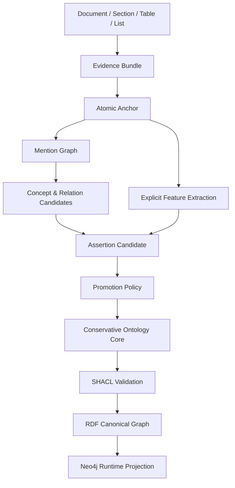

# 자이제 R4-CEOC 보수적 증거 기반 온톨로지 코어 실험 설계서

> **R4-CEOC: Conservative Evidence-Only Ontology Core**  
> 자이제 Layer 2 전문가 자료에서 검증 가능한 문서 구조·명시적 언어 단서·근거 경로를 이용해 보수적인 업무 온톨로지 코어를 구축하고, 선택적 LLM이 안전성을 유지하면서 커버리지를 확장할 수 있는지 검증하는 후속 실험

---

## 문서 관리 정보

| 항목 | 내용 |
|---|---|
| 권장 Experiment ID | `zaije_r4_ceoc_20260712_v1` |
| 프로토콜명 | `R4-CEOC` |
| 문서 버전 | `v1.0` |
| 작성 기준일 | `2026-07-12` |
| 선행 실험 | `zaije_ldr_r3_20260712_apre_v1` |
| 선행 실험 최종 판정 | `BOUNDARY_REFERENCE_ONLY` |
| 입력 원본 | `legacy/자이제_1.xlsx` |
| 원본 binary SHA-256 | `9246a6da6c7635b3f34ee55df75112eb38a2984ea06828be943dc196de5926eb` |
| 1차 목표 | 자이제 단일 도메인의 보수적 업무 온톨로지 코어 구축 |
| 제외 범위 | 타 직무 Transfer, 에이전트 성능 검증, 인간 Gold와의 동등성 주장 |
| canonical graph | RDF 기반 그래프 |
| runtime projection | Neo4j property graph |

---

# 1. 요약

R3 APRE 실험은 다음 단계까지 성공했다.

1. 자이제 원문을 exact character offset 기반의 atomic anchor로 분절했다.
2. anchor가 독립적인 Claim 단위인지 점단위 방식으로 판정했다.
3. fresh 60개 Evidence에서 생성된 70개 anchor 중 64개를 `BOUNDARY_HARD_KEEP`, 6개를 `BOUNDARY_HARD_DROP`으로 잠갔다.
4. Claimhood 판정은 3회 반복 일치도, positive-set F1, mismatch control, duplicate consistency에서 모두 높은 안정성을 보였다.

그러나 규범성, 일반 규칙성, 예시성, 조건 범위와 같은 semantic field는 primary model 내부에서는 반복적으로 안정적이었음에도 독립 falsifier와 33.11%의 충돌이 발생했다. 이 결과는 “primary가 틀렸다”거나 “falsifier가 맞았다”는 뜻이 아니다. 외부 기준이 없으므로, 두 모델의 의미 해석이 충돌했고 그중 어느 쪽이 실제 타당한지는 식별되지 않은 상태다.

따라서 R4에서는 semantic field를 다시 LLM으로 정답화하지 않는다. R3에서 검증된 boundary와 Claimhood를 기반으로, 다음 정보만 사용해 보수적인 온톨로지 코어를 구축한다.

- 문서의 장·절·목록·표·양식 구조
- exact-offset anchor와 mention
- 명시적인 의무·권고·금지 표현
- 명시적인 조건·예외·부정 표현
- 정의·예시·템플릿·인용 표지
- 번호화된 단계와 명시적 순서 표현
- 수량·범위·단위
- 서로 독립적인 Evidence group의 반복 지지
- 모든 주장에 대한 provenance 경로
- 결정적 promotion policy와 SHACL 제약

R4의 핵심 연구 질문은 다음과 같다.

> **암묵적 규범성이나 일반 규칙성을 LLM이 직접 결정하지 않고도, 문서 구조·명시적 언어 단서·반복 근거·그래프 제약만으로 신뢰 가능한 업무 온톨로지 코어를 구축할 수 있는가? 또한 선택적 LLM은 이 안전성을 훼손하지 않으면서 개념·관계 커버리지를 얼마나 확장할 수 있는가?**

---

# 2. R3 결과의 공식 해석과 동결 정책

## 2.1 통과한 산출물

다음 산출물은 R4의 고정 입력으로 사용한다.

| 산출물 | 상태 | R4 사용 방식 |
|---|---|---|
| deterministic atomic anchor segmenter | `LOCKED_PASS` | 전체 데이터의 anchor 생성기 |
| 64개 `BOUNDARY_HARD_KEEP` | `PASSED_ENGINEERING_REFERENCE` | Claimhood 개발·회귀 시험 reference |
| 6개 `BOUNDARY_HARD_DROP` | `PASSED_ENGINEERING_REFERENCE` | non-Claim negative control |
| exact-offset·context-span provenance | `LOCKED_PASS` | Evidence Graph의 기준 |
| C04 claimhood pointwise protocol | `LOCKED_FOR_BOUNDARY_ONLY` | 미노출 데이터의 Claimhood 보조 판정 |
| raw API provenance와 manifest | `LOCKED` | 재현성·비용 감사 |

## 2.2 통과하지 않은 산출물

다음 결과는 온톨로지의 사실 또는 reference로 사용하지 않는다.

| 산출물 | 새 상태 | 금지 사항 |
|---|---|---|
| `IS_NORMATIVE` | `DIAGNOSTIC_ONLY` | RuleBox 직접 승격 금지 |
| `GENERALIZABLE_RULE` | `DIAGNOSTIC_ONLY` | 일반 규칙 정답으로 사용 금지 |
| `SPECIFIC_EXAMPLE_INSTANCE` | `DIAGNOSTIC_ONLY` | 단독 Gold로 사용 금지 |
| semantic field envelope | `UNRESOLVED` | E0~E5 semantic F1 계산 금지 |
| argument role reference | `NOT_BUILT` | argument 정확도 주장 금지 |
| ontology·Neo4j 결과 | `NOT_EXECUTED` | 선행 결과로 간주 금지 |

## 2.3 50건의 falsifier contradiction 재명명

R3의 50건은 다음과 같이 재명명한다.

```yaml
r3_cross_model_semantic_disagreements:
  count: 50
  previous_label: falsifier_contradiction
  official_label: CROSS_MODEL_SEMANTIC_DISAGREEMENT
  use_as_gold: false
  use_as_diagnostic_dev: true
```

이 50건은 다음 원인을 분석하는 개발 자료로만 사용한다.

```text
CUE_ABSENT
CUE_SCOPE_AMBIGUOUS
PROCEDURE_VS_NORM_CONFLATION
EXAMPLE_VS_GENERIC_CONFLATION
INSUFFICIENT_CONTEXT
MIXED_PROPOSITION
MODEL_POLICY_DIFFERENCE
ANCHOR_OVERMERGED
DISCOURSE_ROLE_AMBIGUOUS
OTHER
```

## 2.4 데이터 노출 상태

R3의 fresh 60은 이미 API에 노출되었으므로 다음과 같이 변경한다.

```yaml
r3_fresh_60:
  status: DEV_EXPOSED_R3
  confirmatory_reuse: prohibited
  test_reuse: prohibited
  diagnostic_reuse: allowed
```

---

# 3. 연구 목적과 연구 질문

## 3.1 연구 목적

R4의 목적은 완전한 직무 온톨로지나 인간 전문가 수준의 semantic reference를 만드는 것이 아니다. 다음 세 가지를 먼저 검증한다.

1. **안전성**  
   원문에서 명시적으로 확인 가능한 근거만으로 unsupported promotion이 없는 온톨로지 코어를 만들 수 있는가?

2. **확장성**  
   결정적 추출만으로 해결되지 않는 일부 개념·관계 후보에 선택적 LLM을 사용했을 때 안전성을 유지하면서 커버리지가 증가하는가?

3. **실행 가능성**  
   구축된 코어가 RDF·SHACL·PROV 기반의 검증 가능한 canonical graph와 Neo4j runtime graph로 변환되고, 구조적 Competency Question에 근거 경로와 함께 답할 수 있는가?

## 3.2 연구 질문

### RQ4-1. Evidence-grounded core

문서 구조, exact-offset mention, 명시 cue, 반복 Evidence support만으로 provenance-complete ontology core를 구축할 수 있는가?

### RQ4-2. Selective LLM utility

선택적 LLM은 deterministic core보다 accepted concept·relation coverage를 증가시키면서 critical policy violation을 발생시키지 않는가?

### RQ4-3. Cost efficiency

선택적 LLM은 모든 gray-zone 후보를 LLM에 보내는 방식보다 적은 비용으로 유사한 graph yield를 달성하는가?

### RQ4-4. Structural usefulness

온톨로지 코어는 정의, 템플릿, 단계, 명시 규칙, 수량 기준 등 구조적 CQ에 대해 근거 경로를 포함한 답을 제공하는가?

### RQ4-5. Safe abstention

암묵적 규범성, 사례에서의 일반화, 불충분한 문맥처럼 현재 검증할 수 없는 항목을 `CANDIDATE`, `EVIDENCE_ONLY`, `QUARANTINED` 상태로 보존할 수 있는가?

---

# 4. 실험 범위

## 4.1 포함 범위

- 자이제 `Layer 2` 데이터만 사용
- 장·절·목록·표·양식·anchor 기반 Evidence Graph
- exact-offset mention extraction
- 개념 후보 및 alias 후보 생성
- 명시적 정의, 규범, 조건, 예외, 수량, 단계 관계 추출
- 결정적 promotion policy
- 선택적 pointwise LLM을 통한 제한적 확장
- RDF canonical graph 생성
- SHACL 검증
- PROV 기반 provenance 기록
- Neo4j runtime projection
- 구조적 CQ 평가
- API token·비용·coverage Pareto 비교

## 4.2 제외 범위

- 암묵적 규범성의 실제 정확도 주장
- `GENERALIZABLE_RULE`의 LLM 단독 판정
- 인간 전문가 수준 온톨로지 품질 주장
- 전체 자이제 도메인의 완전한 Gold graph 주장
- 법인파산·투자·Performance Marketing으로의 Transfer
- AI agent 성능 향상 검증
- TEST 데이터 사용
- R3 exposed sample을 confirmatory sample로 재사용

---

# 5. 핵심 방법론 원칙

R4는 다음 원칙을 따른다.

```text
Evidence First
→ Structure First
→ Explicit Signal First
→ Candidate Before Assertion
→ Promotion by Policy
→ Constraint Before Export
→ LLM Only for Closed Choices
→ Abstain Before Overgeneralize
```

## 5.1 Evidence와 사실의 분리

원문에 존재하는 Evidence와 온톨로지에 승격된 Assertion을 분리한다.

```text
Evidence Anchor
    ↓ supports
Assertion Candidate
    ↓ promotion policy
Promoted Assertion
```

## 5.2 의미 판정과 승격의 분리

LLM이 “일반 규칙이다”, “RuleBox에 넣어야 한다”를 직접 결정하지 않는다.

```text
관찰 가능한 feature
→ 결정적 승격 정책
→ ontology status
```

## 5.3 보수적 정확도 우선

R4는 recall보다 promotion precision을 우선한다. 누락된 후보는 이후 확장할 수 있지만 잘못 승격된 규칙은 agent 행동과 규정 준수에 직접적인 위험을 만든다.

## 5.4 모호성 보존

해결되지 않은 후보는 제거하거나 강제 정답화하지 않는다.

```text
EVIDENCE_ONLY
CANDIDATE
SUPPORTED_CANDIDATE
QUARANTINED
```

---

# 6. 그래프 아키텍처

R4 그래프는 다음 다섯 계층으로 구성한다.



## 6.1 Evidence Graph

### 주요 노드

```text
Document
Chapter
Section
EvidenceBundle
Anchor
ContextSpan
Table
TableRow
TableCell
List
ListItem
TemplateBlock
```

### 주요 관계

```text
HAS_CHAPTER
HAS_SECTION
HAS_EVIDENCE
HAS_ANCHOR
HAS_CONTEXT
IN_TABLE
IN_ROW
IN_COLUMN
IN_LIST
INHERITS_HEADER
PRECEDES_IN_DOCUMENT
SAME_DUPLICATE_CLUSTER
```

## 6.2 Mention Graph

### 주요 노드

```text
TermMention
ActorMention
ActionMention
ObjectMention
ArtifactMention
QuantityMention
ConditionMention
ExceptionMention
CueMention
DefinitionMention
TemplateFieldMention
```

모든 mention은 다음 값을 가져야 한다.

```yaml
mention_id: unique
anchor_id: required
start_char: required
end_char: required
text_by_program: required
extraction_method: required
```

## 6.3 Concept Candidate Graph

### 주요 후보 유형

```text
ConceptCandidate
AliasCandidate
ActorConceptCandidate
WorkUnitCandidate
ArtifactCandidate
MethodCandidate
MetricCandidate
ConditionConceptCandidate
TemplateFieldCandidate
```

초기 단계에서는 후보를 곧바로 `owl:Class`로 선언하지 않는다. `skos:Concept` 수준에서 후보 개념, preferred label, alternative label, broader candidate, related concept를 관리한다.

## 6.4 Assertion Candidate Graph

평면 triple 대신 assertion node를 사용한다.

```yaml
assertion_id: AST_...
subject_candidate_id: required
predicate_candidate_id: required
object_candidate_id: optional
qualifier_ids: []
condition_span_ids: []
polarity: POSITIVE | NEGATIVE | UNKNOWN
quantity_id: optional
evidence_anchor_ids: []
extraction_method: RULE | SMALL_MODEL | SELECTIVE_LLM
confidence: numeric
promotion_status: CANDIDATE
```

## 6.5 Conservative Ontology Core

다음 유형만 보수적으로 승격한다.

```text
Concept
Alias
ExplicitDefinition
ExplicitProcessStep
ExplicitInputRelation
ExplicitOutputRelation
ExplicitDeonticRule
ExplicitCondition
ExplicitException
TemplateField
MetricConstraint
ExampleInstance
DocumentedActorRole
```

---

# 7. 승격 상태 모델

모든 후보는 다음 상태 중 하나를 가진다.

| 상태 | 의미 | operational graph 포함 여부 |
|---|---|---:|
| `EVIDENCE_ONLY` | 원문 근거만 보존 | 아니오 |
| `CANDIDATE` | 추출됐으나 지지 조건 미충족 | 아니오 |
| `SUPPORTED_CANDIDATE` | 복수 근거 또는 명시 feature 존재 | 제한적 |
| `EXPLICIT_ASSERTION` | 원문에 명시적으로 표현됨 | 예 |
| `PROMOTED_TBOX` | 개념·분류 수준으로 승격 | 예 |
| `PROMOTED_ABOX` | 사례·인스턴스로 승격 | 예 |
| `PROMOTED_RULEBOX` | 명시 규칙·제약으로 승격 | 예 |
| `QUARANTINED` | 충돌·불충분 문맥·정책 위반 | 아니오 |
| `REJECTED` | 명백한 오추출 | 아니오 |

승격 이력은 덮어쓰지 않고 provenance event로 추가한다.

---

# 8. 결정적 feature 추출

## 8.1 명시 규범 cue

### 의무

```text
반드시
해야 한다
하여야 한다
필수이다
필요하다
요구된다
```

### 권고

```text
권장한다
바람직하다
적절하다
하는 것이 좋다
고려해야 한다
```

### 금지

```text
해서는 안 된다
금지한다
허용되지 않는다
피해야 한다
```

단순 cue 출현만으로 규칙을 승격하지 않는다. cue와 action의 scope가 확인되어야 한다.

## 8.2 조건·예외·부정 cue

```text
경우
때
조건에서
이후
이전
단, 
다만
예외적으로
아니며
않는다
제외하고
```

## 8.3 정의 cue

```text
X란 Y이다
X는 Y를 의미한다
X라고 한다
정의한다
즉,
```

## 8.4 예시·사례 cue

```text
예를 들어
사례
가령
실제로
A사의 경우
```

## 8.5 템플릿 cue

- 표 header와 field name
- “작성 항목”, “기입 내용”, “양식”, “템플릿”
- 동일 표에서 설명 열과 예시 열의 분리

## 8.6 수량·범위·단위

```text
3~6명
1~5점
최소 N개
이상 / 이하 / 초과 / 미만
백분율
기간
금액
```

## 8.7 절차·순서 cue

```text
먼저
다음으로
이후
이전에
1단계 / 2단계
1. / 2. / 3.
```

문서에서 먼저 등장했다는 이유만으로 `precedes`를 생성하지 않는다.

---

# 9. 보수적 승격 정책

## 9.1 Explicit Deontic Rule

```text
EXPLICIT_DEONTIC_RULE :=
    deontic_cue_exists
    AND cue_scope_resolved
    AND action_span_exists
    AND discourse_role NOT IN {
        EXAMPLE_ONLY,
        REPORTED_VIEW,
        HYPOTHETICAL
    }
```

승격 결과:

```text
PROMOTED_RULEBOX
```

명시 cue가 없지만 절차적 지시로 보이는 문장은 다음 상태에 둔다.

```text
OPERATIONAL_DIRECTIVE_CANDIDATE
```

이는 RuleBox에 넣지 않는다.

## 9.2 Generic Assertion

LLM의 `GENERALIZABLE_RULE=true`는 사용하지 않는다.

```text
CANDIDATE_GENERIC_ASSERTION :=
    generic_subject_form
    AND discourse_role NOT IN {
        EXAMPLE,
        CASE_DESCRIPTION,
        REPORTED_VIEW,
        HYPOTHETICAL
    }
```

최종 승격은 다음 중 하나를 충족할 때만 허용한다.

```text
PROMOTED_GENERIC_RULE :=
    explicit_definition_context
    OR explicit_template_context
    OR explicit_deontic_rule
    OR support_from_at_least_K_independent_evidence_groups
```

`K ∈ {1, 2, 3}`은 DEV ablation 후 confirmatory 실행 전에 잠근다. 기본 후보는 `K=2`다.

## 9.3 Example

```text
Example proposition
→ PROMOTED_ABOX 또는 EVIDENCE_ONLY
```

예시는 규칙을 직접 생성하지 않는다.

```text
ExampleInstance --illustrates--> CandidateRule
```

동일 anchor에 example과 generic proposition이 섞여 있으면 가능한 경우 anchor를 분할한다. 분할할 수 없으면 `QUARANTINED_MIXED_PROPOSITION`으로 처리한다.

## 9.4 Definition

명시적 정의 패턴과 용어 span이 존재할 때 다음을 생성한다.

```text
ConceptCandidate --hasExplicitDefinition--> DefinitionAssertion
```

정의가 특정 사례의 설명인지 일반 개념 정의인지 구분되지 않으면 TBox 승격을 보류한다.

## 9.5 Procedure

다음 근거가 있을 때만 절차 관계를 생성한다.

- 번호 기반 단계
- 명시 순서 cue
- 표의 단계 열
- section 또는 list가 절차임을 명시하는 header

```text
StepA --precedes--> StepB
```

## 9.6 Quantity Constraint

다음 요소가 모두 존재해야 한다.

```text
subject or field
value or range
unit when applicable
evidence anchor
```

예:

```text
핵심 이해관계자 집합
hasRecommendedCardinality
3..6명
```

## 9.7 Alias

다음 신호를 사용한다.

- 한글명과 영문 병기
- 괄호 표현
- 약어 정의
- 동일 heading·정의 문맥의 반복

LLM 병합은 candidate pair ID 중 선택하는 방식으로만 허용한다.

---

# 10. LLM 사용 정책

## 10.1 허용 작업

LLM은 다음과 같은 닫힌 선택 문제만 수행한다.

```text
주어진 mention ID 중 actor는 무엇인가?
주어진 mention ID 중 action은 무엇인가?
A와 B가 동일 개념 후보인가?
주어진 relation registry 중 어떤 관계가 근거에 가장 부합하는가?
조건 cue의 scope 후보는 무엇인가?
주어진 assertion proposal이 source에 의해 SUPPORTED되는가?
```

## 10.2 금지 작업

```text
새 quote 생성
새 concept label 자유 생성
새 relation 이름 자유 생성
일반 규칙 여부 직접 판정
RuleBox 승격 여부 직접 판정
근거에 없는 actor·object 보완
사례로부터 보편 규칙 추론
```

## 10.3 LLM 호출 조건

다음 gray-zone 후보만 선택적 LLM에 보낸다.

- 개념 병합 후보가 2개 이상
- actor/action/object role 충돌
- cue scope 불명확
- relation 후보가 2개 이상
- CQ coverage에 직접 영향을 주는 고중앙성 후보
- SHACL 위반을 해결할 가능성이 있는 후보
- 반복 Evidence cluster 연결 여부가 불명확한 후보

## 10.4 선택 점수

```text
SelectionScore(c) =
    Uncertainty(c)
    × GraphImpact(c)
    × CQGain(c)
    × Risk(c)
    × DiversityBonus(c)
    ÷ EstimatedTokenCost(c)
```

추가 제약:

- 동일 후보 유형 최대 35%
- 개념 병합·argument·scope·relation에 최소 quota
- 동일 semantic cluster 중복 억제
- 5% deterministic exploration
- RuleBox 영향 후보 우선

## 10.5 출력 제약

모든 LLM 출력은 Structured Output schema를 사용한다.

```json
{
  "candidate_id": "AST_000123",
  "decision": "SUPPORTED",
  "selected_relation_id": "REL_USES_INPUT",
  "selected_mention_ids": ["M03", "M07"],
  "reason_code": "EXACT_SUPPORT",
  "abstain": false
}
```

자연어 rationale은 reference 또는 승격 근거로 사용하지 않는다.

---

# 11. 비교 시스템

R4에서는 기존 E0~E5 전체 대신 다음 네 시스템을 먼저 비교한다.

| ID | 시스템 | 구성 | 목적 |
|---|---|---|---|
| `R4-B0` | Structure Only | 문서·표·목록·anchor·provenance | 최소 구조 기준선 |
| `R4-B1` | Deterministic Conservative Core | B0 + 명시 cue + 결정적 관계·승격 | 비LLM 보수 코어 |
| `R4-B2` | Selective LLM Extension | B1 + 정보가치 기반 제한적 LLM | 최종 제안 시스템 |
| `R4-B3` | Exhaustive Gray-zone LLM | B1 + 모든 gray-zone LLM | 비용·coverage 비교군 |

## 11.1 R4-B0

생성 요소:

- Document hierarchy
- Evidence bundle
- Anchor
- Table·row·cell
- List·item
- Document order
- Context span
- Provenance

## 11.2 R4-B1

B0에 다음을 추가한다.

- definition pattern
- alias pattern
- explicit deontic cue
- condition·exception·negation cue
- quantity·range·unit
- numbered procedure
- template field
- example marker
- deterministic promotion

## 11.3 R4-B2

B1에서 선택된 gray-zone 후보만 LLM으로 판정한다.

## 11.4 R4-B3

B1의 모든 gray-zone 후보를 LLM으로 판정한다.

B3는 품질의 이론적 상한으로 부르지 않는다. 단지 고비용 coverage 비교군이다.

---

# 12. 데이터 설계

## 12.1 DEV 데이터

다음을 개발 자료로 사용한다.

```text
DEV_EXPOSED_R1
DEV_EXPOSED_R2
DEV_EXPOSED_R3
R3 64 KEEP + 6 DROP
50 CROSS_MODEL_SEMANTIC_DISAGREEMENT
101 falsifier accepted/soft proposals
기존 노출 table/template 자료
```

DEV에서는 다음 작업을 수행할 수 있다.

- cue lexicon 수정
- candidate lattice 수정
- relation registry 수정
- promotion threshold ablation
- SHACL shape 수정
- prompt·schema 수정
- CQ-DEV 수정

## 12.2 Confirmatory 데이터

TEST는 사용하지 않는다. 기존에 노출되지 않은 VALIDATION leakage group에서 추출한다.

권장 규모:

```text
Evidence bundle: 80
예상 anchor: 100~160
```

권장 strata:

| Stratum | 목표 비율 |
|---|---:|
| 명시 규범 cue | 15% |
| 조건·예외·부정 | 15% |
| 절차·단계 | 20% |
| 예시·사례 | 15% |
| 정의·용어 | 15% |
| 표·템플릿 | 10% |
| 일반 설명 negative control | 10% |

실제 잔여 데이터가 quota를 충족하지 못하면 다음 절차를 따른다.

1. 가능한 strata를 전수 포함한다.
2. 부족분을 조건·절차·정의 strata로 재분배한다.
3. API 호출 전에 amendment와 membership hash를 잠근다.
4. 이미 노출된 leakage group과의 교집합이 0인지 검사한다.

## 12.3 분할 무결성 Gate

```text
confirmatory ∩ DEV_EXPOSED evidence = 0
confirmatory ∩ DEV_EXPOSED leakage_group = 0
confirmatory ∩ TEST = 0
```

---

# 13. 실험 단계

## Phase R4-0. 선행 산출물 동결

### 수행

- R3 boundary 결과 잠금
- R3 semantic fields를 `DIAGNOSTIC_ONLY`로 변경
- 50건을 `CROSS_MODEL_SEMANTIC_DISAGREEMENT`로 재명명
- exposed data registry 통합
- TEST 접근 차단 확인

### 산출물

```text
locks/r3_boundary_import_lock.json
locks/exposure_registry.json
reports/r3_reinterpretation_report.md
```

### Gate R4-0

| 항목 | 기준 |
|---|---:|
| hash 일치 | 1.00 |
| exposed registry completeness | 1.00 |
| TEST access | 0 |
| 기존 결과 덮어쓰기 | 0 |

---

## Phase R4-1. 스키마·정책 사전등록

### 수행

- relation registry 정의
- promotion status 정의
- explicit feature lexicon 잠금
- SHACL shape 초안 잠금
- CQ-DEV·CQ-TEST 분리
- B0~B3 구성 잠금
- LLM token budget 잠금

### 산출물

```text
preregistration/r4_ceoc_protocol.md
preregistration/relation_registry.yaml
preregistration/promotion_policy.yaml
preregistration/shacl_policy.yaml
preregistration/llm_selection_policy.yaml
preregistration/cq_split_lock.json
```

---

## Phase R4-2. Deterministic B0/B1 구현

### 수행

- 전체 DEV에서 Evidence Graph 생성
- mention·cue extraction
- definition·alias·quantity·procedure rule 구현
- promotion policy 적용
- SHACL 검증
- metamorphic fixture 생성

### 산출물

```text
runs/dev_b0/
runs/dev_b1/
fixtures/metamorphic/
reports/deterministic_core_dev_report.md
```

### Gate R4-2

| 지표 | 기준 |
|---|---:|
| Anchor offset round-trip | 1.00 |
| Mention offset round-trip | 1.00 |
| Invalid ID | 0 |
| Generated quote 사용 | 0 |
| Assertion→Evidence path | 1.00 |
| Critical SHACL violation | 0 |
| Example→Rule direct promotion | 0 |
| Rule without qualifying evidence | 0 |

Gate 실패 시 LLM 실험으로 진행하지 않는다.

---

## Phase R4-3. Selective LLM B2/B3 개발

### 수행

- gray-zone 후보 정의
- candidate scoring 구현
- closed-choice prompt·schema 개발
- model snapshot 자격시험
- B2 budget sweep
- B3 exhaustive 비교
- API 비용 원장 기록

### Budget sweep

```text
0%, 5%, 10%, 20%, 40%, 100%
```

### 모델 자격 기준

| 지표 | 기준 |
|---|---:|
| Structured Output validity | 1.00 |
| Candidate ID validity | 1.00 |
| Source mismatch rejection | 0.95 이상 |
| Repeat agreement | 0.90 이상 |
| Deterministic control accuracy | 0.95 이상 |
| Unsupported free generation | 0 |

### Gate R4-3

- prompt·schema·snapshot·threshold·budget가 잠겼는가?
- confirmatory 데이터가 아직 API에 노출되지 않았는가?
- B2가 DEV에서 B1의 critical violation을 증가시키지 않는가?

---

## Phase R4-4. Confirmatory 실행

### 순서

1. 미노출 VALIDATION 80개 membership 잠금
2. B0 실행
3. B1 실행
4. B2 실행
5. B3 실행
6. Grounding 검사
7. SHACL 검사
8. Metamorphic test
9. CQ-TEST 실행
10. 비용·coverage 집계
11. leakage-group cluster bootstrap

### 금지

- confirmatory 결과를 본 뒤 prompt 수정
- 결과를 본 뒤 threshold 수정
- 결과를 본 뒤 relation registry 수정
- 결과가 불리하다는 이유로 strata 제외

수정이 필요하면 새 experiment ID로 시작한다.

---

## Phase R4-5. Canonical RDF와 Neo4j projection

### 수행

- RDF canonical graph 생성
- SKOS concept scheme 생성
- PROV provenance event 연결
- SHACL validation report 생성
- Neo4j projection 변환
- node·edge·property count 대조
- evidence path runtime query 검증

### Gate R4-5

| 지표 | 기준 |
|---|---:|
| RDF triple serialization 성공 | 1.00 |
| SHACL critical violation | 0 |
| RDF→Neo4j node coverage | 1.00 |
| RDF→Neo4j edge coverage | 1.00 |
| provenance property coverage | 1.00 |
| sample evidence path query 성공 | 1.00 |

---

# 14. 평가 프레임워크

인간 Gold가 없으므로 semantic accuracy를 직접 주장하지 않는다. 다음 네 계열을 primary 평가로 사용한다.

## 14.1 Grounding·Provenance

| 지표 | 정의 | Gate |
|---|---|---:|
| Anchor offset round-trip | 원문 substring과 anchor text 일치 | 1.00 |
| Mention offset round-trip | mention text와 원문 일치 | 1.00 |
| Assertion evidence coverage | 모든 promoted assertion의 evidence 경로 | 1.00 |
| Generated text rate | 원문에 없는 quote 생성 비율 | 0 |
| Invalid candidate ID | 등록되지 않은 ID 사용 | 0 |
| Provenance completeness | method·run·version·source 기록 | 1.00 |

## 14.2 Graph constraint

필수 SHACL 규칙:

```text
모든 promoted Assertion은 evidenceAnchor를 가진다.
모든 ExplicitDeonticRule은 deonticCue를 가진다.
모든 deonticCue는 exact span을 가진다.
모든 QuantityConstraint는 value 또는 range를 가진다.
모든 promoted relation은 subject와 object를 가진다.
ExampleInstance는 RuleBox assertion이 될 수 없다.
ReportedView는 RuleBox assertion이 될 수 없다.
QUARANTINED assertion은 operational projection에 포함되지 않는다.
모든 Neo4j operational edge는 canonical RDF assertion을 역참조한다.
```

Gate:

| 지표 | 기준 |
|---|---:|
| Critical SHACL violation | 0 |
| 전체 SHACL violation rate | 0.01 이하 |
| Rule without qualifying evidence | 0 |
| Example→Rule direct promotion | 0 |
| Orphan promoted node | 0 |

## 14.3 Metamorphic test

| 입력 변환 | 기대 변화 |
|---|---|
| “해야 한다” 제거 | HARD deontic rule 해제 또는 candidate 강등 |
| “예를 들어” 추가 | RuleBox 자동 승격 차단 |
| “해서는 안 된다”로 변경 | prohibition·negative polarity 반영 |
| 숫자 3~6을 4~7로 변경 | quantity만 변경 |
| 후보 표시 순서 변경 | 결과 불변 |
| anchor와 source 불일치 | reject |
| 동일 문장 중복 입력 | 동일 extraction result |
| heading 문맥 제거 | context-dependent assertion을 SOFT/QUARANTINED로 강등 |

Gate:

```text
Deterministic metamorphic accuracy = 1.00
LLM-assisted metamorphic consistency >= 0.95
```

## 14.4 구조적 Competency Question

CQ는 DEV와 TEST를 분리한다.

### CQ 예시

```text
Capture Plan의 명시적 구성 필드는 무엇인가?
문서에서 제시한 핵심 이해관계자 수의 권고 범위는 무엇인가?
명시적으로 정의된 용어와 정의문은 무엇인가?
번호 또는 순서 표현으로 연결된 업무 단계는 무엇인가?
특정 양식의 필드와 작성 지침은 무엇인가?
특정 규칙에 연결된 조건과 예외는 무엇인가?
```

### 답변 형식

```json
{
  "answer_node_ids": ["CON_..."],
  "graph_path": ["..."],
  "evidence_anchor_ids": ["ANC_..."],
  "exact_source_text": ["..."],
  "abstained": false
}
```

### 평가

| 지표 | Gate |
|---|---:|
| CQ evidence answerability | 0.80 이상 |
| Answer provenance precision | 1.00 |
| Unsupported answer rate | 0 |
| 적절한 abstention | 별도 보고 |

## 14.5 Coverage·Cost

### Graph yield

```text
accepted concepts
accepted aliases
accepted assertions
accepted relations
accepted explicit rules
CQ-supporting paths
```

### 비용

```text
API calls
input tokens
output tokens
estimated cost
cost per accepted node
cost per accepted relation
cost per CQ-supporting path
```

---

# 15. 가설과 성공 Gate

## H4-A. 보수적 코어 안전성

> 명시적 구조와 cue 기반 B1은 unsupported promotion 없이 evidence-grounded ontology core를 구축할 수 있다.

```yaml
provenance_completeness: 1.00
critical_shacl_violation: 0
example_to_rule_direct_promotion: 0
rule_without_qualifying_evidence: 0
```

## H4-B. 선택적 LLM의 coverage 효용

> B2는 B1보다 accepted candidate coverage를 증가시키면서 안전성 Gate를 유지한다.

```yaml
accepted_candidate_gain_over_b1: ">= 0.15"
critical_policy_violation_rate: "<= 0.01"
provenance_completeness: 1.00
```

## H4-C. 비용 효율

> B2는 B3보다 적은 LLM 비용으로 유사한 policy-compliant graph yield를 달성한다.

```yaml
b2_token_ratio_to_b3: "<= 0.35"
b2_graph_yield_ratio_to_b3: ">= 0.85"
b2_critical_violation_not_worse_than_b3: true
```

## H4-D. 구조적 활용성

> R4 ontology core는 구조적 CQ에 대해 근거 경로를 가진 답을 제공한다.

```yaml
cq_evidence_answerability: ">= 0.80"
answer_provenance_precision: 1.00
unsupported_answer_rate: 0
```

## H4-E. Neo4j projection 일치성

> canonical RDF graph와 Neo4j runtime projection은 operational node·edge·provenance를 손실 없이 대응시킨다.

```yaml
node_projection_coverage: 1.00
edge_projection_coverage: 1.00
provenance_projection_coverage: 1.00
```

---

# 16. 통계 분석

## 16.1 분석 단위

Evidence 또는 anchor를 독립 표본으로 가정하지 않는다. 동일 문서 블록, 표, 목록, 중복 cluster가 상관될 수 있으므로 `leakage_group_id`를 primary cluster로 사용한다.

## 16.2 비교

### B1 vs B2

- accepted graph yield 증가
- critical violation 변화
- CQ answerability 변화
- 비용 증가

### B2 vs B3

- graph yield 비열등성
- token ratio
- critical violation 비교

## 16.3 추정 방법

- leakage-group 단위 paired cluster bootstrap 5,000회
- 차이의 95% confidence interval
- 절대 p-value보다 effect size와 Gate 충족 여부 우선
- strata별 결과 별도 보고

## 16.4 Pareto 분석

다음 축을 함께 보고한다.

```text
X축: LLM token 또는 비용
Y축: policy-compliant accepted graph yield
안전성 제약: critical violation = 0 또는 허용치 이하
```

---

# 17. RDF canonical graph 설계

## 17.1 권장 namespace

```text
ceoc:   R4 도메인 스키마
prov:   provenance
skos:   concept scheme
sh:     SHACL
rdf/rdfs/xsd: 기본 RDF 표현
```

## 17.2 Turtle 예시

```turtle
ceoc:rule_001 a ceoc:ExplicitDeonticRule ;
    ceoc:hasSubject ceoc:core_stakeholder_set ;
    ceoc:hasPredicate ceoc:hasRecommendedCardinality ;
    ceoc:hasRange ceoc:range_3_6 ;
    ceoc:hasDeonticCue ceoc:cue_001 ;
    prov:wasDerivedFrom ceoc:anchor_000321 ;
    prov:wasGeneratedBy ceoc:rule_extraction_run_v1 ;
    ceoc:promotionStatus ceoc:PROMOTED_RULEBOX .

ceoc:cue_001 a ceoc:DeonticCue ;
    ceoc:cueType ceoc:RECOMMENDATION ;
    ceoc:startChar 17 ;
    ceoc:endChar 22 ;
    prov:wasDerivedFrom ceoc:anchor_000321 .
```

## 17.3 초기 taxonomy

초기 taxonomy는 SKOS 후보 체계로 관리한다.

```text
skos:Concept
skos:prefLabel
skos:altLabel
skos:broader
skos:related
```

충분한 근거와 안정적인 승격 정책이 마련되기 전에는 `rdfs:subClassOf` 또는 OWL 공리를 과도하게 생성하지 않는다.

---

# 18. SHACL 예시

```turtle
ceoc:ExplicitDeonticRuleShape
    a sh:NodeShape ;
    sh:targetClass ceoc:ExplicitDeonticRule ;
    sh:property [
        sh:path prov:wasDerivedFrom ;
        sh:minCount 1 ;
    ] ;
    sh:property [
        sh:path ceoc:hasDeonticCue ;
        sh:minCount 1 ;
    ] ;
    sh:property [
        sh:path ceoc:promotionStatus ;
        sh:hasValue ceoc:PROMOTED_RULEBOX ;
    ] .
```

```turtle
ceoc:ExampleNotRuleShape
    a sh:NodeShape ;
    sh:targetClass ceoc:ExampleInstance ;
    sh:not [
        sh:property [
            sh:path ceoc:promotionStatus ;
            sh:hasValue ceoc:PROMOTED_RULEBOX ;
        ]
    ] .
```

---

# 19. Neo4j runtime projection

## 19.1 원칙

```text
RDF canonical graph = source of truth
Neo4j = runtime·탐색·시각화 projection
```

## 19.2 노드 예시

```text
(:Anchor)
(:Concept)
(:Assertion)
(:ExplicitDeonticRule)
(:TemplateField)
(:ExampleInstance)
(:EvidenceBundle)
(:ExtractionRun)
```

## 19.3 관계 예시

```text
(:Assertion)-[:DERIVED_FROM]->(:Anchor)
(:Rule)-[:HAS_SUBJECT]->(:Concept)
(:Rule)-[:HAS_OBJECT]->(:Concept)
(:ExampleInstance)-[:ILLUSTRATES]->(:Assertion)
(:Step)-[:PRECEDES]->(:Step)
(:Concept)-[:BROADER_THAN]->(:Concept)
```

## 19.4 runtime 검증 질의 예시

```cypher
MATCH p=(r:ExplicitDeonticRule)-[:DERIVED_FROM]->(a:Anchor)
WHERE r.promotionStatus = 'PROMOTED_RULEBOX'
RETURN r.ruleId, a.anchorId, a.exactText
```

```cypher
MATCH (e:ExampleInstance)
WHERE e.promotionStatus = 'PROMOTED_RULEBOX'
RETURN e
```

두 번째 질의 결과는 0건이어야 한다.

---

# 20. 디렉터리 구조

```text
zaije_experiment/
└── experiments/
    └── zaije_r4_ceoc_20260712_v1/
        ├── preregistration/
        │   ├── r4_ceoc_protocol.md
        │   ├── relation_registry.yaml
        │   ├── promotion_policy.yaml
        │   ├── shacl_policy.yaml
        │   ├── llm_selection_policy.yaml
        │   └── cq_split_lock.json
        ├── locks/
        │   ├── input_lock.json
        │   ├── r3_boundary_import_lock.json
        │   ├── exposure_registry.json
        │   ├── confirmatory_membership_lock.json
        │   └── system_freeze.json
        ├── data/
        │   ├── dev_exposed/
        │   ├── confirmatory/
        │   └── manifests/
        ├── schema/
        │   ├── core_schema.ttl
        │   ├── shapes.ttl
        │   └── neo4j_projection.yaml
        ├── extraction/
        │   ├── deterministic/
        │   ├── candidates/
        │   └── selective_llm/
        ├── runs/
        │   ├── b0_structure/
        │   ├── b1_deterministic/
        │   ├── b2_selective_llm/
        │   └── b3_exhaustive_llm/
        ├── graphs/
        │   ├── rdf/
        │   ├── shacl_reports/
        │   └── neo4j/
        ├── evaluation/
        │   ├── grounding/
        │   ├── metamorphic/
        │   ├── cq/
        │   ├── coverage/
        │   └── cost/
        ├── cost/
        │   ├── reference/
        │   ├── system/
        │   └── summary.json
        └── reports/
            ├── phase0_lock_report.md
            ├── deterministic_core_report.md
            ├── selective_llm_report.md
            ├── confirmatory_report.md
            └── final_report.md
```

---

# 21. 사전등록 YAML 예시

```yaml
experiment_id: zaije_r4_ceoc_20260712_v1
protocol: R4-CEOC
input:
  path: legacy/자이제_1.xlsx
  binary_sha256: 9246a6da6c7635b3f34ee55df75112eb38a2984ea06828be943dc196de5926eb

r3_import:
  boundary_keep: 64
  boundary_drop: 6
  semantic_fields: DIAGNOSTIC_ONLY
  disagreement_count: 50

systems:
  - R4-B0
  - R4-B1
  - R4-B2
  - R4-B3

confirmatory:
  source_split: VALIDATION
  target_evidence: 80
  exclude_all_exposed_groups: true
  test_access: false

promotion:
  allow_implicit_normativity: false
  allow_llm_direct_rule_promotion: false
  generic_support_k_candidates: [1, 2, 3]
  default_generic_support_k: 2

llm:
  closed_choice_only: true
  free_quote_generation: false
  free_relation_generation: false
  budget_sweep: [0.0, 0.05, 0.10, 0.20, 0.40, 1.0]

primary_gates:
  provenance_completeness: 1.0
  critical_shacl_violation: 0
  example_to_rule_direct_promotion: 0
  cq_evidence_answerability: 0.80
  b2_token_ratio_to_b3: 0.35
  b2_graph_yield_ratio_to_b3: 0.85
```

---

# 22. 오류 코드

```text
E001 INVALID_OFFSET
E002 INVALID_CANDIDATE_ID
E003 GENERATED_UNSUPPORTED_TEXT
E004 MISSING_EVIDENCE_PATH
E005 RULE_WITHOUT_DEONTIC_OR_MULTI_SUPPORT
E006 EXAMPLE_PROMOTED_TO_RULE
E007 REPORTED_VIEW_PROMOTED_TO_RULE
E008 UNRESOLVED_CUE_SCOPE
E009 MISSING_SUBJECT
E010 MISSING_OBJECT
E011 QUANTITY_WITHOUT_VALUE
E012 QUANTITY_WITHOUT_UNIT
E013 ORPHAN_PROMOTED_NODE
E014 RDF_NEO4J_PROJECTION_LOSS
E015 CONFIRMATORY_LEAKAGE
E016 TEST_ACCESS_VIOLATION
E017 PROMPT_CHANGED_AFTER_FREEZE
E018 THRESHOLD_CHANGED_AFTER_FREEZE
E019 MIXED_PROPOSITION
E020 UNSUPPORTED_RELATION
```

---

# 23. 최종 판정 체계

## 23.1 `CONSERVATIVE_CORE_PASS`

다음이 모두 충족된 경우다.

- provenance completeness 1.00
- critical SHACL violation 0
- Rule·Example 직접 오염 0
- B2가 B1보다 coverage 증가
- B2가 비용 Gate 통과
- 구조적 CQ가 근거와 함께 동작
- RDF→Neo4j projection 손실 없음

다음 단계:

```text
Concept canonicalization
→ SKOS taxonomy refinement
→ relation induction
→ 제한적 E0~E5 engineering comparison
→ semantic calibration 준비
```

## 23.2 `DETERMINISTIC_CORE_ONLY_PASS`

B1은 통과했으나 B2가 critical violation 또는 비용 Gate를 통과하지 못한 경우다.

해석:

> 자이제 자료에서는 LLM 확장보다 결정적 구조·cue 기반 추출이 신뢰 가능한 코어 구축에 더 적합했다.

## 23.3 `EVIDENCE_GRAPH_ONLY`

Evidence Graph와 anchor·provenance는 통과했지만 개념·관계 승격 Gate를 통과하지 못한 경우다.

결과물 명칭:

```text
Evidence-grounded Work Knowledge Index
```

## 23.4 `CONSERVATIVE_CORE_REVISE`

명시 cue 기반 규칙조차 metamorphic test 또는 SHACL Gate를 통과하지 못한 경우다.

이 경우 API 호출을 늘리지 않고 다음을 수정한다.

- cue scope parser
- anchor context model
- assertion schema
- promotion policy
- relation registry

## 23.5 `INVALID`

다음 중 하나가 발생하면 현재 run을 무효 처리한다.

- confirmatory data leakage
- TEST 접근
- system freeze 이후 prompt·threshold 변경
- raw response 또는 비용 원장 누락
- hash 불일치
- 결과를 본 뒤 strata 제외

---

# 24. 결과 해석과 주장 범위

## 24.1 통과 시 주장 가능한 것

> 자이제 Layer 2 자료에서 문서 구조, exact provenance, 명시적 규범·조건·정의·템플릿 신호, 반복 Evidence support, 결정적 promotion policy를 이용해 보수적 업무 온톨로지 코어를 구축했다.

> 선택적 LLM은 닫힌 후보 판정에만 사용되었으며, 모든 승격은 provenance와 SHACL 제약을 통과했다.

> canonical RDF graph와 Neo4j runtime projection 사이의 운영 노드·관계·근거 경로를 검증했다.

## 24.2 주장할 수 없는 것

- 인간 전문가 Gold와 동등하다.
- 암묵적 규범성을 정확히 추출했다.
- 모든 일반 규칙을 발견했다.
- 전체 자이제 도메인의 완전한 온톨로지다.
- 타 직무로 자동 전이된다.
- AI agent 성능을 향상시킨다.
- LLM보다 전반적으로 우수하다.

## 24.3 결과물 권장 명칭

```text
Evidence-grounded Conservative Work Ontology Core
```

“완성된 직무 온톨로지”라는 명칭은 사용하지 않는다.

---

# 25. semantic field 재개 조건

다음 항목은 폐기하지 않고 보류한다.

```text
IMPLICIT_NORMATIVITY
OPERATIONAL_DIRECTIVENESS
GENERALIZABLE_RULE
IMPLICIT_PROCEDURALITY
```

R4 코어 이후에는 다음 그래프 문맥을 semantic 판정 입력으로 사용할 수 있다.

- anchor와 문서 구조
- discourse cue
- 연결된 example
- 독립 Evidence support count
- concept type 후보
- template·definition context
- 반대 Evidence
- graph centrality와 CQ role

향후 semantic promotion은 다음 형태로 재설계한다.

```text
단일 anchor 판정
```

이 아니라,

```text
anchor
+ 문서 구조
+ 담화 역할
+ 반복 Evidence cluster
+ example 연결
+ concept types
+ 반대 Evidence
→ graph-level promotion candidate
```

사람 calibration이 없는 경우에도 결과 상태는 `CANDIDATE` 또는 `SOFT`로 제한한다.

---

# 26. 즉시 실행 체크리스트

## 실행 전

- [ ] 새 experiment ID 생성
- [ ] R3 boundary import hash 잠금
- [ ] R3 semantic field를 `DIAGNOSTIC_ONLY`로 변경
- [ ] exposed leakage group registry 통합
- [ ] relation registry 잠금
- [ ] promotion policy 잠금
- [ ] SHACL shape 잠금
- [ ] CQ-DEV·CQ-TEST 분리
- [ ] API model snapshot·token budget 잠금

## DEV

- [ ] B0 Evidence Graph 구현
- [ ] B1 deterministic extraction 구현
- [ ] 50 disagreement 원인 코드 분석
- [ ] metamorphic fixture 구축
- [ ] SHACL 0-error 달성
- [ ] B2 selective scoring 구현
- [ ] B3 exhaustive gray-zone 구현
- [ ] prompt·schema·threshold freeze

## Confirmatory

- [ ] 미노출 VALIDATION 80개 membership 잠금
- [ ] DEV·TEST와 leakage overlap 0 확인
- [ ] B0~B3 동일 입력 실행
- [ ] Grounding·SHACL·metamorphic·CQ 평가
- [ ] 비용·coverage 원장 생성
- [ ] cluster bootstrap 수행
- [ ] 결과 확인 후 수정 금지

## Export

- [ ] canonical RDF 생성
- [ ] SHACL report 생성
- [ ] Neo4j projection 생성
- [ ] node·edge·provenance coverage 1.00 확인
- [ ] sample evidence path runtime query 통과

---

# 27. 최종 권고

다음 실행은 `zaije_r4_ceoc_20260712_v1`이라는 새 실험 ID에서 시작한다.

```text
R4-B0 구조 그래프
→ R4-B1 명시 근거 기반 보수 코어
→ R4-B2 선택적 LLM 확장
→ R4-B3 exhaustive gray-zone 비교
→ SHACL·Metamorphic·CQ·비용 평가
→ RDF canonical graph
→ Neo4j runtime projection
```

이번 R4에서는 다음 두 field를 자동 승격 근거로 사용하지 않는다.

```text
IS_NORMATIVE
GENERALIZABLE_RULE
```

RuleBox 또는 TBox 승격에는 다음만 인정한다.

```text
명시 deontic cue + 검증된 scope
명시 definition 또는 template 구조
독립 Evidence group의 반복 지지
example·reported·hypothetical 아님
모든 assertion의 exact provenance
SHACL policy 통과
```

이 실험의 핵심 기여는 LLM이 불안정한 의미를 억지로 확정하는 것이 아니라, **현재 검증 가능한 지식과 아직 검증되지 않은 후보를 분리하면서 실제로 실행 가능한 KG 코어를 구축하는 것**이다.

---

# 부록 A. 최소 관계 레지스트리 예시

```yaml
relations:
  - id: REL_HAS_DEFINITION
    domain: ConceptCandidate
    range: DefinitionAssertion
    promotion: explicit_only

  - id: REL_HAS_INPUT
    domain: WorkUnitCandidate
    range: ArtifactCandidate
    promotion: explicit_or_structural

  - id: REL_PRODUCES_OUTPUT
    domain: WorkUnitCandidate
    range: ArtifactCandidate
    promotion: explicit_or_structural

  - id: REL_PERFORMED_BY
    domain: WorkUnitCandidate
    range: ActorConceptCandidate
    promotion: exact_argument_required

  - id: REL_PRECEDES
    domain: WorkUnitCandidate
    range: WorkUnitCandidate
    promotion: explicit_sequence_only

  - id: REL_HAS_CONDITION
    domain: AssertionCandidate
    range: ConditionMention
    promotion: cue_scope_required

  - id: REL_HAS_EXCEPTION
    domain: AssertionCandidate
    range: ExceptionMention
    promotion: cue_scope_required

  - id: REL_ILLUSTRATES
    domain: ExampleInstance
    range: AssertionCandidate
    promotion: safe

  - id: REL_HAS_QUANTITY_CONSTRAINT
    domain: ConceptCandidate
    range: QuantityMention
    promotion: explicit_value_required
```

---

# 부록 B. 최종 보고서 필수 표

## B.1 Gate 요약

| Gate | 결과 | 핵심 지표 | 판정 |
|---|---:|---|---|
| R4-0 |  | 무결성·노출 통제 |  |
| R4-1 |  | 사전등록 잠금 |  |
| R4-2 |  | grounding·SHACL |  |
| R4-3 |  | LLM 자격·freeze |  |
| R4-4 |  | confirmatory B0~B3 |  |
| R4-5 |  | RDF·Neo4j projection |  |

## B.2 시스템 비교

| Metric | B0 | B1 | B2 | B3 |
|---|---:|---:|---:|---:|
| Accepted concepts |  |  |  |  |
| Accepted assertions |  |  |  |  |
| Accepted rules |  |  |  |  |
| CQ-supporting paths |  |  |  |  |
| Critical SHACL violations |  |  |  |  |
| Provenance completeness |  |  |  |  |
| Input tokens | 0 | 0 |  |  |
| Output tokens | 0 | 0 |  |  |
| Estimated cost | 0 | 0 |  |  |

## B.3 최종 판정

```text
CONSERVATIVE_CORE_PASS
DETERMINISTIC_CORE_ONLY_PASS
EVIDENCE_GRAPH_ONLY
CONSERVATIVE_CORE_REVISE
INVALID
```
