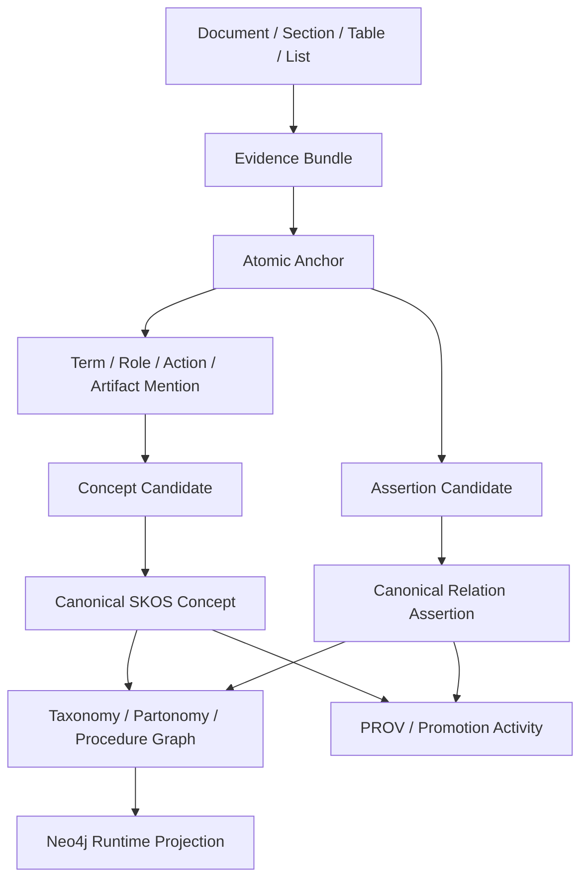

# 자이제 R5-CRSI-V 개념 정규화·스키마 귀납·Neo4j 시각화 통합 실험 설계서

> **R5-CRSI-V: Concept Resolution, Schema Induction, and Neo4j Visualization**  
> R4-CEOC에서 검증된 결정적 보수 코어를 입력으로 사용하여, 중복된 용어·개념을 정규화하고 관계 스키마와 초기 taxonomy를 귀납한 뒤, 베이스라인 대비 개선 효과와 Neo4j 기반 시각화·질의 가능성을 함께 검증하는 실험

---

## 문서 관리 정보

| 항목 | 내용 |
|---|---|
| 권장 Experiment ID | `zaije_r5_crsi_v_20260712_v1` |
| 프로토콜명 | `R5-CRSI-V` |
| 문서 버전 | `v1.0` |
| 작성 기준일 | `2026-07-12` |
| 선행 실험 | `zaije_r4_ceoc_20260712_v1` |
| 선행 판정 | `DETERMINISTIC_CORE_ONLY_PASS` |
| 입력 원본 | `legacy/자이제_1.xlsx` |
| 입력 그래프 | R4-B1 canonical RDF 및 Neo4j projection |
| R4-B1 입력 규모 | 566 nodes, 1,155 relationships, 20 concepts, 15 aliases, 93 assertions, 10 explicit rules, 11,402 RDF triples |
| canonical 표현 | RDF + SKOS + PROV-O + SHACL |
| runtime·시각화 표현 | Neo4j property graph |
| 핵심 목표 | 개념 정규화, 관계 스키마 귀납, 초기 taxonomy, 베이스라인 비교, Neo4j 시각화 패키지 생성 |
| 제외 범위 | 타 직무 Transfer, AI 에이전트 성능, 인간 전문가 수준 정확도 주장, 암묵 규범의 자동 RuleBox 승격 |

---

# 1. 한 문장 요약

> **R5는 R4에서 안전하게 추출한 개념·관계·규칙 후보를 서로 연결되고 중복이 정리된 실제 온톨로지 구조로 조직하고, 그 결과가 Raw KG 및 Direct-LLM 베이스라인보다 더 근거 추적 가능하고 일관되며 질의·시각화에 유용한지를 검증하는 실험이다.**

R4가 검증한 것은 “원문 근거가 명확하고 안전한 최소 KG 코어를 만들 수 있는가”였다. R5가 검증할 것은 다음이다.

```text
안전한 KG 코어
→ 같은 개념의 여러 표현 통합
→ 관계 이름과 domain/range 정규화
→ 상·하위 및 부분·전체 구조 분리
→ 증거 기반 온톨로지 스키마 생성
→ Neo4j에서 업무·규칙·용어·근거 관점으로 시각화
```

R5의 성공 결과물은 단순히 노드 수가 많은 그래프가 아니다. 다음 조건을 만족하는 **자이제 수주·제안 도메인의 근거 기반 온톨로지 v0.2**이다.

- 같은 개념의 표기 변형과 명시적 동의어가 하나의 canonical concept에 연결된다.
- 서로 다른 개념, 클래스와 인스턴스, 역할과 산출물이 잘못 병합되지 않는다.
- 표면적으로 다양했던 관계가 제한된 관계 레지스트리로 정규화된다.
- taxonomy, partonomy, procedure 순서가 혼동되지 않는다.
- 모든 개념 병합과 관계 승격에 원문 Evidence 경로가 남는다.
- Neo4j에서 핵심 업무 흐름, 규칙, 템플릿, 개념 클러스터, 원문 근거를 재현 가능한 Cypher로 시각화할 수 있다.

---

# 2. 왜 R4 다음에 R5가 필요한가

## 2.1 R4가 이미 해결한 문제

R4-B1은 다음 항목을 통과했다.

- exact-offset Anchor 및 Mention
- Assertion–Evidence provenance 1.00
- Critical SHACL violation 0
- Example→RuleBox 오승격 0
- 명시 규범·조건·정의·수량·절차·템플릿 코어
- 구조적 CQ answerability 1.00
- RDF serialization·SHACL 검증
- Neo4j node·edge·provenance projection coverage 1.00

따라서 다음 실험에서 다시 해결할 필요가 없는 것은 다음이다.

```text
원문 분절
Claimhood 안정화
명시 cue 검출의 기본 구조
Evidence Graph 구축
RDF/Neo4j 변환 파이프라인
```

## 2.2 R4가 아직 해결하지 않은 문제

R4의 20개 accepted concept와 15개 alias는 보수적으로 생성된 코어다. 그러나 이것만으로 다음을 충분히 주장할 수는 없다.

- 같은 개념이 문서 여러 곳에서 다른 노드로 분산되어 있지 않은가?
- 유사하지만 다른 개념을 하나로 잘못 합치지 않았는가?
- `hasInput`, `uses`, `requires`, `참조한다`와 같은 표면 관계가 어떤 정식 관계로 통합되는가?
- Capture Planning과 이해관계자 분석의 관계는 상·하위인가, 부분·전체인가, 선행·후행인가?
- 템플릿 필드, 산출물, 방법론, 역할, 업무가 명확한 타입으로 분리되는가?
- 그래프가 실제로 사람이 이해할 수 있는 업무 흐름과 규칙 구조로 시각화되는가?

R5는 이 문제를 다룬다. 따라서 R5는 KG를 더 많이 추출하는 단계라기보다 **KG 후보를 온톨로지로 조직하는 단계**다.

---

# 3. 연구 목적과 연구 질문

## 3.1 연구 목적

R5의 1차 목적은 다음과 같다.

> **R4-B1의 Evidence-grounded Conservative Work Ontology Core를 입력으로 하여, 구조·문자열·그래프 문맥·제약을 우선 사용하고 필요한 모호한 판단에만 LLM을 호출하는 방식으로 개념 정규화와 관계 스키마 귀납을 수행한다.**

2차 목적은 동일 입력에 대한 Raw Graph, Deterministic CRSI, Selective-LLM CRSI, Exhaustive-LLM CRSI, Direct-LLM Ontology를 비교하여 제안 방법의 품질·비용·시각화 효용을 정량화하는 것이다.

## 3.2 연구 질문

### RQ5-1. Concept Resolution

명시적 alias, 문자열 정규화, 타입 호환성, Evidence 및 관계 문맥을 이용하면 중복 개념을 줄이면서 과병합을 방지할 수 있는가?

### RQ5-2. Relation Schema Induction

여러 표면 관계를 제한된 canonical relation registry로 정규화하고, domain/range 및 승격 근거를 자동으로 부여할 수 있는가?

### RQ5-3. Taxonomy and Partonomy

상·하위 관계, 부분·전체 관계, 문서 포함 관계, 절차 순서를 서로 혼동하지 않고 초기 SKOS concept scheme을 구축할 수 있는가?

### RQ5-4. Selective LLM Utility

그래프에 미치는 영향이 큰 모호한 concept pair와 relation mapping에만 LLM을 사용하면, exhaustive LLM보다 적은 비용으로 유사한 안전한 graph yield를 달성할 수 있는가?

### RQ5-5. Baseline Superiority

제안 방법은 Raw Surface Graph 및 Direct-LLM Ontology보다 provenance, 제약 준수, 중복 제거, CQ, 반복 안정성에서 더 우수한가?

### RQ5-6. Neo4j Visualization Readiness

구축된 온톨로지를 업무 흐름, 규칙·조건, 개념·동의어, 템플릿, Evidence trace 관점의 재현 가능한 Neo4j view로 제공할 수 있는가?

---

# 4. 이번 실험에서 주장하려는 방법론

R5의 제안 방법은 다음 원칙을 따른다.

```text
R4 Safe Core
→ Candidate Blocking
→ Deterministic Hard Merge / Hard Reject
→ Graph-context Scoring
→ Selective Pointwise LLM for Gray Zone
→ Constraint-aware Clustering
→ Relation Registry Mapping
→ SKOS Taxonomy / Partonomy Separation
→ SHACL Validation
→ RDF Canonicalization
→ Neo4j Projection and Views
```

핵심 명제는 다음과 같다.

> **개념과 관계를 LLM이 처음부터 자유 생성하게 하는 대신, 원문 근거가 있는 후보만 만들고 명시적 alias·타입·관계 문맥·그래프 제약으로 대부분을 결정한 뒤, 전역 그래프에 영향이 큰 소수의 모호한 후보만 LLM으로 판정하면 더 적은 비용으로 중복이 적고 추적 가능한 업무 온톨로지를 만들 수 있다.**

R4 결과를 반영하여 R5에서도 LLM은 operational graph에 직접 사실을 생성하지 못한다. LLM은 닫힌 후보를 판정할 수 있을 뿐이며, 최종 병합과 승격은 결정적 constraint gate가 수행한다.

---

# 5. 선행 산출물 동결 정책

## 5.1 R4-B1 canonical graph

다음 결과를 R5의 고정 입력으로 사용한다.

```yaml
r4_b1_core:
  status: LOCKED_INPUT
  nodes: 566
  relationships: 1155
  accepted_concepts: 20
  accepted_aliases: 15
  accepted_assertions: 93
  accepted_explicit_rules: 10
  rdf_triples: 11402
  provenance_completeness: 1.0
  critical_shacl_violation: 0
```

## 5.2 R4-B2/B3 결과

R4-B2의 22개, B3의 139개 `Accepted LLM Candidate`는 R5의 정답으로 사용하지 않는다.

```yaml
r4_llm_candidates:
  status: DEV_CANDIDATE_POOL_ONLY
  use_as_gold: false
  use_for_error_analysis: true
  automatic_promotion: prohibited
```

이 후보는 다음 용도로만 사용할 수 있다.

- gray-zone 유형 분석
- pair blocking 및 scoring feature 개발
- Direct-LLM과 selective-LLM이 자주 제안하는 relation 유형 분석
- R5 DEV에서 negative·positive control 후보 탐색

## 5.3 TEST 정책

R5 confirmatory 단계 전까지 기존 TEST 원문과 membership을 열람하지 않는다. R5는 우선 남아 있는 미노출 VALIDATION leakage group으로 검증한다.

---

# 6. 실험의 두 실행 트랙

R5는 빠른 결과와 정식 검증을 분리한다.

## 6.1 Track P — Visualization-ready exploratory pilot

목적:

- 현재 R4-B1 그래프를 사용해 개념 정규화·관계 스키마의 작동 여부를 빠르게 확인한다.
- Neo4j 시각화 쿼리와 스타일을 완성한다.
- 베이스라인 비교표 형식을 먼저 만든다.

데이터:

- R4까지 이미 노출된 DEV 및 confirmatory B1 graph
- R3/R4 exposed evidence

판정:

```text
EXPLORATORY_ONLY
```

Track P 결과는 발표·시연에는 사용할 수 있지만 confirmatory 성능으로 주장하지 않는다.

## 6.2 Track C — Fresh confirmatory experiment

목적:

- DEV에서 시스템을 동결한 후 미노출 VALIDATION data에 적용한다.
- 개념 정규화·relation mapping·CQ·비용 결과를 잠긴 조건에서 비교한다.

권장 표본:

```text
미노출 VALIDATION Evidence bundle: 목표 80개
목표 atomic anchor: 약 100~160개
기존 R1~R4 exposed leakage group과 중복: 0
TEST 접근: 0
```

남은 VALIDATION에서 80개를 확보하지 못하면 가능한 leakage group을 전수 포함하고, 부족분과 strata 재배분을 API 호출 전에 amendment로 잠근다.

최종 방법론 주장은 Track C 결과로만 한다.

---

# 7. R5 그래프 계층

R5는 R4의 Evidence Graph를 유지하면서 다음 계층을 추가한다.



## 7.1 Evidence·Mention 계층

기존 R4 결과를 그대로 유지한다.

- `Document`
- `Chapter`
- `Section`
- `EvidenceBundle`
- `Anchor`
- `ContextSpan`
- `Table`, `TableRow`, `TableCell`
- `List`, `ListItem`
- `TermMention`
- `ActorMention`
- `ActionMention`
- `ArtifactMention`
- `QuantityMention`
- `ConditionMention`
- `CueMention`

## 7.2 Canonical Concept 계층

초기 상위 타입은 domain-neutral metamodel로 제한한다.

```text
WorkUnit
Actor
Organization
InformationObject
Artifact
Method
Strategy
Metric
Condition
DecisionCriterion
Template
TemplateField
Rule
ExampleInstance
DomainConcept
```

각 canonical concept는 최소 다음 속성을 가진다.

```json
{
  "concept_id": "CON_R5_000123",
  "preferred_label": "핵심 이해관계자",
  "coarse_type": "Actor",
  "status": "CANONICAL_HARD",
  "mention_count": 5,
  "evidence_group_count": 3,
  "creation_method": "EXPLICIT_ALIAS_MERGE",
  "source_hash": "...",
  "run_id": "zaije_r5_crsi_v_20260712_v1"
}
```

## 7.3 관계 계층

관계는 표면 동사나 문장 표현을 그대로 relationship type으로 만들지 않는다. 표면 표현은 `RelationMention` 또는 `PredicateMention`으로 보존하고, canonical relation registry에 매핑한다.

## 7.4 Taxonomy·Partonomy·Procedure 분리

다음 관계는 서로 대체할 수 없다.

```text
skos:broader       개념적 상·하위
PART_OF             부분·전체
HAS_STEP            프로세스와 단계
PRECEDES            시간·업무 순서
DOCUMENT_CONTAINS   문서 구조 포함
ILLUSTRATES         사례가 개념·규칙을 예시
```

문서의 장·절 포함 관계를 자동으로 `skos:broader`로 변환해서는 안 된다.

---

# 8. Concept Candidate 생성

## 8.1 문자열 정규화

다음 변환은 후보 생성에만 사용하고 원문 표기를 덮어쓰지 않는다.

- Unicode NFKC
- 영문 case folding
- 연속 공백 정규화
- 괄호·구두점 표준화
- 앞뒤 조사·기호 제거를 위한 보수적 규칙
- 영문 약어의 대소문자 정규화
- 숫자·단위 표기 정규화
- 한글명–영문명 괄호 병기 분리

원문 mention과 offset은 항상 별도로 보존한다.

## 8.2 Hard positive candidate

다음은 높은 정밀도의 동일 개념 후보로 간주한다.

1. R4에서 이미 승인된 explicit alias
2. 동일 anchor의 `한글명(English Name)` 또는 `English Name(한글명)`
3. 명시적인 “이하 X라 한다” 패턴
4. 동일 coarse type 안의 exact normalized string
5. 명시적인 약어 정의
6. 동일 정의 assertion을 공유하고 type conflict가 없는 경우

## 8.3 Hard negative candidate

다음 pair는 자동 병합 금지다.

- `Actor`와 `Artifact`
- `WorkUnit`과 `Metric`
- `Template`과 `TemplateField`
- `ExampleInstance`와 generic `DomainConcept`
- organization instance와 role class
- 정의가 명시적으로 상충하는 pair
- 서로 다른 수량·식별자를 가진 사례 인스턴스
- 하나가 다른 하나의 `PART_OF` 또는 `BROADER` 대상인 pair

## 8.4 Gray-zone candidate

다음은 LLM 또는 보수적 abstention의 대상이다.

- 문자열은 유사하지만 명시적 alias가 없음
- 한글·영문 표현이 유사하나 동일 anchor의 병기가 아님
- 같은 관계 이웃을 공유하지만 coarse type이 넓음
- 동일 업무 단계에서 반복되지만 역할이 다를 수 있음
- 약어가 여러 개념으로 해석될 수 있음
- 같은 표면어가 상황에 따라 프로세스와 산출물을 모두 의미함

---

# 9. 개념 pair scoring과 병합 정책

## 9.1 Candidate blocking

모든 concept pair를 비교하지 않는다. 다음 blocking key 중 하나를 공유하는 pair만 생성한다.

```text
normalized prefix
character 3-gram bucket
explicit acronym key
same coarse type
shared definition cue
shared relation-neighbor signature
same bilingual token
same section family
```

## 9.2 Graph-context signature

각 concept candidate에 다음 signature를 생성한다.

```json
{
  "coarse_type": "WorkUnit",
  "section_ids": ["S_2_3", "S_2_4"],
  "incoming_relation_types": ["HAS_STEP"],
  "outgoing_relation_types": ["PRODUCES_OUTPUT", "PERFORMED_BY"],
  "neighbor_types": ["Actor", "Artifact"],
  "definition_terms": ["수주", "기회", "계획"],
  "evidence_group_count": 4
}
```

## 9.3 Pair score

DEV에서 feature ablation을 수행한 뒤 confirmatory 전에 계수를 잠근다. 초기 제안식은 다음과 같다.

\[
S_{pair} =
0.30L + 0.25G + 0.20D + 0.15R + 0.10B
\]

- `L`: lexical similarity
- `G`: graph-neighborhood similarity
- `D`: definition similarity
- `R`: relation-role similarity
- `B`: bilingual·acronym evidence

명시적 alias는 점수와 무관하게 `HARD_MERGE`, type conflict는 점수와 무관하게 `HARD_REJECT`다.

## 9.4 상태

```text
HARD_MERGE
SOFT_MERGE_CANDIDATE
RELATED_NOT_SAME
HARD_REJECT
UNDERDETERMINED
QUARANTINED
```

## 9.5 Transitive merge 안전 규칙

A=B, B=C 후보가 있더라도 A=C가 type·definition constraint를 위반하면 세 노드를 자동으로 하나의 cluster로 합치지 않는다.

```text
Union-Find 적용 대상: HARD_MERGE만
SOFT_MERGE: cluster-level constraint 통과 후 별도 승격
```

cluster에는 다음 조건을 적용한다.

- coarse type compatibility
- class–instance conflict 없음
- taxonomy·partonomy self-loop 없음
- 상충 definition 없음
- 동일 evidence에서 서로 다른 역할로 등장한 pair의 강제 병합 금지

## 9.6 preferred label 결정

다음 우선순위를 사용한다.

1. 명시적 정의의 head term
2. 문서에서 사용된 정식 한글명
3. 한글명이 없으면 정식 영문명
4. 더 많은 독립 Evidence group에서 사용된 표현
5. 동률이면 더 짧고 불필요한 수식어가 적은 표현

모든 나머지 표현은 `skos:altLabel` 또는 `hasMention`으로 보존한다.

---

# 10. LLM 사용 정책

## 10.1 허용 작업

LLM은 한 번에 하나의 pair 또는 하나의 relation mapping만 판정한다.

### Concept pair

```text
SAME_CONCEPT
RELATED_NOT_SAME
DIFFERENT_CONCEPT
UNDERDETERMINED
```

### Relation mapping

```text
REL_HAS_INPUT
REL_PRODUCES_OUTPUT
REL_PERFORMED_BY
REL_PRECEDES
REL_HAS_CONDITION
REL_HAS_EXCEPTION
REL_HAS_QUANTITY_CONSTRAINT
REL_USES_TEMPLATE
REL_HAS_FIELD
REL_ILLUSTRATES
REL_ADDRESSES_ISSUE
REL_SUPPORTS_DECISION
NONE_OF_THE_ABOVE
UNDERDETERMINED
```

## 10.2 금지 작업

- 새로운 quote 생성
- 새로운 concept label 자유 생성
- 새로운 relation 이름 자유 생성
- source에 없는 synonym 생성
- taxonomy edge 직접 승격
- `owl:Class` 직접 생성
- evidence 없이 merge 승인
- example instance를 generic concept로 승격

## 10.3 입력

LLM에는 다음만 제공한다.

- candidate A와 B의 ID 및 원문 mention
- coarse type
- 정의·상위 heading의 최소 문맥
- 관계 이웃 요약
- exact Evidence ID
- 허용 label enum

## 10.4 선택 우선순위

R4에서 단순 graph-yield scoring이 실패했으므로 R5에서는 “승인될 가능성”보다 “정규화했을 때 그래프에 미치는 영향”을 우선한다.

\[
Priority(c)=
\frac{
U(c) \times Impact(c) \times Support(c) \times CQGain(c) \times Diversity(c)
}{
EstimatedTokenCost(c)
}
\]

- `U`: 결정적 규칙이 확정하지 못한 정도
- `Impact`: 병합 시 줄어드는 중복 노드·관계 수
- `Support`: 독립 Evidence group 수
- `CQGain`: 잠긴 CQ의 답변 경로에 미치는 영향
- `Diversity`: 특정 개념·관계 유형 집중 방지

다음 quota를 둔다.

- concept merge 후보가 전체 선택의 60%를 초과하지 않음
- relation mapping 최소 20%
- taxonomy/partonomy 구분 후보 최소 10%
- 고빈도 concept cluster 최소 20%
- 같은 lexical cluster 최대 3건
- 5% deterministic exploration

## 10.5 반복 안정성

선택적 LLM 결과 중 20%를 2회 반복한다.

```text
Pair decision repeat agreement >= 0.90
Relation mapping repeat agreement >= 0.90
```

기준 미달 필드는 `UNDERDETERMINED`로 강등한다.

---

# 11. Relation Registry와 Schema Induction

## 11.1 초기 관계 레지스트리

```yaml
relations:
  - id: REL_HAS_DEFINITION
    domain: DomainConcept
    range: DefinitionAssertion
    promotion: explicit_only

  - id: REL_HAS_ALIAS
    domain: DomainConcept
    range: TermMention
    promotion: explicit_or_hard_merge

  - id: REL_HAS_INPUT
    domain: WorkUnit
    range: Artifact
    promotion: explicit_or_structural

  - id: REL_PRODUCES_OUTPUT
    domain: WorkUnit
    range: Artifact
    promotion: explicit_or_structural

  - id: REL_PERFORMED_BY
    domain: WorkUnit
    range: Actor
    promotion: exact_argument_required

  - id: REL_PRECEDES
    domain: WorkUnit
    range: WorkUnit
    promotion: explicit_sequence_only

  - id: REL_HAS_CONDITION
    domain: [Assertion, Rule, WorkUnit]
    range: Condition
    promotion: cue_scope_required

  - id: REL_HAS_EXCEPTION
    domain: [Assertion, Rule]
    range: Condition
    promotion: cue_scope_required

  - id: REL_HAS_QUANTITY_CONSTRAINT
    domain: [Rule, DomainConcept, TemplateField]
    range: Metric
    promotion: explicit_value_required

  - id: REL_USES_TEMPLATE
    domain: WorkUnit
    range: Template
    promotion: explicit_only

  - id: REL_HAS_FIELD
    domain: Template
    range: TemplateField
    promotion: table_or_template_structure

  - id: REL_ILLUSTRATES
    domain: ExampleInstance
    range: [DomainConcept, Assertion, Rule]
    promotion: example_marker_required

  - id: REL_ADDRESSES_ISSUE
    domain: [WorkUnit, Strategy, Artifact]
    range: DomainConcept
    promotion: explicit_or_supported_candidate

  - id: REL_SUPPORTS_DECISION
    domain: [Artifact, Metric, Strategy]
    range: DecisionCriterion
    promotion: explicit_or_supported_candidate

  - id: REL_PART_OF
    domain: DomainConcept
    range: DomainConcept
    promotion: explicit_partonomy_only

  - id: REL_BROADER
    domain: DomainConcept
    range: DomainConcept
    promotion: explicit_or_definition_backed
```

## 11.2 신규 관계 발견

레지스트리에 맞지 않는 반복 predicate는 바로 새 relation이 되지 않는다.

```text
NOVEL_RELATION_CANDIDATE
```

으로 저장하고 다음 조건을 모두 만족할 때만 새 관계 등록 심사 대상으로 올린다.

- 서로 독립적인 leakage group 3개 이상
- subject·object coarse type 일관성
- 기존 relation으로 설명할 수 없음
- exact evidence 100%
- relation label을 원문 표현으로 설명 가능
- SHACL domain/range draft 통과

R5에서는 신규 relation의 자동 최종 승격을 하지 않고 `CANDIDATE_REGISTRY_EXTENSION`으로 남기는 것이 원칙이다.

---

# 12. Taxonomy·Partonomy 귀납

## 12.1 SKOS 우선

R5에서는 초기 개념 체계를 `skos:Concept`, `skos:prefLabel`, `skos:altLabel`, `skos:broader`, `skos:related`로 표현한다.

충분한 의미 검증 전에는 `rdfs:subClassOf` 또는 강한 OWL 공리를 사용하지 않는다.

## 12.2 `skos:broader` 승격 근거

다음 중 하나가 있어야 한다.

- 명시적 정의: “X는 Y의 한 유형이다”
- 분류 표 또는 명시 taxonomy
- 동일 coarse type 안에서 정의 head가 상위 개념으로 나타남
- DEV에서 잠긴 rule과 confirmatory constraint를 통과한 관계

다음은 근거가 아니다.

- 문서의 상위 장·하위 절
- 단순한 앞뒤 등장 순서
- 같은 표에 함께 등장함
- lexical substring 포함

## 12.3 Partonomy

“구성요소”, “포함한다”, 템플릿 필드 구조는 `PART_OF` 또는 `HAS_FIELD`로 표현한다.

Capture Plan의 8개 구성요소를 8개의 subclass로 만들지 않는다. 이들은 우선 `PART_OF` 또는 `HAS_COMPONENT` 관계로 표현한다.

## 12.4 Procedure

업무 단계는 `HAS_STEP`과 `PRECEDES`로 표현하며 taxonomy와 분리한다.

## 12.5 제약

- taxonomy cycle = 0
- self broader = 0
- class–instance broader = 0
- broader와 partOf의 동일 pair 중복 금지
- evidence 없는 broader edge = 0

---

# 13. 비교 시스템

## 13.1 R5-B0 — Raw Surface Graph

R4-B1의 mention과 assertion을 사용하되 canonicalization과 relation normalization을 적용하지 않는다.

- unique surface form마다 별도 concept node
- 표면 predicate마다 별도 relation label
- taxonomy 없음
- provenance는 유지

목적: 중복과 관계 파편화의 최소 기준선.

## 13.2 R5-B1 — Deterministic CRSI

- explicit alias
- exact normalization
- acronym·bilingual pairing
- type compatibility
- graph constraint
- deterministic relation mapping
- explicit taxonomy·partonomy
- LLM 호출 0

목적: R4 결과상 가장 신뢰 가능한 기본 방법.

## 13.3 R5-B2 — Selective Graph-context CRSI

R5-B1에 다음을 추가한다.

- gray-zone pair scoring
- 상위 budget 후보의 pointwise LLM 판정
- relation mapping ambiguity 해결
- cluster-level constraint gate
- 반복 안정성 검사

이 시스템이 제안 hybrid 방법이다. 단, Gate를 통과하지 못하면 R5-B1을 최종 canonical graph로 유지한다.

## 13.4 R5-B3 — Exhaustive Gray-zone LLM

R5-B1에서 남은 모든 gray-zone concept pair와 relation mapping을 동일 snapshot·prompt·schema로 판정한다.

목적: 정확도 상한이 아니라 coverage·비용 비교군.

## 13.5 R5-B4 — Direct-LLM Ontology Baseline

동일 Evidence/Anchor를 입력하되 다음 파이프라인 없이 LLM이 ontology JSON을 직접 출력한다.

- deterministic candidate blocking 없음
- explicit alias hard rule 없음
- graph-context merge policy 없음
- relation registry는 출력 형식 통일을 위해 제공
- evidence ID 필수
- ontology adapter는 JSON schema와 ID만 검증하며 의미 오류를 고치지 않음

출력:

```json
{
  "concepts": [],
  "aliases": [],
  "relations": [],
  "taxonomy_edges": [],
  "evidence_links": []
}
```

B4는 Direct-LLM 방식과 제안 방법을 비교하기 위한 외부 베이스라인이다.

## 13.6 최종 canonical graph 선택 규칙

```text
B2가 모든 안전성 Gate 통과
AND B1 대비 유효 graph yield 증가
AND B3 대비 비용 비열등 Gate 통과
→ B2를 R5 canonical graph로 선택

그 외
→ B1을 R5 canonical graph로 선택
```

B3와 B4는 canonical graph로 선택하지 않는다.

---

# 14. 데이터와 누출 통제

## 14.1 DEV

다음을 DEV로 사용한다.

- R1~R4 exposed Evidence 및 leakage groups
- R4-B1 graph
- R4-B2/B3 candidate pool
- R3 cross-model disagreement 50건
- 기존 explicit alias 15개
- 기존 structure CQ와 metamorphic fixture

## 14.2 Confirmatory

미노출 VALIDATION leakage group에서 추출한다.

권장 strata:

| Stratum | 목표 비율 |
|---|---:|
| 동일 개념의 표기 변형 가능성이 높은 구간 | 20% |
| WorkUnit·Actor·Artifact가 함께 등장하는 구간 | 20% |
| 정의·용어 설명 | 15% |
| 절차·단계 | 15% |
| 표·템플릿 | 10% |
| 규칙·조건·수량 | 10% |
| 사례·예시 negative control | 10% |

## 14.3 누출 방지

- Evidence ID 중복 0
- leakage group 중복 0
- 표 header–row–caption group 분리 금지
- duplicate cluster 분리 금지
- 동일 explicit alias 문형이 DEV와 confirmatory에 그대로 중복될 경우 group으로 묶음
- TEST 접근 0

## 14.4 Freeze 순서

```text
DEV에서 blocking·score·threshold·relation registry 개발
→ baseline prompt와 schema 잠금
→ CQ-TEST 잠금
→ confirmatory membership/hash 잠금
→ 모든 시스템 출력 생성
→ 결과 계산 1회
```

confirmatory 결과를 본 뒤 score, threshold, prompt, registry를 변경하면 새 experiment ID를 사용한다.

---

# 15. Reference와 평가셋

완전한 인간 Gold가 없는 상태에서 하나의 수치로 “정확도”를 주장하지 않는다. Reference를 세 층으로 나눈다.

## 15.1 HARD reference

프로그램과 원문으로 직접 검증 가능한 항목이다.

### Positive concept pairs

- explicit parenthetical alias
- 명시 acronym definition
- exact normalized duplicate
- “이하 X” 정의

### Negative concept pairs

- type-incompatible pair
- class–instance conflict
- template–field pair
- partOf 또는 broader 관계가 이미 명시된 pair
- 같은 anchor에서 서로 다른 역할로 병렬 등장하는 pair

### Relation reference

- 명시 순서 cue
- 명시 입력·출력 표현
- 명시 수행 주체
- 명시 템플릿 필드
- exact quantity relation

## 15.2 Metamorphic reference

통제된 변환으로 기대 동작을 정의한다.

| 변환 | 기대 결과 |
|---|---|
| 괄호 영문 alias 제거 | explicit alias hard merge가 사라짐 |
| 표기 공백만 변경 | canonical concept는 동일 |
| Actor label을 Artifact context로 교체 | merge reject 또는 quarantine |
| example marker 추가 | generic concept 자동 승격 금지 |
| relation cue를 `이후`에서 `이전`으로 변경 | PRECEDES 방향 반전 |
| source-anchor mismatch | 모든 merge·mapping reject |
| mention 순서 변경 | 결과 불변 |
| 동일 데이터 재실행 | canonical IDs와 cluster 동일 |

## 15.3 선택적 semantic audit

방법론의 의미적 성능을 발표·논문에서 수치로 제시하려면 최소 다음 blind audit을 권장한다.

```text
concept pair 60개
relation mapping 40개
taxonomy/partonomy edge 20개
총 120개 판단
```

표본은 각 시스템 출력에서 동일 candidate ID를 기준으로 추출하고 시스템명을 가린다.

label:

```text
CORRECT
INCORRECT
UNDERDETERMINED
```

1인 연구자 점검만 수행할 경우 결과 명칭은 `PRELIMINARY_BLIND_AUDIT`로 제한한다. 2인 독립 주석과 adjudication을 수행한 경우에만 semantic precision을 정식 보조 지표로 사용할 수 있다.

---

# 16. 평가 지표

## 16.1 Grounding·Provenance

| 지표 | 정의 | 목표 |
|---|---|---:|
| Concept evidence coverage | canonical concept가 하나 이상의 exact mention을 가짐 | 1.00 |
| Merge provenance coverage | 모든 merge edge가 근거·방법·run을 가짐 | 1.00 |
| Relation evidence coverage | canonical relation assertion이 exact anchor를 가짐 | 1.00 |
| Promotion activity coverage | 승격 결과가 생성 activity와 연결됨 | 1.00 |
| Unsupported free label rate | 원문 mention이 없는 label 비율 | 0 |

## 16.2 Concept Resolution

### Explicit Alias Recovery

\[
AliasRecall = \frac{recovered\ explicit\ alias\ pairs}{all\ explicit\ alias\ pairs}
\]

### Must-not-merge Violation

\[
ConflictMergeRate = \frac{merged\ hard\ negative\ pairs}{all\ hard\ negative\ pairs}
\]

### Canonical Compression Ratio

\[
Compression = 1 - \frac{\#CanonicalConcepts}{\#UniqueSurfaceConcepts}
\]

이 값은 높다고 무조건 좋은 것이 아니므로 ConflictMergeRate와 함께 해석한다.

### Multi-evidence Support

- canonical concept당 독립 Evidence group 수
- multi-mention concept 비율
- singleton concept 비율

### Cluster Stability

동일 입력 재실행 간 mention-pair co-clustering F1 또는 Jaccard를 계산한다.

## 16.3 Relation Schema

| 지표 | 정의 |
|---|---|
| Relation vocabulary size | canonical relation type 수 |
| Surface-to-canonical compression | 표면 predicate 수 / canonical relation 수 |
| Domain/range violation | registry 타입 제약 위반 |
| Orphan relation rate | subject 또는 object canonical concept가 없는 관계 |
| Evidence support | relation당 독립 Evidence group 수 |
| Novel relation quarantine | 새 관계 후보 중 quarantine 비율 |

## 16.4 Taxonomy·Partonomy

- taxonomy cycle count
- self-loop count
- mixed class–instance broader edge
- broader evidence coverage
- partOf/broader duplicate pair
- 평균 depth와 branching factor는 설명 통계로만 보고

## 16.5 Safe Ontology Yield

다음을 모두 통과한 항목 수다.

```text
exact provenance
+ type constraint
+ promotion policy
+ SHACL
+ no class–instance conflict
+ no quarantine
```

구성요소별로 분리 보고한다.

```text
canonical concepts
aliases
canonical relation assertions
taxonomy edges
partonomy edges
rules
```

총합은 비용 Pareto 비교에만 사용한다.

## 16.6 Competency Question

R4의 5개 구조적 CQ를 유지하고 R5용 CQ를 추가한다.

### CQ 영역

1. 명시 정의
2. 동의어·약어
3. 특정 업무와 수행 역할
4. 업무 입력·산출물
5. 절차 선행·후행
6. 템플릿과 필드
7. 수량·범위 제약
8. 규칙과 조건·예외
9. 개념의 broader/narrower
10. 예시가 어떤 개념·규칙을 설명하는가
11. 같은 개념이 어떤 표면어로 등장하는가
12. 특정 assertion의 원문 근거는 무엇인가

### CQ 결과 형식

```json
{
  "cq_id": "CQ_R5_07",
  "answer_ids": ["CON_R5_0012"],
  "graph_path": ["..."],
  "evidence_anchor_ids": ["A_00071"],
  "source_quotes": ["..."],
  "abstained": false
}
```

### 지표

- answerability
- provenance precision
- unsupported answer rate
- duplicate answer collapse
- abstention correctness on impossible CQ
- B0 대비 path length 감소 또는 query 단순화

## 16.7 비용

- API calls
- input/output token
- estimated cost
- safe merge 하나당 token
- safe relation mapping 하나당 token
- CQ answerability gain / 1K token
- B2 token / B3 token

## 16.8 Neo4j 구조 지표

필수 pure Cypher 지표:

- node·relationship count
- label별 node count
- relationship type별 count
- orphan canonical concept
- Evidence까지 도달하지 못하는 promoted node
- largest connected component 비율 또는 component 수
- rule→anchor path coverage
- concept→mention path coverage

GDS가 설치된 경우 선택적으로 다음을 추가한다.

- Weakly Connected Components
- PageRank 또는 degree centrality
- Node Similarity for candidate inspection
- Louvain/Leiden community는 탐색용이며 ontology 정답으로 사용하지 않음

---

# 17. 가설과 성공 Gate

## H5-A. Deterministic Concept Resolution

> 명시적 alias·타입·문자열·그래프 제약만으로 중복을 줄이면서 위험한 병합을 방지할 수 있다.

Gate:

```text
Explicit alias recovery >= 0.90
Hard-negative conflict merge = 0
Merge provenance completeness = 1.00
Critical SHACL violation = 0
Cluster rerun stability = 1.00
```

## H5-B. Relation Schema Induction

> 표면 관계를 제한된 registry로 정규화하면서 domain/range와 Evidence를 보존할 수 있다.

Gate:

```text
Relation evidence coverage = 1.00
Critical domain/range violation = 0
Orphan promoted relation = 0
Taxonomy cycle = 0
Partonomy/taxonomy conflation = 0
```

## H5-C. Selective LLM Utility

> B2는 B1보다 안전한 ontology yield를 증가시키면서 B3보다 적은 비용을 사용한다.

Gate:

```text
B2 safe yield gain over B1 >= 10%
B2 safe yield / B3 safe yield >= 0.80
B2 token / B3 token <= 0.35
B2 critical violation <= B1 critical violation
LLM repeat agreement >= 0.90
```

R4와 달리 단순 전체 후보 수가 아니라 concept fragmentation 감소와 relation normalization의 실제 영향을 중심으로 yield를 계산한다.

## H5-D. Direct-LLM 대비 안전성

> B1 또는 B2는 B4 Direct-LLM보다 provenance와 제약 일관성에서 우수하다.

Gate:

```text
Proposed provenance completeness >= B4
Proposed unsupported label rate <= B4
Proposed critical SHACL violation <= B4
Proposed hard-negative merge violation <= B4
Proposed CQ evidence answerability >= B4
```

## H5-E. Ontology 활용성

> 정규화된 ontology는 Raw Surface Graph보다 더 간결한 질의로 근거 기반 답을 제공한다.

Gate:

```text
R5 CQ answerability >= 0.80
CQ provenance precision = 1.00
Unsupported answer rate = 0
R4의 기존 5개 CQ 성능 저하 = 0
```

## H5-F. Neo4j Visualization Readiness

> canonical ontology는 재현 가능한 Neo4j view와 Evidence trace를 제공한다.

Gate:

```text
RDF→Neo4j node coverage = 1.00
RDF→Neo4j relationship coverage = 1.00
Neo4j provenance property coverage = 1.00
필수 visualization query 6종 non-empty = 6/6
Rule→Anchor runtime path coverage = 1.00
Concept→Mention runtime path coverage = 1.00
```

---

# 18. 실험 단계

## Phase R5-0. R4 산출물 동결·입력 감사

수행:

- R4-B1 RDF·JSONL·CSV hash 기록
- node/edge/count 재검산
- R4-B2/B3 후보의 DEV-only 상태 확인
- TEST 접근 0 확인
- R5 run manifest 생성

Gate:

```text
모든 입력 hash 일치
R4-B1 node/edge/RDF count 일치
provenance path 손실 0
```

## Phase R5-1. Concept·Relation Candidate 생성

수행:

- surface mention inventory
- candidate blocking
- explicit alias positive set
- type-conflict negative set
- graph-context signature
- relation mention inventory

산출물:

```text
concept_mentions.jsonl
concept_pair_candidates.jsonl
relation_mentions.jsonl
relation_mapping_candidates.jsonl
hard_reference_pairs.jsonl
```

## Phase R5-2. Deterministic R5-B0/B1

수행:

- B0 Raw Surface Graph
- B1 deterministic hard merge/reject
- relation registry mapping
- explicit taxonomy·partonomy
- SHACL validation
- metamorphic test

DEV Gate:

```text
hard negative merge = 0
provenance = 1.00
critical SHACL = 0
idempotent rerun = 1.00
```

## Phase R5-3. Selective LLM R5-B2/B3 개발

수행:

- DEV에서 pair score ablation
- 10%, 20%, 40% budget sweep
- pointwise prompt·schema 고정
- repeat audit
- B3 exhaustive run
- Pareto 분석

선택 규칙:

- B2 budget은 DEV Pareto에서 가장 작은 budget 중 B3 safe yield의 80% 이상을 처음 달성한 값을 선택
- 달성하지 못하면 20% budget을 기본값으로 잠그되, confirmatory에서 실패 가능성을 명시

## Phase R5-4. Direct-LLM Baseline 개발

수행:

- 동일 metamodel JSON schema
- Evidence ID 필수
- concept·alias·relation·taxonomy 직접 출력
- adapter는 형식 검증만 수행
- 20% sample repeat audit

## Phase R5-5. System Freeze

잠금 대상:

```text
candidate generation rules
pair score weights
merge thresholds
relation registry
LLM snapshot
prompts
JSON schemas
budget
CQ-TEST
SHACL shapes
Neo4j projection rules
visualization queries
browser style
```

## Phase R5-6. Confirmatory 실행

순서:

```text
fresh VALIDATION membership audit
→ anchor·mention generation
→ B0
→ B1
→ B2
→ B3
→ B4
→ SHACL·metamorphic
→ CQ
→ cost
→ cluster bootstrap
```

결과를 본 뒤 시스템을 수정하지 않는다.

## Phase R5-7. Canonical graph 선택·전체 non-test 재구축

Confirmatory 판정에 따라 B1 또는 B2를 선택한다.

그 후 전체 INDUCTION+VALIDATION non-test 자료에 선택 시스템을 적용하여 다음 시연용 그래프를 만든다.

```text
zaije_r5_full_nontest_demo
```

이 full graph는 최종 시각화와 탐색에 사용하되 confirmatory 성능 표본으로 재사용하지 않는다.

## Phase R5-8. Neo4j import·시각화 패키지 생성

수행:

- canonical RDF 재검증
- Neo4j JSONL/CSV projection
- local Neo4j import
- constraints·indexes 생성
- 6개 필수 view 실행
- PNG 또는 SVG screenshot 저장
- Cypher query pack 저장
- Browser GraSS style 저장

---

# 19. 통계 분석

## 19.1 분석 단위

- concept pair: pair-level
- relation mapping: relation mention-level
- CQ: question-level
- graph yield: leakage group-level
- 비용: logical request-level

## 19.2 신뢰구간

- leakage-group cluster bootstrap 5,000회
- concept pair metric은 pair bootstrap 5,000회
- 비율은 Wilson 95% interval 병행
- optional human audit precision은 bootstrap CI 보고

## 19.3 비교

### B0 vs B1

- duplicate fragmentation 감소
- relation vocabulary normalization
- CQ path simplification

### B1 vs B2

- safe yield 증가
- 추가 merge·mapping의 constraint pass율
- 비용 증가

### B2 vs B3

- safe yield non-inferiority
- token ratio
- 선택 ranking의 집중도

### Proposed vs B4

- provenance
- unsupported label
- SHACL
- hard-negative merge
- CQ
- repeat stability

## 19.4 다중 지표 해석

하나의 종합 점수로 모든 지표를 합치지 않는다. 다음 Pareto 축을 사용한다.

```text
X축: LLM token 또는 비용
Y축: Safe Ontology Yield
안전성 조건: critical violation = 0
```

안전성 조건을 위반한 시스템은 yield가 높아도 Pareto 후보에서 제외한다.

---

# 20. RDF canonical model

## 20.1 권장 namespace

```turtle
@prefix z:     <https://example.org/zaije/> .
@prefix skos:  <http://www.w3.org/2004/02/skos/core#> .
@prefix prov:  <http://www.w3.org/ns/prov#> .
@prefix sh:    <http://www.w3.org/ns/shacl#> .
@prefix rdf:   <http://www.w3.org/1999/02/22-rdf-syntax-ns#> .
@prefix rdfs:  <http://www.w3.org/2000/01/rdf-schema#> .
```

## 20.2 Concept 예시

```turtle
z:concept_capture_planning
    a skos:Concept, z:WorkUnit ;
    skos:prefLabel "Capture Planning"@en ;
    skos:altLabel "캡처 플래닝"@ko ;
    z:mentionCount 8 ;
    z:evidenceGroupCount 4 ;
    prov:wasGeneratedBy z:run_r5_b1 ;
    prov:wasDerivedFrom z:anchor_0012, z:anchor_0204 .
```

## 20.3 Merge provenance 예시

```turtle
z:merge_activity_0042
    a prov:Activity, z:ConceptMergeActivity ;
    z:decision "HARD_MERGE" ;
    z:method "EXPLICIT_BILINGUAL_ALIAS" ;
    prov:used z:mention_0012, z:mention_0013 ;
    prov:generated z:concept_capture_planning .
```

## 20.4 Relation 예시

```turtle
z:assertion_0088
    a z:CanonicalRelationAssertion ;
    z:subject z:concept_stakeholder_analysis ;
    z:predicate z:REL_PRECEDES ;
    z:object z:concept_strategy_development ;
    prov:wasDerivedFrom z:anchor_0071 ;
    prov:wasGeneratedBy z:run_r5_b1 .
```

---

# 21. SHACL 최소 규칙

다음 constraint를 필수로 둔다.

```text
모든 CanonicalConcept는 prefLabel을 1개 이상 가진다.
모든 CanonicalConcept는 Mention 또는 Evidence와 연결된다.
모든 MergeActivity는 최소 2개 input Mention을 가진다.
모든 HARD_MERGE는 merge method를 가진다.
모든 CanonicalRelationAssertion은 subject·predicate·object·evidence를 가진다.
REL_PERFORMED_BY의 object는 Actor다.
REL_HAS_INPUT과 REL_PRODUCES_OUTPUT의 object는 Artifact다.
REL_PRECEDES의 subject와 object는 WorkUnit이다.
ExampleInstance는 generic Concept cluster의 동일 노드가 될 수 없다.
Broader edge는 cycle을 만들 수 없다.
PART_OF와 BROADER는 동일 pair에 동시에 존재할 수 없다.
QUARANTINED 후보는 operational relation으로 projection되지 않는다.
Direct-LLM의 unsupported label은 canonical graph로 승격되지 않는다.
```

Gate:

```text
critical violation = 0
overall violation rate <= 0.01
```

---

# 22. Neo4j projection 설계

## 22.1 시스템 비교를 위한 versioning

한 데이터베이스에서 여러 시스템을 비교할 경우 모든 노드·관계에 `system_id`와 `run_id`를 기록한다.

```json
{
  "uid": "R5-B2::CON_R5_000123",
  "local_id": "CON_R5_000123",
  "system_id": "R5-B2",
  "run_id": "zaije_r5_crsi_v_20260712_v1",
  "status": "CANONICAL_HARD"
}
```

Community Edition에서 database 분리가 불편하면 `system_id` 방식으로 동일 DB에 적재한다. Canonical demo graph는 별도 prefix 또는 별도 import 디렉터리로 보존한다.

## 22.2 Neo4j labels

```text
:R5Entity
:Document
:Section
:EvidenceBundle
:Anchor
:Mention
:Concept
:WorkUnit
:Actor
:Artifact
:Method
:Metric
:Rule
:Condition
:Template
:TemplateField
:ExampleInstance
:Assertion
:MergeActivity
:ExtractionRun
```

## 22.3 Relationship types

```text
HAS_SECTION
HAS_EVIDENCE
HAS_ANCHOR
HAS_CONTEXT
HAS_MENTION
DENOTES
ALT_LABEL_OF
BROADER
PART_OF
HAS_STEP
PRECEDES
PERFORMED_BY
HAS_INPUT
PRODUCES_OUTPUT
HAS_CONDITION
HAS_EXCEPTION
HAS_QUANTITY_CONSTRAINT
USES_TEMPLATE
HAS_FIELD
ILLUSTRATES
ADDRESSES_ISSUE
SUPPORTS_DECISION
DERIVED_FROM
GENERATED_BY
USED
GENERATED
```

## 22.4 필수 속성

### Concept

```text
uid
preferred_label
coarse_type
status
mention_count
evidence_group_count
system_id
run_id
```

### Assertion·Relationship

```text
assertion_id
status
promotion_method
evidence_anchor_id
system_id
run_id
```

### Evidence

```text
evidence_id
anchor_id
start_char
end_char
source_text
source_hash
```

---

# 23. Neo4j 시각화 결과 패키지

Neo4j Browser는 Cypher 결과에 포함된 node·relationship을 graph view로 표시하므로, 한 번에 전체 566개 이상의 노드를 펼치기보다 목적별 subgraph query를 고정한다. Browser style은 GraSS 파일로 잠가 재현성을 확보한다.

## View 1. Ontology Overview

목적:

- 핵심 canonical concept와 정규화 관계를 한 화면에 제시
- 근거가 많은 상위 30~50개 개념 중심

포함:

```text
WorkUnit
Actor
Artifact
Method
Rule
BROADER / PART_OF / PERFORMED_BY / HAS_INPUT / PRODUCES_OUTPUT
```

산출물:

```text
01_ontology_overview.png
01_ontology_overview.cypher
```

## View 2. Work Process Map

목적:

- 수주·제안 업무의 명시적 단계와 선행·후행
- 역할·입력·산출물 연결

포함:

```text
WorkUnit -[:PRECEDES]-> WorkUnit
WorkUnit -[:PERFORMED_BY]-> Actor
WorkUnit -[:HAS_INPUT]-> Artifact
WorkUnit -[:PRODUCES_OUTPUT]-> Artifact
```

산출물:

```text
02_work_process_map.png
```

## View 3. Rule–Condition–Quantity Map

목적:

- 명시 규칙이 어떤 업무·조건·수량과 연결되는지 표시

포함:

```text
Rule
Condition
Metric
WorkUnit
HAS_CONDITION
HAS_EXCEPTION
HAS_QUANTITY_CONSTRAINT
```

산출물:

```text
03_rule_condition_map.png
```

## View 4. Concept Resolution Map

목적:

- 한 canonical concept에 어떤 표면어·약어·영문명이 연결됐는지 시각화

포함:

```text
Concept <-[:DENOTES]- Mention
MergeActivity -[:GENERATED]-> Concept
MergeActivity -[:USED]-> Mention
```

산출물:

```text
04_concept_resolution_map.png
```

## View 5. Template and Field Map

목적:

- Capture Plan 등 템플릿과 구성 필드·작성 규칙 표시

포함:

```text
Template -[:HAS_FIELD]-> TemplateField
TemplateField -[:DERIVED_FROM]-> Anchor
WorkUnit -[:USES_TEMPLATE]-> Template
```

산출물:

```text
05_template_field_map.png
```

## View 6. Evidence Trace

목적:

- 선택한 개념·관계·규칙이 어느 원문에서 추출되고 어떤 run을 거쳤는지 증명

포함:

```text
Concept/Rule/Assertion
→ DERIVED_FROM
→ Anchor
→ EvidenceBundle
→ Section
→ Document

Concept
← GENERATED
← MergeActivity
← USED
← Mention
```

산출물:

```text
06_evidence_trace.png
```

## View 7. Baseline vs Proposed Fragmentation

목적:

- Raw Surface Graph와 canonical graph의 중복 차이를 같은 대표 개념에서 비교

예:

```text
핵심 이해관계자
주요 이해관계자
Key Stakeholder
이해관계자 핵심 인물
```

B0에서는 여러 노드, B1/B2에서는 근거가 있는 경우 하나의 concept와 여러 mention으로 표시한다.

산출물:

```text
07a_baseline_fragmented.png
07b_proposed_canonical.png
```

## View 8. System Metrics Dashboard Data

Neo4j graph screenshot과 별도로 다음 CSV를 생성한다.

```text
system_metrics.csv
concept_metrics.csv
relation_metrics.csv
cq_metrics.csv
cost_metrics.csv
```

Neo4j Browser만으로 dashboard를 만들 필요는 없다. 발표에서는 표와 graph screenshot을 함께 사용한다.

---

# 24. 필수 Cypher 질의 예시

아래 쿼리는 schema에 맞추어 property명만 조정한다. 실제 실행 파일은 별도 `.cypher`로 보존한다.

## 24.1 Overview

```cypher
:param system_id => 'R5-B1';

MATCH (c:Concept {system_id: $system_id})
WITH c
ORDER BY coalesce(c.evidence_group_count, 0) DESC,
         coalesce(c.mention_count, 0) DESC
LIMIT 40
OPTIONAL MATCH (c)-[r:BROADER|PART_OF|PERFORMED_BY|HAS_INPUT|PRODUCES_OUTPUT|PRECEDES|USES_TEMPLATE]->(d)
WHERE d.system_id = $system_id
RETURN c, r, d
LIMIT 150;
```

## 24.2 Process Map

```cypher
MATCH (w:WorkUnit {system_id: $system_id})
OPTIONAL MATCH (w)-[r:PRECEDES|PERFORMED_BY|HAS_INPUT|PRODUCES_OUTPUT]->(x)
WHERE x.system_id = $system_id
RETURN w, r, x
LIMIT 150;
```

## 24.3 Rule Trace

```cypher
MATCH (rule:Rule {system_id: $system_id})
OPTIONAL MATCH (rule)-[q:HAS_CONDITION|HAS_EXCEPTION|HAS_QUANTITY_CONSTRAINT]->(qualifier)
OPTIONAL MATCH (rule)-[:DERIVED_FROM]->(a:Anchor)
OPTIONAL MATCH (a)<-[:HAS_ANCHOR]-(e:EvidenceBundle)
RETURN rule, q, qualifier, a, e
LIMIT 150;
```

## 24.4 Concept Cluster

```cypher
MATCH (c:Concept {system_id: $system_id})<-[d:DENOTES]-(m:Mention)
WHERE coalesce(c.mention_count, 0) > 1
OPTIONAL MATCH (act:MergeActivity)-[:GENERATED]->(c)
OPTIONAL MATCH (act)-[:USED]->(m2:Mention)
RETURN c, d, m, act, m2
LIMIT 150;
```

## 24.5 Template Map

```cypher
MATCH (t:Template {system_id: $system_id})-[r:HAS_FIELD]->(f:TemplateField)
OPTIONAL MATCH (f)-[:DERIVED_FROM]->(a:Anchor)
OPTIONAL MATCH (w:WorkUnit)-[:USES_TEMPLATE]->(t)
WHERE w.system_id = $system_id OR w IS NULL
RETURN t, r, f, a, w
LIMIT 150;
```

## 24.6 Evidence Path

```cypher
MATCH p=(x)-[:DERIVED_FROM]->(a:Anchor)<-[:HAS_ANCHOR]-(e:EvidenceBundle)
WHERE x.system_id = $system_id
  AND x.uid = $target_uid
OPTIONAL MATCH (e)<-[:HAS_EVIDENCE]-(s:Section)<-[:HAS_SECTION]-(d:Document)
RETURN p, s, d;
```

## 24.7 Baseline 비교 통계

```cypher
MATCH (n)
WHERE n.system_id IN ['R5-B0', 'R5-B1', 'R5-B2', 'R5-B3', 'R5-B4']
RETURN n.system_id AS system,
       labels(n) AS labels,
       count(*) AS node_count
ORDER BY system, node_count DESC;
```

## 24.8 Orphan·Provenance 검사

```cypher
MATCH (c:Concept {system_id: $system_id})
WHERE NOT (c)<-[:DENOTES]-(:Mention)
  AND NOT (c)-[:DERIVED_FROM]->(:Anchor)
RETURN count(c) AS orphan_concepts;
```

```cypher
MATCH (x {system_id: $system_id})
WHERE (x:Concept OR x:Rule OR x:Assertion)
  AND NOT (x)-[:DERIVED_FROM]->(:Anchor)
RETURN labels(x) AS labels, count(*) AS missing_provenance;
```

---

# 25. Browser 스타일 가이드

필수 caption:

```text
Concept: preferred_label
WorkUnit: preferred_label
Actor: preferred_label
Artifact: preferred_label
Rule: rule_label
Anchor: anchor_id
Mention: surface_text
```

시각화 원칙:

- Evidence node는 기본 overview에서 숨기고 trace view에서만 표시
- Concept type별로 구분하되, 한 view에서 6~7개 이상의 label을 동시에 보여주지 않음
- 관계 caption은 핵심 관계만 표시
- overview는 50개 concept, 150개 relationship 이하를 기본값으로 사용
- 기준선과 제안 시스템은 같은 query·limit·style을 사용
- screenshot 파일명에 system ID와 run ID 포함

예:

```text
R5-B0_07a_baseline_fragmented.png
R5-B1_07b_proposed_canonical.png
```

---

# 26. 디렉터리 구조

```text
zaije_r5_crsi_v_20260712_v1/
├── preregistration/
│   ├── protocol.md
│   ├── input_lock.json
│   ├── split_lock.json
│   ├── concept_policy.yaml
│   ├── relation_registry.yaml
│   ├── thresholds.yaml
│   ├── llm_policy.yaml
│   ├── cq_dev.jsonl
│   ├── cq_test.locked.jsonl
│   └── visualization_manifest.yaml
├── input/
│   ├── r4_b1_core.ttl
│   ├── r4_b1_nodes.jsonl
│   ├── r4_b1_relationships.jsonl
│   └── r4_manifest.json
├── dev/
│   ├── mentions/
│   ├── concept_pairs/
│   ├── relation_candidates/
│   ├── explicit_alias_reference/
│   ├── hard_negative_reference/
│   └── metamorphic/
├── confirmatory/
│   ├── membership.lock.json
│   ├── anchors.jsonl
│   ├── mentions.jsonl
│   └── references/
├── systems/
│   ├── r5_b0_raw/
│   ├── r5_b1_deterministic/
│   ├── r5_b2_selective_llm/
│   ├── r5_b3_exhaustive_llm/
│   └── r5_b4_direct_llm/
├── rdf/
│   ├── r5_b0.ttl
│   ├── r5_b1.ttl
│   ├── r5_b2.ttl
│   ├── r5_b3.ttl
│   ├── r5_b4.ttl
│   └── canonical_selected.ttl
├── shacl/
│   ├── shapes.ttl
│   └── validation_reports/
├── neo4j/
│   ├── import/
│   ├── constraints.cypher
│   ├── visualization_queries.cypher
│   ├── browser_style.grass
│   ├── runtime_validation.cypher
│   └── screenshots/
├── evaluation/
│   ├── concept_metrics.json
│   ├── relation_metrics.json
│   ├── taxonomy_metrics.json
│   ├── cq_metrics.json
│   ├── graph_metrics.json
│   ├── cost_metrics.json
│   └── bootstrap/
├── reports/
│   ├── phase_status.md
│   ├── baseline_comparison.md
│   ├── visualization_report.md
│   └── final_report.md
└── manifests/
    ├── prompts.json
    ├── schemas.json
    ├── api_usage.jsonl
    └── hashes.json
```

---

# 27. 사전등록 YAML 예시

```yaml
experiment_id: zaije_r5_crsi_v_20260712_v1
protocol: R5-CRSI-V
predecessor:
  experiment_id: zaije_r4_ceoc_20260712_v1
  result: DETERMINISTIC_CORE_ONLY_PASS
input:
  canonical_system: R4-B1
  nodes: 566
  relationships: 1155
  concepts: 20
  aliases: 15
  assertions: 93
  explicit_rules: 10
  rdf_triples: 11402
systems:
  - R5-B0
  - R5-B1
  - R5-B2
  - R5-B3
  - R5-B4
llm:
  allowed_tasks:
    - concept_pair_classification
    - relation_registry_mapping
  free_generation: false
  repeated_audit_fraction: 0.20
selection:
  budgets: [0.10, 0.20, 0.40]
  default_if_no_dev_pareto: 0.20
confirmatory:
  source_split: VALIDATION
  target_evidence: 80
  test_access: false
gates:
  explicit_alias_recall: 0.90
  hard_negative_merge_violation: 0.0
  provenance_completeness: 1.0
  critical_shacl_violation: 0
  b2_gain_over_b1: 0.10
  b2_yield_over_b3: 0.80
  b2_token_over_b3: 0.35
  cq_answerability: 0.80
  cq_provenance_precision: 1.0
  neo4j_projection_coverage: 1.0
visualization:
  required_views: 6
  browser_style_locked: true
  query_pack_locked: true
```

---

# 28. 최종 판정 체계

## 28.1 `ONTOLOGY_CONSOLIDATION_PASS`

조건:

- B1 또는 B2가 H5-A, H5-B, H5-E, H5-F 통과
- hard-negative merge 0
- provenance 1.00
- critical SHACL 0
- 필수 Neo4j view 6종 생성

해석:

> 근거 기반 보수 코어를 중복이 정리된 개념 체계와 관계 스키마로 조직하고, Neo4j에서 재현 가능한 탐색·시각화가 가능한 자이제 온톨로지 v0.2를 구축했다.

## 28.2 `DETERMINISTIC_CRSI_ONLY_PASS`

조건:

- B1 통과
- B2 selective LLM이 yield·비용 Gate 실패

해석:

> 자이제에서는 개념 정규화와 관계 스키마 귀납에서도 결정적 구조·제약이 operational 기준으로 가장 적합했으며, LLM은 후보 탐색 보조에만 유지한다.

## 28.3 `HYBRID_CRSI_PASS`

조건:

- B2가 B1 대비 safe yield 10% 이상 증가
- B3 대비 yield 80% 이상
- token 35% 이하
- 안전성 저하 없음

해석:

> graph-impact 기반 selective LLM이 안전성을 유지하면서 deterministic ontology의 커버리지를 비용 효율적으로 확장했다.

## 28.4 `SCHEMA_ONLY_PASS`

조건:

- relation registry·taxonomy·Neo4j는 통과
- concept merge Gate는 일부 실패

처리:

- concept는 분리 상태 유지
- alias와 merge를 `CANDIDATE`로 보존
- relation schema만 v0.2로 채택

## 28.5 `VISUALIZATION_ONLY_PASS`

조건:

- canonicalization은 유의미한 개선을 보이지 못함
- R4-B1의 Neo4j view와 Evidence trace는 재현 가능

해석:

> 온톨로지 consolidation 성능은 추가 검증이 필요하지만, R4 코어의 실행·시각화 기반은 확보했다.

## 28.6 `REVISE`

조건:

- hard-negative merge 발생
- evidence 없는 canonical concept 또는 relation 발생
- taxonomy cycle
- critical SHACL violation
- projection coverage 미달

이 경우 API 호출량을 늘리지 않고 blocking·type schema·merge constraint를 수정한다.

## 28.7 `INVALID`

조건:

- confirmatory 누출
- 결과 확인 후 threshold·prompt 수정
- TEST 접근
- 입력 hash 불일치
- 시스템별 입력·문맥·schema 불공정

---

# 29. 최종 결과 보고서에 반드시 포함할 표

## 29.1 시스템 비교

| Metric | R5-B0 | R5-B1 | R5-B2 | R5-B3 | R5-B4 |
|---|---:|---:|---:|---:|---:|
| Surface concept nodes |  |  |  |  |  |
| Canonical concepts |  |  |  |  |  |
| Explicit alias recall |  |  |  |  |  |
| Hard-negative merge |  |  |  |  |  |
| Canonical relations |  |  |  |  |  |
| Domain/range violation |  |  |  |  |  |
| Taxonomy cycle |  |  |  |  |  |
| Provenance completeness |  |  |  |  |  |
| Critical SHACL |  |  |  |  |  |
| Safe ontology yield |  |  |  |  |  |
| CQ answerability |  |  |  |  |  |
| Unsupported answer |  |  |  |  |  |
| API calls |  |  |  |  |  |
| Tokens |  |  |  |  |  |
| Cost |  |  |  |  |  |

## 29.2 Neo4j 검증

| 항목 | 결과 | Gate |
|---|---:|---:|
| RDF node projection |  | 1.00 |
| RDF edge projection |  | 1.00 |
| Provenance property coverage |  | 1.00 |
| Concept→Mention paths |  | 1.00 |
| Rule→Anchor paths |  | 1.00 |
| Required views non-empty |  | 6/6 |
| Orphan canonical concept |  | 0 |
| Runtime critical query failure |  | 0 |

## 29.3 시각화 산출물

| View | 파일 | 생성 여부 | 핵심 메시지 |
|---|---|---:|---|
| Ontology Overview | `01_ontology_overview.png` |  |  |
| Work Process | `02_work_process_map.png` |  |  |
| Rule–Condition | `03_rule_condition_map.png` |  |  |
| Concept Resolution | `04_concept_resolution_map.png` |  |  |
| Template | `05_template_field_map.png` |  |  |
| Evidence Trace | `06_evidence_trace.png` |  |  |
| Baseline | `07a_baseline_fragmented.png` |  |  |
| Proposed | `07b_proposed_canonical.png` |  |  |

---

# 30. 발표·보고 시 사용할 핵심 설명

R5 결과가 통과하면 다음처럼 설명한다.

> R4에서는 원문 구조와 명시적 근거만으로 안전한 온톨로지 코어를 구축했다. R5에서는 이 코어에 나타난 표기 변형과 관계 표현을 정규화하고, 상·하위·부분·절차 관계를 분리해 실제 온톨로지 구조로 조직했다. 일반 LLM 직접 생성, 결정적 정규화, 선택적 LLM, 전수 LLM을 비교했으며, 근거 추적성·SHACL·개념 중복·관계 일관성·CQ·비용을 함께 평가했다. 최종 그래프는 모든 개념과 관계가 원문 Evidence까지 추적되며, Neo4j에서 업무 흐름, 규칙, 템플릿, 용어 클러스터를 재현 가능한 질의로 시각화할 수 있다.

R5-B1만 통과하면 다음처럼 설명한다.

> R4에 이어 개념 정규화와 관계 스키마 단계에서도 결정적 구조·제약 기반 방법이 가장 안정적이었다. LLM은 더 많은 후보를 판정했지만 operational ontology에 필요한 안전성과 비용 효율을 동시에 개선하지 못했다. 따라서 현재 canonical graph는 deterministic CRSI로 유지하고, LLM은 모호한 후보를 발견하는 보조 계층으로 남겼다.

R5-B2가 통과하면 다음처럼 설명한다.

> 그래프 영향도와 Evidence support를 기준으로 모호한 후보만 선택한 LLM이 전수 LLM보다 훨씬 적은 비용으로 유사한 안전한 graph yield를 달성했다. 이는 LLM을 온톨로지 생성기가 아니라 제한된 개념·관계 판정기로 사용하는 방법의 가능성을 보여준다.

---

# 31. R5 이후의 다음 실험

R5가 통과하면 다음 실험은 Transfer가 아니라 **R6-GSP: Graph-context Semantic Promotion**이다.

## R6 목적

R3에서 실패했던 다음 semantic field를 단일 anchor가 아니라 R5 ontology context를 포함해 다시 판정한다.

```text
Implicit Normativity
Operational Directiveness
Generalizable Rule
Example-to-Rule Support
Complex Condition/Exception Scope
```

입력은 다음과 같이 확장된다.

```text
anchor
+ canonical concept types
+ relation neighbors
+ document section role
+ repeated Evidence groups
+ linked examples
+ template/definition context
+ contradictory Evidence
```

R6에서도 LLM은 `PROMOTED_RULE`을 직접 생성하지 않고, graph-level promotion candidate를 판정한다. 가능하면 R3 conflict 중 20~40개에 최소 인간 calibration을 도입한다.

R6 이후에야 다음을 수행한다.

```text
R7: End-to-End E0~E5 Ontology Benchmark
R8: Performance Marketing·법인파산·투자 Transfer
R9: Agent Utility Evaluation
```

---

# 32. 즉시 실행 체크리스트

## 실행 전

- [ ] 새 experiment ID 생성
- [ ] R4-B1 hash·count 동결
- [ ] R4-B2/B3 candidate를 DEV-only로 표시
- [ ] relation registry 잠금
- [ ] concept type compatibility matrix 잠금
- [ ] hard positive·negative reference 생성
- [ ] CQ-DEV/CQ-TEST 분리
- [ ] Neo4j visualization query와 GraSS style 초안 생성

## Track P

- [ ] B0 Raw Surface Graph 생성
- [ ] B1 deterministic canonicalization 실행
- [ ] B2/B3 DEV budget sweep
- [ ] B4 Direct-LLM baseline 실행
- [ ] 7개 view screenshot 생성
- [ ] baseline comparison table 생성

## Confirmatory 전

- [ ] 미노출 VALIDATION membership/hash 잠금
- [ ] 모든 prompt·schema·threshold 동결
- [ ] system input parity 검사
- [ ] TEST 접근 0 확인

## Confirmatory

- [ ] B0~B4 동일 입력 실행
- [ ] hard reference·metamorphic 평가
- [ ] SHACL·CQ·비용 평가
- [ ] bootstrap CI 생성
- [ ] canonical system 선택

## Neo4j

- [ ] RDF 재파싱 PASS
- [ ] Neo4j projection coverage 1.00
- [ ] orphan·provenance 검사 0
- [ ] 필수 view 6종 non-empty
- [ ] screenshot·query·style·manifest 보존

---

# 33. 최종 권고

다음 실험은 **R5-CRSI-V**로 진행한다.

핵심 순서는 다음과 같다.

```text
R4-B1 deterministic core 동결
→ Raw Surface baseline 생성
→ concept pair·relation candidate 생성
→ deterministic concept resolution과 schema induction
→ selective LLM / exhaustive LLM / Direct-LLM 비교
→ provenance·SHACL·CQ·비용 평가
→ B1 또는 B2 canonical graph 선택
→ RDF·Neo4j 전체 projection
→ 업무·규칙·용어·템플릿·Evidence view 생성
```

이 실험을 통해 받을 수 있는 결과는 두 종류다.

1. **방법론 실험 결과**  
   어떤 방식이 개념 중복, 관계 파편화, 제약 위반, CQ, 비용에서 가장 적절한지 보여주는 B0~B4 비교표

2. **시각화 결과**  
   자이제 수주·제안 온톨로지를 업무 흐름, 규칙·조건, 템플릿, 개념 정규화, 원문 근거 관점에서 보여주는 Neo4j view와 screenshot

R5의 올바른 최종 산출물 명칭은 다음과 같다.

> **Evidence-grounded Canonical Work Ontology for Proposal/Capture Management — v0.2**

단, human semantic audit 없이 통과한 경우에는 다음 제한을 함께 표기한다.

> **Engineering-validated ontology: provenance, constraint, structure, CQ 및 재현성은 검증했으나 인간 전문가 Gold에 대한 전체 의미 정확도는 아직 검증하지 않음.**

---

# 참고 표준·도구

- W3C, *SKOS Simple Knowledge Organization System Reference*.
- W3C, *PROV-O: The PROV Ontology*.
- W3C, *Shapes Constraint Language (SHACL)*.
- Neo4j, *Neo4j Browser Manual*.
- Neo4j, *Browser Styling with GraSS*.
- Neo4j, *Graph Data Science: Weakly Connected Components and Node Similarity* — optional analysis only.

