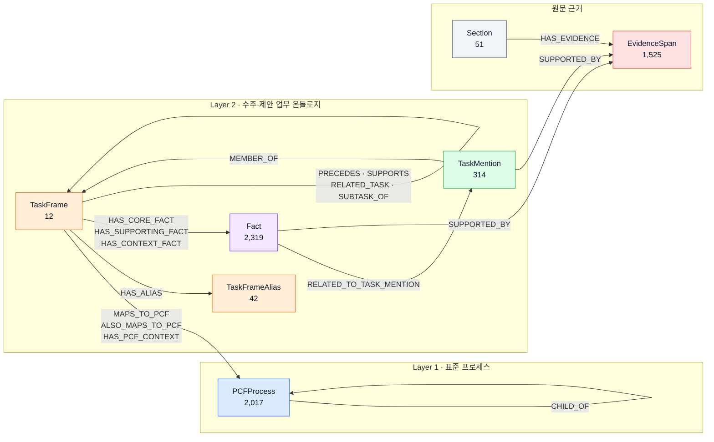

# 실험에 사용한 Neo4j 그래프 구조와 데이터 감사

기준 시점: 2026-09-20 12:51:22 UTC  
감사일: 2026-09-21  
스냅샷 스키마: `qpa-graph-snapshot-v1`  
Neo4j database: `d9c8dd3a`  
스냅샷 SHA-256: `abc9d2b9808c34955f24b76322359cba9f08c39c23ce552a94f1df0206825ef5`

## 1. 해석 범위

이 문서의 수치는 최종 검색 실험이 실제로 읽은
`runs/dev_clause_aspect_trace_v4_20260921/00_graph_snapshot.json`을 감사한 결과다.
따라서 실험 입력을 정확히 설명하지만, 문서를 읽는 시점의 live Neo4j가 이후 변경되었다면
그 변경까지 반영하지는 않는다.

스냅샷 쿼리는 검색에 필요한 그래프 패턴을 명시적으로 가져온다. 일반적인 전체 DB dump가
아니므로 아래에 없는 임의의 label이나 relationship이 DB 전체에 절대 없다고 주장해서는 안 된다.
새 결과를 발표하기 전에는 live snapshot을 다시 생성하고 이 감사를 재실행해야 한다.

## 2. 한눈에 보는 구조



화살표는 Neo4j에 저장된 관계 방향을 나타낸다. 핵심은 **TaskFrame이 PCF 표준 프로세스와
원문의 TaskMention·Fact·EvidenceSpan을 연결하는 중간 온톨로지 계층**이라는 점이다.

검색의 기본 PCF 경로는 다음과 같다.

```text
Question
  -> PCFProcess Top-3
  -> PCF에 매핑된 TaskFrame Top-3
  -> TaskMention / Fact
  -> SUPPORTED_BY
  -> EvidenceSpan 후보
  -> 전체 Evidence fallback
  -> Cross-Encoder + RRF + MMR
  -> Evidence Top-5
```

현재 Direct-Aspect 개정안은 이 기본 경로를 그대로 유지하고, 선택된 질문 Aspect가
EvidenceSpan을 직접 검색하는 보조 후보 경로만 추가한다. 이 `Aspect → EvidenceSpan` 연결은
query-time 유사도 매칭이며 위 Neo4j 구조에 영구 엣지로 저장되지 않는다.

## 3. 노드 수

스냅샷에 포착된 고유 노드는 총 6,280개다. 기존 manifest의 6,187개는 검색 인덱스의
주요 5개 label만 센 값이며, 여기서는 중첩 수집된 `TaskFrameAlias`와 `Section`도 고유 ID로
복원해 포함했다.

| Label | 고유 노드 | 스냅샷에서의 역할 |
|---|---:|---|
| `PCFProcess` | 2,017 | APQC PCF 계층과 한·영 설명 |
| `TaskFrame` | 12 | 수주·제안 업무의 canonical task 단위 |
| `TaskFrameAlias` | 42 | 동의어 40개, 약어 2개; TaskFrame 연결은 44건 |
| `TaskMention` | 314 | 원문에 등장한 task 표현 |
| `Fact` | 2,319 | 구조화 사실·절차·정의·규칙 등 |
| `EvidenceSpan` | 1,525 | 답변의 최종 원문 근거 문장 |
| `Section` | 51 | 문서 장·절 구조; Evidence 연결은 1,525건 |

PCF level 분포는 level 1부터 5까지 각각 13, 74, 362, 1,353, 215개다. Level 1의
13개가 hierarchy root이며 `CHILD_OF` 순환은 발견되지 않았다.

## 4. 관계 수와 방향

스냅샷으로 재구성 가능한 관계는 총 11,325건이다. 같은 Neo4j 타입인 `SUPPORTED_BY`는
출발 label을 구분하기 위해 표에서 두 행으로 나눴다.

| 관계 | 방향 | 수 |
|---|---|---:|
| `CHILD_OF` | PCFProcess → PCFProcess | 2,004 |
| `MAPS_TO_PCF` | TaskFrame → PCFProcess | 12 |
| `ALSO_MAPS_TO_PCF` | TaskFrame → PCFProcess | 2 |
| `HAS_PCF_CONTEXT` | TaskFrame → PCFProcess | 3 |
| `HAS_ALIAS` | TaskFrame → TaskFrameAlias | 44 |
| `MEMBER_OF` | TaskMention → TaskFrame | 314 |
| `HAS_CORE_FACT` | TaskFrame → Fact | 329 |
| `HAS_SUPPORTING_FACT` | TaskFrame → Fact | 357 |
| `HAS_CONTEXT_FACT` | TaskFrame → Fact | 1,650 |
| `RELATED_TO_TASK_MENTION` | Fact → TaskMention | 2,416 |
| `SUPPORTED_BY` | TaskMention → EvidenceSpan | 317 |
| `SUPPORTED_BY` | Fact → EvidenceSpan | 2,319 |
| `HAS_EVIDENCE` | Section → EvidenceSpan | 1,525 |
| `PRECEDES` | TaskFrame → TaskFrame | 16 |
| `SUPPORTS` | TaskFrame → TaskFrame | 8 |
| `RELATED_TASK` | TaskFrame → TaskFrame | 6 |
| `SUBTASK_OF` | TaskFrame → TaskFrame | 3 |

모든 12개 TaskFrame은 최소 한 개 PCF에 매핑되어 있다. 직접 매핑 대상 PCF는 11개이며,
TaskFrame당 PCF 관계 수는 최소 1, 중앙값 1, 평균 1.42, 최대 3이다. 2,017개 PCF 중
11개만 직접 매핑되었다는 것은 오류라기보다 12개 도메인 TaskFrame을 전체 PCF taxonomy에
연결한 현재 범위를 뜻한다. 계층 거리 2 이내의 PCF는 검색 시 mapping prior로 추가 활용한다.

## 5. 노드별 주요 속성

### 5.1 PCFProcess

모든 2,017개에서 다음 Neo4j 속성이 채워져 있다.

- 식별·계층: `id`, `pcfid`, `hid`, `code`, `level`, `path_ids`, `scheme`
- 표시·검색: `name`, `name_en`, `description_ko`, `description_en`
- 품질·계보: `validation_status`, `pipelineVersion`, `runIds`, `lastRunId`
- 시각화·레이어: `type`, `graphLayer`, `graphLayerName`, `vizColor`

`computed_path`와 `computed_path_text`는 Neo4j 원본 속성이 아니다. snapshot exporter가
`CHILD_OF`를 따라 root부터 현재 노드까지 계산해 추가하며, PCF path 임베딩과 계층 거리 계산에
사용한다.

### 5.2 TaskFrame

12개 모두 `id`, `name`, `displayName`, `definition`, `scope`, `status`, `alias_count`,
`alias_model`, `raw_task_mention_count`, `schema_version`, 실행 계보 및 graph layer 속성을 갖는다.
검색 view는 identity 0.25, definition/scope 0.25, alias 0.15, 대표 근거 0.35의 기본 비중으로
구성된다.

### 5.3 TaskFrameAlias

고유 alias는 42개이고 연결은 44건이므로 두 alias는 둘 이상의 연결 문맥에 등장한다.
모두 `id`, `name`, `normalized_key`, `alias_type`, `language`, `ambiguous`, `target_count`,
`validation_status` 및 실행 계보를 갖는다. 유형은 synonym 40개, abbreviation 2개다.

### 5.4 TaskMention

| 속성 | 채워진 수 | 비율 |
|---|---:|---:|
| `action_raw` | 314 / 314 | 100.00% |
| `focal_object_raw` | 299 / 314 | 95.22% |
| `intended_outcome_raw` | 17 / 314 | 5.41% |
| `confidence` | 314 / 314 | 100.00% |
| `canonicalization_eligible` | 314 / 314 | 100.00% |
| `section_path` | 314 / 314 | 100.00% |
| `quality_status` | 314 / 314 | 100.00% |
| `quality_issues` 비어 있지 않음 | 33 / 314 | 10.51% |

품질 상태는 accepted 281개, review_required 33개다. 모든 TaskMention은 최소 한 EvidenceSpan을
가지며, mention당 Evidence는 중앙값 1, 최대 2다.

### 5.5 Fact

| 속성 | 채워진 수 | 비율 |
|---|---:|---:|
| `evidence_quote` | 2,319 / 2,319 | 100.00% |
| `knowledge_function` | 2,319 / 2,319 | 100.00% |
| `predicate_raw` | 2,319 / 2,319 | 100.00% |
| `predicate_canonical` | 2,247 / 2,319 | 96.90% |
| `subject_raw`, `subject_canonical` | 1,945 / 2,319 | 83.87% |
| `object_raw`, `object_canonical` | 2,014 / 2,319 | 86.85% |
| `canonical_fact_id` | 2,247 / 2,319 | 96.90% |
| `qualifiers` 비어 있지 않음 | 405 / 2,319 | 17.46% |
| `quality_issues` 비어 있지 않음 | 268 / 2,319 | 11.56% |
| `active`, `task_related` | 2,319 / 2,319 | 100.00% |

knowledge function은 fact 1,567, procedure 283, definition 256, rule 157,
recommendation 47, decision 9개다. 품질 상태는 accepted 2,051개와 quarantined 268개다.
모든 Fact는 정확히 한 EvidenceSpan에 연결되어 있다.

현재 P1 검색은 quarantined Fact를 완전히 제거하지 않고 quality bonus에서 감점한다. 발표용
최종 버전에서는 `filter_low_quality` ablation 또는 완전 제외 정책을 별도로 검증해야 한다.

### 5.6 EvidenceSpan

1,525개 모두 `id`, `sentence_id`, `name`, `displayName`, `document_id`, `evidence_type`,
`source_file`, `page`, `paragraph_id`, `position`, `section_path`와 실행 계보를 갖는다.
`sentence_audit_status`는 25개, `rawName`은 87개에만 존재한다.

스냅샷은 문서 1개, section 51개, 서로 다른 page 값 143개를 포함한다. `source_file`은 원 수집
환경의 절대 경로이므로 다른 환경에서 그대로 열리지 않을 수 있고, 외부 공유본에서는 경로를
마스킹하는 것이 안전하다.

### 5.7 Section

고유 Section 51개는 모두 `id`, `name`, `displayName`, `chapter_no`, `section_no`, 실행 계보와
graph layer 속성을 갖는다. `HAS_EVIDENCE` 연결은 1,525건으로 모든 EvidenceSpan이 한 section에
포착되었다.

## 6. 연결성·무결성 감사

| 검사 | 결과 |
|---|---:|
| endpoint가 빈 관계 | 0 |
| 존재하지 않는 source ID 참조 | 0 |
| 존재하지 않는 target ID 참조 | 0 |
| PCF ancestry cycle | 0 |
| Evidence가 있는 TaskMention | 314 / 314 |
| Evidence가 있는 Fact | 2,319 / 2,319 |
| TaskMention이 참조하는 고유 Evidence | 226 / 1,525 |
| Fact가 참조하는 고유 Evidence | 1,214 / 1,525 |
| 둘 중 하나가 참조하는 고유 Evidence | 1,232 / 1,525 |
| TaskMention/Fact 모두가 참조하지 않는 Evidence | 293 / 1,525 |
| 정규화 텍스트 중복 그룹 | 18 |
| 중복 그룹의 첫 노드 외 추가 Evidence | 85 |

293개 Evidence는 구조화 TaskMention/Fact 경로로는 도달하지 않고 전체 Evidence fallback에서만
검색될 수 있다. 따라서 PCF-first 검색의 성능은 구조화 coverage에 영향을 받으며, fallback은
단순 편의 기능이 아니라 그래프 결손을 보완하는 필수 안전망이다.

정규화 문장이 같은 Evidence가 여러 ID로 존재하는 문제는 Top-5 중복과 MMR section penalty에
영향을 줄 수 있다. 향후에는 `(document_id, page, normalized_text)` 기반 canonical evidence ID를
도입하거나 평가 단계에서 중복 ID를 동치 집합으로 처리하는 방안을 검토해야 한다.

## 7. TaskFrame별 밀도

| 지표 | 최소 | 중앙값 | 평균 | P95 | 최대 |
|---|---:|---:|---:|---:|---:|
| TaskMention / TaskFrame | 1 | 19.5 | 26.17 | 65 | 65 |
| Fact 관계 / TaskFrame | 2 | 159.5 | 194.67 | 529 | 529 |
| Alias 연결 / TaskFrame | 0 | 3.5 | 3.67 | 7 | 7 |
| PCF mapping / TaskFrame | 1 | 1.0 | 1.42 | 3 | 3 |

TaskFrame 사이의 데이터 밀도 차이가 크므로 동일한 Top-k를 모든 frame에 적용하면 큰 frame이
후보를 독점하거나 작은 frame의 근거가 부족해질 수 있다. 현재 방법은 TaskFrame Top-3,
TaskMention 상위 12개, Fact 상위 30개를 사용하며 이 분포 차이를 별도 정규화하지 않는다.

## 8. 관계 속성의 범위

스냅샷은 `CHILD_OF`, PCF mapping 3종, TaskFrame–Fact 3종,
`RELATED_TO_TASK_MENTION`, TaskFrame 간 4종 관계에 대해 `properties(r)`를 저장한다. 공통으로
`id`, `edgeType`, `graphLayer`, `layer`, `pipelineVersion`, `runIds`, `lastRunId`,
`evidenceIds`, `vizColor` 등이 들어 있다.

PCF mapping에는 추가로 `is_primary`, `mapping_role`, `relation_scope`, `confidence`,
`coverage_score`, `review_status`, `validation_status`, `method`, `rationale`,
`supporting_triples`, `supporting_task_mentions`, `active` 등이 있다. 검색은 관계 종류별
1.00/0.85/0.70 가중치와 `confidence`, `coverage_score`를 mapping prior에 사용한다.

반면 현재 snapshot query는 `HAS_ALIAS`, `MEMBER_OF`, `SUPPORTED_BY`, `HAS_EVIDENCE`의
relationship property를 선택하지 않고 endpoint ID만 수집한다. 따라서 이 네 종류의 관계 속성
스키마는 snapshot만으로 단정할 수 없다.

## 9. 검색에서 실제로 쓰이는 속성

| 단계 | 사용 view 또는 속성 |
|---|---|
| PCF | code, pcfid, name, name_en, description_ko/en, computed path |
| TaskFrame | name/displayName, definition/scope, aliases, 대표 Fact evidence |
| TaskMention | name/displayName, action_raw, focal_object_raw, intended_outcome_raw, 직접 evidence |
| Fact | name/displayName, evidence_quote, canonical/raw triple, qualifiers, knowledge_function |
| Evidence | name/displayName, section_path, page, evidence_type, Section name |
| PCF mapping | relationship type, confidence, coverage_score, PCF hierarchy distance |
| Fact 연결 | HAS_CORE/SUPPORTING/CONTEXT_FACT 역할 |

`D0_ORIGINAL`은 이 속성들을 사용한다. 과거 `D1_PROPERTY_MASK`는 TaskMention의 action/object/outcome과
Fact의 triple/qualifier/function을 가리는 진단 조건이며, 현재 세 방법 주 비교에는 포함하지 않는다.

## 10. 재생성 및 감사 명령

live Neo4j에서 새 snapshot을 만들려면 접속 정보가 있는 환경에서 다음을 실행한다.

```bash
python run_experiment.py \
  --config config/experiment.yaml \
  --stage snapshot --run-id <NEW_RUN_ID>
```

생성된 snapshot의 스키마와 연결성을 다시 감사한다.

```bash
python qa_v2/audit_graph_snapshot.py \
  --snapshot runs/<NEW_RUN_ID>/00_graph_snapshot.json \
  --output-json runs/<NEW_RUN_ID>/NEO4J_GRAPH_AUDIT.json \
  --output-md runs/<NEW_RUN_ID>/NEO4J_GRAPH_AUDIT.md
```

자동 감사의 JSON에는 이 문서보다 더 상세한 모든 node/relationship 속성별 존재 수, 자료형,
coverage가 들어 있다. `runs/`는 `.gitignore` 대상이므로 영구 보존이 필요하면 별도 아카이브해야 한다.
