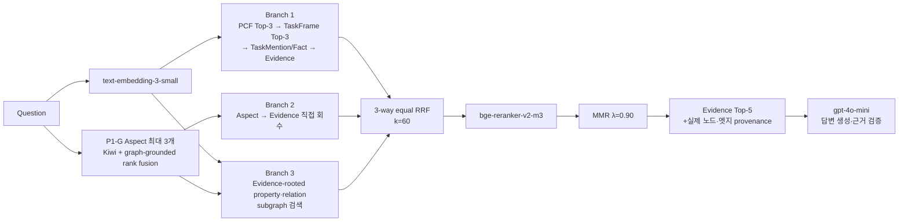

# PARS-KG-RAG: 최종 방법론·실험 보고서

기준일: 2026-09-21  
공개 이름: **PARS-KG-RAG (PCF-Anchored Property–Relation Subgraph KG-RAG)**

최종 방법 ID: `P1P_PCF_ANCHORED_PROPERTY_RELATIONAL_SUBGRAPH_PROFILE_FREE_MMR`  
상태: 210문항 검색·답변 생성·BLEU·ROUGE·BERTScore 평가 완료

`PROFILE_FREE`가 포함된 긴 ID는 완료된 run을 재현하기 위한 내부 식별자일 뿐,
논문·발표·그림에서 사용하는 프레임워크 이름은 **PARS-KG-RAG**다.

## 1. 핵심 결론

PARS-KG-RAG는 **PCF-first 구조를 유지**하면서, 비-LLM
graph-grounded Aspect와 Neo4j의 노드 속성·관계·실제 연결 구조를 이용해
EvidenceSpan Top-5를 선택하는 방법이다. 최종 버전은 Query Profile을 만들거나
사용하지 않고, TaskMention과 Fact의 의미 속성을 균등 가중치로 비교한다.

최신 최소 ablation은 210문항에 Dense RAG, PCF Path, PCF+Aspect,
PARS-KG-RAG 네 방법을
동일 조건으로 실행했다. 개발 32문항을 제외한 178문항 주 비교에서 다음을 확인했다.

- PARS-KG-RAG가 Hit@1·Recall@5·Complete@5·MRR 점추정치에서 가장 높았다.
- Property–Relation Subgraph를 제거한 PCF+Aspect 대비 Hit@1 +4.57%p와
  MRR +2.42%p의 paired
  bootstrap 95% CI가 0보다 컸다.
- Direct Aspect만 추가한 PCF+Aspect와 PCF Path의 검색 차이는 모든 CI가 0을 포함했다.
- Dense 대비 PARS-KG-RAG는 검색 5개 지표와 ROUGE-1/2/L의 CI가 0보다 컸다.
  BLEU-4와 BERTScore의 답변 차이 CI는 0을 포함했다.
- PARS-KG-RAG는 ROUGE-1/2/L 점추정치가 가장 높았지만, PCF Path가 BLEU-4와
  BERTScore에서 가장 높았고 두 KG 방법 간 답변 차이는 유의하지 않았다.

따라서 정확한 해석은 **“Query Profile 없이도 PCF-first를 유지할 수 있으며,
PARS가 상위 근거의 순위를 개선한다. 답변 수준의 추가 이득은 아직 제한적으로
확인됐다”**이다.

## 2. 이전 버전에서 바꾸는 이유

이전 Query Profile은 질문의 cue word를 이용해 답변 형태, target facet,
knowledge function을 규칙 기반으로 추정했다. 이 정보로 TaskMention·Fact 속성
가중치를 질문별로 바꾸었다.

하지만 최종 PARS-KG-RAG에서는 다음 이유로 제거했다.

1. cue word 규칙이 복합·구어체 질문을 충분히 표현하지 못한다.
2. PARS branch가 이미 전체 의미 속성과 관계 신호를 직접 비교한다.
3. 이전 실험에서 질문별 가중치의 명확한 이점이 입증되지 않았다.
4. 하나의 분류 단계와 정보 블록을 줄여 오류 전파와 context 소모를 줄일 수 있다.

최종 실행에서 다음이 모두 확인됐다.

- 최종 방법 210행의 `query_profile` = `{}`
- `query_profile_used` = `false`
- `property_weighting` = `fixed_equal`
- 최종 context의 `[QUERY-ACTIVATED FACETS]` 블록 = 0건

## 3. 전체 구조



핵심은 세 branch가 서로 다른 실패를 보완하는 구조다.

- Branch 1은 PCF-first 온톨로지 탐색을 보존한다.
- Branch 2는 중간 노드 분류 오류와 구조화 누락을 보완한다.
- Branch 3은 질문과 관련된 노드·속성·관계가 어떤 실제 경로로 Evidence에
  연결되는지 찾는다.

## 4. 사용한 Neo4j 그래프

최종 run이 사용한 snapshot에는 고유 노드 6,280개와 관계 11,325개가 있다.

| Label | 수 | 역할 |
|---|---:|---|
| `PCFProcess` | 2,017 | 표준 프로세스 분류·계층 |
| `TaskFrame` | 12 | 수주·제안 canonical task |
| `TaskFrameAlias` | 42 | 동의어·약어 |
| `TaskMention` | 314 | 원문의 행위·대상·결과 표현 |
| `Fact` | 2,319 | 정의·사실·절차·규칙·조건 |
| `EvidenceSpan` | 1,525 | 최종 답변 근거 원문 |
| `Section` | 51 | 문서 장·절 문맥 |

```text
PCFProcess -[CHILD_OF]-> PCFProcess
TaskFrame -[MAPS_TO_PCF | ALSO_MAPS_TO_PCF | HAS_PCF_CONTEXT]-> PCFProcess
TaskFrame -[HAS_ALIAS]-> TaskFrameAlias
TaskMention -[MEMBER_OF]-> TaskFrame
TaskFrame -[HAS_CORE_FACT | HAS_SUPPORTING_FACT | HAS_CONTEXT_FACT]-> Fact
Fact -[RELATED_TO_TASK_MENTION]-> TaskMention
TaskMention/Fact -[SUPPORTED_BY]-> EvidenceSpan
Section -[HAS_EVIDENCE]-> EvidenceSpan
TaskFrame -[PRECEDES | SUPPORTS | RELATED_TASK | SUBTASK_OF]-> TaskFrame
```

Fact·TaskMention 구조 경로가 닿지 않는 EvidenceSpan이 293개이므로, Branch 1의
전역 Evidence fallback과 Branch 2의 직접 회수를 유지한다.

## 5. Aspect 추출: P1-G

최종 방법은 LLM prompting이 아닌 결정론적 P1-G를 사용한다. 정답, Gold ID,
참조 답변은 입력하지 않는다.

### 5.1 후보 생성

Kiwi 형태소 분석으로 다음을 만든다.

- 1~3개 내용 형태소로 구성된 도메인 명사구
- 명사와 결합한 행위 표현
- 조건·예외·시점·범위 표현
- 질문의 정보 요구를 담은 clause

예시 질문 `기회분석이 끝난 뒤 제안참여 의사결정 전에는 어떤 결정이
이루어집니까?`에서 Kiwi는 핵심 내용을 다음처럼 분석했다.

```text
기회/NNG 분석/NNG 이/JKS 끝나/VV ᆫ/ETM 뒤/NNG
제안/NNG 참여/NNG 의사/NNG 결정/NNG 전/NNG ...
결정/NNG 이/JKS 이루어지/VV ᆸ니까/EF ?/SF
```

명사열 전체와 1~3형태소 window, 동사와 가까운 앞 명사, `뒤/전` 주변 내용어,
긴 clause를 조합해 이 질문에서는 domain 17개, action 4개, constraint 2개,
intent 1개, 총 24개 후보가 만들어졌다. `끝난 뒤 제안참여`의 원문 span은
보존하되 실제 임베딩 문자열은 기본형·내용어만 남긴 `끝나 뒤 제안 참여`다.

### 5.2 다섯 순위 신호

후보 `a`에 대해 다음을 계산한다.

1. 원 질문과의 코사인 유사도
2. PCFProcess 속성과의 최고 유사도
3. TaskFrame 속성과의 최고 유사도
4. EvidenceSpan hybrid 검색 최고 점수
5. 상위 PCF–TaskFrame–Evidence 저장 경로 일치도

```text
AspectScore(a) = (1/5) × Σ[j=1..5] 1 / rank_j(a)
```

각 신호의 raw scale을 직접 더하지 않고 rank를 균등 결합한다. 답 의도,
명시적 조건, 다단어 행위·대상을 우선해 중복이 적은 Aspect를 최대 3개 선택한다.
최종 버전은 별도 applicability gate를 두지 않고 선택된 Aspect를 항상 사용한다.

### 5.3 후보가 비교되는 실제 속성

Aspect grounding에서 후보 vector는 노드 전체를 한 문자열로 합친 vector가 아니라
노드 유형별 semantic view와 비교된다.

```text
PCF = .35 identity + .45 description + .20 hierarchy path
TaskFrame = .25 identity + .25 definition/scope
          + .15 aliases + .35 representative evidence
EvidenceSemantic = .90 text + .10 section/page/type metadata
EvidenceHybrid   = .75 EvidenceSemantic + .25 normalized BM25
```

위 예시의 전체 intent 후보는 `PCF_18116 기회 수주 계획 수립`의 identity .398,
description .355, path .479를 가중 결합해 PCF support .395를 얻었다. 같은 후보는
`TF_60ee... 입찰 의사결정 및 기회 관리`의 identity .529, definition .390,
aliases .485, representative evidence .420을 결합해 TaskFrame support .450을 얻었다.
Evidence 1위 `EV_799a...`는 text .539, metadata .372, BM25 1.000을 결합해 .642였다.

24개 후보는 다섯 신호로 먼저 순위화된다. 점수만의 상위 3개는 전체 intent,
`제안 참여`, `참여 의사 결정`이었지만, 결정론적 role router가 시간 제약을 보존하기
위해 intent → constraint → multiword action/domain 순으로 채운다. 최종 세 Aspect는
전체 intent, `끝나 뒤 제안 참여`, `참여 의사 결정 전`이다.

## 6. Branch 1: PCF-first 기본 경로

```text
Question
  → PCFProcess Top-3
  → PCF mapping prior + semantic score로 TaskFrame Top-3
  → TaskMention / Fact
  → SUPPORTED_BY EvidenceSpan
  → 전역 Evidence fallback
```

Query Profile 대신 다음 속성 view에 각각 0.20의 고정 가중치를 사용한다.

- TaskMention: identity, action, object, outcome, evidence
- Fact: identity, evidence, triple, qualifier, knowledge function

이 경로는 PCF 언어로 질문의 업무 위치를 먼저 잡는 본 방법론의 원칙을 보존한다.

## 7. Branch 2: Aspect–Evidence 직접 회수

선택된 Aspect 각각으로 EvidenceSpan을 직접 검색하고 후보를 보충한다. 이는
중간 PCF·TaskFrame 분류가 틀리거나 Fact·TaskMention 연결이 빈 경우를 위한 recall
안전망이다.

`Aspect → EvidenceSpan`은 검색 시점의 유사도 경로이며 Neo4j에 영구 엣지를 생성하지
않는다. 답변 provenance에서도 query-time route와 stored graph edge를 구분한다.

## 8. Branch 3: Property–Relation Subgraph

### 8.1 Evidence-rooted support closure

각 EvidenceSpan `e`를 root로 두고, 그 근거를 설명할 수 있는 방향으로만 closure
`C(e)`를 구성한다.

1. Evidence에 직접 연결된 Fact, TaskMention, Section
2. 해당 Fact·TaskMention의 TaskFrame
3. TaskFrame의 Alias, PCF mapping, TaskFrame 1-hop 관계
4. 포함된 PCF의 root까지 `CHILD_OF` 부모 경로

무제한 BFS를 하지 않고, 1-hop TaskFrame에서 모든 Fact로 다시 확장하지 않아 큰
TaskFrame이 단순 노드 수로 후보를 지배하는 것을 막는다.

### 8.2 노드 속성 매칭

노드 종류별로 의미가 다른 속성을 별도 view로 임베딩한다.

| 노드 | 실제 저장 속성의 의미 영역 | 임베딩 view |
|---|---|---|
| PCFProcess | code/pcfid/hid, 한·영 이름·설명, level/path, scheme·validation, lineage | identity, description, hierarchy path |
| TaskFrame | name, definition, scope, status, Alias·Mention 수, lineage | identity, definition/scope, aliases, representative evidence |
| TaskFrameAlias | name, normalized key, type/language, ambiguity, validation | 독립 점수화 대신 부모 TaskFrame aliases에 이름 반영 |
| TaskMention | name, raw action/object/outcome, confidence, section, quality | identity, action, object, outcome, direct evidence |
| Fact | raw/canonical S·P·O, quote, qualifiers, function, active·quality | identity, evidence quote, SPO triple, qualifier, knowledge function |
| EvidenceSpan | text, document/file, page/paragraph/position, section, type | text, section/page/type metadata |
| Section | name, chapter/section 번호, lineage | 독립 점수화 대신 Evidence metadata에 이름 반영 |

```text
NodeMatch(q, v) = max[p in semantic_views(v)] max(0, cosine(q, emb(v,p)))
```

run ID, timestamp, color, hash와 같은 운영·시각화 속성은 제외한다.

대표 Gold `EV_2c129...`의 최소 서브그래프에서는 다음 속성이 실제 최고 match로
기록됐다.

| 노드 | 실제 저장값 예 | 선택 view | cosine |
|---|---|---|---:|
| `PCF_18116` | code `3.5.1.5`, name `기회 수주 계획 수립`, level 4 | path `…영업 계획 개발·관리 > 리드·기회 관리 > 기회 수주 계획 수립` | .479 |
| `TF_60ee...` | definition `사업 기회를 발굴하고 참여 여부를 결정…`, aliases `입찰 타당성 검토 / Bid/No Bid 결정 / 기회 발굴` | identity `입찰 의사결정 및 기회 관리` | .554 |
| `TM_c531...` | action `해야 하는데`, object `참여 여부에 대한 최종 의사결정을`, confidence 1.0 | object | .742 |
| `TR_6e8d...` | S=`결정하는 것`, P=`이다`, O=`영업참여 결정`, function=`definition` | temporal qualifier `기회분석이 끝나고 나면` | .490 |
| `EV_2c129...` | page 44, Excel row 218, section `프로세스가 중요하다`, type `sentence` | 원문 text | .444 |

이 단계의 `NodeMatch`는 Aspect grounding의 view 가중평균과 다르다. 질문 또는 선택
Aspect마다 각 노드의 모든 view를 비교해 **가장 큰 단일 속성**을 대표 match로 둔다.
Alias와 Section은 실제 closure 노드로 남지만 그 이름이 각각 TaskFrame aliases와
Evidence metadata에 들어간다. 전체 원시 속성 카드와 정확한 문자열은
`visualization_guide.md` 8절에 기록했다.

### 8.3 관계 의미 매칭

관계 type과 `reason`, `rationale`, `mapping_role`, `relation_scope`, `method`,
`propagation_path`, `relevance`, 품질 상태를 설명 문자열로 만든다. 원 질문과
Aspect를 합친 query와의 BM25를 계산한다.

```text
EdgeSupport(e) = max[x in edges(C(e))] BM25(question + aspects, semantic_text(x))
```

### 8.4 다섯 서브그래프 신호

```text
QuestionProperty(e) = closure 내 원 질문–노드 속성 최고 일치
AspectCoverage(e)   = Aspect별 closure 내 최고 노드 일치의 평균
EdgeSupport(e)      = closure 내 최고 관계 의미 일치
PCFAnchor(e)        = 원 질문 PCF Top-3과 closure PCF의 계층 거리 일치
EvidenceRelevant(e) = 0.75 × Dense + 0.25 × BM25
```

서로 다른 scale의 점수를 임의 가중합하지 않고 dense rank를 균등 결합한다.

```text
PARS(e) = (1/5) × [
    1/r_question_property(e)
  + 1/r_aspect_coverage(e)
  + 1/r_edge_support(e)
  + 1/r_pcf_anchor(e)
  + 1/r_evidence_relevance(e)
]
```

### 8.5 실제 연결 서브그래프

원 질문, 각 Aspect, PCF anchor, 상위 관계와 가장 잘 맞은 terminal을 선택한다.
각 terminal에서 EvidenceSpan까지 closure 내 최단 저장 경로를 찾고, 그 합집합을
최종 서브그래프로 남긴다.

```text
S*(e) = Union(ShortestStoredPath(t, e)) for selected terminal t
```

모든 계층을 의무적으로 채우지 않지만, 제시하는 노드와 엣지는 실제 snapshot에
존재하며 EvidenceSpan에 연결된다.

## 9. 후보 결합·재정렬·Top-5

세 branch 상위 20개 후보를 균등 3-way RRF로 결합한다.

```text
ThreeRRF(e) = I_base(e)/(60 + rank_base(e))
            + I_direct(e)/(60 + rank_direct(e))
            + I_PARS(e)/(60 + rank_PARS(e))
```

합집합 상위 40개를 원 질문과 `BAAI/bge-reranker-v2-m3`로 재정렬한다.
후보 순위와 Cross-Encoder 순위를 다시 균등 RRF로 합친 뒤 MMR로 중복을 줄여
Top-5를 선택한다.

```text
FinalRelevance(e) = 1/(60 + rank_candidate(e))
                  + 1/(60 + rank_cross_encoder(e))

MMR(e) = 0.90 × normalized_relevance(e)
       - 0.10 × max_similarity(e, selected)
```

같은 section의 후보는 최대 중복으로 처리한다. 최종 5개 중 2개는 융합 상위 후보를
보존해 다양성 패널티가 핵심 근거를 모두 제거하지 않게 한다.

## 10. 답변 생성에 제공하는 정보

최종 6,000자 context에는 다음이 들어간다.

- PCF Top-3와 계층 경로
- TaskFrame 후보
- EvidenceSpan 원문, page, section, ID
- 질문·Aspect와 맞은 노드 속성
- 선택된 실제 저장 엣지
- 대표 Fact triple, knowledge function, TaskMention slot

Query Profile facet은 들어가지 않는다. `gpt-4o-mini-2024-07-18`이 근거 내에서
답변을 생성한 뒤 인용 근거를 온라인 검증한다. 근거가 부족하면 `INSUFFICIENT`로
보류한다.

## 11. 실제 처리 예시

최신 ablation에서 PARS의 구조적 기여가 가장 선명한 source-derived 문항
`JAIJE1-QA-0101`을 사용한다.

> 기회분석이 끝난 뒤 제안참여 의사결정 전에는 어떤 결정이 이루어집니까?

```text
P1-G selected Aspect
1. 기회 분석 끝나 뒤 제안 참여 의사 결정 전 이루어지  [intent]
2. 끝나 뒤 제안 참여                                  [constraint]
3. 참여 의사 결정 전                                   [constraint]
```

초기 PCF Top-3에는 승인·통지 관련 잡음이 포함됐다. PCF를 hard gate로 사용하지
않았기 때문에 Direct Evidence와 PARS branch는 계속 실행됐다. PARS의
Evidence-rooted closure가 다음 실제 저장 구조를 회복했다.

```text
TaskFrame(입찰 의사결정 및 기회 관리)
  -[MAPS_TO_PCF]-> PCFProcess(기회 수주 계획 수립)
  -[HAS_SUPPORTING_FACT]-> Fact(기회분석 후 영업참여 결정)
Fact -[RELATED_TO_TASK_MENTION]-> TaskMention(참여 여부 결정)
Fact / TaskMention -[SUPPORTED_BY]-> EvidenceSpan
```

첫 번째 최종 Evidence의 다섯 신호 순위는 질문–속성 1위, Aspect coverage 3위,
관계 3위, PCF anchor 1위, Evidence 직접 적합도 1위였다. 두 Gold Evidence에 대한
Dense/PCF Path/PCF+Aspect의 Recall@5는 모두 0.50이었지만 PARS-KG-RAG는 1.00이었고,
MRR도 각각 0.20/0.50/0.50에서 1.00으로 상승했다.

PARS-KG-RAG는 다음 두 원문을 1·2위에 배치했다.

1. 정보수집 영업활동이 끝나면 축적된 정보를 바탕으로 제안참여 의사결정을 한다.
2. 기회분석 후 정보수집 영업활동을 할지를 정하는 것이 영업참여 결정이다.

생성 답변:

> 기회분석이 끝난 뒤, 고객과 경쟁자에 대한 정보 수집을 위한 영업참여 결정을
> 하게 됩니다. 이 과정에서 RFP가 나오면 참여 여부에 대한 최종 의사결정을 해야 합니다.

이는 전체 성능을 대신하는 증거가 아니라, 복수 근거를 속성·관계 서브그래프가
보완하는 과정을 설명하기 위한 대표 사례다.

## 12. 실험 설정

### 12.1 데이터

| 구성 | 문항 수 | 설명 |
|---|---:|---|
| 원문 기반 | 150 | 수주·제안 교재 EvidenceSpan을 바탕으로 생성 |
| 일반 업무형 합성 | 60 | direct, scenario, multi-intent, process, condition, colloquial 각 10 |
| 개발·진단 | 32 | source 2 + 합성 tuning 30 |
| 주 비교 | 178 | source 148 + 합성 holdout 30 |

Gold Evidence는 전체 207/210, 주 비교 175/178문항에 정렬됐다. 합성 60문항은
실제 현업자가 독립 작성한 질문이 아니며 parent Gold의 합집합을 상속한다.

### 12.2 비교 방법

| 방법 | 목적 |
|---|---|
| Dense RAG | EvidenceSpan 문장별 임베딩 Top-5 기준선 |
| PCF Path | PCF-first; Aspect·Property–Relation Subgraph 제거 |
| PCF+Aspect | PCF Path + 비-LLM Direct Aspect; Subgraph 제거 |
| **PARS-KG-RAG** | PCF+Aspect + Property–Relation Subgraph |

모든 방법은 같은 `text-embedding-3-small`, Top-5, 답변 모델, 참조 답변,
평가 코드를 사용한다. 세 KG 방법은 모두 Query Profile이 없고 고정 균등 속성
가중치를 사용한다.

### 12.3 모델·고정 설정

| 역할 | 설정 |
|---|---|
| 임베더 | `text-embedding-3-small`, 1,536차원, L2 정규화 |
| Aspect | P1-G, Kiwi + 5-signal graph-grounded rank fusion, 최대 3개 |
| Cross-Encoder | `BAAI/bge-reranker-v2-m3`, revision `953dc6f...` |
| 답변·검증 | `gpt-4o-mini-2024-07-18`, 최대 350 output token |
| BERTScore | `FacebookAI/xlm-roberta-large`, layer 17 |
| 후보 | branch별 20, 재정렬 최대 40, 최종 5 |
| RRF / MMR | `k=60`, `λ=0.90` |
| Dense/lexical | 0.75 / 0.25 |
| context | 최대 6,000자 |

## 13. 평가 방법

검색:

- Evidence Hit@1, Hit@5
- Evidence Recall@5
- Complete Evidence Set@5
- MRR

답변:

- Kiwi tokenization BLEU-4
- ROUGE-1/2/L F1
- XLM-R layer 17 BERTScore F1
- API failure rate, `INSUFFICIENT` rate

차이의 불확실성은 10,000회 paired bootstrap percentile 95% CI로 평가했다. 검색은
qid, 답변은 `section_no` cluster를 재표본화 단위로 사용한다.

## 14. 실험 결과

### 14.1 검색: 주 비교 178문항

Evidence 지표의 실제 분모는 Gold ID가 정렬된 175문항이다.

| 방법 | Hit@1 | Hit@5 | Recall@5 | Complete@5 | MRR | 평균 검색† (s/query) |
|---|---:|---:|---:|---:|---:|---:|
| Dense RAG | 47.43 | 77.14 | 60.95 | 46.86 | 58.27 | **0.015** |
| PCF Path | 66.86 | **91.43** | 71.83 | 55.43 | 76.64 | 0.263 |
| PCF+Aspect | 68.00 | **91.43** | 72.59 | 56.00 | 77.35 | 1.020 |
| **PARS-KG-RAG** | **72.57** | 90.29 | **72.88** | **57.71** | **79.77** | 2.225 |

† 주 비교 178문항의 warm-cache 질문→Top-5 시간이다. PCF+Aspect와
PARS-KG-RAG는 P1-G Aspect 추출 평균 0.714초/query를 포함한다.
일회성 인덱스·Cross-Encoder 로딩, uncached 임베딩 네트워크, GPT
답변·검증 시간은 제외한다. 따라서 실서비스 end-to-end SLA가 아니라
방법 간 검색 계산비용 비교다. 세부 분포와 재현 방법은
[처리 시간 보고서](latency.md)에 기록했다.

PARS-KG-RAG − Dense paired 차이(%p):

| 지표 | 차이 | 95% CI |
|---|---:|---:|
| Hit@1 | +25.14 | [18.29, 32.00] |
| Hit@5 | +13.14 | [7.43, 18.86] |
| Recall@5 | +11.93 | [7.45, 16.62] |
| Complete@5 | +10.86 | [5.71, 16.01] |
| MRR | +21.50 | [16.26, 26.78] |

### 14.2 구성요소 효과

PARS-KG-RAG − PCF+Aspect는 Property–Relation Subgraph만 추가한 비교다.

| 지표 | 차이(%p) | 95% CI | 해석 |
|---|---:|---:|---|
| Hit@1 | +4.57 | [1.14, 8.00] | 0보다 큰 CI |
| Hit@5 | -1.14 | [-4.00, 1.71] | 차이 불확실 |
| Recall@5 | +0.29 | [-2.19, 2.86] | 차이 불확실 |
| Complete@5 | +1.71 | [-1.14, 4.57] | 차이 불확실 |
| MRR | +2.42 | [0.26, 4.79] | 0보다 큰 CI |

PARS-KG-RAG − PCF Path의 Hit@1은 +5.71%p, 95% CI [0.57, 10.86]이었다.
MRR은 +3.13%p였지만 CI [-0.14, 6.56]가 0을 조금 포함했다. PCF+Aspect −
PCF Path의 모든 검색 CI는 0을 포함했다. 따라서 이번 ablation에서 분명하게
관찰된 추가 효과는 **Direct Aspect 자체보다 PARS의 상위 순위 개선**이다.

### 14.3 데이터 구간별 검색 진단

| 구간 | 방법 | Hit@1 | Hit@5 | Recall@5 | MRR |
|---|---|---:|---:|---:|---:|
| 원문 기반 148 | Dense | 51.03 | 81.38 | 64.25 | 61.82 |
| 원문 기반 148 | **PARS-KG-RAG** | **75.86** | **92.41** | **75.29** | **82.63** |
| 합성 업무형 30 | Dense | 30.00 | 56.67 | 45.00 | 41.11 |
| 합성 업무형 30 | **PARS-KG-RAG** | **56.67** | **80.00** | **61.23** | **65.94** |

합성 업무형에서도 크게 높은 점추정치를 보였지만, 30문항이고 실무자 독립
질문이 아니므로 일반 현업 성능으로 확대 해석하지 않는다.

### 14.4 답변: 주 비교 178문항

| 방법 | BLEU-4 | ROUGE-1 | ROUGE-2 | ROUGE-L | BERTScore F1 | 보류율 |
|---|---:|---:|---:|---:|---:|---:|
| Dense RAG | 24.68 | 52.43 | 32.14 | 43.81 | 92.32 | 1.69% |
| PCF Path | **26.31** | 54.61 | 34.45 | 45.37 | **92.57** | 2.25% |
| PCF+Aspect | 24.76 | 53.69 | 33.19 | 44.74 | 92.39 | 2.81% |
| **PARS-KG-RAG** | 26.21 | **55.06** | **34.87** | **46.46** | 92.52 | 2.25% |

PARS-KG-RAG − Dense paired 차이(점수):

| 지표 | 차이 | 95% CI | 해석 |
|---|---:|---:|---|
| BLEU-4 | +1.53 | [-0.21, 3.25] | 평균은 상승, CI는 0 포함 |
| ROUGE-1 | +2.64 | [1.11, 4.18] | 0보다 큰 CI |
| ROUGE-2 | +2.74 | [1.02, 4.51] | 0보다 큰 CI |
| ROUGE-L | +2.65 | [0.90, 4.32] | 0보다 큰 CI |
| BERTScore | +0.20 | [-0.01, 0.41] | CI는 0 포함 |

PARS-KG-RAG − PCF+Aspect의 ROUGE-L은 +1.72, 95% CI [0.07, 3.40]로 0보다
컸다. 나머지 네 답변 지표 CI는 0을 포함했다. PARS-KG-RAG − PCF Path는 다섯
답변 지표 모두 CI가 0을 포함했다. 즉 최종 방법이 ROUGE 점추정치에서 우세하지만,
KG 구성요소 간 답변 품질 차이는 아직 대부분 불확실하다.

## 15. 무결성 검증

- 검색 840행, 답변 840행, 공식 답변 평가 712행, API 실패 0건
- 세 KG 방법 630행 전체에서 Query Profile 미사용과 고정 균등 속성 가중치 확인
- `01_query_profiles.jsonl` 파일 자체가 생성되지 않음
- 최종 Top-5 1,050개의 서브그래프 누락 0건
- 깨진 엣지 endpoint 0건
- query-time 가상 Neo4j 엣지 생성 0건
- 최종 context 길이: 최소 3,811, 평균 5,393.13, 최대 5,996자
- 주 비교 답변: `ANSWERED` 174, `INSUFFICIENT` 4, API 실패 0
- Python 문법 및 단위 테스트 41개 통과

## 16. 논문 기여로 정리할 부분

기존 연구에도 query-relevant subgraph retrieval, graph expansion, PPR, pattern alignment은
존재한다. 본 프로젝트의 기여 후보는 다음 **조합과 적용 설계**에 있다.

1. PCF를 hard gate가 아닌 soft anchor로 보존
2. schema별 의미 속성 view를 분리한 최고 속성 매칭
3. 관계 type과 설명 속성을 별도 신호로 사용
4. Evidence-rooted 방향 제한 closure로 fan-out 제어
5. 다섯 이질 신호의 학습 없는 균등 rank fusion
6. 선택 terminal–Evidence 실제 최단 저장 경로를 provenance로 제공
7. 불안정한 Query Profile을 제거하고 고정 균등 속성 비교로 단순화

이를 “프로젝트에서 제안한 PCF-anchored property–relation subgraph retrieval”로
설명할 수는 있지만, 체계적 문헌 검토와 독립 확증셋 없이 “최초”나 “완전히 새로운
알고리즘”으로 주장하지 않는다.

## 17. 한계와 다음 검증

1. 모든 분할을 개발 중 반복 관찰했으므로 현재 결과는 탐색적이다.
2. 일반 업무형 60문항은 합성이며 실제 실무자 독립 질문이 아니다.
3. 원문 기반 150문항은 하나의 문서에서 생성됐다.
4. 합성 질문 Gold와 reference answer의 사람 검수가 필요하다.
5. TaskFrame이 12개이고 밀도 편차가 크다.
6. 현재는 Top-5·6,000자·단일 생성만 평가했다.
7. 독립 미관찰 질문에서의 재현과 사람 평가가 다음 최우선 과제다.

## 18. 재실행

최종 방법과 Dense RAG만 실행하는 설정:

```bash
OPENAI_API_KEY=<환경변수로만 설정> \
CUDA_VISIBLE_DEVICES=<GPU_ID> \
python run_experiment.py \
  --config config/experiment.yaml \
  --run-id <NEW_RUN_ID> --stage all
```

최소 구성요소 ablation을 함께 재현하는 설정:

```bash
OPENAI_API_KEY=<환경변수로만 설정> \
CUDA_VISIBLE_DEVICES=<GPU_ID> \
python run_experiment.py \
  --config config/experiment_ablation.yaml \
  --run-id <NEW_RUN_ID> --stage all
```

API key는 문서·설정·JSON·Git에 저장하지 않는다. `runs/`는 `.gitignore`
대상이므로 원시 실행을 다른 환경에 보존하려면 별도 아카이브가 필요하다.

## 19. 산출물

- 최종 방법 설정: `config/experiment.yaml`
- 최소 구성요소 ablation 설정: `config/experiment_ablation.yaml`
- 최종 실행: `runs/p1p_profile_free_final_210_20260921/`
- 최신 ablation 실행: `runs/p1p_profile_free_component_ablation_210_20260921/`
- 검색 요약: `03_retrieval_metric_summary.json`
- paired 검색 분석: `metrics/component_ablation_retrieval_analysis.json`
- 답변 요약: `metrics/answer_metric_summary.json`
- 기계 판독 요약: `../results/final_summary.json`
- ablation 기계 요약: `../results/ablation_summary.json`
- ablation 결과 보고서: `component_ablation.md`
- 교수님 발표 슬라이드 초안: `presentation.md`
- 전체 KG·focus map·실제 서브그래프·원문 페이지 시각화 가이드:
  `visualization_guide.md`
