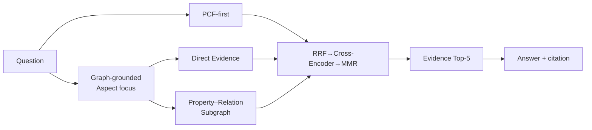
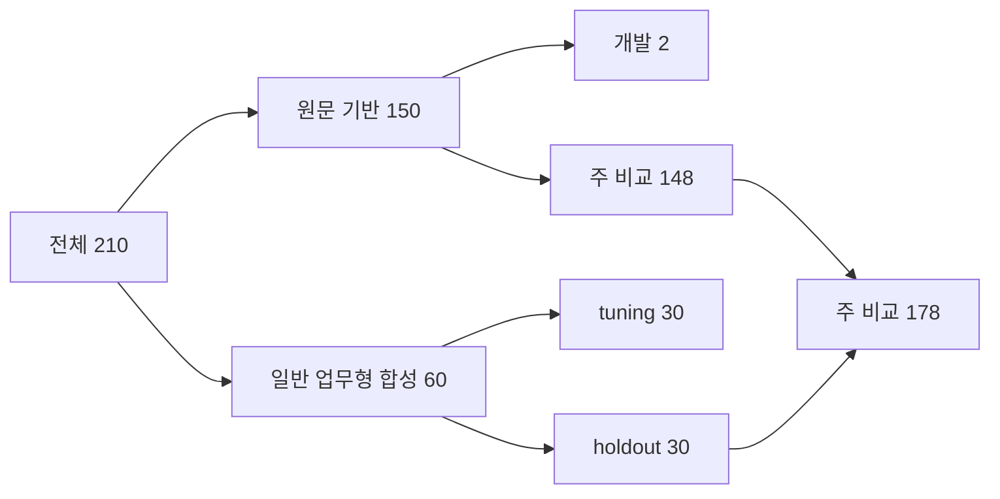
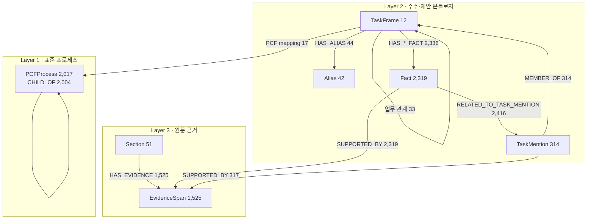
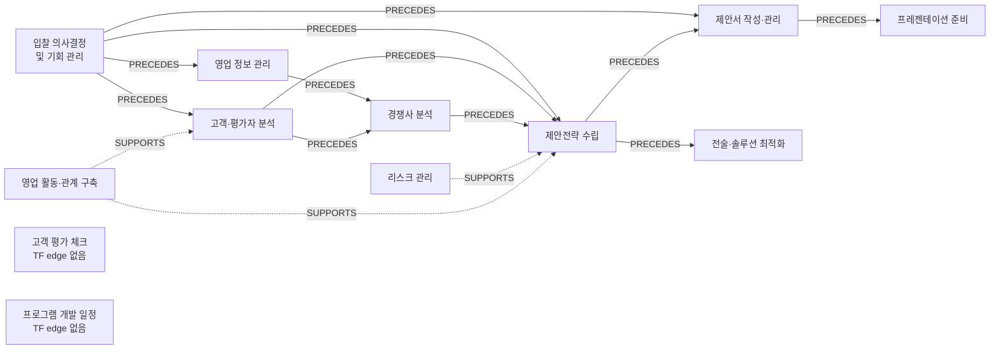
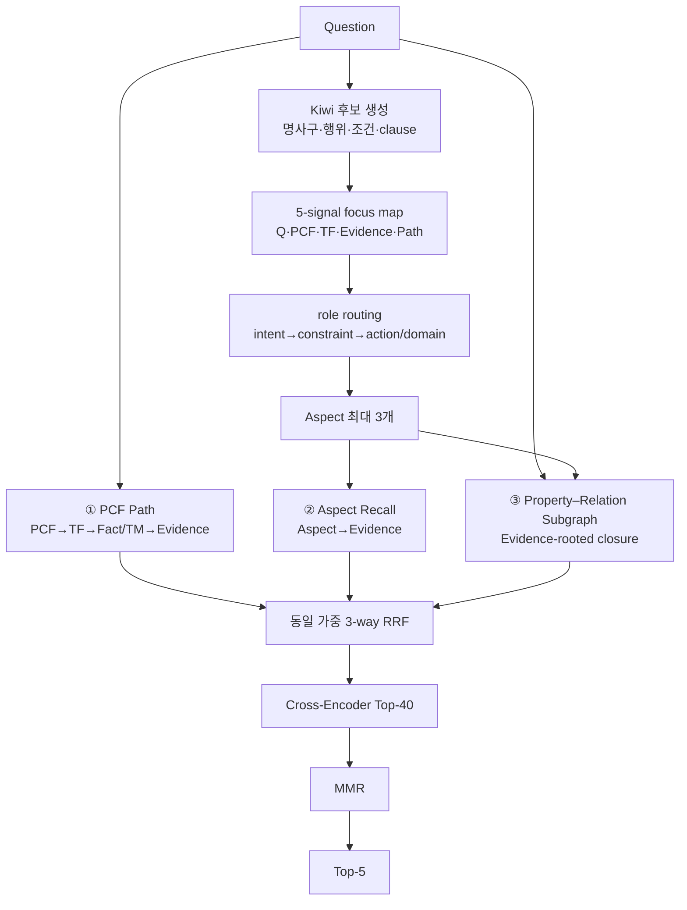
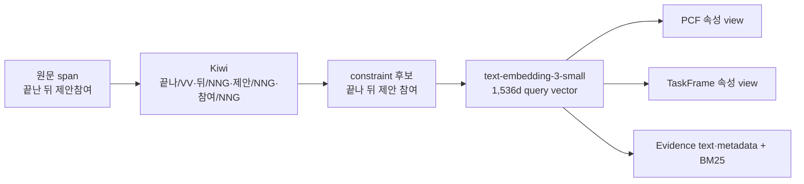
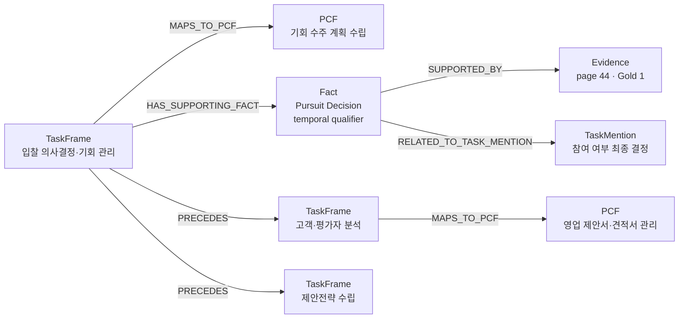
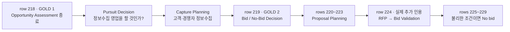

# 1. PARS-KG-RAG

## PCF-Anchored Property–Relation Subgraph KG-RAG

**연구 질문**

수주·제안 질문에서 문장 유사도만 사용하는 Dense RAG보다, PCF 프로세스와
도메인 KG의 노드 속성·관계를 함께 사용하는 검색이 더 정확한 근거를 제공하는가?



| 핵심 결과 | 값 |
|---|---:|
| PARS-KG-RAG Hit@1 | **72.57%** |
| PARS-KG-RAG MRR | **79.77%** |
| PARS-KG-RAG − PCF+Aspect Hit@1 | **+4.57%p**, CI [1.14, 8.00] |
| PARS-KG-RAG − PCF+Aspect MRR | **+2.42%p**, CI [0.26, 4.79] |

> 한 문장 결론: Query Profile 없이 PCF-first를 유지하면서, 실제 속성·관계
> 서브그래프가 정답 근거를 검색 결과의 앞쪽으로 끌어올렸다.

**화면 배치:** 왼쪽 60%는 pipeline, 오른쪽 40%는 네 개 KPI 카드. PCF는 파랑,
TaskFrame은 주황, Fact는 보라, Evidence는 빨강으로 이후 슬라이드와 통일한다.

---

# 2. 실험 데이터셋: 210문항이 어떻게 구성됐는가



일반 업무형 합성 60문항은 여섯 유형을 각각 10개씩 포함한다.

| 직접형 | 시나리오 | 복수 의도 | 프로세스 구조 | 조건 관계 | 구어체 |
|---:|---:|---:|---:|---:|---:|
| 10 | 10 | 10 | 10 | 10 | 10 |

실제 질문 카드:

| 유형 | 질문 예시 |
|---|---|
| 원문형 | “기회분석이 끝난 뒤 제안참여 의사결정 전에는 어떤 결정이 이루어집니까?” |
| 프로세스 일반화 | “수주 기회를 분석한 뒤 실제 입찰 참여 확정 전에는 어떤 결정을 내려야 하나요?” |
| 구어체 | “제안서가 두꺼우면 오히려 점수를 깎이는 경우도 있나요?” |

- Gold Evidence 정렬: 전체 207/210, 주 비교 175/178
- 주 비교 구성: source 148 + synthetic holdout 30
- 원문 장 분포: 입찰과 제안 53, 수주영업 53, 제안서 전략 44
- 평가 단위: 검색 qid, 답변 section cluster, paired bootstrap 10,000회

> 제한: 합성 60문항은 현업자가 독립 작성한 질문이 아니며, 모든 분할을 개발 중
> 관찰했다. 따라서 현재 결과는 탐색적 파일럿이다.

**화면 배치:** 위에는 210→150/60→178 분할 흐름, 아래에는 질문 카드 3개와
Gold 정렬률을 배치한다.

---

# 3. 전체 Neo4j KG: 6,280개 노드와 11,325개 관계



| 관계군 | 수 | 관계군 | 수 |
|---|---:|---|---:|
| PCF 계층 | 2,004 | TaskFrame–Fact | 2,336 |
| TF–PCF / Alias | 61 | Fact–TaskMention | 2,416 |
| Mention–TaskFrame | 314 | Fact/Mention–Evidence | 2,636 |
| Section–Evidence | 1,525 | TaskFrame 간 관계 | 33 |

- PCF level 분포: 13 / 74 / 362 / 1,353 / 215
- Fact 유형: fact 1,567, procedure 283, definition 256, rule 157,
  recommendation 47, decision 9
- Fact·TaskMention 경로가 닿지 않는 EvidenceSpan: 293개

**그래프의 모양:** 위에는 큰 PCF tree, 가운데에는 작은 12개 TaskFrame network,
아래에는 Fact·TaskMention의 조밀한 fan-out과 1,525개 Evidence가 있다. 답변의 최종
근거는 Evidence지만, 그 Evidence를 선택할 때 위 계층 전체를 사용한다.

**화면 배치:** 전체 그래프는 낮은 채도로, 현재 선택된 경로는 파랑→주황→보라/초록→빨강
순으로 진하게 표시한다. query-time Aspect 연결은 노란 점선으로 구분한다.

---

# 4. 실제 업무 온톨로지의 모양: 12개 TaskFrame



| 구조적 역할 | 실제 관찰값 |
|---|---|
| 가장 큰 수렴 허브 | 제안전략 수립: incoming relation 14 |
| 가장 큰 확산 허브 | 고객·평가자 분석: outgoing relation 7 |
| 대표 질문의 진입 업무 | 입찰 의사결정·기회 관리: 14 mentions, 120 facts, 59 evidences |
| 저장된 TF 관계 | PRECEDES 16, SUPPORTS 8, RELATED_TASK 6, SUBTASK_OF 3 |

대표 질문에서 사용되는 실제 관계:

- 입찰 의사결정 → 고객·평가자 분석: “참여 결정 후 정보수집 활동 진행”
- 입찰 의사결정 → 제안전략 수립: “입찰 의사결정 후 전략 수립”
- 입찰 의사결정 → 제안서 작성: “수주 가능성 평가 후 제안 기획 시작”
- 경쟁사 분석 → 입찰 의사결정: “차별화요소를 참여 결정에 활용”

> 이 구조 덕분에 “어떤 문장이 비슷한가?”뿐 아니라 “어떤 결정 전후에 어떤 업무가
> 오는가?”를 검색 신호로 사용할 수 있다.

**화면 배치:** 중심 흐름은 실선, 지원 관계는 점선. 대표 질문과 관련된 BID 노드를
노란 외곽선으로 강조하고, 두 고립 노드는 연결이 없음을 그대로 보여준다.

---

# 5. 최종 모듈: 질문에서 Evidence Top-5까지



**“Attention”의 정확한 의미**

- 최종 방식에는 Transformer self-attention이나 학습형 Attention-Seeker가 없다.
- 질문 후보 구절에 다섯 graph-grounded 신호로 집중도를 부여한다.
- raw score를 직접 합치지 않고 신호별 순위를 reciprocal rank로 균등 결합한다.
- trainable parameter 0개, Aspect용 LLM 호출 0회, Gold 입력 0개다.

```text
AspectScore(a) = (1/5) × Σ 1/rank_signal(a)

PARS(e) = (1/5) × Σ 1/rank_{
  question-property, aspect-coverage, edge-support,
  PCF-anchor, evidence-relevance
}(e)
```

| 역할 | 고정 설정 |
|---|---|
| 임베더 | `text-embedding-3-small`, 1,536차원 |
| Cross-Encoder | `BAAI/bge-reranker-v2-m3` |
| 후보 | branch별 20 → union 40 → 최종 5 |
| 융합 | RRF `k=60`, MMR `lambda=0.90` |
| 답변 | `gpt-4o-mini-2024-07-18`, context ≤6,000자 |

---

# 6. 실제 trace ① 모듈이 어디에 집중하고 Aspect를 뽑는가

## 질문 `JAIJE1-QA-0101`

> “기회분석이 끝난 뒤 제안참여 의사결정 전에는 어떤 결정이 이루어집니까?”

**Kiwi가 실제로 나눈 형태소**

```text
기회/NNG 분석/NNG 이/JKS 끝나/VV ᆫ/ETM 뒤/NNG
제안/NNG 참여/NNG 의사/NNG 결정/NNG 전/NNG 에/JKB 는/JX
어떤/MM 결정/NNG 이/JKS 이루어지/VV ᆸ니까/EF ?/SF
```

- `끝난 → 끝나`, `이루어집 → 이루어지`로 기본형을 사용한다.
- 조사·어미·질문어를 제외하고 명사열, 동사+앞 명사, `뒤/전` 주변 구, 전체
  clause를 조합해 **domain 17 + action 4 + constraint 2 + intent 1 = 24개 후보**를 만든다.
- 예: 원문 `[6,15)` `끝난 뒤 제안참여` → 임베딩 문자열 `끝나 뒤 제안 참여`.



**실제 1위 probe와 속성별 cosine**

| 후보 | PCF 1위·계산 | TaskFrame 1위·계산 | Evidence 1위·계산 |
|---|---|---|---|
| 전체 intent | 기회 수주 계획: identity .398 / description .355 / **path .479** → .395 | 입찰 의사결정: identity .529 / definition .390 / aliases .485 / evidence .420 → .450 | 기회분석 표: text .539 / metadata .372 / BM25 1.0 → .642 |
| 끝나 뒤 제안 참여 | 제안 제출: .401 / **.464** / .408 → .431 | 제안서 관리: .317 / .431 / **.459** / .409 → .399 | Proposal Planning: text .568 / metadata .429 / BM25 .623 → .571 |
| 참여 의사 결정 전 | 사전 승인: .389 / **.427** / .336 → .396 | 입찰 의사결정: .486 / .414 / .433 / .481 → .458 | 단계 6 입찰 결정: **text .683** / metadata .416 / BM25 1.0 → .742 |

PCF는 `.35 identity + .45 description + .20 path`, TaskFrame은
`.25 identity + .25 definition + .15 aliases + .35 representative evidence`, Evidence는
`.75×(.90 text+.10 metadata)+.25×BM25`로 계산한다. 세 번째 PCF의 `사전 승인`은
잡음이지만 PCF는 hard gate가 아니다.

| 선택 Aspect | 역할 | Question | PCF | TF | Evidence | Path | RRF score |
|---|---|---:|---:|---:|---:|---:|---:|
| 기회 분석 끝나 뒤 제안 참여 의사 결정 전 이루어지 | intent | **0.738** | 0.395 | 0.450 | 0.642 | 1.0 | **0.470** |
| 끝나 뒤 제안 참여 | constraint | 0.465 | **0.431** | 0.399 | 0.571 | 1.0 | 0.315 |
| 참여 의사 결정 전 | constraint | 0.698 | 0.396 | **0.458** | **0.742** | 0.0 | 0.240 |

```text
                                Q        PCF      TF       EV       PATH
전체 의도 clause               ███████  ████     ████     ██████   ██████████
끝난 뒤 제안참여               █████    ████     ████     ██████   ██████████
참여 의사결정 전               ███████  ████     █████    ███████  ·
```

세 번째 Aspect는 완전 저장 경로가 없지만 질문·Evidence 적합도와 시간 제약 역할이
분명해 선택된다. 즉 path consistency도 hard gate가 아니다.

5-signal 점수만의 상위 3개는 전체 intent, `제안 참여`, `참여 의사 결정`이었다.
그러나 이대로면 `뒤/전`이 사라지므로 역할 router가 **intent → constraint →
multiword action/domain** 순으로 채워 최종적으로 전체 intent와 두 constraint를
선택한다. Gold·정답은 어느 단계에도 입력하지 않는다.

**초기 PCF Top-3의 실제 잡음**

| 순위 | PCF | score |
|---:|---|---:|
| 1 | 신청인에게 승인·반려 결과 통지 | 0.403 |
| 2 | 조사 결과·시정조치 권고 수령 | 0.398 |
| 3 | 통지 결과 관리 | 0.380 |

`결정·전·결과`라는 일반 표현 때문에 PCF가 틀릴 수 있다. 최종 방식은 PCF를
soft anchor로만 사용하고 Direct와 PARS를 계속 실행한다. PARS는 실제 closure 안에서
정답 관련 `기회 수주 계획 수립` PCF와 `입찰 의사결정 및 기회 관리` TF를 회복한다.

**화면 배치:** 왼쪽은 질문 토큰에서 intent/constraint를 색칠하고, 가운데는 heatmap,
오른쪽은 선택된 Aspect chip 3개와 잘못된 PCF 후보를 회색으로 배치한다.

---

# 7. 실제 trace ② 전체 그래프에서 서브그래프를 어떻게 남기는가

Gold 1 `EV_2c129...`는 문장 단독 Evidence relevance가 12위였지만,
PARS가 관련 노드와 실제 관계를 모아 후보 순위를 4위로 올렸다.

**노드별 저장 속성 → 실제 검색 view**

| 노드 | Neo4j의 주요 저장 속성 | 임베딩 비교 view | 이번 예시에서 선택된 실제 값·cosine |
|---|---|---|---|
| PCF | code, pcfid, name/영문명, 한·영 설명, level, path | identity / description / path | `PCF_18116.path`: “…리드·기회 관리 > 기회 수주 계획 수립” · **.479** |
| TaskFrame | name, definition, scope, status, alias 수, mention 수 | identity / definition+scope / alias 이름 / 대표 Fact quote | `TF_60ee.identity`: “입찰 의사결정 및 기회 관리” · **.554** |
| TaskMention | name, action_raw, focal_object_raw, intended_outcome_raw, confidence, section | identity / action / object / outcome / 직접 Evidence | `TM_c531.object`: “참여 여부에 대한 최종 의사결정을” · **.742** |
| Fact | S/P/O raw·canonical, evidence_quote, qualifiers, knowledge_function, quality | identity / evidence / triple / qualifier / function | `TR_6e8.qualifier`: “기회분석…끝나고 나면” `[temporal]` · **.490** |
| Evidence | text, document, page, paragraph, position, section, type | text / section+page+type metadata | `EV_2c129.text`: Pursuit Decision 원문 · **.444** |
| Alias·Section | 이름, alias 유형·모호성 / 장·절 번호 | 부모 TF aliases / Evidence metadata에 합침 | `Bid/No Bid 결정`; `1.3.1 프로세스가 중요하다` |

최종 서브그래프 단계에서는 질문과 각 Aspect가 노드의 모든 view를 비교한 뒤 그 노드의
**가장 큰 단일 속성**을 남긴다. `runIds`, pipeline version, 색상, hash 같은 운영용
속성은 provenance에는 보존하지만 의미 임베딩에는 넣지 않는다.

**실제 속성 카드**

```text
PCF_18116
  code=3.5.1.5, level=4, name=기회 수주 계획 수립
  description_ko=리드를 마무리하고 영업 기회를 수주하는 방안에 대한 계획을 수립한다.

TF_60ee...
  definition=사업 기회를 발굴하고 참여 여부(Bid/No Bid)를 결정하며
             수주 가능성을 평가하여 자원을 집중하는 업무
  scope=입찰 전 및 초기 단계
  aliases=[입찰 타당성 검토, Bid/No Bid 결정, 기회 발굴]

TR_6e8d...
  S=결정하는 것, P=이다, O=영업참여 결정(Pursuit Decision)
  qualifier={text: 기회분석이 끝나고 나면, type: temporal}
  knowledge_function=definition

EV_2c129...
  page=44, excel_row=218, evidence_type=sentence
  section=입찰과 제안 > 프로세스가 중요하다
```



실제 선택: **8개 노드, 7개 저장 엣지, 가상 엣지 0개**

| PARS 신호 | 값 | 후보 rank | 역할 |
|---|---:|---:|---|
| QuestionProperty | 0.616 | 2 | 질문–노드 속성 일치 |
| AspectCoverage | 0.591 | **1** | 세 Aspect가 closure를 설명 |
| EdgeSupport | 0.715 | 3 | PRECEDES 등 관계 의미 |
| PCFAnchor | 0.500 | **1** | 올바른 업무 계층과 가까움 |
| EvidenceRelevance | 0.519 | 12 | 문장 단독 적합도는 낮음 |

| 최종 | Evidence | Base | Direct | PARS | Cross-Encoder |
|---:|---|---:|---:|---:|---:|
| 1 | `EV_c483...` Bid/No-Bid · Gold 2 | 2 | 6 | **1** | 4 |
| 2 | `EV_2c129...` Pursuit · Gold 1 | 17 | 14 | **4** | **1** |
| 3 | `EV_55c2...` Capture Planning 표 | **1** | 9 | - | 2 |
| 4 | `EV_f562...` Bid Validation | 12 | 10 | 3 | 5 |
| 5 | `EV_6d68...` Milestone | 4 | 5 | 2 | 9 |

> 핵심: Dense similarity만 낮았던 Gold 1을 Aspect coverage, PCF anchor,
> 저장 관계가 보완하고 Cross-Encoder가 최종 확인했다.

**화면 배치:** 배경에 전체 그래프를 회색 점으로 깔고, 위 8개 노드·7개 엣지만
색상으로 확대한다. 오른쪽에는 branch별 순위 변화표를 둔다.

---

# 8. 실제 trace ③ 원문 44페이지 → context → 답변

44페이지 Section `입찰과 제안 > 프로세스가 중요하다`는 16개 EvidenceSpan으로
분리되어 있다. 핵심 구간은 다음 process storyboard다.

최종 Top-5의 페이지 분포는 **44페이지 4개 + 46페이지 표 1개**다. 46페이지 표는
Capture Planning의 주요 활동, Bid/No-Bid 결정, “이길 수 있는가”라는 기준을 요약한
보조 근거이고 Gold는 아니다.



```text
┌────────────────── PAGE 44 / Section 1.3.1 ──────────────────┐
│ [GOLD 1] 기회분석 후 Pursuit Decision                        │
│                        ↓                                    │
│ 고객·경쟁자 정보수집을 위한 Capture Planning                │
│                        ↓                                    │
│ [GOLD 2] 축적 정보 기반 Bid/No-Bid Decision                 │
│                        ↓                                    │
│ Proposal Planning → RFP → Bid Validation → 필요 시 No bid  │
└─────────────────────────────────────────────────────────────┘
```

**방법별 이 문항 결과**

| 방법 | MRR | Recall@5 | Complete@5 |
|---|---:|---:|---:|
| Dense | 0.20 | 0.50 | 0 |
| PCF Path | 0.50 | 0.50 | 0 |
| PCF+Aspect | 0.50 | 0.50 | 0 |
| **PARS-KG-RAG** | **1.00** | **1.00** | **1** |

PARS-KG-RAG 실제 답변:

> “기회분석이 끝난 뒤, 고객과 경쟁자에 대한 정보 수집을 위한 영업참여 결정을
> 하게 됩니다. 이 과정에서 RFP가 나오면 참여 여부에 대한 최종 의사결정을 해야 합니다.”

실제 인용은 Gold 1 `EV_2c129...`와 후속 Bid Validation `EV_f562...`였다. 검색은
두 Gold를 Top-2에 모두 넣었지만 생성기는 Gold 2 대신 후속 문장을 두 번째로 인용했다.
따라서 검색 성공과 생성기 인용 선택을 분리해 평가해야 한다.

**화면 배치:** 왼쪽은 페이지형 카드, 가운데는 단계 timeline, 오른쪽은 답변 bubble과
citation badge. Gold 1·2는 보라/빨강, 추가 인용은 주황 점선으로 표시한다.

---

# 9. 최소 Ablation: 어떤 모듈이 실제로 기여했는가

| 방법 | PCF-first | Direct Aspect | PARS |
|---|:---:|:---:|:---:|
| Dense | - | - | - |
| PCF Path | O | - | - |
| PCF+Aspect | O | O | - |
| **PARS-KG-RAG** | O | O | O |

**검색: 주 비교 178문항, Evidence 분모 175**

| 방법 | Hit@1 | Hit@5 | Recall@5 | Complete@5 | MRR | 평균 검색† |
|---|---:|---:|---:|---:|---:|---:|
| Dense | 47.43 | 77.14 | 60.95 | 46.86 | 58.27 | **0.015s** |
| PCF Path | 66.86 | **91.43** | 71.83 | 55.43 | 76.64 | 0.263s |
| PCF+Aspect | 68.00 | **91.43** | 72.59 | 56.00 | 77.35 | 1.020s |
| **PARS-KG-RAG** | **72.57** | 90.29 | **72.88** | **57.71** | **79.77** | 2.225s |

† 178문항 warm-cache 질문→Top-5 평균/query. Aspect 방법은 P1-G 추출
0.714초를 포함하며, 일회성 로딩·uncached 임베딩·GPT 생성은 제외한다.

- PARS-KG-RAG − PCF+Aspect Hit@1: **+4.57%p**, CI **[1.14, 8.00]**
- PARS-KG-RAG − PCF+Aspect MRR: **+2.42%p**, CI **[0.26, 4.79]**
- Hit@5 -1.14%p, CI [-4.00, 1.71]: 유의한 하락 아님
- PCF+Aspect − PCF Path: 모든 검색 CI가 0 포함

**답변: 단일 생성**

| 방법 | BLEU | R-1 | R-2 | R-L | BERTScore |
|---|---:|---:|---:|---:|---:|
| Dense | 24.68 | 52.43 | 32.14 | 43.81 | 92.32 |
| PCF Path | **26.31** | 54.61 | 34.45 | 45.37 | **92.57** |
| PCF+Aspect | 24.76 | 53.69 | 33.19 | 44.74 | 92.39 |
| **PARS-KG-RAG** | 26.21 | **55.06** | **34.87** | **46.46** | 92.52 |

> 가장 분명한 기여는 Direct Aspect 단독이 아니라 PARS의 상위 근거 순위 개선이다.
> PARS-KG-RAG가 모든 답변 지표에서 최고라고 주장하지 않는다.

---

# 10. 논문 기여, 해석 한계와 다음 검증

| 제안 기여 | 현재 근거 | 남은 검증 |
|---|---|---|
| PCF를 hard gate가 아닌 soft anchor로 사용 | PCF 잡음 사례에서도 Gold Top-2 회복 | 독립 질문에서 재현 |
| 설명 가능한 5-signal Aspect focus | 실제 focus map과 선택 Aspect 추적 가능 | 다른 extractor와 독립 비교 |
| schema별 노드 속성 matching | qualifier·identity·path가 Gold를 보완 | 속성군 제거 ablation |
| Evidence-rooted 방향 제한 closure | 8-node·7-edge 실제 경로 제공 | 큰 KG에서 확장성 |
| 관계 의미를 별도 검색 신호로 사용 | PRECEDES·mapping이 순서 질문을 지지 | 관계 품질 검수 |
| 검색 route와 저장 edge를 분리한 provenance | 가상 엣지 0개, citation trace 제공 | 사용자 설명 평가 |

**말할 수 있는 결론**

- Dense보다 검색 전 지표와 ROUGE-1/2/L이 높았다.
- Property–Relation Subgraph는 PCF+Aspect 대비 Hit@1과 MRR을 개선했다.
- 실제 질문에서 두 Gold 근거를 모두 Top-2로 회복하는 과정을 추적했다.

**피해야 할 결론**

- 최종 모듈이 학습형 attention을 사용한다.
- Direct Aspect 단독 효과가 입증됐다.
- 모든 답변 지표에서 PARS-KG-RAG가 우월하다.
- 합성 60문항 결과가 현업자 독립 질문 성능을 확증한다.

**다음 단계**

1. 현업자 독립 질문과 untouched test set 확보
2. Gold Evidence·reference 이중 검수
3. 동일 context 반복 생성 및 blind human evaluation
4. 검색 Top-2를 생성기가 올바르게 인용하는지 citation-selection 평가

> 최종 판단: PARS-KG-RAG는 논문 후보 방법으로 유지하되, 검색 개선과
> 답변 생성 개선을 분리해 주장한다.
