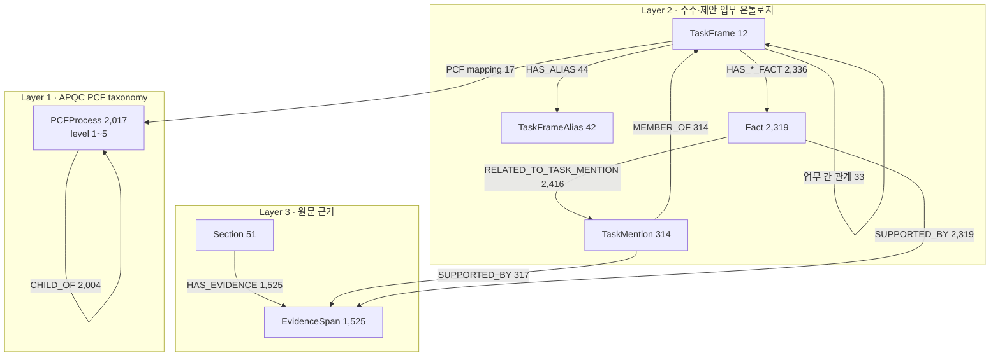
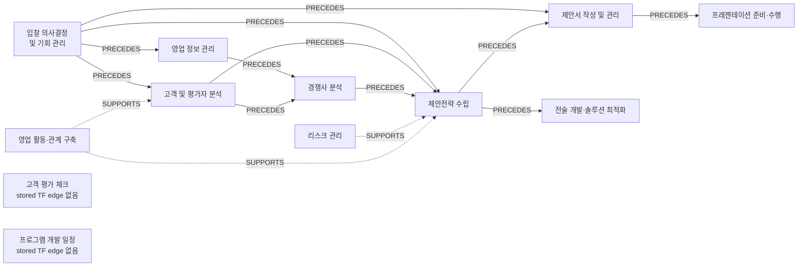
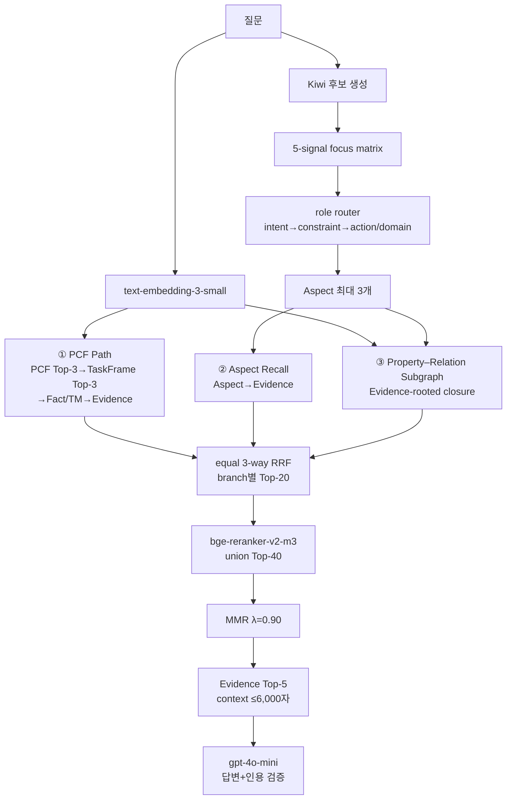
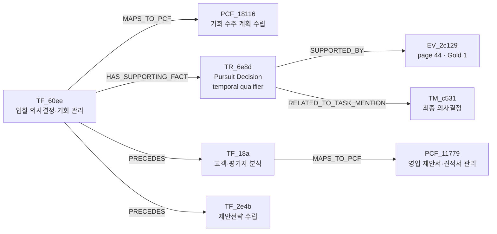
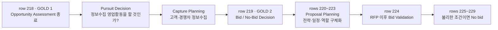

# PARS-KG-RAG 시각화·발표 상세 가이드

공개 이름: **PARS-KG-RAG**

영문명: **PCF-Anchored Property–Relation Subgraph KG-RAG**

한국어명: **PCF 앵커 기반 속성·관계 서브그래프 KG-RAG**

기준 실행: `p1p_profile_free_component_ablation_210_20260921`

대표 trace: `JAIJE1-QA-0101`

이 문서는 PARS-KG-RAG의 내부 동작을 실제 실행값으로 시각화하기 위한 자료다. 전체 KG,
질문 집중도 계산, Aspect 선택, 세 검색 branch, PARS 서브그래프, 원문 페이지,
답변과 인용까지 하나의 사례로 연결한다. 발표 자료에 수치를 옮길 때는 이 문서의
색상·노드 ID·점수·문장을 그대로 사용할 수 있다.

## 1. 먼저 바로잡을 용어: 여기서 “attention”은 무엇인가

최종 PARS-KG-RAG에는 Transformer의 학습형 self-attention이나 과거 실험의
`Attention-Seeker` 모델이 들어가지 않는다. 최종 Aspect 모듈은 다음 다섯 신호로
질문의 어느 구절에 집중할지 결정하는 **비지도 graph-grounded focus scoring**이다.

```text
학습형 Attention                         최종 P1-G focus scoring
-------------------------------         --------------------------------
Q/K/V projection                        질문·PCF·TaskFrame·Evidence probe
학습된 attention weight                 고정된 reciprocal-rank 결합
역전파로 parameter 갱신                 trainable parameter 0개
token별 hidden-state 혼합                구절 후보 선택·검색 query 생성
```

따라서 발표에서는 다음처럼 표현하는 것이 정확하다.

> “모듈이 질문 후보 구절에 graph-grounded 집중도를 부여한다. 이는 설명 가능한
> attention-like focus map이며, 학습된 neural attention weight는 아니다.”

논문 본문에서는 `attention` 단독 표현보다 `graph-grounded aspect focus` 또는
`five-signal aspect rank fusion`을 사용한다.

## 2. 권장 시각 언어

| 대상 | 색 | 화면에서의 의미 |
|---|---|---|
| Question / Aspect | 노랑 `#FACC15` | 현재 질의가 집중하는 표현 |
| PCFProcess | 파랑 `#2563EB` | 표준 프로세스 계층·soft anchor |
| TaskFrame / Alias | 주황 `#F97316` | 도메인 업무 단위·동의어 |
| TaskMention | 초록 `#16A34A` | 원문에 등장한 행위·대상·결과 |
| Fact | 보라 `#7C3AED` | 정의·절차·조건·SPO 사실 |
| EvidenceSpan | 빨강 `#DC2626` | 최종 답변의 원문 근거 |
| Section / page | 회색 `#64748B` | 원문 위치와 문맥 |
| query-time route | 노랑 점선 | 저장되지 않은 임시 유사도 연결 |
| stored Neo4j edge | 실선 | 스냅샷에 실제 존재하는 관계 |

PPT에서는 전체 그래프를 낮은 채도의 회색으로 두고, 선택된 서브그래프만 위 색상으로
강조하면 “전체 6,280개 중 왜 이 8개가 선택됐는가”가 한눈에 보인다.

## 3. 전체 Neo4j 그래프는 어떤 모양인가

### 3.1 데이터 모델과 규모



- 고유 노드: 6,280개
- 저장 관계: 11,325개, Neo4j 관계 타입 16종
- PCF level 분포: 13 / 74 / 362 / 1,353 / 215
- 12개 TaskFrame은 11개의 서로 다른 PCF에 직접 연결되며 mapping edge는 17개다.
- Fact의 knowledge function: fact 1,567, procedure 283, definition 256,
  rule 157, recommendation 47, decision 9
- Fact·TaskMention 구조 경로가 닿지 않는 EvidenceSpan은 293개다. 따라서
  Direct Aspect–Evidence branch와 전역 Evidence fallback을 유지한다.

### 3.2 관계 수를 합하면 11,325개가 되는 과정

| 관계군 | 수 |
|---|---:|
| PCF `CHILD_OF` | 2,004 |
| TaskFrame–PCF mapping | 17 |
| TaskFrame–Alias | 44 |
| TaskMention–TaskFrame | 314 |
| TaskFrame–Fact | 2,336 |
| Fact–TaskMention | 2,416 |
| Fact/TaskMention–Evidence | 2,636 |
| Section–Evidence | 1,525 |
| TaskFrame 간 관계 | 33 |
| **합계** | **11,325** |

### 3.3 실제 12개 TaskFrame의 중심도

| TaskFrame | Mention | Fact | 연결 Evidence | TF 관계 out/in |
|---|---:|---:|---:|---:|
| 고객 및 평가자 분석 | 56 | 529 | 323 | 7 / 3 |
| 제안전략 수립 | 65 | 510 | 327 | 2 / 14 |
| 제안서 작성 및 관리 | 55 | 253 | 146 | 3 / 3 |
| 영업 정보 관리 | 35 | 265 | 52 | 3 / 4 |
| 영업 활동 및 관계 구축 | 31 | 245 | 172 | 2 / 3 |
| 경쟁사 분석 | 25 | 199 | 84 | 5 / 3 |
| 입찰 의사결정 및 기회 관리 | 14 | 120 | 59 | 5 / 1 |
| 리스크 관리 | 11 | 113 | 53 | 2 / 0 |
| 전술 개발 및 솔루션 최적화 | 10 | 64 | 48 | 3 / 1 |
| 프레젠테이션 준비 및 수행 | 10 | 34 | 9 | 1 / 1 |
| 고객 평가 체크 | 1 | 2 | 2 | 0 / 0 |
| 프로그램 개발 일정 수립 | 1 | 2 | 1 | 0 / 0 |

`제안전략 수립`은 incoming relation 14개인 수렴 허브이고, `고객 및 평가자 분석`은
outgoing relation 7개인 확산 허브다. 대표 질문의 `입찰 의사결정 및 기회 관리`는
Fact 수는 상대적으로 작지만 네 개 후속 업무로 이어지는 process-entry 역할을 한다.

### 3.4 실제 TaskFrame 업무 흐름



이 그림은 33개 관계 중 주 흐름만 보여준다. 전체 저장 관계는 PRECEDES 16,
SUPPORTS 8, RELATED_TASK 6, SUBTASK_OF 3개다. `고객 평가 체크`와
`프로그램 개발 일정 수립`은 Fact/Evidence와 PCF에는 연결되지만 현재 TaskFrame 간
관계는 없다.

## 4. 최종 검색 모듈의 전체 정보 흐름



고정 모델과 parameter:

- 임베딩: `text-embedding-3-small`, 1,536차원, L2 정규화
- Aspect: Kiwi + P1-G, LLM 0회, 학습 parameter 0개
- Cross-Encoder: `BAAI/bge-reranker-v2-m3`, revision `953dc6f...`
- 후보: 각 branch 20, 합집합 재정렬 40, 최종 5
- RRF `k=60`, MMR `lambda=0.90`
- 생성·인용 검증: `gpt-4o-mini-2024-07-18`

## 5. 실제 질문이 모듈에 들어오는 순간

### 5.1 입력과 정답 범위

`JAIJE1-QA-0101` 질문:

> 기회분석이 끝난 뒤 제안참여 의사결정 전에는 어떤 결정이 이루어집니까?

참조 답변은 두 단계의 순서를 요구한다.

1. 기회분석 후 고객·경쟁자 정보수집 영업활동을 할지 정하는
   `영업참여 결정(Pursuit Decision)`
2. 정보수집 활동 후 축적된 정보로 수행하는
   `제안참여 의사결정(Bid/No-Bid Decision)`

Gold Evidence는 원문 44페이지의 연속 문장 두 개다.

- `EV_2c129...`, Excel row 218: Pursuit Decision
- `EV_c483...`, Excel row 219: Bid/No-Bid Decision

### 5.2 Kiwi 후보 생성

Kiwi 0.23.2가 실제로 반환한 형태소는 다음과 같다. `원문 위치`는 0부터 시작하는
문자 offset이며, 표면형과 기본형이 다른 경우를 함께 표시했다.

| # | 원문 표면 | Kiwi `form` | POS | 시작 | 길이 | 검색에서의 역할 |
|---:|---|---|---|---:|---:|---|
| 0 | 기회 | 기회 | NNG | 0 | 2 | 명사 후보 |
| 1 | 분석 | 분석 | NNG | 2 | 2 | 명사 후보 |
| 2 | 이 | 이 | JKS | 4 | 1 | 조사, 내용어에서 제외 |
| 3 | 끝난 | 끝나 | VV | 6 | 2 | 동사 기본형 |
| 4 | 난 | ᆫ | ETM | 7 | 1 | 어미, 제외 |
| 5 | 뒤 | 뒤 | NNG | 9 | 1 | 명사이자 시간 제약 marker |
| 6 | 제안 | 제안 | NNG | 11 | 2 | 명사 후보 |
| 7 | 참여 | 참여 | NNG | 13 | 2 | 명사 후보 |
| 8 | 의사 | 의사 | NNG | 16 | 2 | 명사 후보 |
| 9 | 결정 | 결정 | NNG | 18 | 2 | 명사 후보 |
| 10 | 전 | 전 | NNG | 21 | 1 | 명사이자 시간 제약 marker |
| 11–12 | 에는 | 에 + 는 | JKB + JX | 22 | 2 | 조사, 제외 |
| 13 | 어떤 | 어떤 | MM | 25 | 2 | 문법 질문어, 제외 |
| 14 | 결정 | 결정 | NNG | 28 | 2 | 명사 후보; 앞의 `결정`과 통합 |
| 15 | 이 | 이 | JKS | 30 | 1 | 조사, 제외 |
| 16 | 이루어집 | 이루어지 | VV | 32 | 4 | 동사 기본형 |
| 17–18 | 니까? | ᆸ니까 + ? | EF + SF | 35 | 4 | 종결어미·문장부호, 제외 |

여기서 **Kiwi가 곧바로 Aspect 세 개를 출력하는 것은 아니다.** 다음 결정론적 규칙으로
후보를 만든다.

1. 연속 명사열은 전체 구와 1·2·3개 연속 window를 만든다.
2. 동사는 단독 action과 가장 가까운 앞 명사 최대 두 개를 결합한 action을 만든다.
3. `뒤`, `전` 같은 marker 주위 최대 네 내용어를 constraint 후보로 만든다.
4. 내용 형태소가 6개 이상인 긴 절은 질문 전체의 intent 후보로 보존한다.
5. 조사·어미를 제거한 `terms`가 같으면 하나로 합치되 원문 span은 모두 남긴다.

이 질문에서는 **총 24개 후보**가 생성됐다.

| 유형 | 수 | 실제 후보 `query_text` |
|---|---:|---|
| domain | 17 | `기회 분석`, `기회`, `분석`, `뒤 제안 참여 의사 결정 전`, `제안`, `참여`, `의사`, `결정`, `뒤 제안`, `제안 참여`, `참여 의사`, `의사 결정`, `결정 전`, `뒤 제안 참여`, `제안 참여 의사`, `참여 의사 결정`, `의사 결정 전` |
| action | 4 | `끝나`, `기회 분석 끝나`, `이루어지`, `결정 이루어지` |
| constraint | 2 | `끝나 뒤 제안 참여`, `참여 의사 결정 전` |
| intent | 1 | `기회 분석 끝나 뒤 제안 참여 의사 결정 전 이루어지` |

예를 들어 원문 `끝난 뒤 제안참여`는 그대로 임베딩하지 않고, Kiwi 기본형과
내용어만 남긴 `끝나 뒤 제안 참여`를 검색 query로 임베딩한다. 반면 원문 span
`[6, 15)`는 설명과 검증을 위해 보존한다.

```text
원문 표면          끝난 뒤 제안참여
Kiwi 내용 형태소   끝나 / 뒤 / 제안 / 참여
후보 종류          constraint
실제 임베딩 문자열 끝나 뒤 제안 참여
```

정답, Gold Evidence ID, 참조 답변은 후보 생성이나 선택에 입력되지 않는다.

### 5.3 임베딩은 정확히 무엇과 무엇을 비교하는가

모든 후보의 `query_text`와 원 질문을 `text-embedding-3-small`의 1,536차원
L2-normalized query vector로 만든다. 그래프 노드 쪽은 아래 의미 view마다 별도의
document vector를 미리 만든다. 따라서 내적은 코사인 유사도와 같다.

Aspect 선택 단계와 최종 서브그래프 단계는 같은 임베딩을 쓰지만 집계 방식이 다르다.

| 단계 | 비교 | 한 노드의 속성 집계 |
|---|---|---|
| Aspect 후보 grounding | 후보 vector ↔ PCF·TaskFrame·Evidence view | PCF/TF는 정해진 view 가중평균, Evidence는 semantic+BM25 |
| 최종 PARS node matching | 질문/선택 Aspect vector ↔ 전체 5종 노드 view | 한 노드에서 가장 큰 단일 속성 유사도 `max` |

Aspect 후보 `a`의 PCF·TaskFrame·Evidence support는 다음과 같다.

```text
PCF(a, p) = .35·cos(a, identity_p)
          + .45·cos(a, description_p)
          + .20·cos(a, path_p)
PCFSupport(a) = max_p PCF(a, p)

TF(a, t) = .25·cos(a, identity_t)
         + .25·cos(a, definition_t)
         + .15·cos(a, aliases_t)
         + .35·cos(a, representative_evidence_t)
TFSupport(a) = max_t TF(a, t)

EvidenceSemantic(a, e) = .90·cos(a, text_e) + .10·cos(a, metadata_e)
EvidenceHybrid(a, e)   = .75·EvidenceSemantic(a, e) + .25·BM25(a, e)
EvidenceSupport(a)     = max_e EvidenceHybrid(a, e)
```

빈 view는 분모에서 제외된다. BM25는 해당 query 안에서 0–1로 정규화된다. 이
가중치는 Aspect 후보를 KG에 probe할 때만 쓰며, 최종 node-property match는 아래
8절처럼 단일 최고 속성을 선택한다.

## 6. 실제 “attention-like” focus map과 Aspect 선택

### 6.1 다섯 집중 신호

후보 `a`마다 다음 probe를 수행한다.

```text
Question relevance : cos(question, a)
PCF support        : PCF view 가중평균이 가장 큰 노드의 점수
TaskFrame support  : TaskFrame view 가중평균이 가장 큰 노드의 점수
Evidence support   : best hybrid evidence relevance
Path consistency   : top PCF–TaskFrame–Evidence stored path의 존재
```

raw score의 단위가 서로 다르므로 그대로 가중합하지 않고 각 신호 안의 후보 순위를
reciprocal rank로 바꿔 균등 결합한다.

```text
AspectScore(a) = (1/5) × Σ[j=1..5] 1 / rank_j(a)
```

Path consistency는 단순 문자열 일치가 아니다. 후보별 PCF·TaskFrame·Evidence Top-3를
놓고, PCF와 TaskFrame이 동일/2-hop 이내 PCF mapping으로 이어지는지와 TaskFrame이
Evidence에 Fact·TaskMention 경로로 이어지는지를 각각 reciprocal rank로 계산해
반씩 합친다. 따라서 값 1.0은 두 연결이 모두 각 Top-1에서 확인됐다는 뜻이고,
0.0은 이 작은 Top-3 probe 안에서 완전 경로를 확인하지 못했다는 뜻이다.

### 6.2 실제 후보 임베딩이 닿은 노드·속성

다음은 선택된 세 Aspect마다 **실제로 1위였던 PCF, TaskFrame, Evidence**와 그
계산을 재구성한 표다. 반올림 전 값은 실행 artifact와 embedding cache에서 읽었다.

| Aspect | PCF Top-1 | PCF view cosine → support | TaskFrame Top-1 | TF view cosine → support | Evidence Top-1 | Evidence 계산 → support |
|---|---|---|---|---|---|---|
| 전체 intent | `PCF_18116` 기회 수주 계획 수립 | identity .398, description .355, **path .479** → **.395** | `TF_60ee...` 입찰 의사결정 및 기회 관리 | identity .529, definition .390, aliases .485, evidence .420 → **.450** | `EV_799a...` 기회분석/Pursuit 표 | text .539, metadata .372 → semantic .522; BM25 1.000 → **.642** |
| 끝나 뒤 제안 참여 | `PCF_11790` 고객에 입찰·제안 제출 | identity .401, **description .464**, path .408 → **.431** | `TF_60295...` 제안서 작성 및 관리 | identity .317, definition .431, **aliases .459**, evidence .409 → **.399** | `EV_3dfe...` 참여 후 Proposal Planning | text .568, metadata .429 → semantic .554; BM25 .623 → **.571** |
| 참여 의사 결정 전 | `PCF_20102` 사전 승인 관리 | identity .389, **description .427**, path .336 → **.396** | `TF_60ee...` 입찰 의사결정 및 기회 관리 | identity .486, definition .414, aliases .433, evidence .481 → **.458** | `EV_f5e0...` 단계 6 입찰 참여 의사 결정 | **text .683**, metadata .416 → semantic .656; BM25 1.000 → **.742** |

첫 Aspect의 PCF 계산 예는 다음과 같이 정확히 재현된다.

```text
0.35×0.397967 + 0.45×0.354851 + 0.20×0.479052
= 0.394782  → PCFSupport
```

세 번째 Aspect의 PCF Top-1이 `사전 승인 관리`인 것은 의미 있는 실패 사례다.
`전`과 `결정`이라는 일반 표현이 `사전 승인`에 끌렸다. 하지만 TaskFrame과 Evidence는
입찰 의사결정을 정확히 가리키고, PCF는 hard gate가 아니므로 이 잘못된 단일 probe가
후보를 제거하지 않는다.

각 Aspect의 Top-3 ID와 이름도 다음과 같다.

| Aspect | PCF Top-3 | TaskFrame Top-3 | Evidence Top-3 |
|---|---|---|---|
| 전체 intent | 기회 수주 계획 수립 / 리드·기회 검증·자격 평가 / 통지 결과 관리 | 입찰 의사결정·기회 관리 / 고객·평가자 분석 / 프로그램 개발 일정 | 기회분석·Pursuit 표 / 단계별 Bid-No Bid 그림 / 단계 6 입찰 결정 |
| 끝나 뒤 제안 참여 | 고객에 입찰·제안 제출 / RFP·RFQ 접수 / 기회 수주 계획 | 제안서 작성·관리 / 입찰 의사결정·기회 관리 / 프로그램 개발 일정 | 참여 후 Proposal Planning / 참여 결정 후 전략 / 정보수집 후 Bid-No Bid |
| 참여 의사 결정 전 | 사전 승인 관리 / 이사회 검토 보고서 / 조사 결과·조치 권고 수령 | 입찰 의사결정·기회 관리 / 고객·평가자 분석 / 경쟁사 분석 | 단계 6 입찰 결정 / 단계별 Bid-No Bid 그림 / 의사결정자의 영향자 정의 |

이 표에서 PCF·TaskFrame support는 “가장 유사한 속성 하나”가 아니라 각 노드의
view 가중평균이다. 반대로 8절의 최종 서브그래프 노드 표는 가장 유사한 단일 속성을
표시한다. 두 숫자를 혼동하면 안 된다.

### 6.3 실제 선택된 세 Aspect와 raw focus 값

| 선택 Aspect | 역할 | Question | PCF | TF | Evidence | Path | 최종 RRF score |
|---|---|---:|---:|---:|---:|---:|---:|
| 기회 분석 끝나 뒤 제안 참여 의사 결정 전 이루어지 | intent | 0.738 | 0.395 | 0.450 | 0.642 | 1.0 | 0.470 |
| 끝나 뒤 제안 참여 | constraint | 0.465 | 0.431 | 0.399 | 0.571 | 1.0 | 0.315 |
| 참여 의사 결정 전 | constraint | 0.698 | 0.396 | 0.458 | **0.742** | 0.0 | 0.240 |

시각화용 heat bar:

```text
                                Q        PCF      TF       EV       PATH
전체 의도 clause               ███████  ████     ████     ██████   ██████████
끝난 뒤 제안참여               █████    ████     ████     ██████   ██████████
참여 의사결정 전               ███████  ████     █████    ███████  ·
```

세 번째 후보는 top probe의 완전한 저장 경로가 없지만 질문·Evidence 적합도가 높고
시간 제약이라는 역할이 분명해 router가 선택한다. 즉 path signal이 hard gate가 아니다.

5-signal 점수만 보면 상위 세 후보는 `전체 intent`(0.470), `제안 참여`(0.449),
`참여 의사 결정`(0.442)이었다. 그러나 짧은 domain 구 두 개만 고르면 질문의 `뒤`와
`전`이라는 순서 제약이 사라진다. 그래서 결정론적 router가 intent → 명시적
constraint → 다단어 action/domain → grounded-rank backfill 순서로 역할을 채운다.
그 결과 `전체 intent`와 두 constraint가 최종 Aspect가 됐다. 의미가 완전히 포함되는
짧은 후보는 중복으로 보고 최대 3개만 남기며, 선택 후 별도 applicability gate 없이
세 Aspect를 downstream에 전달한다.

### 6.4 PCF가 틀릴 때도 계속 진행하는 이유

이 질문의 초기 PCF Top-3는 다음과 같이 잡음이 있었다.

| 초기 순위 | PCF | score |
|---:|---|---:|
| 1 | 신청인에게 승인·반려 결과 통지 | 0.403 |
| 2 | 조사 결과·시정조치 권고 수령 | 0.398 |
| 3 | 통지 결과 관리 | 0.380 |

`결정`, `전`, `결과`라는 일반 표현 때문에 승인·통지 프로세스가 유사하게 나온다.
따라서 PCF를 hard routing으로 쓰면 여기서 실패한다. 최종 방법은 PCF를 soft anchor로
유지하면서 Direct와 PARS를 병렬 실행한다. PARS closure 안에서는 실제 연결을 통해
정답 관련 `PCF_18116 기회 수주 계획 수립`을 회복한다.

## 7. 세 branch에서 실제 후보 순위가 어떻게 바뀌는가

최종 PARS-KG-RAG의 Top-5는 다음과 같다.

| 최종 | Evidence | page | Base rank | Direct rank | PARS rank | CE rank | 역할 |
|---:|---|---:|---:|---:|---:|---:|---|
| 1 | `EV_c483...` Bid/No-Bid | 44 | 2 | 6 | **1** | 4 | Gold 2 |
| 2 | `EV_2c129...` Pursuit Decision | 44 | 17 | 14 | **4** | **1** | Gold 1 |
| 3 | `EV_55c2...` Capture Planning 표 | 46 | **1** | 9 | - | 2 | 보조 근거 |
| 4 | `EV_f562...` Bid Validation | 44 | 12 | 10 | 3 | 5 | 후속 단계 |
| 5 | `EV_6d68...` Milestone | 44 | 4 | 5 | 2 | 9 | 문맥 근거 |

`EV_2c129...`는 Base 17위, Direct 14위로 branch Top-5만 봤다면 놓칠 수 있었다.
PARS가 4위로 끌어올리고 Cross-Encoder가 질문과의 쌍 적합도를 1위로 판정해 최종
2위가 됐다. 반대로 `EV_c483...`는 PARS 1위라 최종 1위를 유지했다.

세 branch 결과는 다음처럼 결합된다.

```text
ThreeRRF(e) = I_base(e)/(60+r_base)
            + I_direct(e)/(60+r_direct)
            + I_PARS(e)/(60+r_PARS)

FinalRelevance(e) = 1/(60+r_candidate) + 1/(60+r_cross_encoder)
```

마지막 MMR은 90% relevance와 10% diversity를 사용한다. 같은 section의 중복 문장을
줄이되 융합 상위 후보 2개는 quota로 보존한다.

## 8. 실제 PARS 서브그래프가 추출되는 과정

### 8.1 Evidence-rooted closure

PARS는 전체 그래프를 무제한 탐색하지 않는다. 각 EvidenceSpan에서 출발해 다음 방향만
허용한다.

```text
EvidenceSpan
  ← SUPPORTED_BY — Fact / TaskMention
  ← HAS_*_FACT / MEMBER_OF — TaskFrame
  → MAPS_TO_PCF / Alias / TaskFrame 1-hop relation
  → PCF CHILD_OF parent chain
```

1-hop 이웃 TaskFrame의 모든 Fact로 다시 확장하지 않아 고차수 hub가 단순히 노드 수로
유리해지는 것을 막는다.

### 8.2 노드마다 실제로 저장된 속성과 검색에 쓰는 view

Neo4j 속성을 전부 하나의 문자열로 섞지 않는다. 의미가 있는 속성만 역할별 view로
묶어 따로 임베딩하며, ID·품질·lineage 속성은 연결 검증과 provenance에는 쓰되 의미
유사도에는 넣지 않는다.

| 노드 유형 | snapshot에 실제 존재하는 주요 속성 | 임베딩하는 semantic view | 구조·표시용이어서 임베딩하지 않는 예 |
|---|---|---|---|
| `PCFProcess` | `id`, `code`, `pcfid`, `hid`, `name`, `name_en`, `description_ko/en`, `level`, `path_ids`, `computed_path`, `computed_path_text`, `scheme`, `validation_status`, lineage/색상 | `identity`=`code+pcfid+name+name_en`; `description`=`description_ko+description_en`; `path`=`computed_path_text` | `id`는 join/provenance, `level/path_ids`는 계층 거리, `runIds`, `lastRunId`, `pipelineVersion`, `vizColor`는 운영용 |
| `TaskFrame` | `id`, `name`, `displayName`, `definition`, `scope`, `status`, `alias_count`, `alias_model`, `raw_task_mention_count`, schema/lineage | `identity`; `definition`=`definition+scope`; `aliases`=연결 Alias 이름; `evidence`=관계 중요도순 대표 Fact quote 최대 4개 | count, status, schema version, run/색상 |
| `TaskFrameAlias` | `id`, `name`, `normalized_key`, `alias_type`, `language`, `ambiguous`, `target_count`, `validation_status`, lineage | Alias 노드를 독립 점수화하지 않고 연결된 TaskFrame의 `aliases` view에 `name`을 합침 | ambiguity·target count는 검수/provenance |
| `TaskMention` | `id`, `name`, `displayName`, `action_raw`, `focal_object_raw`, `intended_outcome_raw`, `confidence`, `section_path`, `canonicalization_eligible`, `quality_status/issues`, lineage | `identity`; `action`; `object`; `outcome`; `evidence`=직접 연결 Evidence 원문 | confidence/quality/canonicalization과 lineage |
| `Fact` | `id`, `name`, `displayName`, `subject/predicate/object_raw`, 각 canonical 값, `evidence_quote`, `qualifiers`, `knowledge_function`, `canonical_fact_id`, `active`, `task_related`, quality/lineage | `identity`; `evidence`; `triple`=`S+P+O`; `qualifier`; `function` | active/task_related는 후보 허용·검수, canonical ID와 lineage는 provenance |
| `EvidenceSpan` | `id`, `sentence_id`, `name`, `displayName`, `document_id`, `source_file`, `page`, `paragraph_id`, `position`, `section_path`, `evidence_type`, audit/lineage | `text`=`name/displayName`; `metadata`=`section_path+page+evidence_type+Section.name` | 파일·문장 ID와 position은 citation/provenance |
| `Section` | `id`, `name`, `displayName`, `chapter_no`, `section_no`, lineage | 독립 점수화하지 않고 연결 Evidence의 `metadata` view에 `name`을 합침 | 번호·lineage는 위치 표시와 graph path |

스냅샷 전체에서 관찰된 **노드별 property key의 완전한 합집합**은 다음과 같다.
어떤 개별 노드에는 optional key가 없을 수 있다.

```text
PCFProcess
  code, computed_path, computed_path_text, description_en, description_ko,
  graphLayer, graphLayerName, hid, id, lastRunId, level, name, name_en,
  path_ids, pcfid, pipelineVersion, runIds, scheme, type,
  validation_status, vizColor

TaskFrame
  alias_count, alias_model, definition, displayName, graphLayer,
  graphLayerName, id, lastRunId, name, pipelineVersion,
  raw_task_mention_count, runIds, schema_version, scope, status, type,
  vizColor

TaskFrameAlias
  alias_type, ambiguous, graphLayer, graphLayerName, id, language,
  lastRunId, name, normalized_key, pipelineVersion, runIds, target_count,
  type, validation_status, vizColor

TaskMention
  action_raw, canonicalization_eligible, confidence, displayName,
  focal_object_raw, graphLayer, graphLayerName, id, intended_outcome_raw,
  lastRunId, name, pipelineVersion, quality_issues, quality_status,
  rawName, runIds, section_path, type, vizColor

Fact
  active, canonical_fact_id, displayName, evidence_quote, graphLayer,
  graphLayerName, id, knowledge_function, lastRunId, lifecycleStatus,
  link_rejudged_by_llm_2, name, object_canonical, object_raw,
  pipelineVersion, predicate_canonical, predicate_raw, qualifiers,
  quality_issues, quality_status, rawName, raw_fact_preserved, runIds,
  subject_canonical, subject_raw, supersededByRunId, task_related, type,
  vizColor

EvidenceSpan
  displayName, document_id, evidence_type, graphLayer, graphLayerName, id,
  lastRunId, name, page, paragraph_id, pipelineVersion, position, rawName,
  runIds, section_path, sentence_audit_status, sentence_id, source_file,
  type, vizColor

Section
  chapter_no, displayName, graphLayer, graphLayerName, id, lastRunId,
  name, pipelineVersion, runIds, section_no, type, vizColor
```

스냅샷 행의 `aliases`, `taskframe_id`, `frame_links`, `taskmention_links`,
`evidence_ids`, `sections`는 Neo4j 노드 자체의 property가 아니라 관계를 함께 내보낸
snapshot wrapper 필드다. 검색기는 이를 이용해 실제 stored edge와 direct evidence
연결을 복원한다.

검색 index가 직접 점수화하는 것은 PCFProcess, TaskFrame, TaskMention, Fact,
EvidenceSpan의 다섯 유형이다. Alias와 Section도 실제 노드와 엣지로 closure에 들어가지만,
각각 TaskFrame aliases와 Evidence metadata로 의미가 반영된다.

최종 node match는 다음처럼 **각 노드 안에서 가장 큰 단일 view**를 남긴다.

```text
NodeMatch(q, v) = max over p in SemanticViews(v) of max(0, cosine(q, Emb(v.p)))
```

즉 Fact의 `qualifier`가 가장 높으면 triple이나 evidence quote보다 qualifier가 그 노드의
대표 매칭 속성으로 기록된다. 이것이 아래 실제 예시에서 일어난 일이다.

### 8.3 대표 trace의 실제 노드 속성 카드

아래 값은 예시를 위해 만든 문장이 아니라
`00_graph_snapshot.json`에 저장된 실제 값이다. 운영용 필드는 일부만 축약했다.

#### A. `PCF_18116` · PCFProcess

```yaml
id: PCF_18116
code: 3.5.1.5
pcfid: 18116
level: 4
name: 기회 수주 계획 수립
name_en: Develop opportunity win plans
description_ko: 리드를 마무리하고 영업 기회를 수주하는 방안에 대한 계획을 수립한다.
description_en: Creating plans about how to close leads and win sales opportunities.
path_ids: ["3.0", "3.5", "3.5.1", "3.5.1.5"]
computed_path_text: 제품·서비스 마케팅 및 판매 > 영업 계획 개발·관리 > 리드·기회 관리 > 기회 수주 계획 수립
validation_status: accepted
```

만들어진 view와 실제 매칭:

```text
identity    = 3.5.1.5 | 18116 | 기회 수주 계획 수립 | Develop opportunity win plans
description = 리드를 ... 계획을 수립한다 | Creating plans ...
path        = 제품·서비스 마케팅 및 판매 > ... > 기회 수주 계획 수립

전체 intent Aspect ↔ path cosine = 0.479052  ← 최종 서브그래프의 대표 속성
```

#### B. `TF_60ee157b4e7ad615` · TaskFrame

```yaml
id: TF_60ee157b4e7ad615
name/displayName: 입찰 의사결정 및 기회 관리
definition: 사업 기회를 발굴하고, 참여 여부(Bid/No Bid)를 결정하며, 수주 가능성을 평가하여 자원을 집중하는 업무
scope: 입찰 전 및 초기 단계
status: canonical
alias_count: 3
raw_task_mention_count: 14
aliases:
  - 입찰 타당성 검토
  - Bid/No Bid 결정
  - 기회 발굴
```

만들어진 view와 실제 매칭:

```text
identity   = 입찰 의사결정 및 기회 관리
definition = <definition> | 입찰 전 및 초기 단계
aliases    = 입찰 타당성 검토 | Bid/No Bid 결정 | 기회 발굴
evidence   = 관계 중요도순 대표 Fact.evidence_quote 4개

원 질문 ↔ identity cosine = 0.554232  ← 최종 서브그래프의 대표 속성
```

#### C. `TM_c531ba9e47092ecf` · TaskMention

```yaml
id: TM_c531ba9e47092ecf
name/displayName: 참여 여부에 대한 최종 의사결정을 해야 하는데
action_raw: 해야 하는데
focal_object_raw: 참여 여부에 대한 최종 의사결정을
intended_outcome_raw: ""
confidence: 1.0
canonicalization_eligible: true
quality_status: accepted
section_path: 입찰과 제안 > 프로세스가 중요하다
member_of: TF_60ee157b4e7ad615
direct_evidence: EV_f562a769a21e7c8b
```

`참여 의사 결정 전` Aspect와 `object` view의 cosine이 **0.741601**로 이
TaskMention의 최고 매칭이었다. `action`이나 전체 name보다 질문의 대상 slot이 더
정확하게 반응한 사례다.

#### D. `TR_6e8da544741f5cd9` · Fact

```yaml
id: TR_6e8da544741f5cd9
name: 결정하는 것이 → 이다 → 영업참여 결정(Pursuit Decision)
subject_raw / canonical: 결정하는 것이 / 결정하는 것
predicate_raw / canonical: 이다 / 이다
object_raw / canonical: 영업참여 결정(Pursuit Decision) / 영업참여 결정(Pursuit Decision)
qualifiers: [{text: "기회분석(Opportunity Assessment)이 끝나고 나면", type: temporal}]
knowledge_function: definition
evidence_quote: 먼저 기회분석 ... 결정하는 것이 영업참여 결정(Pursuit Decision)이다
active: true
task_related: true
quality_status: accepted
```

만들어진 view 중 `qualifier`가 전체 intent Aspect와 **0.489639**로 가장 높았다.
질문의 핵심이 `기회분석이 끝난 뒤`라는 시점이므로, 단순 SPO보다 temporal qualifier가
선택된 것이다.

#### E. `EV_2c129cd2c1be2571` · EvidenceSpan

```yaml
id/sentence_id: EV_2c129cd2c1be2571
name: 먼저 기회분석(Opportunity Assessment)이 끝나고 나면 고객과 경쟁자 정보수집을 위한 영업활동(Capture Planning, 이하 수주영업)을 할 것인가 말 것인가를 결정하는 것이 영업참여 결정(Pursuit Decision)이다.
document_id: JAIJE_1
evidence_type: sentence
page: "44"
section_path: 입찰과 제안 > 프로세스가 중요하다
paragraph_id: PAR_1c04e06d2efa
position: {excel_row: 218, page: "44", source_sub_index: 1}
source_file: <SOURCE_DATA_ROOT>/자이제_1.xlsx  # snapshot의 legacy 절대경로
```

```text
text     = 위 원문 전체
metadata = 입찰과 제안 > 프로세스가 중요하다 | 44 | sentence |
           입찰과 제안 > 프로세스가 중요하다

전체 intent Aspect ↔ text cosine = 0.444458
```

#### F. 연결된 Alias와 Section

```yaml
TaskFrameAlias:
  id: TFA_d504b55860e5895e
  name: Bid/No Bid 결정
  normalized_key: bid/no bid 결정
  alias_type: synonym
  language: ko
  ambiguous: false
  target_count: 1
  validation_status: accepted

Section:
  id: SEC_105dc2598f15
  name/displayName: 입찰과 제안 > 프로세스가 중요하다
  chapter_no: "1"
  section_no: "1.3.1"
```

Alias의 `name`은 TaskFrame aliases view로, Section의 `name`은 Evidence metadata
view로 들어간다. 나머지 속성은 연결·품질·화면 표시를 설명한다.

### 8.4 엣지 속성은 어떻게 쓰이는가

엣지도 type만 읽는 것이 아니다. 다음 의미 필드가 있으면 type 뒤에 붙여 BM25용
`semantic_text`를 만든다.

```text
reason, rationale, mapping_role, relation_scope, method,
propagation_path, relevance, review_status, validation_status
```

예를 들어 실제 저장 엣지는 다음처럼 바뀐다.

| 저장 엣지 | 실제 의미 속성 | 검색용 `semantic_text` |
|---|---|---|
| `TF_60ee → PRECEDES → TF_2e4b` | `reason=입찰 의사결정 후 전략 수립이 진행됨` | `PRECEDES 입찰 의사결정 후 전략 수립이 진행됨` |
| `TF_60ee → MAPS_TO_PCF → PCF_18116` | `rationale=...기회 수주 계획 수립을 지지함`, `mapping_role=process_match`, `relation_scope=equivalent`, `method=semantic_document_context_gate_evidence_hierarchy_rerank`, `review_status=confirmed`, `validation_status=accepted` | 관계 type과 왼쪽 의미 필드를 공백으로 결합 |
| `TF_60ee → HAS_SUPPORTING_FACT → TR_6e8d` | `propagation_path=Fact→TaskMention→TaskFrame` | `HAS SUPPORTING FACT Fact→TaskMention→TaskFrame` |
| `TR_6e8d → RELATED_TO_TASK_MENTION → TM_c531` | `relevance=supporting` | `RELATED TO TASK MENTION supporting` |

`runIds`, `lastRunId`, `vizColor`, hash, pipeline version 같은 운영 필드는 edge
semantic text에서 제외한다. 최종 질문+Aspect와 가장 잘 맞은 이 예시의 관계는
`PRECEDES 입찰 의사결정 후 전략 수립이 진행됨`이며 BM25 score는 **0.714636**이었다.

### 8.5 Gold 1 `EV_2c129...`에서 실제 선택된 8개 노드

| 노드 | 실제 매칭 속성 | 매칭 주체 | score |
|---|---|---|---:|
| Evidence `EV_2c129...` | 원문 text | 전체 intent Aspect | 0.444 |
| Fact `TR_6e8d...` | temporal qualifier “기회분석이 끝나고 나면” | 전체 intent Aspect | 0.490 |
| PCF `PCF_18116` | path “리드·기회 관리 > 기회 수주 계획 수립” | 전체 intent Aspect | 0.479 |
| PCF `PCF_11779` | identity “영업 제안서·견적서 개발·관리” | 두 번째 Aspect | 0.432 |
| TaskFrame `TF_60ee...` | identity “입찰 의사결정 및 기회 관리” | 원 질문 | 0.554 |
| TaskFrame `TF_18a...` | representative evidence | 전체 intent Aspect | 0.446 |
| TaskFrame `TF_2e4b...` | definition “제안전략 수립” | 두 번째 Aspect | 0.420 |
| TaskMention `TM_c531...` | object “참여 여부에 대한 최종 의사결정” | 세 번째 Aspect | 0.742 |

### 8.6 실제 저장 엣지 7개



모든 실선은 snapshot에 실제 저장된 엣지다. Aspect에서 Evidence로 향하는 노란 점선은
검색 시점의 임시 route일 뿐 Neo4j에 저장하지 않는다.

### 8.7 이 Evidence의 다섯 PARS 신호

| 신호 | 값 | 후보 내 rank | 해석 |
|---|---:|---:|---|
| QuestionProperty | 0.616 | 2 | 질문과 노드 속성의 최고 일치 |
| AspectCoverage | 0.591 | **1** | 세 Aspect가 closure에서 고르게 설명됨 |
| EdgeSupport | 0.715 | 3 | PRECEDES 등 관계 의미가 질문을 지지 |
| PCFAnchor | 0.500 | **1** | soft PCF anchor와 계층적으로 가까움 |
| EvidenceRelevance | 0.519 | 12 | 문장 단독 유사도는 상대적으로 낮음 |

문장 단독 적합도가 12위여도 Aspect coverage와 PCF anchor, 실제 관계 구조가 보완한다.
이것이 Dense RAG와 PARS의 핵심 차이다.

## 9. 원문 44페이지를 화면으로 재구성하기

44페이지의 `입찰과 제안 > 프로세스가 중요하다` section은 16개 EvidenceSpan으로
분해돼 있다. PPT에서는 페이지 전체 스크린샷 대신 다음 process storyboard를 사용하면
저작물 전문을 노출하지 않으면서 의미 흐름을 보여줄 수 있다.



### 9.1 페이지 카드에 표시할 핵심 Evidence

| 원문 위치 | ID | 요약 | 실험 역할 |
|---:|---|---|---|
| row 217 | `EV_6d68...` | 단계별 의사결정 이해 | 최종 rank 5 |
| **row 218** | `EV_2c129...` | 기회분석 후 Pursuit Decision | **Gold 1, 최종 rank 2, 실제 인용** |
| **row 219** | `EV_c483...` | 정보수집 후 Bid/No-Bid | **Gold 2, 최종 rank 1** |
| row 220 | `EV_3dfe...` | 참여 후 Proposal Planning | 다음 프로세스 |
| row 223 | `EV_642e...` | Capture Strategy → Proposal Strategy | 전략 전환 |
| row 224 | `EV_f562...` | RFP 후 Bid Validation | 최종 rank 4, 실제 인용 |
| row 229 | `EV_f70c...` | 불리한 조건이면 No bid | 예외·리스크 |

### 9.2 실제 페이지형 레이아웃

```text
┌──────────────────── PAGE 44 / Section 1.3.1 ────────────────────┐
│ 프로세스가 중요하다                                              │
│                                                                 │
│ [단계 1] Opportunity Assessment                                  │
│    └─ [GOLD 1] Pursuit Decision: Capture Planning을 할 것인가?   │
│                    ↓                                            │
│ [단계 2] Capture Planning: 고객·경쟁자 정보수집                   │
│    └─ [GOLD 2] Bid/No-Bid Decision                              │
│                    ↓                                            │
│ [단계 3] Proposal Planning: 전략·일정·역할 구체화                 │
│                    ↓                                            │
│ [단계 4] RFP → Bid Validation → 불리한 조건이면 No bid          │
└─────────────────────────────────────────────────────────────────┘
```

슬라이드에서는 Gold 1을 보라색 테두리, Gold 2를 빨간색 테두리, 실제 생성기가 추가로
인용한 Bid Validation을 주황색 점선으로 표시한다.

### 9.3 함께 회수된 46페이지 표

최종 Top-5의 페이지 분포는 44페이지 4개, 46페이지 1개다. 46페이지의
`EV_55c2...`는 최종 3위이며, 다음 표 내용을 담는다.

```text
단계 2: 수주영업(Capture Planning)
주요 활동: 고객 니즈·경쟁사 분석, 솔루션과 수주전략 결정
의사 결정: 제안 참여 의사 결정(Bid/No-Bid)
기준: 이번 사업에서 이길 수 있는가?
```

이 표는 질문의 직접 Gold는 아니지만 44페이지의 과정 설명을 구조화해 확인하는 보조
근거다. PPT에서는 44페이지 process storyboard 옆에 작은 `page 46 summary card`로
배치하고, Gold가 아니라는 뜻으로 회색 테두리를 사용한다.

## 10. 검색 Top-5에서 답변과 인용으로 넘어가는 과정

### 10.1 context에 들어간 정보

각 Evidence card에는 원문만 들어가는 것이 아니다.

```text
[E2]
text: 기회분석 후 ... 영업참여 결정(Pursuit Decision)
page/section/evidence_id
matched_node_properties:
  Fact.qualifier = 기회분석이 끝나고 나면 [temporal]
  TaskFrame.identity = 입찰 의사결정 및 기회 관리
  PCF.path = ... 리드·기회 관리 > 기회 수주 계획 수립
stored_subgraph_edges:
  HAS_SUPPORTING_FACT / MAPS_TO_PCF / SUPPORTED_BY / PRECEDES
query_route:
  Aspect("기회 분석 ... 전") → EvidenceSpan [query-time only]
```

최종 context는 이 형식의 Evidence card 5개와 PCF·TaskFrame 요약을 합쳐 5,451자였다.

### 10.2 방법별 실제 답변 차이

| 방법 | 이 문항 MRR / Recall@5 | 실제 답변의 중심 |
|---|---|---|
| Dense | 0.20 / 0.50 | Bid/No-Bid만 답함 |
| PCF Path | 0.50 / 0.50 | 고객·경쟁 분석 후 참여 여부 |
| PCF+Aspect | 0.50 / 0.50 | 정보수집 기반 참여 여부 |
| **PARS-KG-RAG** | **1.00 / 1.00** | Pursuit Decision과 후속 최종 의사결정 |

PARS-KG-RAG 실제 답변:

> 기회분석이 끝난 뒤, 고객과 경쟁자에 대한 정보 수집을 위한 영업참여 결정을
> 하게 됩니다. 이 과정에서 RFP가 나오면 참여 여부에 대한 최종 의사결정을 해야 합니다.

실제 citation:

- `EV_2c129...` page 44, 최종 rank 2: Gold 1
- `EV_f562...` page 44, 최종 rank 4: Bid Validation 문장

중요한 진단은 검색기가 두 Gold를 모두 Top-2에 올렸지만 생성기가 Gold 2 대신 후속 단계인
Bid Validation을 두 번째 인용으로 선택했다는 점이다. 이는 **검색과 생성의 오류를 분리해
평가해야 하는 이유**이며, 답변 수준에서 KG ablation 차이가 대부분 불확실했던 결과와도
일치한다.

## 11. 전체 ablation 결과를 어떻게 시각화할 것인가

### 11.1 검색 결과

| 방법 | Hit@1 | Hit@5 | Recall@5 | Complete@5 | MRR |
|---|---:|---:|---:|---:|---:|
| Dense | 47.43 | 77.14 | 60.95 | 46.86 | 58.27 |
| PCF Path | 66.86 | **91.43** | 71.83 | 55.43 | 76.64 |
| PCF+Aspect | 68.00 | **91.43** | 72.59 | 56.00 | 77.35 |
| **PARS-KG-RAG** | **72.57** | 90.29 | **72.88** | **57.71** | **79.77** |

권장 차트는 Hit@1과 MRR의 두 개 grouped bar다. PCF+Aspect→PARS-KG-RAG 구간에만
통계 annotation을 표시한다.

```text
Hit@1: PARS-KG-RAG − PCF+Aspect = +4.57%p, 95% CI [1.14, 8.00]
MRR:   PARS-KG-RAG − PCF+Aspect = +2.42%p, 95% CI [0.26, 4.79]
```

Hit@5는 PARS-KG-RAG가 -1.14%p지만 CI [-4.00, 1.71]이므로 붉은 하락 화살표 대신
회색 `차이 불확실` 표식을 사용한다.

### 11.2 답변 결과

| 방법 | BLEU | R-1 | R-2 | R-L | BERTScore |
|---|---:|---:|---:|---:|---:|
| Dense | 24.68 | 52.43 | 32.14 | 43.81 | 92.32 |
| PCF Path | **26.31** | 54.61 | 34.45 | 45.37 | **92.57** |
| PCF+Aspect | 24.76 | 53.69 | 33.19 | 44.74 | 92.39 |
| **PARS-KG-RAG** | 26.21 | **55.06** | **34.87** | **46.46** | 92.52 |

레이더 차트는 scale 차이로 오해를 만들 수 있으므로 사용하지 않는다. 대신 다섯 지표를
행으로 둔 heatmap을 사용하고, 각 행의 최고값만 진하게 표시한다. PARS-KG-RAG가 모든 답변
지표에서 최고가 아니라는 점이 자연스럽게 드러난다.

## 12. 10장 슬라이드에 배치하는 방법

| 슬라이드 | 핵심 시각물 | 청중이 이해해야 할 한 문장 |
|---:|---|---|
| 1 | 성능 KPI 3개 + 전체 pipeline 축약 | PCF-first와 실제 서브그래프를 결합했다. |
| 2 | 210문항 구성 Sankey/stacked bar + 질문 카드 | 원문형과 합성 일반화형을 분리해 평가했다. |
| 3 | 3-layer 전체 KG schema + relation count | 답은 Evidence지만 선정에는 전체 구조를 쓴다. |
| 4 | 실제 12개 TaskFrame topology | KG는 제안 프로세스의 순서와 지원 관계를 담는다. |
| 5 | P1-G focus matrix + 세 Aspect chip | 학습 attention이 아니라 설명 가능한 5-signal focus다. |
| 6 | Base/Direct/PARS branch-rank table | 서로 다른 실패 모드가 병렬 branch에서 보완된다. |
| 7 | 8-node·7-edge 실제 subgraph | 전체 6,280개 중 답과 연결된 저장 경로만 남긴다. |
| 8 | page 44 process storyboard + citation 표시 | 원문 페이지에서 단계 경계를 직접 확인할 수 있다. |
| 9 | 검색/답변 ablation heatmap + CI | PARS의 Hit@1·MRR 기여가 가장 분명하다. |
| 10 | 기여–한계–다음 검증 3열 | 검색 개선과 답변 개선을 구분해 주장한다. |

## 13. 발표 시 반드시 구분할 것

1. `Aspect → Evidence` 점선은 query-time 유사도 route이며 저장된 Neo4j 엣지가 아니다.
2. 최종 방식의 focus scoring을 학습형 Attention-Seeker라고 부르지 않는다.
3. PCF Top-3가 틀려도 실패하지 않는 이유는 PCF가 soft anchor이기 때문이다.
4. EvidenceSpan이 최종 답변 근거지만 Fact·TaskMention·TaskFrame·PCF·관계가
   Evidence의 선택과 설명에 사용된다.
5. 대표 사례는 작동 원리 설명용이며 전체 평균 성능의 대체 증거가 아니다.
6. 60개 일반 업무형 질문은 합성이며 현업자 독립 작성본이 아니다.
7. PARS-KG-RAG는 검색 Hit@1·MRR에서 명확한 이점이 있지만 모든 답변 지표에서 최고는 아니다.

## 14. 근거 산출물

- 전체 그래프: `runs/p1p_profile_free_component_ablation_210_20260921/00_graph_snapshot.json`
- 실제 Aspect: `01_pcf_grounded_aspects.jsonl`
- 실제 Top-5·서브그래프: `02_retrieval.jsonl`
- Gold 정렬: `03_aligned_gold.jsonl`
- 문항별 검색 지표: `03_retrieval_metrics_per_question.jsonl`
- 답변·citation: `04_answers.jsonl`
- 답변 지표: `metrics/answer_metric_per_question.jsonl`
- 기계 요약: `../results/ablation_summary.json`

`runs/`는 Git ignore 대상이다. 시각화 원본을 다른 환경에서도 재현하려면 이 run 폴더를
별도 아카이브해야 한다.
