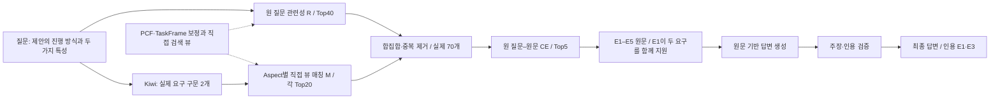

# 실제 문장으로 설명하는 PARS-RF 방법론 그림

아래는 10월 1일 저장 실행의 실제 사례 `JAIJE1-QA-0102`입니다. [원시 사례](../examples/real_question.json)와 [오프라인 재현](../scripts/replay_example.py)으로 확인할 수 있습니다.

## 입력과 추출

> 제안은 어떤 방식으로 진행할 수 있으며, 갖춰야 할 두 가지 특성은 무엇인가요?

| Aspect | 실제 검색 문자열 | 그림의 설명용 이름 |
|---|---|---|
| A1 | 제안은 어떤 방식으로 진행할 수 있으며, | 진행 방식 |
| A2 | 갖춰야 할 두 가지 특성은 무엇인가요? | 요구 특성 |

A2에 ‘제안’을 임의로 추가하지 않습니다. ‘두 가지’는 구문 안에 보존되어 있으며 이 사례에는 별도 조건 연결이 기록되지 않았습니다.

## 후보와 근거

질문 Top40과 각 Aspect Top20의 합집합을 Evidence ID로 중복 제거하면 **70개 후보**입니다. 원 질문과 후보 원문을 CE로 재정렬해 Top5를 선택합니다.

| 순위 | 원문 요약 | CE 변환 점수 |
|---|---|---:|
| E1 | 제안 진행 방식과 설득성·신뢰감 | 0.9204 |
| E2 | 제안 프로세스의 두 가지 구분 | 0.4752 |
| E3 | 논리뿐 아니라 정서적 신뢰의 필요성 | 0.1664 |
| E4 | 제안 성공을 위한 프로세스·도구·훈련 | 0.0962 |
| E5 | 제안 전략과 목적 | 0.0719 |

점수는 정답 확률이 아닙니다. 위 설명은 요약이며 실제 CE 입력은 원문입니다.

E1 원문 — 자이제_1, 105쪽:

> 일반적으로 제안은 **면대면, 제안서, 프레젠테이션**을 통해서 할 수 있고, **설득적이며 동시에 신뢰감**을 전할 수 있어야 한다.

E3 원문 — 자이제_1, 103쪽:

> 제안의 설득력을 높이려면 논리적일 뿐만 아니라 정서적으로 신뢰를 얻어야 한다.

## 실제 답변

> 제안은 면대면, 제안서, 프레젠테이션을 통해 진행할 수 있으며, 설득적이고 신뢰감을 전해야 합니다.

인용은 **E1·E3**입니다. 검증 결과는 `supported=true`, 지원되지 않는 주장 목록은 비어 있고 초안과 최종 답변은 같습니다.

## 그림 구조

그림에는 입력 질문 전문, 실제 A1·A2, E1 원문, 최종 답변을 크게 배치합니다. 진행 방식과 요구 특성에 각각 같은 색을 사용해 질문→원문→답변의 대응을 표시합니다. 그래프는 검색 보정으로 점선 연결하고 최종 원문은 생성의 입력으로 실선 연결합니다.

이 사례에서는 한 원문이 두 요구를 지원합니다. Aspect마다 서로 다른 근거 하나를 배정하는 그림으로 바꾸지 마세요. 사례는 처리 과정을 설명하며 Aspect 확장의 성능 우위를 입증하는 비교 실험은 아닙니다.
