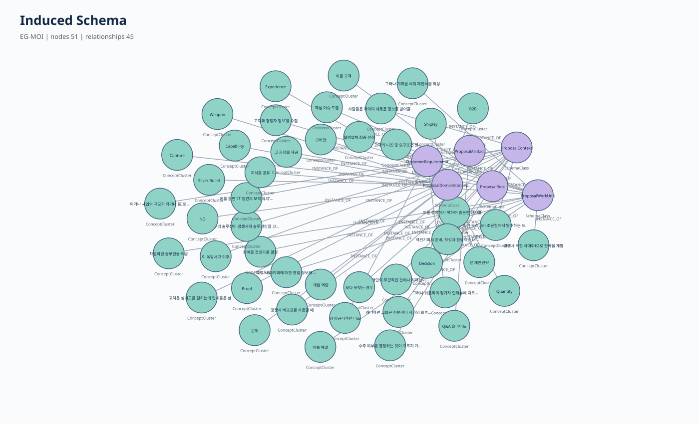
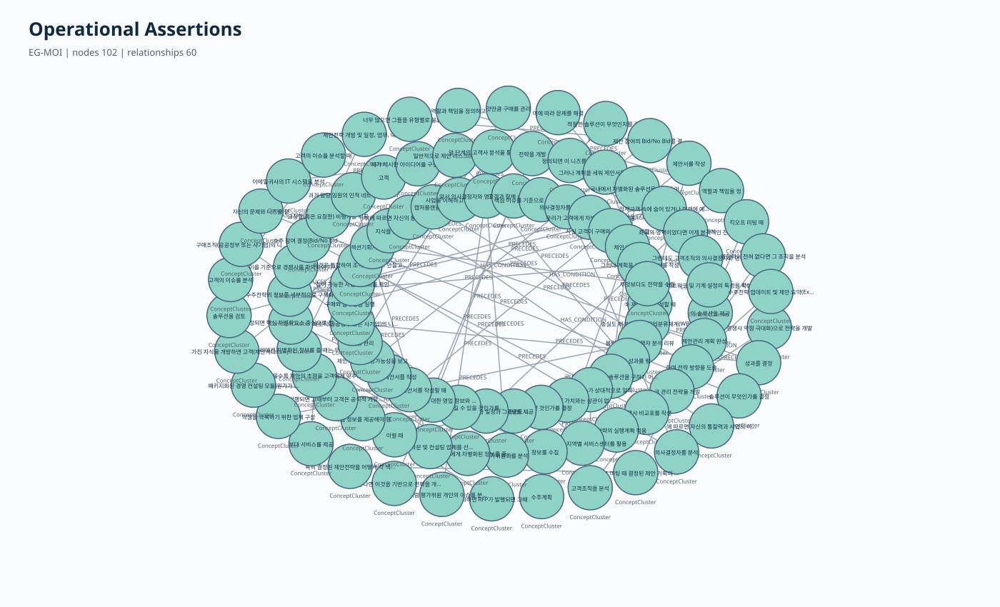
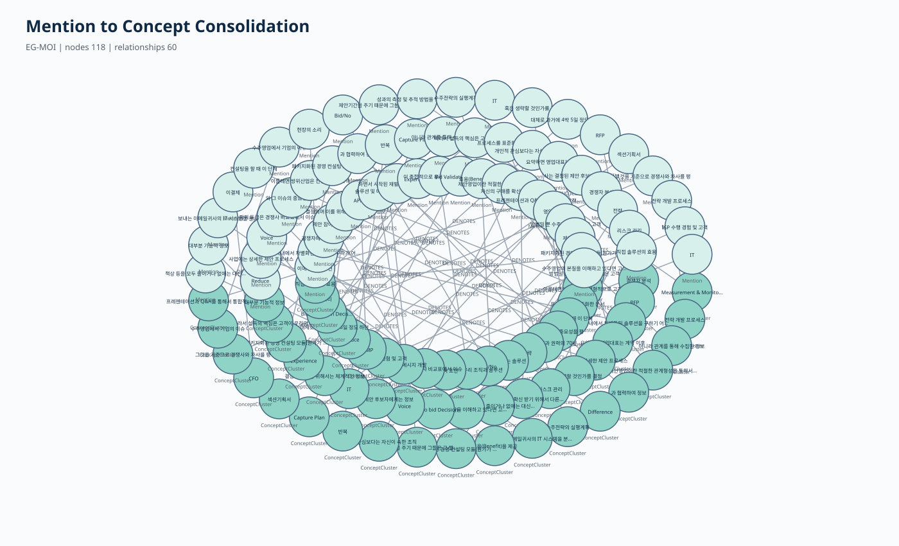
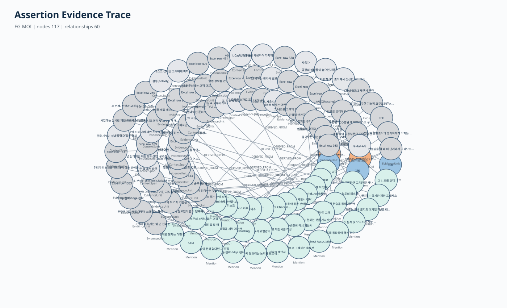
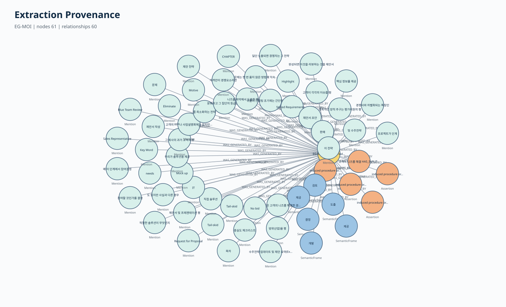

# 자이제 EG-MOI 전체 방법론 상세 설명서

기준 발표자료: **presentation_EG_MOI_method_results_10slides.md**  
기준 실험: **zaije_eg_moi_20260712_v1**  
방법론 버전: **EG-MOI-1.0**  
입력: **자이제_1.xlsx 전체 1,366행**  
최종 실행 판정: **EG_MOI_END_TO_END_PASS**  
결과 해석: **구조 검증 완료, 의미 정확도 미검증**

---

## 이 문서의 구성

이 문서는 기존 10장 발표자료의 흐름을 그대로 따른다.

| 발표자료 | 본 문서의 대단원 |
|---|---|
| 표지 | 연구 목표와 해석 범위 |
| 1. EG-MOI를 한눈에 보기 | 전체 방법론의 개념 |
| 2. Stage 1 | Evidence 구조화 |
| 3. Stage 2 | 열린 후보 발견 |
| 4. Stage 3 | 개념·관계 군집화 |
| 5. Stage 4 | Middle-out 스키마 귀납 |
| 6. Stage 5 | 근거 기반 최종 승격 |
| 7. 최종 결과 | 수치와 성공 기준 |
| 8. Neo4j | 그래프 변환과 시각화 |
| 9. 결론 | 한계와 후속 과제 |

발표자료는 핵심만 설명한다. 본 문서는 각 페이지의 내용을 실제 구현 수준까지 확장한다.

특히 다음 질문에 답하도록 구성했다.

- Anchor는 어떤 기준으로 분리했는가?
- Mention은 어떤 규칙으로 찾았는가?
- 제안서 작성이 WorkUnit이라는 것을 어떻게 판단했는가?
- 제안서가 Artifact라는 것을 어떻게 판단했는가?
- HAS_INPUT, PRODUCES_OUTPUT, PERFORMED_BY를 어떻게 판단했는가?
- 같은 개념을 어떤 기준으로 합쳤는가?
- 어떤 후보를 최종 KG에 넣고 어떤 후보를 보류했는가?
- 최종 관계가 원문까지 어떻게 추적되는가?
- Neo4j에는 어떤 노드와 관계가 들어갔는가?

---

# 표지 확장: 무엇을 만들려고 했는가

## 0.1 연구 목표

일반 문서는 사람이 읽기에는 편하지만 컴퓨터가 다음 질문에 바로 답하기 어렵다.

- 어떤 업무가 있는가?
- 누가 그 업무를 수행하는가?
- 어떤 정보가 입력으로 필요한가?
- 어떤 결과물이 만들어지는가?
- 어떤 조건에서 업무가 수행되는가?
- 어떤 업무가 먼저 수행되는가?
- 그 판단은 원문의 어느 문장에서 나왔는가?

이번 연구의 목표는 자이제_1 문서를 다음과 같은 지식그래프로 자동 변환하는 것이다.

    제안서 작성 ──HAS_INPUT────────> 수주계획
    제안서 작성 ──PRODUCES_OUTPUT──> 제안서
    제안서 작성 ──PERFORMED_BY─────> 담당자
    제안서 작성 ──HAS_CONDITION────> 특정 조건
    대안 검토   ──PRECEDES─────────> 리스크 관리

각 관계는 반드시 원문 근거와 연결돼야 한다.

    Assertion
      ├─ ASSERTS_SUBJECT  → 주체 개념
      ├─ ASSERTS_OBJECT   → 객체 개념
      ├─ DERIVED_FROM     → 원문 Evidence Anchor
      └─ WAS_GENERATED_BY → EG-MOI 실행 활동

## 0.2 온톨로지와 지식그래프

| 용어 | 쉬운 의미 | 예시 |
|---|---|---|
| 온톨로지 | 어떤 종류의 개념과 관계를 사용할지 정한 구조 | ProposalWorkUnit, HAS_INPUT |
| 지식그래프 | 실제 문서에서 찾은 구체적인 개념과 연결 | 제안서 작성 HAS_INPUT 수주계획 |

온톨로지는 그래프의 설계 구조이고, 지식그래프는 그 구조에 실제 문서 지식을 채운 결과다.

## 0.3 성공의 의미

이번 실험의 최종 판정은 **EG_MOI_END_TO_END_PASS**다.

이 판정은 다음을 의미한다.

- 자이제_1 전체 1,366행을 처리했다.
- Evidence 구조화부터 Neo4j 적재까지 자동 실행했다.
- 모든 최종 Assertion에 원문 근거가 있다.
- 모든 최종 Assertion에 생성 활동 이력이 있다.
- RDF 파일을 실제로 다시 파싱했다.
- SHACL 제약을 통과했다.
- Neo4j에 실제 노드와 관계를 적재했다.
- CSV 기대 수와 Neo4j 실제 적재 수가 일치했다.

그러나 다음을 의미하지는 않는다.

- 모든 Mention 경계가 사람 판단과 일치한다.
- 모든 개념 유형이 의미적으로 정답이다.
- 모든 관계가 전문가 관점에서 정답이다.
- precision, recall, F1이 검증됐다.

사람 gold 정답 데이터가 없기 때문이다.

---

# 1. EG-MOI를 한눈에 보기

## 1.1 한 문장 정의

EG-MOI는 문서에서 개념과 관계 후보를 먼저 발견하고, 반복되는 후보를 군집으로 통합해 도메인 스키마를 귀납한 뒤, 원문 근거와 형식 제약을 통과한 결과만 최종 온톨로지와 지식그래프로 승격하는 방법이다.

## 1.2 세 가지 전략의 결합

    Bottom-up Discovery
    문서에서 후보를 먼저 발견
            ↓
    Middle-out Induction
    반복되는 중심 군집에서 스키마 구성
            ↓
    Top-down Validation
    Evidence와 그래프 제약으로 최종 검증

### Bottom-up

미리 만든 도메인 타입에 문서를 바로 끼워 넣지 않는다.

먼저 문서에서 다음을 발견한다.

- 용어
- 사람·조직 표현
- 업무 표현
- 조건
- 수량
- 한·영 병기
- 표의 활동·입력·출력 구조
- 행위와 참여자 역할

### Middle-out

발견된 표현을 그대로 모두 노드로 사용하지 않는다.

반복되는 표현을 ConceptCluster와 RelationCluster로 묶고 중심 군집에서 타입과 관계를 구성한다.

    제안서 작성
    제안서 개발
    제안서 작성 활동
            ↓
    반복 역할 분석
            ↓
    ProposalWorkUnit
            ↓
    WorkUnit

### Top-down

최종 승격 단계에서는 형식 제약을 적용한다.

- 원문 Evidence가 있는가?
- 주체와 객체의 타입이 관계와 맞는가?
- self-loop가 아닌가?
- 중복 관계가 아닌가?
- cycle이 생기지 않는가?
- provenance가 완전한가?
- SHACL을 통과하는가?

## 1.3 순수 Top-down과의 차이

순수 Top-down 방식은 처음부터 타입과 관계를 모두 정한다.

장점:

- 일관성이 높다.
- 평가가 쉽다.
- 그래프 구조가 안정적이다.

한계:

- 문서 고유 개념을 놓칠 수 있다.
- 온톨로지 학습보다 고정 스키마 채우기에 가까워질 수 있다.

EG-MOI에서는 상위 메타타입을 검증과 정렬에 사용하되 후보 발견을 제한하지 않는다.

## 1.4 순수 Bottom-up과의 차이

순수 Bottom-up 방식은 문서 표현을 자유롭게 추출한다.

장점:

- 새로운 도메인 표현을 발견하기 쉽다.
- 문서 특수성을 보존한다.

한계:

- 같은 개념이 여러 노드로 파편화된다.
- 유사 관계가 계속 늘어난다.
- 타입 체계가 불안정해질 수 있다.

EG-MOI는 군집화와 Middle-out 스키마 귀납으로 이 문제를 통제한다.

## 1.5 고정하는 것과 발견하는 것

### 미리 고정한 기술 메타모델

| 요소 | 역할 |
|---|---|
| Document | 원본 문서 |
| EvidenceUnit | 원문의 추적 가능한 단위 |
| Mention | 원문에 나타난 표현 |
| SemanticFrame | 행위와 역할을 보존한 중간표현 |
| ConceptCluster | 같은 개념으로 통합된 Mention 집합 |
| RelationCluster | 같은 관계로 통합된 관계 후보 집합 |
| Assertion | 최종 승격된 지식 주장 |
| ExtractionActivity | 결과 생성 방법과 실행 이력 |

이 여덟 요소는 수주·제안 분야 지식이 아니다. 어떤 문서에도 필요한 표현·추적 구조다.

### 문서에서 발견하거나 귀납한 것

- 업무 개념
- 역할과 조직
- 입력 자료
- 산출물
- 조건
- 수량
- 동의어와 약어
- 도메인 클래스
- 도메인 관계
- 업무 순서

## 1.6 전체 실행 흐름

    자이제_1.xlsx
      ↓
    Stage 1: Evidence Structuring
      ↓
    EvidenceUnit, Anchor, ContextSpan
      ↓
    Stage 2: Open Candidate Discovery
      ↓
    Mention, SemanticFrame, SurfaceRelation
      ↓
    Stage 3: Bottom-up Consolidation
      ↓
    ConceptCluster, RelationCluster
      ↓
    Stage 4: Middle-out Schema Induction
      ↓
    SchemaClass, SchemaProperty
      ↓
    Stage 5: Evidence-constrained Promotion
      ↓
    VALIDATED Assertion + UNRESOLVED 후보
      ↓
    RDF, SKOS, PROV-O, SHACL, Neo4j

---

# 2. Stage 1: 원문을 Evidence로 구조화

## 2.1 목적

Stage 1은 의미를 판단하는 단계가 아니다.

원문을 잃지 않으면서 추출 가능한 단위로 만드는 단계다.

다음 조건을 만족해야 한다.

- Excel 행 번호를 보존한다.
- 원문 문자열을 보존한다.
- 장·절·페이지 정보를 보존한다.
- 표와 목록 구조를 보존한다.
- Anchor의 시작과 끝 위치를 저장한다.
- 저장한 위치로 원문을 다시 잘랐을 때 동일한 문자열이 나와야 한다.

## 2.2 사용한 원본

원본 파일:

    handoff-hanyang/수주제안/자이제_1.xlsx

원본 SHA-256:

    e8c5f174b65eccd7a50dbd2e0e216ea870a6aedfd16b3e4538d6486aea15cf1f

사용한 시트:

    clean_sentences

총 본문 행:

    1,366

XLSX 내부 XML을 직접 읽었다. 장·절 메타데이터가 비어 있는 세 행은 직전의 유효한 메타데이터를 forward-fill했다. 본문 문자열은 변경하지 않았다.

## 2.3 EvidenceUnit 생성

각 Excel 본문 행에 안정적인 ID를 부여했다.

    egmoi:evidence/xlsx-row-237

저장 속성:

| 속성 | 의미 |
|---|---|
| evidence_id | Evidence 고유 ID |
| excel_row | 원본 Excel 행 번호 |
| sheet | 원본 시트 |
| page | 페이지 |
| chapter_no | 장 번호 |
| chapter_title | 장 제목 |
| section_no | 절 번호 |
| section_title | 절 제목 |
| raw_text | 변경하지 않은 원문 |
| text_sha256 | 원문 문자열 해시 |
| source_binary_sha256 | 원본 Excel 파일 해시 |
| structure_type | PROSE, LIST, TABLE 등 |

## 2.4 Anchor란 무엇인가

Anchor는 Mention과 관계를 찾는 최소 근거 단위다.

Excel 한 행이 항상 하나의 문장이라는 보장은 없다.

한 행에 다음이 함께 들어갈 수 있다.

- 여러 문장
- 여러 절
- 목록
- 표 전체
- 표 caption과 데이터

따라서 한 행을 바로 하나의 의미 단위로 사용하지 않고 구조에 맞게 나눈다.

## 2.5 일반 산문의 Anchor 분리 기준

일반 산문은 다음 순서로 처리한다.

1. 문장 종결 기호와 줄바꿈으로 문장을 나눈다.
2. 쉼표, 세미콜론, 콜론으로 절 후보를 나눈다.
3. 그러나, 하지만, 따라서, 또한, 그리고 같은 담화 연결어를 경계 신호로 사용한다.
4. 지나치게 짧은 조각은 만들지 않는다.
5. 절 분리가 불가능하면 문장 전체를 Anchor로 사용한다.

이번 실행에서 일반 산문 Anchor는 1,321개였다.

## 2.6 목록의 Anchor 분리 기준

목록은 다음 기준으로 처리한다.

1. 글머리표와 번호를 탐지한다.
2. 각 목록 항목을 별도 Anchor로 만든다.
3. 목록 앞의 제목과 머리말은 ContextSpan으로 만든다.
4. 앞 항목을 설명하는 후속 줄은 문맥 관계로 연결한다.

이번 실행에서 목록 Anchor는 200개였다.

## 2.7 표의 Anchor 분리 기준

표는 텍스트만 보는 것보다 구조가 중요하다.

처리 순서:

1. Markdown 표 형태의 행을 탐지한다.
2. 첫 의미 행을 column header로 해석한다.
3. 각 데이터 행의 첫 의미 셀을 row header로 해석한다.
4. 나머지 의미 셀을 독립 Anchor로 만든다.
5. 각 Anchor에 column header와 row header를 ContextSpan으로 연결한다.
6. 표 caption이 있으면 caption도 연결한다.

예시:

    Anchor: Capture Plan 초안
      ├─ HAS_COLUMN_HEADER → 결과물(Output)
      └─ HAS_ROW_HEADER    → 수주전략 초안 개발

이번 실행에서 표 셀 Anchor는 787개였다.

## 2.8 ContextSpan의 역할

표현 하나만 보면 의미가 모호할 수 있다.

예를 들어 Capture Plan 초안이라는 셀만 보면 다음을 알기 어렵다.

- 업무인가?
- 입력인가?
- 산출물인가?
- 역할인가?

그러나 column header가 결과물이고 row header가 수주전략 개발이면 다음처럼 해석할 수 있다.

    수주전략 개발 ──PRODUCES_OUTPUT──> Capture Plan 초안

ContextSpan은 Anchor 자체를 수정하지 않고 구조 문맥을 추가한다.

## 2.9 Fallback 규칙

어떤 분리 규칙에도 맞지 않지만 본문이 비어 있지 않으면 전체 본문을 하나의 Anchor로 만든다.

이는 원문 누락을 막기 위한 안전장치다.

## 2.10 Offset 검증

모든 Anchor와 ContextSpan에 다음을 저장한다.

    start_char
    end_char
    text_by_program

검증식:

    raw_text[start_char:end_char] == text_by_program

최종 결과:

| 지표 | 결과 |
|---|---:|
| EvidenceUnit | 1,366 |
| Anchor | 2,308 |
| ContextSpan | 1,718 |
| Offset round-trip validity | 1.00 |
| Anchor ID uniqueness | 1.00 |
| ContextSpan existence | 1.00 |

---

# 3. Stage 2: 후보를 열린 방식으로 발견

## 3.1 목적

Stage 2에서는 고정된 도메인 스키마를 바로 적용하지 않는다.

문서에 실제로 나타난 표현과 행위 구조를 먼저 찾는다.

주요 산출물:

- Mention
- SemanticFrame
- SurfaceRelation
- ExplicitAlias

## 3.2 왜 triple을 바로 만들지 않는가

예시 문장:

    제안팀이 고객 요구조건을 바탕으로 제안서 초안을 작성한다.

직접 triple을 만들면 작성의 역할을 너무 빨리 하나의 관계로 확정하게 된다.

EG-MOI는 먼저 다음 프레임을 만든다.

    SemanticFrame
      action = 작성
      agent  = 제안팀
      input  = 고객 요구조건
      object = 제안서 초안
      evidence = 원문 Anchor

그 후 타입과 역할을 검증해 여러 관계로 나눈다.

    제안서 초안 작성 ──PERFORMED_BY────> 제안팀
    제안서 초안 작성 ──HAS_INPUT───────> 고객 요구조건
    제안서 초안 작성 ──PRODUCES_OUTPUT─> 제안서 초안

## 3.3 Mention의 데이터 구조

Mention은 원문에 실제로 나타난 표현이다.

저장 정보:

| 속성 | 의미 |
|---|---|
| mention_id | 안정적인 Mention ID |
| evidence_id | 원문 행 |
| anchor_id | 직접 근거 Anchor |
| start_char | 원문 시작 위치 |
| end_char | 원문 끝 위치 |
| exact_text | 원문에서 잘라낸 문자열 |
| label | 정리된 표시 라벨 |
| normalized_label | 군집화용 정규화 문자열 |
| role_hint | 발견 단계의 잠정 역할 |
| generation_rule | 어떤 규칙으로 발견했는지 |
| confidence | 자동 신뢰도 |
| status | 최초 CANDIDATE |

role_hint는 최종 타입이 아니다.

예를 들어 WORK는 이 표현이 행위 위치에서 발견됐다는 뜻이며, Stage 4에서 ProposalWorkUnit으로 유형화될 수 있다.

## 3.4 표 header 기반 Mention 추출

다음 header를 탐지한다.

| Header 표현 | role_hint |
|---|---|
| 활동, Activity, 업무, 단계, Step | WORK |
| 결과물, 산출물, Output, Deliverable | OUTPUT |
| 입력, Input, 참고자료, 요구자료 | INPUT |
| 담당, 수행자, 책임자, Role, 역할 | AGENT |

같은 표 행에서 다음 관계 후보를 만든다.

    WORK + OUTPUT → PRODUCES_OUTPUT
    WORK + INPUT  → HAS_INPUT
    WORK + AGENT  → PERFORMED_BY

표 구조는 문자열 사전보다 강한 근거다.

## 3.5 한·영 병기와 약어 추출

다음 형태를 탐지한다.

    한글 용어(English Term)
    English Long Form(ACRONYM)
    ACRONYM: English Long Form

각 표현을 별도 Mention으로 만들고 다음 병합 근거를 저장한다.

    EXPLICIT_BILINGUAL_OR_ACRONYM

confidence는 0.99다.

담화 표현이 포함된 지나치게 긴 한글 구간은 제외한다.

## 3.6 행위 프레임 추출

주요 행위 어간:

    작성, 분석, 검토, 수립, 제출, 개발, 평가, 선정,
    도출, 확인, 준비, 제공, 업데이트, 관리, 정의,
    식별, 수집, 설계, 결정, 승인, 보고, 공유,
    대응, 해결, 활용, 실행, 협의

개념적인 패턴:

    [주체 + 주격 조사] + [목적어 + 목적격 조사] + [행위]

생성 결과:

| 발견 요소 | role_hint 또는 구조 |
|---|---|
| 목적어 | OBJECT |
| 목적어 + 동사 | WORK |
| 명시적 사람·조직 주체 | AGENT |
| 전체 구조 | SemanticFrame |

행위 종류에 따라 목적어 관계 후보를 나눈다.

| 행위 | 관계 후보 |
|---|---|
| 작성, 수립, 개발, 도출, 준비, 제출, 제공, 보고 | PRODUCES_OUTPUT |
| 분석, 검토, 평가, 확인 등 | HAS_INPUT |

이 관계는 아직 CANDIDATE다. Stage 5 제약을 통과해야 최종 관계가 된다.

## 3.7 입력 근거 표현

다음 표현을 별도 처리한다.

    X를 바탕으로 Y를 작성한다
    X에 기반하여 Y를 개발한다
    X를 참고하여 Y를 검토한다

처리:

    X → INPUT Mention
    Y + 동사 → WORK Mention
    WORK HAS_INPUT X → 관계 후보

## 3.8 Agent 판단의 보수적 제한

초기 실행에서는 한국어 주어 경계가 넓게 잡혀 대명사와 담화 표현이 Agent가 되는 문제가 있었다.

최종 실행에서는 다음 명시적 표지를 가진 주어만 AGENT로 허용했다.

    영업대표, 담당자, 평가위원, 의사결정자, 작성자,
    책임자, 대표이사, 제안팀, 고객, 팀, 부서,
    조직, 회사, 기관, 위원회, 본부, 센터, 사업단, 업체

또한 다음 문장 시작 표현을 주어에서 제거했다.

    그리고, 그러나, 하지만, 따라서, 이에 맞추어,
    이때, 사실, 만약에, 대체로

이 수정으로 PERFORMED_BY는 20개에서 8개로 줄었다.

관계 수를 늘리는 것보다 잘못된 Agent 승격을 줄이는 방향을 선택했다.

## 3.9 조건 Mention 추출

조건 표지:

    경우
    만약 ... 라면
    ... 할 때
    이전
    이후
    조건하에

동일 Anchor에 명시적 Work frame이 있으면 다음 후보를 만든다.

    WORK ──HAS_CONDITION──> CONDITION

예시:

    제안서를 작성
      ──HAS_CONDITION──>
    경쟁력 있는 제안서를 작성할 때

## 3.10 수량 Mention 추출

탐지 예:

    20%
    3명
    30점
    2~3주
    5개
    10개월

수량은 MEASURE Mention이 된다.

동일 Anchor에 Work frame이 있으면 다음 후보를 만든다.

    WORK ──HAS_MEASURE──> MEASURE

## 3.11 명시적 정의 추출

일반적인 A는 B이다 문장은 정의가 아닐 수 있다.

최종 구현에서는 다음처럼 명시적 정의 표지가 있는 경우만 사용했다.

    A란 B이다
    A이란 B를 의미한다

초기 구현에서 일반 서술을 정의로 오인하는 문제가 발견돼 규칙을 보수적으로 제한했다.

## 3.12 도메인 용어 추출

다음 접미 표현을 이용해 도메인 용어 후보를 찾았다.

    제안서, 계획, 전략, 고객, 요구조건, 요구사항,
    정보, 이슈, 역량, 프로세스, 활동, 단계,
    분석, 평가, 관리, 조직, 팀, 담당자, 책임자,
    문서, 자료, 템플릿, 양식, 리스크, 가치제안, 솔루션

영문 대문자로 시작하는 다단어 표현도 별도로 추출했다.

## 3.13 Stage 2 결과

| 항목 | 결과 |
|---|---:|
| Mention 후보 | 2,954 |
| SemanticFrame | 177 |
| HAS_OBJECT frame edge | 175 |
| HAS_AGENT frame edge | 8 |

---

# 4. Stage 3: 같은 개념을 군집으로 통합

## 4.1 목적

같은 개념이 여러 표면형으로 나타나는 문제를 해결한다.

    Capture Plan
    capture plan
    Capture  Plan
    수주계획

각 Mention을 바로 독립 개념으로 쓰지 않고 ConceptCluster로 통합한다.

## 4.2 문자열 정규화

정규화 순서:

1. Unicode NFKC 정규화
2. 영문 case folding
3. HTML 줄바꿈 제거
4. 글머리표와 목록 번호 제거
5. 일부 한국어 조사 제거
6. 특수문자를 공백으로 통일
7. 연속 공백 축약

예:

    원문: • Capture  Plan을
    정규화: capture plan

정규화 결과가 완전히 같으면 같은 군집으로 병합한다.

## 4.3 명시적 동의어 병합

한·영 병기와 약어처럼 원문에 근거가 있으면 높은 신뢰도로 병합한다.

    Request for Proposal(RFP)
            ↓
    Request for Proposal ≡ RFP

병합 결정에는 다음을 기록한다.

- 왼쪽 Mention ID
- 오른쪽 Mention ID
- 결정: MERGE
- 근거: EXPLICIT_BILINGUAL_OR_ACRONYM
- 점수: 0.99

## 4.4 문자 2·3-gram 희소 임베딩

이번 파일럿은 사전학습 문장 임베딩을 사용하지 않았다.

정규화 문자열을 문자 2-gram과 3-gram으로 나눠 벡터를 만들었다.

예:

    제안서

    2-gram:
    ^제, 제안, 안서, 서$

    3-gram:
    ^제안, 제안서, 안서$

각 n-gram 출현 횟수를 L2 정규화해 희소 벡터를 만든다.

두 벡터의 유사도는 cosine similarity로 계산한다.

    cosine = 두 정규화 벡터의 내적

## 4.5 후보 비교 Blocking

모든 문자열 쌍을 비교하지 않는다.

다음 중 하나를 공유하는 문자열만 비교 후보로 만든다.

- 앞 두 문자
- 뒤 두 문자
- 동일 토큰

길이 비율이 0.65 미만이면 비교에서 제외한다.

역할이 명백하게 충돌해도 제외한다.

    WORK ↔ WORK        비교 가능
    MEASURE ↔ MEASURE  비교 가능
    AGENT ↔ CONDITION  비교하지 않음

## 4.6 병합 임계값

| Cosine | 처리 |
|---|---|
| 0.90 이상 | 자동 MERGE |
| 0.82 이상 0.90 미만 | Gray-zone UNRESOLVED |
| 0.82 미만 | 병합하지 않음 |

문자 n-gram cosine은 의미 정답 판정이 아니다.

철자와 표기 유사성을 보는 보조 신호다.

## 4.7 ConceptCluster의 VALIDATED 기준

다음 중 하나를 만족하면 구조적으로 VALIDATED가 된다.

1. 서로 다른 Evidence에서 2회 이상 지지된다.
2. 구성 Mention 중 confidence 0.90 이상이 있다.
3. 명시적인 SemanticFrame action 또는 basis action에서 발견됐다.
4. 명시적인 한·영 병기 또는 약어 근거가 있다.

그 외 단일 저신뢰 군집은 UNRESOLVED다.

여기서 VALIDATED는 사람 의미 판정 완료가 아니다.

자동 승격 기준을 통과했다는 뜻이다.

## 4.8 대표 라벨 선택

군집 안에 여러 표면형이 있으면 다음 순서로 대표 라벨을 정한다.

1. 출현 빈도가 높은 라벨
2. 길이가 짧은 라벨
3. 문자열 정렬 순서

다른 모든 표면형은 surface_forms에 보존한다.

## 4.9 RelationCluster

표면 관계를 공통 seed 관계로 묶었다.

    작성 / 개발 / 제출
            ↓
    PRODUCES_OUTPUT 후보군

생성된 RelationCluster:

1. DEFINES
2. HAS_CONDITION
3. HAS_INPUT
4. HAS_MEASURE
5. PERFORMED_BY
6. PRECEDES
7. PRODUCES_OUTPUT

## 4.10 LLM Gray-zone

설계상 LLM은 cosine Gray-zone의 병합 판정에 선택적으로 사용할 수 있다.

이번 실행에서는 OPENAI_API_KEY가 설정되지 않았다.

따라서:

    LLM 호출 = 0
    Gray-zone = 46
    처리 = UNRESOLVED 유지

LLM 결과를 임의로 모사하지 않았다.

## 4.11 Stage 3 결과

| 항목 | 결과 |
|---|---:|
| ConceptCluster 전체 | 2,188 |
| VALIDATED | 818 |
| UNRESOLVED | 1,370 |
| MERGE 결정 | 526 |
| Embedding Gray-zone | 46 |
| RelationCluster | 7 |

---

# 5. Stage 4: 핵심 군집에서 스키마 귀납

## 5.1 목적

개별 표현을 그대로 나열하지 않고 반복 군집의 역할을 분석해 도메인 클래스와 관계를 만든다.

    여러 WORK 역할 군집
            ↓
    ProposalWorkUnit
            ↓
    WorkUnit

## 5.2 개념 유형화의 실제 판단 순서

각 ConceptCluster의 role_counts, 대표 라벨, 도메인 어휘를 사용한다.

판정 우선순위는 다음과 같다.

### 1순위: WORK 역할

    domain_type = ProposalWorkUnit
    meta_type   = WorkUnit

제안서 작성이 WorkUnit이라는 것을 아는 핵심 근거는 사전 목록이 아니라 SemanticFrame에서 WORK 역할로 발견됐다는 점이다.

    Mention: 제안서 작성
      role_hint = WORK
            ↓
    ConceptCluster
      WORK 역할 존재
            ↓
    ProposalWorkUnit
            ↓
    WorkUnit

### 2순위: AGENT 역할

조직 어휘가 있으면:

    ProposalOrganization → Agent

그 외 명시적인 담당자·역할이면:

    ProposalRole → Agent

### 3순위: CONDITION 역할

    ProposalContext → Context

### 4순위: MEASURE 역할

    EvaluationMeasure → Measure

### 5순위: OUTPUT 또는 산출물 어휘

산출물 어휘:

    제안서, 계획서, 보고서, 분석표, 응답표,
    체크리스트, 초안, 문서, 자료, 템플릿,
    양식, 슬라이드, 조직도, 일정표 등

판정:

    ProposalArtifact → Resource

제안서가 Artifact라는 것은 OUTPUT 역할 또는 산출물 어휘로 판단한다.

### 6순위: INPUT 또는 요구정보 어휘

요구정보 어휘:

    요구조건, 요구사항, 평가기준, 고객정보,
    니즈, 관심사, 이슈, 정보, 조건

판정:

    CustomerRequirement → Resource

### 7순위: 라벨 기반 Agent

역할 힌트가 약해도 명시적 조직·역할 어휘가 있으면 Agent 계열로 정렬한다.

### 기본값

위 기준으로 결정할 수 없으면:

    ProposalDomainConcept → DomainConcept

불확실한 대상을 강제로 Artifact나 WorkUnit으로 넣지 않는다.

## 5.3 귀납된 클래스

| 귀납 클래스 | 상위 타입 | VALIDATED 군집 수 |
|---|---|---:|
| ProposalWorkUnit | WorkUnit | 229 |
| ProposalRole | Agent | 47 |
| ProposalOrganization | Agent | 5 |
| ProposalArtifact | Resource | 47 |
| CustomerRequirement | Resource | 31 |
| ProposalContext | Context | 243 |
| EvaluationMeasure | Measure | 4 |
| ProposalDomainConcept | DomainConcept | 212 |

총 818개 VALIDATED ConceptCluster가 8개 도메인 클래스로 정렬됐다.

## 5.4 관계 스키마

각 RelationCluster에 다음을 부여한다.

- 관계 이름
- domain 메타타입
- range 메타타입
- 후보 지지 수
- 지지 RelationCluster ID
- 상태

| 관계 | Domain | Range | 후보 지지 수 |
|---|---|---|---:|
| PERFORMED_BY | WorkUnit | Agent | 8 |
| HAS_INPUT | WorkUnit | Resource | 114 |
| PRODUCES_OUTPUT | WorkUnit | Resource | 68 |
| HAS_CONDITION | WorkUnit 또는 DomainConcept | Context | 36 |
| HAS_MEASURE | WorkUnit 또는 DomainConcept | Measure | 1 |
| DEFINES | DomainConcept | DomainConcept | 12 |
| PRECEDES | WorkUnit | WorkUnit | 247 |

## 5.5 후보 지지 수와 최종 관계 수가 다른 이유

HAS_INPUT 후보 지지 수는 114지만 최종 HAS_INPUT은 13개다.

다음 후보가 최종 승격에서 제외되기 때문이다.

- endpoint ConceptCluster가 UNRESOLVED
- 주체가 WorkUnit이 아님
- 객체가 Resource가 아님
- 같은 주체·객체·관계가 중복
- self-loop

즉 RelationCluster의 지지 수는 발견 단계의 후보량이고 최종 edge 수는 검증을 통과한 양이다.

## 5.6 Taxonomy, Partonomy, Procedure의 분리

| 구조 | 의미 | 이번 구현 |
|---|---|---|
| Taxonomy | A는 B의 종류 | 명시 근거 부족으로 도메인 broader 미생성 |
| Partonomy | A는 B의 구성요소 | 명시적 부분 근거 없이는 미생성 |
| Procedure | A 다음에 B 수행 | 같은 절의 문서 순서로 저신뢰 PRECEDES 생성 |

문서에서 앞에 배치됐다는 이유로 상·하위 개념을 만들지 않았다.

---

# 6. Stage 5: 근거가 있는 결과만 승격

## 6.1 목적

Stage 4까지의 결과는 후보와 스키마다.

Stage 5에서 실제 KG에 들어갈 관계를 결정한다.

## 6.2 일반 관계의 승격 조건

각 SurfaceRelation 후보에 다음 검사를 적용한다.

1. 주체 Mention이 ConceptCluster에 연결되는가?
2. 객체 Mention이 ConceptCluster에 연결되는가?
3. 두 ConceptCluster가 모두 VALIDATED인가?
4. 주체 meta_type이 관계 domain에 맞는가?
5. 객체 meta_type이 관계 range에 맞는가?
6. 주체와 객체가 동일하지 않은가?
7. 동일 관계가 이미 승격되지 않았는가?
8. Evidence Anchor가 존재하는가?

실패 이유:

    UNRESOLVED_ENDPOINT
    DOMAIN_MISMATCH
    RANGE_MISMATCH
    SELF_LOOP
    DUPLICATE_ASSERTION

실패 후보는 삭제하지 않고 stage5_promotion/unresolved.jsonl에 남긴다.

## 6.3 관계별 domain과 range

| 관계 | 허용 주체 | 허용 객체 |
|---|---|---|
| PERFORMED_BY | WorkUnit | Agent |
| HAS_INPUT | WorkUnit | Resource |
| PRODUCES_OUTPUT | WorkUnit | Resource |
| HAS_CONDITION | WorkUnit, DomainConcept | Context |
| HAS_MEASURE | WorkUnit, DomainConcept | Measure |
| DEFINES | DomainConcept | DomainConcept |
| PRECEDES | WorkUnit | WorkUnit |

## 6.4 PERFORMED_BY 판단

다음 조건이 모두 필요하다.

1. SemanticFrame의 명시적 주어가 Agent 어휘 규칙을 통과한다.
2. 행위 Mention의 ConceptCluster가 WorkUnit이다.
3. 주어 Mention의 ConceptCluster가 Agent다.
4. 두 endpoint가 모두 VALIDATED다.
5. 원문 Anchor가 있다.

    WorkUnit → Agent
            ↓
    PERFORMED_BY

## 6.5 HAS_INPUT 판단

다음 경로 중 하나에서 후보가 생성된다.

- 분석, 검토, 평가, 확인 행위의 목적어
- X를 바탕으로, 기반으로, 참고하여 같은 입력 근거 표현
- 표의 Input 열

최종 조건:

    WorkUnit → Resource
            ↓
    HAS_INPUT

실제 예:

    제안서 작성 ──HAS_INPUT──> 수주계획

## 6.6 PRODUCES_OUTPUT 판단

다음 경로 중 하나에서 후보가 생성된다.

- 작성, 수립, 개발, 도출, 준비, 제출, 제공, 보고의 목적어
- 표의 Output 또는 Deliverable 열

최종 조건:

    WorkUnit → Resource
            ↓
    PRODUCES_OUTPUT

실제 예:

    제안서를 작성 ──PRODUCES_OUTPUT──> 제안서

## 6.7 HAS_CONDITION 판단

동일 Anchor 안에서:

1. Work frame이 발견된다.
2. 조건 표지가 발견된다.
3. WorkUnit과 Context 타입이 검증된다.

    WorkUnit → Context
            ↓
    HAS_CONDITION

## 6.8 HAS_MEASURE 판단

동일 Anchor 안에서:

1. Work frame이 발견된다.
2. 수량 표현이 발견된다.
3. WorkUnit과 Measure 타입이 검증된다.

    WorkUnit → Measure
            ↓
    HAS_MEASURE

## 6.9 PRECEDES 생성 방법

PRECEDES는 다른 관계와 별도 방식으로 귀납했다.

1. VALIDATED WorkUnit의 출현 위치를 수집한다.
2. 같은 장·절 안에서 Excel 행과 문자 위치순으로 정렬한다.
3. 인접 WorkUnit을 순서 후보로 만든다.
4. self-loop를 제외한다.
5. 중복을 제외한다.
6. 새 edge가 cycle을 만들면 제외한다.
7. 양쪽 WorkUnit의 Evidence Anchor를 모두 저장한다.

confidence는 0.62다.

문서 순서가 실제 업무 순서와 다를 수 있기 때문이다.

실제 예:

    대안을 검토 ──PRECEDES──> 리스크를 관리

## 6.10 Assertion 노드

승격된 관계는 edge뿐 아니라 Assertion 노드로 표현한다.

    Assertion A1
      predicate   = HAS_INPUT
      subject_uid = 제안서 작성 ConceptCluster
      object_uid  = 수주계획 ConceptCluster
      status      = VALIDATED
      confidence  = 자동 점수

연결:

    A1 ──ASSERTS_SUBJECT──> 제안서 작성
    A1 ──ASSERTS_OBJECT───> 수주계획
    A1 ──DERIVED_FROM─────> Evidence Anchor
    A1 ──WAS_GENERATED_BY─> ExtractionActivity

## 6.11 CANDIDATE, VALIDATED, UNRESOLVED

### CANDIDATE

추출됐지만 아직 군집·타입·관계 검사를 완료하지 않은 상태다.

### VALIDATED

자동 승격 기준과 구조 제약을 통과한 상태다.

사람 의미 정답 판정과 동일하지 않다.

### UNRESOLVED

자동으로 안전하게 확정하기 어려운 상태다.

예:

- 단일 저신뢰 후보
- 임베딩 Gray-zone
- endpoint 미확정
- domain/range 충돌
- self-loop
- 중복

## 6.12 직접 승격과 PRECEDES의 합

일반 관계 후보 판정:

| 상태 | 수 |
|---|---:|
| VALIDATED | 60 |
| UNRESOLVED | 179 |

별도 절차 귀납:

    PRECEDES Assertion = 201

최종:

    일반 Assertion 60
    + PRECEDES 201
    = 전체 Assertion 261

따라서 VALIDATED promotion 60과 최종 Assertion 261은 모순이 아니다.

## 6.13 최종 관계 수

| 관계 | 최종 수 |
|---|---:|
| PERFORMED_BY | 8 |
| HAS_INPUT | 13 |
| PRODUCES_OUTPUT | 3 |
| HAS_CONDITION | 35 |
| HAS_MEASURE | 1 |
| PRECEDES | 201 |
| 합계 | 261 |

DEFINES 관계 스키마와 후보는 있었지만 최종 endpoint와 domain/range 조건을 통과한 관계는 없었다.

---

# 7. 최종 실험 결과

## 7.1 단계별 수치

| 계층 | 수 | 의미 |
|---|---:|---|
| 원문 행 | 1,366 | Excel EvidenceUnit |
| Anchor | 2,308 | 실제 추출 단위 |
| ContextSpan | 1,718 | 표·목록·절 문맥 |
| Mention | 2,954 | 원문의 후보 표현 |
| SemanticFrame | 177 | 행위 중심 중간표현 |
| ConceptCluster | 2,188 | 통합 개념 후보 |
| VALIDATED Cluster | 818 | 자동 승격 기준 통과 |
| UNRESOLVED Cluster | 1,370 | 자동 확정 보류 |
| 최종 Assertion | 261 | 업무 의미 관계 주장 |
| 전체 노드 | 11,053 | Evidence와 provenance 포함 |
| 전체 관계 | 19,502 | 구조 관계와 의미 관계 전체 |

## 7.2 전체 관계 19,502개의 의미

19,502개가 모두 업무 의미 관계는 아니다.

주요 구조 관계:

| 구조 관계 | 수 |
|---|---:|
| DERIVED_FROM | 5,294 |
| WAS_GENERATED_BY | 3,392 |
| DENOTES | 2,954 |
| HAS_CONTEXT | 2,563 |
| HAS_ANCHOR | 2,308 |
| HAS_EVIDENCE | 1,366 |
| INSTANCE_OF | 818 |

업무 의미 관계는 261개다.

전체 관계 수를 곧바로 온톨로지 의미 관계 성능으로 해석하면 안 된다.

## 7.3 RDF 계열 결과

| 출력 | 결과 |
|---|---:|
| Canonical RDF | 157,272 triples |
| SKOS | 4,354 triples |
| PROV-O | 19,892 triples |
| SHACL | conforms = true |

모든 Turtle 파일은 디스크에 기록한 뒤 다시 파싱했다.

## 7.4 SHACL 제약

### EvidenceUnit

- exact_text가 하나 이상 있어야 한다.

### Mention

- DERIVED_FROM이 하나 이상 있어야 한다.
- DENOTES가 하나 이상 있어야 한다.

### Assertion

- DERIVED_FROM이 하나 이상 있어야 한다.
- WAS_GENERATED_BY가 하나 이상 있어야 한다.
- status는 VALIDATED여야 한다.

### ConceptCluster

- status가 있어야 한다.
- Evidence Anchor 정보가 있어야 한다.

## 7.5 구조 성공 게이트

다음이 모두 통과했다.

- 전체 1,366행 처리
- Anchor offset round-trip 100%
- 5단계 산출물 모두 존재
- 잘못된 endpoint 0
- domain/range 위반 0
- semantic self-loop 0
- taxonomy cycle 0
- Assertion Evidence coverage 100%
- Assertion Activity coverage 100%
- RDF 재파싱 성공
- SHACL 통과
- Neo4j node coverage 100%
- Neo4j relationship coverage 100%
- 필수 시각화 질의 non-empty
- secret scan 통과

최종 판정:

    EG_MOI_END_TO_END_PASS

## 7.6 평가하지 않은 것

- Mention precision, recall, F1
- ConceptCluster 병합 정확도
- 타입 분류 정확도
- 관계 precision, recall, F1
- PRECEDES 의미 정확도
- 전문가 타당성
- 선택적 LLM 개선 효과

사람 gold가 없기 때문이다.

---

# 8. Neo4j 시각화 결과

## 8.1 Neo4j 노드 CSV

파일:

    neo4j/nodes.csv

주요 열:

| 열 | 의미 |
|---|---|
| uid:ID | RDF와 공유하는 고유 ID |
| id | 내부 ID |
| system_id | EG-MOI-V1 |
| type | Mention, ConceptCluster, Assertion 등 |
| label | 표시 라벨 |
| status | CANDIDATE, VALIDATED, UNRESOLVED |
| evidence_anchor_ids | 원문 근거 ID 목록 |
| props_json | 기타 속성 |
| :LABEL | EGEntity와 구체 타입 |

## 8.2 Neo4j 관계 CSV

파일:

    neo4j/edges.csv

주요 열:

| 열 | 의미 |
|---|---|
| :START_ID | 시작 노드 UID |
| :END_ID | 끝 노드 UID |
| uid | 관계 고유 ID |
| type | 관계 타입 |
| status | 관계 상태 |
| evidence_anchor_ids | 근거 Anchor |
| props_json | 기타 속성 |
| :TYPE | Neo4j 관계 타입 |

## 8.3 RDF와 Neo4j의 대응

RDF와 Neo4j는 같은 UID를 사용한다.

따라서 동일 ConceptCluster와 Assertion을 두 형식에서 대응시킬 수 있다.

## 8.4 실제 적재 검증

Neo4j Community 4.4.43에 실제 import했다.

| 항목 | 기대값 | 실제값 | Coverage |
|---|---:|---:|---:|
| Nodes | 11,053 | 11,053 | 1.00 |
| Relationships | 19,502 | 19,502 | 1.00 |

생성한 제약과 인덱스:

    EGEntity.uid UNIQUE
    EGEntity.system_id INDEX
    EGEntity.type INDEX
    EGEntity.status INDEX

## 8.5 스키마 시각화

질의:

    MATCH p=(c:SchemaClass)-[:SUBCLASS_OF]->(m:MetaClass)
    RETURN p LIMIT 80;

결과:

- SchemaClass와 MetaClass 연결 8개
- 8개 귀납 도메인 클래스가 상위 타입에 정렬됨

이미지:

## 8.6 Operational 관계 시각화

질의:

    MATCH p=(a:ConceptCluster)-[r]->(b:ConceptCluster)
    WHERE type(r) IN [
      'PERFORMED_BY',
      'HAS_INPUT',
      'PRODUCES_OUTPUT',
      'HAS_CONDITION',
      'HAS_MEASURE',
      'PRECEDES'
    ]
    RETURN p LIMIT 100;

실제 operational 관계 수:

    261

이미지:

## 8.7 Mention과 ConceptCluster

질의:

    MATCH p=(m:Mention)-[:DENOTES]->(c:ConceptCluster)
    RETURN p LIMIT 100;

실제 DENOTES 수:

    2,954

이미지:

## 8.8 Evidence 추적

질의:

    MATCH p=(x:Assertion)-[:DERIVED_FROM]->(a:EvidenceUnit)
    RETURN p LIMIT 100;

Evidence 연결 수:

    445

Assertion은 261개지만 PRECEDES는 두 Anchor를 가질 수 있어 Evidence edge가 더 많다.

이미지:

## 8.9 ExtractionActivity 추적

질의:

    MATCH p=(x:Assertion)-[:WAS_GENERATED_BY]->(a:ExtractionActivity)
    RETURN p LIMIT 100;

결과:

    261개 Assertion 모두 ExtractionActivity 연결

이미지:

## 8.10 실제 자동 생성 예시

### 입력

    제안서 작성 ──HAS_INPUT──> 수주계획
    Evidence: egmoi:evidence/xlsx-row-237_A01

### 산출

    제안서를 작성 ──PRODUCES_OUTPUT──> 제안서
    Evidence: egmoi:evidence/xlsx-row-310_A01

### 수행자

    구매와 솔루션을 실행 ──PERFORMED_BY──> 고객
    Evidence: egmoi:evidence/xlsx-row-659_A02

### 조건

    우리가 솔루션을 제공 ──HAS_CONDITION──> 이 경우
    Evidence: egmoi:evidence/xlsx-row-747_A01

### 수량

    한편으로 제안서를 작성 ──HAS_MEASURE──> ~20%
    Evidence: egmoi:evidence/xlsx-row-1056_A01

### 순서

    대안을 검토 ──PRECEDES──> 리스크를 관리
    Evidence:
      egmoi:evidence/xlsx-row-1333_A11
      egmoi:evidence/xlsx-row-1334_A01

---

# 9. 결론과 해석 범위

## 9.1 완료된 것

- 자이제_1 전체 1,366행을 직접 처리했다.
- 원문을 2,308개 Anchor로 구조화했다.
- Mention 2,954개를 발견했다.
- SemanticFrame 177개를 생성했다.
- ConceptCluster 2,188개를 만들었다.
- 818개 군집이 자동 VALIDATED 기준을 통과했다.
- 8개 도메인 클래스와 7개 관계 스키마를 귀납했다.
- 최종 Assertion 261개를 생성했다.
- RDF, SKOS, PROV-O, SHACL을 생성했다.
- Neo4j에 실제 11,053개 노드와 19,502개 관계를 적재했다.
- 모든 Assertion의 Evidence와 ExtractionActivity를 추적했다.
- 전체 구조 게이트를 통과했다.

## 9.2 아직 확인되지 않은 것

- Mention 경계의 사람 기준 정확도
- 개념 군집의 의미 정확도
- 타입 분류 정확도
- 관계별 precision, recall, F1
- 도메인 전문가 타당성
- PRECEDES의 실제 업무 순서 정확도
- 선택적 LLM의 개선 효과

## 9.3 한국어 분석 한계

외부 형태소 분석기, dependency parser, SRL 모델이 없는 환경에서 투명한 문서 구조와 정규식을 사용했다.

가능한 오류:

- 주체 경계가 길거나 짧음
- 목적어 경계가 부정확함
- 수식어가 개념 라벨에 포함됨
- 조건 범위가 너무 넓거나 좁음
- 서술 동사가 업무로 해석됨

Agent 경계 오류는 최종 실행 전에 보수적으로 수정했다.

## 9.4 문자 n-gram 임베딩 한계

장점:

- 외부 모델 없이 재현 가능
- 띄어쓰기와 철자 변형에 대응
- 계산 방식이 투명함

한계:

- 철자가 다른 동의어에 약함
- 철자가 비슷한 다른 개념을 혼동할 수 있음
- 문맥 의미 표현이 제한적임

## 9.5 PRECEDES 한계

PRECEDES는 같은 절 안의 문서 순서를 실제 업무 순서의 근사값으로 사용했다.

confidence는 0.62다.

201개 PRECEDES를 실제 프로세스 모델로 사용하려면 전문가 검증이 필요하다.

## 9.6 UNRESOLVED의 의미

전체 UNRESOLVED 기록:

    1,549

구성:

    UNRESOLVED ConceptCluster 1,370
    UNRESOLVED 관계 후보 179

보류 수가 많다는 것은 파이프라인이 실패했다는 뜻이 아니다.

불확실한 후보를 최종 KG에 강제로 넣지 않은 결과다.

## 9.7 후속 평가 권고

### 최소 gold 구축

- Mention 경계
- Mention 역할
- ConceptCluster 병합 여부
- 도메인 타입
- 관계 주체·객체
- Evidence 적합성
- PRECEDES 타당성

### 관계별 평가

- PERFORMED_BY
- HAS_INPUT
- PRODUCES_OUTPUT
- HAS_CONDITION
- HAS_MEASURE
- PRECEDES

각 관계의 precision, recall, F1을 따로 계산해야 한다.

### Ablation

권장 비교:

    A. 문서 구조만 사용
    B. 문서 구조 + 정규식
    C. B + 문자 n-gram 임베딩
    D. C + 사전학습 의미 임베딩
    E. D + 선택적 LLM

평가 항목:

- 정확도
- UNRESOLVED 감소량
- 비용
- 실행 시간
- 재현성
- provenance 완전성

## 9.8 선택적 LLM 후속 방식

LLM은 모든 문장이 아니라 Gray-zone에만 사용한다.

입력:

- 두 군집의 대표 라벨
- 표면형
- 역할 분포
- Evidence 예시
- 타입 후보

출력:

- MERGE
- KEEP_SEPARATE
- UNRESOLVED
- 짧은 근거
- confidence

LLM 출력도 즉시 KG에 넣지 않는다.

동일한 domain/range, Evidence, provenance 검증을 거쳐야 한다.

## 9.9 재현 코드

핵심 코드:

    zaije_experiment/src/run_eg_moi.py
    zaije_experiment/src/export_eg_moi.py
    zaije_experiment/src/validate_eg_moi_neo4j.py
    zaije_experiment/src/finalize_eg_moi.py

Python 의존성:

    rdflib>=7,<8
    pyshacl>=0.30,<0.31
    neo4j>=5,<6

재현성 잠금:

    locks/method_lock.json

산출물 해시:

    reports/artifact_sha256.txt

## 9.10 주요 산출물

| 목적 | 파일 |
|---|---|
| 최종 보고서 | reports/final_report.md |
| 10장 발표자료 | reports/presentation_EG_MOI_method_results_10slides.md |
| 본 상세 방법론 | reports/detailed_EG_MOI_full_methodology.md |
| Method lock | locks/method_lock.json |
| Evidence | stage1_evidence/evidence_units.jsonl |
| Mention | stage2_discovery/mentions.jsonl |
| SemanticFrame | stage2_discovery/semantic_frames.jsonl |
| SurfaceRelation | stage2_discovery/surface_relations.jsonl |
| ConceptCluster | stage3_consolidation/concept_clusters.jsonl |
| RelationCluster | stage3_consolidation/relation_clusters.jsonl |
| 병합 결정 | stage3_consolidation/merge_decisions.jsonl |
| LLM Gray-zone | stage3_consolidation/llm_gray_zone_queue.jsonl |
| 귀납 스키마 | stage4_schema/induced_schema.json |
| 승격 결정 | stage5_promotion/promotion_decisions.jsonl |
| 보류 후보 | stage5_promotion/unresolved.jsonl |
| 전체 노드 | graph/nodes.jsonl |
| 전체 관계 | graph/edges.jsonl |
| RDF | rdf/canonical.ttl |
| SKOS | rdf/concepts.skos.ttl |
| PROV-O | rdf/provenance.prov.ttl |
| SHACL | rdf/validation_report.txt |
| Neo4j 노드 | neo4j/nodes.csv |
| Neo4j 관계 | neo4j/edges.csv |
| Neo4j 검증 | neo4j/runtime_validation.json |
| 최종 게이트 | evaluation/gate_summary.json |

## 9.11 최종 요약

EG-MOI의 핵심은 다음 다섯 문장이다.

1. 원문을 먼저 안전하게 구조화한다.
2. 고정 도메인 스키마를 강제하지 않고 Mention과 Frame을 발견한다.
3. 반복 표현을 문자열, 명시 근거, 임베딩으로 군집화한다.
4. 핵심 군집에서 도메인 클래스와 관계를 Middle-out으로 귀납한다.
5. Evidence, domain/range, cycle, provenance, SHACL을 통과한 결과만 최종 KG에 넣는다.

이번 파일럿에서 확인된 것:

    자이제_1.xlsx 1,366행
    → Anchor 2,308개
    → Mention 2,954개
    → SemanticFrame 177개
    → ConceptCluster 2,188개
    → VALIDATED Cluster 818개
    → Assertion 261개
    → RDF 157,272 triples
    → Neo4j 11,053 nodes / 19,502 relationships
    → Evidence와 Activity 추적 100%
    → SHACL PASS

최종 결론:

> 자이제_1 문서만으로 Bottom-up 발견, Middle-out 스키마 귀납, Top-down 근거·제약 검증을 거쳐 RDF와 Neo4j까지 자동 생성하는 전체 파이프라인은 구현·실행됐다.

해석 제한:

> 자동 생성된 개념과 관계의 의미 정확도, 전문가 타당성, 선택적 LLM의 개선 효과는 gold 기반 후속 평가가 필요하다.
