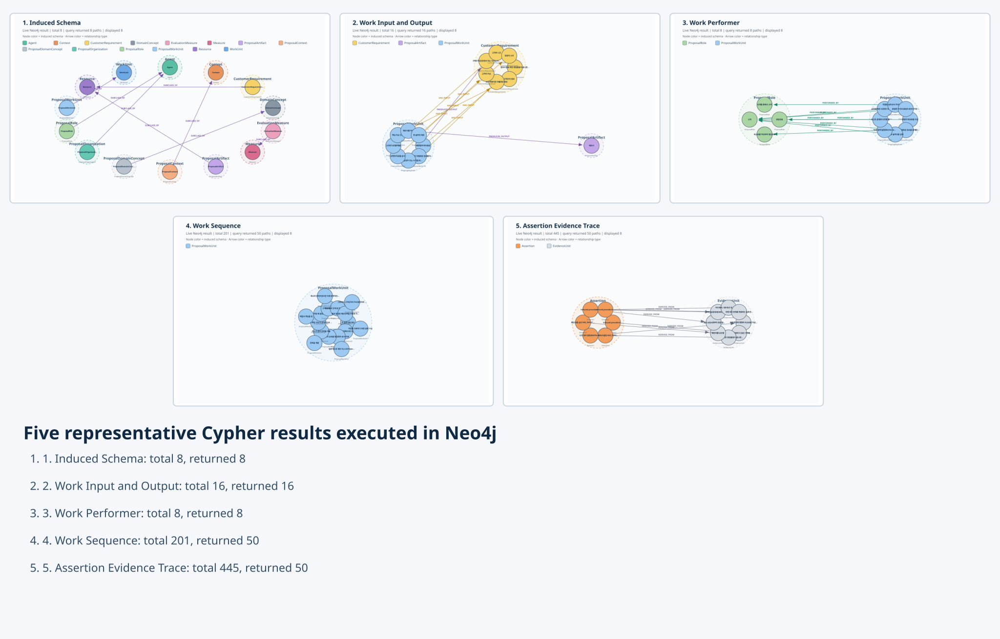
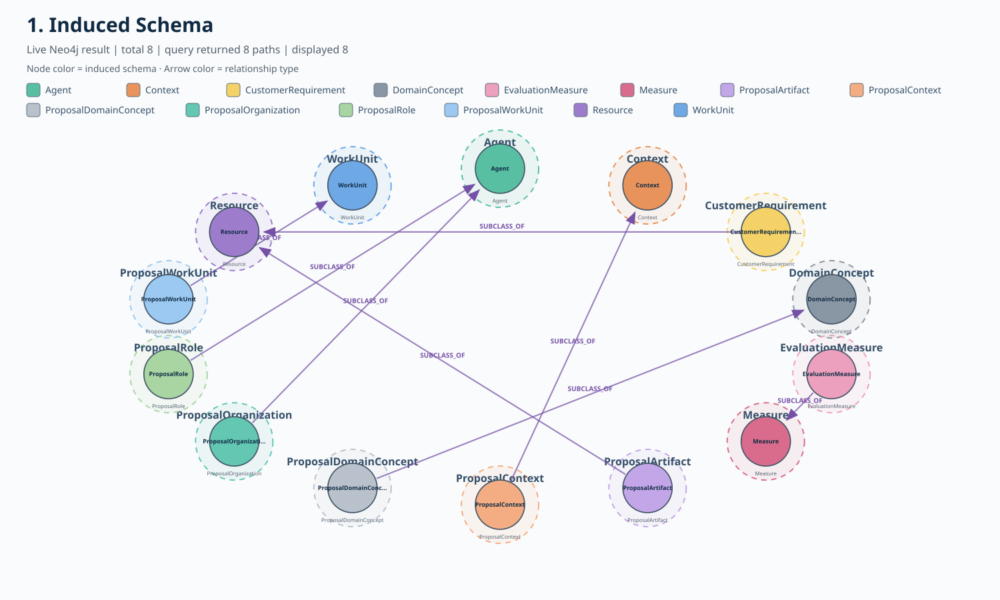
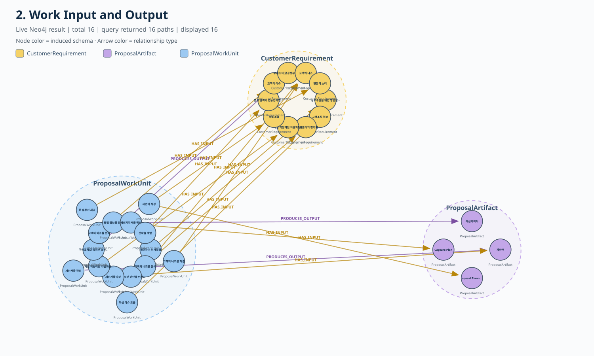
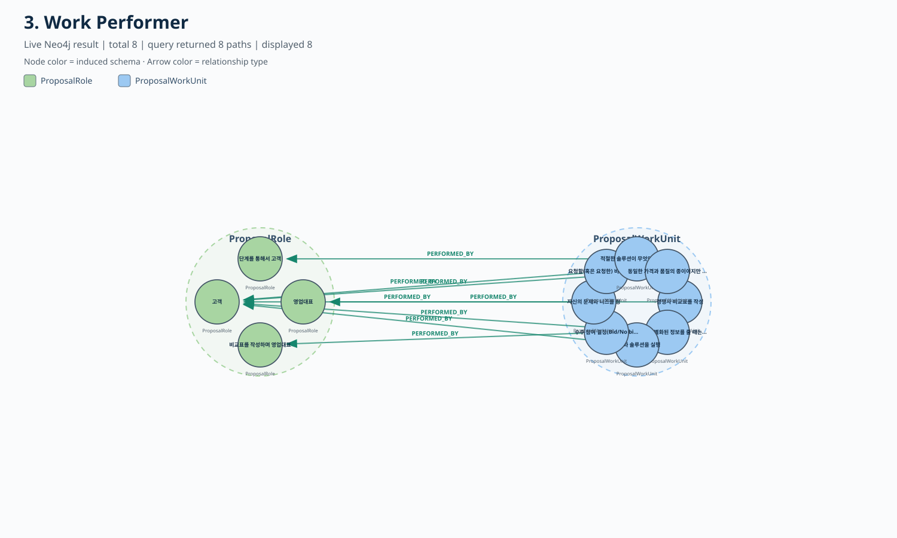
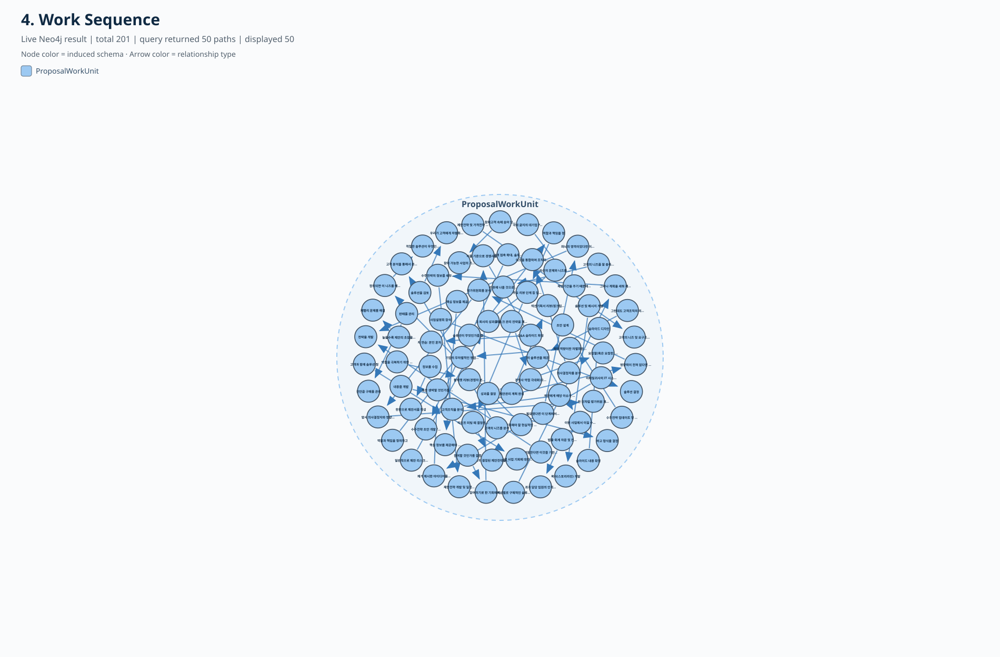
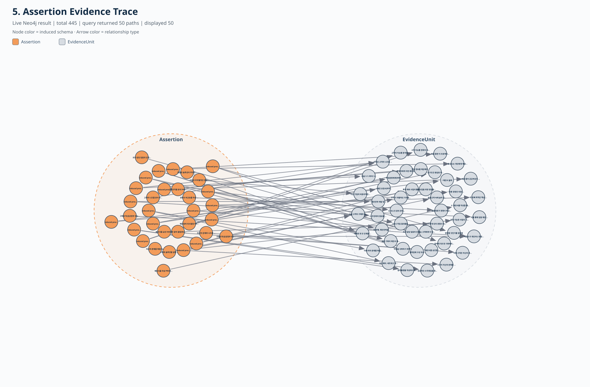

# Neo4j 대표 Cypher 5개 실제 실행·시각화 결과

실행 서버: **bolt://127.0.0.1:7689**  
데이터베이스: **neo4j**  
실행 상태: **5개 질의 모두 PASS**  
시각화 방식: **실제 Neo4j 반환 path를 원형 노드 그래프로 렌더링**

---

## 1. 시각화 원칙

각 원은 Neo4j 노드이며 화살표는 실제 반환된 관계다.

    (주체 노드) ──관계──> (객체 노드)

노드 색은 귀납된 스키마를 나타낸다. 화살표 색은 관계 타입을 나타낸다.
같은 스키마의 노드는 점선으로 표시된 같은 색상 영역 안에 가깝게 배치했다.

### 노드 색상

| 스키마 | 색상 의미 |
|---|---|
| ProposalWorkUnit | 파랑 |
| ProposalRole | 연두 |
| ProposalOrganization | 청록 |
| ProposalArtifact | 보라 |
| CustomerRequirement | 노랑 |
| ProposalContext | 주황 |
| EvaluationMeasure | 분홍 |
| ProposalDomainConcept | 회색 |
| Assertion | 진한 주황 |
| EvidenceUnit | 연한 회색 |

### 관계 색상

| 관계 | 색상 의미 |
|---|---|
| SUBCLASS_OF | 진한 보라 |
| HAS_INPUT | 황갈색 |
| PRODUCES_OUTPUT | 보라 |
| PERFORMED_BY | 초록 |
| PRECEDES | 파랑 |
| DERIVED_FROM | 회색 |

---

## 2. 전체 결과 요약

| 번호 | 시각화 | 전체 결과 | 질의 반환 | 핵심 확인 내용 |
|---|---|---:|---:|---|
| 1 | 귀납 스키마 | 8 | 8 | 도메인 클래스가 상위 메타클래스에 연결됨 |
| 2 | 업무 입력·산출물 | 16 | 16 | HAS_INPUT 13, PRODUCES_OUTPUT 3 |
| 3 | 업무 수행자 | 8 | 8 | WorkUnit과 ProposalRole 연결 |
| 4 | 업무 순서 | 201 | 50 | LIMIT 50에 따라 50개 path 표시 |
| 5 | Assertion 원문 근거 | 445 | 50 | LIMIT 50에 따라 50개 Evidence 연결 표시 |

통합 미리보기:

---

## 3. 귀납 스키마

### 실행 Cypher

    MATCH p=(:SchemaClass)-[:SUBCLASS_OF]->(:MetaClass)
    RETURN p
    LIMIT 50;

### 실행 결과

- 전체 관계: 8
- 반환 path: 8
- 관계: SUBCLASS_OF 8

### 해석

문서에서 귀납한 8개 도메인 클래스가 최소 상위 메타모델에 정렬된 결과다.

예:

    ProposalWorkUnit ──SUBCLASS_OF──> WorkUnit
    ProposalRole ─────SUBCLASS_OF──> Agent
    ProposalArtifact ─SUBCLASS_OF──> Resource
    ProposalContext ──SUBCLASS_OF──> Context

### 실제 실행 이미지

---

## 4. 업무의 입력·산출물

### 실행 Cypher

    MATCH p=(:ConceptCluster)-[r]->(:ConceptCluster)
    WHERE type(r) IN ['HAS_INPUT','PRODUCES_OUTPUT']
    RETURN p
    LIMIT 50;

### 실행 결과

- 전체 관계: 16
- 반환 path: 16
- HAS_INPUT: 13
- PRODUCES_OUTPUT: 3

### 색상 해석

- 파랑: ProposalWorkUnit
- 노랑: CustomerRequirement
- 보라: ProposalArtifact

### 의미

업무가 어떤 정보나 자료를 입력으로 사용하고 어떤 결과물을 만드는지 보여준다.

예:

    제안서 작성 ──HAS_INPUT──> 수주계획
    제안서를 작성 ──PRODUCES_OUTPUT──> 제안서

### 실제 실행 이미지

---

## 5. 업무 수행자

### 실행 Cypher

    MATCH p=(:ConceptCluster)-[:PERFORMED_BY]->(:ConceptCluster)
    RETURN p
    LIMIT 30;

### 실행 결과

- 전체 관계: 8
- 반환 path: 8
- PERFORMED_BY: 8

### 색상 해석

- 파랑: ProposalWorkUnit
- 연두: ProposalRole

### 의미

업무와 그 업무의 명시적 수행자 후보를 연결한 결과다.

최종 구현에서는 담당자, 책임자, 고객, 영업대표 등 명시적인 Agent 표지를 가진 주어만 허용했다.

### 주의

자동 추출 결과이므로 실제 책임 체계로 사용하기 전에 원문과 함께 검토해야 한다.

### 실제 실행 이미지

---

## 6. 업무 순서

### 실행 Cypher

    MATCH p=(:ConceptCluster)-[:PRECEDES]->(:ConceptCluster)
    RETURN p
    LIMIT 50;

### 실행 결과

- 전체 PRECEDES: 201
- 질의 반환 path: 50
- 이미지 표시 path: 50

### 색상 해석

- 양쪽 파랑: ProposalWorkUnit
- 파란 화살표: PRECEDES

### 의미

같은 장·절 안에서 문서에 나타난 WorkUnit의 순서를 연결한 결과다.

예:

    대안을 검토 ──PRECEDES──> 리스크를 관리

### 주의

PRECEDES는 문서 등장 순서를 업무 순서로 근사한 저신뢰 관계다.

- confidence: 0.62
- cycle 방지 적용
- self-loop 제거
- 실제 프로세스 순서로 사용하려면 전문가 검증 필요

### 실제 실행 이미지

---

## 7. Assertion의 원문 Evidence

### 실행 Cypher

    MATCH p=(:Assertion)-[:DERIVED_FROM]->(:EvidenceUnit)
    RETURN p
    LIMIT 50;

### 실행 결과

- 전체 DERIVED_FROM 연결: 445
- 질의 반환 path: 50
- 이미지 표시 path: 50

### 색상 해석

- 주황: Assertion
- 회색: EvidenceUnit
- 회색 화살표: DERIVED_FROM

### 의미

최종 관계 주장에서 실제 원문 Evidence로 돌아갈 수 있음을 보여준다.

Evidence 연결이 Assertion 261개보다 많은 이유는 PRECEDES Assertion 하나가 앞·뒤 업무의 Anchor 두 개를 근거로 가질 수 있기 때문이다.

### 실제 실행 이미지

---

## 8. 최종 해석

다섯 Cypher를 실제 Neo4j에 실행한 결과는 다음과 같다.

    귀납 스키마       8
    입력·산출물      16
    업무 수행자       8
    업무 순서       201
    Evidence 연결   445

이번 시각화로 확인된 것은 다음이다.

1. 귀납 클래스와 상위 메타타입 연결이 실제 Neo4j에 존재한다.
2. WorkUnit에서 입력과 산출물로 연결되는 관계가 존재한다.
3. WorkUnit에서 수행자 역할로 연결되는 관계가 존재한다.
4. WorkUnit 사이의 절차 순서 관계가 존재한다.
5. Assertion에서 원문 Evidence로 역추적할 수 있다.

다만 이 결과는 구조와 추적성 검증이다. 자동 생성 관계의 의미 정확도는 사람 gold 기반 후속 평가가 필요하다.
