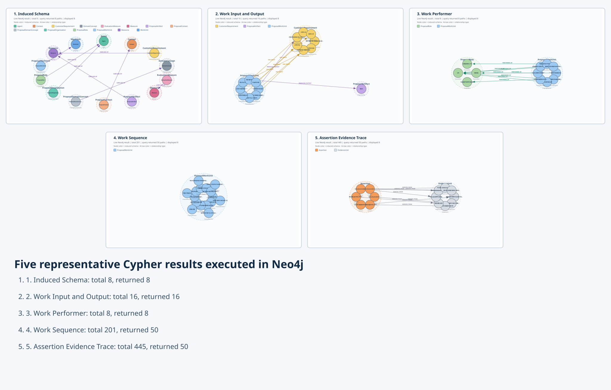

# 자이제 EG-MOI

## 문서에서 근거를 잃지 않고 온톨로지와 KG를 자동으로 만드는 방법

**최종 판정: `EG_MOI_END_TO_END_PASS`**

- 입력: `자이제_1.xlsx` 전체 1,366행
- 사람 중간 개입: 0
- 결과: RDF · SKOS · PROV-O · SHACL · Neo4j
- 주의: 파이프라인 성공이며, 의미 정확도를 모두 보장한다는 뜻은 아님

---

# 1. EG-MOI를 한눈에 보기

```text
Bottom-up Discovery
문서에서 후보를 먼저 발견
        ↓
Middle-out Induction
반복되는 핵심 군집에서 스키마를 구성
        ↓
Top-down Validation
근거와 그래프 제약으로 최종 승격
```

| 구분 | 의미 |
|---|---|
| Bottom-up | 정답 타입을 먼저 강제하지 않고 문서 표현을 폭넓게 발견 |
| Middle-out | 중심 군집부터 타입·관계를 만들고 상위 범주에 정렬 |
| Top-down | Evidence, domain/range, cycle, SHACL로 안전성 검사 |

**핵심:** LLM이 온톨로지를 자유롭게 쓰는 방법이 아니라, 문서에서 발견된 구조를 근거로 승격하는 방법이다.

---

# 2. Stage 1: 원문을 Evidence로 구조화

Excel 1행을 그대로 버리지 않고 문장·목록·표 구조에 맞게 나눈다.

```text
Document
  └─ Section
      └─ EvidenceUnit: Excel 원문 행
          ├─ Anchor: 실제 의미 추출 단위
          └─ ContextSpan: 표 header·row header·목록 문맥
```

| 결과 | 수 |
|---|---:|
| 원문 행 | 1,366 |
| Evidence Anchor | 2,308 |
| ContextSpan | 1,718 |
| 원문 위치 왕복 검증 | 100% |

예: 표의 `결과물(Output)` 셀만 떼더라도, 같은 행의 `활동(Activity)`과 열 제목을 함께 저장한다.

---

# 3. Stage 2: 후보를 열린 방식으로 발견

바로 triple을 만들지 않고 **Mention**과 **SemanticFrame**을 먼저 만든다.

```text
문장 예시:
제안팀이 고객 요구조건을 바탕으로 제안서 초안을 작성한다.

SemanticFrame:
action = 작성
agent  = 제안팀
input  = 고객 요구조건
object = 제안서 초안
```

사용한 신호:

- 표 header와 같은 행 구조
- 한·영 병기와 약어
- 명시적 정의, 조건, 수량 패턴
- 한국어 주체·목적어·행위 패턴

**실험 결과:** Mention 2,954개, SemanticFrame 177개

---

# 4. Stage 3: 같은 개념을 군집으로 통합

```text
Capture Plan / 수주계획 / 표기 변형
                ↓
        ConceptCluster 하나
```

통합 순서:

1. Unicode와 공백·기호를 정규화한다.
2. 완전히 같은 문자열을 묶는다.
3. 명시적 한·영 병기·약어를 근거로 묶는다.
4. 문자 2·3-gram 벡터의 cosine이 `0.90` 이상인 경우만 자동 병합한다.
5. `0.82~0.90`은 강제 병합하지 않고 `UNRESOLVED`로 둔다.

| ConceptCluster | 수 |
|---|---:|
| 전체 | 2,188 |
| VALIDATED | 818 |
| UNRESOLVED | 1,370 |

Gray-zone 46건은 LLM 호출 없이 보류했다.

---

# 5. Stage 4: 핵심 군집에서 스키마 귀납

고정 스키마에 문서를 끼워 넣지 않고, 군집의 반복 역할에서 다음 타입을 만들었다.

| 귀납 타입 | 상위 범주 | 군집 수 |
|---|---|---:|
| ProposalWorkUnit | WorkUnit | 229 |
| ProposalRole | Agent | 47 |
| ProposalOrganization | Agent | 5 |
| ProposalArtifact | Resource | 47 |
| CustomerRequirement | Resource | 31 |
| ProposalContext | Context | 243 |
| EvaluationMeasure | Measure | 4 |
| ProposalDomainConcept | DomainConcept | 212 |

핵심 관계:

`PERFORMED_BY` · `HAS_INPUT` · `PRODUCES_OUTPUT` · `HAS_CONDITION` · `HAS_MEASURE` · `PRECEDES`

문서 배치만으로 `broader`나 `partOf`를 만들지는 않았다.

---

# 6. Stage 5: 근거가 있는 결과만 승격

```text
후보 관계
  ├─ Evidence가 있는가?
  ├─ 주체·객체 타입이 맞는가?
  ├─ self-loop·중복·cycle이 없는가?
  └─ SHACL을 통과하는가?
          ↓
VALIDATED / UNRESOLVED
```

실제 자동 생성 예:

```text
제안서 작성 ──HAS_INPUT────────> 수주계획
제안서를 작성 ─PRODUCES_OUTPUT─> 제안서
대안을 검토 ──PRECEDES─────────> 리스크를 관리
```

모든 Assertion은 `DERIVED_FROM → EvidenceUnit`과 `WAS_GENERATED_BY → ExtractionActivity`를 가진다.

---

# 7. 최종 실험 결과

| 항목 | 결과 |
|---|---:|
| 최종 Assertion | 261 |
| 전체 노드 | 11,053 |
| 전체 관계 | 19,502 |
| RDF triples | 157,272 |
| SKOS triples | 4,354 |
| PROV-O triples | 19,892 |
| SHACL | PASS |
| Neo4j nodes 적재 | 11,053 / 11,053 |
| Neo4j relationships 적재 | 19,502 / 19,502 |
| Assertion Evidence 추적 | 100% |

Operational 관계: `PERFORMED_BY` 8, `HAS_INPUT` 13, `PRODUCES_OUTPUT` 3, `HAS_CONDITION` 35, `HAS_MEASURE` 1, `PRECEDES` 201

---

# 8. Neo4j 대표 시각화 질의 5개

**1. 귀납 스키마: 8개**

    MATCH p=(:SchemaClass)-[:SUBCLASS_OF]->(:MetaClass) RETURN p LIMIT 50;

**2. 업무의 입력·산출물: 16개**

    MATCH p=(:ConceptCluster)-[r]->(:ConceptCluster) WHERE type(r) IN ['HAS_INPUT','PRODUCES_OUTPUT'] RETURN p LIMIT 50;

**3. 업무 수행자: 8개**

    MATCH p=(:ConceptCluster)-[:PERFORMED_BY]->(:ConceptCluster) RETURN p LIMIT 30;

**4. 업무 순서: 201개**

    MATCH p=(:ConceptCluster)-[:PRECEDES]->(:ConceptCluster) RETURN p LIMIT 50;

**5. Assertion의 원문 근거: 445개 연결**

    MATCH p=(:Assertion)-[:DERIVED_FROM]->(:EvidenceUnit) RETURN p LIMIT 50;

---

# 9. 다섯 Cypher의 실제 Neo4j 실행 결과



- 실제 접속: `bolt://127.0.0.1:7689`, database `neo4j`
- 전체 결과: 스키마 8 · 입력/산출물 16 · 수행자 8 · 순서 201 · Evidence 445
- 화면 반환: LIMIT에 따라 각각 8 · 16 · 8 · 50 · 50 path

> **결론:** 다섯 Cypher 모두 실제 Neo4j에서 실행·시각화됐다. 의미 정확도와 저신뢰 `PRECEDES`는 후속 검증이 필요하다.
