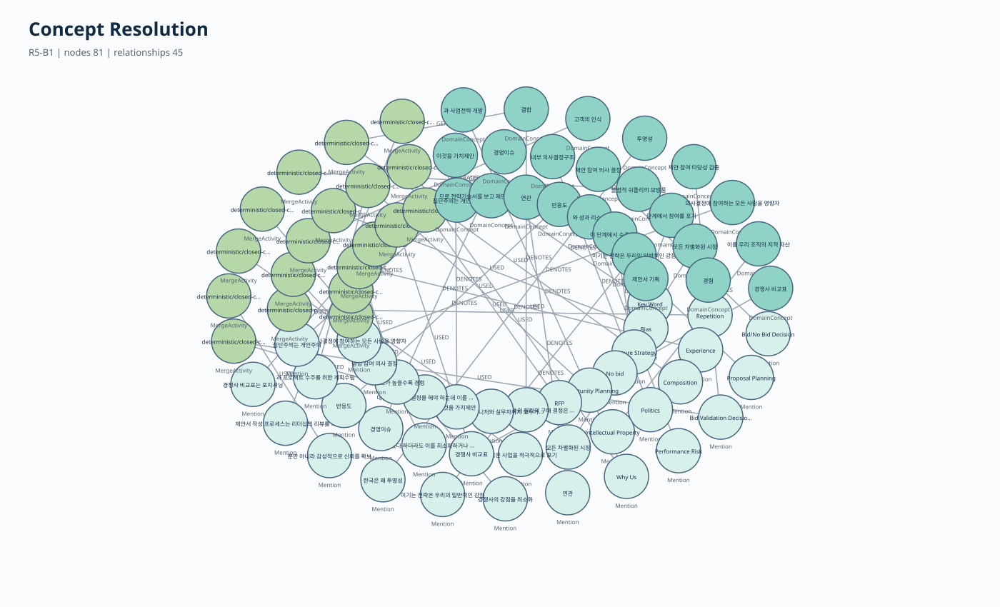

<!-- page: 1 -->
<!-- _class: lead -->

# 자이제 수주·제안 온톨로지 구축 방법론

## 원문을 바로 지식으로 만들지 않고, 근거와 검증을 거쳐 안전하게 정리하는 방법

```text
원문 → 근거 → 의미 후보 → 규칙·LLM 판정 → 제약 검증 → 온톨로지 → Neo4j
```

### 최종 결과

- 채택 방법: **B1 결정적 CRSI**
- 최종 판정: **DETERMINISTIC_CRSI_ONLY_PASS**
- 결과물: **근거 추적이 가능한 보수적 온톨로지 코어 v0.2**

> 핵심은 “지식을 많이 만드는 것”이 아니라, **틀린 지식을 함부로 확정하지 않는 것**입니다.

---

<!-- page: 2 -->

# 1. 온톨로지는 무엇인가?

온톨로지는 어려운 기술 용어라기보다, **업무에서 사용하는 개념·관계·규칙을 같은 기준으로 정리한 지식 지도**입니다.

### 예: 수주·제안 업무를 정리한다면

| 질문 | 온톨로지에 저장할 내용 |
|---|---|
| 무엇을 하는가? | 제안서 작성, 고객 분석, 레드팀 리뷰 |
| 누가 하는가? | 영업대표, 제안팀, 평가위원 |
| 무엇을 사용하는가? | RFP, Capture Plan, 제안서 템플릿 |
| 어떤 순서인가? | 고객 분석 → 전략 수립 → 제안서 작성 → 리뷰 |
| 어떤 규칙이 있는가? | “제안서는 반드시 리뷰해야 한다” |

### 정리 전과 정리 후

```text
[정리 전]
제안 참여 의사 결정 / Bid-No Bid Decision / Pursuit Decision

[정리 후]
Canonical Concept: 제안 참여 의사 결정
  ├─ 한글 표면어
  ├─ 영문 표면어
  └─ 약어·다른 표기
```

**목적:** 같은 개념을 일관되게 검색하고, 관련 업무·규칙·근거를 함께 찾기 위함입니다.

---

<!-- page: 3 -->

# 2. 왜 원문에서 바로 triple을 만들지 않는가?

원문을 바로 `주어–관계–목적어`로 바꾸면 중요한 의미가 사라질 수 있습니다.

### 예시 1: 의무

```text
원문: “제안서는 반드시 리더십의 리뷰를 거쳐야 한다.”
단순 triple: 제안서 → 거친다 → 리뷰
빠진 정보: 반드시 해야 한다는 규칙
```

### 예시 2: 부정

```text
원문: “가격만으로 제안 전략을 결정해서는 안 된다.”
잘못된 triple: 가격 → 결정한다 → 제안 전략
실제 의미: 가격만으로 결정하는 것을 금지함
```

### 예시 3: 사례

```text
원문: “예를 들어 A사는 제안서를 두 번 검토했다.”
위험한 해석: 모든 제안서는 두 번 검토해야 한다.
실제 의미: 특정 사례일 뿐 일반 규칙이 아님
```

따라서 먼저 문장의 **의무·권고·금지·부정·조건·예외·사례 여부**를 보존한 Claim을 만들고, 그다음 온톨로지 후보로 승격합니다.

> 이것이 전체 방법론의 첫 번째 원칙인 **claim-first**입니다.

---

<!-- page: 4 -->

# 3. 전체 방법론은 어떻게 진행되는가?

```text
① Excel 원문 보존
   ↓
② 문장·절·표 셀을 정확한 Anchor로 분리
   ↓
③ Claim과 Mention 추출
   ↓
④ 개념 병합·관계 후보 생성
   ↓
⑤ 명시적 규칙과 타입으로 우선 판정
   ↓
⑥ 모호한 후보만 LLM이 닫힌 선택지로 판정
   ↓
⑦ 제약을 다시 검사한 뒤 canonical ontology로 승격
   ↓
⑧ RDF·Neo4j로 변환하고 원문 추적 경로 검증
```

### 단계별 역할

| 단계 | 하는 일 | 이유 |
|---|---|---|
| Evidence·Anchor | 원문과 위치 고정 | 출처를 잃지 않기 위해 |
| Claim·Mention | 문장 의미와 실제 표현 보존 | 부정·조건·사례 오류 방지 |
| Candidate | 아직 확정되지 않은 후보 생성 | 성급한 지식 확정 방지 |
| Constraint Gate | 타입·근거·관계 규칙 검사 | 잘못된 병합·관계 차단 |
| Canonical Ontology | 통과한 지식만 채택 | 일관된 업무 지식 구축 |

R4까지는 근거·Claim·보수적 코어를 만들었고, **R5에서는 개념 중복 정리와 관계 schema 통합, Neo4j 시각화를 수행했습니다.**

---

<!-- page: 5 -->

# 4. 같은 개념은 어떻게 하나로 정리하는가?

## 후보를 세 종류로 나눕니다

### ① Hard-positive: 같은 개념이라는 근거가 명확함

```text
“제안 참여 의사 결정(Bid/No bid Decision)”
→ 괄호 안 영문은 명시적 alias
→ 하나의 canonical concept로 병합 가능
```

### ② Hard-negative: 병합하면 안 됨

```text
“제안서 작성” = WorkUnit
“30점 이상”   = Metric
→ 문자열이 일부 비슷해도 타입이 다르므로 병합 금지
```

### ③ Gray-zone: 관련 있지만 같은지는 불확실함

```text
제안 참여 의사 결정  ↔  제안 참여 타당성 검증
→ RELATED일 수 있지만 SAME이라고 자동 판단하지 않음
```

## 병합 후에도 원래 표현은 삭제하지 않습니다

```text
Mention “Bid/No bid Decision”
        └─ DENOTES → Canonical Concept “제안 참여 의사 결정”
                           └─ 근거 → 원문 Anchor
```

이 방식으로 **검색은 하나의 개념으로 하면서, 원문 표현과 병합 이유는 그대로 확인**할 수 있습니다.

---

<!-- page: 6 -->

# 5. 관계는 어떻게 같은 기준으로 정리하는가?

LLM이나 규칙이 관계명을 자유롭게 만들면 같은 의미가 여러 관계로 흩어집니다.

```text
produces / creates / makes / hasOutput
                 ↓
          PRODUCES_OUTPUT
```

따라서 허용 관계를 미리 고정했습니다.

| 영역 | 대표 관계 | 쉬운 예시 |
|---|---|---|
| 명칭·정의 | `HAS_ALIAS`, `HAS_DEFINITION` | RFP는 Request for Proposal의 약어 |
| 업무 흐름 | `PRECEDES` | 고객 분석 다음에 전략 수립 |
| 역할·산출물 | `PERFORMED_BY`, `PRODUCES_OUTPUT` | 제안팀이 제안서 초안을 만듦 |
| 규칙·제약 | `HAS_CONDITION`, `HAS_EXCEPTION` | 제출 전이라면 리뷰해야 함 |
| 템플릿 | `HAS_FIELD` | Capture Plan에 고객 이슈 필드가 있음 |

## 서로 다른 구조를 혼동하지 않습니다

```text
종류 관계:   레드팀 리뷰 → 리뷰의 한 종류         (BROADER)
구성 관계:   고객 이슈 필드 → Capture Plan의 일부 (PART_OF/HAS_FIELD)
순서 관계:   전략 수립 → 제안서 작성              (PRECEDES)
```

문서에서 위아래에 있거나 같은 표에 있다는 이유만으로 종류 관계를 만들지 않습니다. **명시적 Evidence가 없으면 관계를 만들지 않는 것이 기본값**입니다.

---

<!-- page: 7 -->

# 6. LLM은 생성기가 아니라 제한된 판정기입니다

### LLM에 주는 질문 예시

```text
후보 A: 제안 참여 의사 결정
후보 B: 제안 참여 타당성 검증
원문 근거: Anchor 1, Anchor 2

다음 중 하나만 선택:
① SAME_CONCEPT
② RELATED_NOT_SAME
③ DIFFERENT_CONCEPT
④ UNDERDETERMINED
```

LLM은 새로운 label·관계·인용문을 만들 수 없습니다. `SAME_CONCEPT`를 선택해도 타입 충돌, Evidence, domain/range, cycle을 다시 검사합니다.

## 비교한 다섯 시스템

| 시스템 | 방식 | 무엇을 확인하는가? |
|---|---|---|
| B0 | 표면어를 모두 분리 | 정규화 전 상태 |
| **B1** | 명시 규칙·타입·제약만 사용 | 결정적 방법의 안전성 |
| B2 | B1 + 중요한 일부 후보만 LLM | 선택적 LLM의 비용 효율 |
| B3 | B1 + gray 후보 전수 LLM | B2가 따라갈 목표 수준 |
| B4 | LLM이 직접 개념·관계 생성 | 자유 생성 방식과 비교 |

> 최종 operational graph에는 **제약을 통과한 결과만** 들어갑니다.

---

<!-- page: 8 -->

# 7. “근거 추적 가능”하다는 것은 무엇인가?



최종 개념이나 규칙에서 Excel 원문까지 경로를 따라갈 수 있다는 뜻입니다.

```text
Canonical Concept
  ← DENOTES ─ Mention
  → MergeActivity
  → Anchor
  → EvidenceBundle
  → Excel 행과 원문
```

### 예시

```text
Canonical Concept: 제안 참여 의사 결정
표면어: Bid/No bid Decision
병합 근거: 원문의 괄호형 alias
출처: Excel 특정 행, Anchor A01
생성 방법: deterministic alias rule
```

따라서 다음 질문에 답할 수 있습니다.

- 왜 두 용어를 하나로 합쳤는가?
- 이 규칙은 원문의 어느 문장에서 나왔는가?
- 규칙이 만든 결과인가, LLM이 판정한 결과인가?
- 원문에 실제 존재하지 않는 표현은 아닌가?

이 추적 구조를 RDF와 실제 Neo4j 서버에서 모두 검증했습니다.

---

<!-- page: 9 -->

# 8. 최종 실험 결과

## DEV 비교

| 지표 | B1 | B2 | B3 | 직접 LLM B4 |
|---|---:|---:|---:|---:|
| safe ontology yield | 88 | 104 | 128 | 140 |
| critical violation | **0** | **0** | **0** | **82** |
| unsupported label rate | 0% | 0% | 0% | 12.08% |

- B2는 B1보다 yield가 **18.18% 증가**했습니다.
- 그러나 B2/B3 토큰 비율이 **55.27%**로 기준 35%를 초과했습니다.
- 직접 LLM B4는 결과 수는 많았지만 schema 위반과 근거 없는 label이 많았습니다.

`safe ontology yield`는 안전하게 줄인 개념 파편과 근거 있는 정규화 관계의 수입니다. **인간 전문가 의미 정확도와 같은 지표는 아닙니다.**

## 최종 전체 시연 그래프

| 항목 | 결과 |
|---|---:|
| Evidence | 953 |
| nodes / relationships | 4,767 / 10,738 |
| canonical concepts | 139 |
| 명시 alias 회수 | 166/166 |
| RDF triples / SHACL 위반 | 87,023 / 0 |
| Neo4j 필수 view | 6/6 non-empty |
| Rule→Anchor / Concept→Mention | 45/45 / 139/139 |

---

<!-- page: 10 -->

# 9. 최종 결론과 현재 위치

## 현재까지 완료된 것

- 원문 Evidence·Anchor 보존
- Claim 중심 의미 표현과 보수적 ontology core 구축
- 개념 alias 통합과 관계 schema 정규화
- B0~B4 비교 실험과 비용·안전성 평가
- RDF·SHACL·Neo4j 실제 적재 및 추적 경로 검증
- 최종 canonical system으로 **B1 결정적 CRSI 채택**

## 아직 남아 있는 것

| 한계 | 필요한 후속 작업 |
|---|---|
| fresh VALIDATION이 8건뿐임 | 신규 독립 표본 80건 이상 구축 |
| 인간 전문가 Gold가 없음 | gray pair·B4 오류 20~40건 전문가 판정 |
| 일부 label 경계가 길거나 불완전함 | span 정제 규칙 개발 |
| 역할·입출력·taxonomy가 부족함 | 해당 관계의 명시 reference 구축 |
| B2 토큰 효율이 낮음 | candidate blocking·impact score 개선 |

## 최종적으로 어떻게 설명해야 하는가?

> 현재 완성된 것은 “모든 의미가 전문가 수준으로 검증된 완성형 온톨로지”가 아니라, **원문 근거를 추적할 수 있고 구조적 제약을 통과한 보수적 온톨로지 코어 v0.2**입니다.

### 핵심 메시지

**LLM이 지식을 자유롭게 만들게 하는 것보다, 원문 근거가 있는 후보를 규칙과 제약으로 먼저 검증하는 방식이 현재 자이제 데이터에서는 더 안전하고 재현 가능했습니다.**
