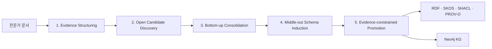

# EG-MOI: 근거 기반 Bottom-up-first Middle-out 온톨로지 귀납 방법론

> **Evidence-Grounded Middle-Out Ontology Induction**  
> **핵심 원리: 발견은 Bottom-up, 조직화는 Middle-out, 검증은 Top-down**

---

## 1. 방법론의 한 문장 정의

> **전문가 문서에서 개념과 관계 후보를 열린 방식으로 먼저 발견하고, 반복되는 후보를 의미 군집으로 통합해 도메인 스키마를 귀납한 뒤, 원문 근거와 그래프 제약을 통과한 결과만 온톨로지와 KG로 승격하는 방법이다.**

이 방법은 완성된 도메인 스키마를 미리 만든 뒤 문서를 끼워 넣는 순수 Top-down 방식이 아니다. 반대로 문서에서 추출한 모든 표현을 그대로 노드와 관계로 사용하는 순수 Bottom-up 방식도 아니다.

```text
Bottom-up Discovery
문서에서 개념·행위·관계 후보를 발견
        ↓
Middle-out Induction
핵심 군집에서 도메인 클래스·관계·계층을 귀납
        ↓
Top-down Validation
근거·타입·일관성·SHACL 제약으로 최종 검증
```

---

## 2. 왜 이 방향이 최종 방법론인가

### 순수 Top-down의 장점과 한계

미리 정의한 타입과 관계에 문서 지식을 매핑하면 안정적이고 평가가 쉽다. 그러나 새로운 직무의 고유 개념과 관계를 놓칠 수 있으며, 연구 결과가 **온톨로지 학습**보다 **고정 스키마 채우기**에 가까워질 수 있다.

### 순수 Bottom-up의 장점과 한계

문서에서 자유롭게 개념과 관계를 발견하면 도메인 특수성을 보존할 수 있다. 그러나 같은 의미가 여러 이름으로 파편화되고, 지나치게 세부적인 타입과 관계가 생성되며, 사람이 없는 환경에서는 스키마가 불안정해질 수 있다.

### 최종 선택

따라서 본 방법론은 다음의 역할 분담을 채택한다.

| 요소 | 방식 |
|---|---|
| 원문 구조와 출처 모델 | 미리 고정 |
| 개념·행위·관계 후보 | 문서에서 Bottom-up 발견 |
| 동일 개념·관계 통합 | NLP·임베딩 기반 Bottom-up 군집화 |
| 도메인 타입·관계·계층 | 핵심 군집에서 Middle-out 귀납 |
| 공통 상위 범주 정렬 | 최소 메타모델에 후행 정렬 |
| 최종 KG 편입 | 근거와 제약을 이용한 Top-down 검증 |

즉, **상위 틀이 발견을 제한하지 않으며, 발견된 지식을 정리하고 검증하는 데만 사용된다.**

---

## 3. 무엇을 미리 정하고 무엇을 자동으로 발견하는가

### 3.1 미리 고정하는 것: 표현·검증 틀

다음은 수주·제안 도메인의 지식이 아니라, 어떤 직무 문서에도 공통으로 필요한 기술적 틀이다.

```text
Document
EvidenceUnit
Mention
SemanticFrame
ConceptCluster
RelationCluster
Assertion
ExtractionActivity
```

또한 다음 원칙을 고정한다.

- 모든 노드와 관계는 원문 Evidence를 가져야 한다.
- 원문에 없는 사실을 자유 생성하지 않는다.
- 동일 개념 병합에는 명시 근거 또는 충분한 의미 유사성이 필요하다.
- 관계의 주체·객체 타입이 일관돼야 한다.
- taxonomy cycle, self-loop, 모순 관계를 허용하지 않는다.
- 불확실한 후보는 강제 승격하지 않고 `UNRESOLVED`로 유지한다.

### 3.2 문서에서 자동으로 발견하는 것: 도메인 온톨로지

다음은 자이제 문서에서 Bottom-up으로 발견한다.

- 구체적인 업무 개념과 용어
- 동의어·약어·표기 변형
- 행위와 업무 프레임
- 도메인 특수 개념 타입
- 도메인 특수 관계
- 개념의 상·하위 및 부분·전체 구조
- 업무 순서와 입력·산출 구조
- 명시적 규칙·조건·수량 제약

예를 들어 `Capture Planning`, `핵심 이해관계자`, `Bid/No Bid Decision`은 사전에 정의하지 않고 문서에서 발견한다. 이후 발견된 개념을 `WorkUnit`, `Agent`, `Resource`와 같은 최소 상위 범주에 정렬할 수는 있지만, 이 상위 범주가 후보 발견을 제한하지는 않는다.

---

## 4. 최종 방법론의 다섯 단계



---

## Stage 1. Evidence Structuring

### 목적

문서를 의미 추출이 가능한 단위로 나누되 원문 위치와 문서 구조를 보존한다.

### 방법

- 일반 산문은 문장과 독립 절 단위로 분리한다.
- 목록은 각 항목을 하나의 EvidenceUnit으로 두고 목록 머리말을 문맥으로 연결한다.
- 표는 셀과 행을 보존하고 caption, column header, row header를 구조 문맥으로 연결한다.
- 모든 단위에 `start_char`, `end_char`, 원본 행, 장·절, 표·목록 위치를 기록한다.

### 출력

```text
EvidenceUnit
+ exact source span
+ document context
+ table/list structure
```

이 단계는 의미를 추론하는 단계가 아니라 **원문을 잃지 않는 근거 구조화 단계**다.

---

## Stage 2. Open Candidate Discovery

### 목적

고정된 도메인 스키마를 강제하지 않고 문서에 나타난 개념·행위·관계 후보를 폭넓게 발견한다.

### 사용 기술

- NER 및 명사구 추출
- 형태소 분석과 도메인 용어 추출
- Dependency Parsing 및 Semantic Role Labeling
- Open Relation Extraction
- 표 Header와 동일 행 구조
- 수량·정의·약어·조건·순서에 대한 고정밀 패턴

### 핵심 중간표현

평면 triple을 바로 만들지 않고 다음 `SemanticFrame`을 먼저 만든다.

```text
SemanticFrame =
  predicate/action
  + participant/agent
  + object/target
  + input/resource
  + result/output
  + condition
  + measure
  + evidence
```

예시:

```text
원문:
제안팀이 고객 요구조건을 바탕으로 제안서 초안을 작성한다.

후보 프레임:
action = 작성
agent = 제안팀
input = 고객 요구조건
output = 제안서 초안
```

이 단계의 결과는 아직 확정 온톨로지가 아니라 `Mention`, `SemanticFrame`, `SurfaceRelation` 후보이다.

---

## Stage 3. Bottom-up Consolidation

### 목적

문서 전체에 흩어진 동일 개념과 동일 관계 표현을 군집화한다.

### 개념 후보 통합

다음 신호를 결합해 동일 개념 후보를 찾는다.

```text
문자열 정규화
+ lexical similarity
+ embedding cosine similarity
+ 주변 문맥 유사도
+ SemanticFrame 역할 유사도
+ 표·문서 구조 유사도
+ 타입 비호환 제약
```

예시:

```text
핵심 이해관계자
주요 이해관계자
Key Stakeholder
        ↓
ConceptCluster: 핵심 이해관계자
```

명시적 한·영 병기나 약어 정의는 높은 신뢰도로 병합한다. 문자열이 비슷하더라도 역할이나 타입이 충돌하면 병합하지 않는다. cosine similarity는 **후보 검색과 우선순위 산정**에 사용하며, 단독 병합 근거로 사용하지 않는다.

### 관계 후보 통합

표면 술어와 프레임 문맥을 임베딩해 관계 군집을 만든다.

```text
작성한다 / 생성한다 / 산출한다
        ↓
RelationCluster: 산출 관계

해결한다 / 대응한다 / address
        ↓
RelationCluster: 이슈 대응 관계
```

이 단계에서는 관계명을 미리 완전히 제한하지 않는다. 공통 업무 관계는 seed로 활용하되, 기존 관계로 설명되지 않는 반복 군집은 신규 관계 후보로 유지한다.

---

## Stage 4. Middle-out Schema Induction

### 목적

가장 안정적이고 중심적인 개념·관계 군집부터 도메인 스키마를 형성하고, 필요에 따라 위로 일반화하거나 아래로 세분화한다.

### 개념 스키마 귀납

1. 반복 빈도, Evidence 다양성, 그래프 연결성이 높은 개념 군집을 핵심 개념으로 선택한다.
2. 군집의 공통 문맥과 역할을 바탕으로 도메인 타입의 이름과 정의를 만든다.
3. 유사 핵심 타입을 상위 타입으로 일반화한다.
4. 의미적으로 구별되는 하위 군집은 하위 타입으로 세분화한다.
5. 마지막에 최소 상위 메타모델에 정렬한다.

예시:

```text
제안 책임자 / Capture Manager / 제안 PM
        ↓
Domain Type: ProposalManagementRole
        ↓
상위 정렬: Agent
```

### 관계 스키마 귀납

1. 관계 군집의 표면 술어, 주체 타입, 객체 타입, 문맥을 분석한다.
2. 공통 seed 관계와 의미가 같으면 해당 관계에 정렬한다.
3. 독립 Evidence에서 반복되고 기존 관계로 설명되지 않으면 신규 도메인 관계 후보로 만든다.
4. 관계의 이름, 정의, domain, range를 부여한다.
5. 중복 관계와 상·하위 관계를 정리한다.

예시:

```text
해결한다 / 대응한다 / address
+ 주체: Strategy
+ 객체: CustomerIssue
        ↓
신규 관계 후보: ADDRESSES_ISSUE
```

### Taxonomy·Partonomy·Procedure 분리

- `broader`: 종류 관계
- `partOf`: 구성요소 관계
- `precedes`: 업무 순서 관계

문서 배치나 문자열 포함만으로 `broader`를 생성하지 않는다.

---

## Stage 5. Evidence-constrained Promotion

### 목적

발견된 후보 중 검증 가능한 지식만 최종 온톨로지와 KG에 편입한다.

### 승격 조건

모든 최종 개념과 관계는 다음을 만족해야 한다.

```text
원문 Evidence 존재
+ 군집 또는 명시 구조의 지지
+ 개념·관계 정규화 완료
+ domain/range 일관성
+ taxonomy cycle 없음
+ provenance 완전성
+ SHACL 제약 통과
```

### 세 가지 상태

```text
CANDIDATE   : 추출됐지만 아직 검증되지 않음
VALIDATED   : 근거와 제약을 통과해 최종 KG에 포함
UNRESOLVED  : 모호하거나 근거가 부족해 보류
```

불확실한 후보를 억지로 처리하지 않는 것이 방법론의 일부다. `UNRESOLVED`는 실패가 아니라 잘못된 지식의 승격을 막는 안전한 abstention이다.

---

## 5. LLM의 정확한 역할

본 방법론은 LLM을 제거하지 않는다. 다만 LLM이 전체 온톨로지를 자유 생성하도록 하지 않는다.

### LLM을 사용하는 경우

- ConceptCluster의 이름과 간결한 정의 생성
- 동일 개념인지 애매한 군집 병합 판정
- RelationCluster가 기존 seed 관계와 같은지 판정
- 신규 관계 후보의 이름·정의·domain·range 제안
- 상위 메타타입 정렬이 애매한 경우
- 그래프 활용에 중요하지만 신뢰도가 낮은 후보 검증

### LLM을 사용하지 않는 경우

- 모든 문장에 대한 자유 triple 생성
- 원문에 없는 개념·사실 추가
- 새로운 Evidence quote 생성
- 한 사례를 일반 규칙으로 임의 일반화
- LLM 출력의 즉시 operational graph 승격

### 호출 단위

```text
문장 단위 전수 호출  X
모호한 후보 또는 군집 단위 호출  O
```

즉, 같은 관계 표현이 100개 문장에 등장해도 문장마다 100번 호출하지 않고, 정규화된 관계 군집 하나를 한 번 판정한다.

운영 목표는 전체 의사결정 후보 중 명시 규칙과 NLP·임베딩으로 해결되지 않은 **소수의 Gray-zone**에만 LLM을 사용하는 것이다. 초기 실험에서는 전체 type·merge·relation decision의 10~15% 이하를 예산 목표로 두되, 이는 성능 비교를 위한 목표값이지 방법론의 절대 조건은 아니다.

---

## 6. 사람 개입 없는 End-to-End 실행

본 방법론은 다음 흐름을 사람의 중간 편집 없이 실행할 수 있다.

```text
Layer 2 전문가 문서
→ EvidenceUnit 생성
→ Mention·SemanticFrame·SurfaceRelation 추출
→ Concept·Relation 군집화
→ 도메인 타입·관계·taxonomy 귀납
→ 선택적 LLM 판정
→ 근거·제약 검증
→ RDF/SKOS/PROV-O/SHACL
→ Neo4j 그래프와 시각화
```

사람이 없기 때문에 모든 후보를 강제로 확정하지 않는다. 자동으로 해결되지 않은 대상은 `UNRESOLVED`에 남기며, 최종 그래프와 별도로 보존한다.

---

## 7. 최종 그래프의 구성

### Evidence Graph

```text
Document → Section → EvidenceUnit
```

### Lexical and Concept Graph

```text
Mention → DENOTES → CanonicalConcept
Concept → broader / partOf → Concept
```

### Operational Work Graph

```text
WorkUnit → performedBy → Agent
WorkUnit → hasInput → Resource
WorkUnit → producesOutput → Resource
WorkUnit → precedes → WorkUnit
WorkUnit → appliesWhen → Context
WorkUnit → hasMeasure → Measure
```

위 관계는 공통 seed이며, Bottom-up으로 귀납된 도메인 관계가 추가될 수 있다.

### Provenance Graph

```text
Assertion → derivedFrom → EvidenceUnit
Assertion → generatedBy → ExtractionActivity
SchemaElement → supportedBy → Concept/RelationCluster
```

### 출력 형식

- RDF: canonical knowledge representation
- SKOS: 초기 개념 체계와 taxonomy
- PROV-O: 추출·병합·승격 이력
- SHACL: 그래프 제약 검증
- Neo4j: 탐색·질의·시각화를 위한 operational projection

---

## 8. 간단한 처리 예시

### 원문

```text
제안팀이 고객 요구조건을 바탕으로 제안서 초안을 작성한다.
```

### 1. Evidence Structuring

```text
EvidenceUnit E1
exact span과 문서 위치 저장
```

### 2. Open Candidate Discovery

```text
Mention: 제안팀
Mention: 고객 요구조건
Mention: 제안서 초안
Predicate: 작성

SemanticFrame:
agent  = 제안팀
input  = 고객 요구조건
output = 제안서 초안
```

### 3. Bottom-up Consolidation

```text
제안팀 / Proposal Team → ConceptCluster C1
고객 요구조건 / Customer Requirement → ConceptCluster C2
제안서 초안 / Proposal Draft → ConceptCluster C3
작성 / 생성 / 산출 → RelationCluster R1
```

### 4. Middle-out Schema Induction

```text
C1 → ProposalOrganization → Agent
C2 → CustomerRequirement → Resource
C3 → ProposalArtifact → Resource
R1 → producesOutput
```

### 5. Evidence-constrained Promotion

```text
제안서 작성 ──performedBy────> 제안팀
제안서 작성 ──hasInput───────> 고객 요구조건
제안서 작성 ──producesOutput─> 제안서 초안
```

세 관계 모두 E1의 exact source span과 연결된다.

---

## 9. 이 방법이 기존 방식과 다른 점

| 방식 | 장점 | 한계 | 본 방법론의 처리 |
|---|---|---|---|
| Fixed Top-down | 안정성과 일관성 | 새로운 도메인 지식 누락 | 상위 틀은 검증과 정렬에만 사용 |
| Pure Bottom-up | 높은 발견 가능성 | 파편화와 스키마 팽창 | 군집화와 Middle-out 귀납으로 통제 |
| Full-LLM | 빠른 자유 생성 | 비용·환각·재현성 문제 | Gray-zone·군집 수준에만 제한 사용 |
| 규칙 중심 | 고정밀 명시 정보 | 암묵적·언어 변형에 약함 | NLP·임베딩·구조 신호와 결합 |
| **EG-MOI** | 발견성과 안전성의 균형 | 일부 후보는 보류됨 | `UNRESOLVED`를 정식 결과로 관리 |

---

## 10. 최종 방법론의 연구적 주장

본 방법론이 검증하려는 핵심 명제는 다음이다.

> **고정된 도메인 스키마 없이도 NLP와 임베딩으로 직무 문서의 개념과 관계를 Bottom-up으로 발견할 수 있으며, 핵심 군집을 중심으로 Middle-out 스키마를 귀납하고, 제한적 LLM과 근거·제약 검증을 결합하면 사람 개입 없이도 추적 가능하고 확장 가능한 직무 온톨로지를 구축할 수 있다.**

연구의 차별점은 LLM을 많이 사용하는 데 있지 않다.

```text
Open Discovery
→ Semantic Consolidation
→ Schema Induction
→ Evidence-constrained Promotion
```

즉, **LLM이 온톨로지를 쓰는 방식이 아니라, 문서에서 발견된 구조를 LLM이 필요한 경우에만 해석하고 최종 승격은 근거와 제약이 결정하는 방식**이다.

---

## 11. 방법론의 최종 요약

```text
발견은 Bottom-up
- NER, 용어 추출, SRL, Open Relation, 표 구조

통합은 데이터 중심
- 문자열, embedding cosine, 문맥, 그래프 역할

조직화는 Middle-out
- 핵심 Concept/Relation cluster에서 도메인 스키마 귀납

LLM은 선택적
- 모호한 병합, 군집 이름·정의, 신규 관계 정렬

검증은 Top-down
- Evidence, provenance, domain/range, cycle, SHACL
```

> **최종 정의:** EG-MOI는 전문가 문서에서 도메인 지식을 Bottom-up으로 발견하고, 의미 군집을 Middle-out으로 온톨로지화하며, 원문 근거와 형식 제약으로 Top-down 검증하는 무인 하이브리드 온톨로지 구축 방법론이다.

---

## 12. 선행연구와의 연결

1. Uschold, M. & Grüninger, M. (1996). *Ontologies: Principles, Methods and Applications.* — Top-down, Bottom-up, Middle-out 온톨로지 개발 전략.
2. Cimiano, P. & Völker, J. (2005). *Text2Onto: A Framework for Ontology Learning and Data-driven Change Discovery.* — 추출 후보를 즉시 확정하지 않고 중간 확률 모델로 관리하는 관점.
3. Wu, S. et al. (2017). *Fonduer: Knowledge Base Construction from Richly Formatted Data.* arXiv:1703.05028 — 텍스트·표·문서 구조를 함께 사용하는 지식 추출.
4. Reimers, N. & Gurevych, I. (2019). *Sentence-BERT.* arXiv:1908.10084 — 의미 임베딩과 cosine similarity 기반 후보 검색·군집화.
5. Giglou, H. B., D'Souza, J., & Auer, S. (2023). *LLMs4OL: Large Language Models for Ontology Learning.* arXiv:2307.16648 — term typing, taxonomy, 비분류 관계의 분리 평가.
6. Abolhasani, M. S. et al. (2026). *TRACE-KG for Context-Enriched Knowledge Graphs from Complex Documents.* arXiv:2604.03496 — 사전 온톨로지 없이 데이터 기반 스키마 귀납과 provenance 보존.
7. W3C. *SKOS Simple Knowledge Organization System Reference.*
8. W3C. *PROV-O: The PROV Ontology.*
9. W3C. *Shapes Constraint Language (SHACL).*

